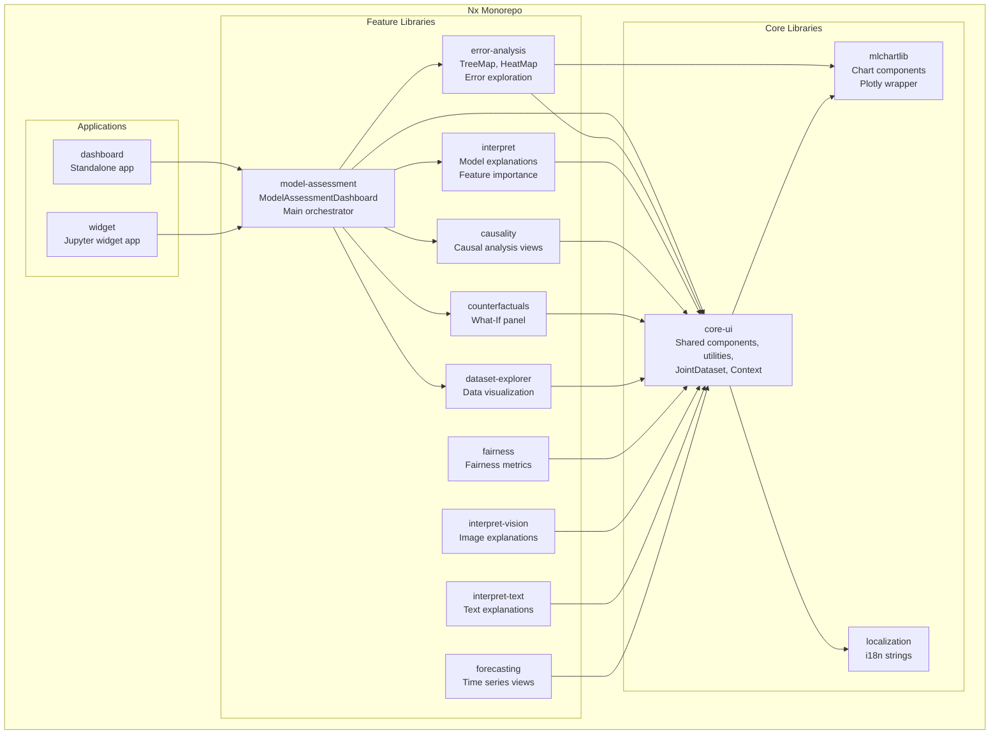
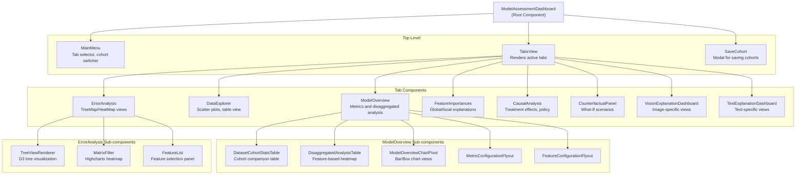
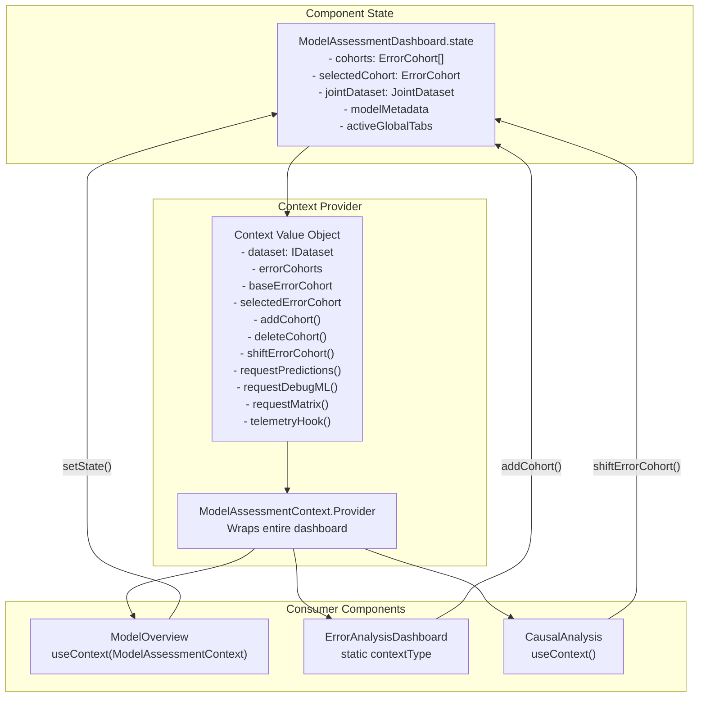
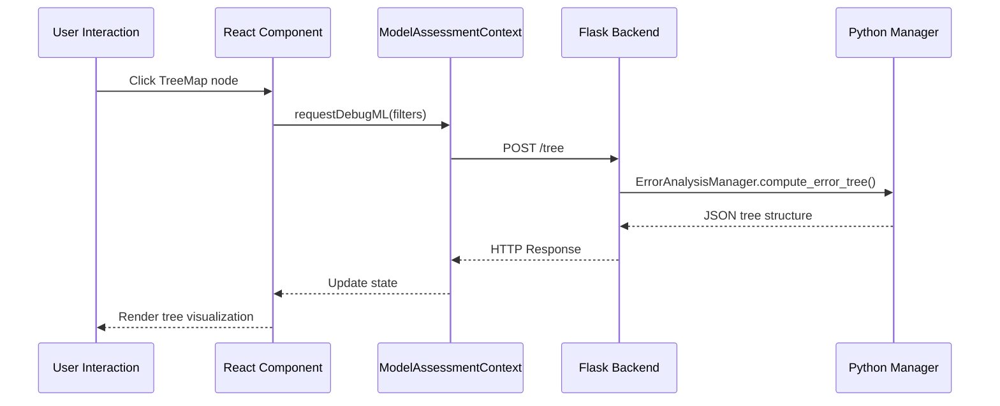
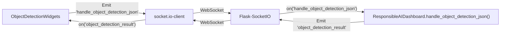
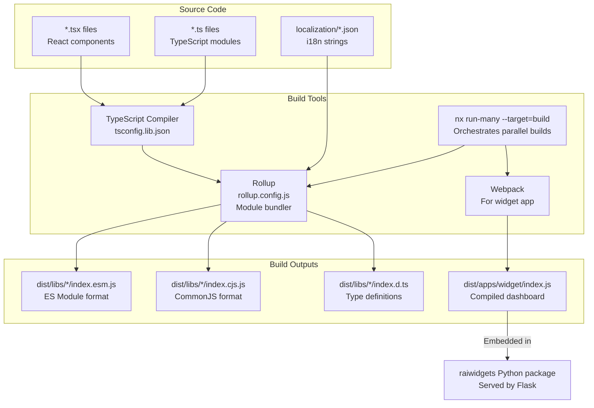
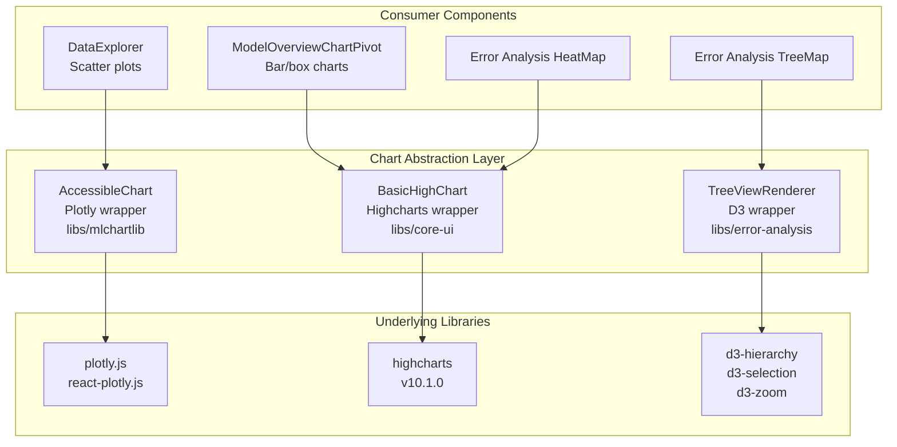
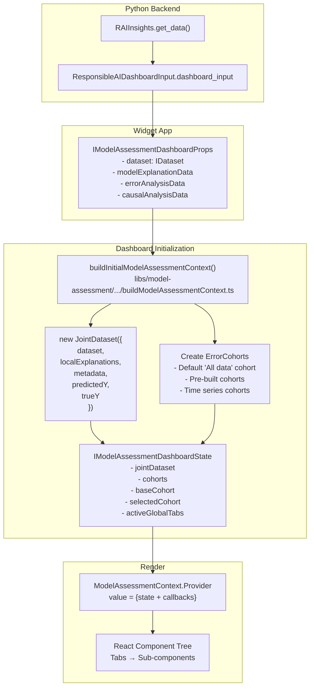
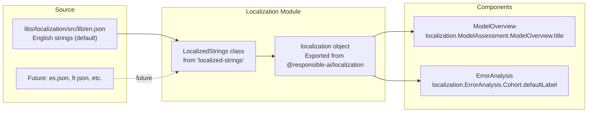

<!-- source: DeepWiki mcp.deepwiki.com · repo microsoft/responsible-ai-toolbox · page 4 TypeScript Dashboard Architecture · fetched 2026-10-26 -->

# TypeScript Dashboard Architecture

<details>
<summary>Relevant source files</summary>

The following files were used as context for generating this wiki page:

- [apps/dashboard-e2e/src/describer/interpret/individualFeatureImportance/describeSubBarChart.ts](apps/dashboard-e2e/src/describer/interpret/individualFeatureImportance/describeSubBarChart.ts)
- [apps/widget/src/app/ModelAssessment.tsx](apps/widget/src/app/ModelAssessment.tsx)
- [libs/core-ui/src/index.ts](libs/core-ui/src/index.ts)
- [libs/core-ui/src/lib/Context/ModelAssessmentContext.tsx](libs/core-ui/src/lib/Context/ModelAssessmentContext.tsx)
- [libs/core-ui/src/lib/Interfaces/IExplanationContext.ts](libs/core-ui/src/lib/Interfaces/IExplanationContext.ts)
- [libs/core-ui/src/lib/util/StatisticsUtils.ts](libs/core-ui/src/lib/util/StatisticsUtils.ts)
- [libs/e2e/src/lib/describer/interpretText/validateBarChart.ts](libs/e2e/src/lib/describer/interpretText/validateBarChart.ts)
- [libs/error-analysis/src/index.ts](libs/error-analysis/src/index.ts)
- [libs/error-analysis/src/lib/ErrorAnalysisDashboard/Controls/MetricSelector/MetricSelector.tsx](libs/error-analysis/src/lib/ErrorAnalysisDashboard/Controls/MetricSelector/MetricSelector.tsx)
- [libs/error-analysis/src/lib/ErrorAnalysisDashboard/Interfaces/IErrorAnalysisDashboardState.ts](libs/error-analysis/src/lib/ErrorAnalysisDashboard/Interfaces/IErrorAnalysisDashboardState.ts)
- [libs/interpret-vision/src/lib/VisionExplanationDashboard/Interfaces/IVisionExplanationDashboardProps.ts](libs/interpret-vision/src/lib/VisionExplanationDashboard/Interfaces/IVisionExplanationDashboardProps.ts)
- [libs/localization/src/lib/en.json](libs/localization/src/lib/en.json)
- [libs/mlchartlib/src/lib/components/AccessibleChart.tsx](libs/mlchartlib/src/lib/components/AccessibleChart.tsx)
- [libs/model-assessment/src/lib/ModelAssessmentDashboard/Context/buildModelAssessmentContext.ts](libs/model-assessment/src/lib/ModelAssessmentDashboard/Context/buildModelAssessmentContext.ts)
- [libs/model-assessment/src/lib/ModelAssessmentDashboard/Controls/ModelOverview/ModelOverview.tsx](libs/model-assessment/src/lib/ModelAssessmentDashboard/Controls/ModelOverview/ModelOverview.tsx)
- [libs/model-assessment/src/lib/ModelAssessmentDashboard/Controls/ModelOverview/StatsTableUtils.ts](libs/model-assessment/src/lib/ModelAssessmentDashboard/Controls/ModelOverview/StatsTableUtils.ts)
- [libs/model-assessment/src/lib/ModelAssessmentDashboard/Controls/TabsView/TabsViewProps.ts](libs/model-assessment/src/lib/ModelAssessmentDashboard/Controls/TabsView/TabsViewProps.ts)
- [libs/model-assessment/src/lib/ModelAssessmentDashboard/ModelAssessmentDashboard.tsx](libs/model-assessment/src/lib/ModelAssessmentDashboard/ModelAssessmentDashboard.tsx)
- [libs/model-assessment/src/lib/ModelAssessmentDashboard/ModelAssessmentDashboardProps.ts](libs/model-assessment/src/lib/ModelAssessmentDashboard/ModelAssessmentDashboardProps.ts)
- [libs/model-assessment/src/lib/ModelAssessmentDashboard/ModelAssessmentDashboardState.ts](libs/model-assessment/src/lib/ModelAssessmentDashboard/ModelAssessmentDashboardState.ts)
- [nx.json](nx.json)
- [package.json](package.json)
- [raiwidgets/raiwidgets/responsibleai_dashboard.py](raiwidgets/raiwidgets/responsibleai_dashboard.py)
- [raiwidgets/raiwidgets/responsibleai_dashboard_input.py](raiwidgets/raiwidgets/responsibleai_dashboard_input.py)
- [tsconfig.base.json](tsconfig.base.json)
- [workspace.json](workspace.json)
- [yarn.lock](yarn.lock)

</details>


## Purpose and Scope

This document describes the TypeScript/React dashboard architecture, which provides the interactive web interface for the Responsible AI Toolbox. The dashboard is built as an Nx monorepo containing 14+ TypeScript libraries that render various analysis views including error analysis, model explanations, causal analysis, and counterfactuals.

For information about the Python backend that serves data to this dashboard, see [Python Backend Architecture](#3). For details on specific dashboard components, see [Model Assessment Dashboard](#4.2) and [Error Analysis Dashboard](#4.3).

---

## Nx Monorepo Structure

The TypeScript codebase is organized as an Nx monorepo located in the `libs/` directory. This structure allows multiple libraries to share code while maintaining independent versioning and build configurations.

**Monorepo Library Organization**



Sources: [workspace.json:1-1000](), [nx.json:1-80](), [package.json:1-158]()

---

## Core Library: `core-ui`

The `core-ui` library provides foundational abstractions used across all dashboard components.

| Component | Description | Key Exports |
|-----------|-------------|-------------|
| **JointDataset** | Unified dataset representation merging features, predictions, labels | `JointDataset` class |
| **Cohort System** | Data filtering and segmentation | `Cohort`, `ErrorCohort`, `DatasetCohort` |
| **Context Provider** | React Context for state sharing | `ModelAssessmentContext` |
| **Chart Components** | Shared visualization primitives | `BasicHighChart`, `FeatureImportanceBar` |
| **Utilities** | Statistical calculations, data processing | `generateMetrics`, `StatisticsUtils` |

**Key Classes and Interfaces**

- **`JointDataset`**: [libs/core-ui/src/lib/util/JointDataset.ts:1-500]() - Combines features, predictions, labels, and explanations into a single queryable dataset
- **`ErrorCohort`**: [libs/core-ui/src/lib/Cohort/ErrorCohort.ts:1-200]() - Represents a filtered subset of data with associated error metrics
- **`ModelAssessmentContext`**: [libs/core-ui/src/lib/Context/ModelAssessmentContext.tsx:1-221]() - React Context providing dataset, cohorts, and backend request functions to all components

Sources: [libs/core-ui/src/index.ts:1-129](), [libs/core-ui/src/lib/Context/ModelAssessmentContext.tsx:1-221]()

---

## Component Hierarchy

The dashboard follows a hierarchical React component structure with `ModelAssessmentDashboard` as the root.

**Component Tree**



Sources: [libs/model-assessment/src/lib/ModelAssessmentDashboard/ModelAssessmentDashboard.tsx:1-379](), [libs/model-assessment/src/lib/ModelAssessmentDashboard/Controls/TabsView/TabsView.tsx:1-200](), [libs/model-assessment/src/lib/ModelAssessmentDashboard/Controls/ModelOverview/ModelOverview.tsx:1-600]()

---

## State Management: Context Pattern

The dashboard uses React Context to share state across components without prop drilling.

**State Flow Diagram**



**Context Interface**

The `IModelAssessmentContext` interface defines all shared state and callbacks:

```typescript
// Key properties from ModelAssessmentContext
interface IModelAssessmentContext {
  dataset: IDataset;
  jointDataset: JointDataset;
  errorCohorts: ErrorCohort[];
  baseErrorCohort: ErrorCohort;
  selectedErrorCohort: ErrorCohort;
  modelMetadata: IExplanationModelMetadata;
  
  // Backend request functions
  requestDebugML?: (request: any[]) => Promise<IErrorAnalysisTreeNode[]>;
  requestMatrix?: (request: any[]) => Promise<IErrorAnalysisMatrix>;
  requestPredictions?: (request: any[]) => Promise<any[]>;
  requestExp?: (index: number | number[]) => Promise<any[]>;
  
  // Cohort management callbacks
  addCohort(cohort: Cohort, switchNew?: boolean): void;
  editCohort(cohort: Cohort, switchNew?: boolean): void;
  deleteCohort(cohort: ErrorCohort): void;
  shiftErrorCohort(cohort: ErrorCohort): void;
}
```

Sources: [libs/core-ui/src/lib/Context/ModelAssessmentContext.tsx:28-221](), [libs/model-assessment/src/lib/ModelAssessmentDashboard/ModelAssessmentDashboard.tsx:56-175]()

---

## Backend Communication

Dashboard components communicate with the Python Flask backend via HTTP POST requests and WebSocket connections.

**Request Flow**



**Request Functions**

Request functions are injected into the Context from the widget app:

| Function | Endpoint | Purpose | Python Handler |
|----------|----------|---------|----------------|
| `requestDebugML` | `/tree` | Get error tree structure | `ResponsibleAIDashboardInput.debug_ml()` |
| `requestMatrix` | `/matrix` | Get error heatmap data | `ResponsibleAIDashboardInput.matrix()` |
| `requestPredictions` | `/predict` | Get model predictions | `ResponsibleAIDashboardInput.on_predict()` |
| `requestImportances` | `/importances` | Get feature importances | `ResponsibleAIDashboardInput.importances()` |
| `requestExp` | `/get_exp` | Get image explanations | `ResponsibleAIDashboardInput.get_exp()` |
| `requestObjectDetectionMetrics` | `/get_object_detection_metrics` | Get OD metrics | `ResponsibleAIDashboardInput.get_object_detection_metrics()` |

**WebSocket for Object Detection**

For computationally expensive operations like object detection metrics, the system uses Socket.IO for real-time updates:



Sources: [apps/widget/src/app/ModelAssessment.tsx:1-280](), [raiwidgets/raiwidgets/responsibleai_dashboard_input.py:1-400](), [raiwidgets/raiwidgets/responsibleai_dashboard.py:1-180]()

---

## Build and Bundle Pipeline

The monorepo uses Nx for building and bundling TypeScript libraries into distributable packages.

**Build Process**



**Build Configuration**

Each library has a `project.json` or entry in `workspace.json` defining:
- Entry point: `libs/*/src/index.ts`
- Output directory: `dist/libs/*`
- External dependencies (not bundled): React, FluentUI, Highcharts, Plotly
- Build target: `@nrwl/web:package`

Example from [workspace.json:99-130]():
```json
"build": {
  "builder": "@nrwl/web:package",
  "options": {
    "outputPath": "dist/libs/core-ui",
    "tsConfig": "libs/core-ui/tsconfig.lib.json",
    "entryFile": "libs/core-ui/src/index.ts",
    "external": ["@fluentui/react", "highcharts", "react", "react-dom"],
    "rollupConfig": "./rollup.config.js"
  }
}
```

The final widget bundle is embedded in the Python `raiwidgets` package and served by Flask at runtime.

Sources: [workspace.json:1-1000](), [package.json:6-42](), [nx.json:1-80]()

---

## Chart Visualization Libraries

The dashboard uses three primary charting libraries, each serving different visualization needs.

| Library | Use Cases | Wrapper Component |
|---------|-----------|-------------------|
| **Highcharts** | Heatmaps, bar charts, box plots | `BasicHighChart`, `HeatmapHighChart` |
| **D3** | Tree maps, custom SVG visualizations | `TreeViewRenderer` (error analysis) |
| **Plotly** | Scatter plots, 3D visualizations | `AccessibleChart` in `mlchartlib` |

**Chart Component Architecture**



All chart components support theming via FluentUI's `ITheme` interface and localization via the `localization` library.

Sources: [libs/mlchartlib/src/lib/components/AccessibleChart.tsx:1-150](), [libs/core-ui/src/lib/Highchart/BasicHighChart.tsx:1-100](), [package.json:43-77]()

---

## Data Flow: Initialization to Render

This section traces how data flows from initial props through to rendered UI.

**Initialization Flow**



**Key Initialization Steps**

1. **Props Processing**: [libs/model-assessment/src/lib/ModelAssessmentDashboard/Context/buildModelAssessmentContext.ts:39-174]()
   - Builds `IExplanationModelMetadata` from dataset
   - Creates `JointDataset` merging all data sources
   - Processes pre-built cohorts or generates time series cohorts
   
2. **Tab Selection**: [libs/model-assessment/src/lib/ModelAssessmentDashboard/AvailableTabs.ts:1-100]()
   - Determines which tabs to show based on available data
   - Only includes tabs with required data (e.g., Causal Analysis tab only if `causalAnalysisData` exists)

3. **Context Population**: [libs/model-assessment/src/lib/ModelAssessmentDashboard/ModelAssessmentDashboard.tsx:59-121]()
   - Combines state with request callbacks
   - Injects telemetry hook
   - Provides cohort management functions

Sources: [libs/model-assessment/src/lib/ModelAssessmentDashboard/Context/buildModelAssessmentContext.ts:39-288](), [libs/model-assessment/src/lib/ModelAssessmentDashboard/ModelAssessmentDashboard.tsx:32-175]()

---

## Localization

All user-facing strings are centralized in the `localization` library for internationalization support.

**Localization Structure**



**Localization Keys Structure** (excerpt from [libs/localization/src/lib/en.json:1-100]()):

```json
{
  "Common": { "close": "Close", "loading": "Loading..." },
  "ErrorAnalysis": {
    "Cohort": { "defaultLabel": "All data" },
    "TreeView": { "treeDescription": "The tree visualization uses..." }
  },
  "ModelAssessment": {
    "ModelOverview": {
      "topLevelDescription": "Evaluate your model...",
      "metrics": { "accuracy": { "name": "Accuracy", "description": "..." } }
    }
  }
}
```

Components access localized strings via: `localization.ModelAssessment.ModelOverview.topLevelDescription`

The dashboard locale can be set via props: `<ModelAssessmentDashboard locale="en" />`

Sources: [libs/localization/src/lib/en.json:1-1000](), [libs/model-assessment/src/lib/ModelAssessmentDashboard/ModelAssessmentDashboard.tsx:40-53]()

---

