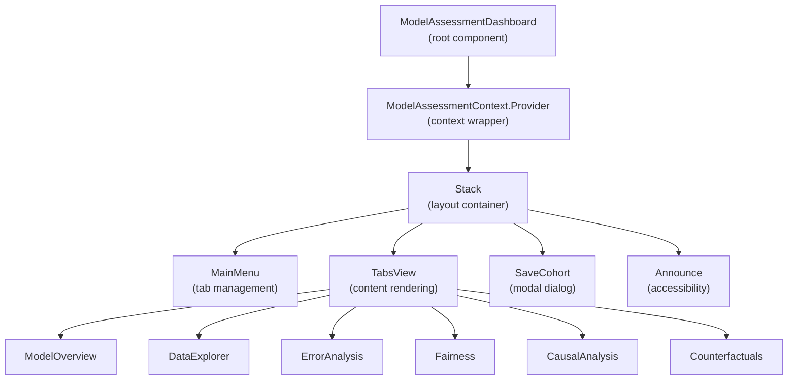
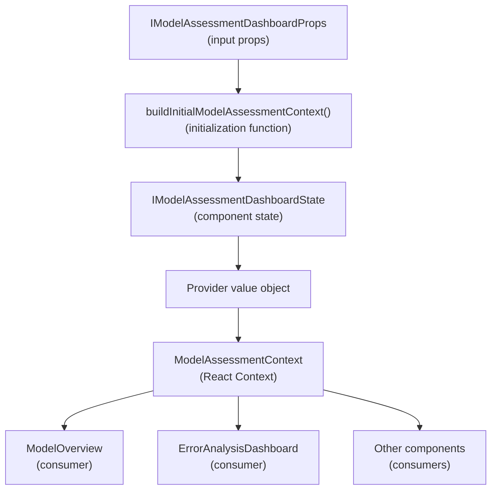
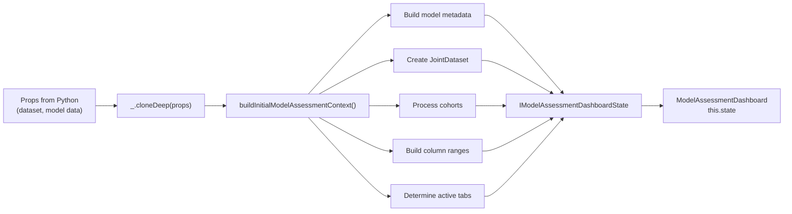
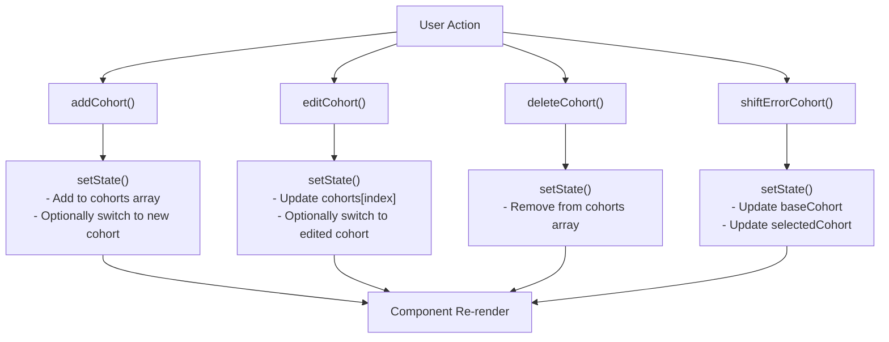
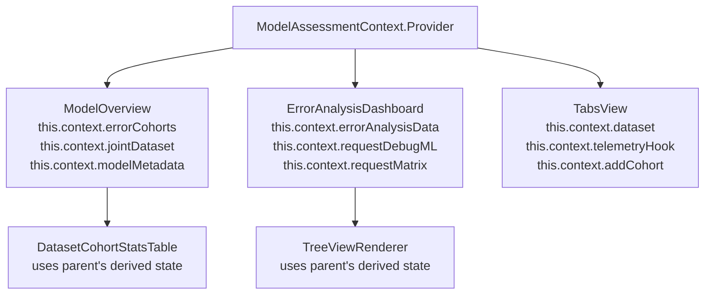
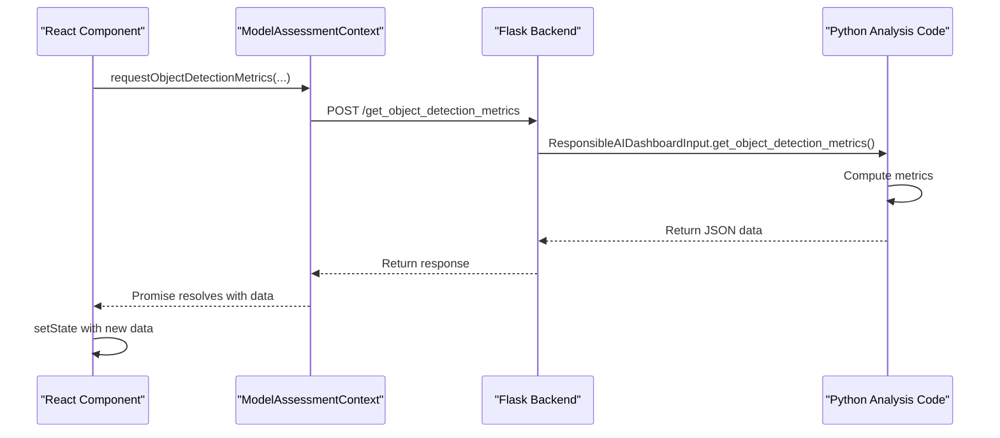
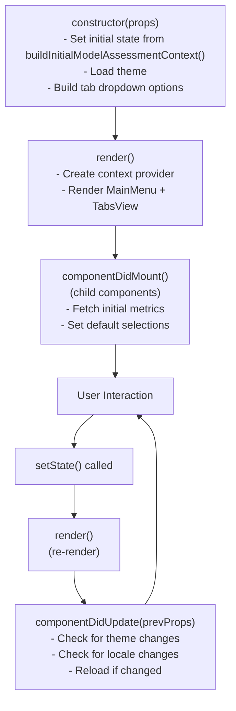

<!-- source: DeepWiki mcp.deepwiki.com · repo microsoft/responsible-ai-toolbox · page 4.1 Component Hierarchy and State · fetched 2026-10-26 -->

# Component Hierarchy and State

<details>
<summary>Relevant source files</summary>

The following files were used as context for generating this wiki page:

- [apps/widget/src/app/ModelAssessment.tsx](apps/widget/src/app/ModelAssessment.tsx)
- [libs/core-ui/src/index.ts](libs/core-ui/src/index.ts)
- [libs/core-ui/src/lib/Context/ModelAssessmentContext.tsx](libs/core-ui/src/lib/Context/ModelAssessmentContext.tsx)
- [libs/core-ui/src/lib/Interfaces/IExplanationContext.ts](libs/core-ui/src/lib/Interfaces/IExplanationContext.ts)
- [libs/core-ui/src/lib/util/StatisticsUtils.ts](libs/core-ui/src/lib/util/StatisticsUtils.ts)
- [libs/error-analysis/src/index.ts](libs/error-analysis/src/index.ts)
- [libs/error-analysis/src/lib/ErrorAnalysisDashboard/Controls/MetricSelector/MetricSelector.tsx](libs/error-analysis/src/lib/ErrorAnalysisDashboard/Controls/MetricSelector/MetricSelector.tsx)
- [libs/error-analysis/src/lib/ErrorAnalysisDashboard/Interfaces/IErrorAnalysisDashboardState.ts](libs/error-analysis/src/lib/ErrorAnalysisDashboard/Interfaces/IErrorAnalysisDashboardState.ts)
- [libs/interpret-vision/src/lib/VisionExplanationDashboard/Interfaces/IVisionExplanationDashboardProps.ts](libs/interpret-vision/src/lib/VisionExplanationDashboard/Interfaces/IVisionExplanationDashboardProps.ts)
- [libs/localization/src/lib/en.json](libs/localization/src/lib/en.json)
- [libs/model-assessment/src/lib/ModelAssessmentDashboard/Context/buildModelAssessmentContext.ts](libs/model-assessment/src/lib/ModelAssessmentDashboard/Context/buildModelAssessmentContext.ts)
- [libs/model-assessment/src/lib/ModelAssessmentDashboard/Controls/ModelOverview/ModelOverview.tsx](libs/model-assessment/src/lib/ModelAssessmentDashboard/Controls/ModelOverview/ModelOverview.tsx)
- [libs/model-assessment/src/lib/ModelAssessmentDashboard/Controls/ModelOverview/StatsTableUtils.ts](libs/model-assessment/src/lib/ModelAssessmentDashboard/Controls/ModelOverview/StatsTableUtils.ts)
- [libs/model-assessment/src/lib/ModelAssessmentDashboard/Controls/TabsView/TabsViewProps.ts](libs/model-assessment/src/lib/ModelAssessmentDashboard/Controls/TabsView/TabsViewProps.ts)
- [libs/model-assessment/src/lib/ModelAssessmentDashboard/ModelAssessmentDashboard.tsx](libs/model-assessment/src/lib/ModelAssessmentDashboard/ModelAssessmentDashboard.tsx)
- [libs/model-assessment/src/lib/ModelAssessmentDashboard/ModelAssessmentDashboardProps.ts](libs/model-assessment/src/lib/ModelAssessmentDashboard/ModelAssessmentDashboardProps.ts)
- [libs/model-assessment/src/lib/ModelAssessmentDashboard/ModelAssessmentDashboardState.ts](libs/model-assessment/src/lib/ModelAssessmentDashboard/ModelAssessmentDashboardState.ts)
- [raiwidgets/raiwidgets/responsibleai_dashboard.py](raiwidgets/raiwidgets/responsibleai_dashboard.py)
- [raiwidgets/raiwidgets/responsibleai_dashboard_input.py](raiwidgets/raiwidgets/responsibleai_dashboard_input.py)

</details>


## Purpose and Scope

This page documents the React component hierarchy and state management architecture in the TypeScript dashboard. It covers how the `ModelAssessmentDashboard` component organizes child components, how state flows through the application using React Context, and the distinction between local component state and shared context. 

For information about specific dashboard features (tabs and views), see [Model Assessment Dashboard](#4.2). For details about the Nx monorepo structure and build configuration, see [Nx Monorepo Structure](#4.5).

## Component Hierarchy Overview

The dashboard follows a hierarchical component structure with `ModelAssessmentDashboard` as the root container component. This component wraps all child components in a `ModelAssessmentContext.Provider`, enabling deep component trees to access shared state and callbacks without prop drilling.

### Top-Level Component Structure



**Sources:** [libs/model-assessment/src/lib/ModelAssessmentDashboard/ModelAssessmentDashboard.tsx:32-175]()

### Context Provider Pattern

The `ModelAssessmentContext` provides a centralized way to share data and callbacks across the component tree without passing props through every level. This is the React Context API pattern.



**Sources:** 
- [libs/model-assessment/src/lib/ModelAssessmentDashboard/ModelAssessmentDashboard.tsx:59-121]()
- [libs/model-assessment/src/lib/ModelAssessmentDashboard/Context/buildModelAssessmentContext.ts:39-174]()

## State Management Architecture

### Component State Structure

The `ModelAssessmentDashboard` component maintains its state using the `IModelAssessmentDashboardState` interface, which extends `ICohortBasedComponentState`:

| State Property | Type | Description |
|----------------|------|-------------|
| `activeGlobalTabs` | `IModelAssessmentDashboardTab[]` | Currently visible tabs in the dashboard |
| `cohorts` | `ErrorCohort[]` | List of error cohorts for analysis |
| `datasetCohorts` | `DatasetCohort[]` | List of dataset cohorts |
| `baseCohort` | `ErrorCohort` | The default cohort (all data) |
| `selectedCohort` | `ErrorCohort` | Currently selected error cohort |
| `selectedDatasetCohort` | `DatasetCohort` | Currently selected dataset cohort |
| `jointDataset` | `JointDataset` | Combined dataset with features, predictions, labels |
| `modelMetadata` | `IExplanationModelMetadata` | Model type, feature names, class names |
| `columnRanges` | `{ [key: string]: IColumnRange }` | Min/max ranges for each feature |
| `saveCohortVisible` | `boolean` | Controls save cohort modal visibility |
| `onAddMessage` | `string` | Accessibility message for tab additions |

**Sources:** [libs/model-assessment/src/lib/ModelAssessmentDashboard/ModelAssessmentDashboardState.ts:15-36]()

### Context Value Structure

The context object passed to the Provider contains both data and callbacks:

```typescript
// Data properties
{
  dataset: IDataset,
  jointDataset: JointDataset,
  modelMetadata: IExplanationModelMetadata,
  modelExplanationData?: IModelExplanationData,
  errorAnalysisData?: IErrorAnalysisData,
  causalAnalysisData?: ICausalAnalysisData,
  counterfactualData?: ICounterfactualData,
  
  // Cohort management
  errorCohorts: ErrorCohort[],
  baseErrorCohort: ErrorCohort,
  selectedErrorCohort: ErrorCohort,
  datasetCohorts?: DatasetCohort[],
  baseDatasetCohort?: DatasetCohort,
  selectedDatasetCohort?: DatasetCohort,
  
  // Callback functions
  addCohort: (cohort, datasetCohort?, switchNew?) => void,
  editCohort: (cohort, datasetCohort?, switchNew?) => void,
  deleteCohort: (cohort) => void,
  shiftErrorCohort: (cohort) => void,
  setAsCategorical: (column, treatAsCategorical) => void,
  
  // API request functions
  requestPredictions?: (request, abortSignal) => Promise<any[]>,
  requestExp?: (index, abortSignal) => Promise<any[]>,
  requestMatrix?: (request, abortSignal) => Promise<IErrorAnalysisMatrix>,
  requestDebugML?: (request, abortSignal) => Promise<IErrorAnalysisTreeNode[]>,
  // ... 15+ more request functions
  
  // Other utilities
  telemetryHook: (message) => void,
  theme: ITheme,
  featureFlights?: string[]
}
```

**Sources:** [libs/core-ui/src/lib/Context/ModelAssessmentContext.tsx:28-191]()

### State Initialization Flow



The initialization process:

1. **Clone props** - Deep clone input props to prevent mutations [ModelAssessmentDashboard.tsx:43]()
2. **Build metadata** - Extract model type, feature names, class names [buildModelAssessmentContext.ts:176-276]()
3. **Create JointDataset** - Merge features, predictions, labels into unified dataset [buildModelAssessmentContext.ts:59-69]()
4. **Process cohorts** - Create default "All data" cohort and load pre-built cohorts [buildModelAssessmentContext.ts:85-135]()
5. **Set active tabs** - Determine which tabs to show based on available data [buildModelAssessmentContext.ts:138-147]()

**Sources:** [libs/model-assessment/src/lib/ModelAssessmentDashboard/Context/buildModelAssessmentContext.ts:39-174]()

## State Update Patterns

### Cohort Management State Updates

The dashboard implements several callback functions for cohort management that update state:



**Example: Adding a Cohort**

```typescript
private addCohort = (
  manuallyCreatedCohort: Cohort,
  datasetCohort?: DatasetCohort,
  switchNew?: boolean
): void => {
  // Create new ErrorCohort wrapper
  const newErrorCohort = new ErrorCohort(
    manuallyCreatedCohort,
    this.state.jointDataset,
    0,
    CohortSource.ManuallyCreated
  );
  
  // Update state with new cohort
  let newCohorts = [...this.state.cohorts, newErrorCohort];
  newCohorts = newCohorts.filter((cohort) => !cohort.isTemporary);
  
  this.setState((prevState) => ({
    baseCohort: switchNew ? newErrorCohort : prevState.baseCohort,
    cohorts: newCohorts,
    selectedCohort: switchNew ? newErrorCohort : prevState.selectedCohort
  }));
};
```

**Sources:** [libs/model-assessment/src/lib/ModelAssessmentDashboard/ModelAssessmentDashboard.tsx:268-314]()

### Tab Management State Updates

Tabs can be dynamically added or removed:

```typescript
private addTab = (index: number, tab: GlobalTabKeys): void => {
  const tabs = [...this.state.activeGlobalTabs];
  // Determine data count from previous tab or base cohort
  let dataCount: number;
  if (index > 0) {
    dataCount = tabs[index - 1].dataCount;
  } else {
    dataCount = this.state.baseCohort.cohortStats.totalCohort;
  }
  
  // Insert new tab at specified position
  tabs.splice(index, 0, {
    dataCount,
    key: tab,
    name: this.addTabDropdownOptions.find(({ key }) => key === tab)?.text || ""
  });
  
  this.setState({ activeGlobalTabs: tabs, onAddMessage: addTabMessage(tab) });
};

private removeTab = (index: number): void => {
  const tabs = [...this.state.activeGlobalTabs];
  tabs.splice(index, 1);
  this.setState({ activeGlobalTabs: tabs });
};
```

**Sources:** [libs/model-assessment/src/lib/ModelAssessmentDashboard/ModelAssessmentDashboard.tsx:196-217]()

## Context Consumer Pattern

Child components access the context using `static contextType` pattern or `useContext` hook:

### Class Component Pattern

```typescript
export class ModelOverview extends React.Component<
  IModelOverviewProps,
  IModelOverviewState
> {
  // Declare context type
  public static contextType = ModelAssessmentContext;
  
  // Type the context property
  public context: React.ContextType<typeof ModelAssessmentContext> =
    defaultModelAssessmentContext;
  
  // Access context in methods
  public componentDidMount(): void {
    const modelType = this.context.modelMetadata.modelType;
    const cohorts = this.context.errorCohorts;
    // ... use context data
  }
  
  public render(): React.ReactNode {
    return (
      <Stack>
        {this.context.dataset.predicted_y && (
          <Text>{this.context.baseErrorCohort.cohort.name}</Text>
        )}
      </Stack>
    );
  }
}
```

**Sources:** [libs/model-assessment/src/lib/ModelAssessmentDashboard/Controls/ModelOverview/ModelOverview.tsx:86-100]()

### Context Access in Child Components



**Sources:** 
- [libs/model-assessment/src/lib/ModelAssessmentDashboard/Controls/ModelOverview/ModelOverview.tsx:90-100]()
- [libs/core-ui/src/lib/Context/ModelAssessmentContext.tsx:28-191]()

## Request Function Pattern

The context provides async request functions that communicate with the Python backend via Flask:

### Request Flow Architecture



**Example: Object Detection Metrics Request**

In the context provider setup:
```typescript
requestObjectDetectionMetrics: this.props.requestObjectDetectionMetrics
```

In the consuming component:
```typescript
this.context
  .requestObjectDetectionMetrics(
    selectionIndexes,
    this.state.aggregateMethod,
    this.state.className,
    this.state.iouThreshold,
    this.objectDetectionCache,
    newAbortController.signal
  )
  .then((result) => {
    const [allCohortMetrics, cohortClasses] = result;
    // Update state with metrics
    this.setState({ datasetCohortLabeledStatistics: updatedMetricStats });
  });
```

**Sources:** 
- [libs/model-assessment/src/lib/ModelAssessmentDashboard/ModelAssessmentDashboard.tsx:102-103]()
- [libs/model-assessment/src/lib/ModelAssessmentDashboard/Controls/ModelOverview/ModelOverview.tsx:641-738]()
- [raiwidgets/raiwidgets/responsibleai_dashboard_input.py:361-397]()

## State vs Props vs Context Decision Matrix

| Data Type | Storage Location | Access Pattern | Mutability |
|-----------|------------------|----------------|------------|
| Dataset features, predictions | Context (`dataset`, `jointDataset`) | Read-only from all components | Immutable |
| Analysis results (explanations, causal) | Context (`modelExplanationData`, etc.) | Read-only from all components | Immutable |
| Active cohorts list | Component state (`cohorts`) | Managed by root component | Mutable via callbacks |
| Selected cohort | Component state (`selectedCohort`) | Managed by root component | Mutable via callbacks |
| Active tabs | Component state (`activeGlobalTabs`) | Managed by root component | Mutable via add/remove |
| API request functions | Context (as callbacks) | Called from any component | N/A (functions) |
| Cohort management callbacks | Context (as callbacks) | Called from any component | N/A (functions) |
| Telemetry hook | Context (as callback) | Called from any component | N/A (function) |
| Component-specific UI state | Local component state | Within single component only | Mutable locally |
| Theme configuration | Context (`theme`) | Read-only from all components | Immutable |

**Rationale:**
- **Context**: Used for data that needs to be accessed by multiple components at different depths (avoiding prop drilling)
- **Component state**: Used for data that needs to be mutated and triggers re-renders of the component tree
- **Local state**: Used for component-specific UI state that doesn't affect other components

**Sources:** 
- [libs/core-ui/src/lib/Context/ModelAssessmentContext.tsx:28-191]()
- [libs/model-assessment/src/lib/ModelAssessmentDashboard/ModelAssessmentDashboardState.ts:15-36]()

## Component Lifecycle and State Updates

### Initialization Lifecycle



**ModelOverview Component Update Lifecycle:**

```typescript
public componentDidUpdate(): void {
  const newDatasetCohortIDs = this.context.errorCohorts.map((errorCohort) => {
    return errorCohort.cohort.getCohortID();
  });
  const oldDatasetCohortIDs = this.state.datasetBasedCohorts.map(
    (errorCohort) => {
      return errorCohort.cohort.getCohortID();
    }
  );
  
  // Detect if cohorts were added or removed
  if (!this.ifCohortIndexesEquals(newDatasetCohortIDs, oldDatasetCohortIDs)) {
    const addCohortIDs = newDatasetCohortIDs.filter(
      (x) => !oldDatasetCohortIDs.includes(x)
    );
    const deleteCohortIDs = oldDatasetCohortIDs.filter(
      (x) => !newDatasetCohortIDs.includes(x)
    );
    
    if (addCohortIDs.length > 0) {
      this.setState(
        { selectedDatasetCohorts: this.state.selectedDatasetCohorts?.concat(addCohortIDs) },
        () => this.updateDatasetCohortStats()
      );
    }
  }
}
```

**Sources:** [libs/model-assessment/src/lib/ModelAssessmentDashboard/Controls/ModelOverview/ModelOverview.tsx:207-242]()

## State Persistence and Serialization

The dashboard does not persist state to local storage or backend. State is ephemeral and rebuilt on each dashboard initialization. However, cohorts can be saved and passed back as `IPreBuiltCohort[]` in the props:

```typescript
// In buildInitialModelAssessmentContext
let [preBuiltErrorCohortList] = processPreBuiltCohort(props, jointDataset);
errorCohortList = errorCohortList.concat(preBuiltErrorCohortList);

const preBuiltDatasetCohortList = processPreBuiltDatasetCohort(
  props,
  modelType,
  columnRanges
);
const datasetCohorts = [defaultDatasetCohort].concat(preBuiltDatasetCohortList);
```

This allows users to define cohorts in Python and have them appear in the dashboard on load.

**Sources:** 
- [libs/model-assessment/src/lib/ModelAssessmentDashboard/Context/buildModelAssessmentContext.ts:99-135]()
- [libs/model-assessment/src/lib/ModelAssessmentDashboard/Cohort/ProcessPreBuiltCohort.ts]()

## Context Default Values

The `defaultModelAssessmentContext` provides fallback values when components are used outside the provider (e.g., in tests):

```typescript
export const defaultModelAssessmentContext: IModelAssessmentContext = {
  addCohort: () => undefined,
  baseErrorCohort: {} as ErrorCohort,
  columnRanges: {},
  dataset: {} as IDataset,
  datasetCohorts: [],
  deleteCohort: () => undefined,
  editCohort: () => undefined,
  errorCohorts: [],
  jointDataset: {} as JointDataset,
  modelExplanationData: undefined,
  modelMetadata: {} as IExplanationModelMetadata,
  modelType: undefined,
  requestExp: undefined,
  requestPredictions: undefined,
  selectedErrorCohort: {} as ErrorCohort,
  setAsCategorical: () => undefined,
  shiftErrorCohort: () => undefined,
  telemetryHook: () => undefined,
  theme: {} as ITheme
};
```

**Sources:** [libs/core-ui/src/lib/Context/ModelAssessmentContext.tsx:193-216]()

---

