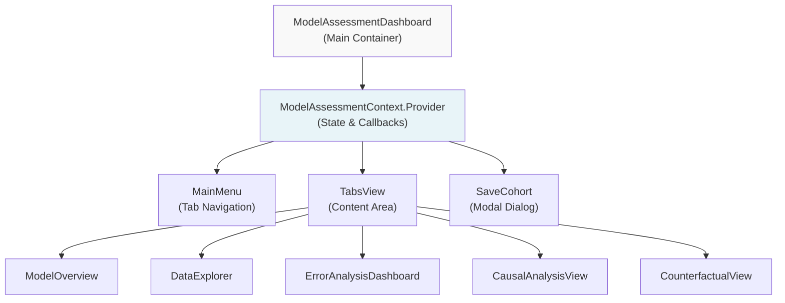
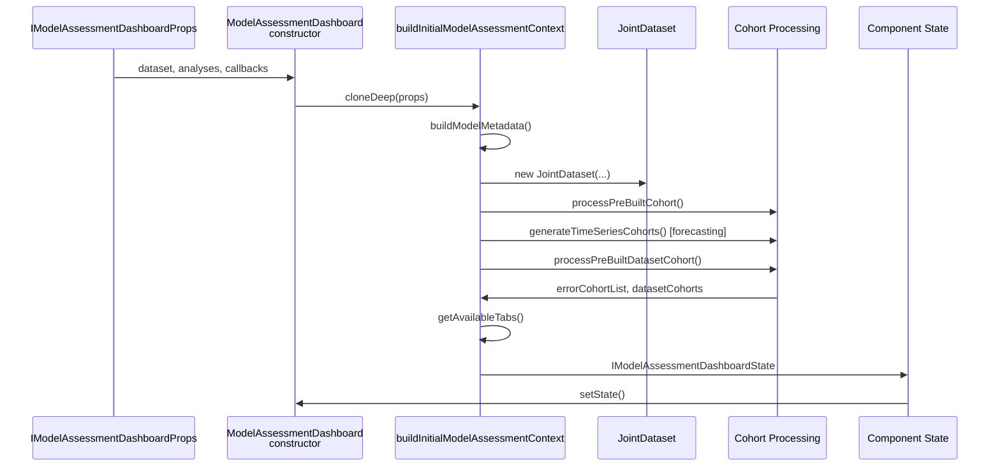
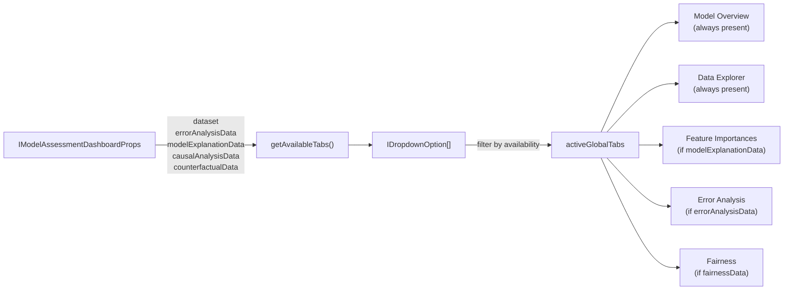
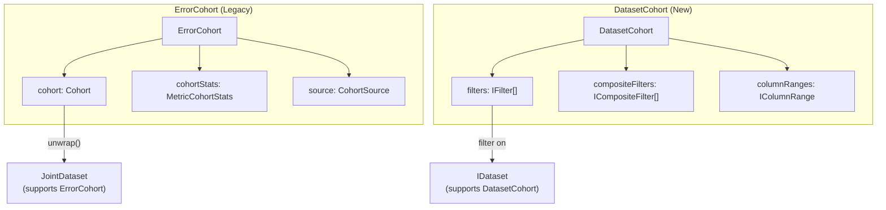
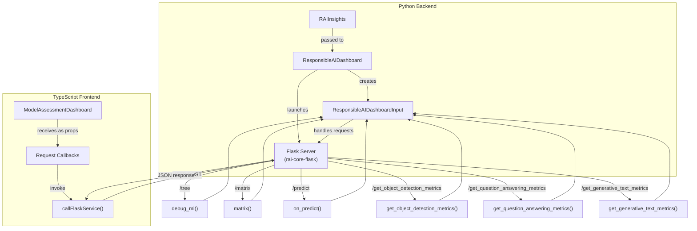
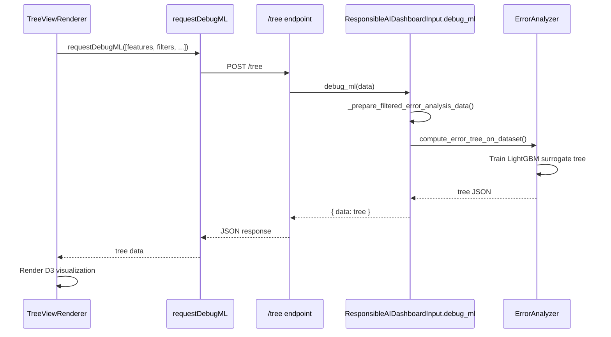
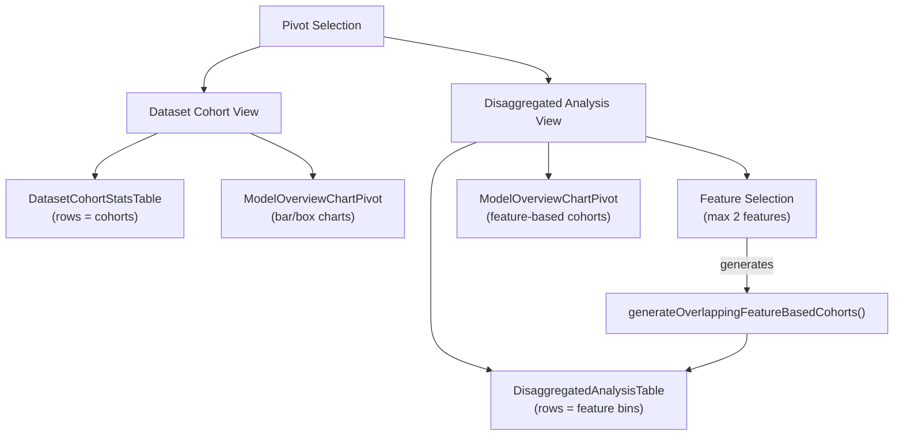

<!-- source: DeepWiki mcp.deepwiki.com · repo microsoft/responsible-ai-toolbox · page 4.2 Model Assessment Dashboard · fetched 2026-10-26 -->

# Model Assessment Dashboard

<details>
<summary>Relevant source files</summary>

The following files were used as context for generating this wiki page:

- [apps/widget/src/app/ModelAssessment.tsx](apps/widget/src/app/ModelAssessment.tsx)
- [libs/core-ui/src/index.ts](libs/core-ui/src/index.ts)
- [libs/core-ui/src/lib/Context/ModelAssessmentContext.tsx](libs/core-ui/src/lib/Context/ModelAssessmentContext.tsx)
- [libs/core-ui/src/lib/Interfaces/IExplanationContext.ts](libs/core-ui/src/lib/Interfaces/IExplanationContext.ts)
- [libs/core-ui/src/lib/util/StatisticsUtils.ts](libs/core-ui/src/lib/util/StatisticsUtils.ts)
- [libs/error-analysis/src/index.ts](libs/error-analysis/src/index.ts)
- [libs/error-analysis/src/lib/ErrorAnalysisDashboard/Controls/MetricSelector/MetricSelector.tsx](libs/error-analysis/src/lib/ErrorAnalysisDashboard/Controls/MetricSelector/MetricSelector.tsx)
- [libs/error-analysis/src/lib/ErrorAnalysisDashboard/Interfaces/IErrorAnalysisDashboardState.ts](libs/error-analysis/src/lib/ErrorAnalysisDashboard/Interfaces/IErrorAnalysisDashboardState.ts)
- [libs/interpret-vision/src/lib/VisionExplanationDashboard/Interfaces/IVisionExplanationDashboardProps.ts](libs/interpret-vision/src/lib/VisionExplanationDashboard/Interfaces/IVisionExplanationDashboardProps.ts)
- [libs/localization/src/lib/en.json](libs/localization/src/lib/en.json)
- [libs/model-assessment/src/lib/ModelAssessmentDashboard/Context/buildModelAssessmentContext.ts](libs/model-assessment/src/lib/ModelAssessmentDashboard/Context/buildModelAssessmentContext.ts)
- [libs/model-assessment/src/lib/ModelAssessmentDashboard/Controls/ModelOverview/ModelOverview.tsx](libs/model-assessment/src/lib/ModelAssessmentDashboard/Controls/ModelOverview/ModelOverview.tsx)
- [libs/model-assessment/src/lib/ModelAssessmentDashboard/Controls/ModelOverview/StatsTableUtils.ts](libs/model-assessment/src/lib/ModelAssessmentDashboard/Controls/ModelOverview/StatsTableUtils.ts)
- [libs/model-assessment/src/lib/ModelAssessmentDashboard/Controls/TabsView/TabsViewProps.ts](libs/model-assessment/src/lib/ModelAssessmentDashboard/Controls/TabsView/TabsViewProps.ts)
- [libs/model-assessment/src/lib/ModelAssessmentDashboard/ModelAssessmentDashboard.tsx](libs/model-assessment/src/lib/ModelAssessmentDashboard/ModelAssessmentDashboard.tsx)
- [libs/model-assessment/src/lib/ModelAssessmentDashboard/ModelAssessmentDashboardProps.ts](libs/model-assessment/src/lib/ModelAssessmentDashboard/ModelAssessmentDashboardProps.ts)
- [libs/model-assessment/src/lib/ModelAssessmentDashboard/ModelAssessmentDashboardState.ts](libs/model-assessment/src/lib/ModelAssessmentDashboard/ModelAssessmentDashboardState.ts)
- [raiwidgets/raiwidgets/responsibleai_dashboard.py](raiwidgets/raiwidgets/responsibleai_dashboard.py)
- [raiwidgets/raiwidgets/responsibleai_dashboard_input.py](raiwidgets/raiwidgets/responsibleai_dashboard_input.py)

</details>


## Purpose and Scope

The Model Assessment Dashboard is the primary UI component for visualizing and analyzing machine learning models in the Responsible AI Toolbox. It provides a unified interface for exploring model behavior across multiple analysis dimensions including error analysis, model explanations, causal inference, and counterfactuals.

This document covers the dashboard's React/TypeScript architecture, initialization flow, tab management, and integration with the Python backend. For backend analysis manager orchestration, see [Manager Orchestration](#3.2.2). For individual analysis capabilities, see [Analysis Managers](#3.3). For specialized vision and text support, see [Vision Package](#5.1) and [Text Package](#5.2).

---

## Component Architecture

The Model Assessment Dashboard is implemented as a React component hierarchy with centralized state management via React Context.

### Core Component Structure



**Sources:**
- [libs/model-assessment/src/lib/ModelAssessmentDashboard/ModelAssessmentDashboard.tsx:32-175]()
- [libs/model-assessment/src/lib/ModelAssessmentDashboard/Controls/MainMenu.tsx]()
- [libs/model-assessment/src/lib/ModelAssessmentDashboard/Controls/TabsView/TabsView.tsx]()

### ModelAssessmentContext

The `ModelAssessmentContext` provides shared state and request functions to all child components:

| Context Property | Type | Purpose |
|-----------------|------|---------|
| `errorCohorts` | `ErrorCohort[]` | All defined error cohorts |
| `baseErrorCohort` | `ErrorCohort` | Default cohort (all data) |
| `selectedErrorCohort` | `ErrorCohort` | Currently active cohort |
| `datasetCohorts` | `DatasetCohort[]` | Dataset-level cohorts |
| `jointDataset` | `JointDataset` | Merged features, predictions, labels |
| `modelMetadata` | `IExplanationModelMetadata` | Model type, feature names, class names |
| `dataset` | `IDataset` | Raw input data |
| `requestPredictions` | Function | Backend prediction endpoint |
| `requestDebugML` | Function | Error analysis tree endpoint |
| `requestMatrix` | Function | Error analysis heatmap endpoint |
| `requestObjectDetectionMetrics` | Function | Object detection metrics endpoint |
| `requestQuestionAnsweringMetrics` | Function | QA metrics endpoint |
| `requestGenerativeTextMetrics` | Function | GenAI metrics endpoint |

**Sources:**
- [libs/core-ui/src/lib/Context/ModelAssessmentContext.tsx:28-191]()
- [libs/model-assessment/src/lib/ModelAssessmentDashboard/ModelAssessmentDashboard.tsx:59-121]()

---

## Initialization and State Management

### Initialization Flow



The initialization process in `buildInitialModelAssessmentContext` performs the following steps:

1. **Model Metadata Construction**: Extracts feature names, class names, and model type from props
2. **JointDataset Creation**: Merges features, predictions, true labels, and explanations into a unified dataset
3. **Cohort Initialization**: Creates default "All data" cohort and processes any pre-built cohorts
4. **Tab Configuration**: Determines which tabs to display based on available analysis data
5. **State Assembly**: Returns complete initial state object

**Sources:**
- [libs/model-assessment/src/lib/ModelAssessmentDashboard/Context/buildModelAssessmentContext.ts:39-174]()
- [libs/model-assessment/src/lib/ModelAssessmentDashboard/ModelAssessmentDashboard.tsx:38-46]()

### State Structure

The dashboard state extends `ICohortBasedComponentState` with additional properties:

```typescript
interface IModelAssessmentDashboardState {
  activeGlobalTabs: IModelAssessmentDashboardTab[];
  baseCohort: ErrorCohort;
  selectedCohort: ErrorCohort;
  cohorts: ErrorCohort[];
  baseDatasetCohort: DatasetCohort;
  selectedDatasetCohort: DatasetCohort;
  datasetCohorts: DatasetCohort[];
  jointDataset: JointDataset;
  modelMetadata: IExplanationModelMetadata;
  columnRanges: { [key: string]: IColumnRange };
  saveCohortVisible: boolean;
  onAddMessage: string;
  // ... additional chart and selection state
}
```

**Sources:**
- [libs/model-assessment/src/lib/ModelAssessmentDashboard/ModelAssessmentDashboardState.ts:15-36]()

---

## Tab System

### Dynamic Tab Management

The dashboard supports adding and removing tabs dynamically. Available tabs are determined by the presence of analysis data:



**Tab Keys**: Defined in `GlobalTabKeys` enum:

| Tab Key | Display Name | Required Data |
|---------|-------------|---------------|
| `ModelOverview` | "Model overview" | None (always shown) |
| `DataExplorer` | "Data explorer" | None (always shown) |
| `FeatureImportances` | "Feature importances" | `modelExplanationData` |
| `ErrorAnalysis` | "Error analysis" | `errorAnalysisData` |
| `Fairness` | "Fairness" | `fairnessData` |
| `CausalAnalysis` | "Causal analysis" | `causalAnalysisData` |
| `Counterfactuals` | "Counterfactuals" | `counterfactualData` |
| `Vision` | "Vision data explorer" | vision task type |

**Sources:**
- [libs/model-assessment/src/lib/ModelAssessmentDashboard/AvailableTabs.ts]()
- [libs/model-assessment/src/lib/ModelAssessmentDashboard/ModelAssessmentEnums.ts]()
- [libs/model-assessment/src/lib/ModelAssessmentDashboard/Context/buildModelAssessmentContext.ts:138-147]()

### Tab Addition and Removal

```typescript
// Adding a tab at specific index
addTab = (index: number, tab: GlobalTabKeys): void => {
  const tabs = [...this.state.activeGlobalTabs];
  tabs.splice(index, 0, {
    key: tab,
    name: /* display name from dropdown options */,
    dataCount: /* inherit from previous tab or baseCohort */
  });
  this.setState({ activeGlobalTabs: tabs });
}

// Removing a tab
removeTab = (index: number): void => {
  const tabs = [...this.state.activeGlobalTabs];
  tabs.splice(index, 1);
  this.setState({ activeGlobalTabs: tabs });
}
```

**Sources:**
- [libs/model-assessment/src/lib/ModelAssessmentDashboard/ModelAssessmentDashboard.tsx:196-217]()

---

## Cohort Management

The dashboard manages two types of cohorts simultaneously:

### ErrorCohort vs DatasetCohort



**ErrorCohort** wraps the legacy `Cohort` class and works with `JointDataset` for backwards compatibility. It's used primarily by error analysis and model explanation features.

**DatasetCohort** is a newer implementation that filters directly on the raw `IDataset` without requiring a JointDataset. It supports advanced filtering with composite filters.

**Sources:**
- [libs/core-ui/src/lib/Cohort/ErrorCohort.ts]()
- [libs/core-ui/src/lib/DatasetCohort.ts]()
- [libs/model-assessment/src/lib/ModelAssessmentDashboard/Context/buildModelAssessmentContext.ts:98-135]()

### Cohort Operations

```typescript
// Add new cohort
addCohort = (
  manuallyCreatedCohort: Cohort,
  datasetCohort?: DatasetCohort,
  switchNew?: boolean
): void => {
  const newErrorCohort = new ErrorCohort(
    manuallyCreatedCohort,
    this.state.jointDataset,
    0,
    CohortSource.ManuallyCreated
  );
  
  let newCohorts = [...this.state.cohorts, newErrorCohort]
    .filter(cohort => !cohort.isTemporary);
  
  this.setState({
    cohorts: newCohorts,
    baseCohort: switchNew ? newErrorCohort : prevState.baseCohort,
    selectedCohort: switchNew ? newErrorCohort : prevState.selectedCohort
  });
  
  // Also update dataset cohorts if provided
  if (datasetCohort) {
    // ... similar logic for datasetCohorts array
  }
}
```

**Cohort Sources**: Tracked via `CohortSource` enum:
- `None`: Default cohort (all data)
- `ManuallyCreated`: User-defined via cohort editor
- `TreeMap`: From error analysis tree selection
- `HeatMap`: From error analysis heatmap selection

**Sources:**
- [libs/model-assessment/src/lib/ModelAssessmentDashboard/ModelAssessmentDashboard.tsx:268-314]()
- [libs/core-ui/src/lib/Cohort/Constants.ts]()

---

## Backend Communication

### Flask Integration Architecture



**Sources:**
- [raiwidgets/raiwidgets/responsibleai_dashboard.py:17-149]()
- [raiwidgets/raiwidgets/responsibleai_dashboard_input.py:24-524]()
- [apps/widget/src/app/ModelAssessment.tsx:23-299]()

### Request Flow Example: Error Analysis Tree



**Key Endpoints**:

| Endpoint | Method | Handler | Purpose |
|----------|--------|---------|---------|
| `/predict` | POST | `on_predict()` | Get model predictions for data points |
| `/tree` | POST | `debug_ml()` | Generate error analysis tree |
| `/matrix` | POST | `matrix()` | Generate error analysis heatmap |
| `/importances` | POST | `importances()` | Compute feature importances for errors |
| `/get_object_detection_metrics` | POST | `get_object_detection_metrics()` | Compute mAP, AP, AR for OD models |
| `/get_question_answering_metrics` | POST | `get_question_answering_metrics()` | Compute F1, EM, BERT scores |
| `/get_generative_text_metrics` | POST | `get_generative_text_metrics()` | Compute coherence, fluency, etc. |
| `/causal_whatif` | POST | `causal_whatif()` | Compute causal what-if effects |
| `/global_causal_effects` | POST | `get_global_causal_effects()` | Get aggregate causal effects |

**Sources:**
- [raiwidgets/raiwidgets/responsibleai_dashboard.py:53-148]()
- [raiwidgets/raiwidgets/responsibleai_dashboard_input.py:172-523]()

### AbortSignal Support

All request callbacks support `AbortSignal` for cancelling in-flight requests:

```typescript
requestObjectDetectionMetrics = async (
  selectionIndexes: number[][],
  aggregateMethod: string,
  className: string,
  iouThreshold: number,
  objectDetectionCache: Map<string, [number, number, number]>,
  abortSignal: AbortSignal
): Promise<any[]> => {
  // If user navigates away or changes selection, request is aborted
  return connectToFlaskServiceWithBackupCall(
    this.props.config,
    [selectionIndexes, aggregateMethod, className, iouThreshold, cache],
    "handle_object_detection_json",  // SocketIO fallback
    "/get_object_detection_metrics", // HTTP endpoint
    abortSignal
  );
}
```

This prevents outdated results from overwriting newer requests and reduces unnecessary backend load.

**Sources:**
- [apps/widget/src/app/ModelAssessment.tsx:31-52]()
- [libs/model-assessment/src/lib/ModelAssessmentDashboard/Controls/ModelOverview/ModelOverview.tsx:641-738]()

---

## Model Overview Tab

The Model Overview tab provides a comprehensive view of model performance metrics across cohorts and feature-based disaggregations.

### Two View Modes



**Dataset Cohort View**: Shows metrics for user-defined cohorts (e.g., "All data", "Age > 50", "High income").

**Disaggregated Analysis View**: Automatically generates cohorts by binning 1-2 selected features, enabling intersectional analysis (e.g., "Age: 20-30 × Income: Low").

**Sources:**
- [libs/model-assessment/src/lib/ModelAssessmentDashboard/Controls/ModelOverview/ModelOverview.tsx:244-534]()
- [libs/model-assessment/src/lib/ModelAssessmentDashboard/Controls/ModelOverview/DisaggregatedAnalysisUtils.ts]()

### Metric Computation and Caching

Metrics are computed differently based on model type:

**Tabular Classification/Regression**: Metrics computed locally in TypeScript from predictions and labels stored in `JointDataset`.

**Object Detection**: Metrics (mAP, AP, AR) require backend computation due to IoU threshold and bounding box matching complexity. Results are cached by `(selectionIndexes, aggregateMethod, className, iouThreshold)` key.

**Question Answering**: Metrics (F1, Exact Match, BERT score) computed on backend and cached by `selectionIndexes`.

**Generative Text**: Metrics (Coherence, Fluency, Groundedness) computed on backend via LLM evaluators and cached.

```typescript
// Example: Object detection metric update
updateObjectDetectionMetrics(selectionIndexes: number[][], isDatasetCohort: boolean): void {
  const newAbortController = new AbortController();
  this.setState({ objectDetectionAbortController: newAbortController });
  
  this.context.requestObjectDetectionMetrics(
    selectionIndexes,
    this.state.aggregateMethod,  // "macro" or "micro"
    this.state.className,         // specific class or "all"
    this.state.iouThreshold,      // 50, 70, 90
    this.objectDetectionCache,
    newAbortController.signal
  ).then((result) => {
    const [allCohortMetrics, cohortClasses] = result;
    // Cache results and update state
    const updatedMetricStats = /* process metrics */;
    isDatasetCohort 
      ? this.updateDatasetCohortState(updatedMetricStats)
      : this.updateFeatureCohortState(updatedMetricStats);
  });
}
```

**Sources:**
- [libs/model-assessment/src/lib/ModelAssessmentDashboard/Controls/ModelOverview/ModelOverview.tsx:641-738]()
- [libs/core-ui/src/lib/util/StatisticsUtils.ts:147-214]()
- [raiwidgets/raiwidgets/responsibleai_dashboard_input.py:361-397]()

### Metrics Table with Heatmap

The metrics table displays a heatmap visualization when multiple cohorts exist:

```typescript
generateCohortsStatsTable(
  cohorts: ErrorCohort[],
  labeledStatistics: ILabeledStatistic[][],
  selectedMetrics: string[],
  showHeatmapColors: boolean
): { fairnessStats: IFairnessStats[], items: PointOptionsObject[] }
```

For each metric, the function:
1. Computes min/max values across cohorts
2. Normalizes each cohort's value to [0, 1] range: `(value - min) / (max - min)`
3. Assigns color intensity based on normalized value
4. Handles NaN values with textured pattern or transparent color

The heatmap helps identify disparities across cohorts visually.

**Sources:**
- [libs/model-assessment/src/lib/ModelAssessmentDashboard/Controls/ModelOverview/StatsTableUtils.ts:32-191]()
- [libs/model-assessment/src/lib/ModelAssessmentDashboard/Controls/ModelOverview/DatasetCohortStatsTable.tsx]()

---

## Key Props Interface

The dashboard accepts the following props structure:

```typescript
interface IModelAssessmentDashboardProps {
  dataset: IDataset;
  modelExplanationData?: IModelExplanationData[];
  causalAnalysisData?: ICausalAnalysisData[];
  counterfactualData?: ICounterfactualData[];
  errorAnalysisData?: IErrorAnalysisData[];
  cohortData?: IPreBuiltCohort[];
  
  // Request callbacks for backend communication
  requestPredictions?: (data: any[], signal: AbortSignal) => Promise<any[]>;
  requestDebugML?: (data: any[], signal: AbortSignal) => Promise<IErrorAnalysisTreeNode[]>;
  requestMatrix?: (data: any[], signal: AbortSignal) => Promise<IErrorAnalysisMatrix>;
  requestObjectDetectionMetrics?: (...) => Promise<any[]>;
  requestQuestionAnsweringMetrics?: (...) => Promise<any[]>;
  requestGenerativeTextMetrics?: (...) => Promise<any[]>;
  // ... many more request callbacks
  
  // UI configuration
  locale?: string;
  theme?: ITheme;
  featureFlights?: string[];
  telemetryHook?: (event: ITelemetryEvent) => void;
}
```

**Required Props**: Only `dataset` is required. All analysis data and request callbacks are optional. The dashboard gracefully handles missing data by hiding corresponding tabs.

**Sources:**
- [libs/model-assessment/src/lib/ModelAssessmentDashboard/ModelAssessmentDashboardProps.ts:33-177]()

---

## Task-Specific Support

The dashboard adapts its UI based on `dataset.task_type`:

| Task Type | Enum Value | Adaptations |
|-----------|-----------|-------------|
| Classification | `DatasetTaskType.Classification` | Binary/multiclass metrics, confusion matrix |
| Regression | `DatasetTaskType.Regression` | MSE, MAE, R² metrics |
| Object Detection | `DatasetTaskType.ObjectDetection` | mAP/AP/AR metrics, bounding box visualization, IoU threshold selector |
| Question Answering | `DatasetTaskType.QuestionAnswering` | F1, EM, BERT score, ROUGE, METEOR, BLEU metrics |
| Generative Text | `DatasetTaskType.GenerativeText` | Coherence, Fluency, Groundedness, Relevance metrics |
| Forecasting | `DatasetTaskType.Forecasting` | Time series cohorts generated automatically, forecast visualization |
| Image/Text variants | `ImageClassification`, `TextClassification`, etc. | Modality-specific data explorer |

The dashboard queries `context.modelMetadata.modelType` (derived from task_type) to determine which metrics to compute and display.

**Sources:**
- [libs/core-ui/src/lib/Interfaces/IDataset.ts]()
- [libs/model-assessment/src/lib/ModelAssessmentDashboard/Controls/ModelOverview/StatsTableUtils.ts:256-527]()
- [libs/core-ui/src/lib/util/StatisticsUtils.ts:147-214]()

---

