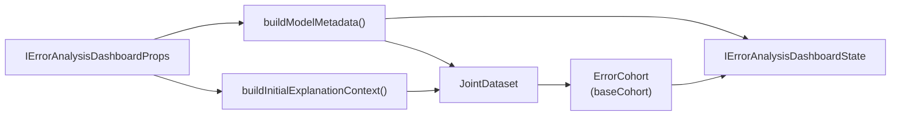
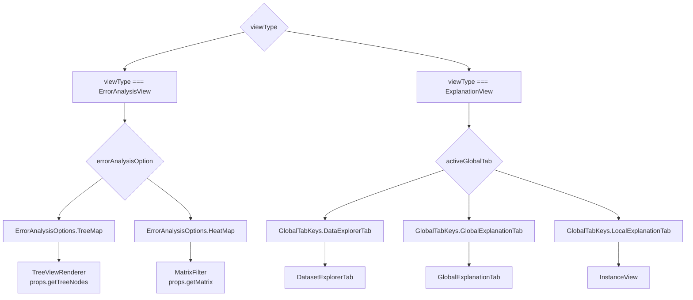
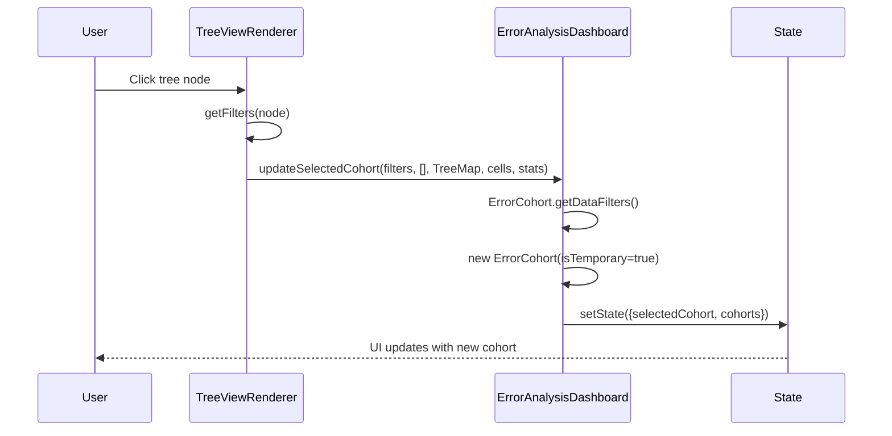
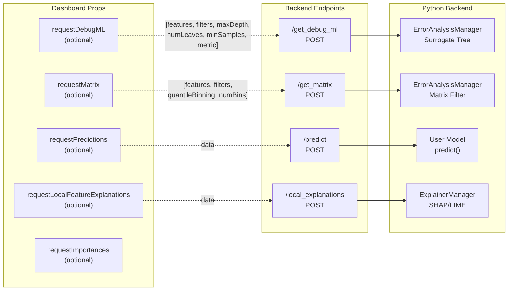

<!-- source: DeepWiki mcp.deepwiki.com · repo microsoft/responsible-ai-toolbox · page 4.3 Error Analysis Dashboard · fetched 2026-10-26 -->

# Error Analysis Dashboard

<details>
<summary>Relevant source files</summary>

The following files were used as context for generating this wiki page:

- [apps/dashboard/src/error-analysis/App.tsx](apps/dashboard/src/error-analysis/App.tsx)
- [libs/core-ui/src/lib/components/SVGToolTip.tsx](libs/core-ui/src/lib/components/SVGToolTip.tsx)
- [libs/error-analysis/src/lib/ErrorAnalysisDashboard/ColorPalette.ts](libs/error-analysis/src/lib/ErrorAnalysisDashboard/ColorPalette.ts)
- [libs/error-analysis/src/lib/ErrorAnalysisDashboard/Controls/ErrorAnalysisView/ErrorAnalysisView.tsx](libs/error-analysis/src/lib/ErrorAnalysisDashboard/Controls/ErrorAnalysisView/ErrorAnalysisView.tsx)
- [libs/error-analysis/src/lib/ErrorAnalysisDashboard/Controls/ErrorAnalysisView/ErrorAnalysisViewTab.tsx](libs/error-analysis/src/lib/ErrorAnalysisDashboard/Controls/ErrorAnalysisView/ErrorAnalysisViewTab.tsx)
- [libs/error-analysis/src/lib/ErrorAnalysisDashboard/Controls/FilterTooltip/FilterTooltip.styles.ts](libs/error-analysis/src/lib/ErrorAnalysisDashboard/Controls/FilterTooltip/FilterTooltip.styles.ts)
- [libs/error-analysis/src/lib/ErrorAnalysisDashboard/Controls/FilterTooltip/FilterTooltip.tsx](libs/error-analysis/src/lib/ErrorAnalysisDashboard/Controls/FilterTooltip/FilterTooltip.tsx)
- [libs/error-analysis/src/lib/ErrorAnalysisDashboard/Controls/TreeLegend/TreeLegend.styles.ts](libs/error-analysis/src/lib/ErrorAnalysisDashboard/Controls/TreeLegend/TreeLegend.styles.ts)
- [libs/error-analysis/src/lib/ErrorAnalysisDashboard/Controls/TreeLegend/TreeLegend.tsx](libs/error-analysis/src/lib/ErrorAnalysisDashboard/Controls/TreeLegend/TreeLegend.tsx)
- [libs/error-analysis/src/lib/ErrorAnalysisDashboard/Controls/TreeViewRenderer/TreeViewNode.tsx](libs/error-analysis/src/lib/ErrorAnalysisDashboard/Controls/TreeViewRenderer/TreeViewNode.tsx)
- [libs/error-analysis/src/lib/ErrorAnalysisDashboard/Controls/TreeViewRenderer/TreeViewRenderer.styles.ts](libs/error-analysis/src/lib/ErrorAnalysisDashboard/Controls/TreeViewRenderer/TreeViewRenderer.styles.ts)
- [libs/error-analysis/src/lib/ErrorAnalysisDashboard/Controls/TreeViewRenderer/TreeViewRenderer.tsx](libs/error-analysis/src/lib/ErrorAnalysisDashboard/Controls/TreeViewRenderer/TreeViewRenderer.tsx)
- [libs/error-analysis/src/lib/ErrorAnalysisDashboard/Controls/TreeViewRenderer/TreeViewUtils.ts](libs/error-analysis/src/lib/ErrorAnalysisDashboard/Controls/TreeViewRenderer/TreeViewUtils.ts)
- [libs/error-analysis/src/lib/ErrorAnalysisDashboard/ErrorAnalysisDashboard.tsx](libs/error-analysis/src/lib/ErrorAnalysisDashboard/ErrorAnalysisDashboard.tsx)

</details>


## Purpose and Scope

The Error Analysis Dashboard is a React component that provides interactive visualization and analysis of model errors. It supports two primary visualization modes (tree map and heat map) and integrates error analysis with model interpretability features. This component serves as a standalone dashboard or can be embedded within the broader Model Assessment Dashboard (see [4.2](#4.2)).

For detailed information about specific visualization modes, see [Tree View Renderer](#4.3.1) and [Matrix Filter UI](#4.3.2). For user interaction patterns, see [Error Analysis Interactions](#4.3.3).

## Component Architecture

The `ErrorAnalysisDashboard` class serves as the root component for error analysis functionality, managing state, coordinating child components, and bridging the TypeScript UI with Python backend services.

```mermaid
graph TB
    EAD["ErrorAnalysisDashboard<br/>(ErrorAnalysisDashboard.tsx)"]
    
    subgraph "Core Navigation"
        Nav["Navigation"]
        MainMenu["MainMenu"]
    end
    
    subgraph "Error Analysis Views"
        EAView["ErrorAnalysisView"]
        TreeView["TreeViewRenderer"]
        MatrixView["MatrixFilter"]
    end
    
    subgraph "Explanation Views"
        DataExp["DatasetExplorerTab"]
        GlobalExp["GlobalExplanationTab"]
        LocalExp["InstanceView"]
    end
    
    subgraph "Panels & Dialogs"
        CohortInfo["CohortInfoPanel"]
        FeatureList["FeatureList"]
        CohortList["CohortListPanel"]
        SaveCohort["SaveCohort"]
        EditCohort["EditCohort"]
        ShiftCohort["ShiftCohort"]
        WhatIf["WhatIf"]
        MapShift["MapShift"]
    end
    
    EAD --> Nav
    EAD --> MainMenu
    EAD --> EAView
    EAD --> DataExp
    EAD --> GlobalExp
    EAD --> LocalExp
    EAD --> CohortInfo
    EAD --> FeatureList
    EAD --> CohortList
    EAD --> SaveCohort
    EAD --> EditCohort
    EAD --> ShiftCohort
    EAD --> WhatIf
    EAD --> MapShift
    
    EAView --> TreeView
    EAView --> MatrixView
```



**Sources:** [libs/error-analysis/src/lib/ErrorAnalysisDashboard/ErrorAnalysisDashboard.tsx:1-830]()

## State Management

The dashboard maintains comprehensive state defined in `IErrorAnalysisDashboardState`:

| State Property | Type | Purpose |
|----------------|------|---------|
| `cohorts` | `ErrorCohort[]` | All cohorts including base and temporary |
| `baseCohort` | `ErrorCohort` | The primary cohort representing all data |
| `selectedCohort` | `ErrorCohort` | Currently active cohort for analysis |
| `errorAnalysisOption` | `ErrorAnalysisOptions` | Active visualization mode (TreeMap/HeatMap) |
| `viewType` | `ViewTypeKeys` | Whether showing error analysis or explanations |
| `activeGlobalTab` | `GlobalTabKeys` | Active tab in explanation view |
| `selectedFeatures` | `string[]` | Features selected for tree/matrix generation |
| `jointDataset` | `JointDataset` | Merged dataset with predictions and features |
| `modelMetadata` | `IExplanationModelMetadata` | Model type, feature names, class names |

**Sources:** [libs/error-analysis/src/lib/ErrorAnalysisDashboard/ErrorAnalysisDashboard.tsx:239-348]()

### Initialization Flow



The initialization process ([ErrorAnalysisDashboard.tsx:239-348]()):

1. **Extract Features**: Determines feature names from `dataSummary.featureNames` or infers from data/explanations
2. **Build Model Metadata**: Constructs `IExplanationModelMetadata` with model type, feature properties, class names
3. **Create JointDataset**: Merges test data, predictions, probabilities, and local explanations
4. **Initialize Base Cohort**: Creates default `ErrorCohort` with all data and initial metrics
5. **Set Selected Features**: Uses provided features or `errorAnalysisData.tree_features`

**Sources:** [libs/error-analysis/src/lib/ErrorAnalysisDashboard/ErrorAnalysisDashboard.tsx:121-181](), [libs/error-analysis/src/lib/ErrorAnalysisDashboard/ErrorAnalysisDashboard.tsx:183-237](), [libs/error-analysis/src/lib/ErrorAnalysisDashboard/ErrorAnalysisDashboard.tsx:239-348]()

## View Types and Navigation

The dashboard supports two primary view types controlled by the `viewType` state property:

### Error Analysis View

When `viewType === ViewTypeKeys.ErrorAnalysisView`, the dashboard renders the `ErrorAnalysisView` component, which provides:

- **Tree Map Mode** (`ErrorAnalysisOptions.TreeMap`): Hierarchical error tree visualization via `TreeViewRenderer`
- **Heat Map Mode** (`ErrorAnalysisOptions.HeatMap`): Two-dimensional error matrix via `MatrixFilter`



**Sources:** [libs/error-analysis/src/lib/ErrorAnalysisDashboard/ErrorAnalysisDashboard.tsx:526-552](), [libs/error-analysis/src/lib/ErrorAnalysisDashboard/ErrorAnalysisDashboard.tsx:553-625](), [libs/error-analysis/src/lib/ErrorAnalysisDashboard/Controls/ErrorAnalysisView/ErrorAnalysisView.tsx:59-104]()

### Explanation View

When `viewType === ViewTypeKeys.ExplanationView`, the dashboard provides three tabs:

- **Data Explorer Tab**: Browse and visualize data points
- **Global Explanation Tab**: Model-level feature importance
- **Local Explanation Tab**: Instance-level predictions and explanations (via `InstanceView`)

**Sources:** [libs/error-analysis/src/lib/ErrorAnalysisDashboard/ErrorAnalysisDashboard.tsx:576-623]()

## Cohort Management

Cohorts are central to the error analysis workflow, enabling users to focus on specific data subsets.

### Cohort Types

| Cohort Type | Property | Characteristics |
|-------------|----------|-----------------|
| Base Cohort | `baseCohort` | Primary cohort with all data, persists throughout session |
| Selected Cohort | `selectedCohort` | Currently active cohort for analysis |
| Temporary Cohort | `isTemporary: true` | Created from tree/matrix selections, not saved |
| Saved Cohort | `isTemporary: false` | User-saved cohorts with custom names |

### Cohort Update Flow



The `updateSelectedCohort` method ([ErrorAnalysisDashboard.tsx:697-744]()):

1. **Relabel Filters**: Converts feature indices to proper column names via `ErrorCohort.getDataFilters()`
2. **Determine Cohort Type**: Tree/HeatMap selections create temporary cohorts, others update base cohort
3. **Create ErrorCohort**: Instantiates new `ErrorCohort` with combined filters from base and new selection
4. **Update Cohorts Array**: Removes old temporary cohorts, adds new one if applicable
5. **Update State**: Sets `selectedCohort` and filtered `cohorts` array

**Sources:** [libs/error-analysis/src/lib/ErrorAnalysisDashboard/ErrorAnalysisDashboard.tsx:697-744]()

### Cohort Actions

The dashboard provides several cohort operations via panels:

- **Save Cohort** (`SaveCohort`): Convert temporary cohort to permanent, optionally switch base cohort
- **Edit Cohort** (`EditCohort`): Modify filters of existing cohort
- **Shift Cohort** (`ShiftCohort`): Change the base cohort used for analysis
- **Clear Selection** (`clearCohortSelection`): Reset to base cohort, remove temporary cohorts

**Sources:** [libs/error-analysis/src/lib/ErrorAnalysisDashboard/ErrorAnalysisDashboard.tsx:434-517](), [libs/error-analysis/src/lib/ErrorAnalysisDashboard/ErrorAnalysisDashboard.tsx:746-755](), [libs/error-analysis/src/lib/ErrorAnalysisDashboard/ErrorAnalysisDashboard.tsx:816-828]()

## Backend Integration

The dashboard communicates with the Python backend via callback functions passed as props:

### Request Functions



**Sources:** [libs/error-analysis/src/lib/ErrorAnalysisDashboard/ErrorAnalysisDashboard.tsx:533-551](), [libs/error-analysis/src/lib/ErrorAnalysisDashboard/Controls/TreeViewRenderer/TreeViewRenderer.tsx:711-754]()

### Static vs. Dynamic Mode

The dashboard supports two modes based on props:

| Mode | Condition | Behavior |
|------|-----------|----------|
| **Dynamic** | `requestDebugML !== undefined` | Fetches tree/matrix from backend on demand |
| **Static** | `requestDebugML === undefined` | Uses pre-computed `errorAnalysisData.tree` and `errorAnalysisData.matrix` |

In static mode, the tree is provided via `props.errorAnalysisData.tree` and matrix via `props.errorAnalysisData.matrix`. In dynamic mode, `TreeViewRenderer` calls `props.getTreeNodes()` with current filters and parameters.

**Sources:** [libs/error-analysis/src/lib/ErrorAnalysisDashboard/ErrorAnalysisDashboard.tsx:546-549](), [libs/error-analysis/src/lib/ErrorAnalysisDashboard/Controls/TreeViewRenderer/TreeViewRenderer.tsx:715-722](), [apps/dashboard/src/error-analysis/App.tsx:60-133]()

## Props Interface

The `IErrorAnalysisDashboardProps` interface defines the component's inputs:

### Required Props

| Prop | Type | Description |
|------|------|-------------|
| `modelInformation` | `{ modelClass: string }` | Model type metadata |
| `dataSummary` | Object | Feature names, class names, categorical mappings |
| `testData` | `any[][]` | Test dataset instances |
| `predictedY` | `number[]` | Model predictions |
| `trueY` | `number[]` | Ground truth labels |
| `errorAnalysisData` | `IErrorAnalysisData` | Tree/matrix data and configuration |
| `features` | `string[]` | Feature names for selection |

### Optional Props

| Prop | Type | Description |
|------|------|-------------|
| `probabilityY` | `number[][]` | Predicted probabilities for classification |
| `precomputedExplanations` | Object | Pre-computed feature importances |
| `requestDebugML` | Function | Fetch error tree from backend |
| `requestMatrix` | Function | Fetch error matrix from backend |
| `requestPredictions` | Function | Get predictions for what-if scenarios |
| `requestLocalFeatureExplanations` | Function | Get instance-level explanations |
| `requestImportances` | Function | Get feature importances |
| `locale` | `string` | Localization language code |
| `theme` | `ITheme` | FluentUI theme object |
| `telemetryHook` | Function | Telemetry event callback |

**Sources:** [libs/error-analysis/src/lib/ErrorAnalysisDashboard/ErrorAnalysisDashboard.tsx:90-119](), [apps/dashboard/src/error-analysis/App.tsx:45-267]()

## Error Analysis Options

The dashboard supports two visualization modes via the `ErrorAnalysisOptions` enum:

```typescript
enum ErrorAnalysisOptions {
  TreeMap = "errorAnalysisTreeMap",
  HeatMap = "errorAnalysisHeatMap"
}
```

Users switch between modes via the `MainMenu` component, which triggers `setErrorDetector()` to update `errorAnalysisOption` state. If a temporary cohort exists, switching modes opens the `MapShift` dialog to confirm the change.

**Sources:** [libs/error-analysis/src/lib/ErrorAnalysisDashboard/ErrorAnalysisDashboard.tsx:414-427](), [libs/error-analysis/src/lib/ErrorAnalysisDashboard/ErrorAnalysisDashboard.tsx:443-465](), [libs/error-analysis/src/lib/ErrorAnalysisDashboard/Controls/ErrorAnalysisView/ErrorAnalysisViewTab.tsx:79-92]()

## Context Integration

The dashboard provides a `ModelAssessmentContext.Provider` to child components:

```typescript
<ModelAssessmentContext.Provider
  value={{
    baseErrorCohort: this.state.baseCohort,
    errorCohorts: this.state.cohorts,
    selectedErrorCohort: this.state.selectedCohort,
    jointDataset: this.state.jointDataset,
    modelMetadata: this.state.modelMetadata,
    errorAnalysisData: this.props.errorAnalysisData,
    shiftErrorCohort: this.shiftErrorCohort,
    telemetryHook: this.props.telemetryHook,
    // ... other properties
  }}
>
```

This context enables child components to access cohorts, dataset, and shared functionality without prop drilling.

**Sources:** [libs/error-analysis/src/lib/ErrorAnalysisDashboard/ErrorAnalysisDashboard.tsx:356-383]()

## Feature Selection

The dashboard supports dynamic feature selection for tree and matrix generation:

- **Feature List Panel** (`FeatureList`): Displays available features with importance scores
- **Selected Features State** (`selectedFeatures`): Array of feature names to use for analysis
- **Tree Features** (`props.selectedFeatures`): Passed to `TreeViewRenderer` to control tree splits
- **Matrix Features** (`matrixFeatures`): Determines axes for heat map visualization

When `requestDebugML !== undefined` (dynamic mode), users can open the feature list and select which features to include in the error tree. The `TreeViewRenderer` then fetches a new tree using the selected features.

**Sources:** [libs/error-analysis/src/lib/ErrorAnalysisDashboard/ErrorAnalysisDashboard.tsx:305-308](), [libs/error-analysis/src/lib/ErrorAnalysisDashboard/ErrorAnalysisDashboard.tsx:636-648](), [libs/error-analysis/src/lib/ErrorAnalysisDashboard/Controls/ErrorAnalysisView/ErrorAnalysisViewTab.tsx:129-137]()

---

