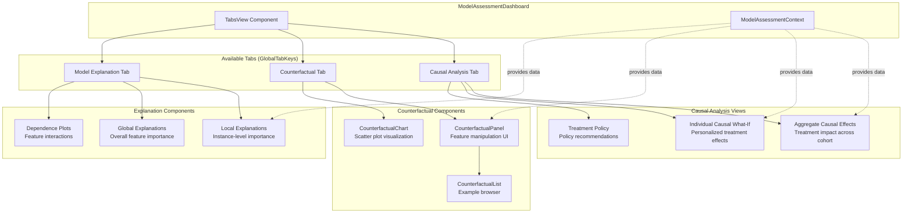
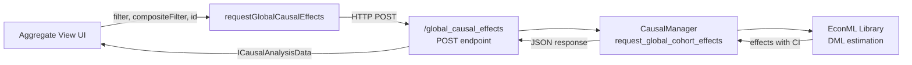
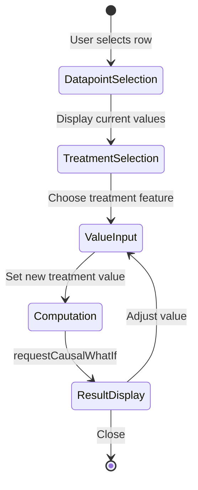
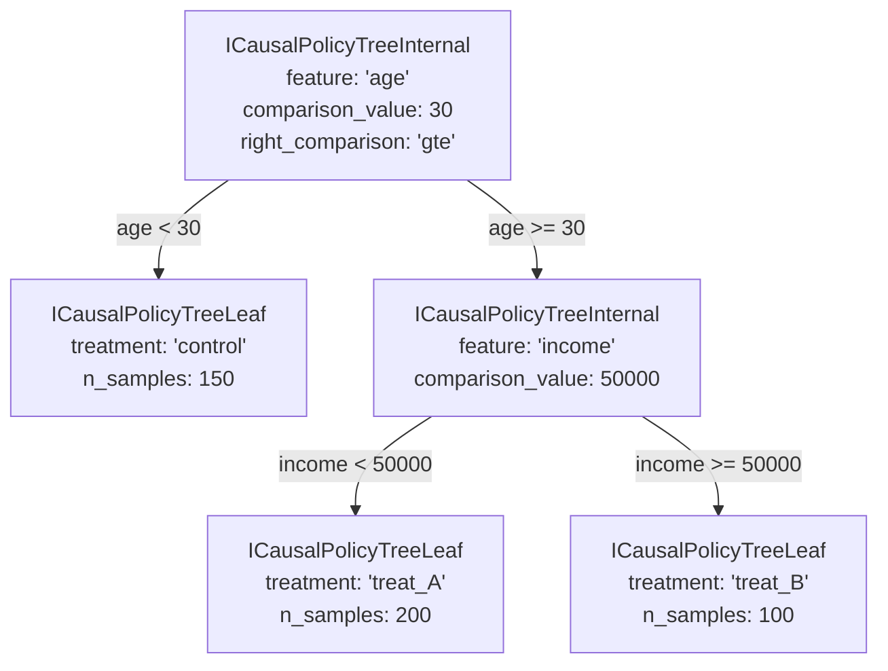
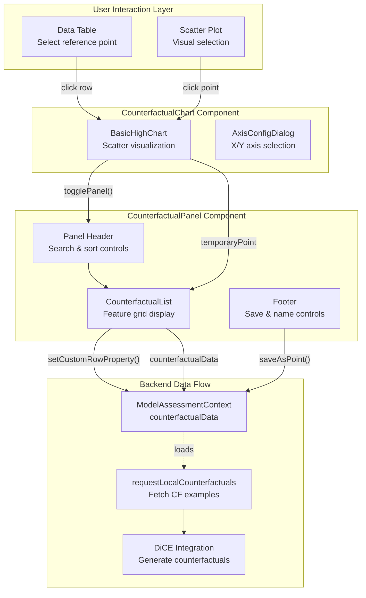
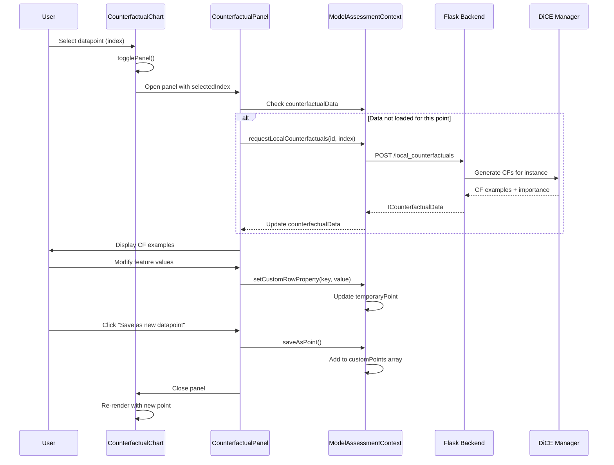
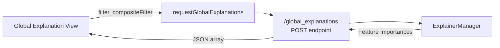

<!-- source: DeepWiki mcp.deepwiki.com · repo microsoft/responsible-ai-toolbox · page 4.4 Other Dashboard Components · fetched 2026-10-26 -->

# Other Dashboard Components

<details>
<summary>Relevant source files</summary>

The following files were used as context for generating this wiki page:

- [.eslintrc/.eslintrc.custom.eslintrc](.eslintrc/.eslintrc.custom.eslintrc)
- [apps/dashboard/src/model-assessment/__mock_data__/adultCensus.ts](apps/dashboard/src/model-assessment/__mock_data__/adultCensus.ts)
- [apps/dashboard/src/model-assessment/__mock_data__/bostonData.ts](apps/dashboard/src/model-assessment/__mock_data__/bostonData.ts)
- [apps/widget/src/app/ModelAssessment.tsx](apps/widget/src/app/ModelAssessment.tsx)
- [libs/core-ui/src/index.ts](libs/core-ui/src/index.ts)
- [libs/core-ui/src/lib/Context/ModelAssessmentContext.tsx](libs/core-ui/src/lib/Context/ModelAssessmentContext.tsx)
- [libs/core-ui/src/lib/Interfaces/ICausalAnalysisData.ts](libs/core-ui/src/lib/Interfaces/ICausalAnalysisData.ts)
- [libs/core-ui/src/lib/Interfaces/ICounterfactualData.ts](libs/core-ui/src/lib/Interfaces/ICounterfactualData.ts)
- [libs/core-ui/src/lib/Interfaces/IDataset.ts](libs/core-ui/src/lib/Interfaces/IDataset.ts)
- [libs/core-ui/src/lib/Interfaces/IExplanationContext.ts](libs/core-ui/src/lib/Interfaces/IExplanationContext.ts)
- [libs/core-ui/src/lib/util/StatisticsUtils.ts](libs/core-ui/src/lib/util/StatisticsUtils.ts)
- [libs/counterfactuals/src/lib/CounterfactualChart.tsx](libs/counterfactuals/src/lib/CounterfactualChart.tsx)
- [libs/counterfactuals/src/lib/CounterfactualPanel.tsx](libs/counterfactuals/src/lib/CounterfactualPanel.tsx)
- [libs/error-analysis/src/index.ts](libs/error-analysis/src/index.ts)
- [libs/error-analysis/src/lib/ErrorAnalysisDashboard/Controls/MetricSelector/MetricSelector.tsx](libs/error-analysis/src/lib/ErrorAnalysisDashboard/Controls/MetricSelector/MetricSelector.tsx)
- [libs/error-analysis/src/lib/ErrorAnalysisDashboard/Interfaces/IErrorAnalysisDashboardState.ts](libs/error-analysis/src/lib/ErrorAnalysisDashboard/Interfaces/IErrorAnalysisDashboardState.ts)
- [libs/interpret-vision/src/lib/VisionExplanationDashboard/Interfaces/IVisionExplanationDashboardProps.ts](libs/interpret-vision/src/lib/VisionExplanationDashboard/Interfaces/IVisionExplanationDashboardProps.ts)
- [libs/localization/src/lib/en.json](libs/localization/src/lib/en.json)
- [libs/model-assessment/src/lib/ModelAssessmentDashboard/Context/buildModelAssessmentContext.ts](libs/model-assessment/src/lib/ModelAssessmentDashboard/Context/buildModelAssessmentContext.ts)
- [libs/model-assessment/src/lib/ModelAssessmentDashboard/Controls/ModelOverview/ModelOverview.tsx](libs/model-assessment/src/lib/ModelAssessmentDashboard/Controls/ModelOverview/ModelOverview.tsx)
- [libs/model-assessment/src/lib/ModelAssessmentDashboard/Controls/ModelOverview/StatsTableUtils.ts](libs/model-assessment/src/lib/ModelAssessmentDashboard/Controls/ModelOverview/StatsTableUtils.ts)
- [libs/model-assessment/src/lib/ModelAssessmentDashboard/Controls/TabsView/TabsViewProps.ts](libs/model-assessment/src/lib/ModelAssessmentDashboard/Controls/TabsView/TabsViewProps.ts)
- [libs/model-assessment/src/lib/ModelAssessmentDashboard/ModelAssessmentDashboard.tsx](libs/model-assessment/src/lib/ModelAssessmentDashboard/ModelAssessmentDashboard.tsx)
- [libs/model-assessment/src/lib/ModelAssessmentDashboard/ModelAssessmentDashboardProps.ts](libs/model-assessment/src/lib/ModelAssessmentDashboard/ModelAssessmentDashboardProps.ts)
- [libs/model-assessment/src/lib/ModelAssessmentDashboard/ModelAssessmentDashboardState.ts](libs/model-assessment/src/lib/ModelAssessmentDashboard/ModelAssessmentDashboardState.ts)
- [raiwidgets/raiwidgets/responsibleai_dashboard.py](raiwidgets/raiwidgets/responsibleai_dashboard.py)
- [raiwidgets/raiwidgets/responsibleai_dashboard_input.py](raiwidgets/raiwidgets/responsibleai_dashboard_input.py)
- [responsibleai/responsibleai/_interfaces.py](responsibleai/responsibleai/_interfaces.py)

</details>


## Purpose and Scope

This page documents the major dashboard components in the Model Assessment Dashboard that are not covered by the Model Overview ([4.2.1](#4.2.1)), Data Explorer ([4.2.2](#4.2.2)), Error Analysis ([4.3](#4.3)), or Cohort Management ([4.2.3](#4.2.3)) sections. These components provide specialized analysis capabilities including:

- **Causal Analysis**: Components for understanding causal relationships and treatment effects
- **Counterfactual Analysis**: What-if scenario exploration (detailed further in [4.4.1](#4.4.1))
- **Model Interpretability**: Explanation and feature importance visualizations

These components are rendered as tabs within the `ModelAssessmentDashboard` and interact with backend services to provide interactive analysis experiences.

Sources: [libs/model-assessment/src/lib/ModelAssessmentDashboard/ModelAssessmentDashboard.tsx:1-379](), [libs/localization/src/lib/en.json:27-201]()

---

## Component Architecture

The dashboard tab system uses `GlobalTabKeys` to identify available analysis types. Components not covered in other sections include:



**Tab Availability**

The available tabs are determined dynamically based on what data is provided:

| Component | Required Data | Props Interface |
|-----------|--------------|-----------------|
| Causal Analysis | `causalAnalysisData` | `ICausalAnalysisData[]` |
| Counterfactuals | `counterfactualData` | `ICounterfactualData[]` |
| Explanations | `modelExplanationData` | `IModelExplanationData[]` |

Sources: [libs/model-assessment/src/lib/ModelAssessmentDashboard/ModelAssessmentDashboard.tsx:122-174](), [libs/model-assessment/src/lib/ModelAssessmentDashboard/ModelAssessmentDashboardProps.ts:22-31]()

---

## Causal Analysis Components

Causal analysis components enable users to understand treatment effects and build intervention policies using EconML integration. The interface provides three main views accessible via pivot tabs.

### Aggregate Causal Effects View

Displays average treatment effects across the entire cohort or filtered groups. This view shows:

- Direct aggregate causal effect of each treatment feature
- 95% confidence intervals using Double Machine Learning (DML)
- Treatment type indicators (binary vs continuous)
- Confounding feature warnings

**Key Localizations:**
- `CausalAnalysis.AggregateView.directAggregate`: Chart title
- `CausalAnalysis.AggregateView.binary`: Binary treatment description
- `CausalAnalysis.AggregateView.continuous`: Continuous treatment description
- `CausalAnalysis.AggregateView.confoundingFeature`: Explanation of confounders

**Backend Integration:**



The response structure follows `ICausalAnalysisData` with `global_effects` containing an array of `ICausalAnalysisSingleData` objects:

| Field | Type | Description |
|-------|------|-------------|
| `ci_lower` | number | Lower confidence interval bound |
| `ci_upper` | number | Upper confidence interval bound |
| `point` | number | Point estimate of causal effect |
| `feature` | string | Treatment feature name |
| `p_value` | number | Statistical significance |

Sources: [libs/localization/src/lib/en.json:27-45](), [libs/core-ui/src/lib/Context/ModelAssessmentContext.tsx:99-110](), [libs/core-ui/src/lib/Interfaces/ICausalAnalysisData.ts:6-13](), [raiwidgets/raiwidgets/responsibleai_dashboard_input.py:305-331]()

### Individual Causal What-If View

Provides personalized treatment effect predictions for individual datapoints. Users can:

1. Select a datapoint from the dataset
2. Choose a treatment feature
3. Set a new treatment value
4. Observe predicted outcome change with confidence intervals

**UI Flow:**



**Backend Request:**
- Endpoint: `/causal_whatif`
- Method: `ResponsibleAIDashboardInput.causal_whatif()`
- Parameters: `[id, features, feature_name, new_value, target]`
- Returns: `ICausalWhatIfData[]` with predicted outcomes

**Key UI Elements:**
- `CausalAnalysis.IndividualView.selectedDatapoint`: Shows current datapoint index
- `CausalAnalysis.IndividualView.currentTreatment`: Current treatment value display
- `CausalAnalysis.IndividualView.setNewTreatment`: Value input control
- `CausalAnalysis.IndividualView.newOutcome`: Predicted outcome display

Sources: [libs/localization/src/lib/en.json:46-60](), [libs/core-ui/src/lib/Context/ModelAssessmentContext.tsx:52-59](), [raiwidgets/raiwidgets/responsibleai_dashboard_input.py:259-278]()

### Treatment Policy View

Generates interpretable treatment policies using policy tree algorithms. The view displays:

- **Policy Table**: Rule-based segmentation showing which subgroups should receive treatment
- **Policy Gains Chart**: Bar chart comparing policy gains vs baseline
- **Policy Tree**: Hierarchical decision rules for treatment assignment

**Policy Tree Structure:**

The policy tree is a binary decision tree represented as `ICausalPolicyTreeNode`:



**Policy Gains Calculation:**

The `ICausalPolicyGains` interface tracks:
- `recommended_policy_gains`: Gain from applying the recommended policy
- `treatment_gains`: Dictionary of gains for each treatment option

**Backend Request:**
- Endpoint: `/global_causal_policy`
- Method: `ResponsibleAIDashboardInput.get_global_causal_policy()`
- Returns: `ICausalPolicy` with policy tree and gains

Sources: [libs/localization/src/lib/en.json:71-91](), [libs/core-ui/src/lib/Interfaces/ICausalAnalysisData.ts:19-50](), [raiwidgets/raiwidgets/responsibleai_dashboard_input.py:333-359]()

---

## Counterfactual/What-If Components

The counterfactual analysis system enables users to explore "what-if" scenarios by manipulating feature values and observing model prediction changes. See [4.4.1](#4.4.1) for detailed documentation of the `CounterfactualPanel` component.

### Architecture Overview



### Component Responsibilities

| Component | File | Purpose |
|-----------|------|---------|
| `CounterfactualChart` | [libs/counterfactuals/src/lib/CounterfactualChart.tsx:61-252]() | Scatter plot with axis configuration, point selection |
| `CounterfactualPanel` | [libs/counterfactuals/src/lib/CounterfactualPanel.tsx:62-280]() | Flyout panel for feature manipulation and CF browsing |
| `CounterfactualList` | Referenced in Panel | Grid of features with suggested CF values |

### Data Interface

The `ICounterfactualData` interface defines the counterfactual dataset:

```typescript
interface ICounterfactualData {
  id: string;                              // Unique identifier
  cfs_list: Array<Array<Array<string | number>>>; // CF examples [instance][cf_num][features]
  feature_names: string[];                 // Feature names
  feature_names_including_target: string[];
  summary_importance?: number[];           // Global CF feature importance
  local_importance?: number[][];           // Per-instance CF importance
  model_type?: string;
  desired_class?: string;                  // For classification
  desired_range?: [number, number];        // For regression
  test_data: Array<Array<string | number>>;
}
```

**Feature Importance Sorting:**

The panel supports sorting features by `local_importance`, which indicates "percentage of counterfactuals that varied the feature" (localization line 157). When enabled via the toggle:
- Features with higher perturbation frequency appear first
- Helps users identify which features are most influential for achieving desired predictions

Sources: [libs/counterfactuals/src/lib/CounterfactualChart.tsx:28-54](), [libs/counterfactuals/src/lib/CounterfactualPanel.tsx:37-56](), [libs/core-ui/src/lib/Interfaces/ICounterfactualData.ts:4-16](), [libs/localization/src/lib/en.json:154-201]()

### Request Flow



Sources: [libs/counterfactuals/src/lib/CounterfactualChart.tsx:78-199](), [libs/core-ui/src/lib/Context/ModelAssessmentContext.tsx:81-85](), [apps/widget/src/app/ModelAssessment.tsx:218-229]()

---

## Model Explanation Components

Model explanation components provide interpretability through feature importance visualizations at both global (dataset-level) and local (instance-level) granularities.

### Explanation Data Structure

The `IModelExplanationData` interface defines the explanation payload:

| Field | Type | Description |
|-------|------|-------------|
| `modelClass` | `ModelClass` enum | 'Tree', 'EBM', or 'blackbox' |
| `explanationMethod` | string | Algorithm used (SHAP, LIME, etc.) |
| `precomputedExplanations` | `PrecomputedExplanations` | Importance scores |

The `PrecomputedExplanations` structure contains:

```typescript
interface PrecomputedExplanations {
  localFeatureImportance?: FeatureImportance;  // Per-instance scores
  globalFeatureImportance?: FeatureImportance; // Dataset-wide scores
  ebmGlobalExplanation?: EBMGlobalExplanation; // EBM-specific
  customVis?: string;                          // Custom visualization config
}
```

Sources: [responsibleai/responsibleai/_interfaces.py:77-93](), [libs/core-ui/src/lib/Interfaces/IModelExplanationData.ts]()

### Global Explanations

Global explanations show overall feature importance across the entire dataset or cohort. The system supports:

**Request Flow:**


**Feature Importance Display:**
- Bar chart visualization using `FeatureImportanceBar` component
- Sortable by absolute importance value
- Supports cohort filtering for disaggregated analysis

### Local Explanations

Local explanations show why the model made a specific prediction for an individual instance. 

**Request Methods:**

| Method | Purpose | Endpoint |
|--------|---------|----------|
| `requestLocalExplanations` | Get explanation for a datapoint | `/local_explanations` |
| `requestLocalFeatureExplanations` | Compute on-demand with algorithm selection | User-provided callback |
| `requestExp` | Vision/text modality explanations | `/get_exp` |

**Vision/Text Explanation Support:**

For image and text data, the `requestExp` method supports specialized explanation visualization:
- **Images**: Saliency maps, superpixel attribution
- **Text**: Token-level importance highlighting
- **Object Detection**: Bounding box attribution

The request signature is `requestExp(index, abortSignal)` where `index` can be:
- Single number for most tasks
- Array `[image_index, object_index]` for object detection

**Dependence Plots:**

Feature dependence plots show how predictions vary with feature values. The `dependenceProps` in dashboard state (`IGenericChartProps`) configures:
- X-axis: Feature to analyze
- Y-axis: Typically prediction or another feature
- Color: Third feature for interaction analysis

Sources: [libs/core-ui/src/lib/Context/ModelAssessmentContext.tsx:129-142](), [raiwidgets/raiwidgets/responsibleai_dashboard_input.py:280-303](), [apps/widget/src/app/ModelAssessment.tsx:28-30]()

---

## Integration with ModelAssessmentContext

All components access data and backend services through the `ModelAssessmentContext` React context. This provides a unified interface for:

### Data Access

```mermaid
graph TB
    Components["Dashboard Components"]
    Context["ModelAssessmentContext"]
    
    subgraph "Static Data (Props)"
        Dataset["dataset: IDataset"]
        CausalData["causalAnalysisData"]
        CFData["counterfactualData"]
        ExplainData["modelExplanationData"]
        ErrorData["errorAnalysisData"]
    end
    
    subgraph "Computed Data (State)"
        JointDS["jointDataset: JointDataset"]
        Metadata["modelMetadata"]
        Cohorts["errorCohorts: ErrorCohort[]"]
    end
    
    subgraph "Request Functions"
        ReqCausal["requestGlobalCausalEffects<br/>requestLocalCausalEffects<br/>requestCausalWhatIf"]
        ReqCF["requestLocalCounterfactuals"]
        ReqExpl["requestLocalExplanations<br/>requestGlobalExplanations<br/>requestExp"]
        ReqMetrics["requestObjectDetectionMetrics<br/>requestQuestionAnsweringMetrics<br/>requestGenerativeTextMetrics"]
    end
    
    Components --> Context
    Context --> Dataset
    Context --> CausalData
    Context --> CFData
    Context --> ExplainData
    Context --> JointDS
    Context --> Metadata
    Context --> Cohorts
    Context --> ReqCausal
    Context --> ReqCF
    Context --> ReqExpl
    Context --> ReqMetrics
```



### Context Usage Pattern

Components access the context using React hooks:

```typescript
public static contextType = ModelAssessmentContext;
public context: React.ContextType<typeof ModelAssessmentContext> = 
  defaultModelAssessmentContext;
```

Then within render or methods:

```typescript
// Access causal data
const causalData = this.context.causalAnalysisData;

// Make backend request
this.context.requestGlobalCausalEffects(
  id, filter, compositeFilter, abortSignal
).then(result => { ... });

// Access current cohort
const cohort = this.context.selectedErrorCohort;
```

### Request Function Signatures

All request functions follow a consistent pattern:

1. Accept filter/cohort parameters to scope the analysis
2. Accept an `AbortSignal` for cancellation support
3. Return a `Promise` with strongly-typed results
4. Handle errors gracefully with error messages in response

**Example: Causal What-If Request**

```typescript
requestCausalWhatIf?: (
  id: string,                    // Causal analysis ID
  features: unknown[],           // Current feature values
  featureName: string,           // Treatment feature to modify
  newValue: unknown[],           // New treatment value
  target: unknown[],             // Target outcome
  abortSignal: AbortSignal       // Cancellation support
) => Promise<ICausalWhatIfData[]>
```

Sources: [libs/core-ui/src/lib/Context/ModelAssessmentContext.tsx:28-191](), [libs/model-assessment/src/lib/ModelAssessmentDashboard/ModelAssessmentDashboard.tsx:59-121](), [libs/counterfactuals/src/lib/CounterfactualPanel.tsx:66-68]()

---

## Specialized Model Type Support

Several components adapt their behavior based on model type, defined by `ModelTypes` enum:

### Object Detection Components

Object detection models require specialized metrics computation. The `requestObjectDetectionMetrics` function handles:

- **Parameters:**
  - `selectionIndexes`: Array of datapoint indices per cohort
  - `aggregateMethod`: "macro", "micro", or per-class
  - `className`: Specific object class to analyze
  - `iouThreshold`: IoU threshold percentage (e.g., 70 for 0.7)
  - `objectDetectionCache`: Map for caching computed metrics

- **Metrics Returned:**
  - Mean Average Precision (mAP)
  - Average Precision (AP) per class
  - Average Recall (AR) per class

The Model Overview component ([4.2.1](#4.2.1)) uses `ObjectDetectionWidgets` to configure these parameters.

### Question Answering Components

Question answering tasks use `requestQuestionAnsweringMetrics` which returns:

```typescript
[
  exactMatchRatio,   // Exact string match
  f1Score,           // Token-level F1
  meteorScore,       // METEOR metric
  bleuScore,         // BLEU score
  bertScore,         // BERTScore
  rougeScore         // ROUGE score
]
```

### Generative Text Components

Generative text models use `requestGenerativeTextMetrics` with a nested cache structure:

```typescript
Map<string, Map<string, number>>
// Outer key: cohort identifier
// Inner key: metric name (fluency, coherence, relevance, etc.)
// Value: metric score
```

Sources: [libs/core-ui/src/lib/Context/ModelAssessmentContext.tsx:150-177](), [libs/model-assessment/src/lib/ModelAssessmentDashboard/Controls/ModelOverview/ModelOverview.tsx:641-739](), [raiwidgets/raiwidgets/responsibleai_dashboard_input.py:361-397]()

---

## Telemetry and Event Tracking

Components implement telemetry hooks for usage tracking. The `ITelemetryEvent` interface defines:

```typescript
interface ITelemetryEvent {
  level: TelemetryLevels;     // ButtonClick, CheckboxClick, etc.
  type: TelemetryEventName;   // Specific event identifier
}
```

**Key Events:**

| Event Name | Triggered When | Component |
|------------|----------------|-----------|
| `CounterfactualSaveAsNewDatapointClick` | User saves CF as new point | CounterfactualPanel |
| `CounterfactualNewDatapointSelectedFromChart` | User selects point from chart | CounterfactualChart |
| `ModelOverviewMetricsSelectionUpdated` | Metrics dropdown changed | ModelOverview |
| `ErrorAnalysisTreeMapSaveAsNewCohortClick` | Save cohort from tree | Error Analysis |

**Usage Pattern:**

```typescript
this.props.telemetryHook?.({
  level: TelemetryLevels.ButtonClick,
  type: TelemetryEventName.CounterfactualSaveAsNewDatapointClick
});
```

Sources: [libs/core-ui/src/lib/util/ITelemetryEvent.ts](), [libs/counterfactuals/src/lib/CounterfactualPanel.tsx:256-263](), [libs/counterfactuals/src/lib/CounterfactualChart.tsx:242-251]()

---

