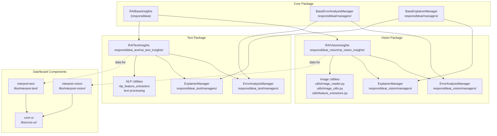
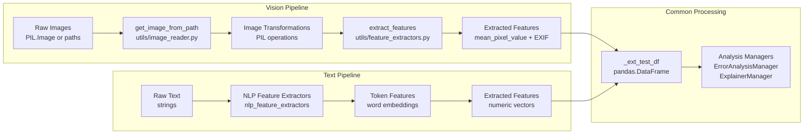
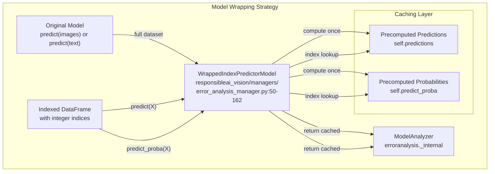
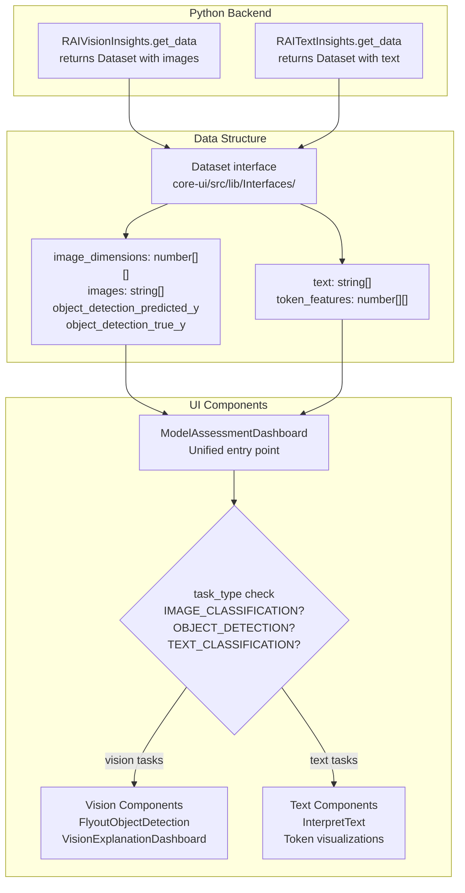
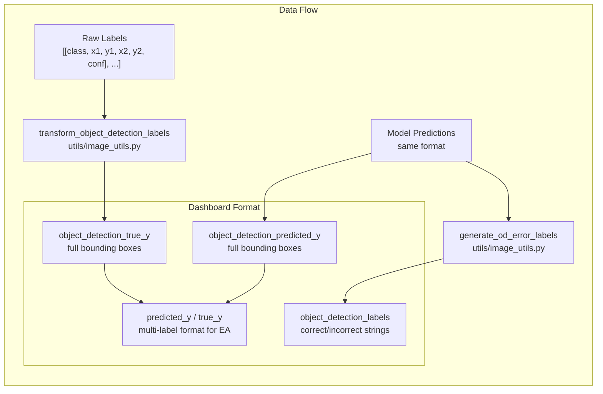
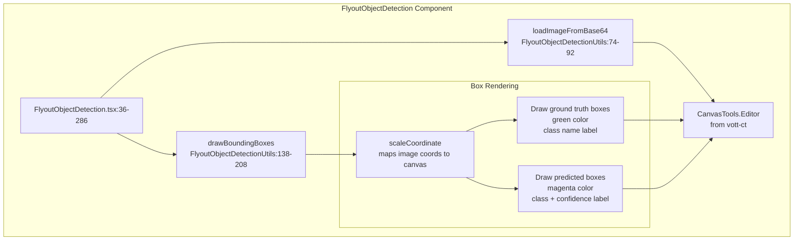
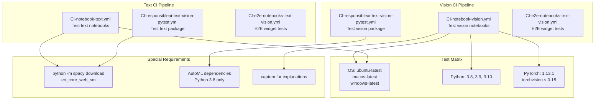

<!-- source: DeepWiki mcp.deepwiki.com · repo microsoft/responsible-ai-toolbox · page 5 Specialized Packages · fetched 2026-10-26 -->

# Specialized Packages

Relevant source files

The following files were used as context for generating this wiki page:

- [.github/workflows/CI-e2e-notebooks-text-vision.yml](.github/workflows/CI-e2e-notebooks-text-vision.yml)
- [.github/workflows/CI-notebook-text.yml](.github/workflows/CI-notebook-text.yml)
- [.github/workflows/CI-notebook-vision.yml](.github/workflows/CI-notebook-vision.yml)
- [.github/workflows/CI-responsibleai-text-vision-pytest.yml](.github/workflows/CI-responsibleai-text-vision-pytest.yml)
- [apps/dashboard/src/app/visionApplications.ts](apps/dashboard/src/app/visionApplications.ts)
- [apps/dashboard/src/model-assessment-vision/__mock_data__/fridgeObjectDetection.ts](apps/dashboard/src/model-assessment-vision/__mock_data__/fridgeObjectDetection.ts)
- [apps/dashboard/src/model-assessment-vision/__mock_data__/fridgeObjectDetectionImages.ts](apps/dashboard/src/model-assessment-vision/__mock_data__/fridgeObjectDetectionImages.ts)
- [libs/core-ui/src/lib/Interfaces/IVisionModelExplanationData.ts](libs/core-ui/src/lib/Interfaces/IVisionModelExplanationData.ts)
- [libs/interpret-vision/src/lib/VisionExplanationDashboard/Controls/DetectionDetails.tsx](libs/interpret-vision/src/lib/VisionExplanationDashboard/Controls/DetectionDetails.tsx)
- [libs/interpret-vision/src/lib/VisionExplanationDashboard/Controls/FlyoutObjectDetection.tsx](libs/interpret-vision/src/lib/VisionExplanationDashboard/Controls/FlyoutObjectDetection.tsx)
- [libs/interpret-vision/src/lib/VisionExplanationDashboard/Controls/FlyoutObjectDetectionUtils.tsx](libs/interpret-vision/src/lib/VisionExplanationDashboard/Controls/FlyoutObjectDetectionUtils.tsx)
- [libs/interpret-vision/src/lib/VisionExplanationDashboard/utils/FlyoutUtils.tsx](libs/interpret-vision/src/lib/VisionExplanationDashboard/utils/FlyoutUtils.tsx)
- [notebooks/individual-dashboards/erroranalysis-dashboard/erroranalysis-dashboard-regression-superconductor.ipynb](notebooks/individual-dashboards/erroranalysis-dashboard/erroranalysis-dashboard-regression-superconductor.ipynb)
- [responsibleai_text/requirements.txt](responsibleai_text/requirements.txt)
- [responsibleai_text/tests/test_rai_text_insights_save_and_load_scenarios.py](responsibleai_text/tests/test_rai_text_insights_save_and_load_scenarios.py)
- [responsibleai_vision/requirements.txt](responsibleai_vision/requirements.txt)
- [responsibleai_vision/responsibleai_vision/common/constants.py](responsibleai_vision/responsibleai_vision/common/constants.py)
- [responsibleai_vision/responsibleai_vision/managers/error_analysis_manager.py](responsibleai_vision/responsibleai_vision/managers/error_analysis_manager.py)
- [responsibleai_vision/responsibleai_vision/rai_vision_insights/rai_vision_insights.py](responsibleai_vision/responsibleai_vision/rai_vision_insights/rai_vision_insights.py)
- [responsibleai_vision/tests/rai_vision_insights_validator.py](responsibleai_vision/tests/rai_vision_insights_validator.py)
- [responsibleai_vision/tests/test_rai_vision_insights.py](responsibleai_vision/tests/test_rai_vision_insights.py)
- [responsibleai_vision/tests/test_rai_vision_insights_save_and_load_scenarios.py](responsibleai_vision/tests/test_rai_vision_insights_save_and_load_scenarios.py)

This page provides an overview of the domain-specific packages that extend the Responsible AI Toolbox to handle vision and text modalities. These packages (`responsibleai_vision` and `responsibleai_text`) provide specialized implementations of the core RAI framework for image and natural language processing tasks.

For detailed information about the core RAI framework and manager orchestration, see [RAIInsights Core API](#3.2) and [Analysis Managers](#3.3). For implementation details of each specialized package, see [Vision Package](#5.1) and [Text Package](#5.2).

## Architecture Overview

The specialized packages follow a consistent architectural pattern that extends the core `responsibleai` package while adapting it for different data modalities. Both packages inherit from `RAIBaseInsights` and provide modality-specific implementations of managers and utilities.

**Sources:** [responsibleai_vision/responsibleai_vision/rai_vision_insights/rai_vision_insights.py:119-124](), [responsibleai_vision/responsibleai_vision/managers/error_analysis_manager.py:164-219](), [Diagram 6 from high-level architecture]()

## Package Dependencies and Versioning

The specialized packages maintain independent version numbers and dependencies, allowing them to evolve at different rates while depending on the core `responsibleai` package.

| Package | Version | Key Dependencies | Purpose |
|---------|---------|------------------|---------|
| `responsibleai_vision` | v0.3.8 | `torchmetrics`, `vision_explanation_methods`, `Pillow>=10.0.0`, `responsibleai>=0.35.0` | Vision model analysis |
| `responsibleai_text` | v0.2.7 | `nlp-feature-extractors==0.1.0`, `spacy`, `transformers`, `responsibleai>=0.35.0` | NLP model analysis |

**Sources:** [responsibleai_vision/requirements.txt:1-10](), [responsibleai_text/requirements.txt:1-7]()

## Task-Specific Adaptations

Both specialized packages adapt the core RAI functionality to handle domain-specific tasks and data formats. The following table summarizes the supported tasks and their characteristics:

| Modality | Task Type | Constant | Data Format | Special Handling |
|----------|-----------|----------|-------------|------------------|
| Vision | Image Classification | `ModelTask.IMAGE_CLASSIFICATION` | Images with single label | Standard classification |
| Vision | Multilabel Classification | `ModelTask.MULTILABEL_IMAGE_CLASSIFICATION` | Images with multiple labels | Label concatenation for error analysis |
| Vision | Object Detection | `ModelTask.OBJECT_DETECTION` | Images with bounding boxes | Specialized prediction format, IoU metrics |
| Text | Text Classification | `ModelTask.TEXT_CLASSIFICATION` | Text strings with labels | Token-level features |
| Text | Multilabel Classification | `ModelTask.MULTILABEL_TEXT_CLASSIFICATION` | Text with multiple labels | Label concatenation |
| Text | Question Answering | `ModelTask.QUESTION_ANSWERING` | Context-question-answer triples | F1/EM metrics |
| Text | Generative AI | `ModelTask.GENERATIVE_TEXT` | Text generation | GenAI-specific metrics |

**Sources:** [responsibleai_vision/responsibleai_vision/common/constants.py:13-23](), [responsibleai_vision/responsibleai_vision/rai_vision_insights/rai_vision_insights.py:355-364]()

## Data Processing Pipeline

The specialized packages implement custom data processing pipelines to extract features from raw data and prepare it for analysis by the core RAI managers.

**Sources:** [responsibleai_vision/responsibleai_vision/rai_vision_insights/rai_vision_insights.py:263-272](), [responsibleai_vision/responsibleai_vision/utils/feature_extractors.py]()

## Manager Specialization

The specialized packages provide custom implementations of `ErrorAnalysisManager` and `ExplainerManager` that handle modality-specific prediction formats and feature extraction.

### Wrapped Index Predictor Pattern

Both packages use a wrapper pattern to adapt models that require non-tabular inputs to work with the tabular-based error analysis engine:

This pattern solves a critical integration challenge: the error analysis engine expects a model that accepts a pandas DataFrame and returns predictions, but vision and text models typically require raw images or text. The wrapper precomputes all predictions once and then uses dataframe indices to look up the cached results.

**Sources:** [responsibleai_vision/responsibleai_vision/managers/error_analysis_manager.py:50-162](), [responsibleai_vision/responsibleai_vision/managers/error_analysis_manager.py:214-261]()

## Dashboard Integration

The specialized packages integrate with modality-specific UI components in the dashboard while maintaining a unified interface.

**Sources:** [responsibleai_vision/responsibleai_vision/rai_vision_insights/rai_vision_insights.py:545-704](), [libs/interpret-vision/src/lib/VisionExplanationDashboard/Controls/FlyoutObjectDetection.tsx:36-286](), [apps/dashboard/src/model-assessment-vision/__mock_data__/fridgeObjectDetection.ts:8-219]()

## Object Detection Special Case

Object detection is the most complex task supported, requiring specialized handling throughout the stack:

### Bounding Box Data Format

Object detection predictions and labels use a nested list format where each image has multiple detections, and each detection is represented as `[class_id, x1, y1, x2, y2, confidence]`:

**Sources:** [responsibleai_vision/responsibleai_vision/rai_vision_insights/rai_vision_insights.py:256-258](), [responsibleai_vision/responsibleai_vision/rai_vision_insights/rai_vision_insights.py:683-703](), [responsibleai_vision/responsibleai_vision/utils/image_utils.py]()

### Bounding Box Visualization

The dashboard uses the VoTT Canvas Tools library to render bounding boxes with color-coded ground truth (green) and predictions (magenta):

**Sources:** [libs/interpret-vision/src/lib/VisionExplanationDashboard/Controls/FlyoutObjectDetection.tsx:261-285](), [libs/interpret-vision/src/lib/VisionExplanationDashboard/Controls/FlyoutObjectDetectionUtils.tsx:94-208]()

## CI/CD Integration

The specialized packages have dedicated CI/CD pipelines that test their unique functionality across operating systems and Python versions:

**Sources:** [.github/workflows/CI-notebook-vision.yml:1-122](), [.github/workflows/CI-notebook-text.yml:1-125](), [.github/workflows/CI-responsibleai-text-vision-pytest.yml:1-166](), [.github/workflows/CI-e2e-notebooks-text-vision.yml:1-174]()

## Serialization and Persistence

Both specialized packages extend the core serialization mechanism to handle modality-specific data:

| Component | Vision Implementation | Text Implementation |
|-----------|----------------------|---------------------|
| **Extracted Features** | Saved to `_ext_test.json` and `_ext_features.json` | Saved with same pattern |
| **Transformations** | Pickled to `transformations` file (PIL operations) | Not typically used |
| **Image Downloader** | Pickled to `image_downloader` file | Not applicable |
| **MLTable Metadata** | Saved to `mltables/` directory for cloud scenarios | Not applicable |
| **Model** | Custom serializer for FastAI, PyTorch, MLflow models | Custom serializer for HuggingFace pipelines |

The vision package's `_save_ext_data` method demonstrates this pattern:

**Sources:** [responsibleai_vision/responsibleai_vision/rai_vision_insights/rai_vision_insights.py:776-827]()

## Feature Extraction Strategies

### Vision Feature Extraction

The vision package extracts tabular features from images for error analysis:

| Feature | Description | Source |
|---------|-------------|--------|
| `mean_pixel_value` | Average pixel intensity across all channels | `ExtractedFeatures.MEAN_PIXEL_VALUE` |
| EXIF metadata | Camera settings, GPS, timestamps, etc. | `PIL.Image._getexif()` |

**Sources:** [responsibleai_vision/responsibleai_vision/utils/feature_extractors.py](), [responsibleai_vision/responsibleai_vision/common/constants.py:7-11]()

### Text Feature Extraction

The text package uses the `nlp_feature_extractors` library to convert text into numeric features:

- Token embeddings from pre-trained models
- Sentence-level features
- Custom feature extractors for domain-specific tasks

**Sources:** [responsibleai_text/requirements.txt:6]()

## Common Patterns

Both specialized packages follow consistent patterns inherited from the core framework:

1. **Initialization**: `RAI{Vision|Text}Insights.__init__` validates inputs, wraps models, and extracts features
2. **Configuration**: Users call `.explainer.add()`, `.error_analysis.add()` to configure analyses
3. **Computation**: `.compute()` runs all configured analyses
4. **Visualization**: `.get_data()` prepares data for the dashboard
5. **Persistence**: `.save()` and `.load()` handle serialization

This consistency allows users familiar with one modality to quickly adopt the other, and enables the unified dashboard to handle all modalities through a common interface.

**Sources:** [responsibleai_vision/responsibleai_vision/rai_vision_insights/rai_vision_insights.py:126-272](), [responsibleai_vision/tests/test_rai_vision_insights.py:301-352](), [responsibleai_vision/tests/rai_vision_insights_validator.py:18-41]()

---

