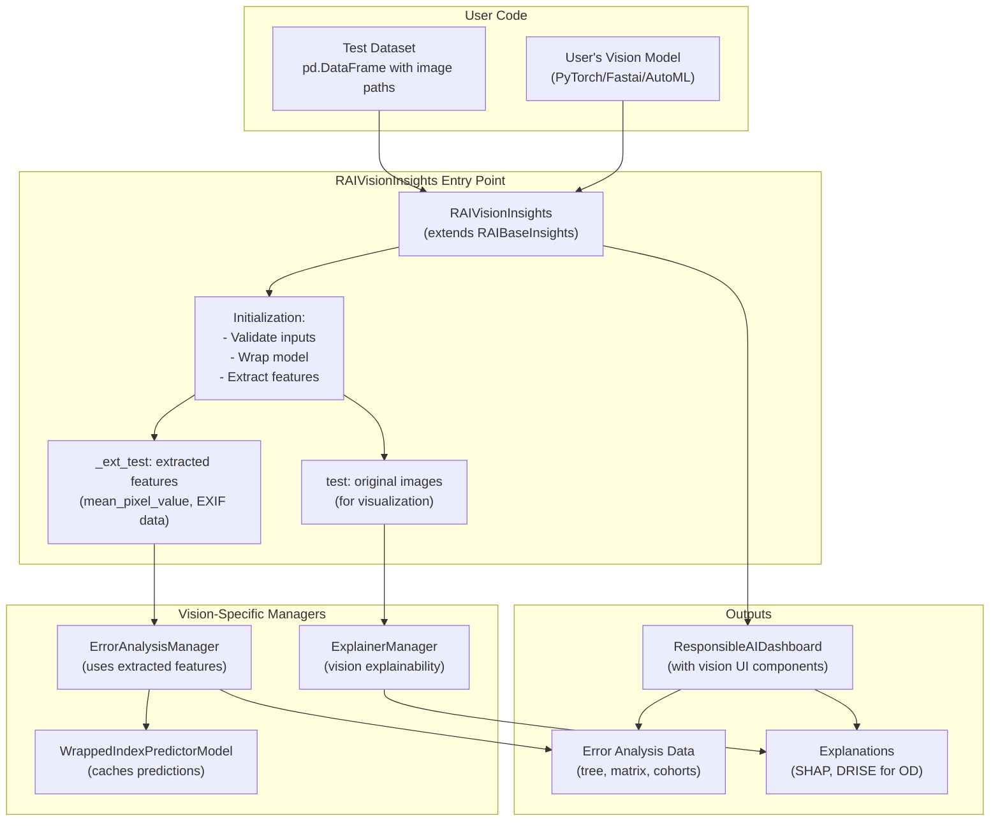
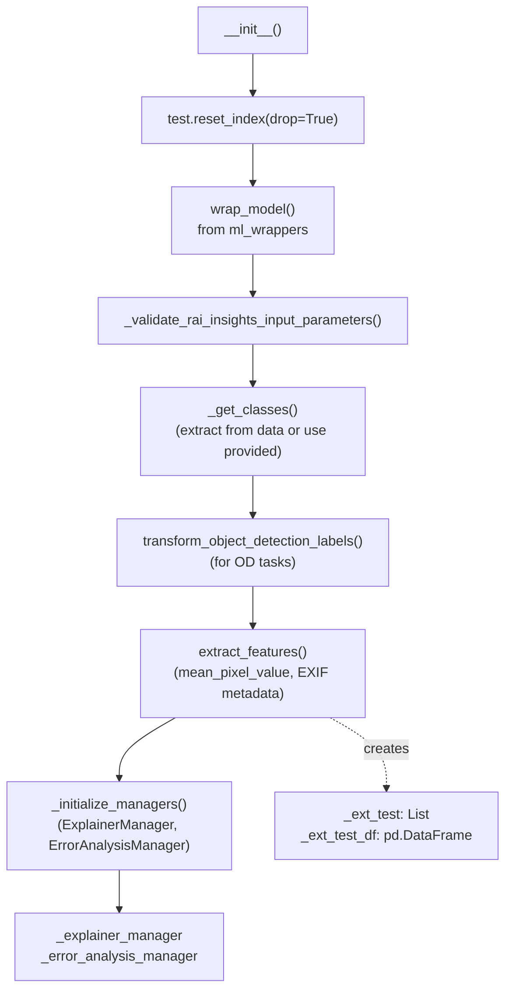
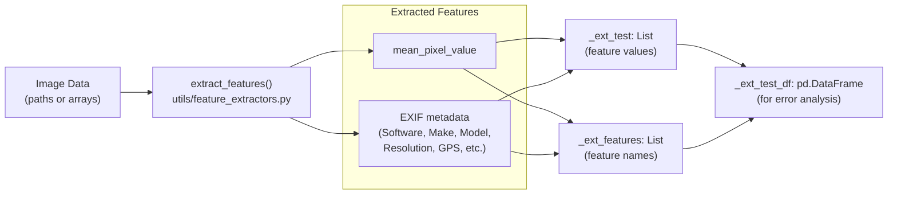
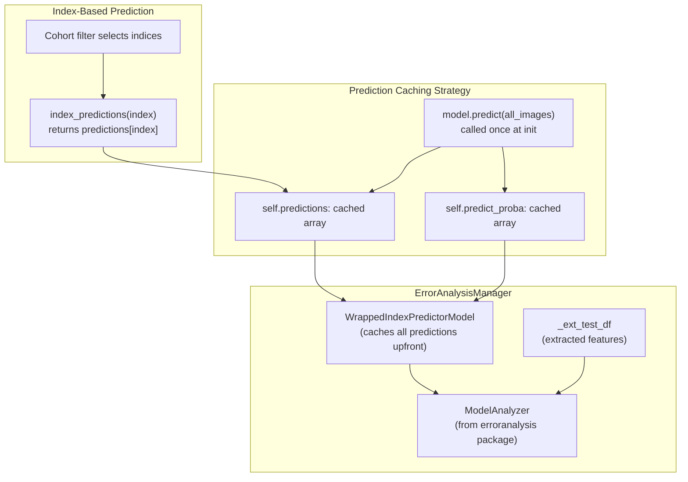
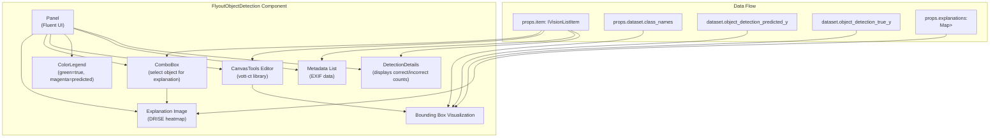
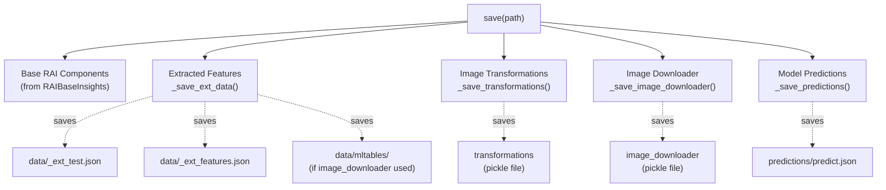

<!-- source: DeepWiki mcp.deepwiki.com · repo microsoft/responsible-ai-toolbox · page 5.1 Vision Package (responsibleai_vision) · fetched 2026-10-26 -->

# Vision Package (responsibleai_vision)

<details>
<summary>Relevant source files</summary>

The following files were used as context for generating this wiki page:

- [apps/dashboard/src/app/visionApplications.ts](apps/dashboard/src/app/visionApplications.ts)
- [apps/dashboard/src/model-assessment-vision/__mock_data__/fridgeObjectDetection.ts](apps/dashboard/src/model-assessment-vision/__mock_data__/fridgeObjectDetection.ts)
- [apps/dashboard/src/model-assessment-vision/__mock_data__/fridgeObjectDetectionImages.ts](apps/dashboard/src/model-assessment-vision/__mock_data__/fridgeObjectDetectionImages.ts)
- [libs/core-ui/src/lib/Interfaces/IVisionModelExplanationData.ts](libs/core-ui/src/lib/Interfaces/IVisionModelExplanationData.ts)
- [libs/interpret-vision/src/lib/VisionExplanationDashboard/Controls/DetectionDetails.tsx](libs/interpret-vision/src/lib/VisionExplanationDashboard/Controls/DetectionDetails.tsx)
- [libs/interpret-vision/src/lib/VisionExplanationDashboard/Controls/FlyoutObjectDetection.tsx](libs/interpret-vision/src/lib/VisionExplanationDashboard/Controls/FlyoutObjectDetection.tsx)
- [libs/interpret-vision/src/lib/VisionExplanationDashboard/Controls/FlyoutObjectDetectionUtils.tsx](libs/interpret-vision/src/lib/VisionExplanationDashboard/Controls/FlyoutObjectDetectionUtils.tsx)
- [libs/interpret-vision/src/lib/VisionExplanationDashboard/utils/FlyoutUtils.tsx](libs/interpret-vision/src/lib/VisionExplanationDashboard/utils/FlyoutUtils.tsx)
- [notebooks/individual-dashboards/erroranalysis-dashboard/erroranalysis-dashboard-regression-superconductor.ipynb](notebooks/individual-dashboards/erroranalysis-dashboard/erroranalysis-dashboard-regression-superconductor.ipynb)
- [responsibleai_text/tests/test_rai_text_insights_save_and_load_scenarios.py](responsibleai_text/tests/test_rai_text_insights_save_and_load_scenarios.py)
- [responsibleai_vision/responsibleai_vision/common/constants.py](responsibleai_vision/responsibleai_vision/common/constants.py)
- [responsibleai_vision/responsibleai_vision/managers/error_analysis_manager.py](responsibleai_vision/responsibleai_vision/managers/error_analysis_manager.py)
- [responsibleai_vision/responsibleai_vision/rai_vision_insights/rai_vision_insights.py](responsibleai_vision/responsibleai_vision/rai_vision_insights/rai_vision_insights.py)
- [responsibleai_vision/tests/rai_vision_insights_validator.py](responsibleai_vision/tests/rai_vision_insights_validator.py)
- [responsibleai_vision/tests/test_rai_vision_insights.py](responsibleai_vision/tests/test_rai_vision_insights.py)
- [responsibleai_vision/tests/test_rai_vision_insights_save_and_load_scenarios.py](responsibleai_vision/tests/test_rai_vision_insights_save_and_load_scenarios.py)

</details>


## Purpose and Scope

The `responsibleai_vision` package extends the core Responsible AI Toolbox to support computer vision models. It provides specialized analysis capabilities for image classification, multilabel image classification, and object detection tasks. This package adapts the core RAI analysis pipeline—including error analysis and explainability—to work with image data by extracting features from images and wrapping vision-specific prediction formats.

For core RAI functionality on tabular data, see [RAIInsights Core API](#3.2). For text/NLP models, see [Text Package (responsibleai_text)](#5.2). For the overall system architecture, see [Overview](#1).

**Sources**: [responsibleai_vision/responsibleai_vision/rai_vision_insights/rai_vision_insights.py:119-124]()

---

## Architecture Overview

The vision package follows the same manager-based architecture as the core `responsibleai` package but adapts it for image data. The key architectural pattern is:
1. Images are loaded and features are extracted
2. The original image data is preserved for visualization
3. Extracted features are used for error analysis
4. Specialized managers handle vision-specific operations



**Sources**: [responsibleai_vision/responsibleai_vision/rai_vision_insights/rai_vision_insights.py:259-272](), [responsibleai_vision/responsibleai_vision/rai_vision_insights/rai_vision_insights.py:274-298]()

---

## RAIVisionInsights Class

### Constructor Parameters

The `RAIVisionInsights` class is the main entry point for vision model analysis, located at [responsibleai_vision/responsibleai_vision/rai_vision_insights/rai_vision_insights.py:119-202]().

| Parameter | Type | Description |
|-----------|------|-------------|
| `model` | Any | Model implementing `predict()` or `predict_proba()` |
| `test` | pd.DataFrame | Test data with image paths or arrays and label column |
| `target_column` | str or list[str] | Label column name (list for multilabel) |
| `task_type` | str | One of: `'image_classification'`, `'multilabel_image_classification'`, `'object_detection'` |
| `classes` | np.ndarray | Optional class names array |
| `serializer` | Any | Optional custom serializer with `save()` and `load()` methods |
| `image_mode` | str | PIL image mode (default: `'RGB'`) |
| `transformations` | Any | Optional callable transformations for preprocessing |
| `max_evals` | int | Max evaluations for SHAP explainer (default: 100) |
| `num_masks` | int | Number of masks for DRISE explainer for object detection (default: 50) |
| `mask_res` | int | Mask resolution for DRISE (default: 4) |
| `device` | str | Device to run model on (default: `'auto'`) |

**Sources**: [responsibleai_vision/responsibleai_vision/rai_vision_insights/rai_vision_insights.py:126-141]()

### Initialization Flow



**Sources**: [responsibleai_vision/responsibleai_vision/rai_vision_insights/rai_vision_insights.py:203-272](), [responsibleai_vision/responsibleai_vision/rai_vision_insights/rai_vision_insights.py:274-298]()

---

## Supported Task Types

The package supports three vision task types defined in [responsibleai_vision/responsibleai_vision/common/constants.py:13-22]():

### Image Classification

Single-label classification where each image has one class label.

```python
task_type = ModelTask.IMAGE_CLASSIFICATION
classes = np.array(['cat', 'dog', 'bird'])
target_column = 'label'  # string column
```

### Multilabel Image Classification

Multi-label classification where each image can have multiple class labels.

```python
task_type = ModelTask.MULTILABEL_IMAGE_CLASSIFICATION
target_column = ['has_cat', 'has_dog', 'has_bird']  # list of binary columns
classes = target_column  # or custom names
```

### Object Detection

Detects multiple objects with bounding boxes in each image.

```python
task_type = ModelTask.OBJECT_DETECTION
classes = np.array(['can', 'carton', 'milk_bottle', 'water_bottle'])
# Labels format: [[class_id, x1, y1, x2, y2, confidence], ...]
```

Object detection labels are transformed to a multi-label format for error analysis at [responsibleai_vision/responsibleai_vision/rai_vision_insights/rai_vision_insights.py:256-258]().

**Sources**: [responsibleai_vision/responsibleai_vision/common/constants.py:13-22](), [responsibleai_vision/tests/test_rai_vision_insights.py:37-122]()

---

## Feature Extraction Pipeline

To enable error analysis on image data, the package extracts structured features from images. This extraction happens automatically during initialization.



**Extracted Features**:
- **mean_pixel_value**: Average pixel value across the image (constant in [responsibleai_vision/responsibleai_vision/common/constants.py:7-10]())
- **EXIF metadata**: Camera settings, device info, timestamps, GPS coordinates if available

The extraction occurs at [responsibleai_vision/responsibleai_vision/rai_vision_insights/rai_vision_insights.py:263-268]():

```python
ext_test, ext_features = extract_features(
    self.test, self.target_column,
    self.image_mode,
    self._feature_metadata)
```

These extracted features enable error analysis to identify patterns like "errors occur more frequently on images from iPhone cameras" or "high-resolution images have lower error rates."

**Sources**: [responsibleai_vision/responsibleai_vision/utils/feature_extractors.py](), [responsibleai_vision/responsibleai_vision/rai_vision_insights/rai_vision_insights.py:263-272]()

---

## Vision-Specific Managers

### ExplainerManager

The `ExplainerManager` for vision is located at [responsibleai_vision/responsibleai_vision/managers/explainer_manager.py](). It adapts explainability methods for image data:

- **For image classification**: Uses hierarchical SHAP with image masking
- **For object detection**: Uses DRISE (Detector Randomized Input Sampling for Explanation) method
- **Configuration parameters**: `max_evals`, `num_masks`, `mask_res` control explanation quality vs. computation time

Initialization at [responsibleai_vision/responsibleai_vision/rai_vision_insights/rai_vision_insights.py:279-288]():

```python
self._explainer_manager = ExplainerManager(
    self._wrapped_model, self.test,
    self.target_column,
    self.task_type,
    self._classes,
    self.image_mode,
    self.max_evals,
    self.num_masks,
    self.mask_res,
    self.device)
```

**Sources**: [responsibleai_vision/responsibleai_vision/managers/explainer_manager.py](), [responsibleai_vision/responsibleai_vision/rai_vision_insights/rai_vision_insights.py:279-288]()

### ErrorAnalysisManager

The vision `ErrorAnalysisManager` at [responsibleai_vision/responsibleai_vision/managers/error_analysis_manager.py:164-220]() wraps the model in a special `WrappedIndexPredictorModel` to cache predictions and enable efficient cohort filtering.



**Key Implementation Details**:

The `WrappedIndexPredictorModel` at [responsibleai_vision/responsibleai_vision/managers/error_analysis_manager.py:50-162]():
- Caches predictions at initialization (line 103)
- For multilabel classification, concatenates predicted labels into comma-separated strings (lines 104-115)
- Implements `predict(X)` and `predict_proba(X)` by indexing into cached arrays (lines 134-161)

**Sources**: [responsibleai_vision/responsibleai_vision/managers/error_analysis_manager.py:50-162](), [responsibleai_vision/responsibleai_vision/managers/error_analysis_manager.py:164-220]()

---

## Object Detection Support

Object detection is the most complex task type supported by the vision package. It requires special handling for bounding box predictions and specialized metrics.

### Bounding Box Format

Object detection predictions and labels use the format: `[class_id, x1, y1, x2, y2, confidence]` where:
- `class_id`: Integer class identifier (1-indexed)
- `x1, y1`: Top-left corner coordinates
- `x2, y2`: Bottom-right corner coordinates
- `confidence`: Prediction confidence score (0-1)

### Label Transformation

Object detection labels are transformed to multilabel format for error analysis at [responsibleai_vision/responsibleai_vision/rai_vision_insights/rai_vision_insights.py:256-258]():

```python
if task_type == ModelTask.OBJECT_DETECTION:
    test = transform_object_detection_labels(
        test, target_column, self._classes)
```

The transformation converts bounding boxes to a binary matrix where each column represents whether an object of that class exists in the image.

### Object Detection Metrics

The `compute_object_detection_metrics()` method computes precision, recall, and F1 scores with configurable IoU thresholds. Example usage from tests at [responsibleai_vision/tests/test_rai_vision_insights.py:342-351]():

```python
metrics = rai_insights.compute_object_detection_metrics(
    selection_indexes=[[0]],
    aggregate_method='macro',  # or 'micro'
    class_name='can',
    iou_threshold=70,
    object_detection_cache={})
```

### UI Data Format

For dashboard display, object detection data is formatted at [responsibleai_vision/responsibleai_vision/rai_vision_insights/rai_vision_insights.py:683-702]():

```python
dashboard_dataset.object_detection_predicted_y = d.predicted_y
dashboard_dataset.object_detection_true_y = d.true_y
dashboard_dataset.predicted_y = self._format_od_labels(
    dashboard_dataset.predicted_y,
    class_names=dashboard_dataset.class_names)
dashboard_dataset.true_y = self._format_od_labels(
    dashboard_dataset.true_y,
    class_names=dashboard_dataset.class_names)
dashboard_dataset.object_detection_labels = \
    generate_od_error_labels(...)
```

**Sources**: [responsibleai_vision/responsibleai_vision/rai_vision_insights/rai_vision_insights.py:256-258](), [responsibleai_vision/responsibleai_vision/rai_vision_insights/rai_vision_insights.py:683-702](), [responsibleai_vision/responsibleai_vision/rai_vision_insights/rai_vision_insights.py:706-728]()

---

## Vision Dashboard UI Components

The vision package includes specialized UI components in the `interpret-vision` TypeScript library for visualizing image data and explanations.

### FlyoutObjectDetection Component

The `FlyoutObjectDetection` component at [libs/interpret-vision/src/lib/VisionExplanationDashboard/Controls/FlyoutObjectDetection.tsx:36-286]() provides an interactive panel for exploring individual images with object detection results.



**Key Features**:

1. **Bounding Box Drawing**: Uses CanvasTools (vott-ct) library to overlay bounding boxes on images
   - Ground truth boxes in green ([libs/interpret-vision/src/lib/VisionExplanationDashboard/Controls/FlyoutObjectDetectionUtils.tsx:163-183]())
   - Predicted boxes in magenta ([libs/interpret-vision/src/lib/VisionExplanationDashboard/Controls/FlyoutObjectDetectionUtils.tsx:185-207]())
   - Coordinate scaling to fit canvas frame ([libs/interpret-vision/src/lib/VisionExplanationDashboard/Controls/FlyoutObjectDetectionUtils.tsx:132-136]())

2. **Object Selection**: ComboBox dropdown to select which detected object to explain ([libs/interpret-vision/src/lib/VisionExplanationDashboard/Controls/FlyoutObjectDetection.tsx:187-200]())

3. **Explanation Display**: Shows DRISE explanation heatmap for selected object ([libs/interpret-vision/src/lib/VisionExplanationDashboard/Controls/FlyoutObjectDetection.tsx:201-234]())

**Sources**: [libs/interpret-vision/src/lib/VisionExplanationDashboard/Controls/FlyoutObjectDetection.tsx:36-286](), [libs/interpret-vision/src/lib/VisionExplanationDashboard/Controls/FlyoutObjectDetectionUtils.tsx:94-208]()

### IVisionListItem Interface

The UI components use the `IVisionListItem` interface defined at [libs/core-ui/src/lib/Interfaces/IVisionModelExplanationData.ts:4-13]():

```typescript
export interface IVisionListItem {
  [key: string]: string | number | boolean | string[] | number[][];
  image: string;
  predictedY: string | string[];
  trueY: string | string[];
  index: number;
  odIncorrect: string;
  odCorrect: string;
  odAggregate: string;
}
```

For object detection:
- `odIncorrect`: Comma-separated list of incorrectly detected objects
- `odCorrect`: Comma-separated list of correctly detected objects
- `odAggregate`: Summary string like "2 correct, 1 incorrect"

**Sources**: [libs/core-ui/src/lib/Interfaces/IVisionModelExplanationData.ts:4-13](), [apps/dashboard/src/model-assessment-vision/__mock_data__/fridgeObjectDetection.ts:102-128]()

---

## Serialization and Loading

The vision package extends the base serialization mechanism to save and load vision-specific data.

### Saved Components

When `rai_insights.save(path)` is called, the following are persisted:



**Implementation**:

1. **Extracted Features**: Saved as JSON at [responsibleai_vision/responsibleai_vision/rai_vision_insights/rai_vision_insights.py:776-786]()
2. **Transformations**: Pickled at [responsibleai_vision/responsibleai_vision/rai_vision_insights/rai_vision_insights.py:806-815]()
3. **Image Downloader**: Pickled at [responsibleai_vision/responsibleai_vision/rai_vision_insights/rai_vision_insights.py:817-826]()
4. **Predictions**: Saved as JSON at [responsibleai_vision/responsibleai_vision/rai_vision_insights/rai_vision_insights.py:869-919]()

### Loading Process

The `RAIVisionInsights.load(path)` static method reconstructs the object:

```python
rai_insights = RAIVisionInsights.load(save_path)
```

The load process:
1. Loads base RAI components
2. Restores extracted features from JSON
3. Unpickles transformations and image downloader
4. Reconstructs managers with loaded state

Test validation at [responsibleai_vision/tests/rai_vision_insights_validator.py:18-41]() ensures:
- Test data integrity
- Target column preservation
- Feature extraction correctness
- Manager state restoration

**Sources**: [responsibleai_vision/responsibleai_vision/rai_vision_insights/rai_vision_insights.py:762-826](), [responsibleai_vision/tests/rai_vision_insights_validator.py:18-41](), [responsibleai_vision/tests/test_rai_vision_insights_save_and_load_scenarios.py:42-149]()

---

## AutoML Image Model Support

The vision package has special support for Azure AutoML-trained image models, which require a specific input format.

### Detection and Wrapping

AutoML models are detected at [responsibleai_vision/responsibleai_vision/rai_vision_insights/rai_vision_insights.py:241]():

```python
self.automl_image_model = is_automl_image_model(self._wrapped_model)
```

### Input Format Conversion

For AutoML models, images are converted to base64-encoded strings in a DataFrame format following MLFlow schema at [responsibleai_vision/responsibleai_vision/rai_vision_insights/rai_vision_insights.py:450-465]():

```python
if self.automl_image_model:
    if self._task_type == ModelTask.OBJECT_DETECTION:
        img_data, img_size = get_base64_string_from_path(
            img, return_image_size=True)
        img = pd.DataFrame(
            data=[[img_data, img_size]],
            columns=[
                MLFlowSchemaLiterals.INPUT_COLUMN_IMAGE,
                MLFlowSchemaLiterals.INPUT_IMAGE_SIZE],
        )
    else:
        img = pd.DataFrame(
            data=[get_base64_string_from_path(img)],
            columns=[MLFlowSchemaLiterals.INPUT_COLUMN_IMAGE],
        )
```

The MLFlow schema constants are defined at [responsibleai_vision/responsibleai_vision/common/constants.py:90-95]().

**Sources**: [responsibleai_vision/responsibleai_vision/rai_vision_insights/rai_vision_insights.py:241](), [responsibleai_vision/responsibleai_vision/rai_vision_insights/rai_vision_insights.py:450-465](), [responsibleai_vision/responsibleai_vision/common/constants.py:90-95]()

---

## Example Usage

### Image Classification Example

```python
from responsibleai_vision import RAIVisionInsights, ModelTask
import pandas as pd

# Load data with image paths
test_data = pd.DataFrame({
    'image': ['img1.jpg', 'img2.jpg', 'img3.jpg'],
    'label': ['cat', 'dog', 'cat']
})

# Create RAI insights
rai_insights = RAIVisionInsights(
    model=my_classifier,
    test=test_data,
    target_column='label',
    task_type=ModelTask.IMAGE_CLASSIFICATION,
    classes=np.array(['cat', 'dog', 'bird'])
)

# Add analyses
rai_insights.explainer.add()
rai_insights.error_analysis.add()

# Compute
rai_insights.compute()

# Get data for dashboard
data = rai_insights.get_data()
```

### Object Detection Example

```python
rai_insights = RAIVisionInsights(
    model=my_detector,
    test=test_data,
    target_column='label',
    task_type=ModelTask.OBJECT_DETECTION,
    classes=np.array(['can', 'carton', 'milk_bottle', 'water_bottle']),
    num_masks=50,  # For DRISE explanations
    mask_res=4
)

# Compute object detection metrics
metrics = rai_insights.compute_object_detection_metrics(
    selection_indexes=[[0, 1, 2]],
    aggregate_method='macro',
    class_name='can',
    iou_threshold=70
)
```

**Sources**: [responsibleai_vision/tests/test_rai_vision_insights.py:301-327](), [responsibleai_vision/tests/test_rai_vision_insights.py:111-122]()

---

## Configuration Constants

Key configuration constants from [responsibleai_vision/responsibleai_vision/common/constants.py]():

| Constant | Value | Description |
|----------|-------|-------------|
| `DEFAULT_MAX_EVALS` | 100 | Default maximum evaluations for SHAP explainer |
| `DEFAULT_NUM_MASKS` | 50 | Default number of masks for DRISE (object detection) |
| `DEFAULT_MASK_RES` | 4 | Default mask resolution for DRISE |
| `ImageModes.RGB` | 'RGB' | Default image mode for PIL |

**Sources**: [responsibleai_vision/responsibleai_vision/common/constants.py:70-80](), [responsibleai_vision/tests/test_rai_vision_insights.py:30-32]()

---

