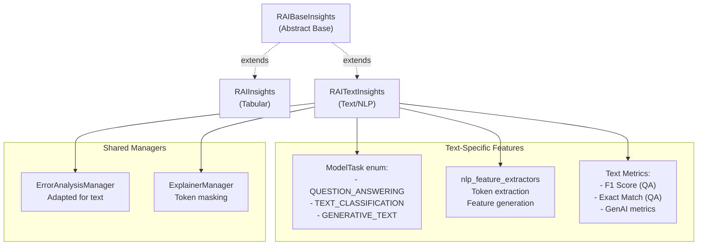
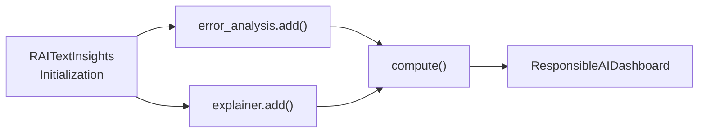
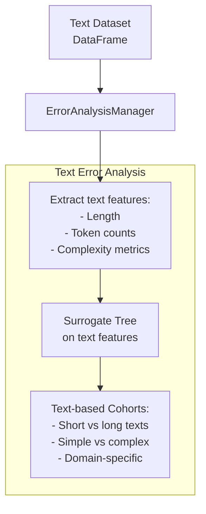
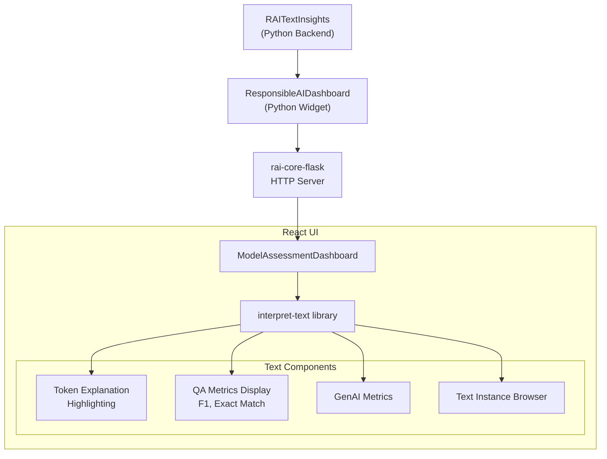
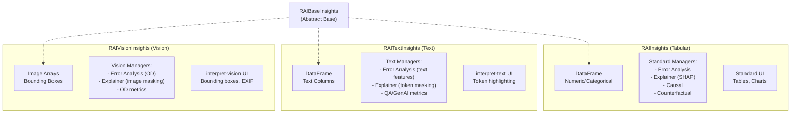

<!-- source: DeepWiki mcp.deepwiki.com · repo microsoft/responsible-ai-toolbox · page 5.2 Text Package (responsibleai_text) · fetched 2026-10-26 -->

# Text Package (responsibleai_text)

<details>
<summary>Relevant source files</summary>

The following files were used as context for generating this wiki page:

- [.github/workflows/CI-e2e-notebooks-text-vision.yml](.github/workflows/CI-e2e-notebooks-text-vision.yml)
- [.github/workflows/CI-notebook-text.yml](.github/workflows/CI-notebook-text.yml)
- [.github/workflows/CI-notebook-vision.yml](.github/workflows/CI-notebook-vision.yml)
- [.github/workflows/CI-responsibleai-text-vision-pytest.yml](.github/workflows/CI-responsibleai-text-vision-pytest.yml)
- [README.md](README.md)
- [notebooks/responsibleaidashboard/text/responsibleaidashboard-openai-model-debugging.ipynb](notebooks/responsibleaidashboard/text/responsibleaidashboard-openai-model-debugging.ipynb)
- [notebooks/test_notebooks.py](notebooks/test_notebooks.py)
- [responsibleai_text/requirements.txt](responsibleai_text/requirements.txt)
- [responsibleai_vision/requirements.txt](responsibleai_vision/requirements.txt)
- [scripts/e2e-widget.js](scripts/e2e-widget.js)

</details>


## Purpose and Scope

The `responsibleai_text` package provides specialized support for analyzing Natural Language Processing (NLP) models within the Responsible AI Toolbox. It extends the core `responsibleai` package with text-specific functionality for error analysis, model interpretability, and performance assessment of text classification and question answering models.

For image-based models, see [Vision Package (responsibleai_vision)](#5.1). For general tabular model analysis, see [RAIInsights Core API](#3.2).

**Sources:** [README.md:113-119](), [responsibleai_text/requirements.txt:1-7]()

---

## Package Overview

The `responsibleai_text` package is a domain-specific extension of the core Responsible AI framework, currently at version 0.2.7. It provides the `RAITextInsights` class as the main API entry point, which inherits from `RAIBaseInsights` and adapts core analysis managers for text-specific use cases.

### Key Dependencies

| Package | Version | Purpose |
|---------|---------|---------|
| `responsibleai` | >=0.35.0 | Core RAI framework and base classes |
| `nlp-feature-extractors` | 0.1.0 | NLP-specific feature extraction utilities |
| `numpy` | >=1.17.2, <2.0.0 | Numerical operations |
| `pandas` | >=0.25.1 | Data manipulation |
| `scikit-learn` | >=0.22.1 | ML utilities |
| `scipy` | >=1.4.1 | Scientific computing |
| `semver` | ~=2.13.0 | Semantic versioning |

Additional optional dependencies include `spacy` for advanced NLP processing and `transformers` for working with transformer-based models.

**Sources:** [responsibleai_text/requirements.txt:1-7](), [README.md:24-32]()

---

## Architecture and Class Hierarchy

### RAITextInsights Inheritance Model



**Sources:** [README.md:24-32](), [notebooks/responsibleaidashboard/text/responsibleaidashboard-openai-model-debugging.ipynb:69-74]()

---

## RAITextInsights API

### Initialization

The `RAITextInsights` class is the primary interface for analyzing text models. It follows the same initialization pattern as `RAIInsights` but is specialized for NLP tasks.

**Constructor Signature:**
```python
RAITextInsights(
    model,                    # Model or pipeline with predict() method
    test_data,               # pandas DataFrame with text columns
    target_column,           # Name of target/label column
    task_type,               # ModelTask enum value
    classes=None,            # Optional: class labels for classification
    feature_columns=None,    # Optional: specific text feature columns
    categorical_features=None # Optional: categorical metadata features
)
```

**Example Usage (Question Answering):**

From the OpenAI notebook, the typical initialization pattern:

```python
from responsibleai_text import RAITextInsights, ModelTask

# Initialize for Question Answering
rai_insights = RAITextInsights(
    pipeline,                              # Model wrapper
    test_data,                            # DataFrame with 'context', 'questions', 'answers'
    "answers",                            # Target column
    task_type=ModelTask.QUESTION_ANSWERING
)
```

**Sources:** [notebooks/responsibleaidashboard/text/responsibleaidashboard-openai-model-debugging.ipynb:290-300](), [notebooks/responsibleaidashboard/text/responsibleaidashboard-openai-model-debugging.ipynb:63-74]()

### Configuration and Computation

After initialization, users configure analysis components and compute insights:



**Configuration Example:**
```python
# Add error analysis
rai_insights.error_analysis.add()

# Add model explanations (token-level)
rai_insights.explainer.add()

# Compute all configured analyses
rai_insights.compute()

# Visualize results
from raiwidgets import ResponsibleAIDashboard
ResponsibleAIDashboard(rai_insights)
```

**Sources:** [notebooks/responsibleaidashboard/text/responsibleaidashboard-openai-model-debugging.ipynb:312-338]()

---

## Supported Task Types

The `ModelTask` enum defines the text-specific tasks supported by `RAITextInsights`:

### Task Type Overview

| Task Type | ModelTask Value | Input Format | Output Format | Metrics |
|-----------|----------------|--------------|---------------|---------|
| Question Answering | `QUESTION_ANSWERING` | Context + Question | Answer text | F1, Exact Match |
| Binary Text Classification | `TEXT_CLASSIFICATION` | Text | Single label | Accuracy, Precision, Recall |
| Multiclass Classification | `TEXT_CLASSIFICATION` | Text | Single label (multiple classes) | Accuracy, F1 (macro/micro) |
| Multilabel Classification | `TEXT_CLASSIFICATION` | Text | Multiple labels | Hamming Loss, Subset Accuracy |
| Generative AI | `GENERATIVE_TEXT` | Prompt/Input | Generated text | Custom GenAI metrics |

**Sources:** [README.md:113-119](), [notebooks/test_notebooks.py:314-361]()

### Question Answering Task

Question Answering (QA) models predict answer spans given a context and question. The package supports both extractive QA (e.g., SQuAD) and generative QA (e.g., OpenAI endpoints).

**Expected Data Format:**
- **Input columns:** `context` (background text), `questions` (query)
- **Target column:** `answers` (ground truth answer text)

**Supported Model Types:**
- HuggingFace Transformers QA pipelines
- OpenAI API endpoints (via `ml_wrappers.model.OpenaiWrapperModel`)
- Custom models implementing `predict(DataFrame) -> np.ndarray[str]`

**Example Dataset Structure:**
```python
# SQuAD-style format
data = pd.DataFrame({
    'context': ['The Normans were...', ...],
    'questions': ['When were the Normans in Normandy?', ...],
    'answers': ['10th and 11th centuries', ...]
})
```

**Sources:** [notebooks/responsibleaidashboard/text/responsibleaidashboard-openai-model-debugging.ipynb:125-148](), [notebooks/responsibleaidashboard/text/responsibleaidashboard-openai-model-debugging.ipynb:85-102]()

### Text Classification Tasks

Text classification encompasses binary, multiclass, and multilabel scenarios. The package handles all variants through the same `TEXT_CLASSIFICATION` task type.

**Notebook Examples:**

| Notebook | Dataset | Task | Classes |
|----------|---------|------|---------|
| `responsibleaidashboard-DBPedia-text-classification-model-debugging` | DBPedia | Multiclass | Topic categories |
| `responsibleaidashboard-blbooksgenre-binary-text-classification-model-debugging` | Book genres | Binary | Genre present/absent |
| `responsibleaidashboard-covid-event-multilabel-text-classification-model-debugging` | COVID-19 events | Multilabel | Multiple event types |

**Sources:** [notebooks/test_notebooks.py:314-342](), [README.md:113-119]()

---

## NLP Feature Extraction and Dependencies

### nlp_feature_extractors Integration

The `nlp-feature-extractors` package (version 0.1.0) provides specialized utilities for extracting features from text data. This is a required dependency that enables text-specific functionality.

**Key Capabilities:**
- Token-level feature extraction for explainability
- Text embedding generation
- Preprocessing for various NLP models

**Sources:** [responsibleai_text/requirements.txt:6]()

### Spacy Setup

For advanced NLP processing, the package requires spaCy models. The CI workflows demonstrate the setup:

```bash
python -m spacy download en_core_web_sm
```

This downloads the English core model used for:
- Tokenization
- Part-of-speech tagging
- Named entity recognition
- Dependency parsing (if needed for feature extraction)

**Sources:** [.github/workflows/CI-responsibleai-text-vision-pytest.yml:89-93](), [.github/workflows/CI-notebook-text.yml:90-93]()

### Transformers and Torch Dependencies

Text models often use PyTorch-based transformers. The CI workflows install specific versions:

```bash
# PyTorch installation
conda install --yes --quiet "pytorch==1.13.1" "torchvision<0.15" cpuonly "numpy<1.24.0" -c pytorch

# Keras compatibility for transformers
pip install tf-keras
pip install keras==2.15
```

**Sources:** [.github/workflows/CI-notebook-text.yml:51-75](), [.github/workflows/CI-responsibleai-text-vision-pytest.yml:75-79]()

---

## Text-Specific Analysis Features

### Error Analysis for Text Models

The `ErrorAnalysisManager` is adapted to handle text-specific error patterns. It analyzes where the model makes mistakes on different text cohorts.

**Text-Specific Error Patterns:**
- Question length vs. error rate
- Answer type distribution in errors
- Text length correlations
- Token-level error analysis



**Sources:** [notebooks/responsibleaidashboard/text/responsibleaidashboard-openai-model-debugging.ipynb:312-320]()

### Token-Level Explanations

The `ExplainerManager` provides token-level explanations for text models, highlighting which words/tokens most influenced the prediction.

**Explanation Methods:**
- Token masking-based importance
- Attention weight visualization (for transformers)
- LIME for text
- SHAP for text models

**Note:** Some model types (e.g., OpenAI API endpoints) may not support explanations due to API limitations.

```python
# Add explainer for token-level insights
rai_insights.explainer.add()
```

**Sources:** [notebooks/responsibleaidashboard/text/responsibleaidashboard-openai-model-debugging.ipynb:317-320]()

### Question Answering Metrics

For QA tasks, the package computes specialized metrics:

**F1 Score:**
- Token-level overlap between predicted and ground truth answers
- Accounts for partial matches

**Exact Match (EM):**
- Binary metric: 1 if prediction exactly matches ground truth, 0 otherwise
- Case-insensitive and punctuation-normalized

These metrics are displayed in the UI and used for error analysis.

**Sources:** [README.md:24-32]()

---

## Model Wrapper Support

### OpenAI Integration

The package supports OpenAI models through the `ml_wrappers` library:

```python
from ml_wrappers.model import OpenaiWrapperModel

# Create OpenAI wrapper
openai_model = OpenaiWrapperModel(
    api_type="azure",
    api_base="https://your.openai.azure.com/",
    api_version="2023-03-15-preview",
    api_key="your_api_key",
    engine='gpt-4'
)

# Create custom template wrapper
class QuestionTemplate:
    def __init__(self, model):
        self.model = model
    
    def predict(self, dataset):
        # Template questions before sending to API
        template = 'Answer the question given the context.'
        for context, question in zip(dataset['context'], dataset['questions']):
            templated = f"{template}\n\ncontext: {context}\nquestion: {question}"
            # ... format and call model
        return self.model.predict(dataset)
```

**Sources:** [notebooks/responsibleaidashboard/text/responsibleaidashboard-openai-model-debugging.ipynb:166-237]()

### HuggingFace Transformers

The package works seamlessly with HuggingFace pipelines:

```python
from transformers import pipeline

# Create a QA pipeline
qa_pipeline = pipeline("question-answering", model="distilbert-base-uncased-distilled-squad")

# Use directly with RAITextInsights
rai_insights = RAITextInsights(
    qa_pipeline,
    test_data,
    "answers",
    task_type=ModelTask.QUESTION_ANSWERING
)
```

**Sources:** [notebooks/responsibleaidashboard/text/responsibleaidashboard-openai-model-debugging.ipynb:69-74]()

---

## Integration with Dashboard UI

### interpret-text UI Components

The TypeScript dashboard includes specialized components for text visualization in the `interpret-text` library:

**Key UI Features:**
- Token-level explanation highlighting
- QA-specific metric displays (F1, Exact Match)
- GenAI metric visualization
- Text instance browsing with context preservation



**Sources:** [README.md:24-32](), [notebooks/responsibleaidashboard/text/responsibleaidashboard-openai-model-debugging.ipynb:350-356]()

---

## Testing and CI/CD

### Text Package Unit Tests

The text package has dedicated pytest tests that run across multiple OS and Python versions:

**Test Matrix:**
- **Operating Systems:** Ubuntu, Windows, macOS (currently disabled due to timeout issues)
- **Python Versions:** 3.8, 3.9, 3.10
- **Test Command:** `pytest -s -v --durations=10 --doctest-modules --junitxml=junit/test-results.xml --cov=responsibleai_text --cov-report=xml --cov-report=html`

**Sources:** [.github/workflows/CI-responsibleai-text-vision-pytest.yml:14-166]()

### Notebook Testing

Text notebooks are tested using `papermill` and `scrapbook`:

**Text Notebooks Under Test:**

| Notebook | Purpose | Test Marker |
|----------|---------|-------------|
| `responsibleaidashboard-DBPedia-text-classification-model-debugging` | Multiclass text classification | `text_notebooks` |
| `responsibleaidashboard-blbooksgenre-binary-text-classification-model-debugging` | Binary text classification | `text_notebooks` |
| `responsibleaidashboard-covid-event-multilabel-text-classification-model-debugging` | Multilabel text classification | `text_notebooks` |
| `responsibleaidashboard-question-answering-model-debugging` | HuggingFace QA | `text_notebooks` |
| `responsibleaidashboard-openai-model-debugging` | OpenAI QA (ignored in CI) | N/A |

**Test Execution:**
```bash
python -m pytest -s -v notebooks -m text_notebooks
```

**Sources:** [notebooks/test_notebooks.py:314-361](), [.github/workflows/CI-notebook-text.yml:106-111]()

### End-to-End Widget Tests

E2E tests verify the full stack from Python backend through Flask to React UI:

**Text E2E Test Groups:**

```javascript
// From scripts/e2e-widget.js
const textFileNames = [
  "responsibleaidashboard-DBPedia-text-classification-model-debugging",
  "responsibleaidashboard-blbooksgenre-binary-text-classification-model-debugging",
  "responsibleaidashboard-covid-event-multilabel-text-classification-model-debugging"
];
```

**E2E Test Flow:**
1. Convert notebook to Python script using `jupyter nbconvert`
2. Execute Python script to start Flask server with RAITextInsights
3. Run Cypress tests against the running dashboard
4. Verify text-specific UI components render correctly

**Sources:** [scripts/e2e-widget.js:30-34](), [.github/workflows/CI-e2e-notebooks-text-vision.yml:160-167]()

---

## Installation and Setup

### Standard Installation

```bash
# Install the text package
pip install responsibleai-text

# Install optional QA dependencies
pip install responsibleai-text[qa]

# Download required spaCy model
python -m spacy download en_core_web_sm
```

**Sources:** [responsibleai_text/requirements.txt:1-7](), [.github/workflows/CI-responsibleai-text-vision-pytest.yml:108-113]()

### Development Setup

For development and testing:

```bash
# Clone repository
git clone https://github.com/microsoft/responsible-ai-toolbox
cd responsible-ai-toolbox/responsibleai_text

# Install development dependencies
pip install -r requirements-dev.txt

# Install package in editable mode with QA extras
pip install -v -e .[qa]

# Setup spaCy
python -m spacy download en_core_web_sm

# Install backwards-compatible keras for transformers
pip install tf-keras
pip install keras==2.15
```

**Sources:** [.github/workflows/CI-responsibleai-text-vision-pytest.yml:75-113]()

---

## Comparison: Text vs Vision vs Tabular

### Modality-Specific Differences



| Feature | Tabular (RAIInsights) | Text (RAITextInsights) | Vision (RAIVisionInsights) |
|---------|----------------------|------------------------|---------------------------|
| **Primary Data Type** | Numeric/Categorical | Text strings | Images/Bounding boxes |
| **Feature Extraction** | Direct column access | nlp_feature_extractors | Vision features |
| **Explainer Method** | SHAP, LIME | Token masking, LIME for text | Image masking, gradients |
| **Task Types** | Classification, Regression | QA, Text Classification, GenAI | Image Classification, Object Detection |
| **Specialized Metrics** | Standard ML metrics | F1, Exact Match (QA) | IoU, mAP (Object Detection) |
| **UI Library** | Standard interpret | interpret-text | interpret-vision |
| **Version** | 0.36.0 | 0.2.7 | 0.3.8 |

**Sources:** [README.md:24-32](), [responsibleai_text/requirements.txt:1-7](), [responsibleai_vision/requirements.txt:1-10]()

---

