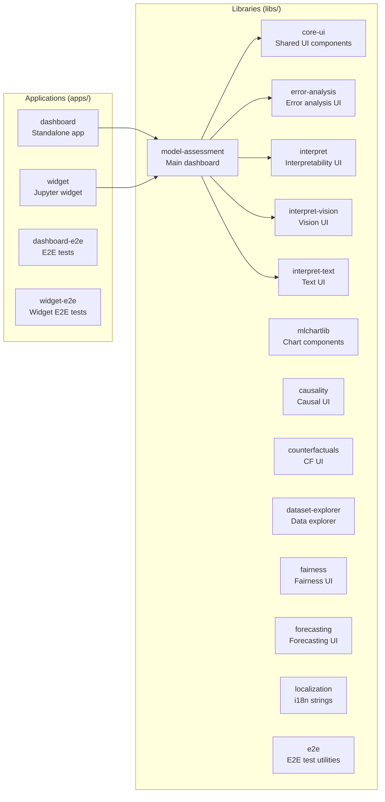
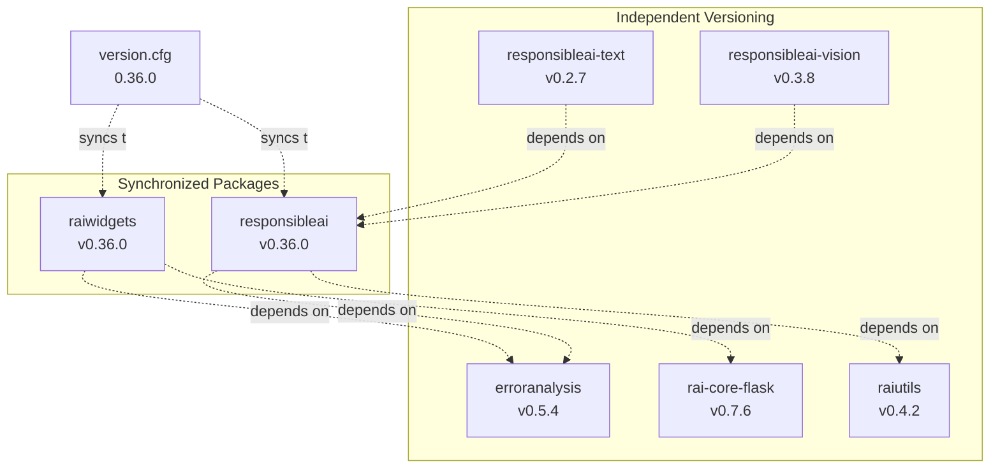
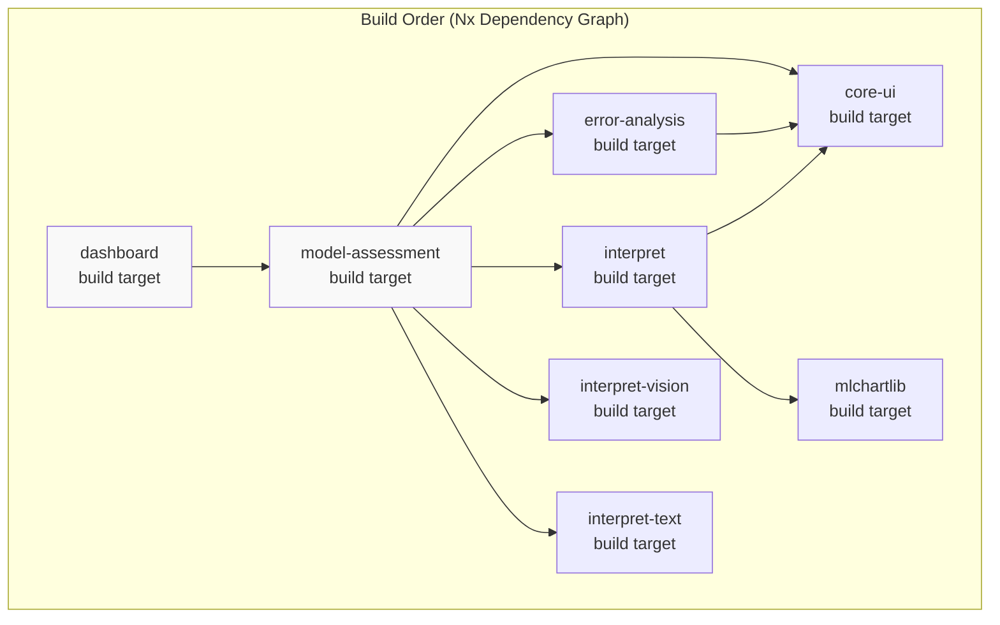
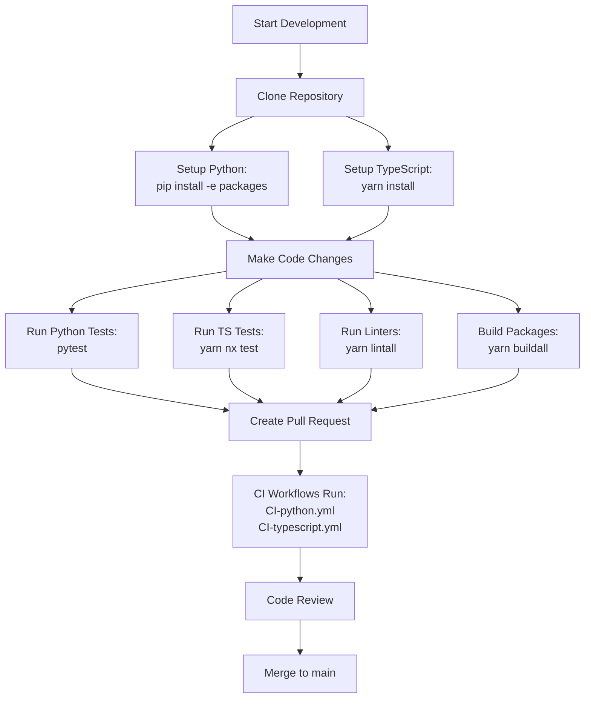

<!-- source: DeepWiki mcp.deepwiki.com · repo microsoft/responsible-ai-toolbox · page 6 Development Guide · fetched 2026-10-26 -->

# Development Guide

<details>
<summary>Relevant source files</summary>

The following files were used as context for generating this wiki page:

- [CHANGES.md](CHANGES.md)
- [apps/dashboard-e2e/src/describer/interpret/individualFeatureImportance/describeSubBarChart.ts](apps/dashboard-e2e/src/describer/interpret/individualFeatureImportance/describeSubBarChart.ts)
- [erroranalysis/requirements-dev.txt](erroranalysis/requirements-dev.txt)
- [erroranalysis/requirements.txt](erroranalysis/requirements.txt)
- [libs/e2e/src/lib/describer/interpretText/validateBarChart.ts](libs/e2e/src/lib/describer/interpretText/validateBarChart.ts)
- [libs/mlchartlib/src/lib/components/AccessibleChart.tsx](libs/mlchartlib/src/lib/components/AccessibleChart.tsx)
- [nlp_feature_extractors/requirements.txt](nlp_feature_extractors/requirements.txt)
- [nx.json](nx.json)
- [package.json](package.json)
- [rai_core_flask/requirements.txt](rai_core_flask/requirements.txt)
- [raiwidgets/requirements.txt](raiwidgets/requirements.txt)
- [responsibleai/requirements-dev.txt](responsibleai/requirements-dev.txt)
- [responsibleai/requirements.txt](responsibleai/requirements.txt)
- [responsibleai_text/responsibleai_text/version.py](responsibleai_text/responsibleai_text/version.py)
- [responsibleai_vision/responsibleai_vision/version.py](responsibleai_vision/responsibleai_vision/version.py)
- [tsconfig.base.json](tsconfig.base.json)
- [version.cfg](version.cfg)
- [workspace.json](workspace.json)
- [yarn.lock](yarn.lock)

</details>


This guide is for developers contributing to the Responsible AI Toolbox codebase. It covers repository structure, development environment setup, package versioning, building, testing, and release processes. For information about using the toolbox APIs, see [RAIInsights Core API](#3.2). For testing strategies and CI/CD pipelines, see [Testing and CI/CD](#7).

## Purpose and Scope

This page provides practical guidance for:
- Setting up a local development environment for both Python and TypeScript components
- Understanding the repository layout and package organization
- Building and testing code changes
- Understanding the versioning strategy and release workflow
- Contributing code changes following the project's structure

## Repository Organization

The Responsible AI Toolbox is organized as a **monorepo** containing multiple Python packages and a TypeScript Nx monorepo for the dashboard UI.

### Top-Level Directory Structure

```mermaid
graph TB
    root["Repository Root"]
    
    subgraph "Python Packages"
        responsibleai["responsibleai/<br/>Core RAI library"]
        raiwidgets["raiwidgets/<br/>Dashboard widgets"]
        erroranalysis["erroranalysis/<br/>Error analysis engine"]
        rai_core_flask["rai_core_flask/<br/>Flask backend"]
        raiutils["raiutils/<br/>Common utilities"]
        responsibleai_vision["responsibleai_vision/<br/>Vision support"]
        responsibleai_text["responsibleai_text/<br/>Text/NLP support"]
        nlp_extractors["nlp_feature_extractors/<br/>NLP extractors"]
    end
    
    subgraph "TypeScript Nx Monorepo"
        libs["libs/<br/>Shared libraries"]
        apps["apps/<br/>Applications"]
        libs_core["libs/core-ui"]
        libs_model["libs/model-assessment"]
        libs_error["libs/error-analysis"]
        libs_interpret["libs/interpret"]
        apps_dashboard["apps/dashboard"]
    end
    
    subgraph "Configuration & Scripts"
        version_cfg["version.cfg"]
        package_json["package.json"]
        workspace_json["workspace.json"]
        nx_json["nx.json"]
        tsconfig["tsconfig.base.json"]
    end
    
    root --> responsibleai
    root --> raiwidgets
    root --> erroranalysis
    root --> rai_core_flask
    root --> raiutils
    root --> responsibleai_vision
    root --> responsibleai_text
    root --> nlp_extractors
    
    root --> libs
    root --> apps
    libs --> libs_core
    libs --> libs_model
    libs --> libs_error
    libs --> libs_interpret
    apps --> apps_dashboard
    
    root --> version_cfg
    root --> package_json
    root --> workspace_json
    root --> nx_json
    root --> tsconfig
```



**Sources:** [package.json:1-158](), [workspace.json:1-10](), [nx.json:1-89](), [tsconfig.base.json:1-59]()

### Python Package Structure

Each Python package follows a standard structure:

| Package | Location | Purpose | Version File |
|---------|----------|---------|--------------|
| `responsibleai` | `responsibleai/` | Core RAI orchestration and managers | `responsibleai/responsibleai/version.py` |
| `raiwidgets` | `raiwidgets/` | Dashboard widget integration | `raiwidgets/raiwidgets/version.py` |
| `erroranalysis` | `erroranalysis/` | Error tree and matrix algorithms | `erroranalysis/erroranalysis/version.py` |
| `rai-core-flask` | `rai_core_flask/` | Flask server for dashboard | `rai_core_flask/rai_core_flask/version.py` |
| `raiutils` | `raiutils/` | Common utilities and helpers | `raiutils/raiutils/version.py` |
| `responsibleai-vision` | `responsibleai_vision/` | Vision task support | `responsibleai_vision/responsibleai_vision/version.py` |
| `responsibleai-text` | `responsibleai_text/` | Text/NLP task support | `responsibleai_text/responsibleai_text/version.py` |
| `nlp-feature-extractors` | `nlp_feature_extractors/` | NLP feature extraction | `nlp_feature_extractors/nlp_feature_extractors/version.py` |

Each package contains:
- `setup.py` or `pyproject.toml` - Package metadata and build configuration
- `requirements.txt` - Runtime dependencies
- `requirements-dev.txt` - Development and testing dependencies
- `version.py` - Package version as `_major`, `_minor`, `_patch` variables
- Source code under a package directory (e.g., `responsibleai/responsibleai/`)
- Tests under `tests/` directory

**Sources:** [responsibleai_vision/responsibleai_vision/version.py:1-9](), [responsibleai_text/responsibleai_text/version.py:1-9]()

### TypeScript Nx Workspace Structure

The TypeScript codebase uses **Nx 12.10.0** to manage a monorepo of libraries and applications. The workspace is configured in [workspace.json:1-10]() and [nx.json:1-89]().



The workspace uses **path mappings** in [tsconfig.base.json:37-56]() to reference libraries:
- `@responsible-ai/core-ui` → `libs/core-ui/src/index.ts`
- `@responsible-ai/model-assessment` → `libs/model-assessment/src/index.ts`
- `@responsible-ai/error-analysis` → `libs/error-analysis/src/index.ts`

**Sources:** [workspace.json:1-10](), [nx.json:1-89](), [tsconfig.base.json:1-59](), [package.json:1-158]()

## Development Environment Setup

### Prerequisites

**Python Requirements:**
- Python 3.7, 3.8, 3.9, 3.10, or 3.11
- pip and virtualenv

**TypeScript Requirements:**
- Node.js 14.x or later
- Yarn 1.x (package manager)
- 6GB+ RAM for builds (see [package.json:17]() - `NODE_OPTIONS=--max_old_space_size=6144`)

### Python Setup

1. **Clone the repository:**
```bash
git clone https://github.com/microsoft/responsible-ai-toolbox
cd responsible-ai-toolbox
```

2. **Create a virtual environment:**
```bash
python -m venv rai_env
source rai_env/bin/activate  # On Windows: rai_env\Scripts\activate
```

3. **Install core packages in development mode:**
```bash
# Install base utilities first
pip install -e raiutils
pip install -e erroranalysis

# Install main package
pip install -e responsibleai[all]

# Install widgets
pip install -e raiwidgets

# Install specialized packages (optional)
pip install -e responsibleai_vision
pip install -e responsibleai_text
```

4. **Install development dependencies:**
```bash
cd responsibleai
pip install -r requirements-dev.txt
cd ..
```

**Key Python Dependencies:**

The core `responsibleai` package has these main dependencies ([responsibleai/requirements.txt:1-22]()):
- `dice-ml>=0.11,<0.12` - Counterfactual generation
- `econml>=0.14.1` - Causal inference
- `erroranalysis>=0.5.4` - Error analysis engine
- `interpret-community>=0.31.0` - Model interpretability
- `scikit-learn>=0.22.1,!=1.1,<=1.5.1` - ML utilities
- `lightgbm>=2.0.11` - Surrogate model training
- `raiutils>=0.4.2` - Common utilities

**Sources:** [responsibleai/requirements.txt:1-22](), [responsibleai/requirements-dev.txt:1-13]()

### TypeScript Setup

1. **Install dependencies using Yarn:**
```bash
yarn install --frozen-lockfile
```

This installs all dependencies from [yarn.lock:1-10]() including:
- `@fluentui/react: 8.58.0` - UI components
- `react: 17.0.2` - UI framework
- `plotly.js: 2.27.1` - Charting
- `highcharts: 10.1.0` - Additional charts
- `@nrwl/cli: 12.10.0` - Nx tooling

2. **Verify setup:**
```bash
yarn nx --version  # Should show 12.10.0
```

**Sources:** [package.json:1-158](), [yarn.lock:1-10]()

### IDE Configuration

The repository includes TypeScript configuration in [tsconfig.base.json:1-59]() with:
- `strict: true` - Strict type checking enabled
- `noImplicitAny: true` - Explicit type annotations required
- `noUnusedLocals: true` and `noUnusedParameters: true` - Catch unused code

For Python, development dependencies include linting tools specified in package `requirements-dev.txt` files.

**Sources:** [tsconfig.base.json:1-59]()

## Package Versioning Strategy

### Version Coordination

The repository uses a **coordinated versioning** strategy where most packages share a common version number stored in [version.cfg:1]().



**Coordinated Packages** (use [version.cfg:1]()):
- `responsibleai` - Core library
- `raiwidgets` - Dashboard widgets

**Independent Packages** (have own version.py):
- `erroranalysis` - Currently v0.5.4 ([erroranalysis/requirements.txt:1-6]())
- `rai-core-flask` - Currently v0.7.6 ([rai_core_flask/requirements.txt:1-8]())
- `raiutils` - Currently v0.4.2 ([responsibleai/requirements.txt:21]())
- `responsibleai-vision` - Currently v0.3.8 ([responsibleai_vision/responsibleai_vision/version.py:1-9]())
- `responsibleai-text` - Currently v0.2.7 ([responsibleai_text/responsibleai_text/version.py:1-9]())

**Sources:** [version.cfg:1](), [responsibleai_vision/responsibleai_vision/version.py:1-9](), [responsibleai_text/responsibleai_text/version.py:1-9](), [responsibleai/requirements.txt:1-22](), [raiwidgets/requirements.txt:1-10]()

### Version File Format

Each package defines its version in a `version.py` file with the format:

```python
name = 'package_name'
_major = '0'
_minor = '36'
_patch = '0'
version = '{}.{}.{}'.format(_major, _minor, _patch)
```

For example, [responsibleai_vision/responsibleai_vision/version.py:1-9]():
```python
name = 'responsibleai_vision'
_major = '0'
_minor = '3'
_patch = '8'
version = '{}.{}.{}'.format(_major, _minor, _patch)
```

**Sources:** [responsibleai_vision/responsibleai_vision/version.py:1-9](), [responsibleai_text/responsibleai_text/version.py:1-9]()

### Dependency Version Constraints

Packages specify dependencies with version constraints to ensure compatibility:

**Core package constraints** ([responsibleai/requirements.txt:1-22]()):
- `erroranalysis>=0.5.4` - Minimum version required
- `dice-ml>=0.11,<0.12` - Version range constraint
- `scikit-learn>=0.22.1,!=1.1,<=1.5.1` - Complex constraint with exclusion
- `raiutils>=0.4.2` - Minimum version

**Widget package constraints** ([raiwidgets/requirements.txt:1-10]()):
- `rai-core-flask>=0.7.6` - Minimum Flask backend version
- `erroranalysis>=0.5.4` - Matches core package requirement
- `fairlearn==0.7.0` - Exact version pin

**Sources:** [responsibleai/requirements.txt:1-22](), [raiwidgets/requirements.txt:1-10]()

## Building the Codebase

### Building Python Packages

Each Python package can be built independently using setuptools:

```bash
# Build a specific package
cd responsibleai
python setup.py sdist bdist_wheel

# Install locally
pip install -e .
```

For development, install in **editable mode** (as shown in setup section) to avoid rebuilding after each change.

### Building TypeScript Packages

The Nx workspace provides several build commands defined in [package.json:6-41]():

**Build all packages:**
```bash
yarn buildall
```
This runs `nx run-many --target=build --configuration=production --all` with 6GB memory allocation.

**Build specific library:**
```bash
yarn nx build core-ui
yarn nx build model-assessment
```

**Build in debug mode:**
```bash
yarn builddebug
```
Builds without production optimizations.

**Build configuration** ([workspace.json:1-10]()):
Each library has a `build` target using `@nrwl/web:package` builder with:
- Output to `dist/libs/{library-name}/`
- TypeScript config from `tsconfig.lib.json`
- External dependencies marked (not bundled): `@fluentui/react`, `react`, `plotly.js`, etc.
- Rollup bundling via `rollup.config.js`

The dashboard app uses `@nrwl/web:build` with:
- Memory limit: 4096MB ([workspace.json:227]())
- Webpack configuration via `webpack.config.js`
- Production optimizations enabled

**Sources:** [package.json:6-41](), [workspace.json:1-10]()

### Build Targets and Dependencies



Nx automatically builds dependencies first based on `targetDependencies` in [nx.json:81-88]():
```json
"targetDependencies": {
  "build": [
    {
      "target": "build",
      "projects": "dependencies"
    }
  ]
}
```

**Sources:** [nx.json:81-88](), [workspace.json:1-10]()

## Testing

### Python Testing

Python packages use **pytest** for testing. Development requirements include ([responsibleai/requirements-dev.txt:1-13]()):
- `pytest==7.0.1`
- `pytest-cov` - Coverage reporting
- `pytest-mock==3.6.1` - Mocking utilities

**Run tests for a package:**
```bash
cd responsibleai
pytest tests/

# With coverage
pytest tests/ --cov=responsibleai --cov-report=html
```

**Test utilities** are provided in the `rai-test-utils` package ([responsibleai/requirements-dev.txt:10]()).

**Sources:** [responsibleai/requirements-dev.txt:1-13](), [erroranalysis/requirements-dev.txt:1-9]()

### TypeScript Testing

TypeScript packages use **Jest 27.2.3** for unit tests and **Cypress 5.6.0** for E2E tests.

**Run all unit tests:**
```bash
yarn testall
```
Runs `nx run-many --target=test --all`

**Test specific library:**
```bash
yarn nx test core-ui
yarn nx test model-assessment
```

**Run with coverage:**
```bash
yarn testall --codeCoverage
```

**E2E tests:**
```bash
yarn e2e  # Runs dashboard-e2e
yarn e2e-widget  # Runs widget integration tests
```

**Test configuration** ([workspace.json:63-69]() example):
- Jest config per library: `libs/{library}/jest.config.js`
- Coverage output: `coverage/libs/{library}/`
- Tests must pass with no tests via `passWithNoTests: true`

**Sources:** [package.json:19-39](), [workspace.json:1-10]()

### Notebook Testing

The repository includes notebook tests that execute Jupyter notebooks as integration tests. These use `papermill` and `scrapbook` as mentioned in the Testing Strategy documentation (see [Testing and CI/CD](#7)).

## Linting and Code Quality

### Python Linting

Python packages use:
- **flake8** - Style checking
- **isort** - Import sorting

Development requirements may include additional linting tools.

### TypeScript Linting

TypeScript linting uses **ESLint 7.22.0** with TypeScript-specific plugins ([package.json:117-137]()):

**Lint all packages:**
```bash
yarn lintall
```
Runs `nx workspace-lint && nx run-many --target=lint --all`

**Auto-fix linting issues:**
```bash
yarn lintfix
```

**Format code:**
```bash
yarn format:write  # Or: yarn prettier . --write
```

**ESLint plugins** used:
- `@typescript-eslint/eslint-plugin` - TypeScript rules
- `eslint-plugin-react` - React best practices
- `eslint-plugin-react-hooks` - Hooks rules
- `eslint-plugin-jsx-a11y` - Accessibility rules
- `eslint-plugin-import` - Import/export validation
- `eslint-plugin-unicorn` - Additional rules

**Sources:** [package.json:30-32](), [package.json:117-137]()

## Development Workflow



**Typical workflow:**

1. **Setup:** Install both Python and TypeScript dependencies as described above
2. **Develop:** Make changes to Python packages and/or TypeScript libraries
3. **Test locally:**
   - Python: `pytest tests/`
   - TypeScript: `yarn nx test {library}`
4. **Lint:** `yarn lintall` (or `yarn lintfix` to auto-fix)
5. **Build:** `yarn buildall` to ensure no build errors
6. **Create PR:** Submit pull request on GitHub
7. **CI validation:** Automated tests run (see [CI/CD Pipelines](#7.2))
8. **Review:** Code review by maintainers
9. **Merge:** After approval and passing CI

**Sources:** [package.json:6-41]()

## Release Process

### Pre-Release Checklist

Before releasing, ensure:
1. All tests pass locally
2. Version numbers are updated correctly
3. `CHANGES.md` is updated with release notes
4. Dependencies are up to date

### Version Update Process

1. **Update version.cfg** for coordinated packages:
```bash
echo "0.37.0" > version.cfg
```

2. **Update individual package versions** for independent packages:
```python
# In responsibleai_vision/responsibleai_vision/version.py
_major = '0'
_minor = '3'
_patch = '9'  # Increment patch version
```

3. **Update CHANGES.md** following the format in [CHANGES.md:1-18]():
```markdown
## v0.37.0

- educational materials
  - Added new tutorial for vision models
- new features
  - Feature X added to error analysis
- bug fixes and tests
  - Fixed issue #123 in causal analysis
```

**Sources:** [version.cfg:1](), [CHANGES.md:1-18](), [responsibleai_vision/responsibleai_vision/version.py:1-9]()

### Building Release Artifacts

**Python packages:**
```bash
cd responsibleai
python setup.py sdist bdist_wheel
# Creates dist/responsibleai-0.37.0.tar.gz and .whl
```

**TypeScript packages:**
```bash
yarn buildall
# Creates bundles in dist/ directory
```

### Release Workflow

The release process is triggered manually and involves publishing to:
- **PyPI** - Python Package Index
- **Test PyPI** - For validation before production
- **NPM Registry** - For TypeScript packages (`@responsible-ai/*` scope)
- **Azure Blob Storage** - For dashboard previews

**Release artifacts locations:**
- PyPI: `responsibleai`, `raiwidgets`, `erroranalysis`, etc.
- NPM: `@responsible-ai/core-ui`, `@responsible-ai/model-assessment`, etc.
- Azure Blob:
  - `/latest/` - From main branch
  - `/pr/{id}/` - PR previews
  - `/version/{ver}/` - Versioned releases

See [Release Process](#7.2.4) for detailed CI/CD workflow information.

**Sources:** [package.json:1-158](), [CHANGES.md:1-100]()

## Common Development Tasks

### Adding a New Python Dependency

1. Add to appropriate `requirements.txt`:
```txt
new-package>=1.0.0,<2.0.0
```

2. Update `-dev.txt` if it's a development dependency
3. Re-install: `pip install -e .`
4. Update dependent packages if needed

### Adding a New TypeScript Dependency

1. Add using Yarn:
```bash
yarn add package-name
# Or for dev dependency
yarn add -D package-name
```

2. Mark as external in `workspace.json` if it shouldn't be bundled:
```json
"external": [
  "@fluentui/react",
  "new-package"
]
```

**Sources:** [workspace.json:1-10](), [package.json:43-77]()

### Creating a New TypeScript Library

1. **Generate library using Nx:**
```bash
yarn nx generate @nrwl/react:library my-library
```

2. **Configure in workspace.json** - Add build, test, and lint targets
3. **Add path mapping** to [tsconfig.base.json:37-56]():
```json
"@responsible-ai/my-library": ["libs/my-library/src/index.ts"]
```

4. **Update nx.json** to include the new project

**Sources:** [workspace.json:1-10](), [tsconfig.base.json:37-56](), [nx.json:1-89]()

### Memory Issues During Build

If you encounter out-of-memory errors during TypeScript builds:

1. The build already allocates 6GB via `NODE_OPTIONS=--max_old_space_size=6144` ([package.json:17]())
2. Close other applications to free memory
3. Build individual libraries instead of all at once:
```bash
yarn nx build core-ui
yarn nx build error-analysis
# etc.
```

**Sources:** [package.json:17]()

## Troubleshooting

### Python Environment Issues

**Problem:** Import errors or version conflicts

**Solution:**
1. Create fresh virtual environment
2. Install packages in correct order: `raiutils` → `erroranalysis` → `responsibleai` → `raiwidgets`
3. Check installed versions: `pip list | grep rai`

### TypeScript Build Failures

**Problem:** Build fails with type errors

**Solution:**
1. Clean Nx cache: `yarn nx reset`
2. Delete `node_modules` and reinstall: `rm -rf node_modules && yarn install --frozen-lockfile`
3. Rebuild dependencies: `yarn nx build {dependency-library}`

### Test Failures

**Problem:** Tests fail locally but pass in CI

**Solution:**
1. Ensure Python version matches CI (3.7, 3.8, 3.9, 3.10, or 3.11)
2. Check Node.js version (should be 14.x+)
3. Clear test caches: `pytest --cache-clear` or `yarn nx reset`

## Additional Resources

- **CI/CD Details:** See [CI/CD Pipelines](#7.2) for GitHub Actions workflows
- **Testing Strategy:** See [Testing Strategy](#7.1) for comprehensive testing documentation
- **Package Architecture:** See [Python Backend Architecture](#3) and [TypeScript Dashboard Architecture](#4)
- **Repository Structure Details:** See [Repository Structure](#6.1)

**Sources:** [package.json:1-158](), [workspace.json:1-10](), [nx.json:1-89](), [tsconfig.base.json:1-59](), [version.cfg:1](), [responsibleai/requirements.txt:1-22](), [raiwidgets/requirements.txt:1-10]()

---

