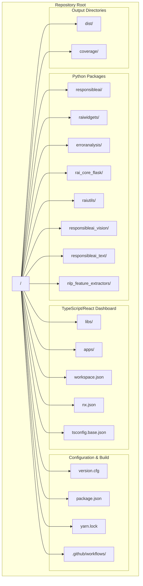
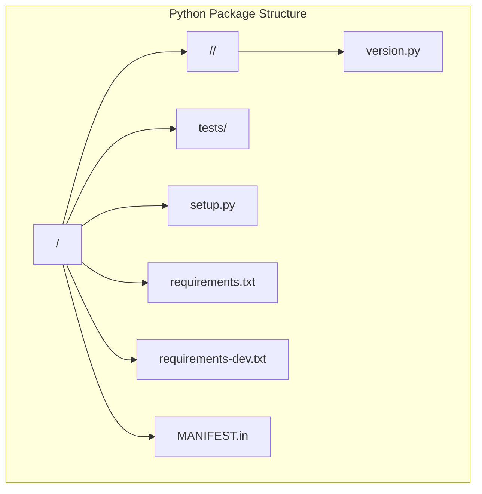
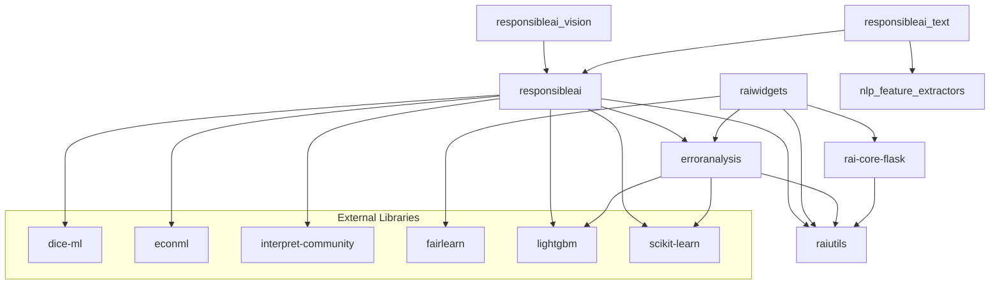
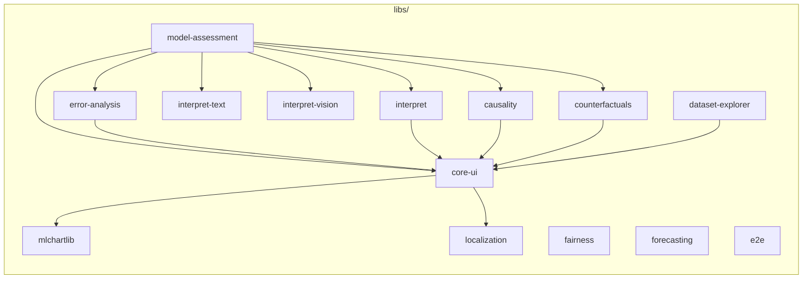
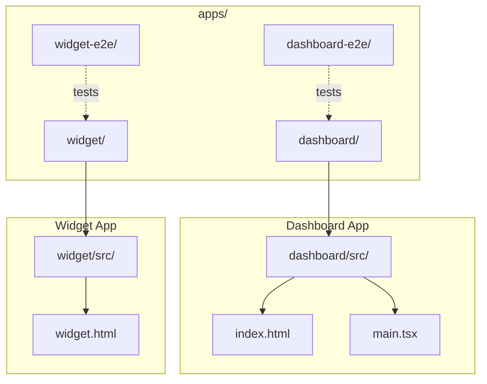
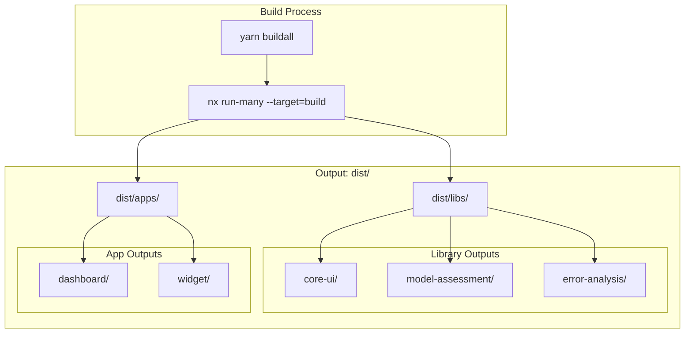

<!-- source: DeepWiki mcp.deepwiki.com · repo microsoft/responsible-ai-toolbox · page 6.1 Repository Structure · fetched 2026-10-26 -->

# Repository Structure

<details>
<summary>Relevant source files</summary>

The following files were used as context for generating this wiki page:

- [CHANGES.md](CHANGES.md)
- [apps/dashboard-e2e/src/describer/interpret/individualFeatureImportance/describeSubBarChart.ts](apps/dashboard-e2e/src/describer/interpret/individualFeatureImportance/describeSubBarChart.ts)
- [erroranalysis/requirements-dev.txt](erroranalysis/requirements-dev.txt)
- [erroranalysis/requirements.txt](erroranalysis/requirements.txt)
- [libs/e2e/src/lib/describer/interpretText/validateBarChart.ts](libs/e2e/src/lib/describer/interpretText/validateBarChart.ts)
- [libs/mlchartlib/src/lib/components/AccessibleChart.tsx](libs/mlchartlib/src/lib/components/AccessibleChart.tsx)
- [nlp_feature_extractors/requirements.txt](nlp_feature_extractors/requirements.txt)
- [nx.json](nx.json)
- [package.json](package.json)
- [rai_core_flask/requirements.txt](rai_core_flask/requirements.txt)
- [raiwidgets/requirements.txt](raiwidgets/requirements.txt)
- [responsibleai/requirements-dev.txt](responsibleai/requirements-dev.txt)
- [responsibleai/requirements.txt](responsibleai/requirements.txt)
- [responsibleai_text/responsibleai_text/version.py](responsibleai_text/responsibleai_text/version.py)
- [responsibleai_vision/responsibleai_vision/version.py](responsibleai_vision/responsibleai_vision/version.py)
- [tsconfig.base.json](tsconfig.base.json)
- [version.cfg](version.cfg)
- [workspace.json](workspace.json)
- [yarn.lock](yarn.lock)

</details>


This page documents the physical organization of the Responsible AI Toolbox repository, including directory layout, package structure, and configuration files. For information about the logical architecture and how components interact, see [Overview](#1). For details on setting up a development environment, see [Development Setup](#6.2).

## Repository Layout

The Responsible AI Toolbox follows a monorepo pattern, containing both Python packages and a TypeScript dashboard organized using Nx.



**Sources:** [package.json:1-159](), [workspace.json:1-10](), [nx.json:1-90](), [version.cfg:1-2]()

## Python Package Organization

The repository contains eight Python packages, each with independent versioning and dependencies.

### Core Python Packages

| Package Directory | Package Name | Version | Purpose |
|-------------------|--------------|---------|---------|
| `raiutils/` | `raiutils` | 0.4.2 | Common utilities and helpers |
| `erroranalysis/` | `erroranalysis` | 0.5.4 | Error analysis engine and algorithms |
| `rai_core_flask/` | `rai-core-flask` | 0.7.6 | Flask backend server for dashboard |
| `responsibleai/` | `responsibleai` | 0.36.0 | Core RAI library and manager orchestration |
| `raiwidgets/` | `raiwidgets` | 0.36.0 | Dashboard widgets and Python interface |

**Sources:** [version.cfg:1-2](), [CHANGES.md:27-28]()

### Specialized Domain Packages

| Package Directory | Package Name | Version | Purpose |
|-------------------|--------------|---------|---------|
| `responsibleai_vision/` | `responsibleai_vision` | 0.3.8 | Vision tasks (image classification, object detection) |
| `responsibleai_text/` | `responsibleai_text` | 0.2.7 | Text/NLP tasks (QA, classification, GenAI) |
| `nlp_feature_extractors/` | `nlp_feature_extractors` | N/A | NLP feature extraction utilities |

**Sources:** [responsibleai_vision/responsibleai_vision/version.py:1-9](), [responsibleai_text/responsibleai_text/version.py:1-9]()

### Python Package Structure

Each Python package follows a standard structure:



**Example: `responsibleai/` package structure:**
- `responsibleai/responsibleai/` - Source code
  - `managers/` - Analysis managers (causal, explainer, error analysis, etc.)
  - `version.py` - Version string
- `responsibleai/tests/` - Unit and integration tests
- `responsibleai/setup.py` - Package installation configuration
- `responsibleai/requirements.txt` - Runtime dependencies
- `responsibleai/requirements-dev.txt` - Development dependencies

**Sources:** [responsibleai/requirements.txt:1-22](), [responsibleai/requirements-dev.txt:1-13]()

### Python Package Dependencies



**Sources:** [responsibleai/requirements.txt:1-22](), [raiwidgets/requirements.txt:1-10](), [erroranalysis/requirements.txt:1-6](), [rai_core_flask/requirements.txt:1-8]()

## TypeScript Dashboard Organization (Nx Workspace)

The TypeScript/React dashboard is organized as an Nx monorepo with multiple libraries and applications.

### Nx Project Structure

The dashboard consists of:
- **Libraries (`libs/`)**: Reusable components and utilities (14 libraries)
- **Applications (`apps/`)**: Standalone applications (dashboard, widget)
- **E2E Tests (`apps/*-e2e`)**: End-to-end test suites

**Sources:** [workspace.json:1-10](), [nx.json:1-90](), [package.json:1-159]()

### TypeScript Libraries



**Library locations mapped in `tsconfig.base.json`:**

| Library | Import Path | Source Location |
|---------|-------------|-----------------|
| `core-ui` | `@responsible-ai/core-ui` | `libs/core-ui/src/index.ts` |
| `model-assessment` | `@responsible-ai/model-assessment` | `libs/model-assessment/src/index.ts` |
| `error-analysis` | `@responsible-ai/error-analysis` | `libs/error-analysis/src/index.ts` |
| `interpret` | `@responsible-ai/interpret` | `libs/interpret/src/index.ts` |
| `interpret-text` | `@responsible-ai/interpret-text` | `libs/interpret-text/src/index.ts` |
| `interpret-vision` | `@responsible-ai/interpret-vision` | `libs/interpret-vision/src/index.ts` |
| `causality` | `@responsible-ai/causality` | `libs/causality/src/index.ts` |
| `counterfactuals` | `@responsible-ai/counterfactuals` | `libs/counterfactuals/src/index.ts` |
| `dataset-explorer` | `@responsible-ai/dataset-explorer` | `libs/dataset-explorer/src/index.ts` |
| `fairness` | `@responsible-ai/fairness` | `libs/fairness/src/index.ts` |
| `forecasting` | `@responsible-ai/forecasting` | `libs/forecasting/src/index.ts` |
| `mlchartlib` | `@responsible-ai/mlchartlib` | `libs/mlchartlib/src/index.ts` |
| `localization` | `@responsible-ai/localization` | `libs/localization/src/index.ts` |
| `e2e` | `@responsible-ai/e2e` | `libs/e2e/src/index.ts` |

**Sources:** [tsconfig.base.json:37-56](), [workspace.json:1-10]()

### Applications



**Dashboard Application (`apps/dashboard/`):**
- Main entry: [apps/dashboard/src/main.tsx]()
- HTML template: [apps/dashboard/src/index.html]()
- Build target: `dashboard:build` in [workspace.json:211-308]()
- Output: `dist/apps/dashboard/`

**Widget Application (`apps/widget/`):**
- Jupyter notebook widget integration
- Embedded in Python `raiwidgets` package
- Output bundled and served by `rai-core-flask`

**Sources:** [workspace.json:211-308](), [package.json:34-36]()

### Library Project Structure

Each TypeScript library follows this structure:

```
libs/<library-name>/
├── src/
│   ├── lib/
│   │   ├── <LibraryName>.tsx
│   │   └── <LibraryName>.styles.ts
│   └── index.ts
├── package.json
├── tsconfig.json
├── tsconfig.lib.json
├── jest.config.js
└── README.md
```

**Nx build configuration in `workspace.json`:**
- `builder`: `@nrwl/web:package` for libraries
- `outputPath`: `dist/libs/<library-name>/`
- `entryFile`: `libs/<library-name>/src/index.ts`
- External dependencies: React, Plotly, Fluent UI, etc.

**Sources:** [workspace.json:73-141]() (example: core-ui), [workspace.json:459-527]() (example: error-analysis)

## Configuration Files

### Root-Level Configuration

| File | Purpose | Key Contents |
|------|---------|--------------|
| `package.json` | Npm workspace root | Scripts, dependencies, Nx configuration |
| `workspace.json` | Nx workspace projects | 14 libraries, 2 apps, build/test targets |
| `nx.json` | Nx configuration | Project tags, task dependencies, implicit dependencies |
| `tsconfig.base.json` | TypeScript base config | Path mappings for `@responsible-ai/*` imports |
| `version.cfg` | Main version number | Currently `0.36.0` |
| `yarn.lock` | Dependency lock file | Exact versions of all npm packages |

**Sources:** [package.json:1-159](), [workspace.json:1-10](), [nx.json:1-90](), [tsconfig.base.json:1-60](), [version.cfg:1-2]()

### Python Package Configuration

Each Python package has:
- `setup.py` - Package metadata, dependencies, entry points
- `requirements.txt` - Runtime dependencies with version constraints
- `requirements-dev.txt` - Development dependencies (pytest, coverage, linting)
- `MANIFEST.in` - Additional files to include in distribution
- `<package>/version.py` - Version string definition

**Example dependency specifications:**

```python
# responsibleai/requirements.txt
dice-ml>=0.11,<0.12
econml>=0.14.1
erroranalysis>=0.5.4
interpret-community>=0.31.0
scikit-learn>=0.22.1,!=1.1,<=1.5.1
raiutils>=0.4.2
```

**Sources:** [responsibleai/requirements.txt:1-22](), [erroranalysis/requirements.txt:1-6](), [rai_core_flask/requirements.txt:1-8]()

### TypeScript Build Configuration

The Nx workspace uses:
- **Rollup** for library bundling ([rollup.config.js]())
- **Webpack** for application building ([webpack.config.js]())
- **Jest** for unit testing ([jest.config.js]() in each project)
- **Cypress** for E2E testing ([cypress.json]() in e2e projects)

**External dependencies marked in `workspace.json`:**
```json
"external": [
  "@fluentui/react",
  "highcharts",
  "jmespath",
  "localized-strings",
  "lodash",
  "memoize-one",
  "moment",
  "plotly.js",
  "react-plotly.js",
  "react",
  "react-dom",
  "uuid"
]
```

**Sources:** [workspace.json:106-119](), [package.json:43-77]()

## Build Outputs

### Python Package Distributions

Python packages are built using `setup.py` and output to:
- **Wheel files**: `dist/<package_name>-<version>-py3-none-any.whl`
- **Source distributions**: `dist/<package_name>-<version>.tar.gz`

Deployed to:
- **PyPI** for releases
- **Test PyPI** for pre-release validation

**Sources:** [CHANGES.md:1-100]() (release history)

### TypeScript Build Artifacts



**Library build outputs (`dist/libs/<library>/`):**
- `index.esm.js` - ES module bundle
- `index.umd.js` - UMD bundle
- `package.json` - NPM package metadata
- Type definition files

**Application build outputs (`dist/apps/<app>/`):**
- `index.html` - Entry HTML
- JavaScript bundles (chunked)
- Static assets (CSS, images)

**Dashboard deployment:**
- **NPM Registry**: `@responsible-ai/*` packages for libraries
- **Azure Blob Storage**: 
  - `/latest/` - Latest builds from main branch
  - `/pr/{id}/` - PR preview deployments
  - `/version/{ver}/` - Release versions

**Sources:** [package.json:17-18](), [workspace.json:30-61](), [CHANGES.md:95-100]()

## CI/CD Configuration

The `.github/workflows/` directory contains GitHub Actions workflows:

| Workflow | Purpose |
|----------|---------|
| `CI-python.yml` | Python package testing (4 packages × 3 OS × 3 Python versions) |
| `CI-typescript.yml` | TypeScript linting and testing |
| `CI-notebook.yml` | Notebook execution tests |
| `CI-e2e-notebooks.yml` | E2E widget integration tests |
| `CD.yml` | Build and deployment to Azure Blob Storage |
| `release-*.yml` | PyPI and NPM release workflows |

**Sources:** High-level diagrams (Diagram 5: CI/CD and Release Pipeline)

## Version Management

The repository uses a coordinated versioning strategy:

1. **Main version** in `version.cfg` (currently `0.36.0`)
2. **Core packages** (`responsibleai`, `raiwidgets`) share this version
3. **Supporting packages** (`erroranalysis`, `rai-core-flask`, `raiutils`) have independent versions
4. **Specialized packages** (`responsibleai_vision`, `responsibleai_text`) have independent versions
5. **TypeScript packages** published to NPM with `@responsible-ai/` scope

**Version locations:**
- Python: `<package>/<package>/version.py`
- TypeScript: `libs/<library>/package.json`
- Root: `version.cfg`

**Sources:** [version.cfg:1-2](), [responsibleai_vision/responsibleai_vision/version.py:1-9](), [responsibleai_text/responsibleai_text/version.py:1-9]()

---

