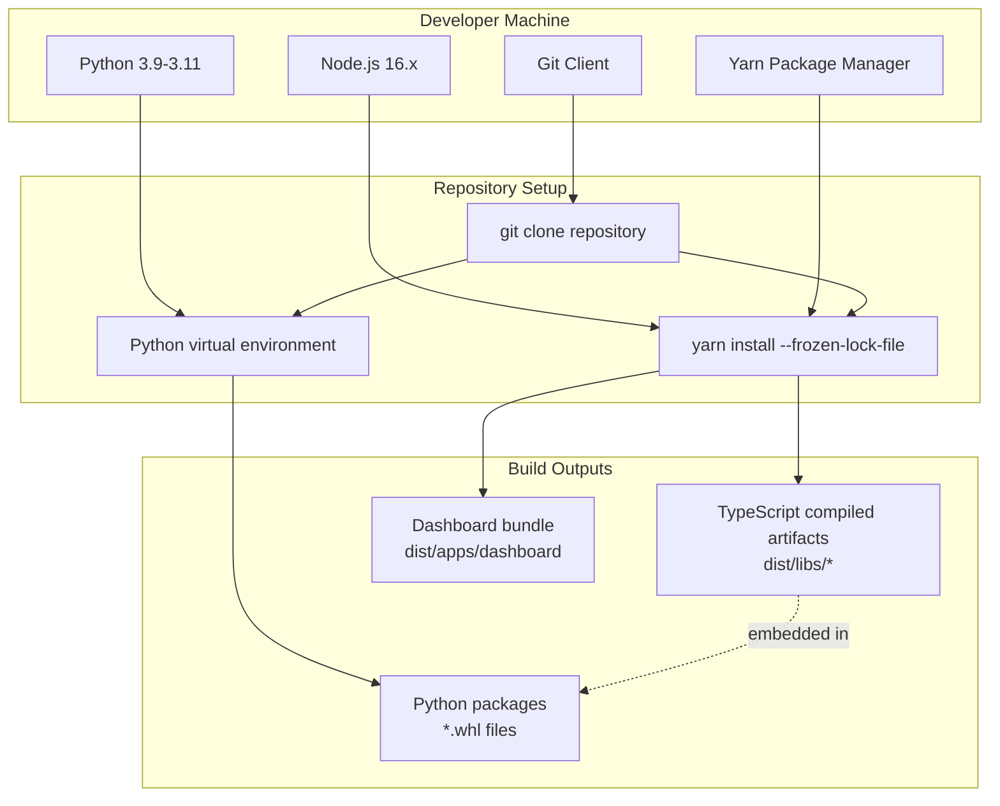
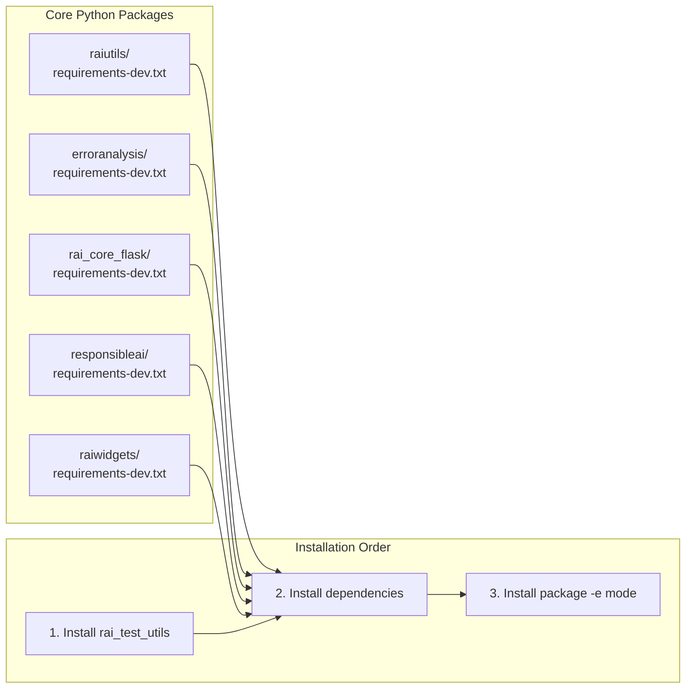
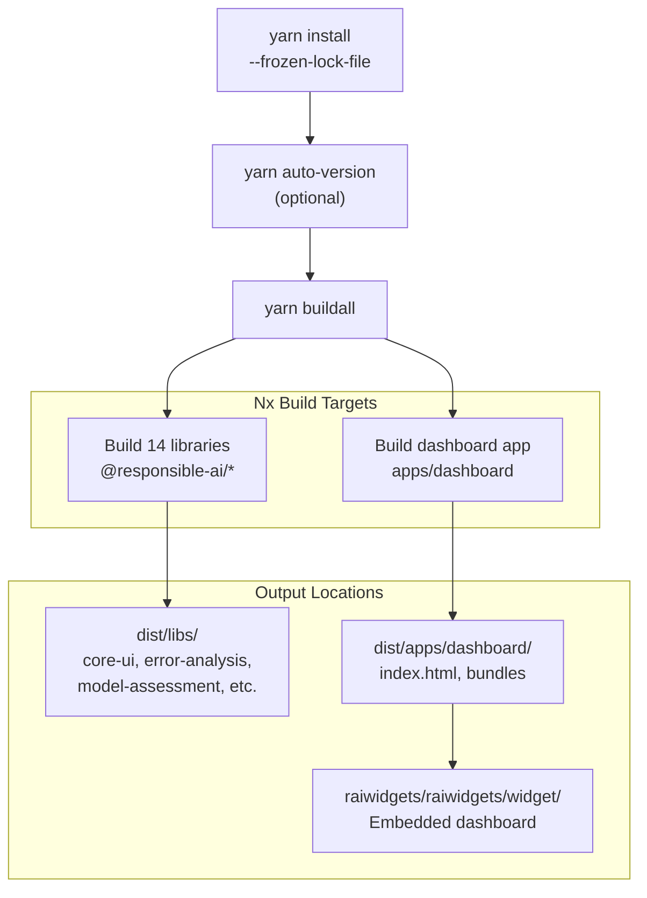
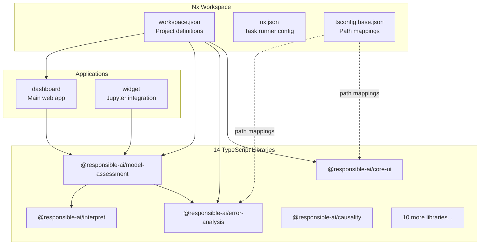

<!-- source: DeepWiki mcp.deepwiki.com · repo microsoft/responsible-ai-toolbox · page 6.2 Development Setup · fetched 2026-10-26 -->

# Development Setup

<details>
<summary>Relevant source files</summary>

The following files were used as context for generating this wiki page:

- [.azure-devops/component-governance.yml](.azure-devops/component-governance.yml)
- [.github/workflows/CD.yml](.github/workflows/CD.yml)
- [.github/workflows/CI-codescan.yml](.github/workflows/CI-codescan.yml)
- [.github/workflows/CI-e2e-notebooks.yml](.github/workflows/CI-e2e-notebooks.yml)
- [.github/workflows/CI-notebook.yml](.github/workflows/CI-notebook.yml)
- [.github/workflows/CI-python.yml](.github/workflows/CI-python.yml)
- [.github/workflows/CI-rai_core_flask-pytest.yml](.github/workflows/CI-rai_core_flask-pytest.yml)
- [.github/workflows/CI-raiwidgets-pytest.yml](.github/workflows/CI-raiwidgets-pytest.yml)
- [.github/workflows/CI-typescript.yml](.github/workflows/CI-typescript.yml)
- [.github/workflows/GitHubPages.yml](.github/workflows/GitHubPages.yml)
- [.github/workflows/python-linting.yml](.github/workflows/python-linting.yml)
- [.github/workflows/release-rai-tabular.yml](.github/workflows/release-rai-tabular.yml)
- [apps/dashboard-e2e/src/describer/interpret/individualFeatureImportance/describeSubBarChart.ts](apps/dashboard-e2e/src/describer/interpret/individualFeatureImportance/describeSubBarChart.ts)
- [libs/e2e/src/lib/describer/interpretText/validateBarChart.ts](libs/e2e/src/lib/describer/interpretText/validateBarChart.ts)
- [libs/mlchartlib/src/lib/components/AccessibleChart.tsx](libs/mlchartlib/src/lib/components/AccessibleChart.tsx)
- [nx.json](nx.json)
- [package.json](package.json)
- [tsconfig.base.json](tsconfig.base.json)
- [workspace.json](workspace.json)
- [yarn.lock](yarn.lock)

</details>


This page provides instructions for setting up a local development environment to contribute to the Responsible AI Toolbox. It covers prerequisites, environment configuration, dependency installation, building, and running tests. For information about the repository structure, see [Repository Structure](#6.1). For release processes, see [Package Versioning and Releases](#6.3).

## Overview

The Responsible AI Toolbox is a hybrid Python/TypeScript monorepo. Development requires both Python (3.9+) and Node.js (16.x) environments. The TypeScript dashboard is built using Nx and Yarn, while Python packages use standard pip-based workflows.



Sources: [.github/workflows/CD.yml:12-16](), [.github/workflows/CI-python.yml:22](), [.github/workflows/CI-notebook.yml:12]()

## Prerequisites

### Required Software

| Tool | Version | Purpose |
|------|---------|---------|
| Python | 3.9, 3.10, or 3.11 | Python package development |
| Node.js | 16.x | TypeScript/React development |
| Yarn | Latest (1.x) | JavaScript dependency management |
| Git | Latest | Version control |

**Python Version Support Matrix:**

The following Python/OS combinations are tested in CI:

| Package | Ubuntu | macOS | Windows | Python Versions |
|---------|--------|-------|---------|----------------|
| `responsibleai` | ✓ | ✓ | ✓ | 3.9, 3.10 |
| `erroranalysis` | ✓ | ✓ | ✓ | 3.9, 3.10, 3.11 |
| `raiutils` | ✓ | ✓ | ✓ | 3.9, 3.10, 3.11 |
| `raiwidgets` | ✓ | ✓ | ✓ | 3.9, 3.10 |
| `rai_core_flask` | ✓ | ✓ | ✓ | 3.8-3.11 |

Sources: [.github/workflows/CI-python.yml:21-28](), [.github/workflows/CI-raiwidgets-pytest.yml:20-24](), [.github/workflows/CI-rai_core_flask-pytest.yml:21]()

### Platform-Specific Dependencies

**macOS:**
```bash
brew install libomp
```

**Conda environments (for notebook development):**
```bash
conda install pytorch torchvision captum cpuonly -c pytorch
```

Sources: [.github/workflows/CI-python.yml:46-49](), [.github/workflows/CI-notebook.yml:44-48]()

## Initial Repository Setup

### 1. Clone the Repository

```bash
git clone https://github.com/microsoft/responsible-ai-toolbox.git
cd responsible-ai-toolbox
```

### 2. Set Up Python Environment

Create a virtual environment (recommended):

```bash
python -m venv .venv
source .venv/bin/activate  # On Windows: .venv\Scripts\activate
```

Upgrade core tools:

```bash
python -m pip install --upgrade pip
pip install --upgrade setuptools wheel twine
pip install --upgrade "pip-tools<=7.1.0"
```

Sources: [.github/workflows/CD.yml:73-76](), [.github/workflows/CI-python.yml:40-44]()

### 3. Install Node.js Dependencies

```bash
npm install yarn -g
yarn install --frozen-lock-file
```

The `--frozen-lock-file` flag ensures reproducible builds by using exact versions from `yarn.lock`.

Sources: [.github/workflows/CD.yml:59-62](), [package.json:1-158]()

## Package-by-Package Setup



Sources: [.github/workflows/CD.yml:77-90]()

### Core Package: `raiutils`

```bash
cd raiutils
pip install -r requirements-dev.txt
pip install -e .
cd ..
```

### Error Analysis: `erroranalysis`

```bash
cd erroranalysis
pip install -r requirements-dev.txt
pip install -e .
cd ..
```

### Flask Backend: `rai_core_flask`

```bash
cd rai_core_flask
pip install -r requirements-dev.txt
pip install -e .
cd ..
```

### Main Package: `responsibleai`

```bash
cd responsibleai
pip install -r requirements.txt
pip install -r requirements-dev.txt
pip install -e .
cd ..
```

Sources: [.github/workflows/CD.yml:77-81](), [.github/workflows/CI-python.yml:51-59]()

### Dashboard Widgets: `raiwidgets`

This package requires the TypeScript dashboard to be built first (see next section).

```bash
cd raiwidgets
pip install -r requirements.txt
pip install -r requirements-dev.txt
pip install -e .
cd ..
```

Sources: [.github/workflows/CD.yml:82-86]()

### Test Utilities: `rai_test_utils`

```bash
cd rai_test_utils
pip install -v -e .
cd ..
```

Sources: [.github/workflows/CD.yml:87-90]()

## TypeScript Dashboard Build

The TypeScript dashboard must be built before installing `raiwidgets`, as the compiled JavaScript artifacts are embedded in the Python package.

### Build Process Flow



Sources: [.github/workflows/CD.yml:59-70](), [package.json:17-18]()

### Build Commands

**Development Build (faster, includes source maps):**
```bash
yarn builddebug
```

**Production Build (optimized, used for releases):**
```bash
yarn buildall
```

The production build allocates 6GB of memory for the build process:

Sources: [package.json:17-18](), [.github/workflows/CD.yml:69-70]()

### Build Configuration

The build system uses Nx with the following key configurations:

- **Memory Limit:** 6GB for production builds, 4GB for debug builds
- **Builder:** `@nrwl/web:package` for libraries, `@nrwl/web:build` for dashboard app
- **Bundler:** Rollup for libraries, Webpack for dashboard
- **TypeScript Config:** Individual `tsconfig.lib.json` per library

Sources: [workspace.json:99-130](), [package.json:17-18]()

### Nx Monorepo Structure



Sources: [workspace.json:1-100](), [nx.json:1-90](), [tsconfig.base.json:37-56]()

## Verification: Running Tests

### Python Unit Tests

Each Python package has its own test suite using `pytest`:

```bash
# Test individual packages
cd responsibleai
pytest -s -v --durations=10 --doctest-modules --junitxml=junit/test-results.xml --cov=responsibleai --cov-report=xml --cov-report=html

cd ../erroranalysis
pytest -s -v --durations=10 --doctest-modules --cov=erroranalysis --cov-report=xml

cd ../raiwidgets
pytest -s -v --durations=10 --cov=raiwidgets --cov-report=xml
```

Sources: [.github/workflows/CI-python.yml:74-77](), [.github/workflows/CI-raiwidgets-pytest.yml:106-111]()

### TypeScript Tests

The TypeScript codebase uses Jest for unit tests:

```bash
# Run all tests
yarn testall

# Run tests for specific library
yarn nx test core-ui
yarn nx test error-analysis
```

Sources: [package.json:39]()

### End-to-End Tests

**Dashboard E2E (Cypress):**
```bash
yarn e2e
```

**Widget E2E (Notebook-based):**
```bash
yarn e2e-widget -n "responsibleaidashboard-census-classification-model-debugging" -f ""
```

Sources: [package.json:22-24](), [.github/workflows/CI-e2e-notebooks.yml:122-126]()

### Linting

**Python:**
```bash
flake8
isort . -c
```

**TypeScript:**
```bash
yarn lintall
```

Sources: [.github/workflows/python-linting.yml:24-29](), [package.json:31]()

## Development Workflow Scripts

The repository provides several convenience scripts in `package.json`:

| Script | Purpose | Command |
|--------|---------|---------|
| `yarn buildall` | Production build all packages | Uses 6GB memory |
| `yarn builddebug` | Debug build with source maps | Faster iteration |
| `yarn testall` | Run all TypeScript tests | Jest unit tests |
| `yarn lintall` | Lint all TypeScript code | ESLint + Prettier |
| `yarn lintfix` | Auto-fix linting issues | ESLint --fix |
| `yarn start` | Dev server for dashboard | Hot reload enabled |
| `yarn e2e` | Run Cypress E2E tests | Dashboard integration |
| `yarn ci` | Full CI pipeline locally | All checks |

Sources: [package.json:6-42]()

## Common Development Tasks

### Rebuilding After Changes

**TypeScript changes only:**
```bash
yarn buildall
# Then reinstall raiwidgets if needed
cd raiwidgets && pip install -e . && cd ..
```

**Python changes only:**
No rebuild needed if installed with `-e` (editable mode).

**Both TypeScript and Python:**
```bash
yarn buildall
cd raiwidgets && pip install -e . && cd ..
```

### Testing Locally Before PR

Run the full CI suite locally:
```bash
yarn ci
```

This executes: `yarn install --frozen-lock-file && yarn testall --codeCoverage && yarn lintall && yarn buildall && yarn test && yarn e2e`

Sources: [package.json:19]()

### Memory Configuration

If builds fail with out-of-memory errors, the scripts already configure appropriate limits:

- **Production build:** `NODE_OPTIONS=--max_old_space_size=6144`
- **Debug build:** `NODE_OPTIONS=--max_old_space_size=6144`
- **Linting:** `NODE_OPTIONS=--max_old_space_size=4096`

Sources: [package.json:17-18, 30-32]()

## IDE Configuration

### VS Code

Recommended extensions:
- Python
- Pylance
- ESLint
- Prettier
- Jest

### Python Import Paths

The repository uses relative imports. Ensure your IDE Python path includes:
- `responsibleai/`
- `raiwidgets/`
- `erroranalysis/`
- `raiutils/`
- `rai_core_flask/`

### TypeScript Path Mappings

The TypeScript paths are configured in `tsconfig.base.json` and automatically recognized by IDE:

```json
"@responsible-ai/core-ui": ["libs/core-ui/src/index.ts"],
"@responsible-ai/error-analysis": ["libs/error-analysis/src/index.ts"],
...
```

Sources: [tsconfig.base.json:37-56]()

## Troubleshooting

### Common Issues

**Issue:** `yarn install` fails on macOS  
**Solution:** Install native dependencies: `brew install cairo pango libomp`

Sources: [.github/workflows/CI-raiwidgets-pytest.yml:60-64]()

**Issue:** Python tests fail with import errors  
**Solution:** Ensure packages are installed in correct order (see dependency graph in [Package Dependencies](#3.1))

**Issue:** `yarn buildall` runs out of memory  
**Solution:** The script already allocates 6GB; check available system memory

**Issue:** Conda environment conflicts  
**Solution:** Use specific channels: `conda install --yes --quiet pytorch torchvision captum cpuonly -c pytorch`

Sources: [.github/workflows/CI-notebook.yml:47-48]()

### Dependency Version Pinning

The repository uses `yarn.lock` for deterministic TypeScript builds and `requirements-dev.txt` with `pip-tools` for Python:

```bash
# Update Python dependencies
cd <package-directory>
pip-compile requirements-dev.txt -o requirements-dev-comp.txt
pip-sync requirements-dev-comp.txt
```

Sources: [.github/workflows/CI-rai_core_flask-pytest.yml:53-68]()

## Next Steps

After setting up your development environment:

1. Review [Repository Structure](#6.1) to understand the codebase organization
2. See [Testing Strategy](#7.1) for writing tests
3. Consult [Package Versioning and Releases](#6.3) before submitting PRs

Sources: All workflow files in `.github/workflows/` directory

---

