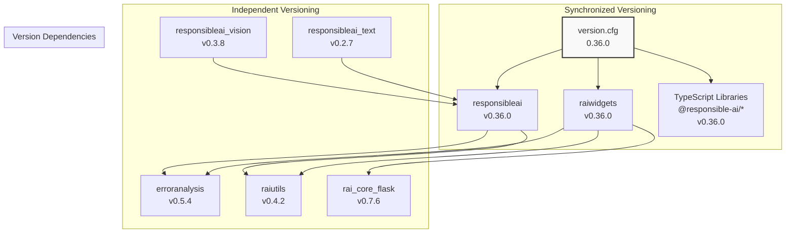
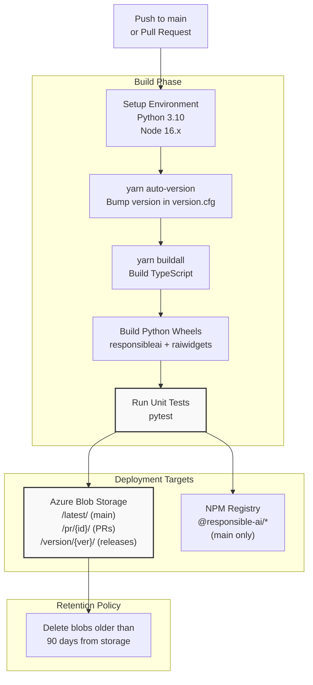
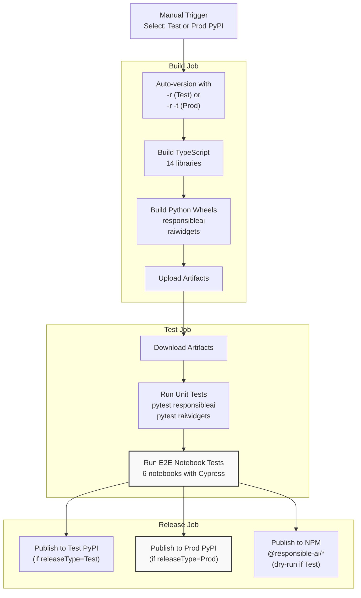

<!-- source: DeepWiki mcp.deepwiki.com · repo microsoft/responsible-ai-toolbox · page 6.3 Package Versioning and Releases · fetched 2026-10-26 -->

# Package Versioning and Releases

<details>
<summary>Relevant source files</summary>

The following files were used as context for generating this wiki page:

- [.azure-devops/component-governance.yml](.azure-devops/component-governance.yml)
- [.github/workflows/CD.yml](.github/workflows/CD.yml)
- [.github/workflows/CI-codescan.yml](.github/workflows/CI-codescan.yml)
- [.github/workflows/CI-e2e-notebooks.yml](.github/workflows/CI-e2e-notebooks.yml)
- [.github/workflows/CI-notebook.yml](.github/workflows/CI-notebook.yml)
- [.github/workflows/CI-python.yml](.github/workflows/CI-python.yml)
- [.github/workflows/CI-rai_core_flask-pytest.yml](.github/workflows/CI-rai_core_flask-pytest.yml)
- [.github/workflows/CI-raiwidgets-pytest.yml](.github/workflows/CI-raiwidgets-pytest.yml)
- [.github/workflows/CI-typescript.yml](.github/workflows/CI-typescript.yml)
- [.github/workflows/GitHubPages.yml](.github/workflows/GitHubPages.yml)
- [.github/workflows/python-linting.yml](.github/workflows/python-linting.yml)
- [.github/workflows/release-rai-tabular.yml](.github/workflows/release-rai-tabular.yml)
- [CHANGES.md](CHANGES.md)
- [erroranalysis/requirements-dev.txt](erroranalysis/requirements-dev.txt)
- [erroranalysis/requirements.txt](erroranalysis/requirements.txt)
- [nlp_feature_extractors/requirements.txt](nlp_feature_extractors/requirements.txt)
- [rai_core_flask/requirements.txt](rai_core_flask/requirements.txt)
- [raiwidgets/requirements.txt](raiwidgets/requirements.txt)
- [responsibleai/requirements-dev.txt](responsibleai/requirements-dev.txt)
- [responsibleai/requirements.txt](responsibleai/requirements.txt)
- [responsibleai_text/responsibleai_text/version.py](responsibleai_text/responsibleai_text/version.py)
- [responsibleai_vision/responsibleai_vision/version.py](responsibleai_vision/responsibleai_vision/version.py)
- [version.cfg](version.cfg)

</details>


This page documents the versioning strategy and release process for the Responsible AI Toolbox. It covers how version numbers are assigned, coordinated across packages, automatically bumped, and how releases are published to PyPI and NPM registries.

For information about the overall package structure and dependencies, see [Package Dependencies and Versioning](#3.1). For details on CI/CD pipelines that support the release process, see [CI/CD Pipelines](#7.2).

## Version Numbering Scheme

The repository uses semantic versioning (MAJOR.MINOR.PATCH) with two distinct versioning strategies:

**Synchronized Versioning**: Core packages share a common version number stored in [version.cfg:1]():
- `responsibleai` 
- `raiwidgets`
- Core TypeScript libraries

**Independent Versioning**: Specialized packages maintain their own version numbers:
- `responsibleai_vision` - currently 0.3.8 ([responsibleai_vision/responsibleai_vision/version.py:5-8]())
- `responsibleai_text` - currently 0.2.7 ([responsibleai_text/responsibleai_text/version.py:5-8]())
- `erroranalysis`
- `raiutils`
- `rai_core_flask`

This dual strategy allows specialized packages to evolve at different rates while maintaining API stability for core components.

**Sources:** [version.cfg](), [responsibleai_vision/responsibleai_vision/version.py](), [responsibleai_text/responsibleai_text/version.py](), [CHANGES.md:27-39]()

## Package Version Relationships



**Diagram: Version Management Architecture**

The diagram shows how `version.cfg` drives synchronized versioning for core packages while specialized packages maintain independent versions. Dependencies use minimum version constraints (`>=`) to ensure compatibility.

**Sources:** [version.cfg](), [responsibleai/requirements.txt:5,21](), [raiwidgets/requirements.txt:4,7,9]()

## Version Configuration Files

| Package | Version Location | Format | Example |
|---------|-----------------|--------|---------|
| Core (sync) | `version.cfg` | Plain text | `0.36.0` |
| responsibleai_vision | `responsibleai_vision/version.py` | Python module | `_major='0'`, `_minor='3'`, `_patch='8'` |
| responsibleai_text | `responsibleai_text/version.py` | Python module | `_major='0'`, `_minor='2'`, `_patch='7'` |
| TypeScript libs | `package.json` in each library | JSON | `"version": "0.36.0"` |

The vision and text packages define version components separately ([responsibleai_vision/responsibleai_vision/version.py:5-8](), [responsibleai_text/responsibleai_text/version.py:5-8]()), allowing programmatic access:

```python
# responsibleai_vision/version.py
name = 'responsibleai_vision'
_major = '0'
_minor = '3'
_patch = '8'
version = '{}.{}.{}'.format(_major, _minor, _patch)
```

**Sources:** [version.cfg](), [responsibleai_vision/responsibleai_vision/version.py](), [responsibleai_text/responsibleai_text/version.py]()

## Dependency Version Constraints

Dependencies use minimum version constraints with explicit upper bounds where necessary to prevent breaking changes:

### Python Package Dependencies

**responsibleai** ([responsibleai/requirements.txt:1-22]()):
```
erroranalysis>=0.5.4
raiutils>=0.4.2
scikit-learn>=0.22.1,!=1.1,<=1.5.1  # Upper bound with exclusion
numpy>=1.17.2,<=1.26.2               # Strict upper bound
pandas>=0.25.1,<2.0.0                # Major version cap
```

**raiwidgets** ([raiwidgets/requirements.txt:1-10]()):
```
rai-core-flask>=0.7.6
erroranalysis>=0.5.4
fairlearn==0.7.0                     # Exact pinning for stability
raiutils>=0.4.2
```

**erroranalysis** ([erroranalysis/requirements.txt:1-6]()):
```
raiutils>=0.4.2
numpy>=1.17.2,<2.0.0
pandas>=0.25.1,<2.0.0
```

The `>=` constraint ensures packages can receive bug fixes, while upper bounds prevent incompatible major version updates. The `fairlearn==0.7.0` exact pin ([raiwidgets/requirements.txt:8]()) indicates a specific API dependency.

**Sources:** [responsibleai/requirements.txt](), [raiwidgets/requirements.txt](), [erroranalysis/requirements.txt]()

## Automatic Version Bumping

The CD workflow uses the `yarn auto-version` command to automatically bump version numbers in [.github/workflows/CD.yml:63-64]():

```yaml
- name: bump version
  run: yarn auto-version
- name: Get version
  id: version
  run: echo "version=$(cat version.cfg)" >> $GITHUB_OUTPUT
```

This command:
1. Reads the current version from `version.cfg`
2. Increments the PATCH version automatically
3. Updates `version.cfg` and all synchronized `package.json` files
4. The updated version is captured for use in deployment paths

For releases, the manual workflow supports different version bumping modes ([.github/workflows/release-rai-tabular.yml:52-59]()):

```yaml
- name: auto version
  if: ${{ github.event.inputs.releaseType == 'Test' }}
  run: |
    yarn auto-version -r       # Regular version bump
- name: auto version
  if: ${{ github.event.inputs.releaseType == 'Prod' }}
  run: |
    yarn auto-version -r -t    # Production release bump
```

The `-r` flag indicates a release bump, and `-t` flag signals a production (tagged) release.

**Sources:** [.github/workflows/CD.yml:63-67](), [.github/workflows/release-rai-tabular.yml:52-59]()

## Release Workflows

### Continuous Deployment (CD) Workflow



**Diagram: Continuous Deployment Workflow**

The CD workflow ([.github/workflows/CD.yml]()) runs on every push to main and all pull requests. It builds artifacts and deploys them to Azure Blob Storage for preview, with a 90-day retention policy ([.github/workflows/CD.yml:16,182-194]()).

**Sources:** [.github/workflows/CD.yml:18-243]()

### Manual Release Workflow



**Diagram: Manual Release Workflow**

The manual release workflow ([.github/workflows/release-rai-tabular.yml]()) is triggered manually with a choice of Test or Prod PyPI as the target. It requires all tests to pass before publishing.

**Sources:** [.github/workflows/release-rai-tabular.yml:1-364]()

## Testing Requirements Before Release

All releases must pass comprehensive testing across multiple dimensions:

### Test Matrix for Python Packages

**CI Python Tests** ([.github/workflows/CI-python.yml:16-29]()):

| Package | Operating Systems | Python Versions |
|---------|------------------|-----------------|
| responsibleai | ubuntu, macos, windows | 3.9, 3.10 (3.11 excluded) |
| erroranalysis | ubuntu, macos, windows | 3.9, 3.10, 3.11 |
| raiutils | ubuntu, macos, windows | 3.9, 3.10, 3.11 |
| rai_test_utils | ubuntu, macos, windows | 3.9, 3.10, 3.11 |

**Exclusions:**
- `responsibleai` excludes Python 3.11 ([.github/workflows/CI-python.yml:24-25]())
- `responsibleai` excludes macOS + Python 3.9 ([.github/workflows/CI-python.yml:26-28]())

### Test Suites Run Before Release

The manual release workflow ([.github/workflows/release-rai-tabular.yml:127-260]()) executes:

1. **Unit Tests** (`test-unittests` job):
   - Install wheels locally
   - Run `pytest -s -v ./tests/` for both responsibleai and raiwidgets

2. **E2E Notebook Tests** (`test-e2e-notebooks` job):
   - Install PyTorch with CPU-only support
   - Run 6 comprehensive notebooks via `yarn e2e-widget`:
     - `responsibleaidashboard-census-classification-model-debugging`
     - `responsibleaidashboard-diabetes-regression-model-debugging`
     - `responsibleaidashboard-housing-decision-making`
     - `responsibleaidashboard-housing-classification-model-debugging`
     - `responsibleaidashboard-diabetes-decision-making`
     - `responsibleaidashboard-multiclass-dnn-model-debugging`

Only if both test jobs succeed does the workflow proceed to publishing.

**Sources:** [.github/workflows/CI-python.yml:16-29](), [.github/workflows/release-rai-tabular.yml:127-260]()

## Publishing to Registries

### PyPI Publishing

The release workflow publishes Python packages to PyPI using the `pypa/gh-action-pypi-publish` action ([.github/workflows/release-rai-tabular.yml:261-313]()):

**Test PyPI:**
```yaml
- name: Publish responsibleai package to Test PyPI
  if: ${{ github.event.inputs.releaseType == 'Test' && matrix.package == 'responsibleai' }}
  uses: pypa/gh-action-pypi-publish@release/v1
  with:
    user: __token__
    password: ${{ secrets.TEST_PYPI_API_TOKEN_RESPONSIBLEAI }}
    repository_url: https://test.pypi.org/legacy/
```

**Production PyPI:**
```yaml
- name: Publish responsibleai package to Prod PyPI
  if: ${{ github.event.inputs.releaseType == 'Prod' && matrix.package == 'responsibleai' }}
  uses: pypa/gh-action-pypi-publish@release/v1
  with:
    user: __token__
    password: ${{ secrets.PYPI_API_TOKEN_RESPONSIBLEAI }}
```

Separate API tokens are used for each package:
- `secrets.PYPI_API_TOKEN_RESPONSIBLEAI`
- `secrets.PYPI_API_TOKEN_RAIWIDGETS`
- `secrets.TEST_PYPI_API_TOKEN_RESPONSIBLEAI`
- `secrets.TEST_PYPI_API_TOKEN_RAIWIDGETS`

### NPM Publishing

TypeScript libraries are published to NPM using a matrix strategy ([.github/workflows/release-rai-tabular.yml:315-363]()):

```yaml
strategy:
  matrix:
    package:
      [
        core-ui,
        forecasting,
        mlchartlib,
        dataset-explorer,
        causality,
        counterfactuals,
        fairness,
        interpret,
        interpret-text,
        interpret-vision,
        localization,
        error-analysis,
        model-assessment,
        e2e
      ]
```

Each package is published with:
- `dry-run: ${{github.event.inputs.releaseType == 'Test'}}` - Test releases are not actually published
- `access: public` - All packages are publicly accessible
- `token: ${{ secrets.NPM_TOKEN }}` - Single NPM token for all packages

The CD workflow also publishes to NPM on every push to main ([.github/workflows/CD.yml:196-243]()), but only for the main branch, not pull requests.

**Sources:** [.github/workflows/release-rai-tabular.yml:261-363](), [.github/workflows/CD.yml:196-243]()

## Changelog Management

Version changes are documented in [CHANGES.md:1-85]() following a structured format:

```markdown
## v-next

- educational materials
- new features
- breaking changes
- bug fixes and tests
- other

## v0.36.0

- educational materials
  - Update getting-started.ipynb by @oohtmeel1 in #2572
- bug fixes and tests
  - ## Responsible AI Dashboard
    - Fix robot page exception - Update StatsTableUtils.ts by @tongyu-microsoft in #2568
```

Changes are grouped by category and sub-categorized by component (Responsible AI Dashboard, RAIInsights, RAI Vision, etc.). Each entry includes:
- Description of the change
- Author
- Pull request number

The `v-next` section is continuously updated during development and renamed to the actual version number at release time.

**Sources:** [CHANGES.md:1-85]()

## Version Update Checklist

When preparing a release:

1. **Update specialized package versions** if needed:
   - Edit [responsibleai_vision/responsibleai_vision/version.py:5-8]()
   - Edit [responsibleai_text/responsibleai_text/version.py:5-8]()

2. **Update dependency versions** in requirements.txt files:
   - Ensure `responsibleai_vision` and `responsibleai_text` pin to the latest `responsibleai` version
   - Update minimum versions for `erroranalysis`, `raiutils`, `rai_core_flask`

3. **Update CHANGES.md**:
   - Rename `v-next` to the new version number
   - Create a new `v-next` section

4. **Trigger manual release workflow**:
   - Select "Test" to validate without publishing
   - Select "Prod" to publish to production registries

5. **Verify test passage**:
   - Monitor `test-unittests` job completion
   - Monitor `test-e2e-notebooks` job completion

6. **Confirm publication**:
   - Check PyPI for new versions
   - Check NPM for new versions
   - Verify Azure Blob Storage updates

**Sources:** [.github/workflows/release-rai-tabular.yml:10-18](), [CHANGES.md:19-26]()

---

