<!-- source: DeepWiki mcp.deepwiki.com · repo microsoft/responsible-ai-toolbox · page 7 Testing and CI/CD · fetched 2026-10-26 -->

# Testing and CI/CD

<details>
<summary>Relevant source files</summary>

The following files were used as context for generating this wiki page:

- [.azure-devops/component-governance.yml](.azure-devops/component-governance.yml)
- [.github/workflows/CD.yml](.github/workflows/CD.yml)
- [.github/workflows/CI-codescan.yml](.github/workflows/CI-codescan.yml)
- [.github/workflows/CI-e2e-notebooks.yml](.github/workflows/CI-e2e-notebooks.yml)
- [.github/workflows/CI-notebook.yml](.github/workflows/CI-notebook.yml)
- [.github/workflows/CI-python.yml](.github/workflows/CI-python.yml)
- [.github/workflows/CI-rai_core_flask-pytest.yml](.github/workflows/CI-rai_core_flask-pytest.yml)
- [.github/workflows/CI-raiwidgets-pytest.yml](.github/workflows/CI-raiwidgets-pytest.yml)
- [.github/workflows/CI-typescript.yml](.github/workflows/CI-typescript.yml)
- [.github/workflows/GitHubPages.yml](.github/workflows/GitHubPages.yml)
- [.github/workflows/python-linting.yml](.github/workflows/python-linting.yml)
- [.github/workflows/release-rai-tabular.yml](.github/workflows/release-rai-tabular.yml)
- [README.md](README.md)
- [notebooks/responsibleaidashboard/text/responsibleaidashboard-openai-model-debugging.ipynb](notebooks/responsibleaidashboard/text/responsibleaidashboard-openai-model-debugging.ipynb)
- [notebooks/test_notebooks.py](notebooks/test_notebooks.py)
- [scripts/e2e-widget.js](scripts/e2e-widget.js)

</details>


This page documents the testing infrastructure and continuous integration/deployment (CI/CD) pipelines for the Responsible AI Toolbox. The repository uses GitHub Actions for all automation, with comprehensive test coverage across Python packages, TypeScript libraries, Jupyter notebooks, and end-to-end widget integration.

For information about development environment setup, see [Development Setup](#6.2). For package versioning and release coordination, see [Package Versioning and Releases](#6.3).

## Overview

The testing and CI/CD strategy follows a multi-layered approach:

1. **Unit and Integration Tests**: Python packages use `pytest`, TypeScript libraries use `Jest`
2. **Notebook Tests**: Jupyter notebooks executed with `papermill` and validated with `scrapbook`
3. **End-to-End Tests**: Widget integration tested using `Cypress` against live notebook servers
4. **Quality Gates**: Code coverage tracking via `codecov`, linting with `flake8`/`isort`/`ESLint`, security scanning with `CodeQL`
5. **Continuous Deployment**: Automatic builds to Azure Blob Storage on every push/PR, manual releases to PyPI and NPM

All CI workflows run on a matrix of operating systems (Ubuntu, macOS, Windows) and Python/Node versions to ensure cross-platform compatibility.

---

## Testing Architecture Overview

```mermaid
graph TB
    subgraph "Test Execution Triggers"
        PushMain["Push to main"]
        PullRequest["Pull Request"]
        ManualRelease["Manual Release<br/>workflow_dispatch"]
    end
    
    subgraph "Python Test Workflows"
        CIPython["CI-python.yml<br/>4 packages × 3 OS × 3 Python"]
        CIRAIWidgets["CI-raiwidgets-pytest.yml<br/>raiwidgets package"]
        CIFlask["CI-rai_core_flask-pytest.yml<br/>rai_core_flask package"]
        CINotebook["CI-notebook.yml<br/>Notebook execution tests"]
    end
    
    subgraph "TypeScript Test Workflows"
        CITS["CI-typescript.yml<br/>Jest + ESLint"]
    end
    
    subgraph "E2E Test Workflows"
        CIE2E["CI-e2e-notebooks.yml<br/>Cypress widget tests"]
    end
    
    subgraph "Quality Gates"
        Linting["python-linting.yml<br/>flake8 + isort"]
        CodeScan["CI-codescan.yml<br/>CodeQL security"]
        Coverage["codecov.io<br/>Coverage tracking"]
    end
    
    subgraph "Build & Deploy"
        CD["CD.yml<br/>Build + Azure Blob"]
        Release["release-rai-tabular.yml<br/>PyPI + NPM publish"]
    end
    
    PushMain --> CIPython
    PushMain --> CIRAIWidgets
    PushMain --> CIFlask
    PushMain --> CINotebook
    PushMain --> CITS
    PushMain --> CIE2E
    PushMain --> Linting
    PushMain --> CodeScan
    PushMain --> CD
    
    PullRequest --> CIPython
    PullRequest --> CIRAIWidgets
    PullRequest --> CIFlask
    PullRequest --> CINotebook
    PullRequest --> CITS
    PullRequest --> CIE2E
    PullRequest --> Linting
    PullRequest --> CodeScan
    PullRequest --> CD
    
    ManualRelease --> Release
    
    CIPython --> Coverage
    CIRAIWidgets --> Coverage
    CIFlask --> Coverage
    
    style CIPython fill:#f9f9f9
    style CIRAIWidgets fill:#f9f9f9
    style CIFlask fill:#f9f9f9
    style CINotebook fill:#f9f9f9
    style CITS fill:#f9f9f9
    style CIE2E fill:#f9f9f9
    style CD fill:#e8f5e9
    style Release fill:#e8f5e9
```

**Sources:** [.github/workflows/CI-python.yml](), [.github/workflows/CI-raiwidgets-pytest.yml](), [.github/workflows/CI-typescript.yml](), [.github/workflows/CD.yml]()

---

## Python Unit and Integration Tests

Python tests use the `pytest` framework with coverage tracking via `pytest-cov`. Tests are organized by package, with each package containing its own `tests/` directory.

### Test Matrix Configuration

The Python CI workflow [.github/workflows/CI-python.yml:15-29]() defines a comprehensive test matrix:

| Package | Operating Systems | Python Versions |
|---------|------------------|-----------------|
| `responsibleai` | ubuntu-latest, macos-latest, windows-latest | 3.9, 3.10 (excludes 3.11, excludes macOS+3.9) |
| `erroranalysis` | ubuntu-latest, macos-latest, windows-latest | 3.9, 3.10, 3.11 |
| `raiutils` | ubuntu-latest, macos-latest, windows-latest | 3.9, 3.10, 3.11 |
| `rai_test_utils` | ubuntu-latest, macos-latest, windows-latest | 3.9, 3.10, 3.11 |

The `raiwidgets` package has a separate workflow [.github/workflows/CI-raiwidgets-pytest.yml]() that includes TypeScript build steps before running Python tests.

### Test Execution Workflow

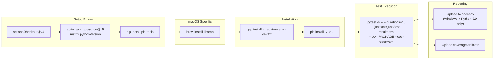

**Sources:** [.github/workflows/CI-python.yml:32-124]()

### pytest Configuration

Test execution uses the following pytest flags [.github/workflows/CI-python.yml:76]():

- `-s`: No output capturing (show print statements)
- `-v`: Verbose output
- `--durations=10`: Show 10 slowest tests
- `--doctest-modules`: Run doctests in modules
- `--junitxml=junit/test-results.xml`: Generate JUnit XML report
- `--cov=$PACKAGE`: Enable coverage for the package
- `--cov-report=xml`: Generate XML coverage report
- `--cov-report=html`: Generate HTML coverage report

### rai_core_flask Testing

The `rai_core_flask` package has unique requirements and uses `pip-compile` for dependency management [.github/workflows/CI-rai_core_flask-pytest.yml:53-68]():

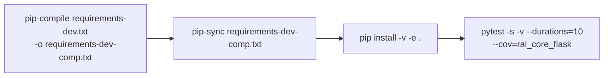

It tests across Python versions 3.8, 3.9, 3.10, and 3.11 with varying OS combinations [.github/workflows/CI-rai_core_flask-pytest.yml:19-34]().

**Sources:** [.github/workflows/CI-rai_core_flask-pytest.yml]()

---

## TypeScript Unit Tests

TypeScript tests use the `Jest` framework with test files co-located in `libs/*/src/**/*.test.ts` files. The Nx monorepo structure allows running tests for individual libraries or all libraries at once.

### Test Execution via yarn ci

The main TypeScript CI workflow [.github/workflows/CI-typescript.yml:31-32]() runs:

```bash
yarn ci
```

This command (defined in the root `package.json`) executes:
1. **Linting**: `yarn lint` - ESLint across all 14 TypeScript libraries
2. **Unit Tests**: `yarn test` - Jest tests with coverage
3. **Build**: `yarn buildall` - TypeScript compilation and bundling
4. **E2E Tests**: Cypress component tests (if configured)

### Test Matrix

Tests run on Node.js versions 14.x and 16.x on Ubuntu [.github/workflows/CI-typescript.yml:19-22]().

### Coverage Artifacts

Test coverage reports are uploaded as artifacts [.github/workflows/CI-typescript.yml:33-38]():

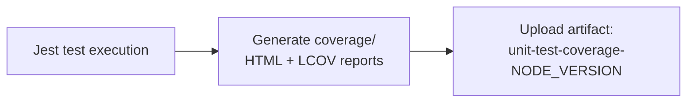

**Sources:** [.github/workflows/CI-typescript.yml]()

---

## Notebook Tests

Jupyter notebooks are tested using `papermill` for execution and `scrapbook` for validation. This ensures example notebooks remain functional and produce expected outputs.

### Notebook Test Framework Architecture

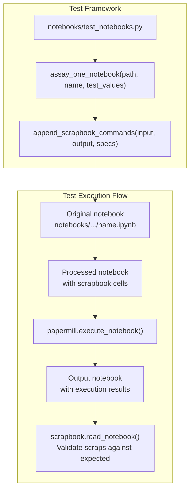

**Test Notebook Implementation**

The test framework [notebooks/test_notebooks.py:52-71]() works as follows:

1. **Read notebook**: Load the original `.ipynb` file using `nbformat`
2. **Append scrapbook cells**: Add cells that "glue" values to the scrapbook
   ```python
   import scrapbook as sb
   sb.glue("key", expression_to_evaluate)
   ```
3. **Execute with papermill**: Run the modified notebook
4. **Validate results**: Read scrapbook values and assert equality

Example test specification [notebooks/test_notebooks.py:109-114]():

```python
test_values = {}
test_values["race_group_sizes"] = ScrapSpec(
    "X_raw['race'].value_counts().to_dict()",
    RACE_GROUP_SIZES_ADULT
)
```

### Notebook Test Categories

Tests are marked with pytest markers:

- `@pytest.mark.notebooks`: Standard tabular notebooks [notebooks/test_notebooks.py:104]()
- `@pytest.mark.vision_notebooks`: Vision notebooks [notebooks/test_notebooks.py:263]()
- `@pytest.mark.text_notebooks`: Text/NLP notebooks [notebooks/test_notebooks.py:314]()

### CI Workflow for Notebooks

The notebook CI workflow [.github/workflows/CI-notebook.yml]() runs on Ubuntu and Windows with Python 3.9 and 3.10:

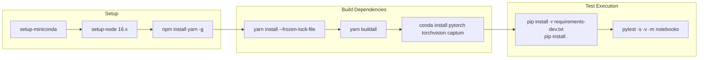

**Sources:** [notebooks/test_notebooks.py](), [.github/workflows/CI-notebook.yml]()

---

## End-to-End Tests

End-to-end tests validate the complete widget integration by running actual notebooks and testing the dashboard UI with Cypress.

### E2E Test Architecture

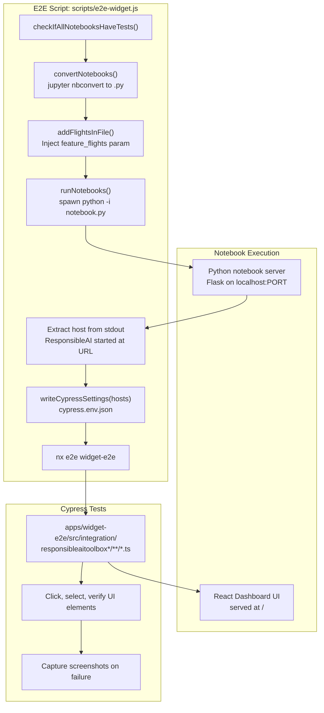

### E2E Workflow Execution

The script [scripts/e2e-widget.js]() orchestrates the entire E2E test process:

1. **Convert notebooks to Python** [scripts/e2e-widget.js:192-223](): Uses `jupyter nbconvert` to create `.py` files
2. **Inject feature flights** [scripts/e2e-widget.js:145-175](): Modifies `ResponsibleAIDashboard(...)` calls to add `feature_flights` parameter
3. **Run notebooks** [scripts/e2e-widget.js:116-143](): Spawns Python interpreter in interactive mode
4. **Extract host URL** [scripts/e2e-widget.js:132-135](): Parses stdout for `ResponsibleAI started at http://localhost:PORT`
5. **Write Cypress config** [scripts/e2e-widget.js:267-274](): Creates `apps/widget-e2e/cypress.env.json` with host URLs
6. **Execute Cypress** [scripts/e2e-widget.js:276-322](): Runs `nx e2e widget-e2e` with optional `--spec` filter

### E2E Test Matrix

The CI workflow [.github/workflows/CI-e2e-notebooks.yml:45-57]() tests combinations of:

| Dimension | Values |
|-----------|--------|
| Operating System | ubuntu-latest, windows-latest |
| Python Version | 3.9, 3.10 |
| Feature Flights | `""` (none), `"dataBalanceExperience"` |
| Notebook Group | `nb_group_1`, `nb_group_2`, `nb_group_3` |

Notebook groups [.github/workflows/CI-e2e-notebooks.yml:120-140]():

- **nb_group_1**: `responsibleaidashboard-census-classification-model-debugging`, `responsibleaidashboard-diabetes-regression-model-debugging`, `responsibleaidashboard-housing-decision-making`
- **nb_group_2**: `responsibleaidashboard-housing-classification-model-debugging`, `responsibleaidashboard-diabetes-decision-making`, `responsibleaidashboard-multiclass-dnn-model-debugging`
- **nb_group_3**: `responsibleaidashboard-orange-juice-forecasting` (excludes dataBalanceExperience flight)

### Notebook Registry

The script maintains a registry of testable notebooks [scripts/e2e-widget.js:16-38]():

```javascript
const tabularFileNames = [
  "responsibleaidashboard-census-classification-model-debugging",
  "responsibleaidashboard-diabetes-regression-model-debugging",
  // ... more tabular notebooks
];
const visionFileNames = [
  "responsibleaidashboard-fridge-image-classification-model-debugging",
  // ... more vision notebooks
];
const textFileNames = [
  "responsibleaidashboard-DBPedia-text-classification-model-debugging",
  // ... more text notebooks
];
const ignoredFiles = [
  "responsibleaidashboard-question-answering-model-debugging",
  "responsibleaidashboard-openai-model-debugging"
];
```

The script validates that all notebooks have tests [scripts/e2e-widget.js:177-190]().

**Sources:** [scripts/e2e-widget.js](), [.github/workflows/CI-e2e-notebooks.yml]()

---

## Code Quality Gates

### Python Linting

The linting workflow [.github/workflows/python-linting.yml]() enforces code style:

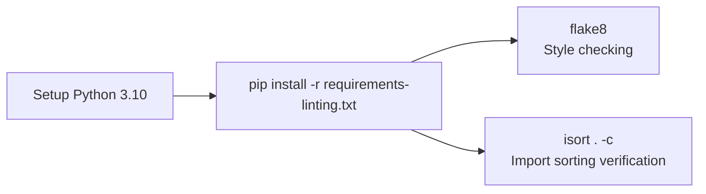

Runs on all pushes and pull requests to `main`.

### Security Scanning

CodeQL security analysis [.github/workflows/CI-codescan.yml:10-57]() scans both JavaScript and Python code:

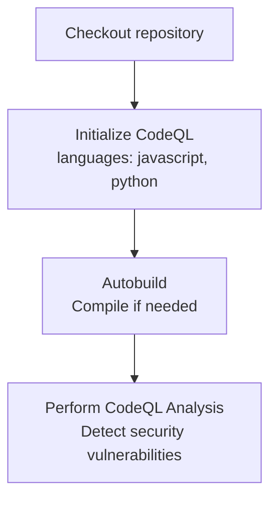

### Coverage Tracking

Code coverage is uploaded to `codecov.io` from specific matrix combinations [.github/workflows/CI-python.yml:87-99]():

- **Python packages**: Windows + Python 3.9 uploads coverage
- **rai_core_flask**: Windows + Python 3.8 uploads coverage
- **raiwidgets**: Windows + Python 3.9 uploads coverage

Retry logic handles upload failures [.github/workflows/CI-python.yml:101-123]().

**Sources:** [.github/workflows/python-linting.yml](), [.github/workflows/CI-codescan.yml](), [.github/workflows/CI-python.yml:87-123]()

---

## Continuous Deployment Workflow

The CD workflow [.github/workflows/CD.yml]() builds artifacts and deploys them to Azure Blob Storage on every push to `main` and every pull request.

### CD Pipeline Flow

```mermaid
graph TB
    subgraph "Build Phase"
        Checkout["Checkout code"]
        SetupPython["Setup Python 3.10"]
        SetupNode["Setup Node.js 16.x"]
        InstallYarn["npm install yarn -g"]
        YarnInstall["yarn install --frozen-lock-file"]
        AutoVersion["yarn auto-version<br/>Read version.cfg"]
        BuildTS["yarn buildall<br/>Compile all TS libs"]
    end
    
    subgraph "Python Build"
        InstallReqRAI["pip install -r requirements.txt<br/>-r requirements-dev.txt<br/>working-directory: responsibleai"]
        InstallReqWidget["pip install -r requirements.txt<br/>-r requirements-dev.txt<br/>working-directory: raiwidgets"]
        ReplaceREADME["Replace relative image paths<br/>with GitHub raw URLs"]
        BuildWheelRAI["python setup.py sdist bdist_wheel<br/>working-directory: raiwidgets"]
        BuildWheelWidget["python setup.py sdist bdist_wheel<br/>working-directory: responsibleai"]
    end
    
    subgraph "Test Built Wheels"
        InstallWheelRAI["pip install dist/*.whl<br/>working-directory: responsibleai"]
        InstallWheelWidget["pip install dist/*.whl<br/>working-directory: raiwidgets"]
        RunTests["pytest -s -v --durations=10"]
    end
    
    subgraph "Deploy Artifacts"
        UploadArtifact["Upload artifact: dist/"]
        AzureBlob["Azure Blob Storage upload<br/>az storage blob sync"]
    end
    
    Checkout --> SetupPython
    SetupPython --> SetupNode
    SetupNode --> InstallYarn
    InstallYarn --> YarnInstall
    YarnInstall --> AutoVersion
    AutoVersion --> BuildTS
    BuildTS --> InstallReqRAI
    InstallReqRAI --> InstallReqWidget
    InstallReqWidget --> ReplaceREADME
    ReplaceREADME --> BuildWheelRAI
    BuildWheelRAI --> BuildWheelWidget
    BuildWheelWidget --> InstallWheelRAI
    InstallWheelRAI --> InstallWheelWidget
    InstallWheelWidget --> RunTests
    RunTests --> UploadArtifact
    UploadArtifact --> AzureBlob
```

### Azure Blob Storage Deployment

Deployment targets depend on the trigger [.github/workflows/CD.yml:46-57]():

| Event | Blob Container | Blob Path | Purpose |
|-------|---------------|-----------|---------|
| `push` to `main` | `latest` | `/` | Production latest build |
| `pull_request` | `pullrequest` | `/{repo}/{branch}/dashboard/` | PR preview |

Storage configuration [.github/workflows/CD.yml:6-16]():

- **Account**: `responsibleai`
- **Retention**: 90 days [.github/workflows/CD.yml:16]()
- **Cleanup**: Old blobs deleted via `az storage blob delete-batch` [.github/workflows/CD.yml:186-194]()

### NPM Publishing

After successful build, TypeScript packages are published to NPM [.github/workflows/CD.yml:196-243]():

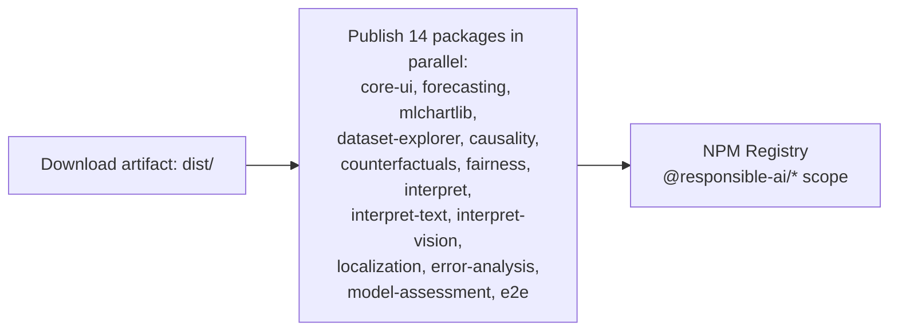

Uses `JS-DevTools/npm-publish@v1` action with:
- Token: `secrets.NPM_TOKEN`
- Access: `public`
- Only publishes if version changed

**Sources:** [.github/workflows/CD.yml]()

---

## Release Process

Manual releases to PyPI and NPM are triggered via `workflow_dispatch` [.github/workflows/release-rai-tabular.yml:10-17]().

### Release Workflow Stages

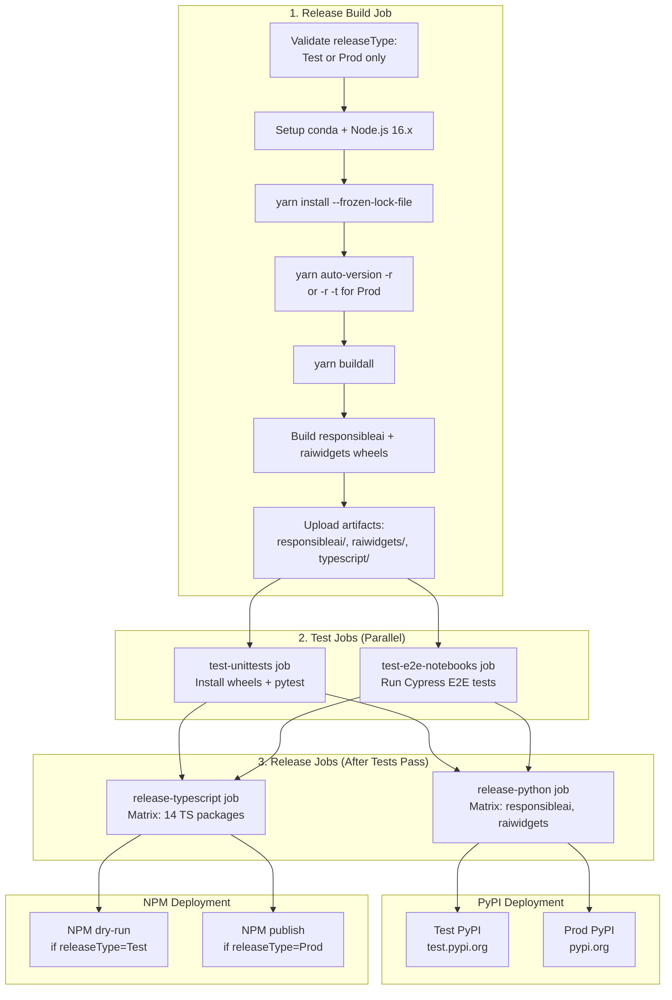

### Release Validation

Before publishing, the workflow runs validation [.github/workflows/release-rai-tabular.yml:127-260]():

1. **Unit tests**: Install wheels and run `pytest` on `responsibleai` and `raiwidgets` packages
2. **E2E tests**: Execute 6 notebook E2E tests without feature flights:
   - `responsibleaidashboard-census-classification-model-debugging`
   - `responsibleaidashboard-diabetes-regression-model-debugging`
   - `responsibleaidashboard-housing-decision-making`
   - `responsibleaidashboard-housing-classification-model-debugging`
   - `responsibleaidashboard-diabetes-decision-making`
   - `responsibleaidashboard-multiclass-dnn-model-debugging`

### PyPI Publishing

Python package publishing [.github/workflows/release-rai-tabular.yml:281-313]() uses `pypa/gh-action-pypi-publish@release/v1`:

| releaseType | Package | Token | Repository |
|-------------|---------|-------|------------|
| Test | responsibleai | `TEST_PYPI_API_TOKEN_RESPONSIBLEAI` | `https://test.pypi.org/legacy/` |
| Prod | responsibleai | `PYPI_API_TOKEN_RESPONSIBLEAI` | Default (pypi.org) |
| Test | raiwidgets | `TEST_PYPI_API_TOKEN_RAIWIDGETS` | `https://test.pypi.org/legacy/` |
| Prod | raiwidgets | `PYPI_API_TOKEN_RAIWIDGETS` | Default (pypi.org) |

### TypeScript Publishing

NPM publishing [.github/workflows/release-rai-tabular.yml:315-363]() publishes 14 packages:

- `core-ui`, `forecasting`, `mlchartlib`, `dataset-explorer`
- `causality`, `counterfactuals`, `fairness`, `interpret`
- `interpret-text`, `interpret-vision`, `localization`
- `error-analysis`, `model-assessment`, `e2e`

The `dry-run` parameter is set based on `releaseType` [.github/workflows/release-rai-tabular.yml:357]():
- `releaseType == 'Test'`: `dry-run: true` (validate without publishing)
- `releaseType == 'Prod'`: `dry-run: false` (actually publish)

**Sources:** [.github/workflows/release-rai-tabular.yml]()

---

## Vision and Text CI Pipelines

Vision and text packages have specialized CI pipelines that extend the standard testing infrastructure.

### Additional Dependencies

Vision and text tests require additional dependencies installed via conda [.github/workflows/CI-notebook.yml:44-54]():

```bash
# For all except macOS
conda install --yes --quiet pytorch torchvision captum cpuonly -c pytorch

# For macOS (without cpuonly)
conda install --yes --quiet pytorch torchvision captum -c pytorch
```

### Vision Notebook Tests

Vision notebooks are marked with `@pytest.mark.vision_notebooks` [notebooks/test_notebooks.py:263-293]():

- `test_responsibleaidashboard_fridge_image_classification_model_debugging`
- `test_responsibleaidashboard_fridge_multilabel_ic_model_debugging`
- `test_responsibleaidashboard_fridge_object_detection_model_debugging`

### Text Notebook Tests

Text notebooks are marked with `@pytest.mark.text_notebooks` [notebooks/test_notebooks.py:314-360]():

- `test_responsibleaidashboard_dbpedia_text_classification_model_debugging`
- `test_responsibleaidashboard_covid19_event_text_model_debugging`
- `test_responsibleaidashboard_blbooksgenre_text_model_debugging`
- `test_responsibleaidashboard_question_answering_model_debugging`
- `test_responsibleaidashboard_openai_model_debugging`

Note: The OpenAI notebook [notebooks/responsibleaidashboard/text/responsibleaidashboard-openai-model-debugging.ipynb]() includes mocking logic to avoid requiring actual API credentials during testing [notebooks/responsibleaidashboard/text/responsibleaidashboard-openai-model-debugging.ipynb:228-236]().

### E2E Test Organization

E2E tests for vision and text notebooks are organized separately in the `scripts/e2e-widget.js` registry [scripts/e2e-widget.js:25-38]():

- Vision tests run against notebooks in `notebooks/responsibleaidashboard/vision/`
- Text tests run against notebooks in `notebooks/responsibleaidashboard/text/`
- The script determines the correct directory using `getDirForNotebook()` [scripts/e2e-widget.js:51-64]()

**Sources:** [.github/workflows/CI-notebook.yml:44-54](), [notebooks/test_notebooks.py:263-360](), [scripts/e2e-widget.js:25-64]()

---

## GitHub Pages Deployment

Documentation is built and deployed to GitHub Pages [.github/workflows/GitHubPages.yml]():

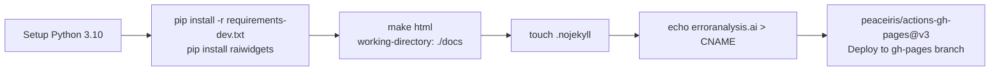

The workflow:
1. Builds Sphinx documentation from `docs/` directory
2. Disables Jekyll processing with `.nojekyll` file
3. Sets custom domain with `CNAME` file pointing to `erroranalysis.ai`
4. Deploys to `gh-pages` branch (only on push to `main`)

**Sources:** [.github/workflows/GitHubPages.yml]()

---

## Component Governance

Azure DevOps Component Governance runs on every push to `main` [.azure-devops/component-governance.yml:1-11]():

```yaml
trigger:
  - main

pool:
  vmImage: "ubuntu-latest"

steps:
  - task: ComponentGovernanceComponentDetection@0
```

This task scans all dependencies (Python, npm, etc.) and registers them for security and compliance tracking in Microsoft's component governance system.

**Sources:** [.azure-devops/component-governance.yml]()

---

