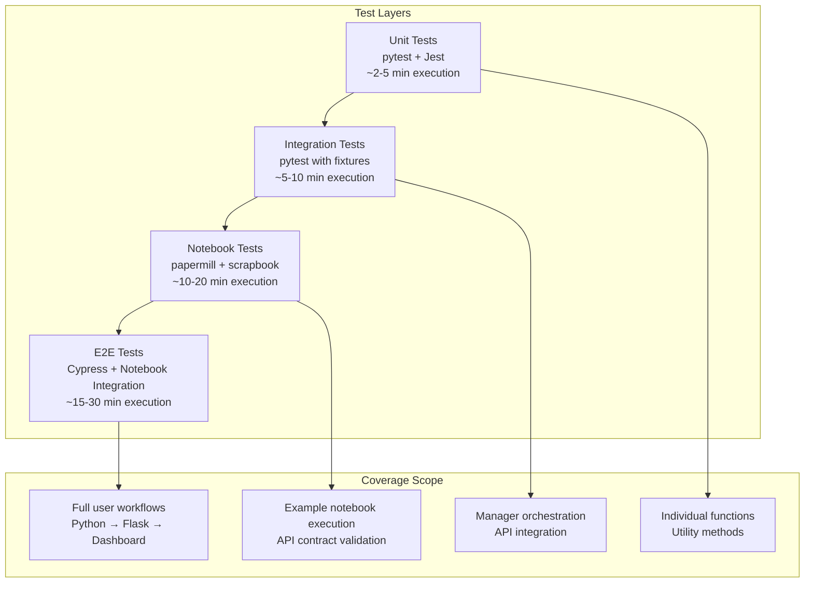
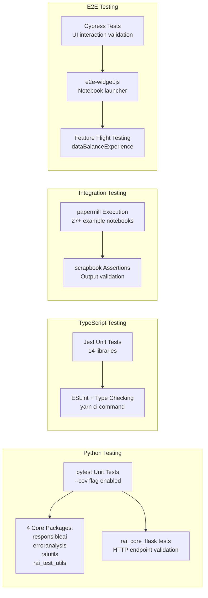
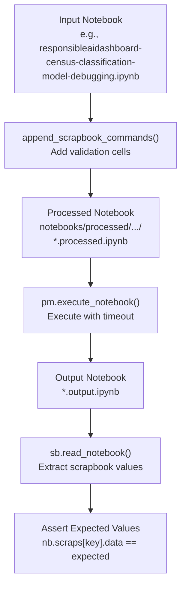
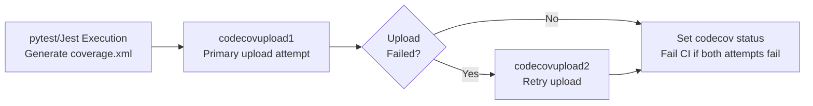
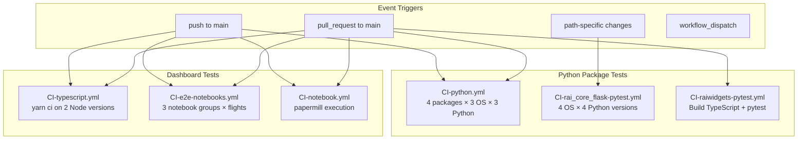
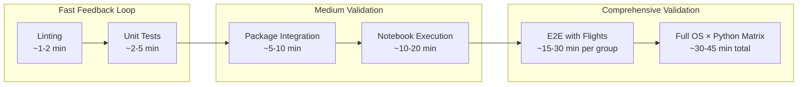

<!-- source: DeepWiki mcp.deepwiki.com · repo microsoft/responsible-ai-toolbox · page 7.1 Testing Strategy · fetched 2026-10-26 -->

# Testing Strategy

<details>
<summary>Relevant source files</summary>

The following files were used as context for generating this wiki page:

- [.azure-devops/component-governance.yml](.azure-devops/component-governance.yml)
- [.github/workflows/CD.yml](.github/workflows/CD.yml)
- [.github/workflows/CI-codescan.yml](.github/workflows/CI-codescan.yml)
- [.github/workflows/CI-e2e-notebooks.yml](.github/workflows/CI-e2e-notebooks.yml)
- [.github/workflows/CI-notebook.yml](.github/workflows/CI-notebook.yml)
- [.github/workflows/CI-python.yml](.github/workflows/CI-python.yml)
- [.github/workflows/CI-rai_core_flask-pytest.yml](.github/workflows/CI-rai_core_flask-pytest.yml)
- [.github/workflows/CI-raiwidgets-pytest.yml](.github/workflows/CI-raiwidgets-pytest.yml)
- [.github/workflows/CI-typescript.yml](.github/workflows/CI-typescript.yml)
- [.github/workflows/GitHubPages.yml](.github/workflows/GitHubPages.yml)
- [.github/workflows/python-linting.yml](.github/workflows/python-linting.yml)
- [.github/workflows/release-rai-tabular.yml](.github/workflows/release-rai-tabular.yml)
- [README.md](README.md)
- [notebooks/responsibleaidashboard/text/responsibleaidashboard-openai-model-debugging.ipynb](notebooks/responsibleaidashboard/text/responsibleaidashboard-openai-model-debugging.ipynb)
- [notebooks/test_notebooks.py](notebooks/test_notebooks.py)
- [scripts/e2e-widget.js](scripts/e2e-widget.js)

</details>


## Purpose and Scope

This document describes the overall testing strategy for the Responsible AI Toolbox repository, covering all test types and testing infrastructure. It provides a high-level overview of how testing ensures quality across the Python backend, TypeScript dashboard, and integrated notebook experiences.

For implementation details of specific test types, see:
- Python unit and integration tests: [7.1.1](#7.1.1)
- TypeScript unit tests: [7.1.2](#7.1.2)
- Notebook tests: [7.1.3](#7.1.3)
- End-to-end tests: [7.1.4](#7.1.4)

For CI/CD pipeline configurations, see [7.2](#7.2).

## Testing Philosophy

The Responsible AI Toolbox employs a multi-layered testing strategy designed to validate functionality at different granularities. The testing approach balances comprehensive coverage with execution speed by organizing tests into distinct categories that can run independently or as part of a complete validation suite.

### Test Pyramid Structure



**Sources:** [.github/workflows/CI-python.yml](), [.github/workflows/CI-typescript.yml](), [.github/workflows/CI-notebook.yml](), [.github/workflows/CI-e2e-notebooks.yml]()

### Matrix Testing Strategy

The repository uses matrix testing to validate compatibility across multiple dimensions:

| Dimension | Values | Rationale |
|-----------|--------|-----------|
| Operating Systems | `ubuntu-latest`, `macos-latest`, `windows-latest` | Cross-platform compatibility for data scientists |
| Python Versions | `3.9`, `3.10`, `3.11` | Support for common Python environments |
| Node.js Versions | `14.x`, `16.x` | Dashboard compatibility with different Node runtimes |
| Package Combinations | 4 Python packages × multiple OS/versions | Independent package validation |

**Sources:** [.github/workflows/CI-python.yml:18-29](), [.github/workflows/CI-raiwidgets-pytest.yml:17-24]()

## Test Type Classification



**Sources:** [.github/workflows/CI-python.yml](), [.github/workflows/CI-typescript.yml](), [notebooks/test_notebooks.py](), [scripts/e2e-widget.js]()

### Python Unit and Integration Tests

Python tests use the `pytest` framework with coverage measurement via `pytest-cov`. Each package runs tests independently with the following command pattern:

```bash
pytest -s -v --durations=10 --doctest-modules \
  --junitxml=junit/test-results.xml \
  --cov=$PACKAGE --cov-report=xml --cov-report=html
```

The `--durations=10` flag identifies slow tests for optimization, while `--doctest-modules` validates code examples in docstrings.

**Sources:** [.github/workflows/CI-python.yml:74-77](), [.github/workflows/CI-raiwidgets-pytest.yml:106-111]()

### TypeScript Unit Tests

TypeScript testing uses Jest for unit tests and ESLint for static analysis. The `yarn ci` command executes the complete TypeScript testing pipeline:

1. **Linting**: ESLint validates code style and potential errors across 14 libraries
2. **Type Checking**: TypeScript compiler validates type safety
3. **Unit Tests**: Jest executes component and utility tests with coverage reporting

**Sources:** [.github/workflows/CI-typescript.yml:31-32]()

### Notebook Tests

Notebook validation uses `papermill` to execute Jupyter notebooks programmatically and `scrapbook` to assert on computed outputs. The test framework appends validation cells to notebooks before execution.

**Test Execution Flow:**



**Sources:** [notebooks/test_notebooks.py:52-101]()

### End-to-End Tests

E2E tests validate complete user workflows by launching Python notebooks that start Flask servers, then using Cypress to interact with the rendered dashboard. The `e2e-widget.js` script orchestrates this process.

**Sources:** [scripts/e2e-widget.js](), [.github/workflows/CI-e2e-notebooks.yml]()

## Testing Infrastructure Components

### Coverage Reporting

Code coverage data is collected during test execution and uploaded to codecov.io for tracking over time. The workflow implements retry logic for codecov uploads due to occasional network issues:



**Sources:** [.github/workflows/CI-python.yml:87-123](), [.github/workflows/CI-raiwidgets-pytest.yml:120-156]()

### Artifact Uploads

Test workflows upload various artifacts for debugging and validation:

| Artifact Type | Purpose | Upload Condition |
|---------------|---------|------------------|
| `htmlcov/` | HTML coverage reports | Always on test completion |
| `dist/cypress/` | Cypress screenshots/videos | Always (for failure debugging) |
| `requirements-dev.txt` | Frozen dependencies | Windows + Python 3.9 only |
| `junit/test-results.xml` | Test results for dashboards | All test runs |

**Sources:** [.github/workflows/CI-python.yml:79-85](), [.github/workflows/CI-e2e-notebooks.yml:142-147]()

### Test Data Management

Notebook tests use predefined test datasets and validation values defined in `test_notebooks.py`. Example validation patterns:

```python
test_values["race_group_sizes"] = ScrapSpec(
    "X_raw['race'].value_counts().to_dict()",
    RACE_GROUP_SIZES_ADULT  # Expected: {'White': 41762, 'Black': 4685, ...}
)

test_values["dominant_models"] = ScrapSpec(
    "list(dominant_all.keys())",
    ['unmitigated', 'grid_28', 'grid_29', ...]
)
```

**Sources:** [notebooks/test_notebooks.py:11-16](), [notebooks/test_notebooks.py:109-122]()

## Quality Gates and Testing Triggers

### CI Trigger Conditions

Tests execute on different events based on their scope and execution time:



**Sources:** [.github/workflows/CI-python.yml:3-13](), [.github/workflows/CI-rai_core_flask-pytest.yml:3-10]()

### Release Testing Gates

The release process includes additional testing stages before publishing to PyPI or NPM:

1. **Unit Test Validation**: All unit tests must pass on release builds
2. **E2E Notebook Validation**: Selected notebooks execute without feature flights
3. **Wheel Installation Test**: Built wheels install cleanly and tests pass
4. **Parallel Deployment**: Python (PyPI) and TypeScript (NPM) publish only after all tests pass

**Sources:** [.github/workflows/release-rai-tabular.yml:127-180](), [.github/workflows/release-rai-tabular.yml:244-259]()

### E2E Notebook Grouping

E2E tests are organized into groups to enable parallel execution and reduce total CI time:

| Group | Notebooks | Flight Variants |
|-------|-----------|-----------------|
| `nb_group_1` | census-classification, diabetes-regression, housing-decision-making | Default + dataBalanceExperience |
| `nb_group_2` | housing-classification, diabetes-decision-making, multiclass-dnn | Default + dataBalanceExperience |
| `nb_group_3` | orange-juice-forecasting | Default only (no flight changes) |

The `scripts/e2e-widget.js` script manages notebook conversion, flight injection, and Cypress test execution:

```javascript
// Convert notebook to .py script
jupyter nbconvert path/to/notebook.ipynb --to script

// Inject feature flights if specified
addFlightsInFile(notebookPath, 'dataBalanceExperience')

// Launch notebook Python server
python -i path/to/notebook.py  // Captures server URL

// Execute Cypress tests against the launched server
node nx e2e widget-e2e --spec **/responsibleaitoolbox${notebookKey}/**
```

**Sources:** [scripts/e2e-widget.js:14-41](), [scripts/e2e-widget.js:145-222](), [.github/workflows/CI-e2e-notebooks.yml:45-57]()

## Platform-Specific Testing Considerations

### macOS Special Handling

macOS builds require additional setup for dependencies:

```yaml
# Install libomp for LightGBM compatibility
- name: Use Homebrew to install libomp on MacOS
  run: brew install libomp

# Install node-gyp dependencies for native modules
- name: Install macos node-gyp dependencies
  run: |
    brew install cairo
    brew install pango
```

**Sources:** [.github/workflows/CI-python.yml:46-49](), [.github/workflows/CI-raiwidgets-pytest.yml:59-64]()

### Conda vs. pip Environments

Different workflows use different Python environment managers:

- **Python package tests**: Use `pip` directly for faster setup
- **Notebook tests**: Use `conda` to handle PyTorch and complex dependencies
- **E2E tests**: Use `conda` to match user environments

**Sources:** [.github/workflows/CI-python.yml:35-38](), [.github/workflows/CI-notebook.yml:23-26](), [.github/workflows/CI-e2e-notebooks.yml:81-89]()

## Test Execution Times and Optimization

The test suite is optimized for parallel execution and fast feedback:



The `--durations=10` pytest flag helps identify slow tests for optimization. Tests that exceed thresholds are candidates for mocking or refactoring.

**Sources:** [.github/workflows/CI-python.yml:76](), [.github/workflows/CI-raiwidgets-pytest.yml:110]()

---

