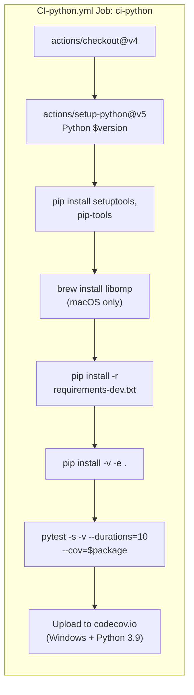
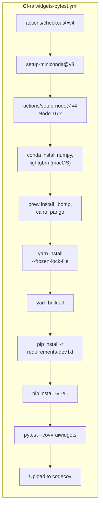
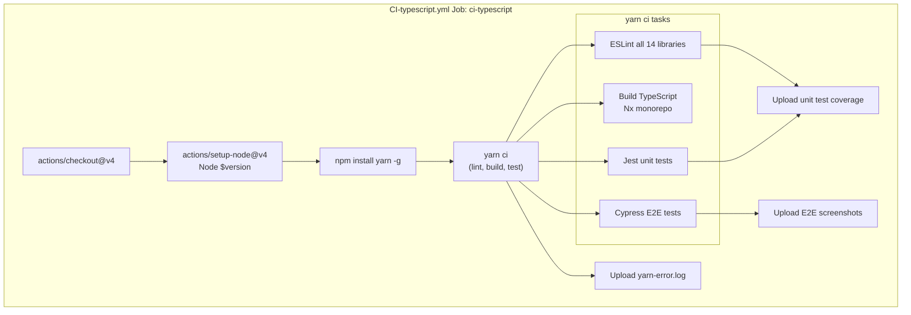
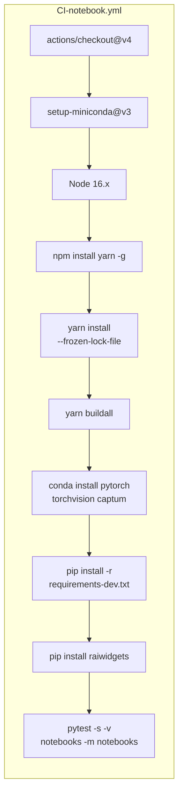
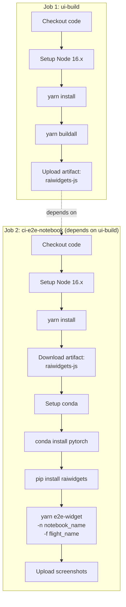
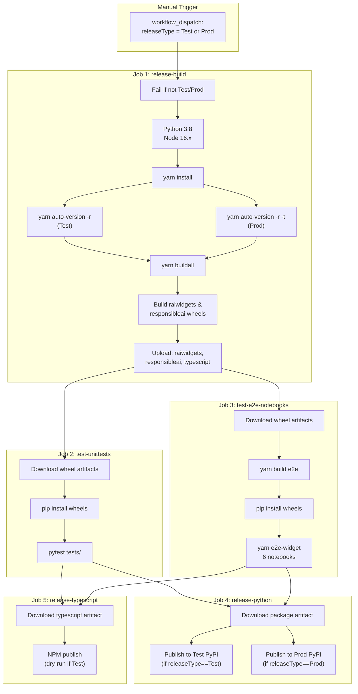
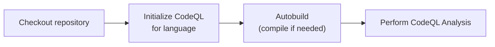
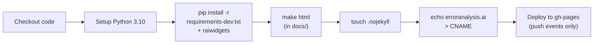

<!-- source: DeepWiki mcp.deepwiki.com · repo microsoft/responsible-ai-toolbox · page 7.2 CI/CD Pipelines · fetched 2026-10-26 -->

# CI/CD Pipelines

<details>
<summary>Relevant source files</summary>

The following files were used as context for generating this wiki page:

- [.azure-devops/component-governance.yml](.azure-devops/component-governance.yml)
- [.github/workflows/CD.yml](.github/workflows/CD.yml)
- [.github/workflows/CI-codescan.yml](.github/workflows/CI-codescan.yml)
- [.github/workflows/CI-e2e-notebooks.yml](.github/workflows/CI-e2e-notebooks.yml)
- [.github/workflows/CI-notebook.yml](.github/workflows/CI-notebook.yml)
- [.github/workflows/CI-python.yml](.github/workflows/CI-python.yml)
- [.github/workflows/CI-rai_core_flask-pytest.yml](.github/workflows/CI-rai_core_flask-pytest.yml)
- [.github/workflows/CI-raiwidgets-pytest.yml](.github/workflows/CI-raiwidgets-pytest.yml)
- [.github/workflows/CI-typescript.yml](.github/workflows/CI-typescript.yml)
- [.github/workflows/GitHubPages.yml](.github/workflows/GitHubPages.yml)
- [.github/workflows/python-linting.yml](.github/workflows/python-linting.yml)
- [.github/workflows/release-rai-tabular.yml](.github/workflows/release-rai-tabular.yml)

</details>


## Purpose and Scope

This page documents the Continuous Integration and Continuous Deployment (CI/CD) pipelines implemented via GitHub Actions workflows. These pipelines automate testing, building, and deployment of all packages in the Responsible AI Toolbox repository.

The CI/CD system consists of multiple specialized workflows that validate code quality, run comprehensive test suites across multiple operating systems and language versions, build artifacts, and deploy them to various targets (Azure Blob Storage, PyPI, NPM). For details on specific testing strategies and test types, see [Testing Strategy](#7.1). For information on the release versioning process, see [Package Versioning and Releases](#6.3).

---

## Overall Pipeline Architecture

The repository uses GitHub Actions with 11+ workflow files that handle different aspects of the CI/CD process. These workflows are triggered by push events to `main`, pull requests, or manual workflow dispatch.

```mermaid
graph TB
    subgraph "Trigger Events"
        PushMain["Push to main"]
        PullRequest["Pull Request"]
        ManualTrigger["workflow_dispatch"]
    end
    
    subgraph "CI Workflows - Python"
        CIPython["CI-python.yml<br/>4 packages × 3 OS × 3 Python versions"]
        CIRAIWidgets["CI-raiwidgets-pytest.yml<br/>raiwidgets testing"]
        CIFlask["CI-rai_core_flask-pytest.yml<br/>Flask backend testing"]
        CINotebook["CI-notebook.yml<br/>Notebook validation"]
        CIE2ENotebook["CI-e2e-notebooks.yml<br/>Widget E2E tests"]
    end
    
    subgraph "CI Workflows - TypeScript & Quality"
        CITypeScript["CI-typescript.yml<br/>Node 14.x, 16.x"]
        PyLinting["python-linting.yml<br/>flake8, isort"]
        CodeScan["CI-codescan.yml<br/>CodeQL analysis"]
    end
    
    subgraph "CD Workflows"
        CDBuild["CD.yml<br/>Build & deploy to Azure"]
        GitHubPages["GitHubPages.yml<br/>Documentation site"]
    end
    
    subgraph "Release Workflows"
        ReleaseTabular["release-rai-tabular.yml<br/>PyPI & NPM publish"]
    end
    
    subgraph "External Services"
        AzureBlob["Azure Blob Storage<br/>/latest/, /pullrequest/"]
        PyPI["PyPI<br/>Production/Test"]
        NPM["NPM Registry<br/>@responsible-ai/*"]
        Codecov["codecov.io<br/>Coverage reports"]
        GitHubPagesService["GitHub Pages<br/>erroranalysis.ai"]
    end
    
    PushMain --> CIPython
    PushMain --> CIRAIWidgets
    PushMain --> CIFlask
    PushMain --> CINotebook
    PushMain --> CIE2ENotebook
    PushMain --> CITypeScript
    PushMain --> PyLinting
    PushMain --> CodeScan
    PushMain --> CDBuild
    PushMain --> GitHubPages
    
    PullRequest --> CIPython
    PullRequest --> CIRAIWidgets
    PullRequest --> CIFlask
    PullRequest --> CINotebook
    PullRequest --> CIE2ENotebook
    PullRequest --> CITypeScript
    PullRequest --> PyLinting
    PullRequest --> CodeScan
    PullRequest --> CDBuild
    PullRequest --> GitHubPages
    
    ManualTrigger --> ReleaseTabular
    ManualTrigger --> CDBuild
    
    CIPython --> Codecov
    CIRAIWidgets --> Codecov
    CIFlask --> Codecov
    CITypeScript --> Codecov
    
    CDBuild --> AzureBlob
    CDBuild --> NPM
    
    ReleaseTabular --> PyPI
    ReleaseTabular --> NPM
    
    GitHubPages --> GitHubPagesService
```



**Sources:** [.github/workflows/CI-python.yml](), [.github/workflows/CD.yml](), [.github/workflows/CI-notebook.yml](), [.github/workflows/CI-typescript.yml](), [.github/workflows/release-rai-tabular.yml]()

---

## Workflow Triggers and Path Filters

Each workflow specifies trigger conditions via the `on:` configuration. Most workflows trigger on both `push` to `main` and `pull_request` events. Some workflows include path filters to run only when relevant files change.

| Workflow | Push to main | Pull Request | Manual Dispatch | Path Filters |
|----------|-------------|--------------|-----------------|--------------|
| `CI-python.yml` | ✓ | ✓ | ✗ | `erroranalysis/**`, `rai_test_utils/**`, `raiutils/**`, `responsibleai/**` |
| `CI-raiwidgets-pytest.yml` | ✓ | ✓ | ✗ | None |
| `CI-rai_core_flask-pytest.yml` | ✓ | ✓ | ✗ | `rai_core_flask/**` |
| `CI-notebook.yml` | ✓ | ✓ | ✗ | None |
| `CI-e2e-notebooks.yml` | ✓ | ✓ | ✗ | None |
| `CI-typescript.yml` | ✗ | ✓ | ✗ | None (PR only) |
| `CD.yml` | ✓ | ✓ | ✓ | None |
| `release-rai-tabular.yml` | ✗ | ✗ | ✓ | None (manual only) |
| `python-linting.yml` | ✓ | ✓ | ✗ | None |
| `GitHubPages.yml` | ✓ | ✓ | ✗ | None |
| `CI-codescan.yml` | ✓ | ✓ | ✗ | None |

**Sources:** [.github/workflows/CI-python.yml:3-13](), [.github/workflows/CI-rai_core_flask-pytest.yml:3-10](), [.github/workflows/CI-typescript.yml:11-13](), [.github/workflows/CD.yml:18-23](), [.github/workflows/release-rai-tabular.yml:11-17]()

---

## Python CI Workflows

### CI-python.yml - Core Package Testing

The `CI-python.yml` workflow tests four core Python packages (`responsibleai`, `erroranalysis`, `raiutils`, `rai_test_utils`) across multiple operating systems and Python versions using a matrix strategy.

**Test Matrix:**

| Dimension | Values |
|-----------|--------|
| Packages | `responsibleai`, `erroranalysis`, `raiutils`, `rai_test_utils` |
| Operating Systems | `ubuntu-latest`, `macos-latest`, `windows-latest` |
| Python Versions | 3.9, 3.10, 3.11 |
| **Exclusions** | `responsibleai` on Python 3.11; `responsibleai` on macOS with Python 3.9 |



**Key Steps:**

1. **Environment Setup** [.github/workflows/CI-python.yml:33-44](): Checks out code and configures Python version from matrix
2. **macOS Special Handling** [.github/workflows/CI-python.yml:46-49](): Installs `libomp` via Homebrew for LightGBM compatibility
3. **Dependency Installation** [.github/workflows/CI-python.yml:51-59](): Installs development requirements and the package in editable mode
4. **Test Execution** [.github/workflows/CI-python.yml:74-77](): Runs pytest with coverage, doctests, and JUnit XML output
5. **Coverage Upload** [.github/workflows/CI-python.yml:87-123](): Uploads coverage to codecov.io from Windows + Python 3.9 jobs, with retry logic

**Sources:** [.github/workflows/CI-python.yml]()

### CI-raiwidgets-pytest.yml - Widget Package Testing

This workflow specifically tests the `raiwidgets` package, which contains both Python and TypeScript components. It builds the TypeScript dashboard before running Python tests.

**Test Matrix:**

| Dimension | Values |
|-----------|--------|
| Package | `raiwidgets` only |
| Operating Systems | `ubuntu-latest`, `macos-latest`, `windows-latest` |
| Python Versions | 3.9, 3.10 |
| **Exclusions** | macOS with Python 3.9 |



**Notable Differences:**

- Uses `conda` instead of plain `pip` for package management [.github/workflows/CI-raiwidgets-pytest.yml:31-34]()
- Installs macOS-specific dependencies (`cairo`, `pango`) for node-gyp [.github/workflows/CI-raiwidgets-pytest.yml:59-64]()
- Builds TypeScript before Python tests [.github/workflows/CI-raiwidgets-pytest.yml:82-83]()
- Uses `fail-fast: false` to continue other matrix jobs on failure [.github/workflows/CI-raiwidgets-pytest.yml:16]()

**Sources:** [.github/workflows/CI-raiwidgets-pytest.yml]()

### CI-rai_core_flask-pytest.yml - Flask Backend Testing

Tests the `rai_core_flask` package, which provides the Flask web server and API endpoints for the dashboard.

**Test Matrix:**

| Dimension | Values |
|-----------|--------|
| Operating Systems | `ubuntu-20.04`, `ubuntu-latest`, `macos-latest`, `windows-latest` |
| Python Versions | 3.8, 3.9, 3.10, 3.11 |
| **Multiple Exclusions** | Various OS/Python combinations to reduce matrix size |

**Unique Features:**

- Uses `pip-compile` to generate locked dependencies [.github/workflows/CI-rai_core_flask-pytest.yml:53-57]()
- Uses `pip-sync` for exact dependency matching [.github/workflows/CI-rai_core_flask-pytest.yml:66-68]()
- Uploads compiled requirements as artifact [.github/workflows/CI-rai_core_flask-pytest.yml:59-63]()
- Tests on `ubuntu-20.04` in addition to `ubuntu-latest` for compatibility

**Sources:** [.github/workflows/CI-rai_core_flask-pytest.yml]()

---

## TypeScript CI Workflows

### CI-typescript.yml - Frontend Testing

The TypeScript workflow runs only on pull requests and tests the dashboard codebase across Node.js versions.



**Test Matrix:**

| Dimension | Values |
|-----------|--------|
| Operating System | `ubuntu-latest` only |
| Node Versions | 14.x, 16.x |

**Key Artifacts:**

- `unit-test-coverage-${{ matrix.node-version }}`: Jest coverage reports [.github/workflows/CI-typescript.yml:33-38]()
- `e2e-screen-shot-${{ matrix.node-version }}`: Cypress screenshots [.github/workflows/CI-typescript.yml:39-44]()
- `yarn-error.log-${{ matrix.node-version }}`: Error logs for debugging [.github/workflows/CI-typescript.yml:45-50]()

**Sources:** [.github/workflows/CI-typescript.yml]()

---

## Notebook Testing Workflows

### CI-notebook.yml - Notebook Validation

This workflow validates that example notebooks execute successfully using `papermill` and `scrapbook`.

**Test Matrix:**

| Dimension | Values |
|-----------|--------|
| Operating Systems | `ubuntu-latest`, `windows-latest` |
| Python Versions | 3.9, 3.10 |

**Execution Flow:**



**Platform-Specific Handling:**

- macOS excludes `cpuonly` flag for PyTorch [.github/workflows/CI-notebook.yml:50-54]()
- Uses `conda` for PyTorch installation to ensure GPU library compatibility [.github/workflows/CI-notebook.yml:44-48]()

**Sources:** [.github/workflows/CI-notebook.yml]()

### CI-e2e-notebooks.yml - Widget Integration Testing

This workflow performs end-to-end testing of the widget dashboard by executing notebooks and validating the UI with Cypress.

**Test Matrix:**

| Dimension | Values |
|-----------|--------|
| Operating Systems | `ubuntu-latest`, `windows-latest` |
| Python Versions | 3.9, 3.10 |
| Feature Flights | `""` (none), `"dataBalanceExperience"` |
| Notebook Groups | `nb_group_1`, `nb_group_2`, `nb_group_3` |
| **Exclusions** | `nb_group_3` with `dataBalanceExperience` flight |

**Two-Job Architecture:**



**Notebook Groups:**

- **nb_group_1** [.github/workflows/CI-e2e-notebooks.yml:120-126]():
  - `responsibleaidashboard-census-classification-model-debugging`
  - `responsibleaidashboard-diabetes-regression-model-debugging`
  - `responsibleaidashboard-housing-decision-making`
  
- **nb_group_2** [.github/workflows/CI-e2e-notebooks.yml:128-134]():
  - `responsibleaidashboard-housing-classification-model-debugging`
  - `responsibleaidashboard-diabetes-decision-making`
  - `responsibleaidashboard-multiclass-dnn-model-debugging`
  
- **nb_group_3** [.github/workflows/CI-e2e-notebooks.yml:136-140]():
  - `responsibleaidashboard-orange-juice-forecasting`

**Sources:** [.github/workflows/CI-e2e-notebooks.yml]()

---

## CD Workflow - Build and Deployment

The `CD.yml` workflow builds artifacts and deploys them to Azure Blob Storage on every push to `main` or pull request. It also publishes TypeScript packages to NPM on pushes to `main`.

### CD Build Job

```mermaid
graph TB
    subgraph "cd-build Job"
        SetupEnv["Setup Python 3.10<br/>Node 16.x"]
        YarnInstall["yarn install<br/>--frozen-lock-file"]
        AutoVersion["yarn auto-version"]
        GetVersion["echo version=$(cat version.cfg)"]
        BuildTS["yarn buildall"]
        
        subgraph "Python Wheel Building"
            InstallReqRAI["pip install -r<br/>requirements.txt (responsibleai)"]
            InstallReqWidget["pip install -r<br/>requirements.txt (raiwidgets)"]
            ReplaceREADME["sed: Replace README<br/>image paths for PyPI"]
            BuildWheelRAI["python setup.py<br/>sdist bdist_wheel (responsibleai)"]
            BuildWheelWidget["python setup.py<br/>sdist bdist_wheel (raiwidgets)"]
        end
        
        InstallWheels["pip install built wheels"]
        RunTests["pytest -s -v<br/>--durations=10"]
        
        subgraph "Azure Blob Upload"
            UploadDashboard["az storage blob sync<br/>dashboard to /latest/<br/>or /pullrequest/$path/"]
            UploadRAI["az storage blob sync<br/>responsibleai wheel"]
            UploadWidget["az storage blob sync<br/>raiwidgets wheel"]
            Cleanup["Delete blobs older<br/>than 90 days"]
        end
        
        UploadArtifact["Upload artifact: dist"]
    end
    
    SetupEnv --> YarnInstall
    YarnInstall --> AutoVersion
    AutoVersion --> GetVersion
    GetVersion --> BuildTS
    BuildTS --> InstallReqRAI
    BuildTS --> InstallReqWidget
    InstallReqRAI --> ReplaceREADME
    InstallReqWidget --> ReplaceREADME
    ReplaceREADME --> BuildWheelRAI
    ReplaceREADME --> BuildWheelWidget
    BuildWheelRAI --> InstallWheels
    BuildWheelWidget --> InstallWheels
    InstallWheels --> RunTests
    RunTests --> UploadDashboard
    UploadDashboard --> UploadRAI
    UploadRAI --> UploadWidget
    UploadWidget --> Cleanup
    Cleanup --> UploadArtifact
```



**Environment Variables:** [.github/workflows/CD.yml:5-16]()

| Variable | Value | Purpose |
|----------|-------|---------|
| `folder_to_upload` | `dist/apps/dashboard` | Dashboard build output |
| `blob_account` | `responsibleai` | Azure storage account |
| `blob_container_for_pull_request` | `pullrequest` | Container for PR previews |
| `blob_container_for_js` | `latest` | Container for main branch |
| `blob_container_for_raiwidget` | `raiwidgets` | Container for Python wheels |
| `blob_path_for_pull_request` | `${{ github.event.pull_request.head.repo.full_name }}/${{ github.head_ref }}` | Path within PR container |
| `retentionDays` | `90` | Blob retention period |

**Conditional Upload Logic:** [.github/workflows/CD.yml:131-139]()

- **Push to main**: Uploads to `/latest/` for dashboard, versioned paths for wheels
- **Pull request**: Uploads to `/pullrequest/$repo/$branch/` for preview
- Posts comment on PR with preview URL [.github/workflows/CD.yml:142-148]()

**Sources:** [.github/workflows/CD.yml]()

### CD TypeScript Publish Job

Runs after `cd-build` job completes successfully and publishes 14 NPM packages when triggered by push to `main`.

**Package Matrix:** [.github/workflows/CD.yml:201-218]()

```
core-ui, forecasting, mlchartlib, dataset-explorer, causality,
counterfactuals, fairness, interpret, interpret-text, interpret-vision,
localization, error-analysis, model-assessment, e2e
```

**Publishing Steps:**

1. Download `dist` artifact from `cd-build` job [.github/workflows/CD.yml:225-230]()
2. Use `JS-DevTools/npm-publish@v1` action [.github/workflows/CD.yml:231-242]()
3. Publish to NPM with public access using `NPM_TOKEN` secret
4. Skip publishing if version hasn't changed (`steps.publish.type == 'none'`)

**Sources:** [.github/workflows/CD.yml:196-243]()

---

## Release Workflow

The `release-rai-tabular.yml` workflow is manually triggered via `workflow_dispatch` to publish packages to PyPI and NPM. It supports both Test PyPI and Production PyPI releases.

### Release Architecture



### Release Input Parameters

The workflow accepts a single input parameter [.github/workflows/release-rai-tabular.yml:13-17]():

```yaml
releaseType:
  description: "Test or Prod PyPI?"
  required: true
  default: "Test"
```

### Auto-Versioning

The workflow uses different versioning commands based on release type [.github/workflows/release-rai-tabular.yml:52-59]():

- **Test Release**: `yarn auto-version -r` (creates release candidate version)
- **Prod Release**: `yarn auto-version -r -t` (creates tagged release version)

### PyPI Publishing Secrets

Different secrets are used for different packages and environments [.github/workflows/release-rai-tabular.yml:281-313]():

| Package | Test PyPI Secret | Prod PyPI Secret |
|---------|------------------|------------------|
| `responsibleai` | `TEST_PYPI_API_TOKEN_RESPONSIBLEAI` | `PYPI_API_TOKEN_RESPONSIBLEAI` |
| `raiwidgets` | `TEST_PYPI_API_TOKEN_RAIWIDGETS` | `PYPI_API_TOKEN_RAIWIDGETS` |

**NPM Publishing:**

Uses `dry-run: ${{github.event.inputs.releaseType == 'Test'}}` to prevent actual publishing for Test releases [.github/workflows/release-rai-tabular.yml:357]().

**Sources:** [.github/workflows/release-rai-tabular.yml]()

---

## Quality Gates

### Python Linting

The `python-linting.yml` workflow enforces Python code quality standards on all Python files.

**Tools and Checks:**

1. **flake8** [.github/workflows/python-linting.yml:24-25](): PEP8 style checking
2. **isort** [.github/workflows/python-linting.yml:27-29](): Import sorting verification

**Configuration:**

- Runs on `ubuntu-latest` with Python 3.10
- Installs dependencies from `requirements-linting.txt` [.github/workflows/python-linting.yml:21-22]()
- Fails the build if any linting errors are found

**Sources:** [.github/workflows/python-linting.yml]()

### Code Coverage

Code coverage is collected during test execution and uploaded to codecov.io.

**Coverage Upload Strategy:**

- **Python packages**: Upload from Windows + Python 3.9 jobs only [.github/workflows/CI-python.yml:87-99]()
- **Flask package**: Upload from Windows + Python 3.8 job [.github/workflows/CI-rai_core_flask-pytest.yml:88-100]()
- **TypeScript**: Upload from `CI-typescript.yml` execution [.github/workflows/CI-typescript.yml:33-38]()

**Retry Logic:**

All codecov uploads implement retry logic [.github/workflows/CI-python.yml:101-123]():

```yaml
- name: Upload to codecov
  id: codecovupload1
  uses: codecov/codecov-action@v3
  # ... upload configuration ...

- name: Retry upload to codecov
  id: codecovupload2
  if: steps.codecovupload1.outcome == 'failure'
  uses: codecov/codecov-action@v3
  # ... same configuration ...

- name: Set codecov status
  run: |
    if ${{ (steps.codecovupload1.outcome == 'success') || (steps.codecovupload2.outcome == 'success') }} ; then
      echo fine
    else
      exit 1
    fi
```

**Sources:** [.github/workflows/CI-python.yml:79-123](), [.github/workflows/CI-raiwidgets-pytest.yml:120-156]()

### Security Scanning

The `CI-codescan.yml` workflow uses GitHub's CodeQL to perform static security analysis.

**Languages Analyzed:**

- JavaScript [.github/workflows/CI-codescan.yml:21]()
- Python [.github/workflows/CI-codescan.yml:21]()

**Workflow Steps:**



**Permissions Required:** [.github/workflows/CI-codescan.yml:13-16]()

- `actions: read`
- `contents: read`
- `security-events: write`

**Sources:** [.github/workflows/CI-codescan.yml]()

---

## Artifact Management

### Artifact Upload Patterns

Workflows upload various artifacts for debugging, deployment, and release purposes.

**Common Artifacts:**

| Artifact Name Pattern | Source Workflow | Purpose | Retention |
|----------------------|-----------------|---------|-----------|
| `${{ matrix.packageDirectory }}-${{ matrix.pythonVersion}}-code-coverage-results` | `CI-python.yml` | HTML coverage reports | Default (90 days) |
| `requirements-dev.txt` | Multiple | Pip freeze output | Default |
| `dist` | `CD.yml` | Built packages (Python + TypeScript) | Default |
| `raiwidgets-js` | `CI-e2e-notebooks.yml` | Pre-built UI for E2E tests | Default |
| `notebook-test-${{ matrix.operatingSystem }}-${{ matrix.pythonVersion }}` | `CI-notebook.yml` | Executed notebooks | Default |
| `e2e-screen-shot-*` | Multiple | Cypress screenshots | Default |
| `unit-test-coverage-*` | `CI-typescript.yml` | Jest coverage | Default |

### Azure Blob Storage Structure

The CD workflow organizes deployed artifacts in Azure Blob Storage with the following structure:

```
responsibleai.blob.core.windows.net/
├── latest/                              # Main branch dashboard
│   └── index.html
├── pullrequest/                         # PR previews
│   └── ${{ repo }}/${{ branch }}/
│       ├── dashboard/
│       │   └── index.html
│       ├── responsibleai/
│       │   └── *.whl
│       └── raiwidgets/
│           └── *.whl
└── raiwidgets/                          # Versioned releases
    └── ${{ version }}/
        ├── responsibleai/
        │   └── *.whl
        └── raiwidgets/
            └── *.whl
```

**Blob Cleanup:**

The workflow deletes blobs older than 90 days from both containers [.github/workflows/CD.yml:182-194]():

```bash
az storage blob delete-batch \
  --account-name "${{env.blob_account}}" \
  -s "${{env.blob_container_for_raiwidget}}" \
  --if-unmodified-since "${{steps.retention_date.outputs.date}}"
```

**Sources:** [.github/workflows/CD.yml:5-16](), [.github/workflows/CD.yml:125-181](), [.github/workflows/CD.yml:182-194]()

---

## Documentation Deployment

The `GitHubPages.yml` workflow builds and deploys Sphinx documentation to GitHub Pages.

**Deployment Target:**

- Custom domain: `erroranalysis.ai` [.github/workflows/GitHubPages.yml:37]()
- GitHub Pages: `https://microsoft.github.io/responsible-ai-toolbox/`

**Build Process:**



**Conditional Deployment:**

Only pushes to `main` trigger actual deployment [.github/workflows/GitHubPages.yml:40-41]():

```yaml
if: github.event_name == 'push'
```

Pull requests build documentation but don't deploy, validating that docs build successfully.

**Sources:** [.github/workflows/GitHubPages.yml]()

---

## Component Governance

The repository uses Azure DevOps Component Governance for dependency tracking.

**Configuration:** [.azure-devops/component-governance.yml]()

```yaml
trigger:
  - main

pool:
  vmImage: "ubuntu-latest"

steps:
  - task: ComponentGovernanceComponentDetection@0
```

This detects all open-source components used in the repository and registers them for license compliance and security vulnerability tracking.

**Sources:** [.azure-devops/component-governance.yml]()

---

