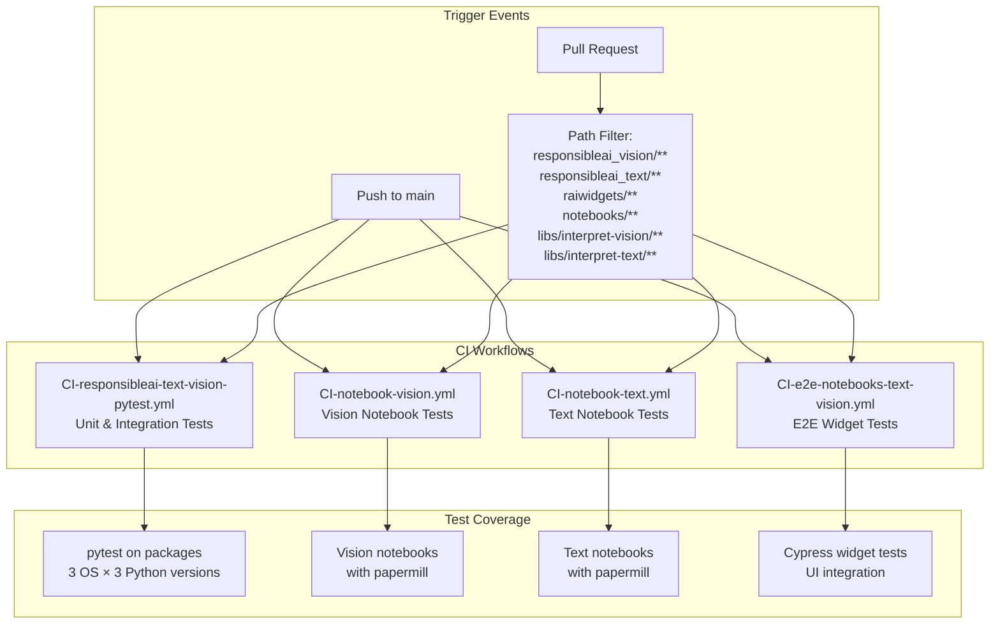
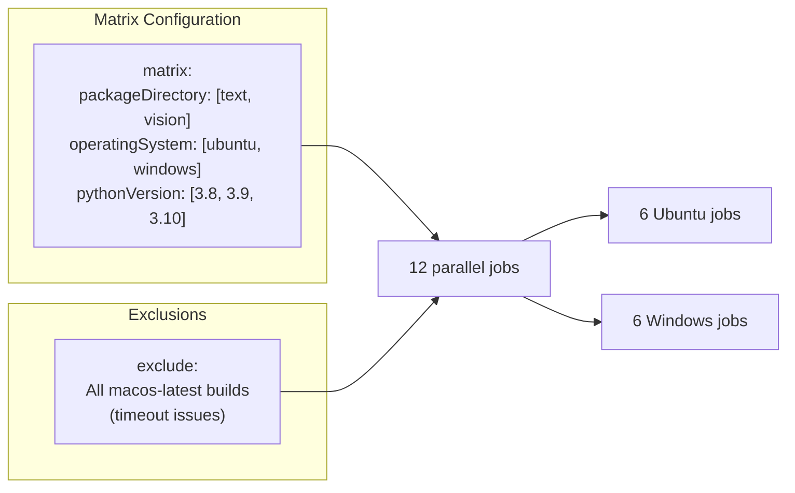
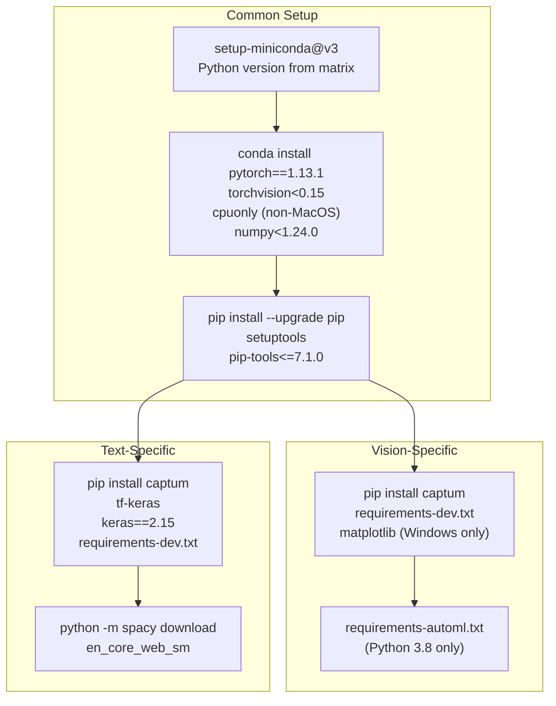
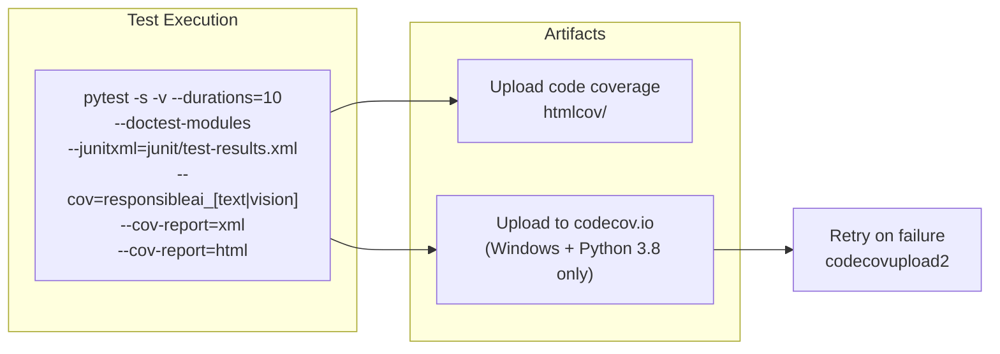
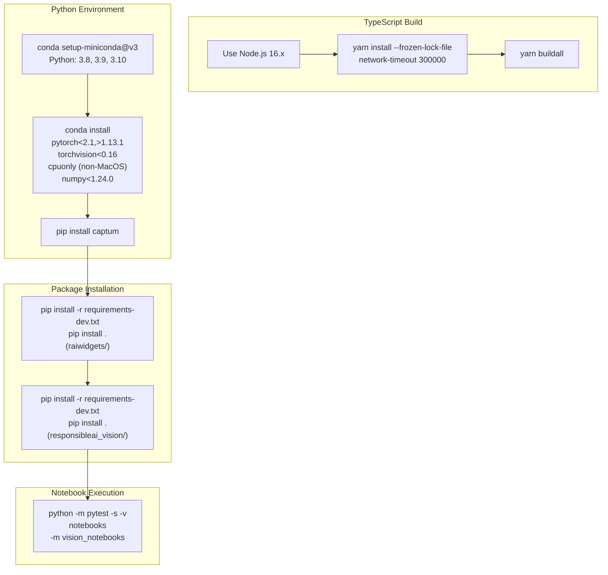
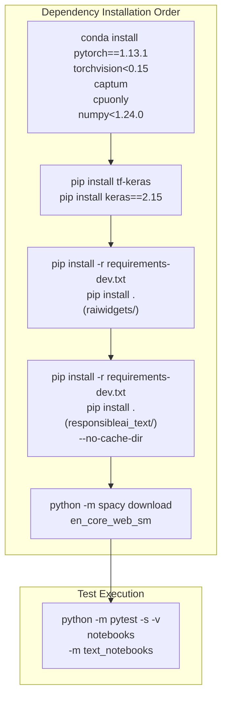
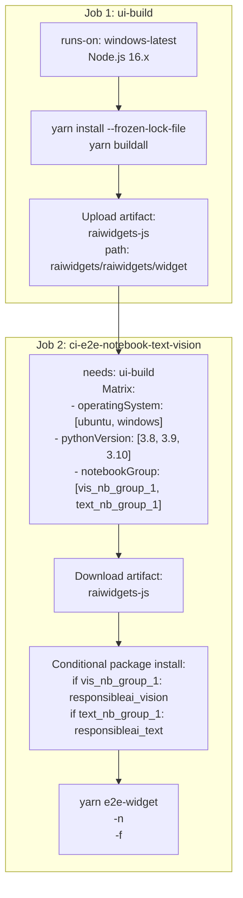
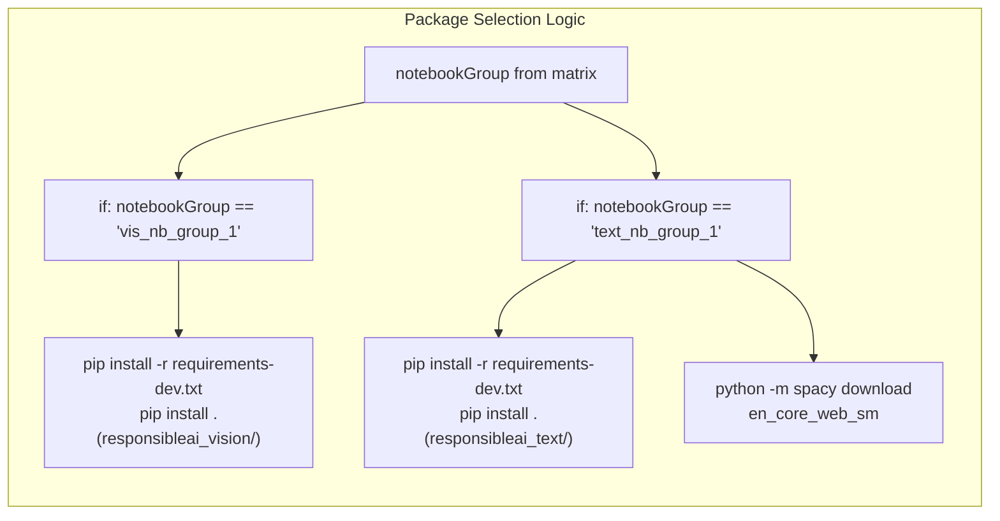
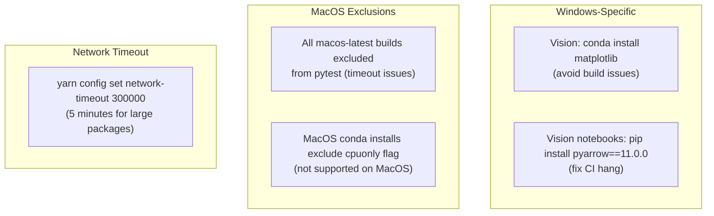

<!-- source: DeepWiki mcp.deepwiki.com · repo microsoft/responsible-ai-toolbox · page 7.3 Vision and Text CI Pipelines · fetched 2026-10-26 -->

# Vision and Text CI Pipelines

<details>
<summary>Relevant source files</summary>

The following files were used as context for generating this wiki page:

- [.azure-devops/component-governance.yml](.azure-devops/component-governance.yml)
- [.github/workflows/CD.yml](.github/workflows/CD.yml)
- [.github/workflows/CI-codescan.yml](.github/workflows/CI-codescan.yml)
- [.github/workflows/CI-e2e-notebooks-text-vision.yml](.github/workflows/CI-e2e-notebooks-text-vision.yml)
- [.github/workflows/CI-e2e-notebooks.yml](.github/workflows/CI-e2e-notebooks.yml)
- [.github/workflows/CI-notebook-text.yml](.github/workflows/CI-notebook-text.yml)
- [.github/workflows/CI-notebook-vision.yml](.github/workflows/CI-notebook-vision.yml)
- [.github/workflows/CI-notebook.yml](.github/workflows/CI-notebook.yml)
- [.github/workflows/CI-python.yml](.github/workflows/CI-python.yml)
- [.github/workflows/CI-rai_core_flask-pytest.yml](.github/workflows/CI-rai_core_flask-pytest.yml)
- [.github/workflows/CI-raiwidgets-pytest.yml](.github/workflows/CI-raiwidgets-pytest.yml)
- [.github/workflows/CI-responsibleai-text-vision-pytest.yml](.github/workflows/CI-responsibleai-text-vision-pytest.yml)
- [.github/workflows/CI-typescript.yml](.github/workflows/CI-typescript.yml)
- [.github/workflows/GitHubPages.yml](.github/workflows/GitHubPages.yml)
- [.github/workflows/python-linting.yml](.github/workflows/python-linting.yml)
- [.github/workflows/release-rai-tabular.yml](.github/workflows/release-rai-tabular.yml)
- [responsibleai_text/requirements.txt](responsibleai_text/requirements.txt)
- [responsibleai_vision/requirements.txt](responsibleai_vision/requirements.txt)

</details>


## Purpose and Scope

This page documents the specialized continuous integration workflows for the `responsibleai_vision` and `responsibleai_text` packages. These pipelines extend beyond the standard Python CI workflows ([7.2.1](#7.2.1)) to accommodate the unique requirements of computer vision and natural language processing models, including PyTorch/TensorFlow dependencies, spaCy language models, and specialized notebook testing.

For information about the vision and text packages themselves, see [Vision Package](#5.1) and [Text Package](#5.2). For general CI/CD architecture, see [CI/CD Pipelines](#7.2).

## Workflow Architecture

The vision and text packages have four dedicated GitHub Actions workflows that test different aspects of the specialized packages:



**Sources:** [.github/workflows/CI-responsibleai-text-vision-pytest.yml:1-166](), [.github/workflows/CI-notebook-vision.yml:1-122](), [.github/workflows/CI-notebook-text.yml:1-125](), [.github/workflows/CI-e2e-notebooks-text-vision.yml:1-174]()

## Unit Test Pipeline: `CI-responsibleai-text-vision-pytest.yml`

### Matrix Strategy and Exclusions

The unit test workflow uses a matrix strategy that tests both packages across multiple environments, with MacOS builds currently excluded due to timeout issues:

| Package | Operating Systems | Python Versions | Total Jobs |
|---------|------------------|-----------------|------------|
| `responsibleai_text` | ubuntu-latest, windows-latest | 3.8, 3.9, 3.10 | 6 |
| `responsibleai_vision` | ubuntu-latest, windows-latest | 3.8, 3.9, 3.10 | 6 |



**Sources:** [.github/workflows/CI-responsibleai-text-vision-pytest.yml:15-39]()

### Environment Setup and Dependencies

The pipeline installs distinct dependency sets based on package type:



**Sources:** [.github/workflows/CI-responsibleai-text-vision-pytest.yml:45-113]()

### Key Installation Steps

#### Vision Package Installation

The vision package installation varies by Python version to support optional AutoML dependencies:

- **Python 3.8**: Installs additional AutoML requirements from `requirements-automl.txt` ([.github/workflows/CI-responsibleai-text-vision-pytest.yml:95-99]())
- **All versions**: Installs matplotlib via conda on Windows to avoid build issues ([.github/workflows/CI-responsibleai-text-vision-pytest.yml:69-73]())
- **Installation command**: `pip install -v -e .` in editable mode ([.github/workflows/CI-responsibleai-text-vision-pytest.yml:101-106]())

#### Text Package Installation

The text package requires additional NLP tooling:

- **Keras compatibility**: Installs `tf-keras` and `keras==2.15` for transformer compatibility ([.github/workflows/CI-responsibleai-text-vision-pytest.yml:75-79]())
- **Question Answering support**: Installed with `pip install -v -e .[qa]` to include QA extras ([.github/workflows/CI-responsibleai-text-vision-pytest.yml:108-113]())
- **spaCy language model**: Downloads `en_core_web_sm` model post-installation ([.github/workflows/CI-responsibleai-text-vision-pytest.yml:89-93]())

### Test Execution and Coverage



**Sources:** [.github/workflows/CI-responsibleai-text-vision-pytest.yml:115-165]()

## Vision Notebook Pipeline: `CI-notebook-vision.yml`

### Notebook Testing Scope

This workflow runs on every push to main and on pull requests that modify vision-related files:

```yaml
paths:
  - "raiwidgets/**"
  - "responsibleai_vision/**"
  - ".github/workflows/CI-notebook-vision.yml"
  - "libs/e2e/src/lib/describer/modelAssessment/**"
  - "libs/interpret-vision/**"
  - "notebooks/**"
```

**Sources:** [.github/workflows/CI-notebook-vision.yml:6-14]()

### Vision-Specific Environment



**Sources:** [.github/workflows/CI-notebook-vision.yml:35-107]()

### Vision Notebook Test Markers

The vision notebooks are marked with the `vision_notebooks` pytest marker, which is used to select only vision-related notebook tests during execution. The test command `python -m pytest -s -v notebooks -m vision_notebooks` runs all notebooks in the `notebooks/` directory that have been decorated with `@pytest.mark.vision_notebooks`.

**Sources:** [.github/workflows/CI-notebook-vision.yml:105-107]()

## Text Notebook Pipeline: `CI-notebook-text.yml`

### Text-Specific Dependencies

The text notebook pipeline includes transformers and NLP-specific dependencies:



**Sources:** [.github/workflows/CI-notebook-text.yml:51-110]()

### Operating System Matrix

Unlike vision notebooks (which only run on Ubuntu), text notebooks are tested on both Ubuntu and Windows:

| OS | Python Versions | Purpose |
|----|-----------------|---------|
| ubuntu-latest | 3.8, 3.9, 3.10 | Primary testing platform |
| windows-latest | 3.8, 3.9, 3.10 | Cross-platform compatibility |

**Sources:** [.github/workflows/CI-notebook-text.yml:20-23]()

## E2E Widget Testing Pipeline: `CI-e2e-notebooks-text-vision.yml`

### Two-Job Architecture

This workflow separates UI build from test execution to optimize resource usage:



**Sources:** [.github/workflows/CI-e2e-notebooks-text-vision.yml:19-173]()

### Notebook Groups and Test Execution

The E2E tests are organized into notebook groups that execute different sets of notebooks:

#### Vision Notebook Group: `vis_nb_group_1`

```bash
yarn e2e-widget -n "responsibleaidashboard-fridge-image-classification-model-debugging"
yarn e2e-widget -n "responsibleaidashboard-fridge-multilabel-image-classification-model-debugging"
yarn e2e-widget -n "responsibleaidashboard-fridge-object-detection-model-debugging"
```

**Sources:** [.github/workflows/CI-e2e-notebooks-text-vision.yml:152-158]()

#### Text Notebook Group: `text_nb_group_1`

```bash
yarn e2e-widget -n "responsibleaidashboard-DBPedia-text-classification-model-debugging"
yarn e2e-widget -n "responsibleaidashboard-blbooksgenre-binary-text-classification-model-debugging"
yarn e2e-widget -n "responsibleaidashboard-covid-event-multilabel-text-classification-model-debugging"
```

**Sources:** [.github/workflows/CI-e2e-notebooks-text-vision.yml:160-166]()

### Conditional Package Installation

The workflow uses conditional steps to install only the necessary package for each notebook group:



**Sources:** [.github/workflows/CI-e2e-notebooks-text-vision.yml:116-136]()

## Key Differences from Tabular CI

### PyTorch and Deep Learning Dependencies

Vision and text pipelines require PyTorch/TorchVision installation via conda, whereas the standard Python CI ([7.2.1](#7.2.1)) does not:

```yaml
# Vision/Text specific
conda install --yes --quiet pytorch==1.13.1 torchvision<0.15 cpuonly numpy<1.24.0 -c pytorch
```

**Sources:** [.github/workflows/CI-responsibleai-text-vision-pytest.yml:50-54]()

### Version Constraints

| Package | Vision Requirement | Text Requirement | Reason |
|---------|-------------------|------------------|--------|
| PyTorch | 1.13.1 (pytest) / <2.1,>1.13.1 (notebooks) | 1.13.1 | Model compatibility |
| TorchVision | <0.15 (pytest) / <0.16 (notebooks) | <0.15 | API stability |
| NumPy | <1.24.0 | <1.24.0 | PyTorch 1.13.1 requirement |
| Keras | Not required | ==2.15 with tf-keras | Transformers compatibility |

**Sources:** [responsibleai_vision/requirements.txt:1-10](), [responsibleai_text/requirements.txt:1-7](), [.github/workflows/CI-responsibleai-text-vision-pytest.yml:54](), [.github/workflows/CI-notebook-vision.yml:55]()

### Conda vs. Pip Installation

The vision and text pipelines use `conda-incubator/setup-miniconda@v3` instead of `actions/setup-python@v5` to better manage the complex dependency tree of deep learning packages. This contrasts with the standard Python CI which uses pip exclusively.

**Sources:** [.github/workflows/CI-responsibleai-text-vision-pytest.yml:45-48](), [.github/workflows/CI-python.yml:35-38]()

### Platform-Specific Build Issues

The vision and text workflows include platform-specific workarounds not present in tabular CI:



**Sources:** [.github/workflows/CI-responsibleai-text-vision-pytest.yml:69-73](), [.github/workflows/CI-notebook-vision.yml:85-90](), [.github/workflows/CI-notebook-vision.yml:44-46]()

## Codecov Upload Strategy

The vision and text pipelines upload coverage only from Windows builds with Python 3.8, whereas standard Python CI uses Python 3.9:

```yaml
if: ${{ (matrix.operatingSystem == 'windows-latest') && (matrix.pythonVersion == '3.8') }}
```

This choice aligns with the oldest supported Python version for these specialized packages to ensure maximum compatibility testing.

**Sources:** [.github/workflows/CI-responsibleai-text-vision-pytest.yml:129-155]()

## Artifact Management

All vision and text workflows upload artifacts for debugging:

| Artifact Type | Upload Condition | Retention |
|--------------|------------------|-----------|
| Code coverage (htmlcov) | Always (on test completion) | Default (90 days) |
| Notebook test results | Always | Default |
| E2E screenshots (dist/cypress) | Always | Default |
| Requirements snapshot | Specific OS/Python combinations | Default |

The `if: always()` condition ensures artifacts are uploaded even when tests fail, enabling post-mortem debugging.

**Sources:** [.github/workflows/CI-responsibleai-text-vision-pytest.yml:121-127](), [.github/workflows/CI-notebook-vision.yml:109-121](), [.github/workflows/CI-e2e-notebooks-text-vision.yml:168-173]()