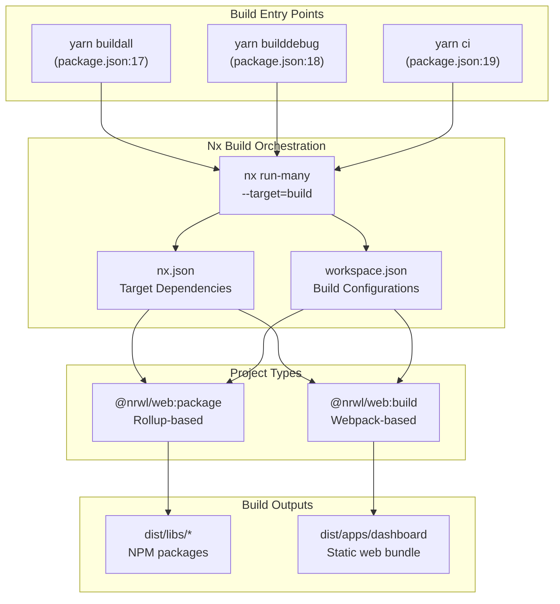
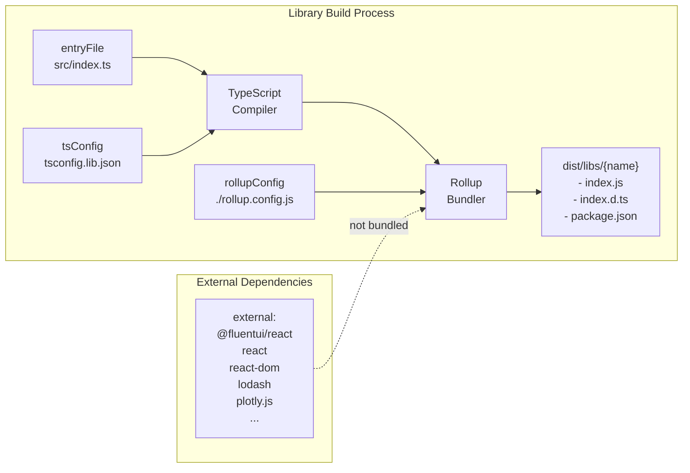
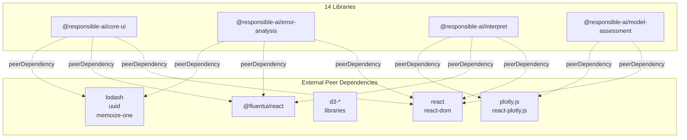
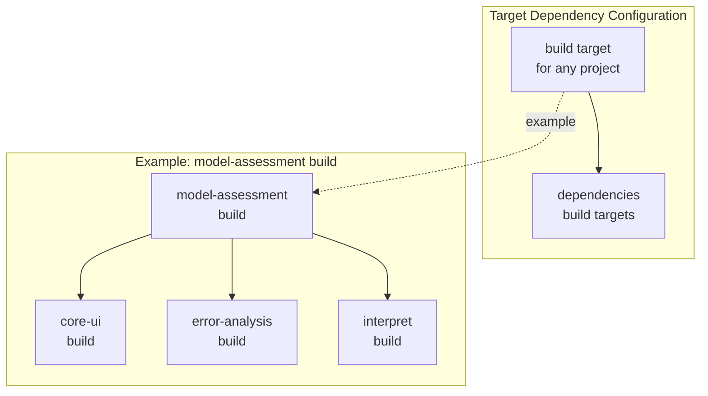
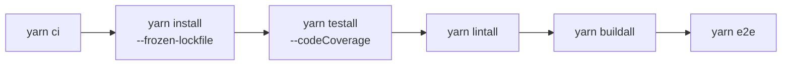

<!-- source: DeepWiki mcp.deepwiki.com · repo microsoft/responsible-ai-toolbox · extra page Build and Bundle Pipeline · fetched 2026-10-26 -->

# Build and Bundle Pipeline

<details>
<summary>Relevant source files</summary>

The following files were used as context for generating this wiki page:

- [apps/dashboard-e2e/src/describer/interpret/individualFeatureImportance/describeSubBarChart.ts](apps/dashboard-e2e/src/describer/interpret/individualFeatureImportance/describeSubBarChart.ts)
- [libs/e2e/src/lib/describer/interpretText/validateBarChart.ts](libs/e2e/src/lib/describer/interpretText/validateBarChart.ts)
- [libs/mlchartlib/src/lib/components/AccessibleChart.tsx](libs/mlchartlib/src/lib/components/AccessibleChart.tsx)
- [nx.json](nx.json)
- [package.json](package.json)
- [tsconfig.base.json](tsconfig.base.json)
- [workspace.json](workspace.json)
- [yarn.lock](yarn.lock)

</details>


This document explains the build process, bundling strategy, and dependency management for the TypeScript/React dashboard components in the Responsible AI Toolbox. It covers the Nx-based build system, memory management, and artifact generation.

For information about the individual library structures being built, see [TypeScript Libraries](#4.5.1). For details on development workflows and local setup, see [Development Setup](#6.2).

## Purpose and Scope

The build pipeline transforms TypeScript source code in the monorepo into distributable JavaScript artifacts. It handles:

- Compilation of 14+ TypeScript libraries into NPM packages
- Bundling of the dashboard application into a deployable web app
- Dependency management and external module handling
- Memory optimization for large-scale builds
- Production and development build configurations

---

## Build System Overview

The repository uses **Nx** as the build orchestrator with library-specific builders for different artifact types.



**Sources:** [package.json:1-158](), [workspace.json:1-100](), [nx.json:81-88]()

---

## Build Scripts and Commands

### Primary Build Commands

| Command | Purpose | Memory Allocation | Configuration |
|---------|---------|-------------------|---------------|
| `yarn buildall` | Production build of all projects | 6144 MB | `--configuration=production` |
| `yarn builddebug` | Debug build with source maps | 6144 MB | No optimization flags |
| `yarn build` | Single project build | Default | Project-specific |
| `yarn ci` | Complete CI pipeline | 4096-6144 MB | Test + Lint + Build |

**Sources:** [package.json:16-19]()

### Memory Configuration

The build process requires significant memory allocation due to:
- TypeScript compilation of multiple large libraries
- Webpack bundling of the dashboard application
- Concurrent build processes via Nx

```bash
# Production build with 6GB allocation
cross-env NODE_OPTIONS=--max_old_space_size=6144 nx run-many --target=build --configuration=production --all

# Lint with 4GB allocation
cross-env NODE_OPTIONS=--max_old_space_size=4096 nx affected:lint
```

**Sources:** [package.json:17-18](), [package.json:13](), [package.json:30-31]()

---

## Library Build Configuration

Libraries use the `@nrwl/web:package` builder with Rollup for bundling.

### Standard Library Configuration

Each library in [workspace.json]() follows this pattern:



**Sources:** [workspace.json:99-130]()

### Example: core-ui Library Configuration

```json
{
  "build": {
    "builder": "@nrwl/web:package",
    "options": {
      "outputPath": "dist/libs/core-ui",
      "tsConfig": "libs/core-ui/tsconfig.lib.json",
      "project": "libs/core-ui/package.json",
      "entryFile": "libs/core-ui/src/index.ts",
      "external": [
        "@fluentui/react",
        "highcharts",
        "jmespath",
        "localized-strings",
        "lodash",
        "memoize-one",
        "moment",
        "plotly.js",
        "react-plotly.js",
        "react",
        "react-dom",
        "uuid"
      ],
      "rollupConfig": "./rollup.config.js",
      "buildableProjectDepsInPackageJsonType": "dependencies"
    }
  }
}
```

**Key Configuration Properties:**

- **outputPath**: Build artifacts location (`dist/libs/{library-name}`)
- **entryFile**: Main export file (typically `src/index.ts`)
- **external**: Dependencies not bundled (peer dependencies in output)
- **rollupConfig**: Custom Rollup configuration file
- **buildableProjectDepsInPackageJsonType**: How internal dependencies are declared

**Sources:** [workspace.json:99-130]()

---

## Application Build Configuration

The dashboard application uses `@nrwl/web:build` builder with Webpack.

### Dashboard Build Configuration

```json
{
  "build": {
    "builder": "@nrwl/web:build",
    "options": {
      "outputPath": "dist/apps/dashboard",
      "index": "apps/dashboard/src/index.html",
      "main": "apps/dashboard/src/main.tsx",
      "memoryLimit": 4096,
      "webpackConfig": "./webpack.config.js",
      "globals": [
        {
          "moduleId": "plotly.js",
          "global": "Plotly"
        }
      ]
    },
    "configurations": {
      "production": {
        "optimization": true,
        "outputHashing": "all",
        "sourceMap": false,
        "extractCss": true,
        "budgets": [
          {
            "type": "initial",
            "maximumWarning": "20mb",
            "maximumError": "50mb"
          }
        ]
      }
    }
  }
}
```

**Sources:** [workspace.json:217-266]()

### Production vs Development Builds

| Feature | Development | Production |
|---------|-------------|------------|
| **Optimization** | Disabled | Enabled |
| **Source Maps** | Enabled | Disabled |
| **Output Hashing** | None | All files |
| **CSS Extraction** | Inline | Extracted |
| **Bundle Size Limit** | None | 50 MB error threshold |
| **Environment** | environment.ts | environment.prod.ts |

**Sources:** [workspace.json:242-264]()

---

## TypeScript Path Mappings

Path aliases enable clean imports across the monorepo without relative paths.

```typescript
// tsconfig.base.json path configuration
{
  "paths": {
    "@responsible-ai/causality": ["libs/causality/src/index.ts"],
    "@responsible-ai/core-ui": ["libs/core-ui/src/index.ts"],
    "@responsible-ai/counterfactuals": ["libs/counterfactuals/src/index.ts"],
    "@responsible-ai/dataset-explorer": ["libs/dataset-explorer/src/index.ts"],
    "@responsible-ai/error-analysis": ["libs/error-analysis/src/index.ts"],
    "@responsible-ai/interpret": ["libs/interpret/src/index.ts"],
    "@responsible-ai/mlchartlib": ["libs/mlchartlib/src/index.ts"],
    "@responsible-ai/model-assessment": ["libs/model-assessment/src/index.ts"]
  }
}
```

These paths are resolved during build by:
1. TypeScript compiler for type checking
2. Rollup/Webpack for module resolution
3. Jest for test imports

**Sources:** [tsconfig.base.json:37-56]()

---

## Dependency Management Strategy

### External Dependencies

Libraries mark shared dependencies as `external` to avoid duplication:



**Rationale:** The dashboard application bundles all dependencies once. Libraries declaring them as external prevents:
- Duplicate code in final bundle
- Version conflicts
- Bloated NPM packages

**Sources:** [workspace.json:37-50](), [workspace.json:106-119]()

### Internal Library Dependencies

The `buildableProjectDepsInPackageJsonType: "dependencies"` option ensures built libraries declare their internal dependencies:

```json
// Example: model-assessment depends on error-analysis
{
  "dependencies": {
    "@responsible-ai/core-ui": "^4.0.0",
    "@responsible-ai/error-analysis": "^4.0.0",
    "@responsible-ai/interpret": "^4.0.0"
  }
}
```

**Sources:** [workspace.json:59](), [workspace.json:128]()

---

## Build Targets and Dependencies

Nx's target dependency system ensures libraries are built in the correct order.



Configuration in [nx.json:81-88]():

```json
{
  "targetDependencies": {
    "build": [
      {
        "target": "build",
        "projects": "dependencies"
      }
    ]
  }
}
```

This ensures:
1. Dependencies build before dependents
2. Parallel builds where possible
3. Correct build order for incremental builds

**Sources:** [nx.json:81-88]()

---

## Build Output Structure

### Library Output

Each library produces a standard NPM package structure:

```
dist/libs/{library-name}/
├── index.js                    # Bundled JavaScript
├── index.d.ts                  # TypeScript declarations
├── package.json                # Package metadata with dependencies
└── README.md                   # Documentation
```

**Sources:** [workspace.json:52-58]()

### Application Output

The dashboard application builds to a static web bundle:

```
dist/apps/dashboard/
├── index.html                  # Entry HTML
├── main.[hash].js              # Application bundle
├── polyfills.[hash].js         # Browser polyfills
├── runtime.[hash].js           # Webpack runtime
├── vendor.[hash].js            # Third-party libraries (dev only)
├── assets/                     # Static assets
└── favicon.ico
```

**Notes:**
- Hash suffixes enable cache busting (`outputHashing: "all"` in production)
- Vendor chunk disabled in production (`vendorChunk: false`)
- Budget limits prevent excessive bundle sizes

**Sources:** [workspace.json:217-266]()

---

## Advanced Build Features

### Custom Webpack Configuration

The dashboard application references a custom Webpack config:

```json
{
  "webpackConfig": "./webpack.config.js"
}
```

This likely includes:
- Custom loaders (e.g., `worker-loader` for web workers)
- Plugin configurations
- Module resolution rules
- Performance optimizations

**Sources:** [workspace.json:240](), [package.json:151]()

### Global Module Configuration

Plotly.js is configured as a global module to reduce bundle size:

```json
{
  "globals": [
    {
      "moduleId": "plotly.js",
      "global": "Plotly"
    }
  ]
}
```

This assumes Plotly is loaded separately (e.g., via CDN or prior bundle).

**Sources:** [workspace.json:228-233]()

### Bundle Size Budgets

Production builds enforce size limits:

```json
{
  "budgets": [
    {
      "type": "initial",
      "maximumWarning": "20mb",
      "maximumError": "50mb"
    }
  ]
}
```

- **Warning at 20 MB**: Alerts developers to review bundle size
- **Error at 50 MB**: Fails build if bundle is too large

**Sources:** [workspace.json:257-263]()

---

## Build Performance Optimization

### Parallel Execution

Nx executes builds in parallel when dependencies allow:

```bash
# Build all projects with maximum parallelization
nx run-many --target=build --all
```

Nx's computation caching and task scheduling optimize build times.

### Memory Allocation

Different build scenarios require different memory limits:

| Scenario | Memory | Reason |
|----------|--------|--------|
| Full production build | 6144 MB | All libraries + dashboard + optimization |
| Linting | 4096 MB | ESLint processes multiple files |
| Single library build | Default (2048 MB) | Smaller scope |
| CI pipeline | 6144 MB | Full test + lint + build |

**Sources:** [package.json:17-19](), [package.json:30-31]()

### Incremental Builds

Nx's affected command system enables incremental builds:

```bash
# Only build projects affected by changes
nx affected:build --base=main
```

This is configured via [nx.json:3-5]():

```json
{
  "affected": {
    "defaultBase": "main"
  }
}
```

---

## Build Integration with CI/CD

The CI pipeline orchestrates multiple build stages:



Each stage must pass before proceeding:

```bash
yarn install --frozen-lockfile && 
yarn testall --codeCoverage && 
yarn lintall && 
yarn buildall && 
yarn test && 
yarn e2e
```

**Sources:** [package.json:19]()

For details on CI/CD workflows, see [Build and Deployment](#7.2.3).

---

## Common Build Commands

| Command | Description | Use Case |
|---------|-------------|----------|
| `yarn buildall` | Build all projects (production) | Release preparation |
| `yarn builddebug` | Build all projects (debug) | Debugging bundle issues |
| `yarn build {project}` | Build single project | Iterative development |
| `yarn affected:build` | Build changed projects | CI optimization |
| `nx run-many --target=build --all` | Nx direct build | Custom build scripts |

**Sources:** [package.json:16-18](), [package.json:7-9]()

---

## Build Artifacts and Publishing

Built artifacts are deployed to multiple targets:

1. **NPM Registry**: Individual library packages from `dist/libs/*`
2. **Azure Blob Storage**: Dashboard bundle from `dist/apps/dashboard`
3. **Test PyPI**: Pre-release validation

For the complete deployment process, see [Build and Deployment](#7.2.3) and [Release Process](#7.2.4).

**Sources:** Referenced in CI/CD diagram from high-level overview

---

## Troubleshooting Build Issues

### Common Issues

**Out of Memory Errors:**
```bash
# Increase memory allocation
cross-env NODE_OPTIONS=--max_old_space_size=8192 yarn buildall
```

**Dependency Resolution Failures:**
```bash
# Clean install
rm -rf node_modules yarn.lock
yarn install
```

**TypeScript Compilation Errors:**
- Check [tsconfig.base.json]() path mappings
- Verify library `tsconfig.lib.json` files
- Ensure proper `external` declarations in [workspace.json]()

**Bundle Size Exceeded:**
- Review `budgets` configuration in [workspace.json:257-263]()
- Analyze bundle with webpack-bundle-analyzer
- Consider code splitting or lazy loading

**Sources:** [package.json:17-18](), [workspace.json:257-263]()

---

