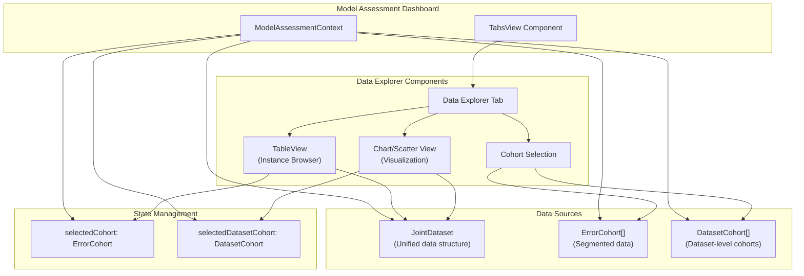
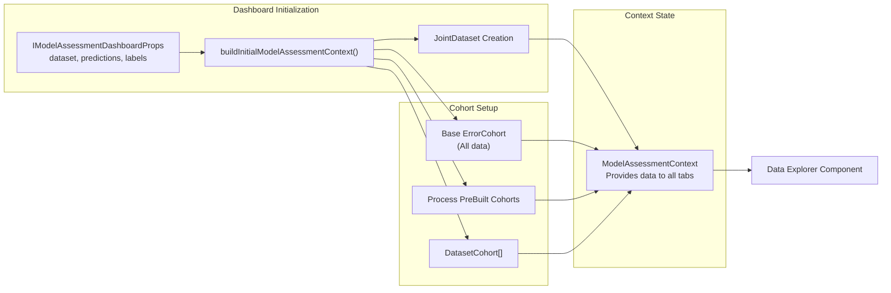
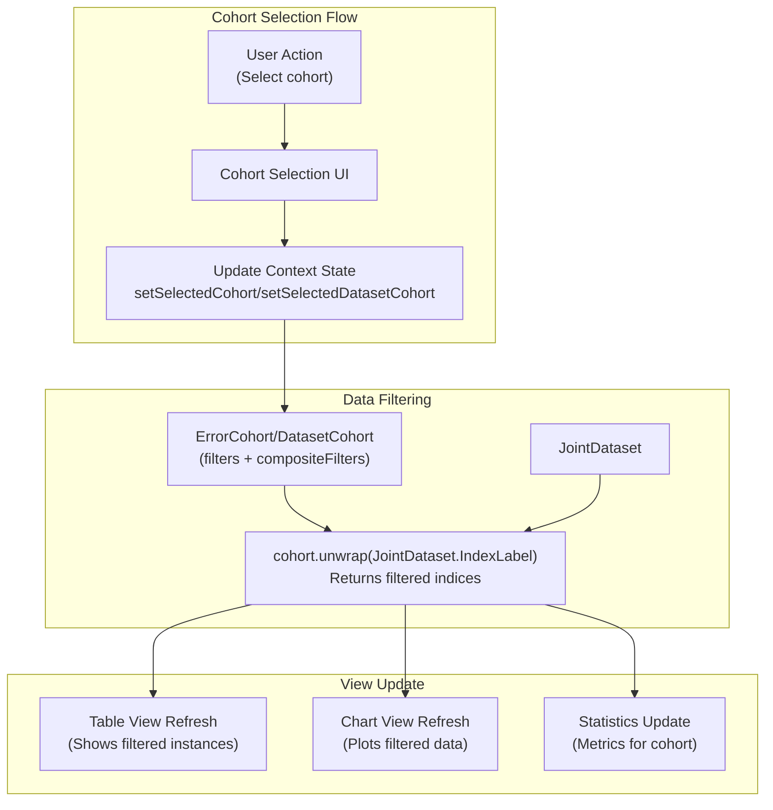
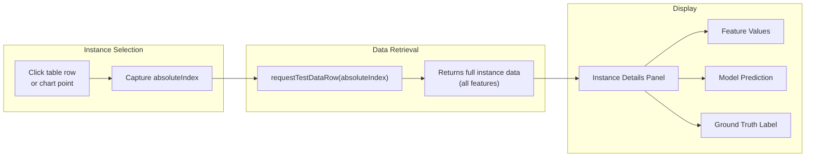
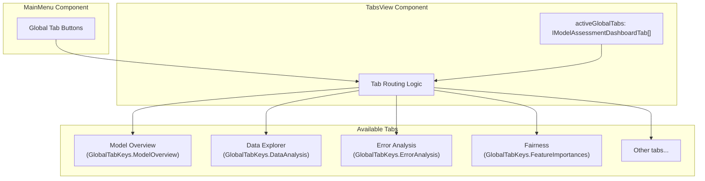
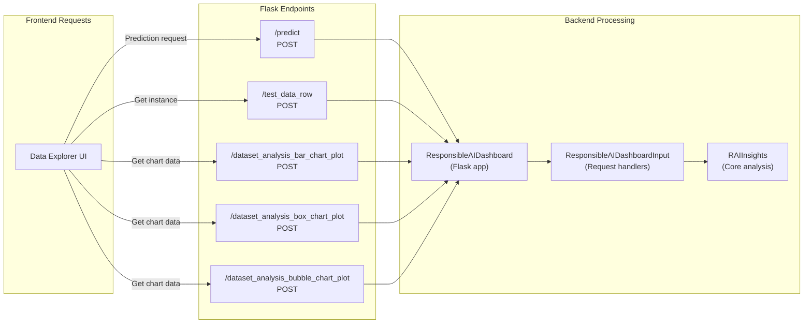
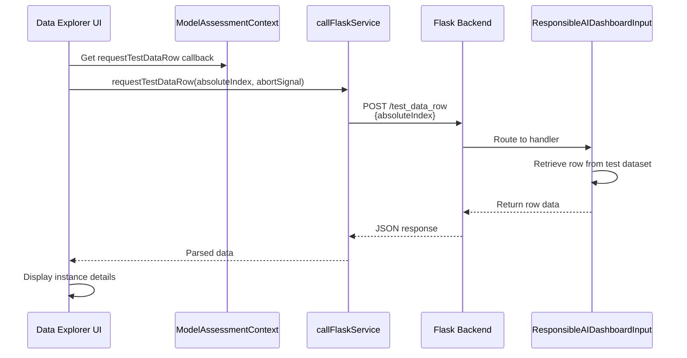

<!-- source: DeepWiki mcp.deepwiki.com · repo microsoft/responsible-ai-toolbox · extra page Data Explorer Component · fetched 2026-10-26 -->

# Data Explorer Component

<details>
<summary>Relevant source files</summary>

The following files were used as context for generating this wiki page:

- [apps/widget/src/app/ModelAssessment.tsx](apps/widget/src/app/ModelAssessment.tsx)
- [libs/core-ui/src/index.ts](libs/core-ui/src/index.ts)
- [libs/core-ui/src/lib/Context/ModelAssessmentContext.tsx](libs/core-ui/src/lib/Context/ModelAssessmentContext.tsx)
- [libs/core-ui/src/lib/Interfaces/IExplanationContext.ts](libs/core-ui/src/lib/Interfaces/IExplanationContext.ts)
- [libs/core-ui/src/lib/util/StatisticsUtils.ts](libs/core-ui/src/lib/util/StatisticsUtils.ts)
- [libs/error-analysis/src/index.ts](libs/error-analysis/src/index.ts)
- [libs/error-analysis/src/lib/ErrorAnalysisDashboard/Controls/MetricSelector/MetricSelector.tsx](libs/error-analysis/src/lib/ErrorAnalysisDashboard/Controls/MetricSelector/MetricSelector.tsx)
- [libs/error-analysis/src/lib/ErrorAnalysisDashboard/Interfaces/IErrorAnalysisDashboardState.ts](libs/error-analysis/src/lib/ErrorAnalysisDashboard/Interfaces/IErrorAnalysisDashboardState.ts)
- [libs/interpret-vision/src/lib/VisionExplanationDashboard/Interfaces/IVisionExplanationDashboardProps.ts](libs/interpret-vision/src/lib/VisionExplanationDashboard/Interfaces/IVisionExplanationDashboardProps.ts)
- [libs/localization/src/lib/en.json](libs/localization/src/lib/en.json)
- [libs/model-assessment/src/lib/ModelAssessmentDashboard/Context/buildModelAssessmentContext.ts](libs/model-assessment/src/lib/ModelAssessmentDashboard/Context/buildModelAssessmentContext.ts)
- [libs/model-assessment/src/lib/ModelAssessmentDashboard/Controls/ModelOverview/ModelOverview.tsx](libs/model-assessment/src/lib/ModelAssessmentDashboard/Controls/ModelOverview/ModelOverview.tsx)
- [libs/model-assessment/src/lib/ModelAssessmentDashboard/Controls/ModelOverview/StatsTableUtils.ts](libs/model-assessment/src/lib/ModelAssessmentDashboard/Controls/ModelOverview/StatsTableUtils.ts)
- [libs/model-assessment/src/lib/ModelAssessmentDashboard/Controls/TabsView/TabsViewProps.ts](libs/model-assessment/src/lib/ModelAssessmentDashboard/Controls/TabsView/TabsViewProps.ts)
- [libs/model-assessment/src/lib/ModelAssessmentDashboard/ModelAssessmentDashboard.tsx](libs/model-assessment/src/lib/ModelAssessmentDashboard/ModelAssessmentDashboard.tsx)
- [libs/model-assessment/src/lib/ModelAssessmentDashboard/ModelAssessmentDashboardProps.ts](libs/model-assessment/src/lib/ModelAssessmentDashboard/ModelAssessmentDashboardProps.ts)
- [libs/model-assessment/src/lib/ModelAssessmentDashboard/ModelAssessmentDashboardState.ts](libs/model-assessment/src/lib/ModelAssessmentDashboard/ModelAssessmentDashboardState.ts)
- [raiwidgets/raiwidgets/responsibleai_dashboard.py](raiwidgets/raiwidgets/responsibleai_dashboard.py)
- [raiwidgets/raiwidgets/responsibleai_dashboard_input.py](raiwidgets/raiwidgets/responsibleai_dashboard_input.py)

</details>


## Purpose and Scope

The Data Explorer Component provides an interactive interface for browsing, filtering, and visualizing dataset instances within the Model Assessment Dashboard. It enables users to examine individual data points, explore feature distributions, view predictions versus ground truth, and understand model behavior across different cohorts.

This page documents the Data Explorer's architecture, data flow, and UI components. For information about cohort management features, see [Cohort Management](#4.2.3). For error-specific visualization, see [Error Analysis Dashboard](#4.3).

---

## Overview

The Data Explorer serves as the primary interface for dataset inspection, allowing users to:

- Browse individual instances in a tabular format with ground truth and predicted labels
- Visualize data distributions through scatter plots and other chart types
- Filter and segment data using cohort selections
- Inspect specific data points to understand feature values and predictions
- Navigate between correct and incorrect predictions

The component integrates with the broader Model Assessment Dashboard context, sharing cohort selections and dataset state with other analysis tools.

---

## Component Architecture

### High-Level Structure



**Sources:**
- [libs/model-assessment/src/lib/ModelAssessmentDashboard/ModelAssessmentDashboard.tsx:56-174]()
- [libs/core-ui/src/lib/Context/ModelAssessmentContext.tsx:28-191]()
- [libs/localization/src/lib/en.json:202-207]()

### Context Integration

The Data Explorer accesses dashboard-wide state through `ModelAssessmentContext`, which provides:

| Context Property | Type | Purpose |
|-----------------|------|---------|
| `dataset` | `IDataset` | Raw dataset with features, labels, predictions |
| `jointDataset` | `JointDataset` | Unified data structure combining features and model outputs |
| `errorCohorts` | `ErrorCohort[]` | Available cohorts for filtering |
| `datasetCohorts` | `DatasetCohort[]` | Dataset-level cohorts |
| `selectedErrorCohort` | `ErrorCohort` | Currently selected error cohort |
| `selectedDatasetCohort` | `DatasetCohort` | Currently selected dataset cohort |
| `baseErrorCohort` | `ErrorCohort` | Default cohort representing all data |
| `modelMetadata` | `IExplanationModelMetadata` | Model type, feature names, class names |

**Sources:**
- [libs/core-ui/src/lib/Context/ModelAssessmentContext.tsx:28-51]()
- [libs/model-assessment/src/lib/ModelAssessmentDashboard/Context/buildModelAssessmentContext.ts:39-174]()

---

## Data Flow and State Management

### Initialization and Data Loading



The initialization process:

1. **Props Processing**: `buildInitialModelAssessmentContext()` receives dashboard props containing the dataset
2. **JointDataset Creation**: Combines features, true labels, predictions, and explanations into a unified structure
3. **Cohort Generation**: Creates default cohort and processes any pre-built cohorts from props
4. **Context Provision**: Makes data available to all dashboard components including Data Explorer

**Sources:**
- [libs/model-assessment/src/lib/ModelAssessmentDashboard/Context/buildModelAssessmentContext.ts:39-174]()
- [libs/model-assessment/src/lib/ModelAssessmentDashboard/ModelAssessmentDashboard.tsx:38-46]()

### Data Filtering Through Cohorts

The Data Explorer displays instances based on the currently selected cohort:



**Sources:**
- [libs/model-assessment/src/lib/ModelAssessmentDashboard/ModelAssessmentDashboard.tsx:226-230]()
- [libs/core-ui/src/lib/Cohort/Cohort.ts]() (inferred from usage patterns)

---

## UI Components and Features

### Table View for Instance Browsing

The Table View displays dataset instances in a tabular format, typically separated into correct and incorrect predictions:

**Key Features:**
- Column headers showing feature names from `dataset.feature_names`
- Rows representing individual data points
- Ground truth labels from `dataset.true_y`
- Predicted labels from `dataset.predicted_y`
- Separation into correct/incorrect prediction tables
- Support for categorical and numerical features

**Localization:**
```
DataAnalysis.TableView.description:
"View the dataset in a table representation with the ground truth and 
predicted labels. The table is separated into sub-tables of correct 
and incorrect predictions."
```

**Sources:**
- [libs/localization/src/lib/en.json:203-205]()

### Scatter Plot and Chart Visualization

The Data Explorer provides chart-based views for visualizing data distributions and relationships:

**Chart Types:**
- Scatter plots for feature relationships
- Bubble charts for multi-dimensional data (via `requestBubblePlotData`)
- Box plots for distribution analysis (via `requestBoxPlotDistribution`)

**Configuration:**
- X-axis and Y-axis feature selection
- Color coding by prediction correctness or other attributes
- Interactive point selection for detail inspection
- Cohort-based filtering of displayed points

**API Integration:**
The component can request chart data from the backend:

| Request Method | Parameters | Purpose |
|---------------|------------|---------|
| `requestBubblePlotData` | filter, compositeFilter, xAxis, yAxis | Get bubble chart data for cohort |
| `requestBoxPlotDistribution` | request (cohort data) | Get distribution box plots |
| `requestDatasetAnalysisBarChart` | filter, features, numBins | Get bar chart for categorical analysis |
| `requestDatasetAnalysisBoxChart` | filter, features, numBins | Get box chart for numerical analysis |

**Sources:**
- [libs/model-assessment/src/lib/ModelAssessmentDashboard/ModelAssessmentDashboardProps.ts:69-102]()
- [libs/core-ui/src/lib/Context/ModelAssessmentContext.tsx:70-128]()
- [apps/widget/src/app/ModelAssessment.tsx:114-217]()

### Instance Inspection and Navigation

The Data Explorer enables detailed inspection of individual instances:



**Backend Endpoint:**
```python
# Flask route: /test_data_row
def get_test_data_row(absoluteIndex: int) -> dict:
    # Returns the full feature vector for the specified instance
```

**Sources:**
- [libs/core-ui/src/lib/Context/ModelAssessmentContext.tsx:95-98]()
- [apps/widget/src/app/ModelAssessment.tsx:253-263]()

---

## Integration with Model Assessment Dashboard

### Tab Navigation Structure

The Data Explorer exists as a global tab within the Model Assessment Dashboard:



**Tab Definition:**
```typescript
interface IModelAssessmentDashboardTab {
  key: GlobalTabKeys;  // e.g., GlobalTabKeys.DataAnalysis
  dataCount: number;   // Number of instances in current cohort
  name: string;        // Localized display name
}
```

**Sources:**
- [libs/model-assessment/src/lib/ModelAssessmentDashboard/ModelAssessmentDashboardState.ts:38-42]()
- [libs/model-assessment/src/lib/ModelAssessmentDashboard/Controls/TabsView/TabsView.tsx]() (inferred)

### Cohort Synchronization

The Data Explorer shares cohort state with other dashboard components:

**Shared State:**
- Changes to `selectedErrorCohort` affect all tabs displaying error-based metrics
- Changes to `selectedDatasetCohort` affect all tabs displaying dataset-level views
- Cohort creation in one tab (e.g., Error Analysis) makes it available in Data Explorer

**Cohort Operations:**

| Operation | Method | Effect on Data Explorer |
|-----------|--------|------------------------|
| Add Cohort | `addCohort(cohort, datasetCohort, switchNew)` | New cohort appears in selection dropdown |
| Edit Cohort | `editCohort(cohort, datasetCohort, switchNew)` | Updated cohort filters affect displayed data |
| Delete Cohort | `deleteCohort(cohort)` | Removed from available selections |
| Shift Cohort | `shiftErrorCohort(cohort)` | Changes base cohort for analysis |

**Sources:**
- [libs/model-assessment/src/lib/ModelAssessmentDashboard/ModelAssessmentDashboard.tsx:268-314]()
- [libs/core-ui/src/lib/Context/ModelAssessmentContext.tsx:179-190]()

---

## Data Types and Supported Task Types

### Dataset Structure

The Data Explorer works with the `IDataset` interface:

```typescript
interface IDataset {
  features: any[][];                    // Feature matrix [n_samples, n_features]
  feature_names: string[];              // Feature column names
  feature_metadata?: IFeatureMetadata;  // Categorical, datetime, etc.
  
  true_y: number[];                     // Ground truth labels
  predicted_y?: number[];               // Model predictions
  probability_y?: number[][];           // Prediction probabilities
  
  class_names?: string[];               // For classification tasks
  target_column: string;                // Target variable name
  task_type: DatasetTaskType;           // Classification, Regression, etc.
  
  categorical_features: string[];       // List of categorical feature names
  object_detection_labels?: any;        // For object detection tasks
  index?: any[];                        // Optional datetime index
}
```

**Sources:**
- [libs/core-ui/src/lib/Interfaces/IDataset.ts]() (inferred from usage)
- [libs/model-assessment/src/lib/ModelAssessmentDashboard/Context/buildModelAssessmentContext.ts:59-69]()

### Task Type Support

The Data Explorer adapts its display based on `dataset.task_type`:

| Task Type | Enum Value | Display Adaptations |
|-----------|------------|---------------------|
| Classification | `DatasetTaskType.Classification` | Shows class names, probabilities |
| Regression | `DatasetTaskType.Regression` | Shows numeric predictions, error values |
| Object Detection | `DatasetTaskType.ObjectDetection` | Displays bounding boxes, detection metrics |
| Question Answering | `DatasetTaskType.QuestionAnswering` | Shows text data, QA-specific metrics |
| Generative Text | `DatasetTaskType.GenerativeText` | Displays generated text outputs |
| Forecasting | `DatasetTaskType.Forecasting` | Time series visualizations |
| Image/Text Classification | Various | Modality-specific rendering |

**Sources:**
- [libs/core-ui/src/lib/util/StatisticsUtils.ts:1-215]()
- [libs/model-assessment/src/lib/ModelAssessmentDashboard/Controls/ModelOverview/ModelOverview.tsx:130-205]()

---

## Backend API Integration

### Flask Endpoints Used

The Data Explorer may interact with backend Flask endpoints for dynamic data:



**Endpoint Details:**

**`/predict`** - Get model predictions for instances
- Input: Feature matrix
- Output: Predictions (class labels or probabilities)
- Handler: `ResponsibleAIDashboardInput.on_predict()`

**`/test_data_row`** - Retrieve full feature vector for an instance
- Input: Absolute index
- Output: Complete row data with all features
- Handler: Backend method (not shown in provided files)

**Chart Endpoints** - Generate visualization data
- Input: Filters, composite filters, feature selections, bin counts
- Output: Chart-ready data structures (Highcharts format)
- Handlers: Various backend methods for different chart types

**Sources:**
- [raiwidgets/raiwidgets/responsibleai_dashboard.py:53-62]()
- [raiwidgets/raiwidgets/responsibleai_dashboard_input.py:129-152]()
- [apps/widget/src/app/ModelAssessment.tsx:164-217]()

### Request Flow Example



**Sources:**
- [apps/widget/src/app/ModelAssessment.tsx:253-263]()
- [libs/core-ui/src/lib/Context/ModelAssessmentContext.tsx:95-98]()

---

## Localization and Internationalization

The Data Explorer uses the localization system for all user-facing text:

**Key Localization Entries:**

```typescript
// Navigation labels
"ErrorAnalysis.Navigation.dataExplorer": "Data explorer"

// Table view
"DataAnalysis.TableView.description": 
  "View the dataset in a table representation with the ground truth 
   and predicted labels. The table is separated into sub-tables of 
   correct and incorrect predictions."

// View labels
"ErrorAnalysis.dataExplorerView": "Data explorer"
"ErrorAnalysis.dataExploration": "Dataset Exploration"
```

**Usage Pattern:**
```typescript
import { localization } from "@responsible-ai/localization";

const tabName = localization.ErrorAnalysis.Navigation.dataExplorer;
const description = localization.DataAnalysis.TableView.description;
```

**Sources:**
- [libs/localization/src/lib/en.json:433]()
- [libs/localization/src/lib/en.json:203-205]()
- [libs/localization/src/lib/en.json:475-476]()

---

## Summary

The Data Explorer Component provides comprehensive dataset browsing capabilities within the Model Assessment Dashboard:

**Core Capabilities:**
- Tabular instance browsing with prediction details
- Interactive chart visualizations (scatter, bubble, box plots)
- Cohort-based filtering and segmentation
- Individual instance inspection
- Integration with backend APIs for dynamic data

**Integration Points:**
- Shares `ModelAssessmentContext` with all dashboard tabs
- Synchronizes cohort selections across components
- Uses `JointDataset` for unified data access
- Leverages Flask backend for predictions and chart data

**Supported Scenarios:**
- Classification (binary and multiclass)
- Regression
- Object detection
- Question answering
- Generative text
- Time series forecasting

The component adapts its display and metrics based on the model task type, providing task-appropriate visualizations and instance details.

---

