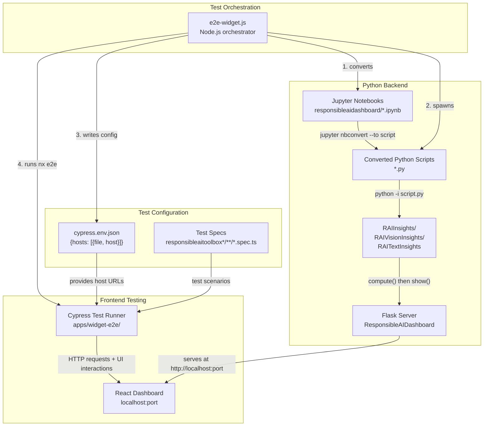
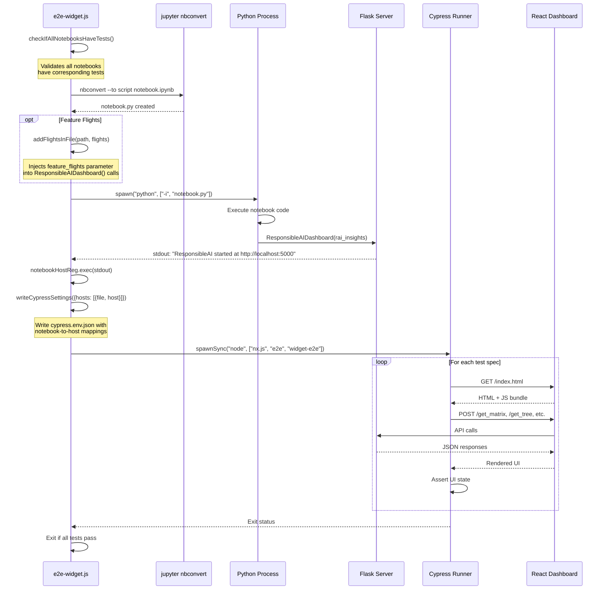
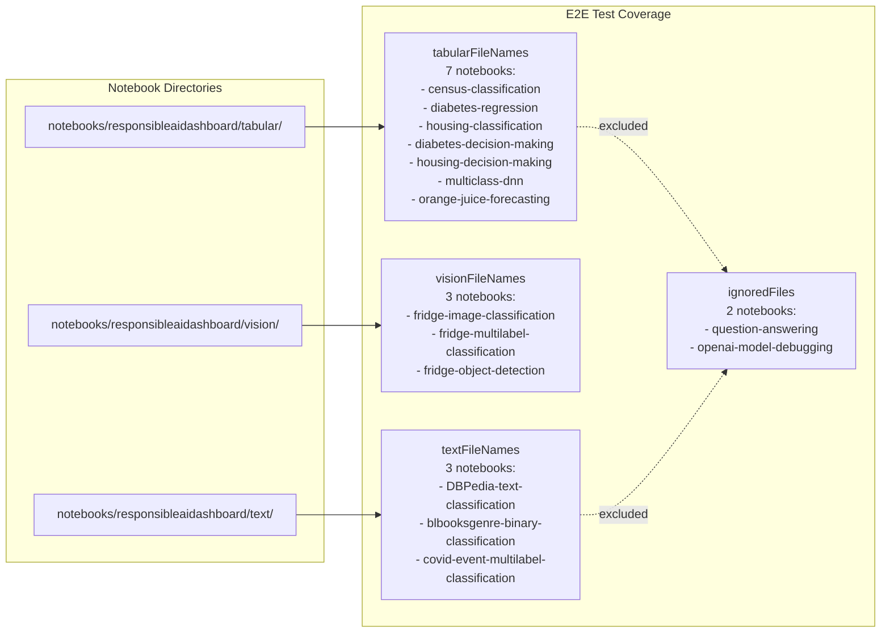
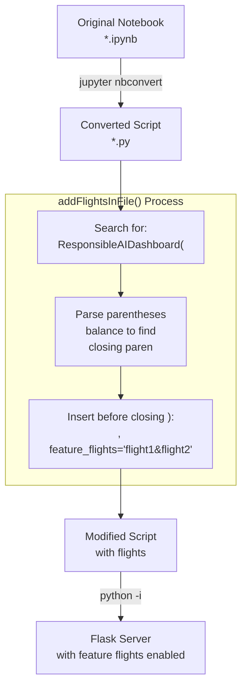
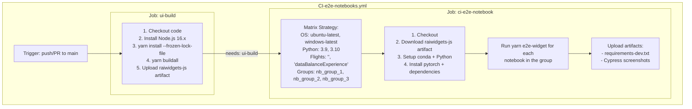
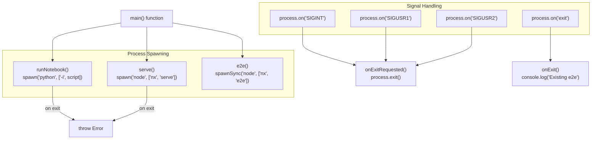

<!-- source: DeepWiki mcp.deepwiki.com · repo microsoft/responsible-ai-toolbox · extra page End-to-End Tests · fetched 2026-10-26 -->

# End-to-End Tests

<details>
<summary>Relevant source files</summary>

The following files were used as context for generating this wiki page:

- [.azure-devops/component-governance.yml](.azure-devops/component-governance.yml)
- [.github/workflows/CD.yml](.github/workflows/CD.yml)
- [.github/workflows/CI-codescan.yml](.github/workflows/CI-codescan.yml)
- [.github/workflows/CI-e2e-notebooks.yml](.github/workflows/CI-e2e-notebooks.yml)
- [.github/workflows/CI-notebook.yml](.github/workflows/CI-notebook.yml)
- [.github/workflows/CI-python.yml](.github/workflows/CI-python.yml)
- [.github/workflows/CI-rai_core_flask-pytest.yml](.github/workflows/CI-rai_core_flask-pytest.yml)
- [.github/workflows/CI-raiwidgets-pytest.yml](.github/workflows/CI-raiwidgets-pytest.yml)
- [.github/workflows/CI-typescript.yml](.github/workflows/CI-typescript.yml)
- [.github/workflows/GitHubPages.yml](.github/workflows/GitHubPages.yml)
- [.github/workflows/python-linting.yml](.github/workflows/python-linting.yml)
- [.github/workflows/release-rai-tabular.yml](.github/workflows/release-rai-tabular.yml)
- [README.md](README.md)
- [notebooks/responsibleaidashboard/text/responsibleaidashboard-openai-model-debugging.ipynb](notebooks/responsibleaidashboard/text/responsibleaidashboard-openai-model-debugging.ipynb)
- [notebooks/test_notebooks.py](notebooks/test_notebooks.py)
- [scripts/e2e-widget.js](scripts/e2e-widget.js)

</details>


## Purpose and Scope

This page documents the end-to-end (E2E) testing strategy for the Responsible AI Dashboard widgets, which validates the complete integration between Python backend and TypeScript frontend. E2E tests ensure that the dashboard UI correctly interacts with the Flask API endpoints and displays model insights appropriately.

For information about Python unit tests, see [Python Unit and Integration Tests](#7.1.1). For TypeScript unit tests, see [TypeScript Unit Tests](#7.1.2). For notebook execution tests using papermill, see [Notebook Tests](#7.1.3).

The E2E tests in this codebase use **Cypress** to interact with the dashboard UI while it runs against live Python notebooks that serve the Responsible AI Dashboard through Flask. This validates the full stack from notebook execution through API calls to UI rendering.

## E2E Testing Architecture

The E2E test system consists of three main components working together:



**Sources:** [scripts/e2e-widget.js:1-399](), [.github/workflows/CI-e2e-notebooks.yml:1-148]()

## Widget E2E Test Workflow

The E2E test workflow follows a multi-stage process that bridges Jupyter notebooks to Cypress tests:



**Sources:** [scripts/e2e-widget.js:45-322](), [scripts/e2e-widget.js:116-143](), [scripts/e2e-widget.js:267-274]()

## Test Orchestration Script

The `e2e-widget.js` script is the central orchestrator for all widget E2E tests. It provides a command-line interface for running tests with various configurations.

### Key Functions

| Function | Purpose | Source Lines |
|----------|---------|--------------|
| `checkIfAllNotebooksHaveTests()` | Validates that every notebook in the directories has corresponding E2E tests | [177-190]() |
| `convertNotebooks(notebook, flights)` | Converts Jupyter notebooks to Python scripts using `jupyter nbconvert` | [192-224]() |
| `addFlightsInFile(path, flights)` | Injects feature flight parameters into `ResponsibleAIDashboard()` constructor calls | [145-175]() |
| `runNotebook(name)` | Spawns Python process to execute notebook script and extracts Flask server URL | [116-143]() |
| `writeCypressSettings(hosts)` | Writes `cypress.env.json` with notebook-to-host mappings | [267-274]() |
| `e2e(watch, selectedNotebook, flights, host)` | Executes Cypress tests via Nx CLI | [276-322]() |

### Notebook Organization

Notebooks are organized into three directories with specific lists maintained for testing:



**Sources:** [scripts/e2e-widget.js:9-42](), [scripts/e2e-widget.js:51-64]()

### Command-Line Interface

The script supports several command-line options:

```javascript
// Command-line options from commander.js
--watch, -w              // Watch mode for iterative testing
--skipgen                // Skip notebook conversion step
--host [host]            // Use existing Flask server (full URL or port)
--notebook [notebook], -n // Run specific notebook only
--flights [flights], -f   // Feature flights (comma-separated, no whitespace)
```

**Example usage:**
```bash
# Run all E2E tests
yarn e2e-widget

# Run specific notebook with feature flight
yarn e2e-widget -n "responsibleaidashboard-census-classification-model-debugging" -f "dataBalanceExperience"

# Watch mode for development (requires --host)
yarn e2e-widget -n "responsibleaidashboard-housing-decision-making" --host 5000 --watch
```

**Sources:** [scripts/e2e-widget.js:324-380]()

## Feature Flights Support

The E2E testing system supports feature flags (called "flights") to test experimental UI features:

### Flight Injection Mechanism



The injection works by:
1. Finding all occurrences of `ResponsibleAIDashboard(`
2. Tracking parenthesis balance to locate the closing `)`
3. Injecting the `feature_flights` parameter with flights joined by `&`

**Sources:** [scripts/e2e-widget.js:145-175](), [scripts/e2e-widget.js:167-170]()

### Test Key Generation

Cypress test specs are organized by notebook name and flights. The script generates test keys by:

```javascript
// Remove prefix "responsibleaidashboard-"
// Remove dashes and make camel case
let notebookKey = selectedNotebook.substring("responsibleaidashboard".length)
notebookKey = notebookKey
  .split("-")
  .map((word) => word.charAt(0).toUpperCase() + word.slice(1))
  .join("");

// Append flights with capitalized first letters
if (flights) {
  notebookKey = notebookKey + 
    flights.split(",")
      .map((flight) => flight.charAt(0).toUpperCase() + flight.slice(1))
      .join("");
}
```

This generates spec paths like `**/responsibleaitoolboxCensusClassificationModelDebugging/**` or `**/responsibleaitoolboxCensusClassificationModelDebuggingDataBalanceExperience/**`.

**Sources:** [scripts/e2e-widget.js:276-303]()

## CI Pipeline Configuration

The E2E tests run as part of the CI pipeline with comprehensive matrix testing:

### CI Workflow Structure



**Sources:** [.github/workflows/CI-e2e-notebooks.yml:1-148]()

### Matrix Configuration Details

| Matrix Dimension | Values | Notes |
|-----------------|--------|-------|
| **Operating Systems** | `ubuntu-latest`, `windows-latest` | macOS excluded (TODO comment in workflow) |
| **Python Versions** | `3.9`, `3.10` | Standard Python support matrix |
| **Feature Flights** | `""` (empty), `"dataBalanceExperience"` | Tests with and without experimental features |
| **Notebook Groups** | `nb_group_1`, `nb_group_2`, `nb_group_3` | Splits tests for parallel execution |
| **Exclusions** | `nb_group_3` with `dataBalanceExperience` flight | Forecasting notebooks don't use data balance features |

**Sources:** [.github/workflows/CI-e2e-notebooks.yml:45-57]()

### Notebook Test Groups

The notebooks are divided into three groups for parallel CI execution:

**Group 1 (nb_group_1):**
```yaml
- responsibleaidashboard-census-classification-model-debugging
- responsibleaidashboard-diabetes-regression-model-debugging
- responsibleaidashboard-housing-decision-making
```

**Group 2 (nb_group_2):**
```yaml
- responsibleaidashboard-housing-classification-model-debugging
- responsibleaidashboard-diabetes-decision-making
- responsibleaidashboard-multiclass-dnn-model-debugging
```

**Group 3 (nb_group_3):**
```yaml
- responsibleaidashboard-orange-juice-forecasting
```

**Sources:** [.github/workflows/CI-e2e-notebooks.yml:119-141]()

## Vision and Text E2E Tests

Vision and text notebooks have separate E2E test workflows due to additional dependencies:

### Vision E2E Pipeline

The vision notebooks require:
- PyTorch and torchvision
- Vision-specific datasets (fridge images)
- Object detection metrics support

These tests are likely in a separate workflow (referenced in the ToC as specialized CI workflows).

**Notebooks tested:**
- `responsibleaidashboard-fridge-image-classification-model-debugging`
- `responsibleaidashboard-fridge-multilabel-image-classification-model-debugging`
- `responsibleaidashboard-fridge-object-detection-model-debugging`

**Sources:** [scripts/e2e-widget.js:25-29]()

### Text E2E Pipeline

Text notebooks require:
- Transformers library
- NLP feature extractors
- Text-specific datasets

**Notebooks tested:**
- `responsibleaidashboard-DBPedia-text-classification-model-debugging`
- `responsibleaidashboard-blbooksgenre-binary-text-classification-model-debugging`
- `responsibleaidashboard-covid-event-multilabel-text-classification-model-debugging`

**Notebooks excluded** (no E2E tests yet):
- `responsibleaidashboard-question-answering-model-debugging`
- `responsibleaidashboard-openai-model-debugging` (requires API credentials)

**Sources:** [scripts/e2e-widget.js:30-38](), [notebooks/responsibleaidashboard/text/responsibleaidashboard-openai-model-debugging.ipynb:1-381]()

## Running E2E Tests Locally

### Prerequisites

1. **Install dependencies:**
```bash
# Install Node.js dependencies
yarn install --frozen-lock-file

# Build TypeScript
yarn buildall

# Install Python dependencies
pip install -r raiwidgets/requirements-dev.txt
pip install -e raiwidgets
```

2. **For vision tests, install PyTorch:**
```bash
conda install --yes --quiet pytorch torchvision captum cpuonly -c pytorch
```

### Running All Tests

```bash
# Run all E2E tests (converts notebooks, launches servers, runs Cypress)
yarn e2e-widget
```

This will:
1. Convert all notebooks to Python scripts
2. Run each notebook to launch Flask servers
3. Execute Cypress tests against each server
4. Report results

### Running Specific Tests

```bash
# Run a single notebook
yarn e2e-widget -n "responsibleaidashboard-census-classification-model-debugging"

# Run with feature flight
yarn e2e-widget -n "responsibleaidashboard-housing-decision-making" -f "dataBalanceExperience"

# Skip notebook conversion (notebooks already converted)
yarn e2e-widget -n "responsibleaidashboard-diabetes-regression-model-debugging" --skipgen
```

### Development Workflow

For iterative development, use watch mode with an existing server:

```bash
# Terminal 1: Start the notebook manually
cd notebooks/responsibleaidashboard/tabular
python -i responsibleaidashboard-census-classification-model-debugging.py

# Note the port (e.g., 5000)

# Terminal 2: Run Cypress in watch mode
yarn e2e-widget -n "responsibleaidashboard-census-classification-model-debugging" --host 5000 --watch
```

Watch mode keeps Cypress open so you can:
- Re-run tests interactively
- Debug test failures
- Inspect the dashboard in the Cypress browser

**Sources:** [scripts/e2e-widget.js:324-380](), [scripts/e2e-widget.js:363-366]()

## Test Artifacts and Debugging

### Cypress Artifacts

After test execution, artifacts are stored in `dist/cypress/`:

```
dist/cypress/
├── screenshots/          # Screenshots of test failures
│   └── [test-spec]/
│       └── [test-name] (failed).png
├── videos/              # Video recordings of test runs
│   └── [test-spec].mp4
└── results/             # Test result JSON files
```

In CI, these artifacts are uploaded with naming convention:
```
raiwidgets-ci-e2e-notebooks-screen-shot-{notebookGroup}-{flights}-{OS}-{pythonVersion}
```

**Sources:** [.github/workflows/CI-e2e-notebooks.yml:142-147]()

### Debugging Failed Tests

When tests fail, the CI workflow:
1. Continues execution despite failures (`fail-fast: false`)
2. Uploads screenshots using `actions/upload-artifact@v4`
3. Uses `if: always()` to ensure artifacts upload even on failure

To debug locally:
1. Run the specific failing test with `--watch`
2. Open Cypress Test Runner UI
3. Click on the failing test to see it execute
4. Use browser DevTools to inspect network requests
5. Check Flask server logs for API errors

**Sources:** [.github/workflows/CI-e2e-notebooks.yml:45-46](), [.github/workflows/CI-e2e-notebooks.yml:142-147]()

## Timeout and Error Handling

### Timeout Configuration

The orchestration script uses a 4800-second (80-minute) timeout for both notebook execution and Nx serve:

```javascript
const timeout = 4800; // seconds

// Notebook execution timeout
const timer = setTimeout(() => {
  throw new Error(`${name} timeout.`);
}, timeout * 1000);
```

This generous timeout accounts for:
- Slow CI environments
- Large model loading
- Complex dashboard rendering
- Network latency in API calls

**Sources:** [scripts/e2e-widget.js:44](), [scripts/e2e-widget.js:118-120]()

### Process Management

The script handles process lifecycle carefully:



The script registers signal handlers to ensure clean shutdown when killed by CI or developers.

**Sources:** [scripts/e2e-widget.js:382-398]()

## Integration with Notebook Tests

While this page focuses on Cypress-based widget E2E tests, the codebase also has notebook execution tests using papermill and scrapbook (see [Notebook Tests](#7.1.3)).

The key difference:

| Aspect | Widget E2E Tests | Notebook Tests |
|--------|------------------|----------------|
| **Tool** | Cypress + converted Python scripts | papermill + scrapbook |
| **Purpose** | Test UI interactions and full stack | Validate notebook execution and outputs |
| **Location** | `apps/widget-e2e/` | `notebooks/test_notebooks.py` |
| **CI Workflow** | `CI-e2e-notebooks.yml` | `CI-notebook.yml` |
| **Execution** | `yarn e2e-widget` | `pytest -m notebooks` |

Both testing strategies complement each other to ensure notebook reliability from execution through visualization.

**Sources:** [notebooks/test_notebooks.py:1-361](), [.github/workflows/CI-notebook.yml:1-101]()

---

