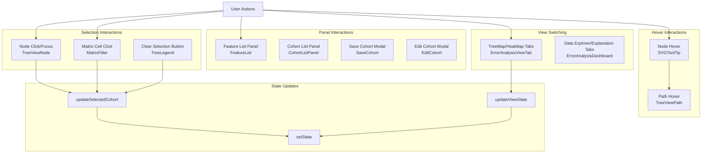
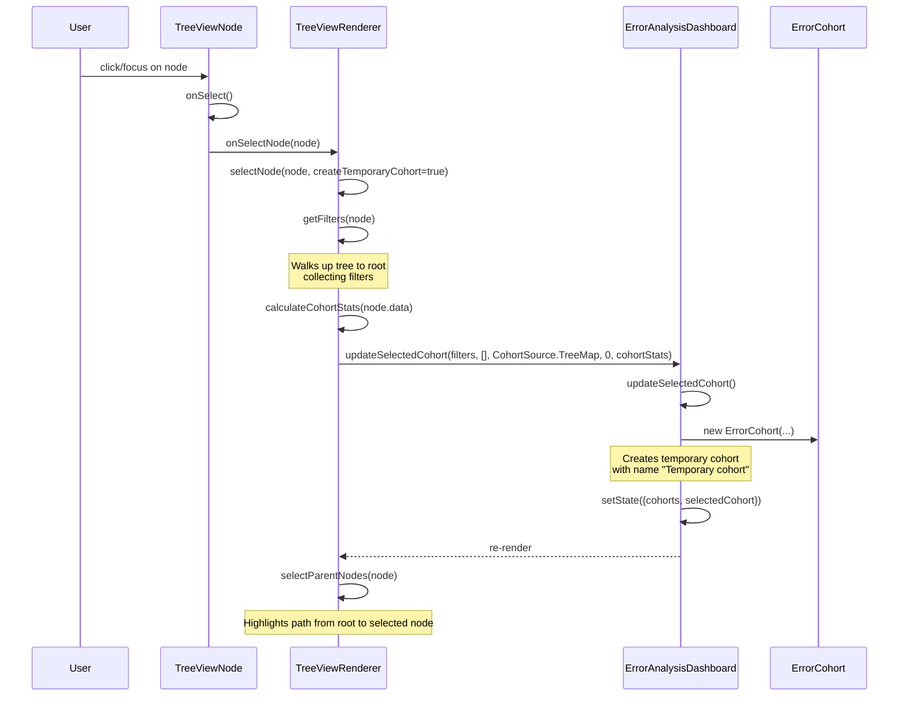
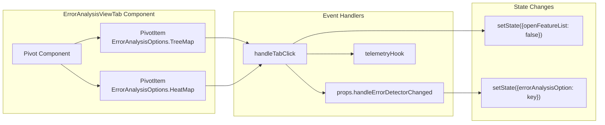
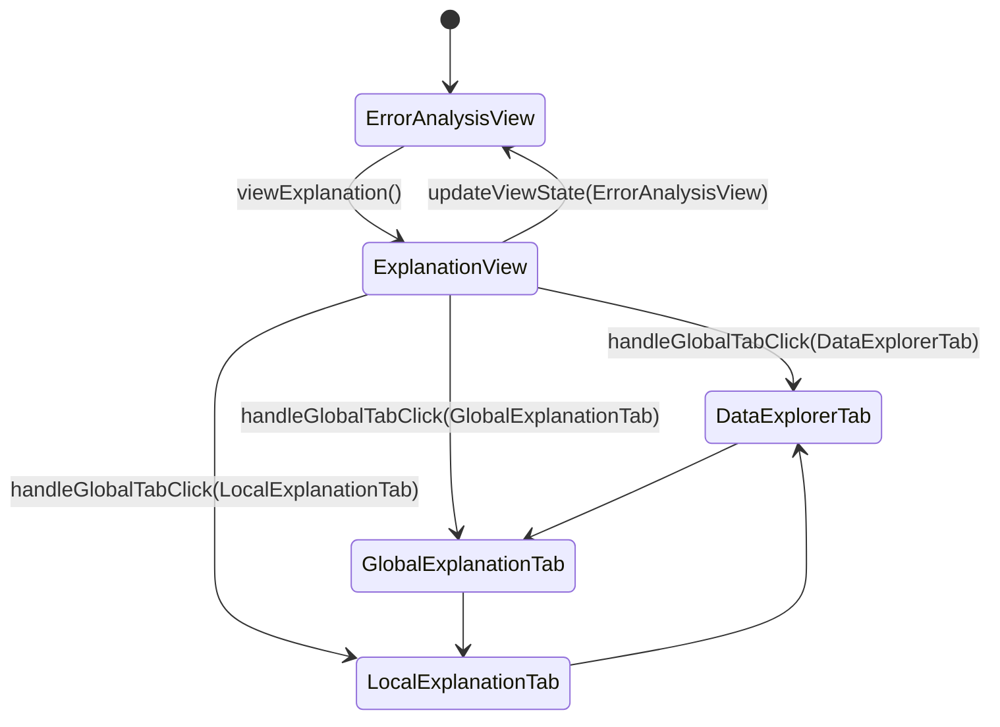
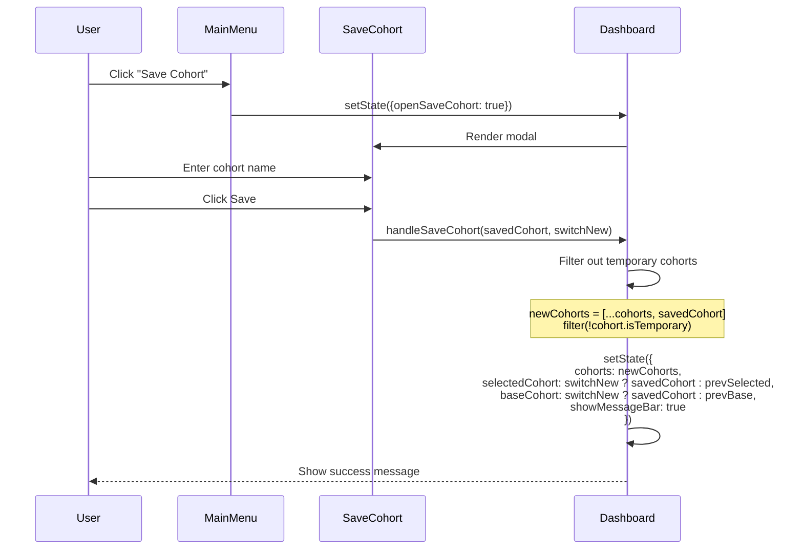
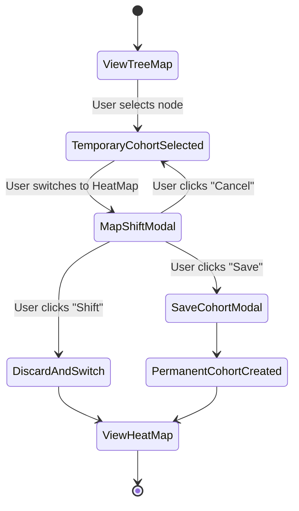
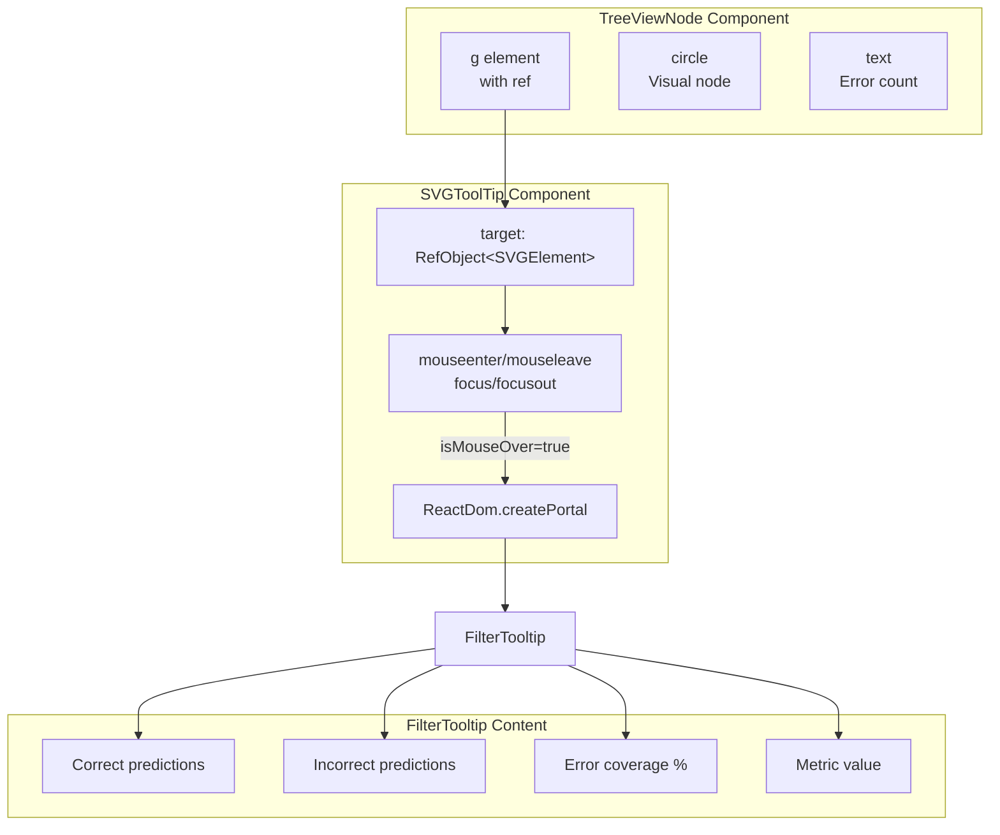
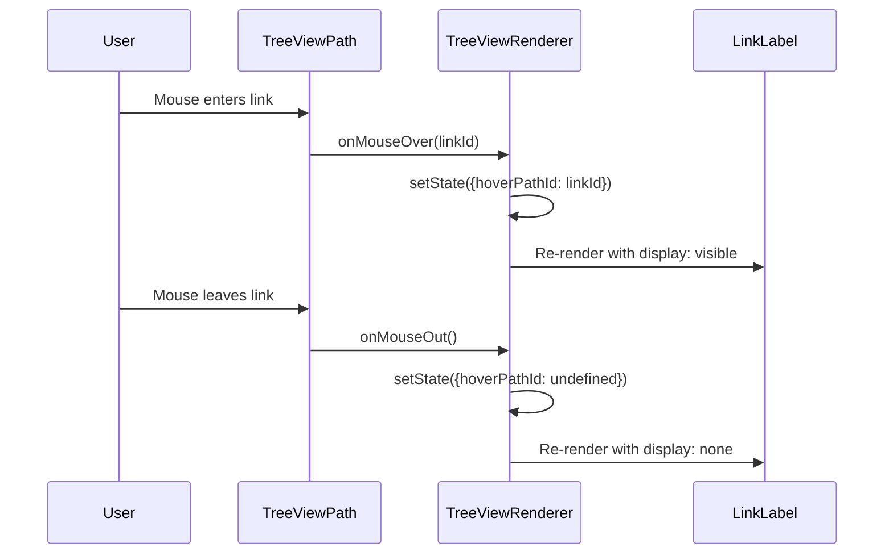
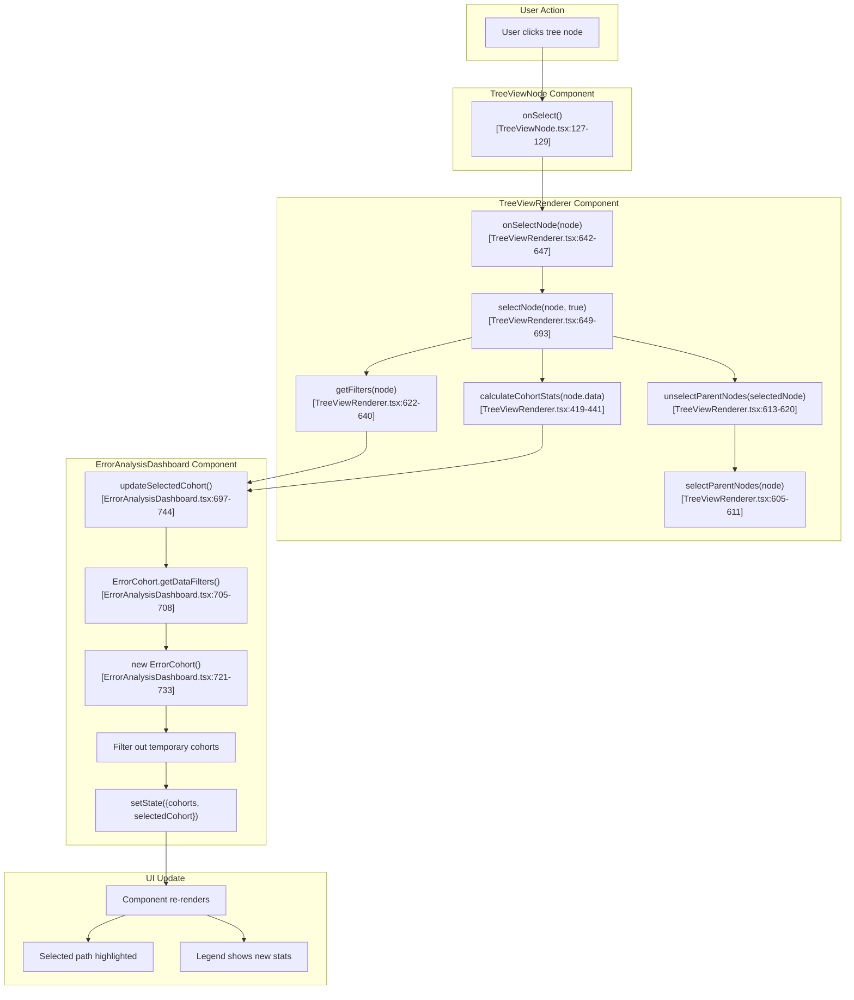
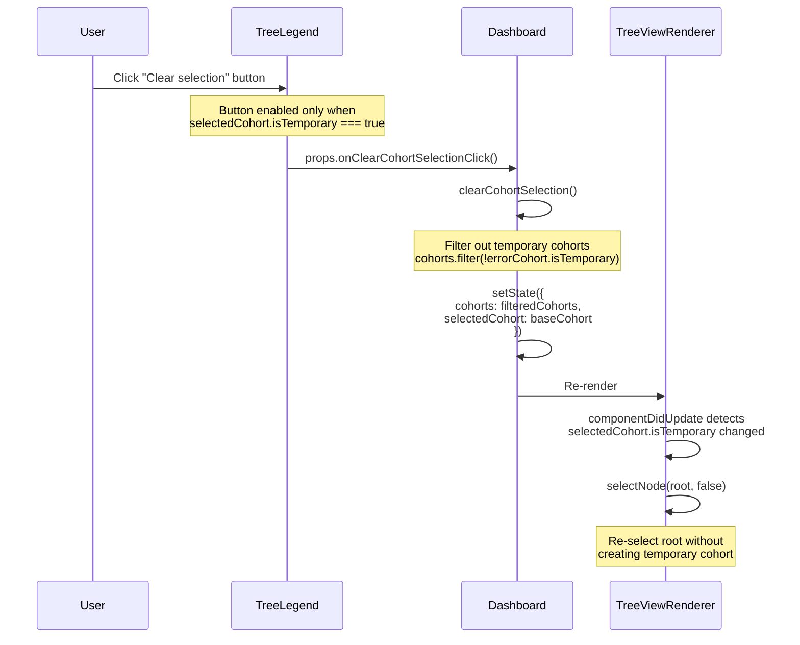

<!-- source: DeepWiki mcp.deepwiki.com · repo microsoft/responsible-ai-toolbox · extra page Error Analysis Interactions · fetched 2026-10-26 -->

# Error Analysis Interactions

<details>
<summary>Relevant source files</summary>

The following files were used as context for generating this wiki page:

- [apps/dashboard/src/error-analysis/App.tsx](apps/dashboard/src/error-analysis/App.tsx)
- [libs/core-ui/src/lib/components/SVGToolTip.tsx](libs/core-ui/src/lib/components/SVGToolTip.tsx)
- [libs/error-analysis/src/lib/ErrorAnalysisDashboard/ColorPalette.ts](libs/error-analysis/src/lib/ErrorAnalysisDashboard/ColorPalette.ts)
- [libs/error-analysis/src/lib/ErrorAnalysisDashboard/Controls/ErrorAnalysisView/ErrorAnalysisView.tsx](libs/error-analysis/src/lib/ErrorAnalysisDashboard/Controls/ErrorAnalysisView/ErrorAnalysisView.tsx)
- [libs/error-analysis/src/lib/ErrorAnalysisDashboard/Controls/ErrorAnalysisView/ErrorAnalysisViewTab.tsx](libs/error-analysis/src/lib/ErrorAnalysisDashboard/Controls/ErrorAnalysisView/ErrorAnalysisViewTab.tsx)
- [libs/error-analysis/src/lib/ErrorAnalysisDashboard/Controls/FilterTooltip/FilterTooltip.styles.ts](libs/error-analysis/src/lib/ErrorAnalysisDashboard/Controls/FilterTooltip/FilterTooltip.styles.ts)
- [libs/error-analysis/src/lib/ErrorAnalysisDashboard/Controls/FilterTooltip/FilterTooltip.tsx](libs/error-analysis/src/lib/ErrorAnalysisDashboard/Controls/FilterTooltip/FilterTooltip.tsx)
- [libs/error-analysis/src/lib/ErrorAnalysisDashboard/Controls/TreeLegend/TreeLegend.styles.ts](libs/error-analysis/src/lib/ErrorAnalysisDashboard/Controls/TreeLegend/TreeLegend.styles.ts)
- [libs/error-analysis/src/lib/ErrorAnalysisDashboard/Controls/TreeLegend/TreeLegend.tsx](libs/error-analysis/src/lib/ErrorAnalysisDashboard/Controls/TreeLegend/TreeLegend.tsx)
- [libs/error-analysis/src/lib/ErrorAnalysisDashboard/Controls/TreeViewRenderer/TreeViewNode.tsx](libs/error-analysis/src/lib/ErrorAnalysisDashboard/Controls/TreeViewRenderer/TreeViewNode.tsx)
- [libs/error-analysis/src/lib/ErrorAnalysisDashboard/Controls/TreeViewRenderer/TreeViewRenderer.styles.ts](libs/error-analysis/src/lib/ErrorAnalysisDashboard/Controls/TreeViewRenderer/TreeViewRenderer.styles.ts)
- [libs/error-analysis/src/lib/ErrorAnalysisDashboard/Controls/TreeViewRenderer/TreeViewRenderer.tsx](libs/error-analysis/src/lib/ErrorAnalysisDashboard/Controls/TreeViewRenderer/TreeViewRenderer.tsx)
- [libs/error-analysis/src/lib/ErrorAnalysisDashboard/Controls/TreeViewRenderer/TreeViewUtils.ts](libs/error-analysis/src/lib/ErrorAnalysisDashboard/Controls/TreeViewRenderer/TreeViewUtils.ts)
- [libs/error-analysis/src/lib/ErrorAnalysisDashboard/ErrorAnalysisDashboard.tsx](libs/error-analysis/src/lib/ErrorAnalysisDashboard/ErrorAnalysisDashboard.tsx)

</details>


## Purpose and Scope

This page documents the user interaction mechanisms in the Error Analysis Dashboard, focusing on how user actions (clicks, hovers, keyboard inputs) trigger state changes, cohort updates, and view transitions. For details on the tree visualization rendering itself, see [Tree View Renderer](#4.3.1). For matrix heatmap visualization, see [Matrix Filter UI](#4.3.2). For the overall Error Analysis Dashboard architecture, see [Error Analysis Dashboard](#4.3).

This page covers:
- Node selection and temporary cohort creation
- View switching between TreeMap and HeatMap modes
- Panel and modal interactions (feature selection, cohort management)
- Hover interactions and tooltips
- Event propagation and state management patterns

## Interaction Patterns Overview

The Error Analysis Dashboard supports several categories of user interactions that work together to enable exploratory error analysis:



**Sources:**
- [libs/error-analysis/src/lib/ErrorAnalysisDashboard/ErrorAnalysisDashboard.tsx:77-829]()
- [libs/error-analysis/src/lib/ErrorAnalysisDashboard/Controls/TreeViewRenderer/TreeViewNode.tsx:1-131]()
- [libs/error-analysis/src/lib/ErrorAnalysisDashboard/Controls/ErrorAnalysisView/ErrorAnalysisViewTab.tsx:1-184]()

## Node Selection and Cohort Creation

### Selection Mechanism

When a user clicks or focuses on a node in the tree view, a temporary cohort is created based on the path from the root to that node. This interaction flow is central to error analysis exploration:



**Sources:**
- [libs/error-analysis/src/lib/ErrorAnalysisDashboard/Controls/TreeViewRenderer/TreeViewNode.tsx:127-129]()
- [libs/error-analysis/src/lib/ErrorAnalysisDashboard/Controls/TreeViewRenderer/TreeViewRenderer.tsx:642-693]()
- [libs/error-analysis/src/lib/ErrorAnalysisDashboard/ErrorAnalysisDashboard.tsx:697-744]()

### Filter Generation

The `getFilters` method walks up the tree hierarchy from the selected node to the root, collecting filter conditions at each level:

| Step | Method | Purpose |
|------|--------|---------|
| 1 | `getFilters(node)` at [libs/error-analysis/src/lib/ErrorAnalysisDashboard/Controls/TreeViewRenderer/TreeViewRenderer.tsx:622-640]() | Recursively collect filters from node to root |
| 2 | Extract `node.data.arg`, `node.parent.data.nodeName`, `node.data.method` | Build individual filter object |
| 3 | `ErrorCohort.getDataFilters()` | Relabel filters based on feature indices |
| 4 | Combine with base cohort filters | Merge with existing cohort constraints |

The filter structure follows the `IFilter` interface:

```typescript
interface IFilter {
  column: string;      // Feature name from parent node
  method: FilterMethods; // e.g., "less", "greater", "includes"
  arg: number[];       // Threshold value(s)
}
```

**Sources:**
- [libs/error-analysis/src/lib/ErrorAnalysisDashboard/Controls/TreeViewRenderer/TreeViewRenderer.tsx:622-640]()
- [libs/error-analysis/src/lib/ErrorAnalysisDashboard/ErrorAnalysisDashboard.tsx:705-708]()

### Temporary vs. Permanent Cohorts

The dashboard maintains two types of cohorts:

| Cohort Type | Characteristics | Creation Method |
|-------------|----------------|-----------------|
| **Temporary** | `isTemporary = true`, named "Temporary cohort", automatically replaced on next selection | Created by node/cell selection via `CohortSource.TreeMap` or `CohortSource.HeatMap` |
| **Permanent** | `isTemporary = false`, user-defined name, persists until manually deleted | Created via Save Cohort modal from temporary cohort |

The state management for cohorts at [libs/error-analysis/src/lib/ErrorAnalysisDashboard/ErrorAnalysisDashboard.tsx:734-743]():

```typescript
// Filter out temporary cohorts and add new selection
let cohorts = this.state.cohorts.filter(
  (errorCohort) => !errorCohort.isTemporary
);
if (addTemporaryCohort) {
  cohorts = [...cohorts, selectedCohort];
}
this.setState({
  cohorts,
  selectedCohort
});
```

**Sources:**
- [libs/error-analysis/src/lib/ErrorAnalysisDashboard/ErrorAnalysisDashboard.tsx:710-744]()
- [libs/error-analysis/src/lib/ErrorAnalysisDashboard/Controls/TreeViewRenderer/TreeViewRenderer.tsx:666-669]()

## View Switching

### TreeMap and HeatMap Toggle

Users can switch between TreeMap and HeatMap visualizations using tabs. The interaction is handled by `ErrorAnalysisViewTab`:



At [libs/error-analysis/src/lib/ErrorAnalysisDashboard/Controls/ErrorAnalysisView/ErrorAnalysisViewTab.tsx:162-174](), the tab click handler:

```typescript
private readonly handleTabClick = (item?: PivotItem): void => {
  if (item?.props.itemKey === ErrorAnalysisOptions.HeatMap) {
    this.setState({ openFeatureList: false });
  }
  this.props.handleErrorDetectorChanged(item);
  this.props.telemetryHook?.({
    level: TelemetryLevels.ButtonClick,
    type: item?.props.itemKey === ErrorAnalysisOptions.HeatMap
      ? TelemetryEventName.ErrorAnalysisHeatMapTabClick
      : TelemetryEventName.ErrorAnalysisTreeMapTabClick
  });
};
```

**Note:** The Feature List panel is automatically closed when switching to HeatMap mode, as feature selection is only relevant for TreeMap visualization.

**Sources:**
- [libs/error-analysis/src/lib/ErrorAnalysisDashboard/Controls/ErrorAnalysisView/ErrorAnalysisViewTab.tsx:79-106]()
- [libs/error-analysis/src/lib/ErrorAnalysisDashboard/Controls/ErrorAnalysisView/ErrorAnalysisViewTab.tsx:162-174]()

### Global Tab Navigation

The Error Analysis Dashboard also supports switching between global views (Data Explorer, Global Explanation, Local Explanation):



The view state management at [libs/error-analysis/src/lib/ErrorAnalysisDashboard/ErrorAnalysisDashboard.tsx:777-784]():

**Sources:**
- [libs/error-analysis/src/lib/ErrorAnalysisDashboard/ErrorAnalysisDashboard.tsx:757-768]()
- [libs/error-analysis/src/lib/ErrorAnalysisDashboard/ErrorAnalysisDashboard.tsx:777-784]()
- [libs/error-analysis/src/lib/ErrorAnalysisDashboard/ErrorAnalysisDashboard.tsx:526-625]()

### State Preservation During View Switches

When switching between TreeMap and HeatMap, the component uses static state preservation to maintain user selections:

| Component | State Preservation Mechanism |
|-----------|----------------------------|
| `TreeViewRenderer` | Static `savedState` at [libs/error-analysis/src/lib/ErrorAnalysisDashboard/Controls/TreeViewRenderer/TreeViewRenderer.tsx:79]() |
| `MatrixFilter` | Static state via `resetState()` method |
| `MatrixArea` | Static state via `resetState()` method |

The `TreeViewRenderer` saves state on unmount unless explicitly reset at [libs/error-analysis/src/lib/ErrorAnalysisDashboard/Controls/TreeViewRenderer/TreeViewRenderer.tsx:136-143]():

```typescript
public componentWillUnmount(): void {
  window.removeEventListener("resize", this.onResize);
  if (TreeViewRenderer.saveStateOnUnmount) {
    TreeViewRenderer.savedState = this.state;
  } else {
    TreeViewRenderer.savedState = undefined;
  }
}
```

**Sources:**
- [libs/error-analysis/src/lib/ErrorAnalysisDashboard/Controls/TreeViewRenderer/TreeViewRenderer.tsx:79-97]()
- [libs/error-analysis/src/lib/ErrorAnalysisDashboard/Controls/TreeViewRenderer/TreeViewRenderer.tsx:136-143]()
- [libs/error-analysis/src/lib/ErrorAnalysisDashboard/ErrorAnalysisDashboard.tsx:454-465]()

## Panel and Modal Interactions

### Feature List Panel

The Feature List panel allows users to select which features to use for tree construction. This interaction is specific to TreeMap mode:

```mermaid
graph TB
    MainMenu[MainMenu Component]
    FeatureListButton[CommandBarButton<br/>"Feature list"]
    FeatureListPanel[FeatureList Component]
    
    MainMenu --> FeatureListButton
    FeatureListButton -->|onClick| OpenFeatureList["setState({openFeatureList: true})"]
    OpenFeatureList --> FeatureListPanel
    
    subgraph "FeatureList Panel"
        FeatureCheckboxes[Feature Checkboxes<br/>with Importance Scores]
        SaveButton[Save Button]
        CancelButton[Dismiss Button]
    end
    
    FeatureListPanel --> FeatureCheckboxes
    FeatureCheckboxes --> SaveButton
    SaveButton -->|saveFeatures| UpdateSelectedFeatures["setState({selectedFeatures: features})"]
    CancelButton -->|onDismiss| ClosePanel["setState({openFeatureList: false})"]
    
    UpdateSelectedFeatures --> FetchTreeNodes[fetchTreeNodes]
    FetchTreeNodes -->|requestDebugML| BackendAPI[Backend API]
```

The button visibility logic at [libs/error-analysis/src/lib/ErrorAnalysisDashboard/Controls/ErrorAnalysisView/ErrorAnalysisViewTab.tsx:95-104]():

```typescript
{this.props.errorAnalysisOption === ErrorAnalysisOptions.TreeMap && (
  <CommandBarButton
    className={classNames.featureList}
    iconProps={featureListIcon}
    key={"featureList"}
    onClick={this.handleFeatureListClick}
    text={localization.ErrorAnalysis.MainMenu.featureList}
  />
)}
```

**Sources:**
- [libs/error-analysis/src/lib/ErrorAnalysisDashboard/Controls/ErrorAnalysisView/ErrorAnalysisViewTab.tsx:95-104]()
- [libs/error-analysis/src/lib/ErrorAnalysisDashboard/Controls/ErrorAnalysisView/ErrorAnalysisViewTab.tsx:129-148]()
- [libs/error-analysis/src/lib/ErrorAnalysisDashboard/ErrorAnalysisDashboard.tsx:636-648]()

### Cohort Management Panels

The dashboard provides several modals for cohort management:

| Modal | Purpose | Trigger | State Key |
|-------|---------|---------|-----------|
| **SaveCohort** | Convert temporary cohort to permanent | Save Cohort button | `openSaveCohort` |
| **EditCohort** | Modify existing cohort filters | Edit button in CohortListPanel | `openEditCohort` |
| **ShiftCohort** | Change base cohort for analysis | Shift Cohort button | `openShiftCohort` |
| **MapShift** | Switch error detector with temporary cohort | Error detector change with temporary cohort | `openMapShift` |
| **CohortListPanel** | View and manage all cohorts | Cohort List button | `openCohortListPanel` |
| **CohortInfoPanel** | View current cohort statistics | Info button | `openInfoPanel` |

**Sources:**
- [libs/error-analysis/src/lib/ErrorAnalysisDashboard/ErrorAnalysisDashboard.tsx:434-517]()
- [libs/error-analysis/src/lib/ErrorAnalysisDashboard/ErrorAnalysisDashboard.tsx:626-661]()

### Save Cohort Flow

The save cohort interaction creates a permanent cohort from a temporary selection:



The `handleSaveCohort` method at [libs/error-analysis/src/lib/ErrorAnalysisDashboard/ErrorAnalysisDashboard.tsx:816-828]():

**Sources:**
- [libs/error-analysis/src/lib/ErrorAnalysisDashboard/ErrorAnalysisDashboard.tsx:434-442]()
- [libs/error-analysis/src/lib/ErrorAnalysisDashboard/ErrorAnalysisDashboard.tsx:816-828]()

### MapShift Modal

The MapShift modal appears when a user attempts to change the error analysis view (TreeMap ↔ HeatMap) while a temporary cohort is selected. This prevents accidental loss of exploration context:



The MapShift modal logic at [libs/error-analysis/src/lib/ErrorAnalysisDashboard/ErrorAnalysisDashboard.tsx:414-427]():

```typescript
setErrorDetector={(key: ErrorAnalysisOptions): void => {
  if (this.state.selectedCohort.isTemporary) {
    this.setState({
      mapShiftErrorAnalysisOption: key,
      openFeatureList: false,
      openMapShift: true
    });
  } else {
    this.setState({
      errorAnalysisOption: key,
      openFeatureList: false
    });
  }
}}
```

**Sources:**
- [libs/error-analysis/src/lib/ErrorAnalysisDashboard/ErrorAnalysisDashboard.tsx:414-427]()
- [libs/error-analysis/src/lib/ErrorAnalysisDashboard/ErrorAnalysisDashboard.tsx:443-466]()

## Hover and Focus Interactions

### Node Tooltips

When users hover over or focus on a tree node, an SVG tooltip displays detailed error statistics:



The SVGToolTip component at [libs/core-ui/src/lib/components/SVGToolTip.tsx:34-42]() attaches event listeners:

```typescript
public componentDidMount(): void {
  const element = this.props.target.current;
  if (element) {
    element.addEventListener("mouseenter", this.onMouseEnter);
    element.addEventListener("focus", this.onMouseEnter);
    element.addEventListener("mouseleave", this.onMouseLeave);
    element.addEventListener("focusout", this.onMouseLeave);
  }
}
```

The tooltip content structure at [libs/error-analysis/src/lib/ErrorAnalysisDashboard/Controls/FilterTooltip/FilterTooltip.tsx:28-107]() includes:
- Correct/incorrect counts (for error rate) or count/error sum (for other metrics)
- Error coverage percentage
- Metric-specific value (error rate, MSE, MAE, etc.)

**Sources:**
- [libs/error-analysis/src/lib/ErrorAnalysisDashboard/Controls/TreeViewRenderer/TreeViewNode.tsx:115-122]()
- [libs/core-ui/src/lib/components/SVGToolTip.tsx:21-110]()
- [libs/error-analysis/src/lib/ErrorAnalysisDashboard/Controls/FilterTooltip/FilterTooltip.tsx:1-108]()

### Path Highlighting on Hover

When a user hovers over a link (edge) in the tree, the path label becomes visible to show the filter condition:



The link label visibility logic at [libs/error-analysis/src/lib/ErrorAnalysisDashboard/Controls/TreeViewRenderer/TreeViewRenderer.tsx:233-237]():

```typescript
style: {
  display:
    d.data.nodeState.onSelectedPath || this.state.hoverPathId === d.id
      ? undefined
      : "none",
  transform: `translate(${labelX}px, ${labelY}px)`
}
```

Link labels are visible when either:
1. The path is part of the selected node's path (`onSelectedPath = true`)
2. The user is currently hovering over the link (`hoverPathId === d.id`)

**Sources:**
- [libs/error-analysis/src/lib/ErrorAnalysisDashboard/Controls/TreeViewRenderer/TreeViewRenderer.tsx:391-397]()
- [libs/error-analysis/src/lib/ErrorAnalysisDashboard/Controls/TreeViewRenderer/TreeViewRenderer.tsx:218-248]()

### Keyboard Navigation

Tree nodes support keyboard navigation for accessibility:

| Interaction | Event | Handler |
|-------------|-------|---------|
| **Tab to node** | Focus event | Sets focus outline via `:focus-visible` CSS |
| **Enter/Space on node** | Focus + onFocus | Triggers `onSelect()` same as click |
| **Tab through tree** | Sequential focus | Browser default tab order |

The node's keyboard accessibility setup at [libs/error-analysis/src/lib/ErrorAnalysisDashboard/Controls/TreeViewRenderer/TreeViewNode.tsx:46-53]():

```typescript
<g
  onFocus={this.onSelect}
  style={node.data.nodeState.style}
  onClick={this.onSelect}
  pointerEvents="all"
  ref={this.ref}
  tabIndex={0}
  aria-label={ariaLabel}
  className={classNames.treeNodeOutline}
>
```

The `aria-label` is generated by `treeNodeAriaLabel` at [libs/error-analysis/src/lib/ErrorAnalysisDashboard/Controls/TreeViewRenderer/TreeViewUtils.ts:13-44](), which includes:
- Filter condition text
- Error counts or metric statistics
- Error coverage percentage
- Metric value

**Sources:**
- [libs/error-analysis/src/lib/ErrorAnalysisDashboard/Controls/TreeViewRenderer/TreeViewNode.tsx:46-54]()
- [libs/error-analysis/src/lib/ErrorAnalysisDashboard/Controls/TreeViewRenderer/TreeViewUtils.ts:13-44]()
- [libs/error-analysis/src/lib/ErrorAnalysisDashboard/Controls/TreeViewRenderer/TreeViewRenderer.styles.ts:82-88]()

## Event Flow and State Updates

### Complete Interaction Flow

The following diagram shows how a node selection propagates through the component hierarchy and triggers state updates:



**Sources:**
- [libs/error-analysis/src/lib/ErrorAnalysisDashboard/Controls/TreeViewRenderer/TreeViewNode.tsx:127-129]()
- [libs/error-analysis/src/lib/ErrorAnalysisDashboard/Controls/TreeViewRenderer/TreeViewRenderer.tsx:642-693]()
- [libs/error-analysis/src/lib/ErrorAnalysisDashboard/ErrorAnalysisDashboard.tsx:697-744]()

### State Synchronization Pattern

The Error Analysis Dashboard uses a centralized state management pattern where the main component holds all interaction state:

| State Category | Properties | Location |
|----------------|-----------|----------|
| **View State** | `viewType`, `errorAnalysisOption`, `activeGlobalTab`, `predictionTab` | [ErrorAnalysisDashboard.tsx:311-344]() |
| **Cohort State** | `cohorts`, `selectedCohort`, `baseCohort`, `editedCohort` | [ErrorAnalysisDashboard.tsx:311-344]() |
| **Panel State** | `openSaveCohort`, `openEditCohort`, `openFeatureList`, `openInfoPanel`, etc. | [ErrorAnalysisDashboard.tsx:311-344]() |
| **Selection State** | `selectedFeatures`, `selectedWeightVector`, `selectedWhatIfIndex` | [ErrorAnalysisDashboard.tsx:311-344]() |

State updates follow these patterns:

1. **Direct setState calls** for simple state changes (panel open/close)
2. **Callback props** passed down to child components that call parent methods
3. **Context providers** for deeply nested components to access state

The context structure at [libs/error-analysis/src/lib/ErrorAnalysisDashboard/ErrorAnalysisDashboard.tsx:356-383]():

```typescript
<ModelAssessmentContext.Provider
  value={{
    baseErrorCohort: this.state.baseCohort,
    errorAnalysisData: this.props.errorAnalysisData,
    errorCohorts: this.state.cohorts,
    jointDataset: this.state.jointDataset,
    selectedErrorCohort: this.state.selectedCohort,
    shiftErrorCohort: this.shiftErrorCohort,
    // ... other context values
  }}
>
```

**Sources:**
- [libs/error-analysis/src/lib/ErrorAnalysisDashboard/ErrorAnalysisDashboard.tsx:239-348]()
- [libs/error-analysis/src/lib/ErrorAnalysisDashboard/ErrorAnalysisDashboard.tsx:356-383]()

### Clear Selection Interaction

Users can clear the current node selection to return to the base cohort view:



The clear selection handler at [libs/error-analysis/src/lib/ErrorAnalysisDashboard/ErrorAnalysisDashboard.tsx:746-755]():

```typescript
private clearCohortSelection = (): void => {
  const cohorts = this.state.cohorts.filter(
    (errorCohort) => !errorCohort.isTemporary
  );
  this.setState({
    cohorts,
    selectedCohort: this.state.baseCohort
  });
  this.context.selectedErrorCohort = this.state.baseCohort;
};
```

**Sources:**
- [libs/error-analysis/src/lib/ErrorAnalysisDashboard/Controls/TreeLegend/TreeLegend.tsx:57-65]()
- [libs/error-analysis/src/lib/ErrorAnalysisDashboard/ErrorAnalysisDashboard.tsx:746-755]()
- [libs/error-analysis/src/lib/ErrorAnalysisDashboard/Controls/TreeViewRenderer/TreeViewRenderer.tsx:126-133]()

---

