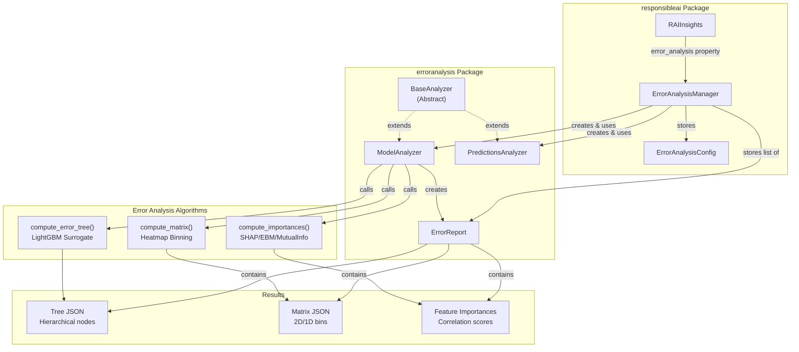
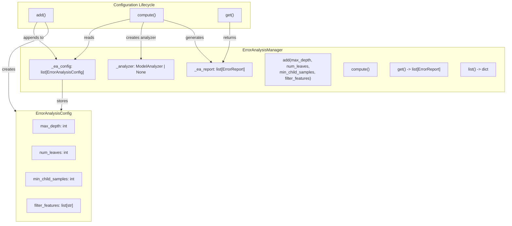
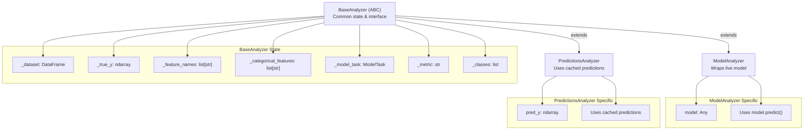
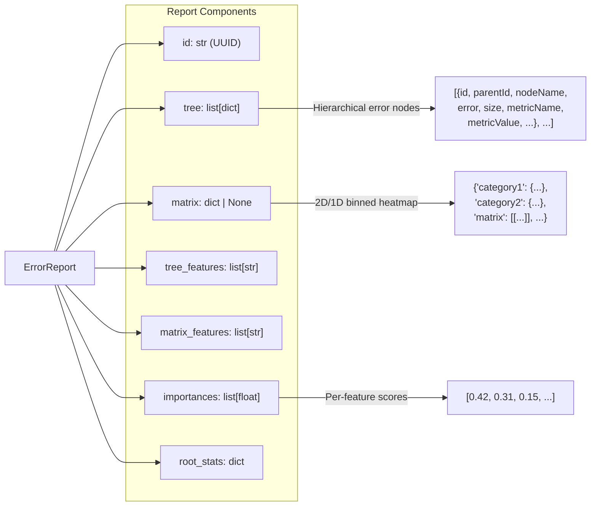
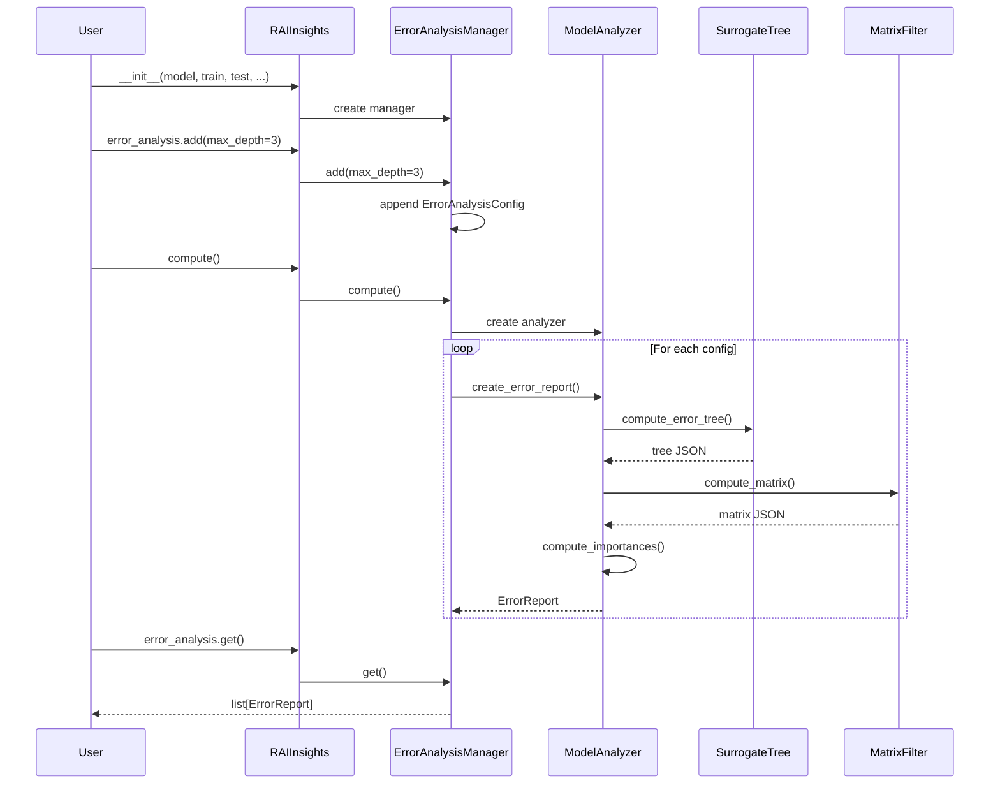
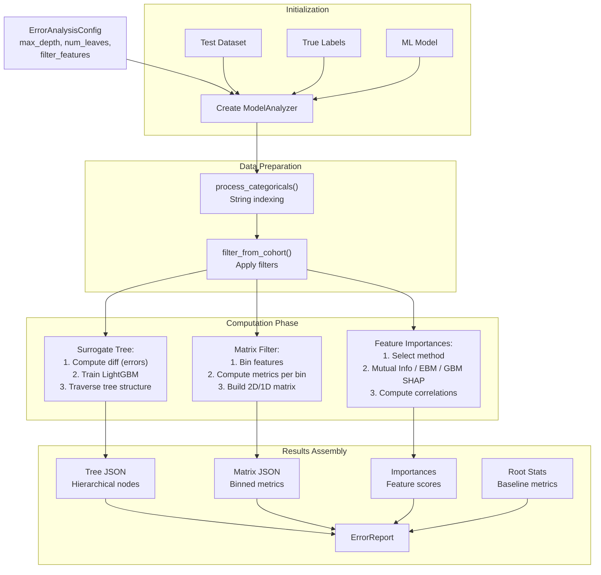
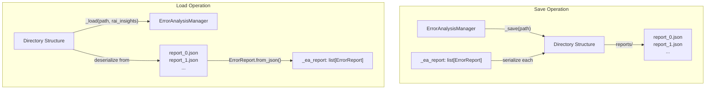

<!-- source: DeepWiki mcp.deepwiki.com · repo microsoft/responsible-ai-toolbox · extra page Error Analysis Manager · fetched 2026-10-26 -->

# Error Analysis Manager

<details>
<summary>Relevant source files</summary>

The following files were used as context for generating this wiki page:

- [erroranalysis/erroranalysis/_internal/cohort_filter.py](erroranalysis/erroranalysis/_internal/cohort_filter.py)
- [erroranalysis/erroranalysis/_internal/constants.py](erroranalysis/erroranalysis/_internal/constants.py)
- [erroranalysis/erroranalysis/_internal/matrix_filter.py](erroranalysis/erroranalysis/_internal/matrix_filter.py)
- [erroranalysis/erroranalysis/_internal/metrics.py](erroranalysis/erroranalysis/_internal/metrics.py)
- [erroranalysis/erroranalysis/_internal/surrogate_error_tree.py](erroranalysis/erroranalysis/_internal/surrogate_error_tree.py)
- [erroranalysis/erroranalysis/analyzer/error_analyzer.py](erroranalysis/erroranalysis/analyzer/error_analyzer.py)
- [erroranalysis/erroranalysis/version.py](erroranalysis/erroranalysis/version.py)
- [erroranalysis/requirements-object-detection.txt](erroranalysis/requirements-object-detection.txt)
- [erroranalysis/tests/common_utils.py](erroranalysis/tests/common_utils.py)
- [erroranalysis/tests/test_cohort_filter.py](erroranalysis/tests/test_cohort_filter.py)
- [erroranalysis/tests/test_error_report.py](erroranalysis/tests/test_error_report.py)
- [erroranalysis/tests/test_importances.py](erroranalysis/tests/test_importances.py)
- [erroranalysis/tests/test_matrix_filter.py](erroranalysis/tests/test_matrix_filter.py)
- [erroranalysis/tests/test_metrics.py](erroranalysis/tests/test_metrics.py)
- [erroranalysis/tests/test_surrogate_error_tree.py](erroranalysis/tests/test_surrogate_error_tree.py)
- [raiwidgets/raiwidgets/interfaces.py](raiwidgets/raiwidgets/interfaces.py)
- [responsibleai/responsibleai/_tools/shared/state_directory_management.py](responsibleai/responsibleai/_tools/shared/state_directory_management.py)
- [responsibleai/responsibleai/exceptions.py](responsibleai/responsibleai/exceptions.py)
- [responsibleai/responsibleai/modelanalysis/model_analysis.py](responsibleai/responsibleai/modelanalysis/model_analysis.py)
- [responsibleai/tests/causal_manager_validator.py](responsibleai/tests/causal_manager_validator.py)
- [responsibleai/tests/counterfactual_manager_validator.py](responsibleai/tests/counterfactual_manager_validator.py)
- [responsibleai/tests/error_analysis_validator.py](responsibleai/tests/error_analysis_validator.py)
- [responsibleai/tests/explainer_manager_validator.py](responsibleai/tests/explainer_manager_validator.py)
- [responsibleai/tests/test_exceptions.py](responsibleai/tests/test_exceptions.py)

</details>


## Purpose and Scope

The Error Analysis Manager (`ErrorAnalysisManager`) is a component of the RAI Insights framework that coordinates error analysis computations for machine learning models. It provides hierarchical error exploration through surrogate decision trees and matrix-based visualizations (heatmaps) to help identify cohorts where the model performs poorly.

This document covers the manager's architecture, its integration with the error analysis engine, and the coordination of error analysis computations. For detailed information about the underlying error analysis algorithms, see:
- Surrogate Error Tree algorithm: [3.4.1](#3.4.1)
- Matrix Filter (heatmap) algorithm: [3.4.2](#3.4.2)  
- Cohort Filtering mechanism: [3.4.3](#3.4.3)

For the overall RAIInsights orchestration pattern, see [3.2.2](#3.2.2).

## Architecture Overview

The Error Analysis Manager follows a two-tier architecture: a high-level manager in the `responsibleai` package that coordinates configurations and results, and a low-level error analysis engine in the `erroranalysis` package that performs the actual computations.



**Sources:** 
- [responsibleai/responsibleai/managers/error_analysis_manager.py]()
- [erroranalysis/erroranalysis/analyzer/error_analyzer.py]()
- [erroranalysis/erroranalysis/_internal/error_report.py]()

## ErrorAnalysisManager Class

The `ErrorAnalysisManager` class manages error analysis configurations and coordinates computation. It stores configurations, delegates computation to the error analysis engine, and maintains the resulting `ErrorReport` objects.

### Class Structure



**Key Methods:**

| Method | Purpose | Parameters |
|--------|---------|------------|
| `add()` | Add error analysis configuration | `max_depth`, `num_leaves`, `min_child_samples`, `filter_features` |
| `compute()` | Execute error analysis for all configurations | None |
| `get()` | Retrieve computed error reports | None |
| `list()` | Get configuration metadata | None |
| `_save()` | Serialize reports to disk | `path` |
| `_load()` | Deserialize reports from disk | `path`, `rai_insights` |

**Sources:**
- [responsibleai/responsibleai/managers/error_analysis_manager.py]()

### Configuration Parameters

The manager accepts the following configuration parameters via the `add()` method:

| Parameter | Type | Default | Description |
|-----------|------|---------|-------------|
| `max_depth` | `int` | 3 | Maximum depth of surrogate error tree |
| `num_leaves` | `int` | 31 | Maximum number of leaves in surrogate tree |
| `min_child_samples` | `int` | 20 | Minimum samples required to create a leaf node |
| `filter_features` | `list[str]` | `None` | One or two features for matrix filter; if `None`, no matrix computed |

**Sources:**
- [erroranalysis/erroranalysis/_internal/surrogate_error_tree.py:51-52]()
- [erroranalysis/erroranalysis/_internal/constants.py:74-77]()

## BaseAnalyzer Hierarchy

The error analysis engine uses an analyzer abstraction to support both live models and pre-computed predictions.



**Shared Methods:**

Both analyzer types implement these core methods:

| Method | Returns | Description |
|--------|---------|-------------|
| `compute_error_tree()` | `list[dict]` | Generate surrogate error tree JSON |
| `compute_error_tree_on_dataset()` | `list[dict]` | Generate tree on specific dataset subset |
| `compute_matrix()` | `dict` | Generate matrix filter (heatmap) JSON |
| `compute_matrix_on_dataset()` | `dict` | Generate matrix on specific dataset subset |
| `create_error_report()` | `ErrorReport` | Create complete error analysis report |
| `compute_importances()` | `list[float]` | Compute feature importance scores |

**Sources:**
- [erroranalysis/erroranalysis/analyzer/error_analyzer.py:53-130]()
- [erroranalysis/erroranalysis/_internal/error_analyzer.py]()

## ErrorReport Structure

The `ErrorReport` class encapsulates all error analysis results for a single configuration.



**Serialization:**

The `ErrorReport` supports JSON serialization via:
- `to_json()`: Serialize to JSON string
- `from_json()`: Deserialize from JSON string

**Sources:**
- [erroranalysis/erroranalysis/_internal/error_report.py]()
- [erroranalysis/tests/test_error_report.py]()

## Integration with RAIInsights

The Error Analysis Manager integrates with the RAIInsights orchestration framework following the standard manager pattern.



**Sources:**
- [responsibleai/responsibleai/rai_insights/rai_insights.py]()
- [responsibleai/responsibleai/managers/error_analysis_manager.py]()

## Error Analysis Computation Flow

The computation flow from configuration to results involves multiple stages of data processing and algorithm execution.



**Sources:**
- [erroranalysis/erroranalysis/analyzer/error_analyzer.py:392-450]()
- [erroranalysis/erroranalysis/_internal/surrogate_error_tree.py:195-274]()
- [erroranalysis/erroranalysis/_internal/matrix_filter.py:322-389]()

## Feature Importances Computation

The Error Analysis Manager supports three methods for computing feature importances, each capturing different aspects of feature-error correlation.

| Method | Implementation | Use Case | Complexity |
|--------|----------------|----------|------------|
| `mutual_info` | Mutual information between features and errors | Fast baseline, works with all data types | O(n log n) |
| `ebm` | Explainable Boosting Machine global feature importance | Interpretable glass-box model | O(n * features) |
| `gbm_shap` | SHAP values from Gradient Boosting Machine | Tree-based feature interactions | O(n * trees * features) |

**Downsampling for Large Datasets:**

For datasets exceeding 50,000 rows, the manager automatically downsamples to maintain reasonable computation times:

```python
# Automatic downsampling in compute_importances()
IMPORTANCES_THRESHOLD = 50000

if len(dataset) > IMPORTANCES_THRESHOLD:
    # Sample random subset for importance computation
    sampled_indices = generate_random_unique_indexes(IMPORTANCES_THRESHOLD, len(dataset))
    dataset = dataset[sampled_indices]
```

**Sources:**
- [erroranalysis/erroranalysis/analyzer/error_analyzer.py:47-48]()
- [erroranalysis/erroranalysis/error_correlation_methods.py]()
- [erroranalysis/tests/test_importances.py]()

## Metrics Support

The Error Analysis Manager supports different metrics based on the model task type:

**Classification Metrics:**

| Metric | Binary | Multiclass | Description |
|--------|--------|------------|-------------|
| `error_rate` | ✓ | ✓ | Proportion of misclassified instances |
| `precision_score` | ✓ | - | Binary precision |
| `macro_precision_score` | - | ✓ | Macro-averaged precision |
| `micro_precision_score` | - | ✓ | Micro-averaged precision |
| `recall_score` | ✓ | - | Binary recall |
| `macro_recall_score` | - | ✓ | Macro-averaged recall |
| `micro_recall_score` | - | ✓ | Micro-averaged recall |
| `f1_score` | ✓ | - | Binary F1 score |
| `macro_f1_score` | - | ✓ | Macro-averaged F1 |
| `micro_f1_score` | - | ✓ | Micro-averaged F1 |
| `accuracy_score` | ✓ | ✓ | Overall accuracy |

**Regression Metrics:**

| Metric | Description |
|--------|-------------|
| `mean_absolute_error` | Mean of absolute errors |
| `mean_squared_error` | Mean of squared errors |
| `median_absolute_error` | Median of absolute errors |
| `r2_score` | R² coefficient of determination |
| `mean_prediction` | Mean of predicted values |

**Sources:**
- [erroranalysis/erroranalysis/_internal/constants.py:80-227]()
- [erroranalysis/erroranalysis/_internal/metrics.py]()

## Persistence and Serialization

The Error Analysis Manager implements save/load functionality through the directory management pattern.



**File Structure:**

```
<rai_insights_dir>/
└── error_analysis/
    └── reports/
        ├── report_0.json
        ├── report_1.json
        └── ...
```

Each `ErrorReport` is serialized to a separate JSON file containing:
- Unique report ID (UUID)
- Tree structure
- Matrix data (if computed)
- Feature importances
- Root statistics
- Configuration metadata

**Sources:**
- [responsibleai/responsibleai/managers/error_analysis_manager.py]()
- [responsibleai/responsibleai/_tools/shared/state_directory_management.py]()

## Validation and Error Handling

The Error Analysis Manager validates configurations and handles various error conditions:

**Configuration Validation:**

- **Model requirement:** Error analysis requires a model; raises `UserConfigValidationException` if model is `None`
- **Duplicate detection:** Raises `DuplicateManagerConfigException` when attempting to add identical configurations
- **Feature validation:** Validates that `filter_features` exist in the dataset feature list

**Runtime Error Handling:**

- **Empty cohorts:** Returns empty node when filtered dataset has zero rows
- **Invalid shapes:** Validates model prediction output dimensions; raises `UserConfigValidationException` for invalid shapes
- **Categorical feature errors:** Catches and reports type errors when categorical features are incorrectly marked as numeric

**Sources:**
- [responsibleai/responsibleai/managers/error_analysis_manager.py]()
- [erroranalysis/erroranalysis/_internal/surrogate_error_tree.py:389-398]()
- [raiutils/raiutils/exceptions.py]()

## Usage Example

Typical usage pattern demonstrating the manager lifecycle:

```python
# 1. Initialize RAIInsights with model and data
rai_insights = RAIInsights(
    model=trained_model,
    train=train_df,
    test=test_df,
    target_column='target',
    task_type='classification'
)

# 2. Add error analysis configurations
rai_insights.error_analysis.add(
    max_depth=3,
    num_leaves=31,
    filter_features=['feature1', 'feature2']  # For heatmap
)

# Optional: Add another configuration
rai_insights.error_analysis.add(
    max_depth=4,
    filter_features=['feature3']  # 1D heatmap
)

# 3. Compute all analyses
rai_insights.compute()

# 4. Retrieve results
reports = rai_insights.error_analysis.get()
for report in reports:
    print(f"Report ID: {report.id}")
    print(f"Tree nodes: {len(report.tree)}")
    print(f"Feature importances: {report.importances}")

# 5. Save for later use
rai_insights.save('path/to/save/dir')

# 6. Load previously saved analysis
loaded_insights = RAIInsights.load('path/to/save/dir')
loaded_reports = loaded_insights.error_analysis.get()
```

**Sources:**
- [responsibleai/tests/error_analysis_validator.py]()
- [responsibleai/responsibleai/modelanalysis/model_analysis.py]()

---

