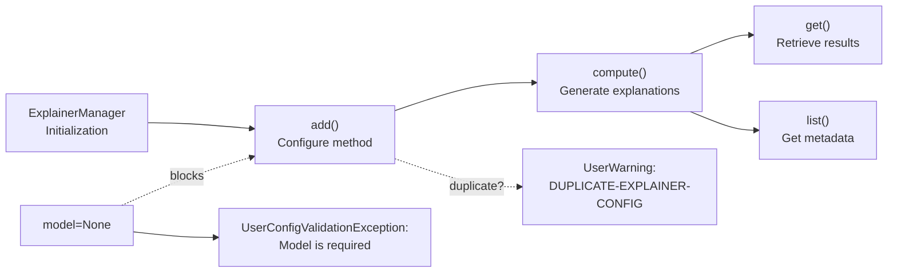
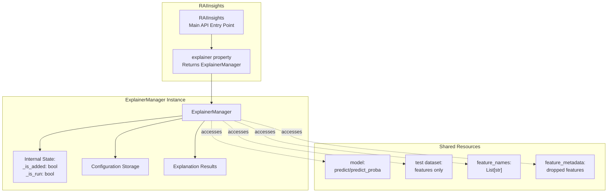
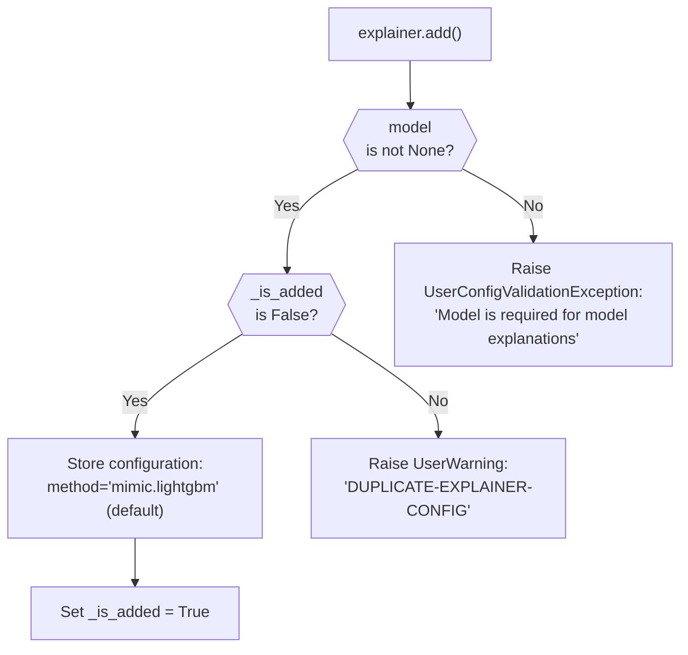
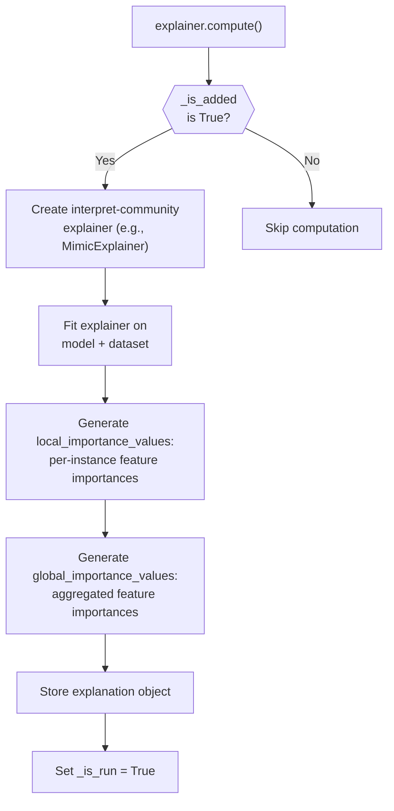
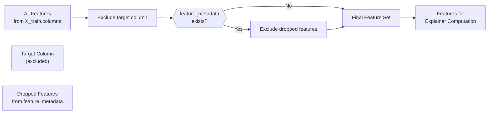
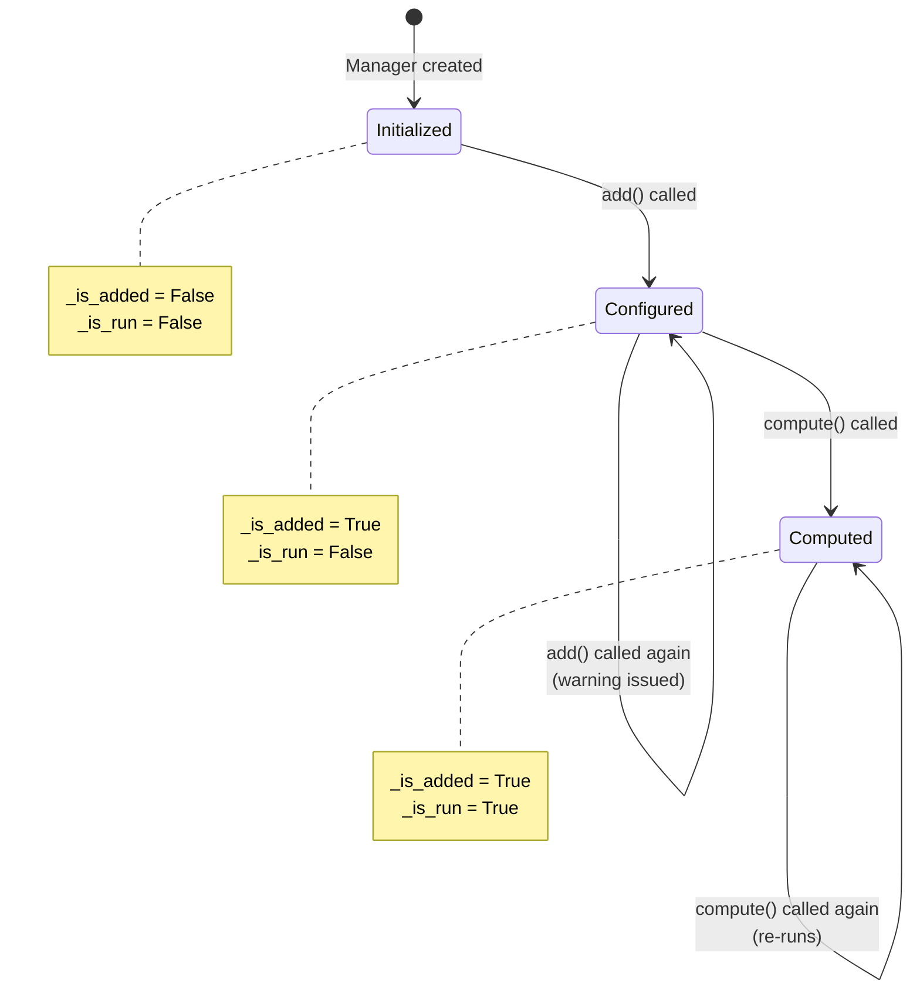
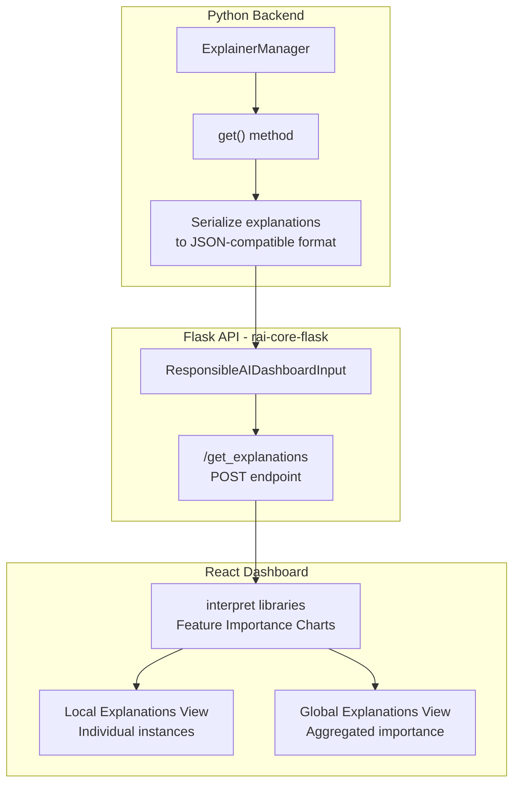
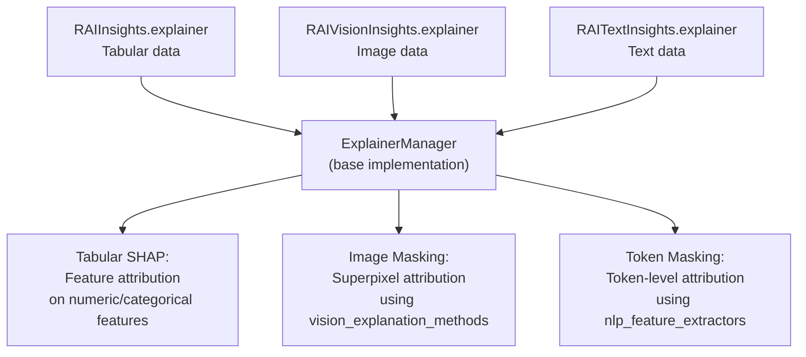
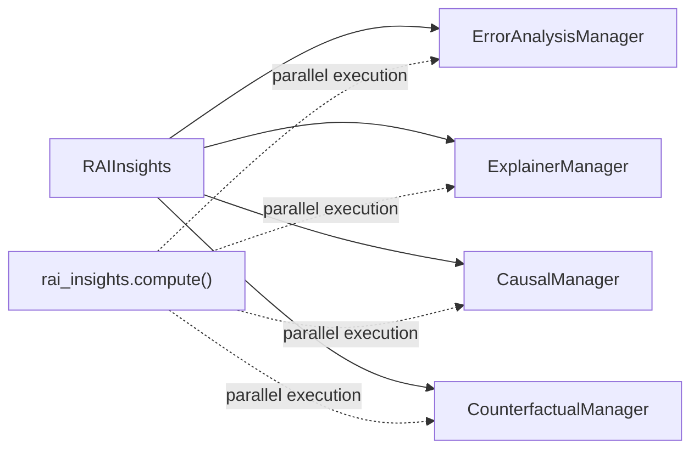

<!-- source: DeepWiki mcp.deepwiki.com · repo microsoft/responsible-ai-toolbox · extra page Explainer Manager · fetched 2026-10-26 -->

# Explainer Manager

<details>
<summary>Relevant source files</summary>

The following files were used as context for generating this wiki page:

- [raiwidgets/raiwidgets/interfaces.py](raiwidgets/raiwidgets/interfaces.py)
- [responsibleai/responsibleai/_tools/shared/state_directory_management.py](responsibleai/responsibleai/_tools/shared/state_directory_management.py)
- [responsibleai/responsibleai/exceptions.py](responsibleai/responsibleai/exceptions.py)
- [responsibleai/responsibleai/modelanalysis/model_analysis.py](responsibleai/responsibleai/modelanalysis/model_analysis.py)
- [responsibleai/tests/causal_manager_validator.py](responsibleai/tests/causal_manager_validator.py)
- [responsibleai/tests/counterfactual_manager_validator.py](responsibleai/tests/counterfactual_manager_validator.py)
- [responsibleai/tests/error_analysis_validator.py](responsibleai/tests/error_analysis_validator.py)
- [responsibleai/tests/explainer_manager_validator.py](responsibleai/tests/explainer_manager_validator.py)
- [responsibleai/tests/test_exceptions.py](responsibleai/tests/test_exceptions.py)

</details>


The `ExplainerManager` provides model interpretability capabilities for the Responsible AI Toolbox by generating feature importance explanations. It integrates with the `interpret-community` library to compute local and global explanations using methods like SHAP and LIME, helping users understand which features most influence model predictions.

For error pattern analysis, see [Error Analysis Manager](#3.3.1). For causal inference, see [Causal Manager](#3.3.3). For counterfactual explanations, see [Counterfactual Manager](#3.3.4).

## Overview

The `ExplainerManager` follows the standard manager pattern used throughout the Responsible AI Toolbox. It provides a configuration-then-compute workflow where users specify the explanation method via `add()`, then execute computation via `compute()` to generate feature importance values.

**Sources:** [responsibleai/responsibleai/modelanalysis/model_analysis.py:16](), [responsibleai/tests/explainer_manager_validator.py:1-69]()

### Manager Lifecycle



**Sources:** [responsibleai/tests/explainer_manager_validator.py:13-30]()

## Integration with RAIInsights

The `ExplainerManager` is accessible as a property on `RAIInsights` (and its deprecated predecessor `ModelAnalysis`). The manager is instantiated during `RAIInsights` initialization and shares access to the model, dataset, and feature metadata.



**Sources:** [responsibleai/responsibleai/modelanalysis/model_analysis.py:114-120](), [responsibleai/tests/explainer_manager_validator.py:66-68]()

## API Methods

### add()

Configures the explainer. The `ExplainerManager` currently supports only one explainer configuration. Calling `add()` multiple times triggers a warning and ignores subsequent calls.



**Parameters:**
- `method` (optional): Explanation method to use. Defaults to `'mimic.lightgbm'`.

**Sources:** [responsibleai/tests/explainer_manager_validator.py:13-29](), [raiutils/raiutils/exceptions.py:1-42]()

### compute()

Executes the explanation computation using the configured method. This method generates both local (instance-level) and global (dataset-level) feature importance values by integrating with `interpret-community`.



**Sources:** [responsibleai/tests/explainer_manager_validator.py:30]()

### get()

Returns the list of computed explanations. Each explanation contains local and global importance values.

**Return Type:** `List[Explanation]`

**Explanation Structure:**
| Field | Type | Description |
|-------|------|-------------|
| `local_importance_values` | `List` or `List[List]` | Per-instance feature importances. For classification with `n` classes, shape is `[n, num_instances, num_features]`. For regression, shape is `[num_instances, num_features]`. |
| `global_importance_values` | Array-like | Aggregated feature importances across the dataset. |
| `method` | `str` | Explanation method used (e.g., `'mimic.lightgbm'`). |

**Sources:** [responsibleai/tests/explainer_manager_validator.py:33-52]()

### list()

Returns metadata about the explainer configuration and results.

**Return Type:** `dict`

**Structure:**
| Key | Type | Description |
|-----|------|-------------|
| `manager_type` | `str` | Always `ManagerNames.EXPLAINER` |
| `id` | `str` | Unique identifier for the explanation |
| `method` | `str` | Explanation method (e.g., `'mimic.lightgbm'`) |
| `model_task` | `str` | `ModelTask.CLASSIFICATION` or `ModelTask.REGRESSION` |
| `model_type` | `str` or `None` | Type of model being explained |
| `is_raw` | `bool` | Whether raw features are used |
| `is_engineered` | `bool` | Whether engineered features are used |

**Sources:** [responsibleai/tests/explainer_manager_validator.py:54-64](), [responsibleai/_internal/constants.py]()

## Explanation Computation Details

The `ExplainerManager` leverages the `interpret-community` library to generate explanations. The default method is `'mimic.lightgbm'`, which trains a surrogate LightGBM model to approximate the original model's behavior and uses it for interpretability.

### Feature Handling

The manager respects the feature metadata and excludes dropped features from explanations:



**Sources:** [responsibleai/tests/explainer_manager_validator.py:40-45]()

### Classification vs Regression

The shape of `local_importance_values` differs based on task type:

**Classification (with classes):**
```
Shape: [num_classes, num_instances, num_features]
Example: [[class0_instance0_features], [class0_instance1_features], ...],
         [[class1_instance0_features], [class1_instance1_features], ...]]
```

**Regression:**
```
Shape: [num_instances, num_features]
Example: [[instance0_features], [instance1_features], ...]
```

**Sources:** [responsibleai/tests/explainer_manager_validator.py:46-52]()

## State Management

The `ExplainerManager` maintains two internal state flags:

| Flag | Type | Purpose |
|------|------|---------|
| `_is_added` | `bool` | Indicates whether `add()` has been called successfully |
| `_is_run` | `bool` | Indicates whether `compute()` has completed successfully |

These flags enable validation and prevent duplicate configurations:



**Sources:** [responsibleai/tests/explainer_manager_validator.py:67-68]()

## Error Handling

The `ExplainerManager` performs validation at configuration time to ensure the model is available:

| Condition | Exception | Message |
|-----------|-----------|---------|
| `model is None` when calling `add()` | `UserConfigValidationException` | "Model is required for model explanations" |
| Duplicate `add()` call | `UserWarning` | "DUPLICATE-EXPLAINER-CONFIG: Ignoring. Explanation has already been added, currently limited to one explainer type." |

**Sources:** [responsibleai/tests/explainer_manager_validator.py:16-29](), [raiutils/raiutils/exceptions.py:1-42]()

## Integration with Dashboard

The computed explanations are serialized and provided to the dashboard through the Flask API layer. The dashboard displays feature importance visualizations in interactive charts.



**Sources:** [Diagram 2 from high-level architecture]()

## Modality-Specific Adaptations

The `ExplainerManager` adapts its explanation generation based on data modality:

| Modality | Package | Adaptation |
|----------|---------|------------|
| Tabular | `responsibleai` | Standard SHAP/LIME on tabular features |
| Vision | `responsibleai_vision` | Image masking techniques for pixel importance |
| Text | `responsibleai_text` | Token masking for text importance |

These adaptations are handled by modality-specific extensions of the base `ExplainerManager`:



**Sources:** [Diagram 6 from high-level architecture]()

## Persistence

The `ExplainerManager` participates in the standard `RAIInsights` save/load mechanism. Explanations are serialized to the data directory managed by `DirectoryManager`.

**Save Location Structure:**
```
<parent_directory>/
  <uuid>/
    configuration/
      explainer_config.json
    data/
      explainer_data_0.json
    generators/
      (not used by ExplainerManager)
```

The configuration stores the explanation method and parameters, while the data directory stores the computed importance values.

**Sources:** [responsibleai/responsibleai/_tools/shared/state_directory_management.py:1-132](), [responsibleai/responsibleai/modelanalysis/model_analysis.py:149-175]()

## Relationship to Other Managers

The `ExplainerManager` operates independently from other managers but shares the same orchestration pattern:



Each manager maintains its own configuration and results, enabling independent evolution without coupling. The `compute()` method on `RAIInsights` invokes `compute()` on all configured managers.

**Sources:** [responsibleai/responsibleai/modelanalysis/model_analysis.py:122-124](), [Diagram 3 from high-level architecture]()

---

