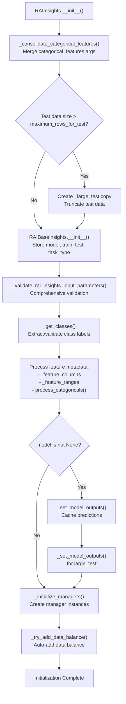
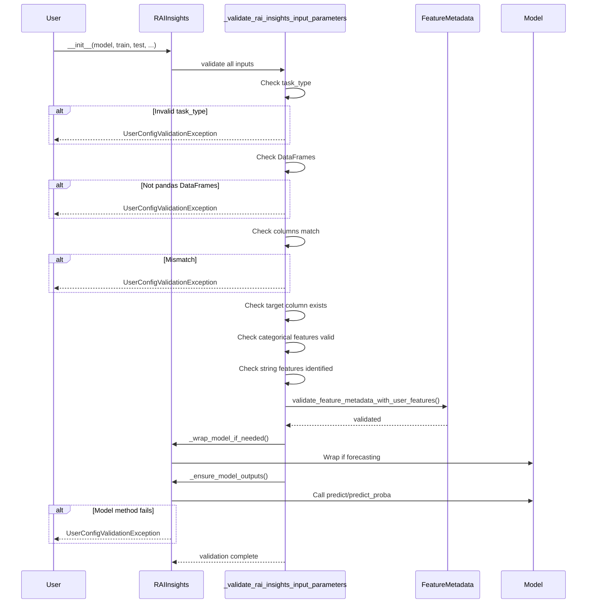
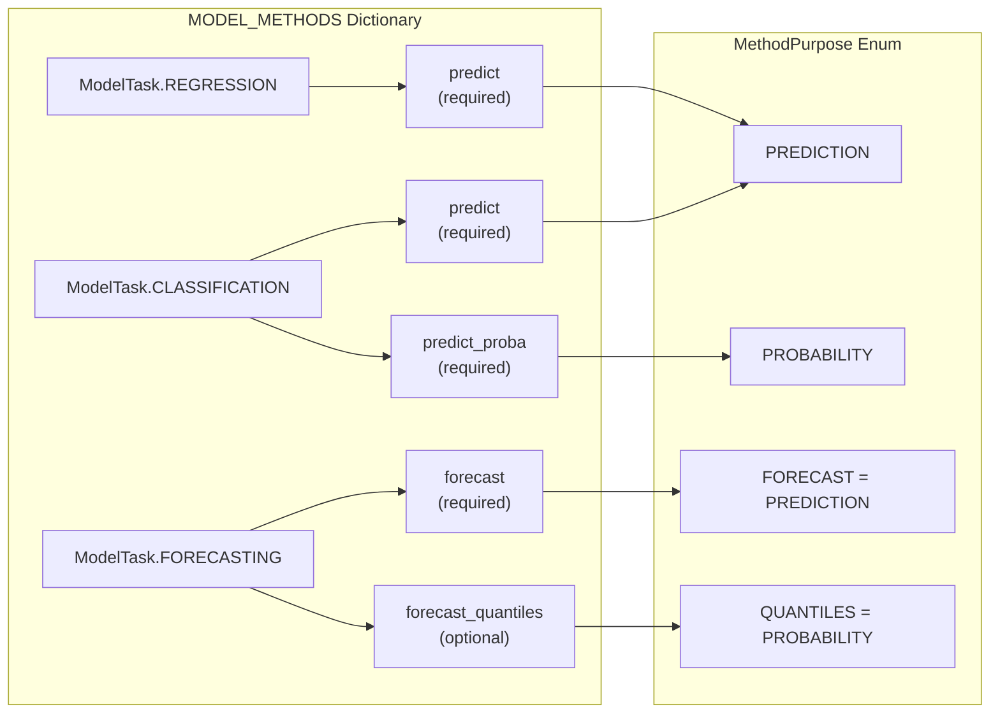
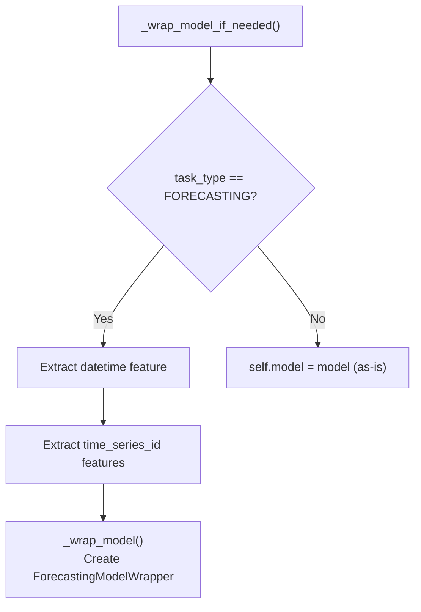
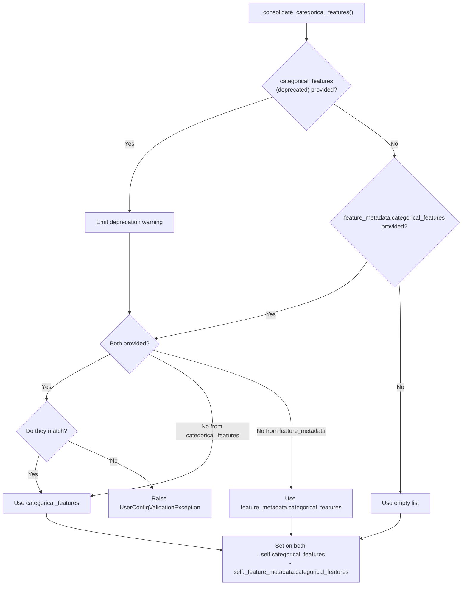
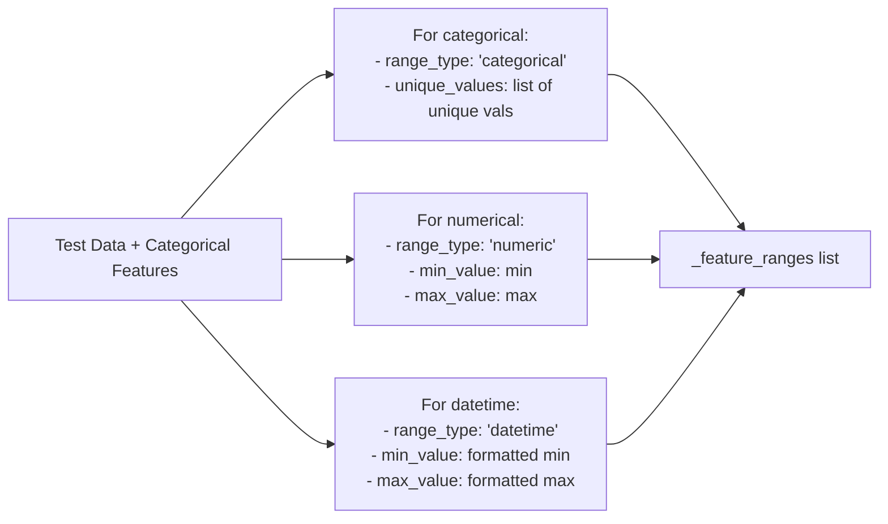
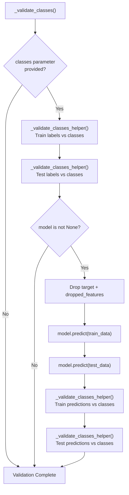
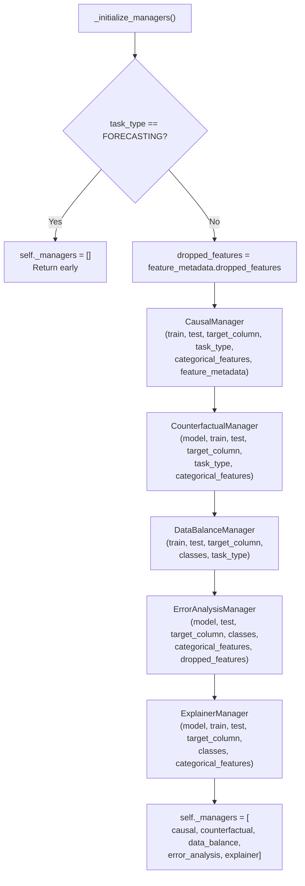

<!-- source: DeepWiki mcp.deepwiki.com · repo microsoft/responsible-ai-toolbox · extra page Initialization and Validation · fetched 2026-10-26 -->

# Initialization and Validation

Relevant source files

The following files were used as context for generating this wiki page:

- [responsibleai/responsibleai/_internal/constants.py](responsibleai/responsibleai/_internal/constants.py)
- [responsibleai/responsibleai/rai_insights/rai_base_insights.py](responsibleai/responsibleai/rai_insights/rai_base_insights.py)
- [responsibleai/responsibleai/rai_insights/rai_insights.py](responsibleai/responsibleai/rai_insights/rai_insights.py)
- [responsibleai/tests/common_utils.py](responsibleai/tests/common_utils.py)
- [responsibleai/tests/model_analysis/test_model_analysis.py](responsibleai/tests/model_analysis/test_model_analysis.py)
- [responsibleai/tests/model_analysis/test_model_analysis_validations.py](responsibleai/tests/model_analysis/test_model_analysis_validations.py)
- [responsibleai/tests/rai_insights/test_rai_insights.py](responsibleai/tests/rai_insights/test_rai_insights.py)
- [responsibleai/tests/rai_insights/test_rai_insights_cohort_filter.py](responsibleai/tests/rai_insights/test_rai_insights_cohort_filter.py)
- [responsibleai/tests/rai_insights/test_rai_insights_data_size_scenarios.py](responsibleai/tests/rai_insights/test_rai_insights_data_size_scenarios.py)
- [responsibleai/tests/rai_insights/test_rai_insights_get_feature_ranges.py](responsibleai/tests/rai_insights/test_rai_insights_get_feature_ranges.py)
- [responsibleai/tests/rai_insights/test_rai_insights_save_and_load_scenarios.py](responsibleai/tests/rai_insights/test_rai_insights_save_and_load_scenarios.py)
- [responsibleai/tests/rai_insights/test_rai_insights_validations.py](responsibleai/tests/rai_insights/test_rai_insights_validations.py)
- [responsibleai/tests/test_model_serializer.py](responsibleai/tests/test_model_serializer.py)

## Purpose and Scope

This page documents the initialization and validation logic of the `RAIInsights` class, the main entry point for model analysis in the Responsible AI Toolbox. The initialization process validates user inputs, processes metadata, wraps models when necessary, and prepares the system for analysis computations.

For information about how managers are orchestrated after initialization, see [Manager Orchestration](#3.2.2). For persistence mechanisms, see [Persistence and Serialization](#3.2.3).

## Initialization Overview

The `RAIInsights` constructor performs a multi-stage initialization process that ensures all inputs are valid before creating manager instances. The process follows a strict sequence to validate data consistency and prepare the analysis environment.

**Initialization Flow Diagram**

Sources: [responsibleai/rai_insights/rai_insights.py:148-263]()

## Input Parameter Validation

The `_validate_rai_insights_input_parameters` method performs comprehensive validation of all constructor inputs. Validation failures raise `UserConfigValidationException` with descriptive error messages.

**Validation Rules Table**

| Validation Check | Method/Lines | Error Condition | Exception Message |
|-----------------|--------------|-----------------|-------------------|
| Task Type | [rai_insights.py:477-491]() | `task_type` not in valid tasks | "Unsupported task type '{task_type}'. Should be one of {valid_tasks}" |
| Model Serializer | [rai_insights.py:503-516]() | Serializer missing save/load methods or not picklable | "The serializer does not implement save()" / "The serializer should be serializable via pickle" |
| Data Type | [rai_insights.py:518-522]() | Train/test not pandas DataFrames | "Unsupported data type for either train or test. Expecting pandas DataFrame" |
| Data Empty | [rai_insights.py:524-529]() | Train or test has zero rows | "Either of the train/test are empty. Please provide non-empty dataframes" |
| Feature Columns | [rai_insights.py:531-534]() | Train/test columns don't match | "The features in train and test data do not match" |
| Target Column | [rai_insights.py:536-539]() | Target not in train/test | "Target name {target_column} not present in train/test data" |
| Categorical Features | [rai_insights.py:541-555]() | Categorical features include target or non-existent features | "Found target name {target_column} in categorical feature list" |
| Continuous Target | [rai_insights.py:557-567]() | Float target for classification | "Target column type must not be continuous for classification scenario" |
| String Features | [rai_insights.py:568-586]() | String columns not marked as categorical/datetime | "The following string features were not identified as categorical features: {columns}" |

Sources: [responsibleai/rai_insights/rai_insights.py:440-639](), [responsibleai/tests/rai_insights/test_rai_insights_validations.py:1-677]()

**Validation Sequence Diagram**

Sources: [responsibleai/rai_insights/rai_insights.py:440-639]()

## Model Validation and Wrapping

The system validates that the model has required methods and wraps forecasting models when necessary. Model methods are validated to ensure they don't modify input data.

**Model Method Requirements by Task Type**

Sources: [responsibleai/rai_insights/rai_insights.py:87-138]()

**Model Output Caching**

The `_set_model_outputs` method caches model predictions to avoid repeated computation. For each task type, specific model methods are called and their outputs stored:

| Task Type | Cached Outputs | Storage Fields |
|-----------|---------------|----------------|
| Classification | `predict()`, `predict_proba()` | `_predict_output`, `_predict_proba_output` |
| Regression | `predict()` | `_predict_output` |
| Forecasting | `forecast()`, `forecast_quantiles()` (optional) | `_forecast_output`, `_forecast_quantiles_output` |

For large datasets (exceeding `maximum_rows_for_test`), outputs are cached separately in `_large_predict_output`, `_large_predict_proba_output`, etc.

Sources: [responsibleai/rai_insights/rai_insights.py:1291-1358](), [responsibleai/rai_insights/rai_insights.py:72-78]()

**Model Wrapping Logic**

For forecasting tasks, models are wrapped in `ForecastingModelWrapper` from `responsibleai._internal._forecasting_wrappers` to provide a consistent interface.

Sources: [responsibleai/rai_insights/rai_insights.py:730-740](), [responsibleai/rai_insights/rai_insights.py:24]()

## Feature Metadata Processing

Feature metadata is consolidated and validated through multiple stages to ensure consistency between deprecated and current API approaches.

**Categorical Features Consolidation**

The `_consolidate_categorical_features` method handles the transition from the deprecated `categorical_features` parameter to the `feature_metadata` approach:

Sources: [responsibleai/rai_insights/rai_insights.py:314-370]()

**Feature Metadata Validation**

The `_validate_feature_metadata` method ensures metadata fields are valid for the task type:

| Metadata Field | Valid Task Types | Validation Rules |
|---------------|-----------------|------------------|
| `categorical_features` | All | Must exist in feature columns |
| `identity_feature_name` | All | Must exist in feature columns |
| `dropped_features` | All | Must exist in feature columns, validated that not all features dropped |
| `datetime_features` | Forecasting only | Exactly one datetime feature required |
| `time_series_id_features` | Forecasting only | Must exist in feature columns |

Sources: [responsibleai/rai_insights/rai_insights.py:697-728](), [responsibleai/tests/rai_insights/test_rai_insights_validations.py:510-746]()

**Feature Range Computation**

Feature ranges are computed by `_get_feature_ranges` to support UI visualization:

Sources: [responsibleai/rai_insights/rai_insights.py:1360-1481]()

## Class Label Validation

For classification tasks, the system validates class labels across training data, test data, and model predictions.

**Class Validation Flow**

The `_validate_classes_helper` ensures that the unique values in target/predictions exactly match the provided classes, raising exceptions if there's any mismatch.

Sources: [responsibleai/rai_insights/rai_insights.py:653-695](), [responsibleai/rai_insights/rai_insights.py:640-651]()

## Dataset Size Management

RAIInsights handles large test datasets by creating a truncated version for analysis while preserving the full dataset.

**Large Dataset Handling**

| Scenario | Condition | Behavior |
|----------|-----------|----------|
| Normal | `len(test) <= maximum_rows_for_test` | Use test as-is, `_large_test = None` |
| Large | `len(test) > maximum_rows_for_test` | Copy full test to `_large_test`, truncate test to first `maximum_rows_for_test` rows, emit warning |

When large data is present:
- Analysis managers operate on truncated test data
- Both small and large predictions are cached (`_predict_output` and `_large_predict_output`)
- `get_filtered_test_data(use_entire_test_data=True)` can access full dataset
- Metadata includes `number_large_test_samples` field

Sources: [responsibleai/rai_insights/rai_insights.py:198-206](), [responsibleai/tests/rai_insights/test_rai_insights_data_size_scenarios.py:1-201]()

## Manager Initialization

After all validation and preprocessing, the `_initialize_managers` method creates manager instances.

**Manager Creation Code Map**

**Key Points:**
- Forecasting tasks skip all managers (managers list is empty)
- Each manager receives processed/validated data (with dropped features handled)
- Managers use `get_train_data()` and `get_test_data()` which automatically apply feature dropping
- `_data_balance_manager.add()` is automatically called for classification tasks with categorical features

Sources: [responsibleai/rai_insights/rai_insights.py:372-414](), [responsibleai/rai_insights/rai_insights.py:429-438]()

## Error Handling Patterns

The initialization process uses consistent error handling patterns:

**Exception Types Used**

| Exception Class | Usage | Example |
|----------------|-------|---------|
| `UserConfigValidationException` | Invalid user inputs | "Unsupported task type", "Target column not found" |
| `SystemErrorException` | Internal system errors | "Unable to convert min or max value" |
| `UserWarning` (warning) | Deprecated features or non-fatal issues | "No valid model supplied", "Test set too large" |

**Model Method Validation Pattern**

When validating model methods, the system:
1. Saves input data columns before method call
2. Calls model method (predict, predict_proba, etc.)
3. Validates columns unchanged via `_validate_features_same()`
4. Catches exceptions and wraps them with descriptive messages

Sources: [responsibleai/rai_insights/rai_insights.py:742-760](), [responsibleai/rai_insights/rai_insights.py:1415-1481]()

## Summary

The initialization and validation process ensures:
- All inputs are valid pandas DataFrames with matching schemas
- The model has required methods and doesn't mutate input data
- Categorical features and metadata are properly consolidated
- Class labels are consistent across data and predictions
- Large datasets are handled appropriately
- Managers are initialized with validated, processed data

This robust validation prevents runtime errors during analysis computation and provides clear error messages to guide users toward correct usage.

Sources: [responsibleai/rai_insights/rai_insights.py:148-263](), [responsibleai/rai_insights/rai_base_insights.py:35-70]()

---

