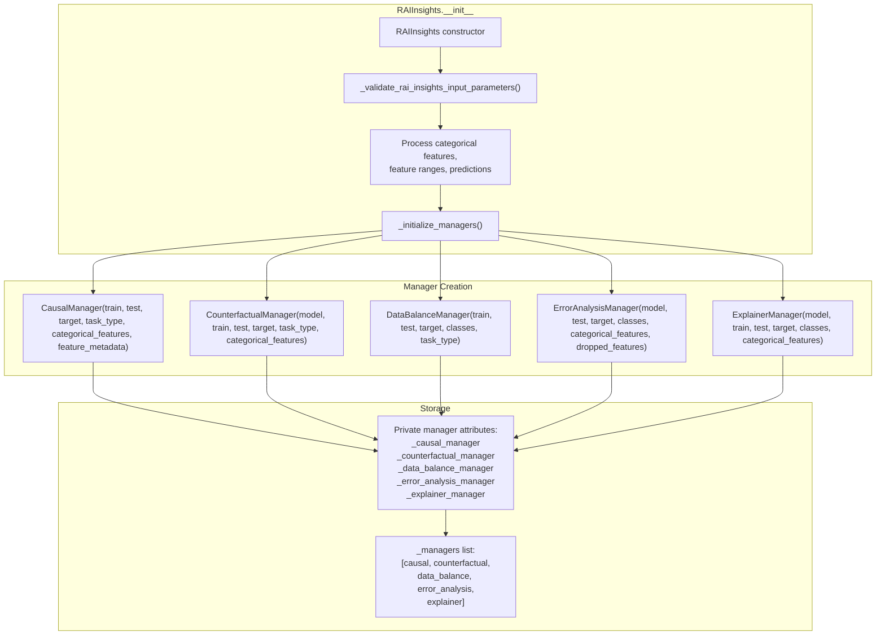
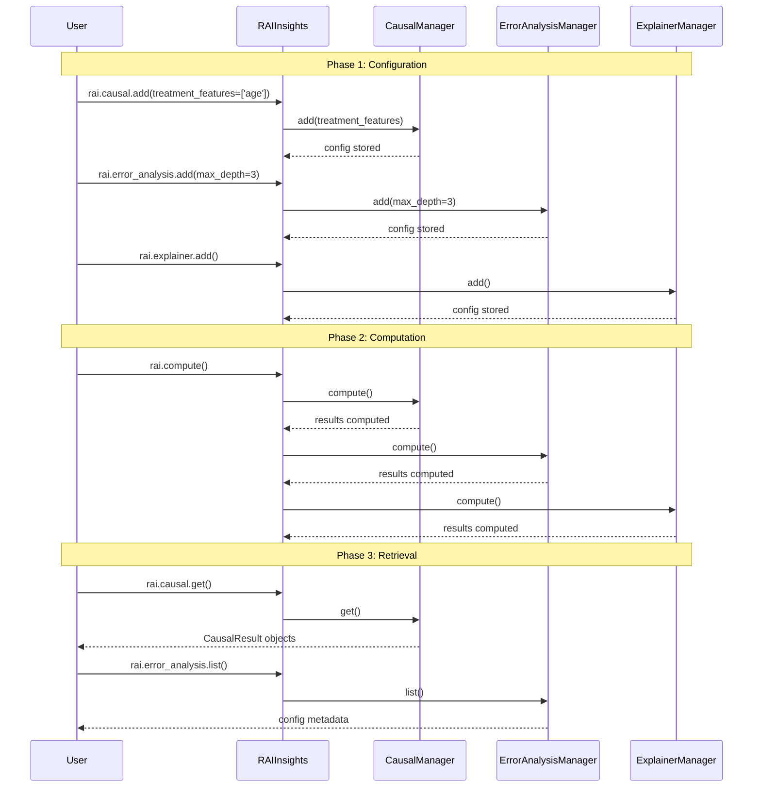
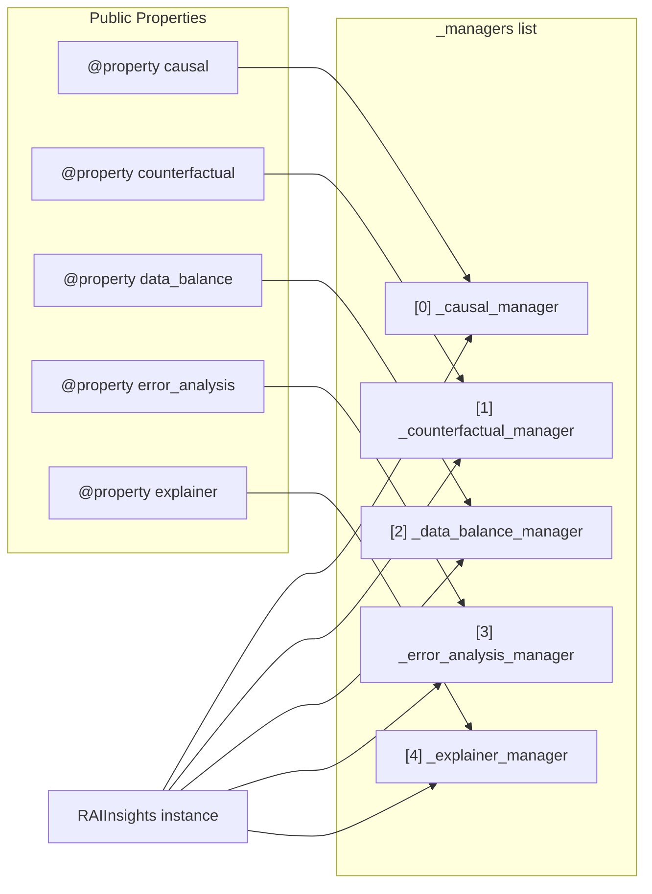
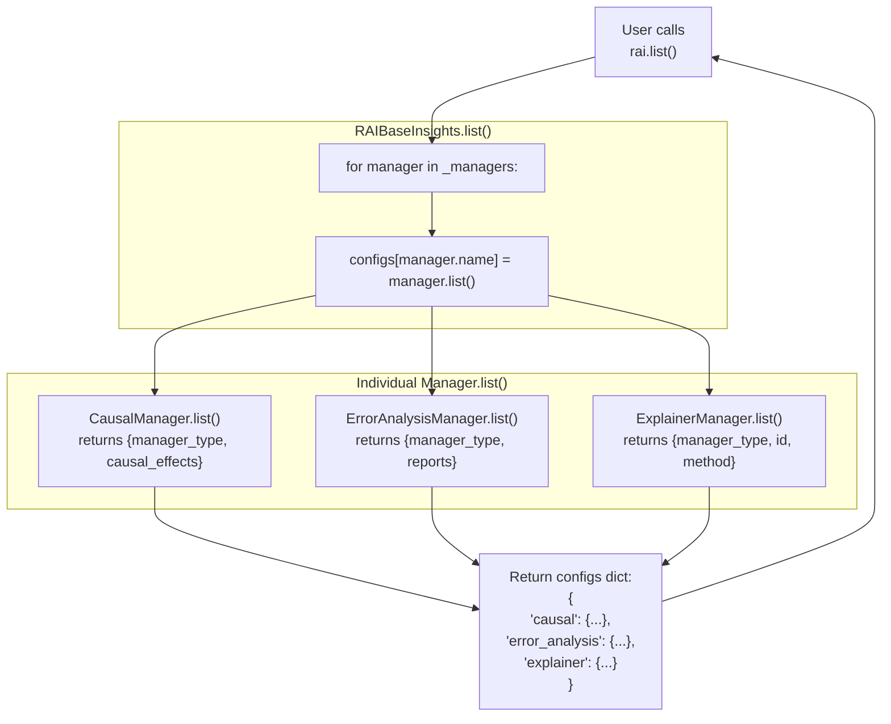
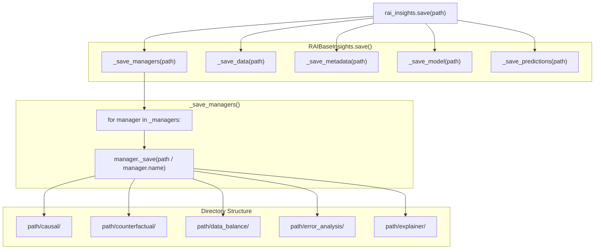
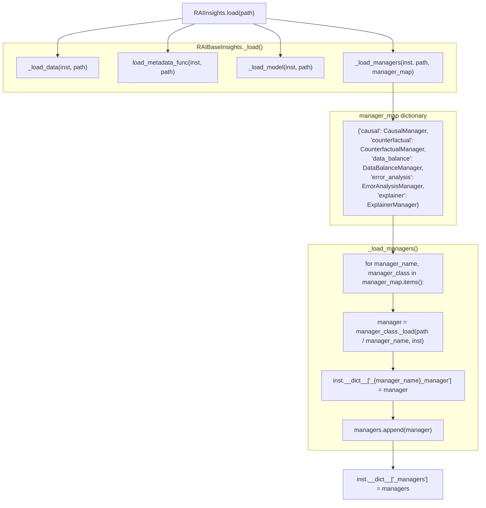

<!-- source: DeepWiki mcp.deepwiki.com · repo microsoft/responsible-ai-toolbox · extra page Manager Orchestration · fetched 2026-10-26 -->

# Manager Orchestration

<details>
<summary>Relevant source files</summary>

The following files were used as context for generating this wiki page:

- [raiwidgets/raiwidgets/interfaces.py](raiwidgets/raiwidgets/interfaces.py)
- [responsibleai/responsibleai/_internal/constants.py](responsibleai/responsibleai/_internal/constants.py)
- [responsibleai/responsibleai/_tools/shared/state_directory_management.py](responsibleai/responsibleai/_tools/shared/state_directory_management.py)
- [responsibleai/responsibleai/exceptions.py](responsibleai/responsibleai/exceptions.py)
- [responsibleai/responsibleai/modelanalysis/model_analysis.py](responsibleai/responsibleai/modelanalysis/model_analysis.py)
- [responsibleai/responsibleai/rai_insights/rai_base_insights.py](responsibleai/responsibleai/rai_insights/rai_base_insights.py)
- [responsibleai/responsibleai/rai_insights/rai_insights.py](responsibleai/responsibleai/rai_insights/rai_insights.py)
- [responsibleai/tests/causal_manager_validator.py](responsibleai/tests/causal_manager_validator.py)
- [responsibleai/tests/common_utils.py](responsibleai/tests/common_utils.py)
- [responsibleai/tests/counterfactual_manager_validator.py](responsibleai/tests/counterfactual_manager_validator.py)
- [responsibleai/tests/error_analysis_validator.py](responsibleai/tests/error_analysis_validator.py)
- [responsibleai/tests/explainer_manager_validator.py](responsibleai/tests/explainer_manager_validator.py)
- [responsibleai/tests/model_analysis/test_model_analysis.py](responsibleai/tests/model_analysis/test_model_analysis.py)
- [responsibleai/tests/model_analysis/test_model_analysis_validations.py](responsibleai/tests/model_analysis/test_model_analysis_validations.py)
- [responsibleai/tests/rai_insights/test_rai_insights.py](responsibleai/tests/rai_insights/test_rai_insights.py)
- [responsibleai/tests/rai_insights/test_rai_insights_cohort_filter.py](responsibleai/tests/rai_insights/test_rai_insights_cohort_filter.py)
- [responsibleai/tests/rai_insights/test_rai_insights_data_size_scenarios.py](responsibleai/tests/rai_insights/test_rai_insights_data_size_scenarios.py)
- [responsibleai/tests/rai_insights/test_rai_insights_get_feature_ranges.py](responsibleai/tests/rai_insights/test_rai_insights_get_feature_ranges.py)
- [responsibleai/tests/rai_insights/test_rai_insights_save_and_load_scenarios.py](responsibleai/tests/rai_insights/test_rai_insights_save_and_load_scenarios.py)
- [responsibleai/tests/rai_insights/test_rai_insights_validations.py](responsibleai/tests/rai_insights/test_rai_insights_validations.py)
- [responsibleai/tests/test_exceptions.py](responsibleai/tests/test_exceptions.py)
- [responsibleai/tests/test_model_serializer.py](responsibleai/tests/test_model_serializer.py)

</details>


This page describes how the `RAIInsights` class orchestrates multiple analysis managers to provide a unified interface for responsible AI analysis. For details about individual manager implementations, see pages [3.3.1](#3.3.1) through [3.3.5](#3.3.5). For information about initialization and validation, see [3.2.1](#3.2.1).

## Purpose and Scope

The `RAIInsights` class manages five specialized analysis managers:
- **CausalManager** - causal inference using EconML
- **CounterfactualManager** - counterfactual generation using DiCE
- **DataBalanceManager** - data distribution analysis
- **ErrorAnalysisManager** - error tree and matrix analysis
- **ExplainerManager** - model interpretability via SHAP/LIME

This document explains how these managers are created, coordinated, and persisted through a unified orchestration pattern.

Sources: [responsibleai/responsibleai/rai_insights/rai_insights.py:141-414]()

## Manager Architecture

### Manager Initialization Pattern

The `_initialize_managers()` method creates all manager instances during `RAIInsights` construction. This method is called at the end of `__init__()` after model validation and data processing are complete.



Sources: [responsibleai/responsibleai/rai_insights/rai_insights.py:372-414](), [responsibleai/responsibleai/rai_insights/rai_insights.py:148-263]()

### Forecasting Task Exception

For forecasting tasks (`task_type == ModelTask.FORECASTING`), manager initialization is skipped and `_managers` is set to an empty list. This is because forecasting support is experimental and limited.

Sources: [responsibleai/responsibleai/rai_insights/rai_insights.py:378-380]()

## Manager Lifecycle

### Three-Phase Pattern

All managers follow a consistent three-phase lifecycle:

| Phase | User Action | Manager Method | Purpose |
|-------|-------------|----------------|---------|
| **Configuration** | `rai_insights.manager.add(...)` | `add()` | Register analysis configuration |
| **Computation** | `rai_insights.compute()` | `compute()` | Execute all configured analyses |
| **Retrieval** | `rai_insights.manager.get()` / `list()` | `get()` / `list()` | Access computed results |



Sources: [responsibleai/responsibleai/rai_insights/rai_base_insights.py:84-108](), [responsibleai/tests/rai_insights/test_rai_insights.py:241-265]()

### Compute Orchestration

The `compute()` method in `RAIBaseInsights` iterates through the `_managers` list and calls `compute()` on each manager sequentially. This acts as a synchronization point ensuring all configured analyses complete before results are accessed.

```python
def compute(self):
    """Calls compute on each of the managers."""
    for manager in self._managers:
        manager.compute()
```

Sources: [responsibleai/responsibleai/rai_insights/rai_base_insights.py:84-87]()

## The Managers List

### Internal Structure

The `_managers` attribute is a Python list containing references to all five manager instances. This list is used for bulk operations like `compute()`, `list()`, `get()`, and serialization.

| Manager Instance | Property Name | Manager Class | Stored At |
|-----------------|---------------|---------------|-----------|
| `_causal_manager` | `causal` | `CausalManager` | `_managers[0]` |
| `_counterfactual_manager` | `counterfactual` | `CounterfactualManager` | `_managers[1]` |
| `_data_balance_manager` | `data_balance` | `DataBalanceManager` | `_managers[2]` |
| `_error_analysis_manager` | `error_analysis` | `ErrorAnalysisManager` | `_managers[3]` |
| `_explainer_manager` | `explainer` | `ExplainerManager` | `_managers[4]` |



Sources: [responsibleai/responsibleai/rai_insights/rai_insights.py:410-414]()

## Public Manager Properties

### Property Accessors

Each manager is exposed through a read-only `@property` decorator, providing type-safe access to manager instances:

```python
@property
def causal(self) -> CausalManager:
    """Get the causal manager."""
    return self._causal_manager

@property
def counterfactual(self) -> CounterfactualManager:
    """Get the counterfactual manager."""
    return self._counterfactual_manager

@property
def data_balance(self) -> DataBalanceManager:
    """Get the data balance manager."""
    return self._data_balance_manager

@property
def error_analysis(self) -> ErrorAnalysisManager:
    """Get the error analysis manager."""
    return self._error_analysis_manager

@property
def explainer(self) -> ExplainerManager:
    """Get the explainer manager."""
    return self._explainer_manager
```

This design pattern allows users to access managers via intuitive names (e.g., `rai_insights.causal.add(...)`) while maintaining internal control over manager instances.

Sources: [responsibleai/responsibleai/rai_insights/rai_insights.py:810-848]()

## Orchestration Methods

### list() Method

The `list()` method aggregates configuration metadata from all managers into a single dictionary. Each manager's `name` attribute serves as the dictionary key.



Sources: [responsibleai/responsibleai/rai_insights/rai_base_insights.py:89-97]()

### get() Method

The `get()` method retrieves computed results from all managers. Unlike `list()`, this returns the actual analysis results, not just configuration metadata.

```python
def get(self):
    """List information about each of the managers.
    
    :return: Information about each of the managers.
    :rtype: dict
    """
    configs = {}
    for manager in self._managers:
        configs[manager.name] = manager.get()
    return configs
```

Sources: [responsibleai/responsibleai/rai_insights/rai_base_insights.py:99-108]()

### Manager-Specific Return Types

Each manager's `get()` method returns different data structures:

| Manager | Return Type | Example Contents |
|---------|-------------|------------------|
| `CausalManager` | `List[CausalResult]` | Causal effects, policies, local/global effects |
| `CounterfactualManager` | `List[CounterfactualData]` | CF examples, feature importances |
| `ErrorAnalysisManager` | `List[ErrorReport]` | Error tree, matrix, feature importances |
| `ExplainerManager` | `List[Explanation]` | Local/global SHAP values |
| `DataBalanceManager` | `List[DataBalanceMeasures]` | Distribution metrics |

Sources: [responsibleai/tests/causal_manager_validator.py:59-72](), [responsibleai/tests/counterfactual_manager_validator.py:62-66](), [responsibleai/tests/error_analysis_validator.py:36-63]()

## Persistence and Serialization

### Save Pattern

The `save()` method orchestrates serialization of all managers through the `_save_managers()` method. Each manager is saved to its own subdirectory identified by `manager.name`.



Sources: [responsibleai/responsibleai/rai_insights/rai_base_insights.py:219-229](), [responsibleai/responsibleai/rai_insights/rai_base_insights.py:208-217]()

### Load Pattern

The `_load_managers()` static method reconstructs manager instances from serialized state using a `manager_map` dictionary that maps manager names to their class constructors.



The `manager_map` is defined in the `RAIInsights.load()` method and passed to the base class's `_load()` implementation. This pattern allows the base class to handle manager loading generically while child classes specify which managers to load.

Sources: [responsibleai/responsibleai/rai_insights/rai_base_insights.py:302-346](), [responsibleai/responsibleai/rai_insights/rai_insights.py:1487-1506]()

### Manager Name Constants

Manager names are defined in the `ManagerNames` class to ensure consistency across saving, loading, and directory naming:

```python
class ManagerNames(object):
    """Provide the manager names."""
    CAUSAL = 'causal'
    COUNTERFACTUAL = 'counterfactual'
    DATA_BALANCE = 'data_balance'
    ERROR_ANALYSIS = 'error_analysis'
    EXPLAINER = 'explainer'
```

Sources: [responsibleai/responsibleai/_internal/constants.py:7-14]()

## Manager Independence

### Isolation Principle

Managers are designed to operate independently with minimal coupling:

1. **Shared Data Access**: All managers receive references to the same train/test datasets and model during initialization
2. **No Inter-Manager Dependencies**: Managers do not call methods on other managers
3. **Independent Configuration**: Each manager maintains its own configuration state
4. **Parallel-Ready Computation**: The sequential `compute()` loop could be parallelized since managers don't depend on each other's results

This architecture enables:
- Adding new managers without modifying existing ones
- Skipping managers that haven't been configured
- Independent versioning and evolution of manager implementations

Sources: [responsibleai/responsibleai/rai_insights/rai_insights.py:383-408](), [responsibleai/tests/rai_insights/test_rai_insights.py:246-265]()

---

