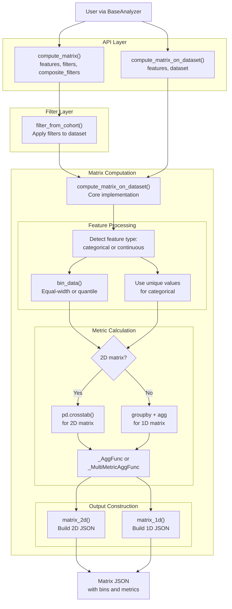
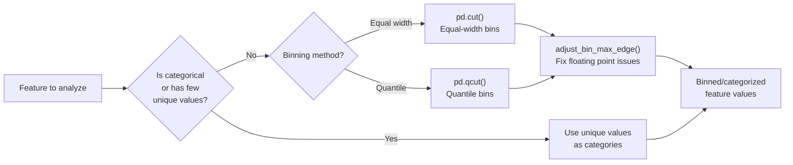
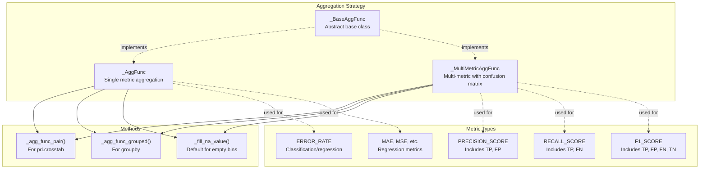
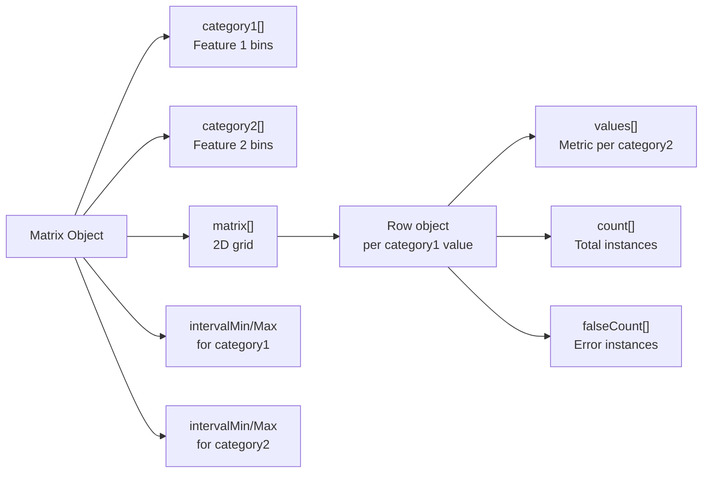
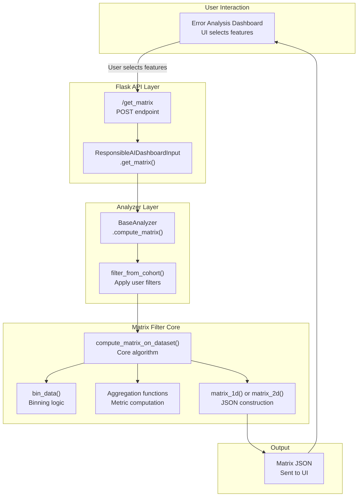

<!-- source: DeepWiki mcp.deepwiki.com · repo microsoft/responsible-ai-toolbox · extra page Matrix Filter (Heatmap) · fetched 2026-10-26 -->

# Matrix Filter (Heatmap)

<details>
<summary>Relevant source files</summary>

The following files were used as context for generating this wiki page:

- [erroranalysis/erroranalysis/_internal/cohort_filter.py](erroranalysis/erroranalysis/_internal/cohort_filter.py)
- [erroranalysis/erroranalysis/_internal/constants.py](erroranalysis/erroranalysis/_internal/constants.py)
- [erroranalysis/erroranalysis/_internal/matrix_filter.py](erroranalysis/erroranalysis/_internal/matrix_filter.py)
- [erroranalysis/erroranalysis/_internal/metrics.py](erroranalysis/erroranalysis/_internal/metrics.py)
- [erroranalysis/erroranalysis/_internal/surrogate_error_tree.py](erroranalysis/erroranalysis/_internal/surrogate_error_tree.py)
- [erroranalysis/erroranalysis/analyzer/error_analyzer.py](erroranalysis/erroranalysis/analyzer/error_analyzer.py)
- [erroranalysis/erroranalysis/version.py](erroranalysis/erroranalysis/version.py)
- [erroranalysis/requirements-object-detection.txt](erroranalysis/requirements-object-detection.txt)
- [erroranalysis/tests/common_utils.py](erroranalysis/tests/common_utils.py)
- [erroranalysis/tests/test_cohort_filter.py](erroranalysis/tests/test_cohort_filter.py)
- [erroranalysis/tests/test_error_report.py](erroranalysis/tests/test_error_report.py)
- [erroranalysis/tests/test_importances.py](erroranalysis/tests/test_importances.py)
- [erroranalysis/tests/test_matrix_filter.py](erroranalysis/tests/test_matrix_filter.py)
- [erroranalysis/tests/test_metrics.py](erroranalysis/tests/test_metrics.py)
- [erroranalysis/tests/test_surrogate_error_tree.py](erroranalysis/tests/test_surrogate_error_tree.py)

</details>


## Purpose and Scope

The Matrix Filter (also called the Heatmap) is a 2D or 1D visualization component in the Error Analysis Engine that bins data points along one or two features and computes error metrics for each bin. This document covers the algorithm, binning strategies, metric aggregation, and data structures used to generate the matrix visualization.

For information about the hierarchical error tree visualization, see [Surrogate Error Tree](#3.4.1). For information about filtering data with cohorts, see [Cohort Filtering](#3.4.3).

## Overview

The Matrix Filter enables users to identify error patterns by visualizing how model performance varies across different ranges of feature values. It supports:

- **1D or 2D matrices**: Analyze error distribution across one or two features
- **Multiple binning strategies**: Equal-width or quantile binning for continuous features
- **Categorical feature handling**: Direct grouping without binning for discrete features
- **Multiple metrics**: Error rate, precision, recall, F1, MSE, MAE, and more
- **Cohort filtering**: Apply filters before computing the matrix

**Primary Entry Point**: `BaseAnalyzer.compute_matrix()` and `BaseAnalyzer.compute_matrix_on_dataset()` in [erroranalysis/erroranalysis/analyzer/error_analyzer.py:251-313]()

**Core Implementation**: [erroranalysis/erroranalysis/_internal/matrix_filter.py]()

Sources: [erroranalysis/erroranalysis/_internal/matrix_filter.py:1-1025](), [erroranalysis/erroranalysis/analyzer/error_analyzer.py:251-313]()

## Architecture and Data Flow

The following diagram shows how the matrix filter computation flows through the system:



Sources: [erroranalysis/erroranalysis/_internal/matrix_filter.py:58-389](), [erroranalysis/erroranalysis/analyzer/error_analyzer.py:251-313]()

## Core Components

### Entry Points

The matrix filter is accessed through two main methods on `BaseAnalyzer`:

| Method | Description | Parameters |
|--------|-------------|------------|
| `compute_matrix()` | Applies filters then computes matrix | `features, filters, composite_filters, quantile_binning, num_bins` |
| `compute_matrix_on_dataset()` | Computes matrix on pre-filtered dataset | `features, dataset, quantile_binning, num_bins` |

Both methods delegate to `_compute_matrix()` and `_compute_matrix_on_dataset()` in [erroranalysis/erroranalysis/_internal/matrix_filter.py:322-389]().

Sources: [erroranalysis/erroranalysis/analyzer/error_analyzer.py:251-313](), [erroranalysis/erroranalysis/_internal/matrix_filter.py:58-76, 322-389]()

### Feature Detection and Binning

The algorithm determines whether to bin a feature based on:

1. **Categorical feature list**: Features in `analyzer.categorical_features` are not binned
2. **Unique value count**: If `unique_count > num_bins`, the feature is binned
3. **Binning method**: Equal-width (`pd.cut`) or quantile (`pd.qcut`)



**Key Function**: `bin_data()` in [erroranalysis/erroranalysis/_internal/matrix_filter.py:417-501]()

The function handles edge cases:
- **Empty columns**: Returns empty bins gracefully
- **Duplicate edges**: Warns user when too many duplicates exist (e.g., many zeros)
- **Floating-point precision**: Adjusts max bin edge to include maximum value
- **Quantile edge adjustment**: Adds tolerance to leftmost bin to include boundary values

Sources: [erroranalysis/erroranalysis/_internal/matrix_filter.py:78-320, 417-501]()

### Metric Aggregation

The matrix filter uses aggregation function classes to compute metrics for each bin:



**Aggregation Classes**:
- `_AggFunc` [erroranalysis/erroranalysis/_internal/matrix_filter.py:545-586](): For simple metrics like error rate, MAE, MSE
- `_MultiMetricAggFunc` [erroranalysis/erroranalysis/_internal/matrix_filter.py:588-676](): For precision/recall/F1 that need confusion matrix components

Sources: [erroranalysis/erroranalysis/_internal/matrix_filter.py:503-676]()

## Matrix Construction

### 1D Matrix

For a single feature, the algorithm:

1. Bins the feature (if continuous) or uses categories
2. Counts total instances per bin
3. Applies metric aggregation to error subset
4. Constructs JSON with intervals and metrics

The output structure for 1D matrices:

| Field | Type | Description |
|-------|------|-------------|
| `category1` | Array | Bin labels (e.g., intervals or category names) |
| `intervalMin` | Array | Minimum value for each interval (continuous only) |
| `intervalMax` | Array | Maximum value for each interval (continuous only) |
| `values` | Array | Metric values for each bin |
| `metricName` | String | Display name of the metric |

Sources: [erroranalysis/erroranalysis/_internal/matrix_filter.py:839-894]()

### 2D Matrix

For two features, the algorithm:

1. Bins both features independently
2. Creates a 2D crosstab of total counts
3. Creates a 2D crosstab of metric values using aggregation function
4. Constructs nested JSON structure

The output structure for 2D matrices:



**Key Functions**:
- `matrix_1d()` [erroranalysis/erroranalysis/_internal/matrix_filter.py:839-894](): Constructs 1D matrix JSON
- `matrix_2d()` [erroranalysis/erroranalysis/_internal/matrix_filter.py:678-837](): Constructs 2D matrix JSON

Sources: [erroranalysis/erroranalysis/_internal/matrix_filter.py:678-894]()

## Advanced Features

### Multi-Metric Output

For precision, recall, F1, and accuracy metrics with multi-class classification, the `_MultiMetricAggFunc` computes additional confusion matrix components:

```python
# Return structure from _multi_metric_result():
(metric_value, tp_sum, fp_sum, fn_sum, tn_sum, error)
```

This enables the UI to display:
- The primary metric value
- TP/FP/FN/TN counts for each bin
- Total error count

The confusion matrix is computed using `sklearn.metrics.multilabel_confusion_matrix()` with specified labels.

Sources: [erroranalysis/erroranalysis/_internal/matrix_filter.py:609-676]()

### Object Detection Support

For object detection tasks (`ModelTask.OBJECT_DETECTION`), the matrix filter:

1. Computes error labels using `ErrorLabeling` from `vision_explanation_methods`
2. Treats each image as having error if `len(error_list) > 0`
3. Only supports `ERROR_RATE` metric currently

This is implemented in [erroranalysis/erroranalysis/_internal/matrix_filter.py:129-145]():

```python
if analyzer.model_task == ModelTask.OBJECT_DETECTION:
    diff = [
        len(
            ErrorLabeling(
                ModelTask.OBJECT_DETECTION,
                pred_y[image_idx],
                true_y[image_idx]
            ).compute_error_list()
        ) > 0
        for image_idx in range(len(true_y))
    ]
```

Sources: [erroranalysis/erroranalysis/_internal/matrix_filter.py:129-145]()

### Binning Edge Cases

The implementation handles several edge cases in binning:

1. **Duplicate bin edges**: When quantile binning creates duplicate edges (e.g., many identical values), the algorithm warns the user and removes duplicates
   - See `warn_duplicate_edges()` [erroranalysis/erroranalysis/_internal/matrix_filter.py:404-414]()

2. **Floating-point precision**: When `pd.cut()` creates a max bin edge below the actual max value due to precision, the algorithm adjusts it
   - See `adjust_bin_max_edge()` [erroranalysis/erroranalysis/_internal/matrix_filter.py:481-501]()

3. **Zero-bin tolerance**: For quantile binning, adds tolerance to the leftmost bin to include boundary values
   - See [erroranalysis/erroranalysis/_internal/matrix_filter.py:454-465]()

Sources: [erroranalysis/erroranalysis/_internal/matrix_filter.py:404-501]()

## Integration with Error Analysis Pipeline

The matrix filter integrates with the broader error analysis system:



Sources: [erroranalysis/erroranalysis/analyzer/error_analyzer.py:251-280](), [erroranalysis/erroranalysis/_internal/matrix_filter.py:58-389]()

## Configuration Parameters

The matrix filter accepts the following configuration:

| Parameter | Type | Default | Description |
|-----------|------|---------|-------------|
| `features` | list[str] | Required | One or two feature names to analyze |
| `filters` | list[dict] | `None` | Simple filters to apply before computing matrix |
| `composite_filters` | list[dict] | `None` | Nested filters with AND/OR operations |
| `quantile_binning` | bool | `False` | Use quantile binning instead of equal-width |
| `num_bins` | int | `8` | Number of bins for continuous features |

**Constants**: 
- `MatrixParams.BIN_THRESHOLD = 8` [erroranalysis/erroranalysis/_internal/constants.py:74-77]()
- `PRECISION = 100` for bin interval formatting [erroranalysis/erroranalysis/_internal/matrix_filter.py:48]()

Sources: [erroranalysis/erroranalysis/_internal/matrix_filter.py:58-389](), [erroranalysis/erroranalysis/_internal/constants.py:74-77]()

## Test Coverage

The matrix filter has comprehensive test coverage in [erroranalysis/tests/test_matrix_filter.py]():

| Test Category | Examples |
|---------------|----------|
| Basic functionality | `test_matrix_filter_iris`, `test_matrix_filter_cancer` |
| Filtering integration | `test_matrix_filter_iris_filters`, `test_matrix_filter_cancer_filters` |
| Quantile binning | `test_matrix_filter_iris_quantile_binning`, `test_matrix_filter_diabetes_quantile_binning` |
| Multiple metrics | `test_matrix_filter_wine_quantile_binning` with parametrized metrics |
| Edge cases | `test_bin_data_max_over_left_bound`, `test_matrix_filter_iris_invalid_num_bins` |
| Categorical features | `test_matrix_filter_titanic`, `test_matrix_filter_adult_census_quantile_binning` |
| Data types | `test_matrix_filter_iris_int64`, `test_matrix_filter_titanic_object_dtype_quantile` |

Sources: [erroranalysis/tests/test_matrix_filter.py:1-578]()

---

