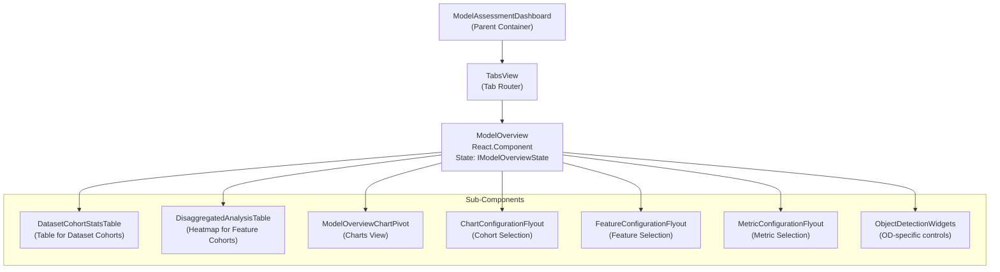
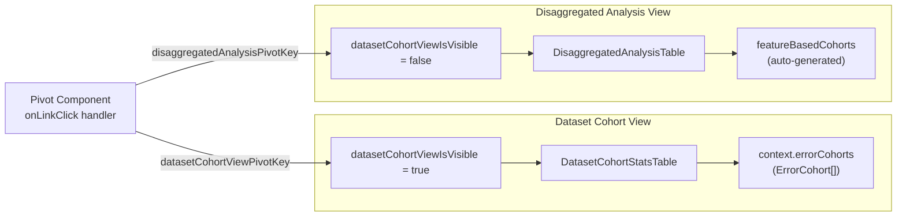
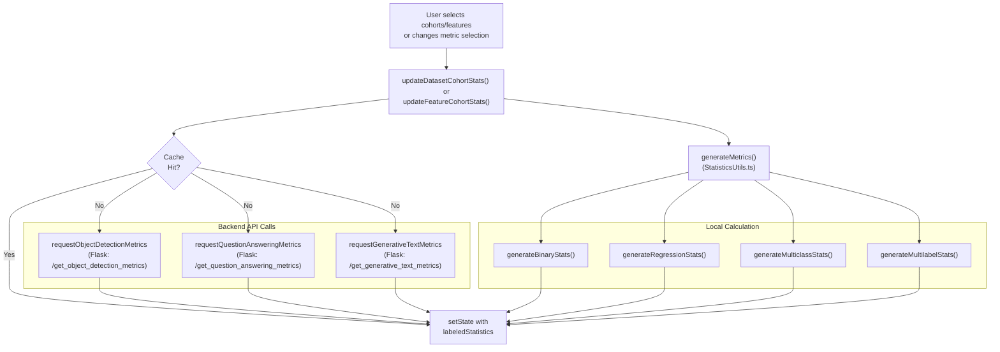
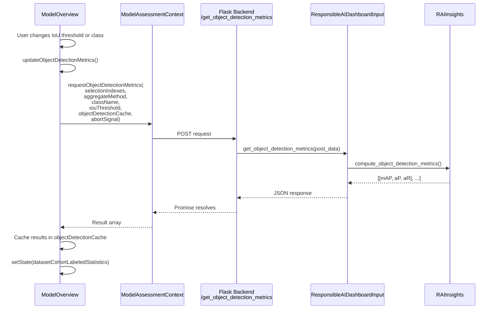
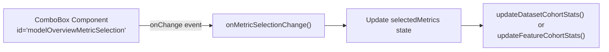

<!-- source: DeepWiki mcp.deepwiki.com · repo microsoft/responsible-ai-toolbox · extra page Model Overview Component · fetched 2026-10-26 -->

# Model Overview Component

<details>
<summary>Relevant source files</summary>

The following files were used as context for generating this wiki page:

- [apps/widget/src/app/ModelAssessment.tsx](apps/widget/src/app/ModelAssessment.tsx)
- [libs/core-ui/src/index.ts](libs/core-ui/src/index.ts)
- [libs/core-ui/src/lib/Context/ModelAssessmentContext.tsx](libs/core-ui/src/lib/Context/ModelAssessmentContext.tsx)
- [libs/core-ui/src/lib/Interfaces/IExplanationContext.ts](libs/core-ui/src/lib/Interfaces/IExplanationContext.ts)
- [libs/core-ui/src/lib/util/StatisticsUtils.ts](libs/core-ui/src/lib/util/StatisticsUtils.ts)
- [libs/error-analysis/src/index.ts](libs/error-analysis/src/index.ts)
- [libs/error-analysis/src/lib/ErrorAnalysisDashboard/Controls/MetricSelector/MetricSelector.tsx](libs/error-analysis/src/lib/ErrorAnalysisDashboard/Controls/MetricSelector/MetricSelector.tsx)
- [libs/error-analysis/src/lib/ErrorAnalysisDashboard/Interfaces/IErrorAnalysisDashboardState.ts](libs/error-analysis/src/lib/ErrorAnalysisDashboard/Interfaces/IErrorAnalysisDashboardState.ts)
- [libs/interpret-vision/src/lib/VisionExplanationDashboard/Interfaces/IVisionExplanationDashboardProps.ts](libs/interpret-vision/src/lib/VisionExplanationDashboard/Interfaces/IVisionExplanationDashboardProps.ts)
- [libs/localization/src/lib/en.json](libs/localization/src/lib/en.json)
- [libs/model-assessment/src/lib/ModelAssessmentDashboard/Context/buildModelAssessmentContext.ts](libs/model-assessment/src/lib/ModelAssessmentDashboard/Context/buildModelAssessmentContext.ts)
- [libs/model-assessment/src/lib/ModelAssessmentDashboard/Controls/ModelOverview/ModelOverview.tsx](libs/model-assessment/src/lib/ModelAssessmentDashboard/Controls/ModelOverview/ModelOverview.tsx)
- [libs/model-assessment/src/lib/ModelAssessmentDashboard/Controls/ModelOverview/StatsTableUtils.ts](libs/model-assessment/src/lib/ModelAssessmentDashboard/Controls/ModelOverview/StatsTableUtils.ts)
- [libs/model-assessment/src/lib/ModelAssessmentDashboard/Controls/TabsView/TabsViewProps.ts](libs/model-assessment/src/lib/ModelAssessmentDashboard/Controls/TabsView/TabsViewProps.ts)
- [libs/model-assessment/src/lib/ModelAssessmentDashboard/ModelAssessmentDashboard.tsx](libs/model-assessment/src/lib/ModelAssessmentDashboard/ModelAssessmentDashboard.tsx)
- [libs/model-assessment/src/lib/ModelAssessmentDashboard/ModelAssessmentDashboardProps.ts](libs/model-assessment/src/lib/ModelAssessmentDashboard/ModelAssessmentDashboardProps.ts)
- [libs/model-assessment/src/lib/ModelAssessmentDashboard/ModelAssessmentDashboardState.ts](libs/model-assessment/src/lib/ModelAssessmentDashboard/ModelAssessmentDashboardState.ts)
- [raiwidgets/raiwidgets/responsibleai_dashboard.py](raiwidgets/raiwidgets/responsibleai_dashboard.py)
- [raiwidgets/raiwidgets/responsibleai_dashboard_input.py](raiwidgets/raiwidgets/responsibleai_dashboard_input.py)

</details>


## Purpose and Scope

The Model Overview Component is a React-based UI component that displays comprehensive performance metrics for machine learning models across different cohorts and feature-based segments. It is rendered as a tab within the Model Assessment Dashboard and provides both tabular and visual representations of model performance.

For information about the parent dashboard structure, see [Model Assessment Dashboard](#4.2). For details on data cohort management in the UI, see [Cohort Management](#4.2.3).

**Sources:** [libs/model-assessment/src/lib/ModelAssessmentDashboard/Controls/ModelOverview/ModelOverview.tsx:1-535]()

---

## Component Architecture

### Component Class Structure



The `ModelOverview` class maintains state via `IModelOverviewState` interface which includes:
- `selectedMetrics`: Array of metric keys currently selected
- `selectedFeatures`: Array of feature indices for disaggregated analysis
- `datasetCohortViewIsVisible`: Boolean toggle between dataset and feature views
- `showHeatmapColors`: Boolean to enable/disable heatmap visualization
- Cache objects for Object Detection, Question Answering, and Generative Text metrics

**Sources:** [libs/model-assessment/src/lib/ModelAssessmentDashboard/Controls/ModelOverview/ModelOverview.tsx:86-127](), [libs/model-assessment/src/lib/ModelAssessmentDashboard/ModelAssessmentDashboard.tsx:32-175]()

---

## View Modes and Display Types

### Two Primary View Modes



**Dataset Cohort View** (`datasetCohortViewPivotKey`): Displays metrics for user-defined cohorts from `context.errorCohorts`. Each row represents one cohort with metrics calculated across all datapoints in that cohort.

**Disaggregated Analysis View** (`disaggregatedAnalysisPivotKey`): Generates feature-based cohorts by splitting the base cohort along selected feature values. Displays metrics in a heatmap format where rows represent feature value bins. Requires 1-2 features to be selected via `selectedFeatures` state.

**Sources:** [libs/model-assessment/src/lib/ModelAssessmentDashboard/Controls/ModelOverview/ModelOverview.tsx:83-84](), [libs/model-assessment/src/lib/ModelAssessmentDashboard/Controls/ModelOverview/ModelOverview.tsx:300-319](), [libs/model-assessment/src/lib/ModelAssessmentDashboard/Controls/ModelOverview/ModelOverview.tsx:419-480]()

---

## Metrics System

### Metric Selection by Task Type

The component selects default metrics based on `dataset.task_type`:

| Task Type | Default Metrics | Metric Enum |
|-----------|----------------|-------------|
| Binary Classification | Accuracy, FalsePositiveRate, FalseNegativeRate, SelectionRate | `BinaryClassificationMetrics` |
| Multiclass Classification | Accuracy, MacroF1, MacroPrecision, MacroRecall | `MulticlassClassificationMetrics` |
| Multilabel Classification | ExactMatchRatio, HammingScore | `MultilabelMetrics` |
| Regression | MeanAbsoluteError, MeanSquaredError, MeanPrediction | `RegressionMetrics` |
| Object Detection | MeanAveragePrecision, AveragePrecision, AverageRecall | `ObjectDetectionMetrics` |
| Question Answering | ExactMatchRatio, F1Score, BertScore | `QuestionAnsweringMetrics` |
| Generative Text | Fluency, Coherence, Relevance | `GenerativeTextMetrics` |

**Sources:** [libs/model-assessment/src/lib/ModelAssessmentDashboard/Controls/ModelOverview/ModelOverview.tsx:129-205](), [libs/model-assessment/src/lib/ModelAssessmentDashboard/Controls/ModelOverview/StatsTableUtils.ts:256-530]()

### Metrics Calculation Pipeline



**Local Metrics**: For classification and regression, metrics are calculated client-side using `generateMetrics()` which calls task-specific functions like `generateBinaryStats()` or `generateRegressionStats()`.

**Backend Metrics**: For Object Detection, Question Answering, and Generative Text, the component calls backend APIs with caching:
- `objectDetectionCache`: Maps `[selectionIndexes, aggregateMethod, className, iouThreshold]` to `[mAP, aP, aR]`
- `questionAnsweringCache`: Maps selection indexes to `[exactMatch, f1, meteor, bleu, bert, rouge]`
- `generativeTextCache`: Maps to metric-specific scores

**Sources:** [libs/model-assessment/src/lib/ModelAssessmentDashboard/Controls/ModelOverview/ModelOverview.tsx:606-639](), [libs/core-ui/src/lib/util/StatisticsUtils.ts:147-214](), [libs/core-ui/src/lib/util/StatisticsUtils.ts:30-89]()

---

## Backend Integration for Specialized Metrics

### Object Detection Metrics Flow



The `ObjectDetectionWidgets` component provides controls for:
- `aggregateMethod`: Dropdown for "macro" or "micro" averaging
- `className`: Dropdown for specific class selection
- `iouThreshold`: Slider for IoU threshold (default 70%)

When any of these change, the component calls `updateDatasetCohortStats()` or `updateFeatureCohortStats()` which triggers the backend request if cache miss occurs.

**Sources:** [libs/model-assessment/src/lib/ModelAssessmentDashboard/Controls/ModelOverview/ModelOverview.tsx:641-739](), [raiwidgets/raiwidgets/responsibleai_dashboard_input.py:361-397](), [libs/model-assessment/src/lib/ModelAssessmentDashboard/Controls/ModelOverview/ModelOverview.tsx:357-369]()

### Question Answering and Generative Text

Similar patterns are used for Question Answering (`updateQuestionAnsweringMetrics()`) and Generative Text (`updateGenerativeTextMetrics()`):

1. Component maintains an `AbortController` in state for each metric type
2. On update, previous request is aborted and new `AbortController` is created
3. Backend computes metrics using specialized libraries
4. Results are cached using selection indexes as keys
5. State is updated with `ILabeledStatistic[][]` structure

**Sources:** [libs/model-assessment/src/lib/ModelAssessmentDashboard/Controls/ModelOverview/ModelOverview.tsx:741-839](), [raiwidgets/raiwidgets/responsibleai_dashboard_input.py:462-523]()

---

## State Management and Data Flow

### State Structure

```typescript
interface IModelOverviewState {
  selectedMetrics: string[];                    // Active metric keys
  selectedFeatures: number[];                   // Feature indices for disaggregated analysis
  selectedFeaturesContinuousFeatureBins: {      // Number of bins per continuous feature
    [featureIndex: number]: number 
  };
  selectedDatasetCohorts?: number[];            // Cohort IDs to display
  selectedFeatureBasedCohorts?: number[];       // Auto-generated feature cohort IDs
  datasetCohortViewIsVisible: boolean;          // View toggle
  showHeatmapColors: boolean;                   // Heatmap visualization toggle
  
  // Computed statistics
  datasetCohortLabeledStatistics: ILabeledStatistic[][];
  featureBasedCohortLabeledStatistics: ILabeledStatistic[][];
  
  // Cohort arrays
  datasetBasedCohorts: ErrorCohort[];
  featureBasedCohorts: ErrorCohort[];
  
  // Object Detection specific
  aggregateMethod: string;                      // "macro" | "micro"
  className: string;                            // Selected class name
  iouThreshold: number;                         // IoU threshold (0-100)
  
  // Cache and abort controllers
  objectDetectionAbortController?: AbortController;
  questionAnsweringAbortController?: AbortController;
  generativeTextAbortController?: AbortController;
}
```

**Sources:** [libs/model-assessment/src/lib/ModelAssessmentDashboard/Controls/ModelOverview/ModelOverview.tsx:59-81]()

### Component Lifecycle

1. **componentDidMount**: Sets default metrics based on task type, initializes `selectedDatasetCohorts` from context, triggers initial stats calculation
2. **componentDidUpdate**: Monitors changes to `context.errorCohorts` and updates `selectedDatasetCohorts` if cohorts are added/deleted
3. **render**: Conditionally renders tables, charts, and configuration flyouts based on current state

**Sources:** [libs/model-assessment/src/lib/ModelAssessmentDashboard/Controls/ModelOverview/ModelOverview.tsx:129-242]()

---

## User Interactions and Event Handlers

### Metric Selection



Users select metrics via a multi-select `ComboBox`. The `onMetricSelectionChange()` handler updates `selectedMetrics` state and triggers recalculation. An `ActionButton` with text "Help me choose metrics" opens `MetricConfigurationFlyout` for guided selection.

**Sources:** [libs/model-assessment/src/lib/ModelAssessmentDashboard/Controls/ModelOverview/ModelOverview.tsx:333-356]()

### Feature Selection for Disaggregated Analysis

Users can select 1-2 features in disaggregated analysis view. The component limits selection to 2 features by setting `disabled: true` on options when `featureSelectionLimitReached` is true. 

The `FeatureConfigurationFlyout` allows users to configure:
- Which features to analyze (up to 2)
- Number of bins for continuous features (stored in `selectedFeaturesContinuousFeatureBins`)

When features change, `generateOverlappingFeatureBasedCohorts()` creates new cohorts by binning feature values.

**Sources:** [libs/model-assessment/src/lib/ModelAssessmentDashboard/Controls/ModelOverview/ModelOverview.tsx:273-405](), [libs/model-assessment/src/lib/ModelAssessmentDashboard/Controls/ModelOverview/DisaggregatedAnalysisUtils.ts]()

### Heatmap Visualization Toggle

A `Toggle` component controls whether metrics are displayed with color gradients:

```typescript
onVisualDisplayToggleChange = (_ev: React.MouseEvent, checked?: boolean): void => {
  this.setState({ showHeatmapColors: !!checked });
}
```

When enabled, the heatmap uses color intensity to represent metric values relative to min/max in the cohort set. The `generateCohortsStatsTable()` function calculates normalized color values.

**Sources:** [libs/model-assessment/src/lib/ModelAssessmentDashboard/Controls/ModelOverview/ModelOverview.tsx:407-418](), [libs/model-assessment/src/lib/ModelAssessmentDashboard/Controls/ModelOverview/StatsTableUtils.ts:32-191]()

---

## Tables and Charts Display

### DatasetCohortStatsTable

Displays metrics in a tabular format with:
- Rows: One per cohort in `datasetBasedCohorts`
- Columns: "Count" + selected metrics
- Cells: Metric values with optional heatmap colors
- Support for NaN values (displayed with textured background pattern)

**Sources:** [libs/model-assessment/src/lib/ModelAssessmentDashboard/Controls/ModelOverview/DatasetCohortStatsTable.tsx]()

### DisaggregatedAnalysisTable

Similar structure but for feature-based cohorts. Row labels include feature value ranges (e.g., "age: 20-30"). Displays warning message if base cohort has filters applied.

**Sources:** [libs/model-assessment/src/lib/ModelAssessmentDashboard/Controls/ModelOverview/DisaggregatedAnalysisTable.tsx](), [libs/model-assessment/src/lib/ModelAssessmentDashboard/Controls/ModelOverview/ModelOverview.tsx:450-465]()

### ModelOverviewChartPivot

Renders charts (bar charts, box plots) for selected cohorts and metrics. Only shown when `selectedChartCohorts.length > 0`. Uses `shouldRenderModelOverviewChartPivot()` to determine visibility.

**Sources:** [libs/model-assessment/src/lib/ModelAssessmentDashboard/Controls/ModelOverview/ModelOverview.tsx:509-531](), [libs/model-assessment/src/lib/ModelAssessmentDashboard/Controls/ModelOverview/ModelOverview.tsx:553-562]()

---

## Integration with Model Assessment Context

The component accesses shared context via `ModelAssessmentContext`:

```typescript
interface IModelAssessmentContext {
  dataset: IDataset;
  errorCohorts: ErrorCohort[];          // User-defined cohorts
  baseErrorCohort: ErrorCohort;         // Default "All data" cohort
  jointDataset: JointDataset;           // Unified dataset representation
  modelMetadata: IExplanationModelMetadata;
  requestObjectDetectionMetrics?: (...) => Promise<any[]>;
  requestQuestionAnsweringMetrics?: (...) => Promise<any[]>;
  requestGenerativeTextMetrics?: (...) => Promise<any[]>;
  // ... other request methods
}
```

The component uses `this.context.errorCohorts` for dataset cohort view and `this.context.baseErrorCohort` as the base for feature-based cohort generation.

**Sources:** [libs/core-ui/src/lib/Context/ModelAssessmentContext.tsx:28-191](), [libs/model-assessment/src/lib/ModelAssessmentDashboard/Controls/ModelOverview/ModelOverview.tsx:98-99]()

---

