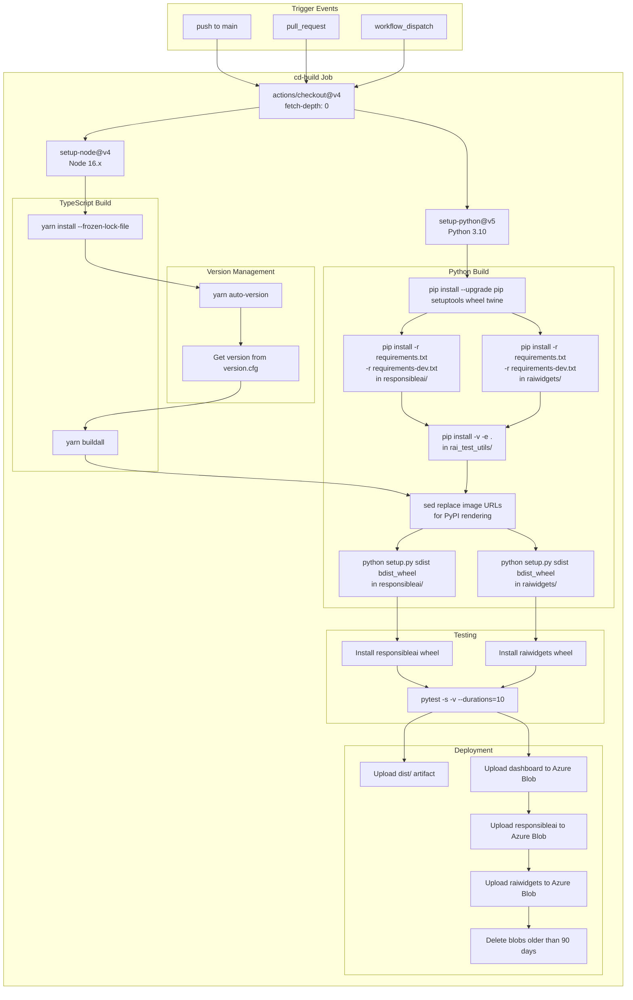
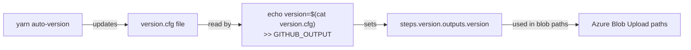
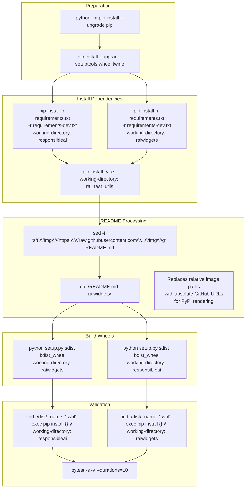
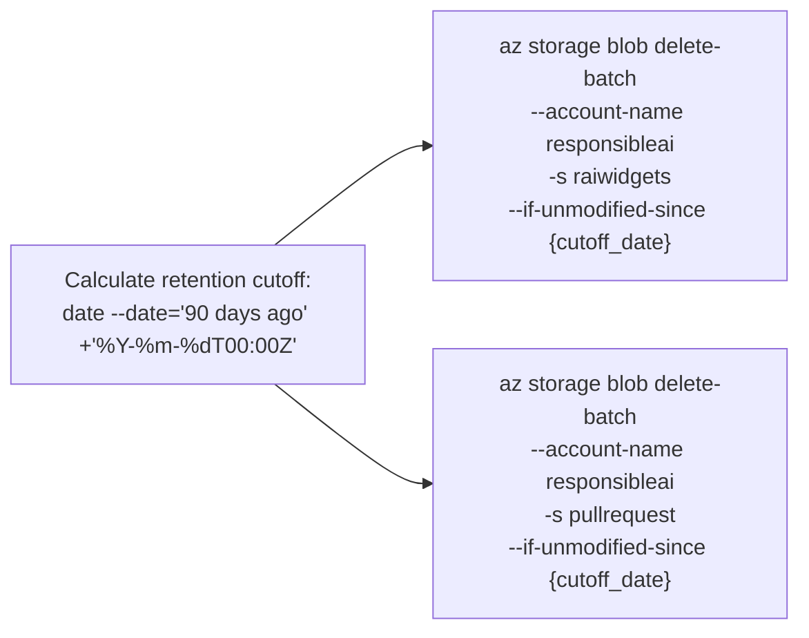
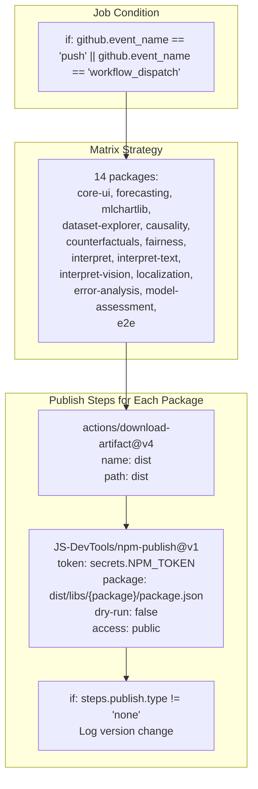
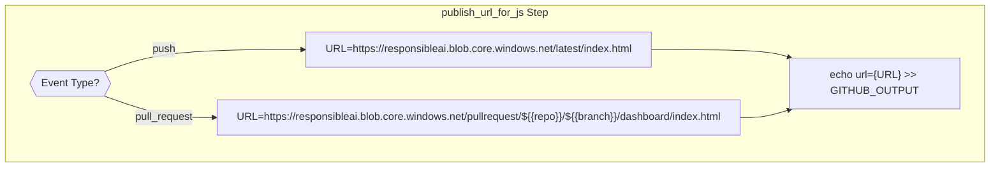

<!-- source: DeepWiki mcp.deepwiki.com · repo microsoft/responsible-ai-toolbox · extra page Build and Deployment · fetched 2026-10-26 -->

# Build and Deployment

<details>
<summary>Relevant source files</summary>

The following files were used as context for generating this wiki page:

- [.azure-devops/component-governance.yml](.azure-devops/component-governance.yml)
- [.github/workflows/CD.yml](.github/workflows/CD.yml)
- [.github/workflows/CI-codescan.yml](.github/workflows/CI-codescan.yml)
- [.github/workflows/CI-e2e-notebooks.yml](.github/workflows/CI-e2e-notebooks.yml)
- [.github/workflows/CI-notebook.yml](.github/workflows/CI-notebook.yml)
- [.github/workflows/CI-python.yml](.github/workflows/CI-python.yml)
- [.github/workflows/CI-rai_core_flask-pytest.yml](.github/workflows/CI-rai_core_flask-pytest.yml)
- [.github/workflows/CI-raiwidgets-pytest.yml](.github/workflows/CI-raiwidgets-pytest.yml)
- [.github/workflows/CI-typescript.yml](.github/workflows/CI-typescript.yml)
- [.github/workflows/GitHubPages.yml](.github/workflows/GitHubPages.yml)
- [.github/workflows/python-linting.yml](.github/workflows/python-linting.yml)
- [.github/workflows/release-rai-tabular.yml](.github/workflows/release-rai-tabular.yml)

</details>


## Purpose and Scope

This document describes the automatic build and deployment pipeline implemented in the CD (Continuous Deployment) workflow. This pipeline runs on every push to the `main` branch and on every pull request, building both TypeScript and Python artifacts and deploying them to appropriate locations for preview and production use.

For information about the manual release process to PyPI and NPM registries, see [Release Process](#7.2.4). For Python and TypeScript testing workflows, see [Python CI Workflows](#7.2.1) and [TypeScript CI Workflows](#7.2.2).

## Workflow Triggers and Jobs

The CD workflow is triggered by three events:

| Event Type | Branch | Purpose |
|------------|--------|---------|
| `push` | `main` | Build and deploy production artifacts to Azure Blob Storage and NPM |
| `pull_request` | `main` | Build and deploy preview artifacts for PR review |
| `workflow_dispatch` | any | Manual trigger for ad-hoc deployments |

The workflow consists of two sequential jobs: `cd-build` (always runs) and `cd-typescript-publish` (only runs on push to main or manual dispatch).

**Sources:** [.github/workflows/CD.yml:18-24]()

## CD Build Job Architecture



**Sources:** [.github/workflows/CD.yml:25-194]()

## Build Process Details

### Environment Configuration

The CD workflow defines several environment variables that control the build and deployment process:

| Variable | Value | Purpose |
|----------|-------|---------|
| `folder_to_upload` | `dist/apps/dashboard` | Dashboard build output location |
| `blob_account` | `responsibleai` | Azure Storage account name |
| `blob_container_for_pull_request` | `pullrequest` | Container for PR previews |
| `blob_container_for_js` | `latest` | Container for latest main builds |
| `blob_container_for_raiwidget` | `raiwidgets` | Container for Python packages |
| `blob_path_for_pull_request` | `${{ github.event.pull_request.head.repo.full_name }}/${{ github.head_ref }}` | Path structure for PR artifacts |
| `node-version` | `16.x` | Node.js version for builds |
| `retentionDays` | `90` | Days to retain artifacts in blob storage |

**Sources:** [.github/workflows/CD.yml:5-16]()

### Version Bumping

The workflow uses an automatic versioning system:



The version from `version.cfg` is used to organize artifacts in Azure Blob Storage under versioned directories.

**Sources:** [.github/workflows/CD.yml:63-67]()

### TypeScript Build Pipeline

The TypeScript build process follows these steps:

1. **Install yarn globally:** `npm install yarn -g`
2. **Install dependencies:** `yarn install --frozen-lock-file` (ensures reproducible builds)
3. **Build all libraries:** `yarn buildall` (compiles all 14 TypeScript libraries in the Nx monorepo)

The build produces artifacts in the `dist/` directory, including compiled libraries and the bundled dashboard application.

**Sources:** [.github/workflows/CD.yml:59-70]()

### Python Wheel Build Pipeline

The Python wheel build process is more complex and includes several validation steps:



The README processing step is critical for PyPI compatibility - it converts relative image paths to absolute GitHub URLs so that images render correctly on PyPI package pages.

**Sources:** [.github/workflows/CD.yml:73-118]()

## Deployment Targets

### Azure Blob Storage Deployment Strategy

The workflow uses Azure CLI to deploy artifacts to blob storage with different strategies based on the event type:

```mermaid
flowchart TB
    subgraph "Event-Based Routing"
        EventCheck{{"Event Type?"}}
        PushEvent["push to main"]
        PREvent["pull_request"]
    end
    
    subgraph "Push to Main Deployment"
        DashboardLatest["az storage blob sync<br/>-c latest<br/>-s dist/apps/dashboard<br/>responsibleai.blob.core.windows.net/latest/"]
        RAIVersioned["az storage blob sync<br/>-c raiwidgets<br/>-s responsibleai/dist/<br/>-d {version}/responsibleai<br/>responsibleai.blob.core.windows.net/raiwidgets/{version}/responsibleai/"]
        WidgetVersioned["az storage blob sync<br/>-c raiwidgets<br/>-s raiwidgets/dist/<br/>-d {version}/raiwidgets<br/>responsibleai.blob.core.windows.net/raiwidgets/{version}/raiwidgets/"]
    end
    
    subgraph "Pull Request Deployment"
        DashboardPR["az storage blob sync<br/>-c pullrequest<br/>-s dist/apps/dashboard<br/>-d {repo}/{branch}/dashboard<br/>responsibleai.blob.core.windows.net/pullrequest/{repo}/{branch}/dashboard/"]
        RAIPR["az storage blob sync<br/>-c pullrequest<br/>-s responsibleai/dist/<br/>-d {repo}/{branch}/responsibleai<br/>responsibleai.blob.core.windows.net/pullrequest/{repo}/{branch}/responsibleai/"]
        WidgetPR["az storage blob sync<br/>-c pullrequest<br/>-s raiwidgets/dist/<br/>-d {repo}/{branch}/raiwidgets<br/>responsibleai.blob.core.windows.net/pullrequest/{repo}/{branch}/raiwidgets/"]
    end
    
    subgraph "PR Comment"
        CommentOnPR["unsplash/comment-on-pr@master<br/>Posts URL to PR:<br/>https://responsibleai.blob.core.windows.net/pullrequest/{repo}/{branch}/dashboard/index.html"]
    end
    
    EventCheck -->|"push"| PushEvent
    EventCheck -->|"pull_request"| PREvent
    
    PushEvent --> DashboardLatest
    PushEvent --> RAIVersioned
    PushEvent --> WidgetVersioned
    
    PREvent --> DashboardPR
    PREvent --> RAIPR
    PREvent --> WidgetPR
    WidgetPR --> CommentOnPR
```



The workflow publishes URLs based on the event type:
- **Push to main:** `https://responsibleai.blob.core.windows.net/latest/index.html`
- **Pull request:** `https://responsibleai.blob.core.windows.net/pullrequest/{repo}/{branch}/dashboard/index.html`

**Sources:** [.github/workflows/CD.yml:46-58](), [.github/workflows/CD.yml:125-181]()

### Artifact Retention Policy

The workflow implements automatic cleanup to prevent unbounded storage growth:



This deletes any blobs in the `raiwidgets` and `pullrequest` containers that have not been modified in the last 90 days.

**Sources:** [.github/workflows/CD.yml:182-194]()

### NPM Publishing Workflow

The `cd-typescript-publish` job runs after `cd-build` completes, but only for push events or manual workflow dispatch:



Each package is published independently using the `JS-DevTools/npm-publish` action, which automatically detects if the version has changed and only publishes if needed.

**Sources:** [.github/workflows/CD.yml:196-243]()

## Deployment URLs and Paths

### URL Generation Logic

The workflow generates deployment URLs dynamically based on the event type:



**Sources:** [.github/workflows/CD.yml:46-57]()

### Storage Container Organization

| Container | Purpose | Path Structure | Retention |
|-----------|---------|----------------|-----------|
| `latest` | Current main branch dashboard | `index.html`, static assets | Permanent |
| `raiwidgets` | Versioned Python wheels | `{version}/responsibleai/`, `{version}/raiwidgets/` | 90 days |
| `pullrequest` | PR preview deployments | `{repo}/{branch}/dashboard/`, `{repo}/{branch}/responsibleai/`, `{repo}/{branch}/raiwidgets/` | 90 days |

## Build Artifacts

The workflow produces and uploads the following artifacts:

| Artifact Name | Contents | Purpose |
|---------------|----------|---------|
| `dist` | Entire `dist/` directory from TypeScript build | Contains all compiled libraries and dashboard, used by `cd-typescript-publish` job |

This artifact is created after tests pass and before Azure/NPM deployment:

**Sources:** [.github/workflows/CD.yml:119-123]()

## Error Handling and Retries

The workflow uses `continue-on-error: true` for Azure upload operations to prevent partial failures from blocking the entire deployment:

```yaml
- name: Upload dashboard
  uses: Azure/cli@v1.0.0
  id: uploaddashboard
  with:
    ...
  continue-on-error: true
```

Subsequent upload steps check the outcome:

```yaml
- if: ${{ (steps.uploaddashboard.outcome != 'failure') }}
  name: Upload responsible-ai
  ...
```

This ensures that if the dashboard upload fails, subsequent uploads are skipped rather than also failing.

**Sources:** [.github/workflows/CD.yml:125-140](), [.github/workflows/CD.yml:150-165]()

## Integration with PR Workflow

For pull requests, the workflow automatically posts a comment with the preview URL:

```yaml
- if: ${{ (github.event_name  == 'pull_request') && (steps.uploaddashboard.outcome != 'failure') }}
  uses: unsplash/comment-on-pr@master
  env:
    GITHUB_TOKEN: ${{ secrets.GITHUB_TOKEN }}
  with:
    msg: ${{steps.publish_url_for_js.outputs.url}}
    check_for_duplicate_msg: true
```

This allows reviewers to immediately access the deployed preview without manually constructing the URL. The `check_for_duplicate_msg` flag prevents posting multiple identical comments if the workflow runs multiple times.

**Sources:** [.github/workflows/CD.yml:142-148]()

---

