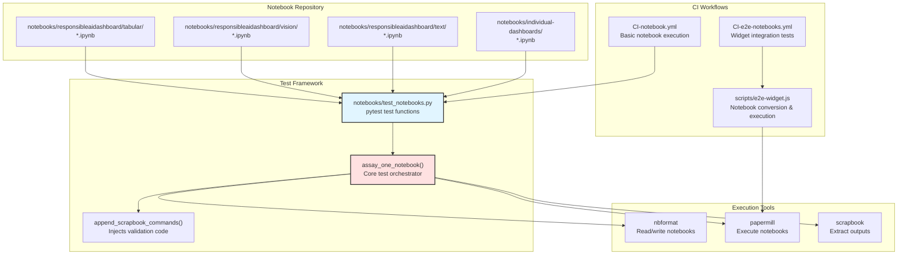
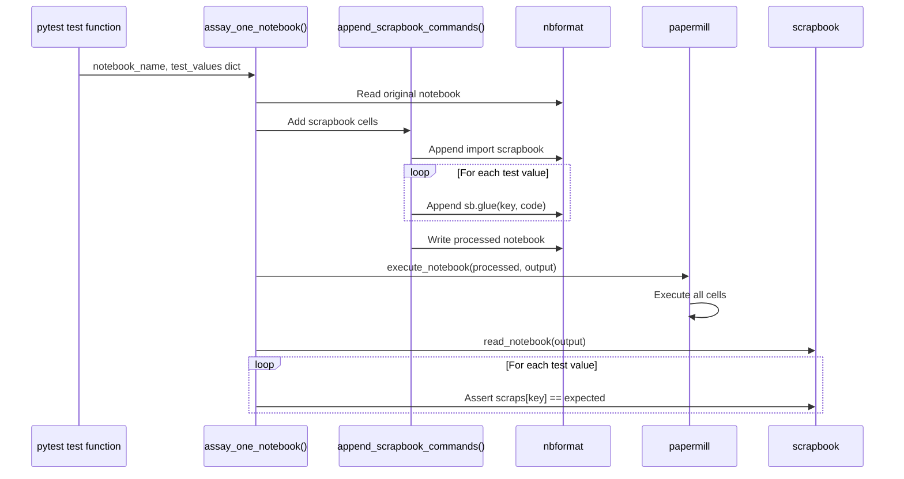
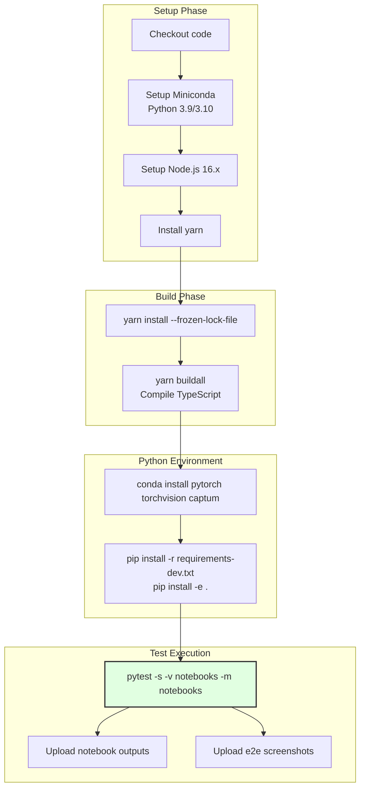
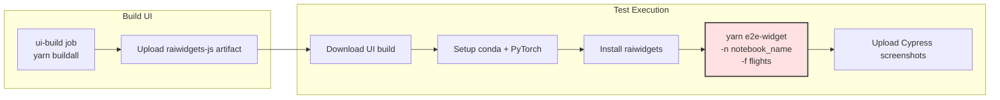
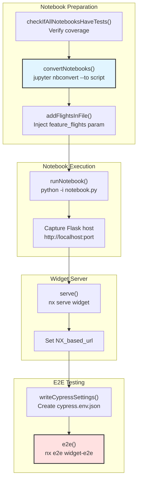
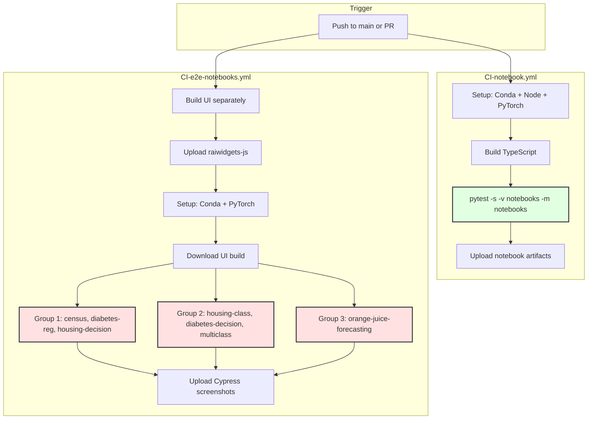

<!-- source: DeepWiki mcp.deepwiki.com · repo microsoft/responsible-ai-toolbox · extra page Notebook Tests · fetched 2026-10-26 -->

# Notebook Tests

<details>
<summary>Relevant source files</summary>

The following files were used as context for generating this wiki page:

- [.azure-devops/component-governance.yml](.azure-devops/component-governance.yml)
- [.github/workflows/CD.yml](.github/workflows/CD.yml)
- [.github/workflows/CI-codescan.yml](.github/workflows/CI-codescan.yml)
- [.github/workflows/CI-e2e-notebooks.yml](.github/workflows/CI-e2e-notebooks.yml)
- [.github/workflows/CI-notebook.yml](.github/workflows/CI-notebook.yml)
- [.github/workflows/CI-python.yml](.github/workflows/CI-python.yml)
- [.github/workflows/CI-rai_core_flask-pytest.yml](.github/workflows/CI-rai_core_flask-pytest.yml)
- [.github/workflows/CI-raiwidgets-pytest.yml](.github/workflows/CI-raiwidgets-pytest.yml)
- [.github/workflows/CI-typescript.yml](.github/workflows/CI-typescript.yml)
- [.github/workflows/GitHubPages.yml](.github/workflows/GitHubPages.yml)
- [.github/workflows/python-linting.yml](.github/workflows/python-linting.yml)
- [.github/workflows/release-rai-tabular.yml](.github/workflows/release-rai-tabular.yml)
- [README.md](README.md)
- [notebooks/responsibleaidashboard/text/responsibleaidashboard-openai-model-debugging.ipynb](notebooks/responsibleaidashboard/text/responsibleaidashboard-openai-model-debugging.ipynb)
- [notebooks/test_notebooks.py](notebooks/test_notebooks.py)
- [scripts/e2e-widget.js](scripts/e2e-widget.js)

</details>


This page documents the notebook testing infrastructure used to validate example notebooks and ensure they execute correctly. Notebook tests verify that demonstration notebooks work end-to-end with the RAI Toolbox components.

For Python unit tests of the core packages, see [Python Unit and Integration Tests](#7.1.1). For E2E widget integration tests using Cypress, see [End-to-End Tests](#7.1.4).

## Purpose and Scope

The Responsible AI Toolbox includes numerous Jupyter notebooks demonstrating usage patterns across tabular, vision, and text scenarios. These notebooks serve as both documentation and integration tests. The notebook testing system:

- **Validates notebook execution**: Ensures all cells execute without errors
- **Checks computed outputs**: Verifies that specific values match expected results
- **Tests across modalities**: Covers tabular, vision, and text notebooks
- **Integrates with CI/CD**: Runs automatically on every pull request and push

Notebook tests are distinct from unit tests (which test individual functions) and E2E tests (which test the interactive dashboard UI). They focus on validating the complete user workflow from data loading through dashboard visualization.

## Testing Architecture Overview



**Sources:** [notebooks/test_notebooks.py:1-361](), [.github/workflows/CI-notebook.yml:1-101](), [.github/workflows/CI-e2e-notebooks.yml:1-148]()

## Notebook Test Framework

The testing framework uses three libraries to validate notebooks:

### Core Testing Components

| Component | Purpose | Usage |
|-----------|---------|-------|
| **nbformat** | Read and write Jupyter notebook files | Append test cells to notebooks before execution |
| **papermill** | Execute notebooks programmatically | Run notebooks with parameter injection |
| **scrapbook** (nteract-scrapbook) | Store and retrieve notebook outputs | Glue values during execution, assert in tests |

### Test Execution Pattern

The `assay_one_notebook()` function implements the core testing pattern:



**Sources:** [notebooks/test_notebooks.py:52-102]()

### ScrapSpec Data Structure

Tests define expected values using the `ScrapSpec` class:

```python
# From test_notebooks.py
class ScrapSpec:
    code: str      # Python code to execute (e.g., "X_raw['race'].value_counts().to_dict()")
    expected: Any  # Expected result to assert against
```

The `code` field is injected into the notebook as `sb.glue(key, <code>)`. After execution, the test asserts that the scrapbook value matches `expected`.

**Example from a fairness test:**

```python
test_values = {}
test_values["race_group_sizes"] = ScrapSpec(
    "X_raw['race'].value_counts().to_dict()",
    RACE_GROUP_SIZES_ADULT  # Expected dictionary
)
test_values["dominant_models"] = ScrapSpec(
    "list(dominant_all.keys())",
    ['unmitigated', 'grid_28', 'grid_29', ...]
)
```

**Sources:** [notebooks/test_notebooks.py:28-50](), [notebooks/test_notebooks.py:105-124]()

## CI Notebook Testing Workflow

### Basic Notebook Tests (CI-notebook.yml)

The `CI-notebook.yml` workflow runs on every push and pull request:



**Matrix Configuration:**
- **Operating Systems:** ubuntu-latest, windows-latest
- **Python Versions:** 3.9, 3.10
- **Total Combinations:** 4 (2 OS × 2 Python versions)

**Sources:** [.github/workflows/CI-notebook.yml:1-101]()

### E2E Notebook Tests (CI-e2e-notebooks.yml)

The E2E notebook workflow tests interactive dashboard functionality:



**Matrix Configuration:**
- **Operating Systems:** ubuntu-latest, windows-latest
- **Python Versions:** 3.9, 3.10
- **Feature Flights:** `""` (no flights), `"dataBalanceExperience"`
- **Notebook Groups:** `nb_group_1`, `nb_group_2`, `nb_group_3`

**Notebook Groups:**
- **nb_group_1:** census-classification, diabetes-regression, housing-decision-making
- **nb_group_2:** housing-classification, diabetes-decision-making, multiclass-dnn
- **nb_group_3:** orange-juice-forecasting

**Sources:** [.github/workflows/CI-e2e-notebooks.yml:39-148]()

## E2E Widget Test Script

The `scripts/e2e-widget.js` script orchestrates notebook-based widget testing:

### Script Workflow



**Sources:** [scripts/e2e-widget.js:1-399]()

### Key Functions

| Function | Purpose | Location |
|----------|---------|----------|
| `checkIfAllNotebooksHaveTests()` | Ensures all notebooks have corresponding tests | [scripts/e2e-widget.js:177-190]() |
| `convertNotebooks()` | Converts `.ipynb` to `.py` using `jupyter nbconvert` | [scripts/e2e-widget.js:192-224]() |
| `addFlightsInFile()` | Injects `feature_flights` parameter into ResponsibleAIDashboard calls | [scripts/e2e-widget.js:145-175]() |
| `runNotebooks()` | Spawns Python process and captures Flask host URL | [scripts/e2e-widget.js:233-261]() |
| `serve()` | Starts development server with custom base URL | [scripts/e2e-widget.js:78-109]() |
| `e2e()` | Executes Cypress tests with notebook-specific specs | [scripts/e2e-widget.js:276-322]() |

**Sources:** [scripts/e2e-widget.js:1-399]()

### Notebook-to-Test Mapping

The script maintains lists of notebooks that must have tests:

```javascript
// Tabular notebooks
const tabularFileNames = [
  "responsibleaidashboard-census-classification-model-debugging",
  "responsibleaidashboard-diabetes-regression-model-debugging",
  "responsibleaidashboard-housing-classification-model-debugging",
  "responsibleaidashboard-diabetes-decision-making",
  "responsibleaidashboard-housing-decision-making",
  "responsibleaidashboard-multiclass-dnn-model-debugging",
  "responsibleaidashboard-orange-juice-forecasting"
];

// Vision notebooks
const visionFileNames = [
  "responsibleaidashboard-fridge-image-classification-model-debugging",
  "responsibleaidashboard-fridge-multilabel-image-classification-model-debugging",
  "responsibleaidashboard-fridge-object-detection-model-debugging"
];

// Text notebooks
const textFileNames = [
  "responsibleaidashboard-DBPedia-text-classification-model-debugging",
  "responsibleaidashboard-blbooksgenre-binary-text-classification-model-debugging",
  "responsibleaidashboard-covid-event-multilabel-text-classification-model-debugging"
];
```

**Sources:** [scripts/e2e-widget.js:14-41]()

## Notebook Organization

Notebooks are organized by modality and purpose:

```mermaid
graph TB
    subgraph "notebooks/"
        Tabular["responsibleaidashboard/tabular/<br/>13 notebooks"]
        Vision["responsibleaidashboard/vision/<br/>3 notebooks"]
        Text["responsibleaidashboard/text/<br/>5 notebooks"]
        Individual["individual-dashboards/<br/>Legacy dashboards"]
    end
    
    subgraph "Tabular Notebooks"
        TabularClass["Classification:<br/>census, housing, multiclass-dnn"]
        TabularReg["Regression:<br/>diabetes-regression"]
        TabularDecision["Decision Making:<br/>diabetes-decision, housing-decision"]
        TabularForecast["Forecasting:<br/>orange-juice-forecasting"]
    end
    
    subgraph "Vision Notebooks"
        VisionClass["Image Classification:<br/>fridge-image-classification"]
        VisionMulti["Multilabel Classification:<br/>fridge-multilabel"]
        VisionOD["Object Detection:<br/>fridge-object-detection"]
    end
    
    subgraph "Text Notebooks"
        TextClass["Text Classification:<br/>DBPedia, blbooksgenre, covid"]
        TextQA["Question Answering:<br/>question-answering, openai"]
    end
    
    Tabular --> TabularClass
    Tabular --> TabularReg
    Tabular --> TabularDecision
    Tabular --> TabularForecast
    
    Vision --> VisionClass
    Vision --> VisionMulti
    Vision --> VisionOD
    
    Text --> TextClass
    Text --> TextQA
    
    style Tabular fill:#e1f5ff,stroke:#333,stroke-width:2px
    style Vision fill:#ffe1e1,stroke:#333,stroke-width:2px
    style Text fill:#fff5e1,stroke:#333,stroke-width:2px
```



**Sources:** [notebooks/test_notebooks.py:18-25](), [scripts/e2e-widget.js:9-41]()

### Pytest Markers

Notebooks are categorized using pytest markers:

| Marker | Purpose | Notebooks |
|--------|---------|-----------|
| `@pytest.mark.notebooks` | General notebook tests | Tabular, fairness, error analysis notebooks |
| `@pytest.mark.vision_notebooks` | Vision-specific tests | Requires PyTorch, torchvision, vision datasets |
| `@pytest.mark.text_notebooks` | Text/NLP-specific tests | Requires transformers, spacy, text datasets |

**Usage in CI:**
```bash
# Run only general notebooks
pytest -s -v notebooks -m notebooks

# Run vision notebooks
pytest -s -v notebooks -m vision_notebooks

# Run text notebooks
pytest -s -v notebooks -m text_notebooks
```

**Sources:** [notebooks/test_notebooks.py:104-361]()

## Writing Notebook Tests

### Step 1: Create Test Function

Add a test function to `notebooks/test_notebooks.py`:

```python
@pytest.mark.notebooks  # or vision_notebooks, text_notebooks
def test_responsibleaidashboard_my_new_notebook():
    nb_path = TABULAR  # or VISION, TEXT
    nb_name = "responsibleaidashboard-my-new-notebook"
    
    test_values = {}
    # Add assertions here
    
    assay_one_notebook(nb_path, nb_name, test_values)
```

**Sources:** [notebooks/test_notebooks.py:210-216]()

### Step 2: Define Test Values

Specify values to validate using `ScrapSpec`:

```python
test_values = {}

# Example: Check a dataframe shape
test_values["data_shape"] = ScrapSpec(
    "data.shape",
    (1000, 10)  # Expected: 1000 rows, 10 columns
)

# Example: Check a dictionary
test_values["class_counts"] = ScrapSpec(
    "y_train.value_counts().to_dict()",
    {'Class_A': 500, 'Class_B': 500}
)

# Example: Check list of keys
test_values["model_features"] = ScrapSpec(
    "list(model.feature_names_)",
    ['feature1', 'feature2', 'feature3']
)
```

The `code` string is executed in the notebook's namespace, and the result is compared against `expected`.

**Sources:** [notebooks/test_notebooks.py:111-151]()

### Step 3: Add to E2E Test List

If the notebook uses the interactive dashboard, add it to `scripts/e2e-widget.js`:

```javascript
// Add to appropriate list
const tabularFileNames = [
  // ... existing notebooks
  "responsibleaidashboard-my-new-notebook"
];
```

And add to the CI workflow in `.github/workflows/CI-e2e-notebooks.yml`:

```yaml
- if: ${{ matrix.notebookGroup == 'nb_group_1'}}
  name: Run widget tests
  shell: bash -l {0}
  run: |
    yarn e2e-widget -n "responsibleaidashboard-my-new-notebook" -f ${{ matrix.flights }}
```

**Sources:** [scripts/e2e-widget.js:16-24](), [.github/workflows/CI-e2e-notebooks.yml:120-127]()

### Step 4: Directory Structure

Ensure notebook files follow the expected structure:

```
notebooks/
├── responsibleaidashboard/
│   ├── tabular/
│   │   └── responsibleaidashboard-my-new-notebook.ipynb
│   ├── vision/
│   └── text/
├── processed/  # Generated during test execution
│   ├── responsibleaidashboard/tabular/
│   │   ├── responsibleaidashboard-my-new-notebook.processed.ipynb
│   │   └── responsibleaidashboard-my-new-notebook.output.ipynb
└── test_notebooks.py
```

The `processed/` directory is created automatically by `assay_one_notebook()` and contains intermediate files.

**Sources:** [notebooks/test_notebooks.py:87-94]()

## Test Execution Flow

### Local Development

```bash
# Run all notebook tests
pytest notebooks/test_notebooks.py -v

# Run specific test
pytest notebooks/test_notebooks.py::test_responsibleaidashboard_census_classification_model_debugging -v

# Run with specific marker
pytest notebooks/ -m notebooks -v
pytest notebooks/ -m vision_notebooks -v
pytest notebooks/ -m text_notebooks -v

# Run E2E widget test for specific notebook
yarn e2e-widget -n "responsibleaidashboard-census-classification-model-debugging"

# Run with feature flights
yarn e2e-widget -n "responsibleaidashboard-census-classification-model-debugging" -f "dataBalanceExperience"

# Watch mode for development
yarn e2e-widget -n "responsibleaidashboard-census-classification-model-debugging" --watch
```

**Sources:** [.github/workflows/CI-notebook.yml:84-86](), [.github/workflows/CI-e2e-notebooks.yml:124-140]()

### CI Execution

The complete test flow in CI:



**Sources:** [.github/workflows/CI-notebook.yml:1-101](), [.github/workflows/CI-e2e-notebooks.yml:1-148]()

## Artifact Management

Both workflows upload artifacts for debugging:

### CI-notebook.yml Artifacts

| Artifact | Content | Condition |
|----------|---------|-----------|
| `requirements-dev.txt` | Frozen pip dependencies | Windows + Python 3.9 only |
| `notebook-test-{OS}-{Python}` | Executed notebook outputs | Always |
| `raiwidgets-ci-notebook-screen-shot-{OS}-{Python}` | Cypress screenshots | Always |

**Sources:** [.github/workflows/CI-notebook.yml:77-100]()

### CI-e2e-notebooks.yml Artifacts

| Artifact | Content | Condition |
|----------|---------|-----------|
| `raiwidgets-js` | Compiled TypeScript dashboard | From ui-build job |
| `requirements-dev.txt` | Frozen pip dependencies | Windows + Python 3.9 + no flights + group 1 |
| `raiwidgets-ci-e2e-notebooks-screen-shot-{group}-{flights}-{OS}-{Python}` | Cypress screenshots | Always |

**Sources:** [.github/workflows/CI-e2e-notebooks.yml:33-147]()

## Special Cases

### Ignored Notebooks

Some notebooks are excluded from automated testing:

```javascript
const ignoredFiles = [
  "responsibleaidashboard-question-answering-model-debugging",
  "responsibleaidashboard-openai-model-debugging"
];
```

These notebooks require external API keys or resources that cannot be provided in CI environments.

**Sources:** [scripts/e2e-widget.js:35-38](), [notebooks/responsibleaidashboard/text/responsibleaidashboard-openai-model-debugging.ipynb:1-381]()

### Feature Flights

The E2E tests support feature flags (flights) to test experimental features:

```bash
# No flights (default behavior)
yarn e2e-widget -n "notebook-name" -f ""

# With dataBalanceExperience flight
yarn e2e-widget -n "notebook-name" -f "dataBalanceExperience"

# Multiple flights (comma-separated)
yarn e2e-widget -n "notebook-name" -f "flight1,flight2"
```

Flights are injected into notebooks by modifying `ResponsibleAIDashboard()` calls:

```python
# Original
ResponsibleAIDashboard(rai_insights)

# With flights injected
ResponsibleAIDashboard(rai_insights, feature_flights="dataBalanceExperience")
```

**Sources:** [scripts/e2e-widget.js:145-175](), [.github/workflows/CI-e2e-notebooks.yml:51-57]()

### Platform-Specific Setup

Different operating systems require different setup:

**macOS:**
```bash
brew install libomp  # For LightGBM
conda install pytorch torchvision captum -c pytorch  # No cpuonly
```

**Ubuntu/Windows:**
```bash
conda install pytorch torchvision captum cpuonly -c pytorch
```

**Sources:** [.github/workflows/CI-notebook.yml:44-54](), [.github/workflows/CI-e2e-notebooks.yml:86-89]()

---

