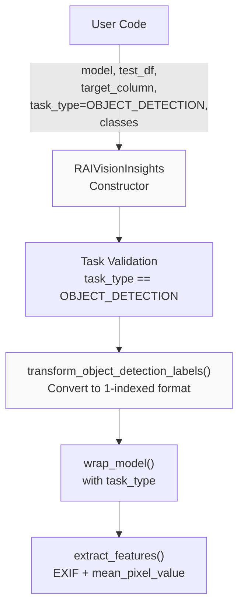
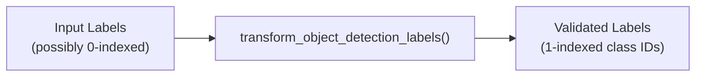
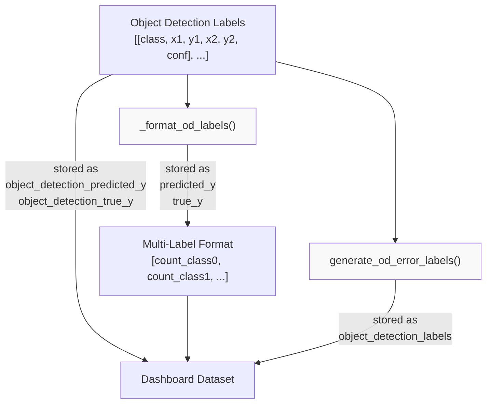
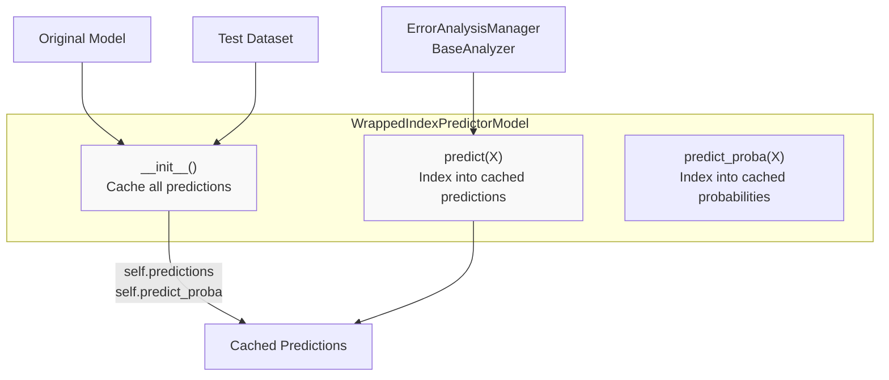
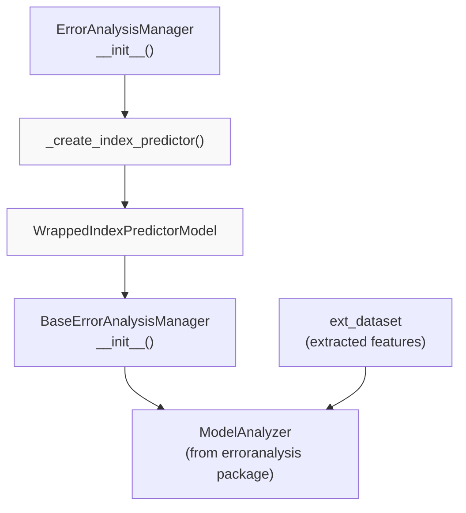
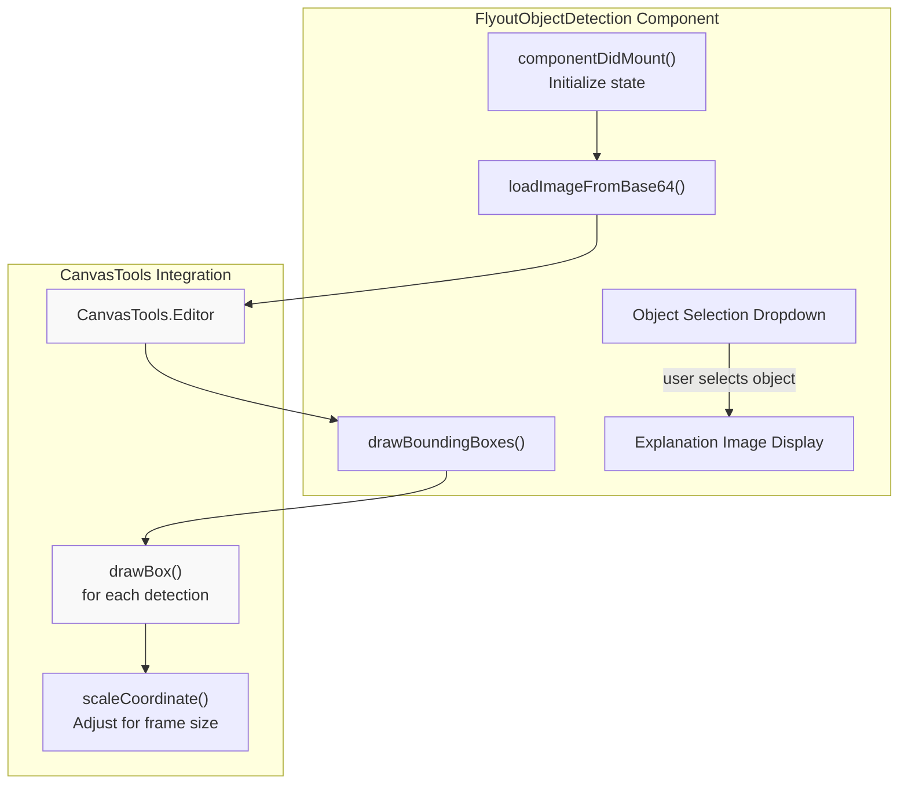
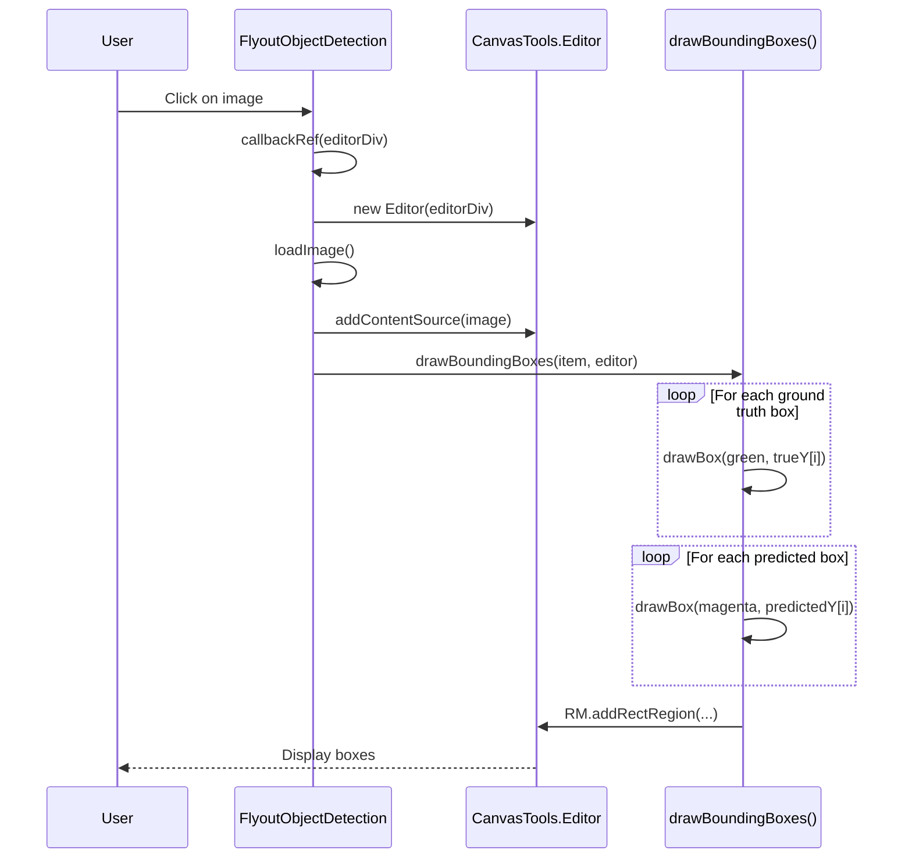
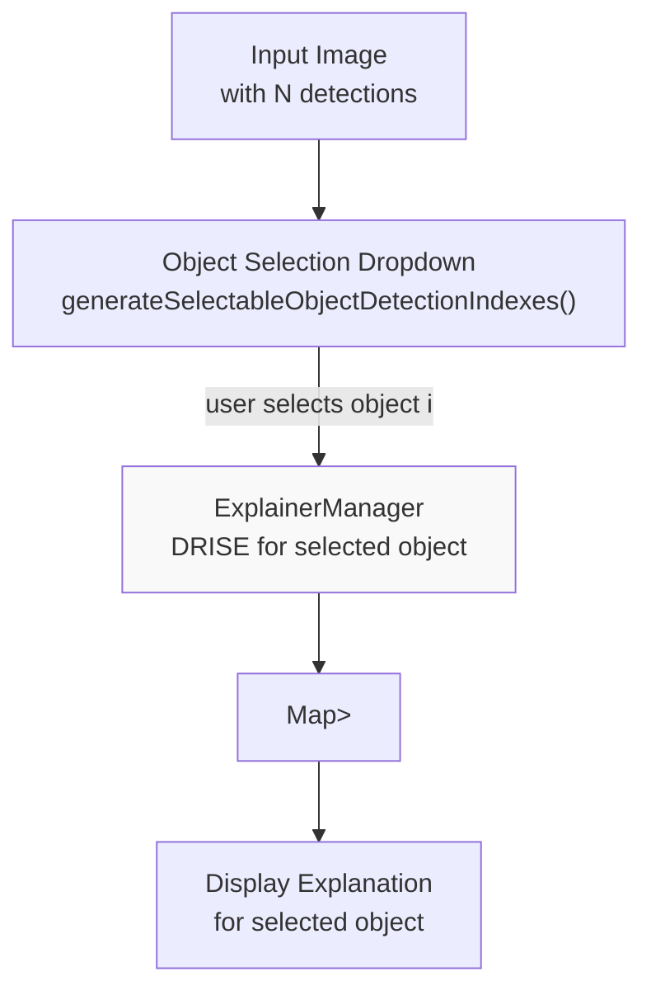
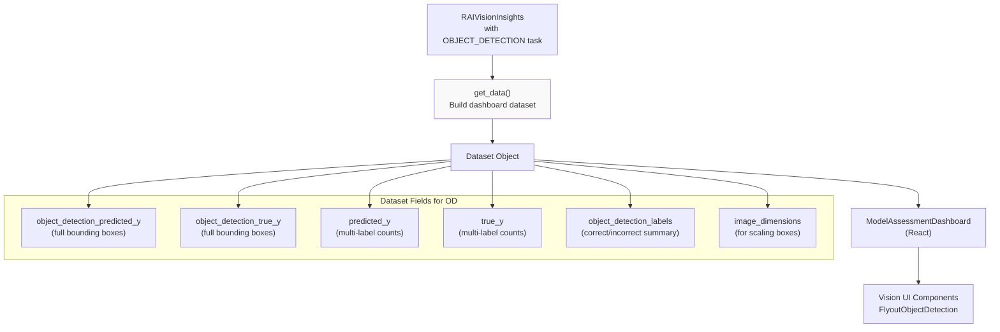

<!-- source: DeepWiki mcp.deepwiki.com · repo microsoft/responsible-ai-toolbox · extra page Object Detection Support · fetched 2026-10-26 -->

# Object Detection Support

<details>
<summary>Relevant source files</summary>

The following files were used as context for generating this wiki page:

- [apps/dashboard/src/app/visionApplications.ts](apps/dashboard/src/app/visionApplications.ts)
- [apps/dashboard/src/model-assessment-vision/__mock_data__/fridgeObjectDetection.ts](apps/dashboard/src/model-assessment-vision/__mock_data__/fridgeObjectDetection.ts)
- [apps/dashboard/src/model-assessment-vision/__mock_data__/fridgeObjectDetectionImages.ts](apps/dashboard/src/model-assessment-vision/__mock_data__/fridgeObjectDetectionImages.ts)
- [libs/core-ui/src/lib/Interfaces/IVisionModelExplanationData.ts](libs/core-ui/src/lib/Interfaces/IVisionModelExplanationData.ts)
- [libs/interpret-vision/src/lib/VisionExplanationDashboard/Controls/DetectionDetails.tsx](libs/interpret-vision/src/lib/VisionExplanationDashboard/Controls/DetectionDetails.tsx)
- [libs/interpret-vision/src/lib/VisionExplanationDashboard/Controls/FlyoutObjectDetection.tsx](libs/interpret-vision/src/lib/VisionExplanationDashboard/Controls/FlyoutObjectDetection.tsx)
- [libs/interpret-vision/src/lib/VisionExplanationDashboard/Controls/FlyoutObjectDetectionUtils.tsx](libs/interpret-vision/src/lib/VisionExplanationDashboard/Controls/FlyoutObjectDetectionUtils.tsx)
- [libs/interpret-vision/src/lib/VisionExplanationDashboard/utils/FlyoutUtils.tsx](libs/interpret-vision/src/lib/VisionExplanationDashboard/utils/FlyoutUtils.tsx)
- [notebooks/individual-dashboards/erroranalysis-dashboard/erroranalysis-dashboard-regression-superconductor.ipynb](notebooks/individual-dashboards/erroranalysis-dashboard/erroranalysis-dashboard-regression-superconductor.ipynb)
- [responsibleai_text/tests/test_rai_text_insights_save_and_load_scenarios.py](responsibleai_text/tests/test_rai_text_insights_save_and_load_scenarios.py)
- [responsibleai_vision/responsibleai_vision/common/constants.py](responsibleai_vision/responsibleai_vision/common/constants.py)
- [responsibleai_vision/responsibleai_vision/managers/error_analysis_manager.py](responsibleai_vision/responsibleai_vision/managers/error_analysis_manager.py)
- [responsibleai_vision/responsibleai_vision/rai_vision_insights/rai_vision_insights.py](responsibleai_vision/responsibleai_vision/rai_vision_insights/rai_vision_insights.py)
- [responsibleai_vision/tests/rai_vision_insights_validator.py](responsibleai_vision/tests/rai_vision_insights_validator.py)
- [responsibleai_vision/tests/test_rai_vision_insights.py](responsibleai_vision/tests/test_rai_vision_insights.py)
- [responsibleai_vision/tests/test_rai_vision_insights_save_and_load_scenarios.py](responsibleai_vision/tests/test_rai_vision_insights_save_and_load_scenarios.py)

</details>


## Purpose and Scope

This page documents how the `responsibleai_vision` package handles **object detection** tasks, including data format requirements, label transformations, error analysis, metrics computation, and UI visualization. Object detection differs from image classification in that models predict multiple objects per image, each with a class label, bounding box coordinates, and confidence score.

For general vision support and the main API, see [RAIVisionInsights API](#5.1.1). For vision-specific UI components beyond object detection, see [Vision UI Components](#5.1.3).

---

## Object Detection Data Format

### Bounding Box Representation

Object detection labels and predictions follow a specific format where each detection is represented as a 6-element array:

```
[class_id, x_min, y_min, x_max, y_max, confidence_score]
```

- **class_id**: 1-indexed integer identifying the object class
- **x_min, y_min**: Top-left corner coordinates of bounding box
- **x_max, y_max**: Bottom-right corner coordinates of bounding box  
- **confidence_score**: Model confidence (0-1) for predictions, or 0 for ground truth

Each image can have multiple detections represented as a list of these arrays. The dataset structure includes:

| Field | Type | Description |
|-------|------|-------------|
| `image` or `image_url` | str | Path or URL to image file |
| `label` | list[list[float]] | Ground truth bounding boxes |
| Other columns | various | Optional metadata (EXIF data, etc.) |

**Sources:** [responsibleai_vision/responsibleai_vision/rai_vision_insights/rai_vision_insights.py:256-258](), [apps/dashboard/src/model-assessment-vision/__mock_data__/fridgeObjectDetection.ts:181-202]()

---

## RAIVisionInsights Initialization for Object Detection

### Basic Initialization



**Object Detection Initialization with DRISE Parameters**

The object detection task requires additional parameters for the DRISE explainability method:

| Parameter | Default | Description |
|-----------|---------|-------------|
| `num_masks` | 50 | Number of masks for DRISE explainer |
| `mask_res` | 4 | Resolution of masks for DRISE |
| `max_evals` | 100 | Maximum evaluations (inherited) |
| `device` | 'auto' | Device for model inference |

**Sources:** [responsibleai_vision/responsibleai_vision/rai_vision_insights/rai_vision_insights.py:126-141](), [responsibleai_vision/responsibleai_vision/rai_vision_insights/rai_vision_insights.py:256-258](), [responsibleai_vision/responsibleai_vision/common/constants.py:70-80]()

### Task Validation

Object detection is validated as one of the supported vision tasks:

```python
valid_tasks = [
    ModelTask.IMAGE_CLASSIFICATION.value,
    ModelTask.MULTILABEL_IMAGE_CLASSIFICATION.value,
    ModelTask.OBJECT_DETECTION.value
]
```

**Sources:** [responsibleai_vision/responsibleai_vision/rai_vision_insights/rai_vision_insights.py:355-364]()

---

## Label Transformation and Formatting

### Transform to 1-Indexed Format

Upon initialization, object detection labels are transformed to ensure class IDs are 1-indexed:



**Sources:** [responsibleai_vision/responsibleai_vision/rai_vision_insights/rai_vision_insights.py:256-258]()

### Dual Label Representation

For dashboard compatibility, object detection data maintains two representations:



**The `_format_od_labels()` Method**

This method converts bounding box detections to a multi-label count representation:

```python
# For each image
for image in y:
    object_labels_lst = [0] * len(class_names)
    for detection in image:
        # Count objects of each class
        object_index = int(detection[0] - 1)
        object_labels_lst[object_index] += 1
    formatted_labels.append(object_labels_lst)
```

**Example transformation:**
- Input: `[[1, 100, 200, 300, 400, 0.95], [2, 100, 200, 300, 400, 0.95], [1, ...]]`
- Classes: `['can', 'carton', 'milk_bottle', 'water_bottle']`
- Output: `[2, 1, 0, 0]` (2 cans, 1 carton, 0 milk bottles, 0 water bottles)

**Sources:** [responsibleai_vision/responsibleai_vision/rai_vision_insights/rai_vision_insights.py:706-728](), [responsibleai_vision/responsibleai_vision/rai_vision_insights/rai_vision_insights.py:683-703]()

---

## Error Analysis for Object Detection

### Index-Based Prediction Wrapper

Object detection models use a specialized wrapper that caches predictions and retrieves them by index:



**Key Features:**

1. **Prediction Caching**: All predictions are computed once during initialization
2. **Index-Based Retrieval**: The `predict()` method uses DataFrame index to retrieve cached results
3. **Task-Specific Formatting**: Predictions maintain original bounding box format for OD tasks

**Sources:** [responsibleai_vision/responsibleai_vision/managers/error_analysis_manager.py:50-162]()

### Error Analysis Manager Initialization



**Sources:** [responsibleai_vision/responsibleai_vision/managers/error_analysis_manager.py:164-219](), [responsibleai_vision/responsibleai_vision/managers/error_analysis_manager.py:230-261]()

---

## Object Detection Metrics Computation

### Metrics API

The `compute_object_detection_metrics()` method computes evaluation metrics for object detection:

| Parameter | Type | Description |
|-----------|------|-------------|
| `selection_indexes` | list[list[int]] | Image indices to compute metrics for |
| `aggregate_method` | str | 'macro' or 'micro' averaging |
| `class_name` | str | Class to compute metrics for |
| `iou_threshold` | float | IoU threshold (0-100) for matching |
| `object_detection_cache` | dict | Cache for expensive computations |

**Metrics Computed:**

The method uses **torchmetrics.detection.mean_ap.MeanAveragePrecision** to compute:
- Mean Average Precision (mAP)
- Precision and Recall at various IoU thresholds
- Per-class performance metrics

**Sources:** [responsibleai_vision/responsibleai_vision/rai_vision_insights/rai_vision_insights.py:23](), [responsibleai_vision/tests/test_rai_vision_insights.py:341-351]()

---

## UI Visualization with Bounding Boxes

### FlyoutObjectDetection Component

The object detection flyout provides interactive visualization of detections with bounding boxes:



**Bounding Box Drawing Algorithm**

The `drawBox()` function scales coordinates and draws boxes using the VoTT CanvasTools library:

1. **Retrieve frame and image dimensions**
2. **Scale coordinates** from image space to canvas space using `scaleCoordinate()`
3. **Create RegionData** for the bounding box rectangle
4. **Apply color coding**:
   - Green (`theme.palette.green`) for ground truth boxes
   - Magenta (`theme.palette.magenta`) for predicted boxes
5. **Add annotation** with class name and confidence score (for predictions)

**Sources:** [libs/interpret-vision/src/lib/VisionExplanationDashboard/Controls/FlyoutObjectDetection.tsx:36-286](), [libs/interpret-vision/src/lib/VisionExplanationDashboard/Controls/FlyoutObjectDetectionUtils.tsx:94-209]()

### Drawing Flow



**Sources:** [libs/interpret-vision/src/lib/VisionExplanationDashboard/Controls/FlyoutObjectDetection.tsx:261-285](), [libs/interpret-vision/src/lib/VisionExplanationDashboard/Controls/FlyoutObjectDetectionUtils.tsx:138-208]()

### Coordinate Scaling

Bounding box coordinates must be scaled from the original image dimensions to the canvas frame dimensions:

```typescript
scaleCoordinate = (
  coordinate: number,
  imageDim: number,
  frameDim: number
): number => (coordinate / imageDim) * frameDim;
```

**Sources:** [libs/interpret-vision/src/lib/VisionExplanationDashboard/Controls/FlyoutObjectDetectionUtils.tsx:132-136]()

---

## Explanations for Object Detection

### DRISE Explainability Method

Object detection explanations use the **DRISE** (Detector Randomized Input Sampling for Explanation) method, which requires specific parameters:

| Parameter | Purpose |
|-----------|---------|
| `num_masks` | Number of random masks to generate for perturbation |
| `mask_res` | Resolution (grid size) of each mask |

**Parameter Validation:**

```python
if num_masks is None:
    num_masks = DEFAULT_NUM_MASKS  # 50
elif num_masks < 1:
    raise ValueError('num_masks must be greater than 0')

if mask_res is None:
    mask_res = DEFAULT_MASK_RES  # 4
elif mask_res < 1:
    raise ValueError('mask_res must be greater than 0')
```

**Sources:** [responsibleai_vision/responsibleai_vision/rai_vision_insights/rai_vision_insights.py:217-223](), [responsibleai_vision/tests/test_rai_vision_insights.py:109-122](), [responsibleai_vision/tests/test_rai_vision_insights.py:163-185]()

### Per-Object Explanations

Unlike image classification which provides one explanation per image, object detection generates **one explanation per detected object**:



**Object Selection UI:**

The dropdown is populated with entries like `"0: can"`, `"1: milk_bottle"`, etc., where the number is the object index within that image:

```typescript
for (let i = 0; i < Object.values(temp).length; i++) {
  const className = classNames[temp[i][0] - 1];
  selectableObjectIndexes.push({
    key: prefix + String(i),
    text: String(i) + String(": ") + className
  });
}
```

**Sources:** [libs/interpret-vision/src/lib/VisionExplanationDashboard/Controls/FlyoutObjectDetection.tsx:179-200](), [libs/interpret-vision/src/lib/VisionExplanationDashboard/utils/FlyoutUtils.tsx:35-52](), [libs/interpret-vision/src/lib/VisionExplanationDashboard/Controls/FlyoutObjectDetection.tsx:201-234]()

---

## Test Data and Mock Examples

### Fridge Object Detection Dataset

The test suite and mock data use a "fridge" dataset with 4 classes detecting common objects in refrigerators:

```typescript
class_names: ["can", "carton", "milk_bottle", "water_bottle"]
```

**Mock Data Structure:**

```typescript
{
  object_detection_predicted_y: [
    [
      [3, 37.83, 312.56, 323.29, 420.73, 0.987],  // milk_bottle
      [1, 314.44, 283.42, 449.13, 453.67, 0.984]  // can
    ],
    // ... more images
  ],
  object_detection_true_y: [
    [
      [3, 35, 314, 324, 416, 0],
      [1, 313, 281, 449, 456, 0]
    ],
    // ... more images
  ],
  predicted_y: [
    [1, 0, 1, 0],  // Multi-label format: 1 can, 0 cartons, 1 milk_bottle, 0 water_bottles
    // ... more images
  ]
}
```

**Sources:** [apps/dashboard/src/model-assessment-vision/__mock_data__/fridgeObjectDetection.ts:8-219](), [responsibleai_vision/tests/test_rai_vision_insights.py:111-122]()

---

## Integration with Model Assessment Dashboard

### Data Flow



**Sources:** [responsibleai_vision/responsibleai_vision/rai_vision_insights/rai_vision_insights.py:683-703](), [responsibleai_vision/responsibleai_vision/rai_vision_insights/rai_vision_insights.py:677-681]()

---

## Serialization and Model Persistence

### Saving Object Detection Models

Object detection models are serialized with special handling for AutoML format:

```python
if self.automl_image_model:
    if self._task_type == ModelTask.OBJECT_DETECTION.value:
        test = pd.DataFrame(
            data=[[x for x in get_base64_string_from_path(
                img_path, return_image_size=True)] for
                img_path in test],
            columns=[
                MLFlowSchemaLiterals.INPUT_COLUMN_IMAGE,
                MLFlowSchemaLiterals.INPUT_IMAGE_SIZE],
        )
```

AutoML object detection models require both the base64-encoded image and the image size for prediction.

**Sources:** [responsibleai_vision/responsibleai_vision/rai_vision_insights/rai_vision_insights.py:887-895](), [responsibleai_vision/responsibleai_vision/rai_vision_insights/rai_vision_insights.py:451-459]()

### Loading Saved Insights

When loading a saved `RAIVisionInsights` object with object detection task:

1. **Model is deserialized** using the provided serializer
2. **Wrapped with ml_wrappers** for consistent interface
3. **WrappedIndexPredictorModel is recreated** with cached predictions
4. **Label transformations are reapplied** for multilabel format

**Sources:** [responsibleai_vision/responsibleai_vision/managers/error_analysis_manager.py:263-356](), [responsibleai_vision/tests/test_rai_vision_insights_save_and_load_scenarios.py:116-129]()

---

## Common Patterns and Best Practices

### Validation Checks

**Always validate object detection-specific parameters:**

```python
# Validate num_masks
if num_masks < 1:
    raise ValueError('num_masks must be greater than 0')

# Validate mask_res  
if mask_res < 1:
    raise ValueError('mask_res must be greater than 0')

# Validate device
if device not in valid_devices:
    raise ValueError("Selected device is invalid")
```

**Sources:** [responsibleai_vision/responsibleai_vision/rai_vision_insights/rai_vision_insights.py:217-223]()

### Handling Jagged Arrays

Object detection data naturally contains jagged arrays (variable number of detections per image). Special care is needed when converting to/from pandas:

```python
# Handle case where single image returns list instead of list of lists
if len(prediction) == 1:
    prediction = prediction[0]
return prediction
```

**Sources:** [responsibleai_vision/tests/test_rai_vision_insights.py:124-162]()

### Image Transformations

Object detection models can work with transformed images (resized, grayscale, etc.) as long as the bounding box coordinates are adjusted accordingly:

**Supported transformations in tests:**
- Resize (large images)
- Grayscale conversion
- Opacity adjustment
- Blackout regions
- PNG format conversion

**Sources:** [responsibleai_vision/tests/test_rai_vision_insights.py:242-278]()

---

