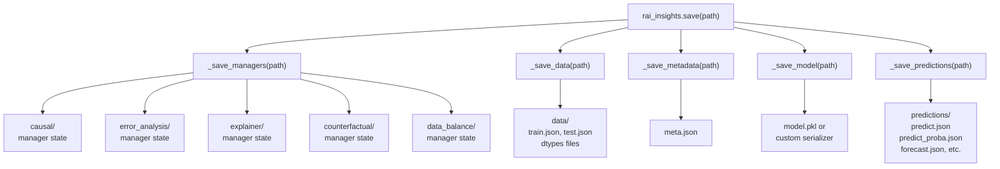
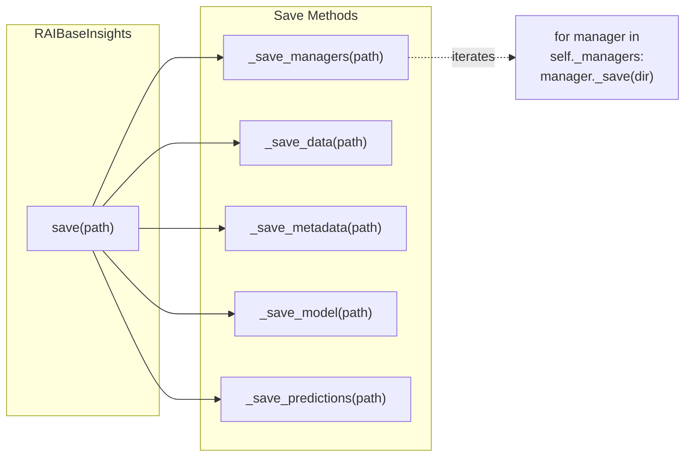
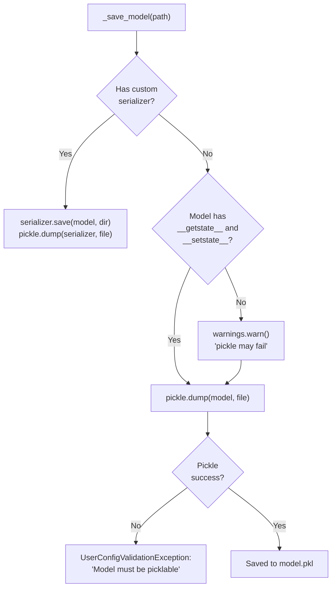
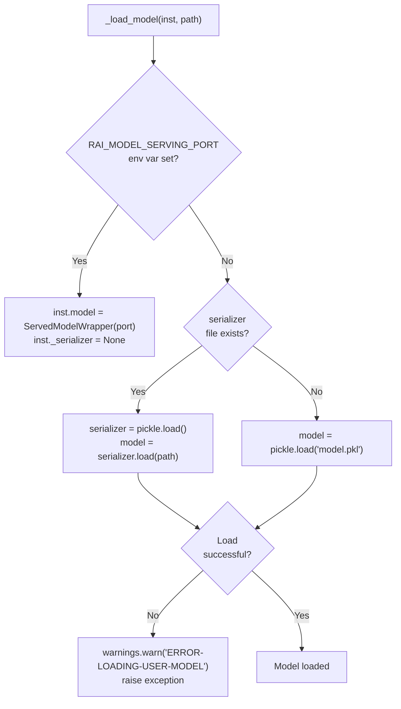
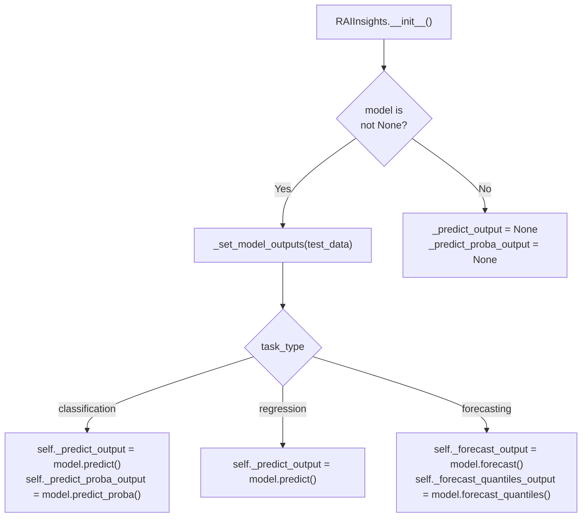
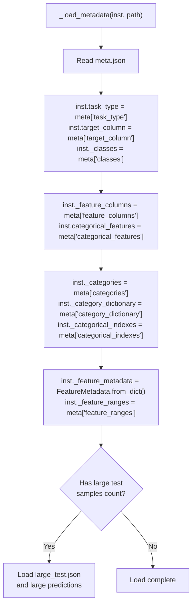
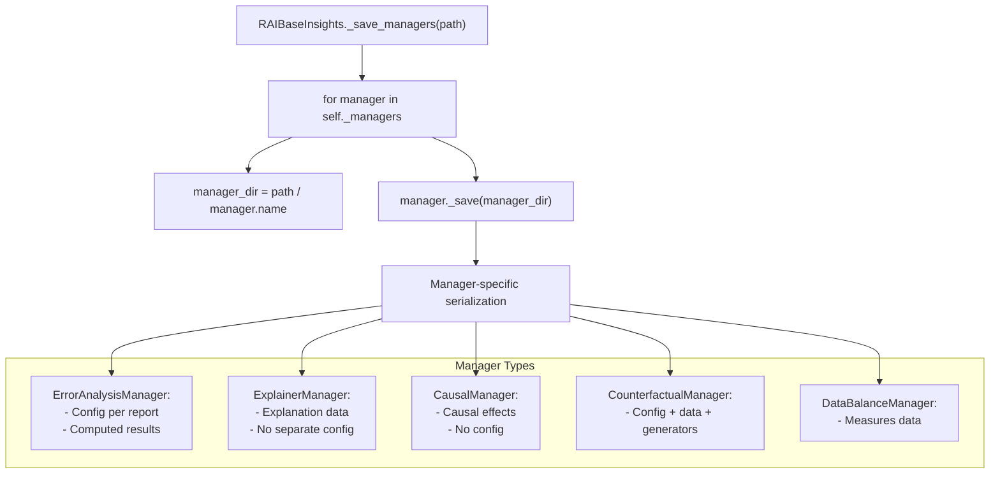
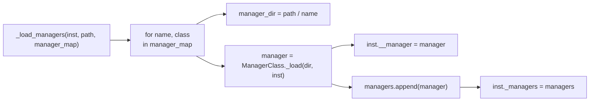
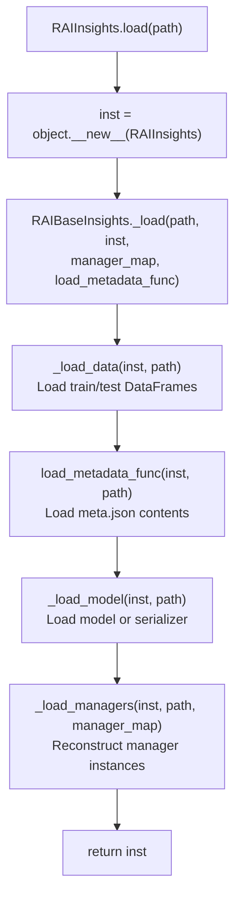

<!-- source: DeepWiki mcp.deepwiki.com · repo microsoft/responsible-ai-toolbox · extra page Persistence and Serialization · fetched 2026-10-26 -->

# Persistence and Serialization

<details>
<summary>Relevant source files</summary>

The following files were used as context for generating this wiki page:

- [responsibleai/responsibleai/_internal/constants.py](responsibleai/responsibleai/_internal/constants.py)
- [responsibleai/responsibleai/rai_insights/rai_base_insights.py](responsibleai/responsibleai/rai_insights/rai_base_insights.py)
- [responsibleai/responsibleai/rai_insights/rai_insights.py](responsibleai/responsibleai/rai_insights/rai_insights.py)
- [responsibleai/tests/common_utils.py](responsibleai/tests/common_utils.py)
- [responsibleai/tests/model_analysis/test_model_analysis.py](responsibleai/tests/model_analysis/test_model_analysis.py)
- [responsibleai/tests/model_analysis/test_model_analysis_validations.py](responsibleai/tests/model_analysis/test_model_analysis_validations.py)
- [responsibleai/tests/rai_insights/test_rai_insights.py](responsibleai/tests/rai_insights/test_rai_insights.py)
- [responsibleai/tests/rai_insights/test_rai_insights_cohort_filter.py](responsibleai/tests/rai_insights/test_rai_insights_cohort_filter.py)
- [responsibleai/tests/rai_insights/test_rai_insights_data_size_scenarios.py](responsibleai/tests/rai_insights/test_rai_insights_data_size_scenarios.py)
- [responsibleai/tests/rai_insights/test_rai_insights_get_feature_ranges.py](responsibleai/tests/rai_insights/test_rai_insights_get_feature_ranges.py)
- [responsibleai/tests/rai_insights/test_rai_insights_save_and_load_scenarios.py](responsibleai/tests/rai_insights/test_rai_insights_save_and_load_scenarios.py)
- [responsibleai/tests/rai_insights/test_rai_insights_validations.py](responsibleai/tests/rai_insights/test_rai_insights_validations.py)
- [responsibleai/tests/test_model_serializer.py](responsibleai/tests/test_model_serializer.py)

</details>


This page documents the persistence and serialization mechanism for `RAIInsights` objects. The Responsible AI Toolbox provides a complete save/load system that enables users to persist their analysis results and restore them later without recomputing expensive operations.

For information about the RAIInsights initialization and configuration, see [Initialization and Validation](#3.2.1). For details on manager orchestration and the compute() method, see [Manager Orchestration](#3.2.2).

## Overview

The persistence system handles serialization of all RAIInsights components including:
- **Model**: The ML model being analyzed (with support for custom serializers)
- **Data**: Train and test datasets with their data types
- **Predictions**: Cached model outputs (predict, predict_proba, forecast, etc.)
- **Metadata**: Task type, target column, feature information, categorical features
- **Manager State**: All computed results from error analysis, explanations, causal analysis, counterfactuals, and data balance managers

The system uses a directory-based structure where each component is saved to its own location, enabling modular loading and partial restoration.

Sources: [responsibleai/responsibleai/rai_insights/rai_base_insights.py:219-230](), [responsibleai/responsibleai/rai_insights/rai_insights.py:1-52]()

## Save Method Architecture

### High-Level Save Flow



Sources: [responsibleai/responsibleai/rai_insights/rai_base_insights.py:219-230]()

### Save Implementation

The `RAIBaseInsights.save()` method orchestrates the serialization process by calling five specialized methods in sequence:



Each save method is responsible for a specific aspect of the RAIInsights state. The implementation in `RAIBaseInsights` provides common functionality, while `RAIInsights` extends this with task-specific behavior.

Sources: [responsibleai/responsibleai/rai_insights/rai_base_insights.py:208-230]()

## Directory Structure

The saved RAIInsights object has the following directory structure:

| Path | Content | Description |
|------|---------|-------------|
| `meta.json` | Metadata dictionary | Task type, target column, classes, feature metadata |
| `rai_version.json` | Version info | ResponsibleAI package version |
| `model.pkl` | Pickled model | Serialized model (if no custom serializer) |
| `serializer` | Pickled serializer | Custom serializer object (if provided) |
| `data/` | Data directory | Contains train/test datasets and dtypes |
| `data/train.json` | Train data | Training dataset in JSON format |
| `data/traindtypes.json` | Train dtypes | Data types for train columns |
| `data/test.json` | Test data | Test dataset in JSON format |
| `data/testdtypes.json` | Test dtypes | Data types for test columns |
| `data/large_test.json` | Large test data | Full test set (if truncated for UI) |
| `predictions/` | Predictions directory | Cached model outputs |
| `predictions/predict.json` | Predictions | Model.predict() output |
| `predictions/predict_proba.json` | Probabilities | Model.predict_proba() output |
| `predictions/forecast.json` | Forecasts | Model.forecast() output (forecasting) |
| `predictions/forecast_quantiles.json` | Quantiles | Forecast quantiles (forecasting) |
| `predictions/large_*.json` | Large data predictions | Predictions for full test set |
| `causal/` | Causal manager state | Saved causal analysis results |
| `counterfactual/` | Counterfactual state | Saved counterfactual results |
| `error_analysis/` | Error analysis state | Saved error analysis results |
| `explainer/` | Explainer state | Saved explanation results |
| `data_balance/` | Data balance state | Saved data balance results |

Sources: [responsibleai/responsibleai/_internal/constants.py:95-132](), [responsibleai/responsibleai/rai_insights/rai_base_insights.py:138-168](), [responsibleai/tests/rai_insights/test_rai_insights.py:300-331]()

## Model Serialization

### Default Pickle Serialization

By default, models are serialized using Python's `pickle` module. The system checks for `__getstate__` and `__setstate__` methods and warns if they're missing:



Sources: [responsibleai/responsibleai/rai_insights/rai_base_insights.py:179-207]()

### Custom Serializer Interface

Users can provide a custom serializer for models that are not picklable. The serializer must implement two methods:

**Required Methods:**
- `save(model, path)`: Serialize the model to the given directory
- `load(path)`: Deserialize and return the model from the directory

**Validation:**
The serializer itself must be picklable and is validated during RAIInsights initialization:

```python
# Validation in _validate_rai_insights_input_parameters
if serializer is not None:
    if not hasattr(serializer, 'save'):
        raise UserConfigValidationException('The serializer does not implement save()')
    if not hasattr(serializer, 'load'):
        raise UserConfigValidationException('The serializer does not implement load()')
    try:
        pickle.dumps(serializer)
    except Exception:
        raise UserConfigValidationException('The serializer should be serializable via pickle')
```

Sources: [responsibleai/responsibleai/rai_insights/rai_insights.py:503-516](), [responsibleai/tests/test_model_serializer.py:12-22]()

### Model Serving Support

The load system supports serving models remotely via the `RAI_MODEL_SERVING_PORT` environment variable. When set, the model is replaced with a `ServedModelWrapper` that communicates with a local server:



Sources: [responsibleai/responsibleai/rai_insights/rai_base_insights.py:260-301]()

## Data Serialization

### Train and Test Data

Data is serialized to JSON format using pandas `to_json()` with `orient='split'`. Data types are preserved in separate JSON files to ensure correct deserialization:

**Save Process:**
1. Extract dtypes using `df.dtypes.astype(str).to_dict()`
2. Save dtypes to `{train|test}dtypes.json`
3. Save data to `{train|test}.json` using `to_json(orient='split')`
4. Save RAI package version to `rai_version.json`

**Load Process:**
1. Load dtypes from JSON
2. Load data using `pd.read_json()` with the saved dtypes
3. Reconstruct the DataFrame with correct column types

Sources: [responsibleai/responsibleai/rai_insights/rai_base_insights.py:138-168](), [responsibleai/responsibleai/rai_insights/rai_base_insights.py:232-259]()

### Large Test Data Handling

When test datasets exceed `maximum_rows_for_test`, RAIInsights stores the full dataset separately and works with a truncated version for UI performance. Both versions are persisted:

| Attribute | File | Description |
|-----------|------|-------------|
| `self.test` | `data/test.json` | Truncated test set for UI |
| `self._large_test` | `data/large_test.json` | Full test set |
| `self._predict_output` | `predictions/predict.json` | Predictions for truncated set |
| `self._large_predict_output` | `predictions/large_predict.json` | Predictions for full set |

The metadata includes `number_large_test_samples` to track the original test set size.

Sources: [responsibleai/responsibleai/rai_insights/rai_insights.py:198-260](), [responsibleai/tests/rai_insights/test_rai_insights_data_size_scenarios.py:58-66]()

## Prediction Caching

### Cached Model Outputs

RAIInsights caches model predictions during initialization to avoid redundant computation. The outputs are stored as instance attributes and serialized to JSON:



**Output Mappings by Task Type:**

| Task Type | Required Method | Optional Method | Purpose |
|-----------|----------------|-----------------|---------|
| Classification | `predict` | `predict_proba` | Predictions and probabilities |
| Regression | `predict` | None | Predictions only |
| Forecasting | `forecast` | `forecast_quantiles` | Forecasts and quantile predictions |

The system uses `MethodPurpose` enum to map forecast methods to prediction/probability slots internally, avoiding code duplication.

Sources: [responsibleai/responsibleai/rai_insights/rai_insights.py:72-138](), [responsibleai/responsibleai/rai_insights/rai_insights.py:252-260]()

### Prediction Serialization

The `_save_predictions()` method iterates through output fields and saves non-null predictions to JSON files:

```python
# File naming convention from constants
_OUTPUT_FIELDS_AND_FILENAMES = list(zip(
    _OUTPUT_FIELDS,
    [f"{o}{FileFormats.JSON}" for o in _OUTPUT_OPTIONS]))

# _OUTPUT_FIELDS example: ['_predict_output', '_predict_proba_output', '_forecast_output', ...]
# Filenames example: ['predict.json', 'predict_proba.json', 'forecast.json', ...]
```

The load process reconstructs predictions from these JSON files, setting the corresponding instance attributes.

Sources: [responsibleai/responsibleai/rai_insights/rai_insights.py:1408-1444](), [responsibleai/responsibleai/rai_insights/rai_insights.py:76-78]()

## Metadata Serialization

### Metadata Dictionary Structure

The `_save_metadata()` method creates a comprehensive metadata dictionary containing:

```python
meta = {
    Metadata.TASK_TYPE: self.task_type,
    Metadata.TARGET_COLUMN: self.target_column,
    Metadata.CLASSES: self._classes,
    Metadata.FEATURE_COLUMNS: self._feature_columns,
    Metadata.CATEGORICAL_FEATURES: self.categorical_features,
    Metadata.FEATURE_METADATA: self._feature_metadata,
    Metadata.FEATURE_RANGES: self._feature_ranges,
    Metadata.CATEGORIES: self._categories,
    Metadata.CATEGORY_DICTIONARY: self._category_dictionary,
    Metadata.CATEGORICAL_INDEXES: self._categorical_indexes,
    Metadata.STRING_IND_DATA: self._string_ind_data,
    Metadata.NUMBER_LARGE_TEST_SAMPLES: number_large_test_samples
}
```

**Feature Metadata Components:**
- `identity_feature_name`: Feature to use as identifier
- `datetime_features`: Datetime columns (forecasting)
- `time_series_id_features`: Time series ID columns (forecasting)
- `categorical_features`: Categorical feature names
- `dropped_features`: Features excluded from analysis

Sources: [responsibleai/responsibleai/rai_insights/rai_insights.py:1446-1495](), [responsibleai/responsibleai/_internal/constants.py:17-36]()

### Loading Metadata

The `_load_metadata()` static method reconstructs the object state from `meta.json`:



Sources: [responsibleai/responsibleai/rai_insights/rai_insights.py:1497-1557]()

## Manager State Persistence

### Manager Save Process

Each manager implements its own `_save()` and `_load()` methods following a common pattern:



Each manager creates a subdirectory under its name (e.g., `error_analysis/`, `explainer/`) and saves components using UUIDs for unique identification.

Sources: [responsibleai/responsibleai/rai_insights/rai_base_insights.py:208-218](), [responsibleai/tests/rai_insights/test_rai_insights.py:333-362]()

### Manager Directory Structure

Managers use a standardized three-directory structure managed by `DirectoryManager`:

| Directory | Purpose | Example Managers |
|-----------|---------|------------------|
| `config/` | Configuration for the analysis | ErrorAnalysis, Counterfactual |
| `data/` | Computed results/outputs | All managers |
| `generators/` | Reusable computation objects | Counterfactual |

**Example for CounterfactualManager:**
- `counterfactual/<uuid>/config/` - Stores configuration like `total_CFs`, `desired_class`
- `counterfactual/<uuid>/data/` - Stores generated counterfactual examples
- `counterfactual/<uuid>/generators/` - Stores DiCE generators for reuse

Sources: [responsibleai/tests/rai_insights/test_rai_insights.py:340-362]()

### Manager Load Process

The `_load_managers()` static method reconstructs manager instances:



The `manager_map` dictionary maps manager names to their class types, enabling dynamic instantiation:

```python
manager_map = {
    ManagerNames.CAUSAL: CausalManager,
    ManagerNames.COUNTERFACTUAL: CounterfactualManager,
    ManagerNames.ERROR_ANALYSIS: ErrorAnalysisManager,
    ManagerNames.EXPLAINER: ExplainerManager,
    ManagerNames.DATA_BALANCE: DataBalanceManager
}
```

Sources: [responsibleai/responsibleai/rai_insights/rai_base_insights.py:302-324](), [responsibleai/responsibleai/rai_insights/rai_insights.py:1559-1575]()

## Load Method Architecture

### Static Load Pattern

The load operation is implemented as a static method that constructs a new RAIInsights instance and populates it from saved files:



The pattern avoids calling `__init__()`, instead directly setting instance attributes via `inst.__dict__`. This enables restoration of the exact previous state without validation overhead.

Sources: [responsibleai/responsibleai/rai_insights/rai_insights.py:1559-1590](), [responsibleai/responsibleai/rai_insights/rai_base_insights.py:326-347]()

### Missing Directory Handling

The load system gracefully handles missing manager directories (which may occur when downloading from Azure Blob storage where empty directories don't exist):

```python
# Managers with no saved state won't have directories
# The load process initializes them as empty managers
if not manager_dir.exists():
    # Manager is created with empty state
    manager = ManagerClass._load(manager_dir, inst)
```

This is tested explicitly for causal, error_analysis, and counterfactual managers that may have no computed outputs.

Sources: [responsibleai/tests/rai_insights/test_rai_insights_save_and_load_scenarios.py:102-140]()

## Common Save/Load Scenarios

### Empty Save-Load-Save Pattern

Users can save an RAIInsights object with no computed analyses, load it, and save again. This is important for workflow flexibility:

```python
# Create RAIInsights without adding any analyses
rai_insights = RAIInsights(model, train, test, target_column, task_type)

# Save with empty managers
rai_insights.save(path1)
# Manager directories exist but are empty

# Load
rai_insights = RAIInsights.load(path1)

# Save again - should preserve empty state
rai_insights.save(path2)
```

Sources: [responsibleai/tests/rai_insights/test_rai_insights_save_and_load_scenarios.py:30-71]()

### Add-Save-Load-Save Pattern

Users can add analyses after loading, then save again with the new results:

```python
# Create and save initial state
rai_insights = RAIInsights(model, train, test, target_column, task_type)
rai_insights.save(path1)

# Load
rai_insights = RAIInsights.load(path1)

# Add new analysis
rai_insights.error_analysis.add()
rai_insights.compute()

# Save updated state
rai_insights.save(path2)
```

This pattern is tested for all manager types to ensure the save/load cycle doesn't break the ability to add new analyses.

Sources: [responsibleai/tests/rai_insights/test_rai_insights_save_and_load_scenarios.py:173-236](), [responsibleai/tests/rai_insights/test_rai_insights_save_and_load_scenarios.py:276-340]()

### Save-Load-Add Pattern  

Users can save an empty RAIInsights, load it, add analyses, compute, and save:

```python
# Save without any analyses
rai_insights = RAIInsights(model, train, test, target_column, task_type)
rai_insights.save(path1)

# Load and add analysis
rai_insights = RAIInsights.load(path1)
rai_insights.causal.add(treatment_features=['age'])
rai_insights.compute()

# Save with computed results
rai_insights.save(path2)
```

This workflow is particularly important for distributed computing scenarios where the initial setup is saved, then analyses are added on different machines.

Sources: [responsibleai/tests/rai_insights/test_rai_insights_save_and_load_scenarios.py:77-101]()

## Error Handling

### Model Loading Errors

When model loading fails, the system warns but continues loading other components:

```python
model_load_err = ('ERROR-LOADING-USER-MODEL: '
                  'There was an error loading the user model.')
try:
    # Load model
    with open(model_pkl_path, 'rb') as file:
        model = pickle.load(file)
except Exception as e:
    warnings.warn(model_load_err)
    raise e
```

Tests verify that missing model files cause exceptions during load.

Sources: [responsibleai/responsibleai/rai_insights/rai_base_insights.py:282-300](), [responsibleai/tests/rai_insights/test_rai_insights_save_and_load_scenarios.py:141-167]()

### Serialization Validation

The system validates serializers at initialization time, not save time:

**Checked at `__init__`:**
- Serializer has `save()` method
- Serializer has `load()` method  
- Serializer is picklable

**Validation Errors:**
- `UserConfigValidationException`: "The serializer does not implement save()"
- `UserConfigValidationException`: "The serializer does not implement load()"
- `UserConfigValidationException`: "The serializer should be serializable via pickle"

Sources: [responsibleai/responsibleai/rai_insights/rai_insights.py:503-516](), [responsibleai/tests/rai_insights/test_rai_insights_validations.py:193-261]()

### Pickle Failure Handling

Models that fail to pickle raise an exception with guidance:

```python
try:
    with open(model_path, 'wb') as file:
        pickle.dump(self.model, file)
except Exception as e:
    raise UserConfigValidationException(
        "Model must be picklable or a custom serializer must be specified") from e
```

Sources: [responsibleai/responsibleai/rai_insights/rai_base_insights.py:200-207]()

---

