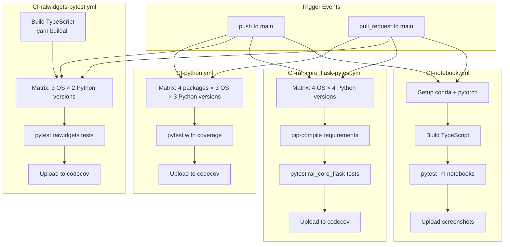
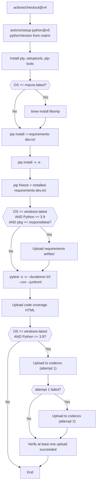
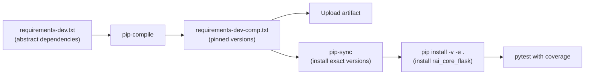
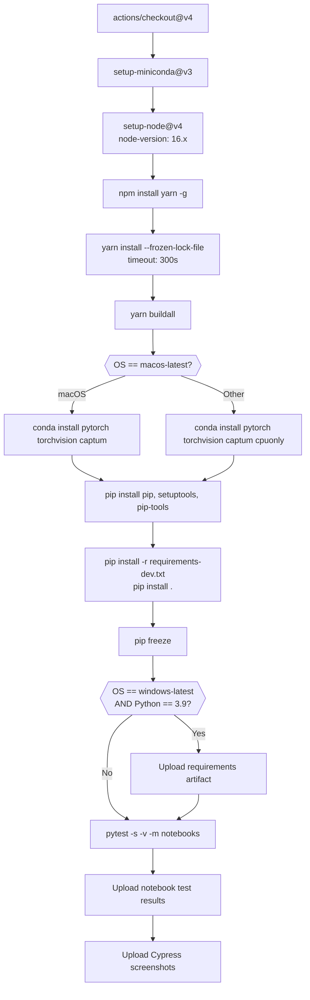
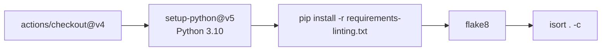
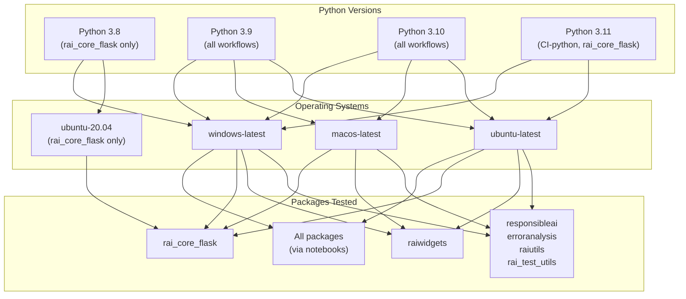
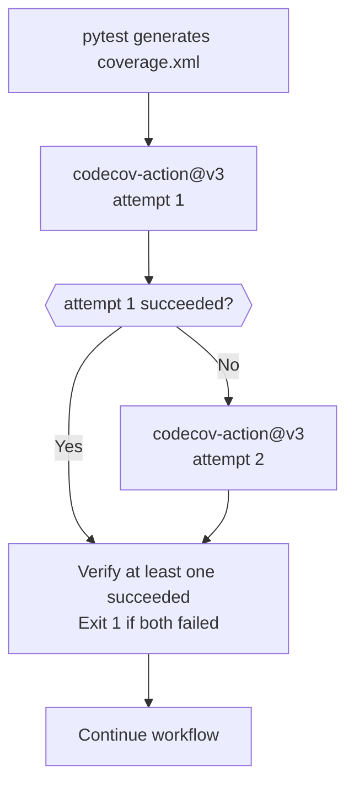

<!-- source: DeepWiki mcp.deepwiki.com · repo microsoft/responsible-ai-toolbox · extra page Python CI Workflows · fetched 2026-10-26 -->

# Python CI Workflows

<details>
<summary>Relevant source files</summary>

The following files were used as context for generating this wiki page:

- [.azure-devops/component-governance.yml](.azure-devops/component-governance.yml)
- [.github/workflows/CD.yml](.github/workflows/CD.yml)
- [.github/workflows/CI-codescan.yml](.github/workflows/CI-codescan.yml)
- [.github/workflows/CI-e2e-notebooks.yml](.github/workflows/CI-e2e-notebooks.yml)
- [.github/workflows/CI-notebook.yml](.github/workflows/CI-notebook.yml)
- [.github/workflows/CI-python.yml](.github/workflows/CI-python.yml)
- [.github/workflows/CI-rai_core_flask-pytest.yml](.github/workflows/CI-rai_core_flask-pytest.yml)
- [.github/workflows/CI-raiwidgets-pytest.yml](.github/workflows/CI-raiwidgets-pytest.yml)
- [.github/workflows/CI-typescript.yml](.github/workflows/CI-typescript.yml)
- [.github/workflows/GitHubPages.yml](.github/workflows/GitHubPages.yml)
- [.github/workflows/python-linting.yml](.github/workflows/python-linting.yml)
- [.github/workflows/release-rai-tabular.yml](.github/workflows/release-rai-tabular.yml)

</details>


## Purpose and Scope

This document describes the Python continuous integration (CI) workflows that test Python packages in the Responsible AI Toolbox across multiple operating systems and Python versions. These workflows validate code quality, run unit tests, and upload coverage metrics. For TypeScript/JavaScript CI workflows, see [TypeScript CI Workflows](#7.2.2). For deployment and release processes, see [Build and Deployment](#7.2.3) and [Release Process](#7.2.4).

## Overview

The repository uses four primary GitHub Actions workflows to test Python code:

| Workflow File | Trigger Paths | Packages Tested | Purpose |
|--------------|---------------|-----------------|---------|
| `CI-python.yml` | `erroranalysis/`, `raiutils/`, `responsibleai/`, `rai_test_utils/` | 4 core packages | Unit and integration tests for core Python packages |
| `CI-raiwidgets-pytest.yml` | All changes to main | `raiwidgets` | Unit tests for widget package with TypeScript build |
| `CI-rai_core_flask-pytest.yml` | `rai_core_flask/` | `rai_core_flask` | Unit tests for Flask backend API package |
| `CI-notebook.yml` | All changes to main | All packages | End-to-end notebook execution tests |

All workflows run on both `push` to `main` and `pull_request` events, ensuring comprehensive testing before merging changes.

**CI Workflow Orchestration**



Sources: [.github/workflows/CI-python.yml](), [.github/workflows/CI-raiwidgets-pytest.yml](), [.github/workflows/CI-rai_core_flask-pytest.yml](), [.github/workflows/CI-notebook.yml]()

## Core Package Testing (CI-python.yml)

The `CI-python.yml` workflow tests the four foundational Python packages: `responsibleai`, `erroranalysis`, `raiutils`, and `rai_test_utils`.

### Workflow Configuration

**Trigger Conditions**: [.github/workflows/CI-python.yml:3-13]()
- Runs on `push` to `main` branch
- Runs on `pull_request` to `main` branch
- Only triggers when changes affect specific paths: `erroranalysis/**`, `rai_test_utils/**`, `raiutils/**`, `responsibleai/**`, or the workflow file itself

**Matrix Strategy**: [.github/workflows/CI-python.yml:16-28]()

| Matrix Dimension | Values |
|------------------|--------|
| `packageDirectory` | `responsibleai`, `erroranalysis`, `raiutils`, `rai_test_utils` |
| `operatingSystem` | `ubuntu-latest`, `macos-latest`, `windows-latest` |
| `pythonVersion` | `3.9`, `3.10`, `3.11` |

**Exclusions**:
- `responsibleai` package on Python 3.11 (all OS)
- `responsibleai` package on macOS with Python 3.9

This creates 33 total test jobs (4 packages × 3 OS × 3 Python versions - 5 exclusions).

### Job Steps

**CI-python.yml Job Flow**



Sources: [.github/workflows/CI-python.yml:32-123]()

### Platform-Specific Setup

**macOS libomp Installation**: [.github/workflows/CI-python.yml:46-49]()
```yaml
- if: ${{ matrix.operatingSystem == 'macos-latest' }}
  name: Use Homebrew to install libomp on MacOS
  run: brew install libomp
```

This installs OpenMP support required by LightGBM on macOS.

### Test Execution

**pytest Command**: [.github/workflows/CI-python.yml:74-77]()
```bash
pytest -s -v --durations=10 --doctest-modules \
  --junitxml=junit/test-results.xml \
  --cov=${{ matrix.packageDirectory }} \
  --cov-report=xml --cov-report=html
```

| Flag | Purpose |
|------|---------|
| `-s` | Disable output capture (show print statements) |
| `-v` | Verbose output |
| `--durations=10` | Report 10 slowest tests |
| `--doctest-modules` | Run doctests in docstrings |
| `--junitxml` | Generate JUnit XML report |
| `--cov` | Measure code coverage for package |
| `--cov-report=xml` | Generate XML coverage report for codecov |
| `--cov-report=html` | Generate HTML coverage report |

### Code Coverage Upload

**Codecov Integration**: [.github/workflows/CI-python.yml:87-123]()

Coverage is uploaded to codecov.io only from Windows with Python 3.9 to avoid duplicate uploads. The workflow implements a retry mechanism:

1. First attempt: [.github/workflows/CI-python.yml:88-99]()
2. Conditional retry if first fails: [.github/workflows/CI-python.yml:101-113]()
3. Verify at least one succeeded: [.github/workflows/CI-python.yml:115-123]()

Sources: [.github/workflows/CI-python.yml]()

## RAIWidgets Testing (CI-raiwidgets-pytest.yml)

The `CI-raiwidgets-pytest.yml` workflow tests the `raiwidgets` package, which requires building the TypeScript dashboard before running Python tests.

### Unique Characteristics

Unlike `CI-python.yml`, this workflow:
1. Uses `conda` instead of standard Python setup for better dependency management
2. Builds TypeScript assets with `yarn buildall` before testing
3. Includes macOS-specific dependency installations for node-gyp

### Workflow Configuration

**Matrix Strategy**: [.github/workflows/CI-raiwidgets-pytest.yml:16-24]()

| Matrix Dimension | Values |
|------------------|--------|
| `packageDirectory` | `raiwidgets` |
| `operatingSystem` | `ubuntu-latest`, `macos-latest`, `windows-latest` |
| `pythonVersion` | `3.9`, `3.10` |

**Exclusion**: macOS with Python 3.9 (5 total jobs)

### Job Steps

**RAIWidgets Testing Workflow**

```mermaid
graph TB
    Checkout["actions/checkout@v4"]
    SetupConda["conda-incubator/setup-miniconda@v3<br/>python-version from matrix"]
    SetupNode["actions/setup-node@v4<br/>node-version: 16.x"]
    
    MacOSCheck{{"OS == macos-latest?"}}
    InstallNumpy["conda install numpy<2.0.0"]
    InstallLibomp["brew install libomp"]
    InstallLightgbm["conda install lightgbm"]
    InstallNodeDeps["brew install cairo pango"]
    
    SetupTools["pip install pip, setuptools, pip-tools"]
    InstallYarn["npm install yarn -g"]
    YarnInstall["yarn install --frozen-lock-file"]
    YarnBuild["yarn buildall"]
    
    PipInstall["pip install -r requirements-dev.txt<br/>pip install -v -e ."]
    PipFreeze["pip freeze > installed-requirements-dev.txt"]
    
    UploadCheck{{"OS == windows-latest<br/>AND Python == 3.9?"}}
    UploadReqs["Upload requirements artifact"]
    
    RunTests["pytest -s -v --durations=10<br/>--cov=raiwidgets"]
    UploadCoverage["Upload code coverage"]
    
    CodecovCheck{{"OS == windows-latest<br/>AND Python == 3.9?"}}
    Codecov["Upload to codecov with retry"]
    
    Checkout --> SetupConda
    SetupConda --> SetupNode
    SetupNode --> MacOSCheck
    
    MacOSCheck -->|Yes| InstallNumpy
    MacOSCheck -->|No| SetupTools
    InstallNumpy --> InstallLibomp
    InstallLibomp --> InstallLightgbm
    InstallLightgbm --> InstallNodeDeps
    InstallNodeDeps --> SetupTools
    
    SetupTools --> InstallYarn
    InstallYarn --> YarnInstall
    YarnInstall --> YarnBuild
    YarnBuild --> PipInstall
    PipInstall --> PipFreeze
    PipFreeze --> UploadCheck
    
    UploadCheck -->|Yes| UploadReqs
    UploadCheck -->|No| RunTests
    UploadReqs --> RunTests
    
    RunTests --> UploadCoverage
    UploadCoverage --> CodecovCheck
    CodecovCheck -->|Yes| Codecov
    CodecovCheck -->|No| End["End"]
    Codecov --> End
```



Sources: [.github/workflows/CI-raiwidgets-pytest.yml:28-156]()

### macOS-Specific Dependencies

**Conda Package Installations**: [.github/workflows/CI-raiwidgets-pytest.yml:41-57]()

On macOS, the workflow installs:
- `numpy<2.0.0` from conda-forge (compatibility constraint)
- `lightgbm` from conda-forge (pre-built binary)

**Homebrew Installations**: [.github/workflows/CI-raiwidgets-pytest.yml:48-64]()
- `libomp` - OpenMP library for LightGBM
- `cairo` - Graphics library for node-gyp
- `pango` - Text rendering library for node-gyp

These dependencies are required for building native Node.js addons on macOS.

### TypeScript Build Requirement

**Build Step**: [.github/workflows/CI-raiwidgets-pytest.yml:82-83]()
```bash
yarn buildall
```

This builds all TypeScript libraries and bundles them into `raiwidgets/raiwidgets/widget/`, which the Python package embeds. The Python tests require these assets to be present.

Sources: [.github/workflows/CI-raiwidgets-pytest.yml]()

## RAI Core Flask Testing (CI-rai_core_flask-pytest.yml)

The `CI-rai_core_flask-pytest.yml` workflow tests the `rai_core_flask` package, which provides the Flask backend API.

### Unique Characteristics

This workflow:
1. Uses `pip-compile` to pin exact dependency versions
2. Supports Python 3.8-3.11 (widest range)
3. Tests on `ubuntu-20.04` in addition to latest OS versions
4. Uses `pip-sync` instead of `pip install -r`

### Workflow Configuration

**Trigger Conditions**: [.github/workflows/CI-rai_core_flask-pytest.yml:3-10]()
- Runs on `push` to `main`
- Runs on `pull_request` to `main`
- Only triggers when changes affect `rai_core_flask/` or the workflow file

**Matrix Strategy**: [.github/workflows/CI-rai_core_flask-pytest.yml:14-34]()

| Matrix Dimension | Values |
|------------------|--------|
| `operatingSystem` | `ubuntu-20.04`, `ubuntu-latest`, `macos-latest`, `windows-latest` |
| `pythonVersion` | `3.8`, `3.9`, `3.10`, `3.11` |

**Exclusions**: 9 combinations excluded to reduce redundancy (7 total jobs)

### Dependency Pinning Strategy

**pip-compile Workflow**



Sources: [.github/workflows/CI-rai_core_flask-pytest.yml:53-78]()

**pip-compile Command**: [.github/workflows/CI-rai_core_flask-pytest.yml:54-56]()
```bash
pip-compile requirements-dev.txt -o requirements-dev-comp.txt
```

This resolves all transitive dependencies and pins exact versions, ensuring reproducible builds.

**pip-sync Command**: [.github/workflows/CI-rai_core_flask-pytest.yml:66-68]()
```bash
pip-sync requirements-dev-comp.txt
```

Unlike `pip install -r`, `pip-sync` also uninstalls packages not in the requirements file, ensuring a clean environment.

### Test Execution

**pytest Command**: [.github/workflows/CI-rai_core_flask-pytest.yml:75-77]()
```bash
pytest -s -v --durations=10 --doctest-modules \
  --junitxml=junit/test-results.xml \
  --cov=rai_core_flask \
  --cov-report=xml --cov-report=html
```

Coverage is uploaded from Windows with Python 3.8: [.github/workflows/CI-rai_core_flask-pytest.yml:88-124]()

Sources: [.github/workflows/CI-rai_core_flask-pytest.yml]()

## Notebook Testing (CI-notebook.yml)

The `CI-notebook.yml` workflow executes Jupyter notebooks end-to-end to ensure examples remain functional.

### Workflow Configuration

**Matrix Strategy**: [.github/workflows/CI-notebook.yml:13-16]()

| Matrix Dimension | Values |
|------------------|--------|
| `operatingSystem` | `ubuntu-latest`, `windows-latest` |
| `pythonVersion` | `3.9`, `3.10` |

This creates 4 test jobs.

### Job Steps

**Notebook Testing Workflow**



Sources: [.github/workflows/CI-notebook.yml:20-100]()

### PyTorch Installation

**Platform-Specific Installation**: [.github/workflows/CI-notebook.yml:44-54]()

- **Non-macOS**: `conda install pytorch torchvision captum cpuonly -c pytorch`
- **macOS**: `conda install pytorch torchvision captum -c pytorch`

The `cpuonly` package is excluded on macOS per PyTorch's official documentation.

### Notebook Test Execution

**pytest Command**: [.github/workflows/CI-notebook.yml:84-86]()
```bash
pytest -s -v notebooks -m notebooks
```

This runs tests marked with `@pytest.mark.notebooks` in the `notebooks/` directory. The tests use `papermill` to execute notebooks and `scrapbook` to extract outputs.

### Artifact Upload

**Artifacts Uploaded**: [.github/workflows/CI-notebook.yml:88-100]()

1. **Notebook test results**: Complete executed notebooks
2. **Cypress screenshots**: Visual evidence of dashboard rendering

These artifacts are uploaded with `if: always()` to capture results even when tests fail.

Sources: [.github/workflows/CI-notebook.yml]()

## Python Linting Workflow

The `python-linting.yml` workflow enforces code style and import ordering.

### Workflow Configuration

**Trigger**: [.github/workflows/python-linting.yml:3-7]()
- Runs on `push` to `main`
- Runs on `pull_request` to `main`
- No path filtering (runs for all changes)

### Linting Tools

**Linting Workflow**



Sources: [.github/workflows/python-linting.yml:10-29]()

**flake8**: [.github/workflows/python-linting.yml:24-25]()
- Enforces PEP 8 style guide
- Configuration in `.flake8` or `setup.cfg` at repository root

**isort**: [.github/workflows/python-linting.yml:27-29]()
- Checks import statement ordering
- `-c` flag runs in check mode (fails if changes needed)
- Configuration in `setup.cfg` or `.isort.cfg`

Sources: [.github/workflows/python-linting.yml]()

## Matrix Strategy Summary

The workflows use extensive matrix testing to ensure compatibility across environments:

**Combined Matrix Coverage**



Sources: [.github/workflows/CI-python.yml:16-28](), [.github/workflows/CI-raiwidgets-pytest.yml:16-24](), [.github/workflows/CI-rai_core_flask-pytest.yml:14-34](), [.github/workflows/CI-notebook.yml:13-16]()

## Code Coverage Reporting

All Python test workflows integrate with codecov.io for coverage tracking.

### Upload Strategy

To avoid duplicate coverage reports, only one matrix job per workflow uploads to codecov:

| Workflow | Upload Condition |
|----------|-----------------|
| `CI-python.yml` | Windows, Python 3.9 |
| `CI-raiwidgets-pytest.yml` | Windows, Python 3.9 |
| `CI-rai_core_flask-pytest.yml` | Windows, Python 3.8 |
| `CI-notebook.yml` | No codecov upload |

### Retry Mechanism

**Codecov Upload Pattern** (used in all workflows):



Sources: [.github/workflows/CI-python.yml:87-123](), [.github/workflows/CI-raiwidgets-pytest.yml:120-156](), [.github/workflows/CI-rai_core_flask-pytest.yml:88-124]()

**Implementation Details**: [.github/workflows/CI-python.yml:88-123]()

1. First attempt uses `id: codecovupload1`
2. If `codecovupload1.outcome == 'failure'`, retry with `id: codecovupload2`
3. Final step verifies `(codecovupload1.outcome == 'success') || (codecovupload2.outcome == 'success')`

Both attempts use the same parameters:
- `token: ${{ secrets.CODECOV_TOKEN }}`
- `fail_ci_if_error: false` (failure doesn't block the workflow)
- `flags: unittests`
- `verbose: true`

### Coverage Report Generation

All workflows generate both XML and HTML coverage reports: [.github/workflows/CI-python.yml:76]()

```bash
--cov-report=xml --cov-report=html
```

- **XML**: Uploaded to codecov.io for aggregation and trend analysis
- **HTML**: Uploaded as GitHub Actions artifact for manual inspection

The HTML reports are uploaded with `if: ${{ always() }}` to ensure availability even when tests fail.

Sources: [.github/workflows/CI-python.yml:74-85](), [.github/workflows/CI-raiwidgets-pytest.yml:106-118](), [.github/workflows/CI-rai_core_flask-pytest.yml:75-86]()

---

