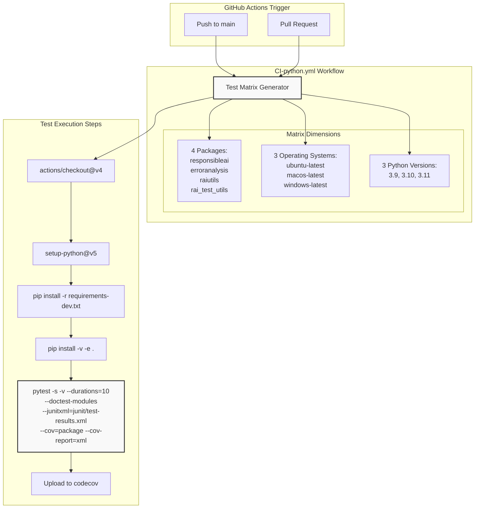
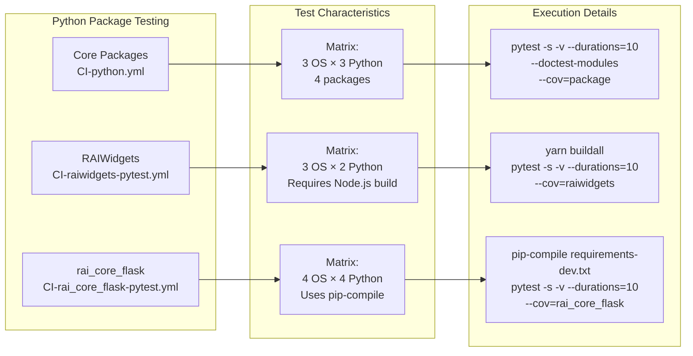
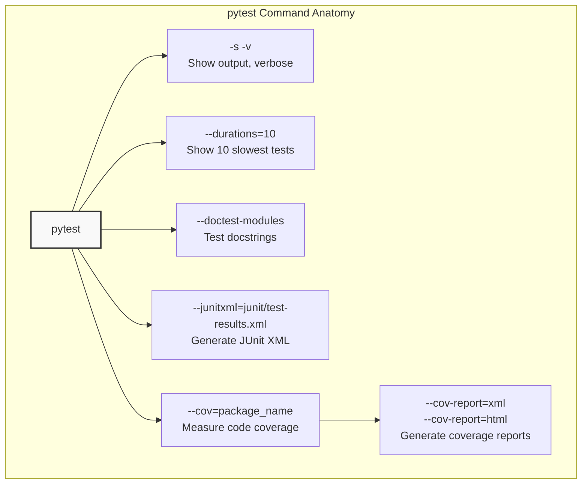
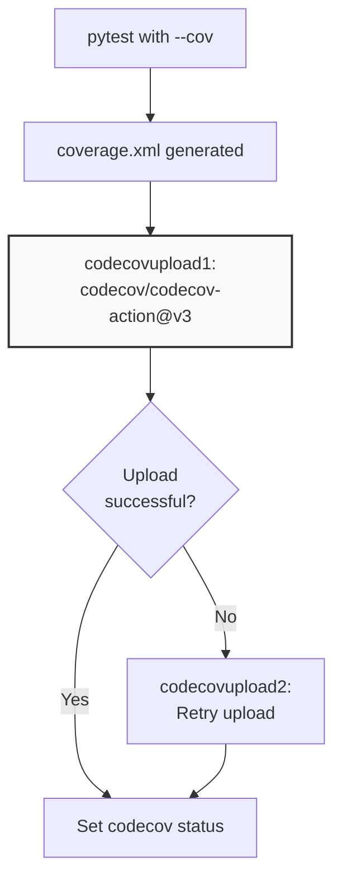
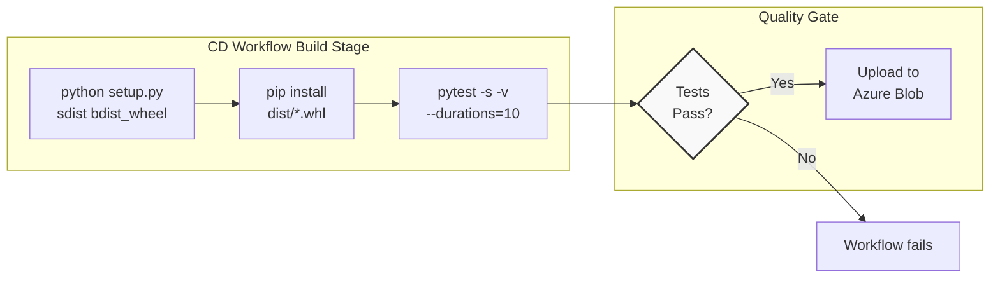

<!-- source: DeepWiki mcp.deepwiki.com · repo microsoft/responsible-ai-toolbox · extra page Python Unit and Integration Tests · fetched 2026-10-26 -->

# Python Unit and Integration Tests

<details>
<summary>Relevant source files</summary>

The following files were used as context for generating this wiki page:

- [.azure-devops/component-governance.yml](.azure-devops/component-governance.yml)
- [.github/workflows/CD.yml](.github/workflows/CD.yml)
- [.github/workflows/CI-codescan.yml](.github/workflows/CI-codescan.yml)
- [.github/workflows/CI-e2e-notebooks.yml](.github/workflows/CI-e2e-notebooks.yml)
- [.github/workflows/CI-notebook.yml](.github/workflows/CI-notebook.yml)
- [.github/workflows/CI-python.yml](.github/workflows/CI-python.yml)
- [.github/workflows/CI-rai_core_flask-pytest.yml](.github/workflows/CI-rai_core_flask-pytest.yml)
- [.github/workflows/CI-raiwidgets-pytest.yml](.github/workflows/CI-raiwidgets-pytest.yml)
- [.github/workflows/CI-typescript.yml](.github/workflows/CI-typescript.yml)
- [.github/workflows/GitHubPages.yml](.github/workflows/GitHubPages.yml)
- [.github/workflows/python-linting.yml](.github/workflows/python-linting.yml)
- [.github/workflows/release-rai-tabular.yml](.github/workflows/release-rai-tabular.yml)

</details>


## Purpose and Scope

This document covers the Python unit and integration testing infrastructure in the Responsible AI Toolbox repository. It describes the pytest-based test suite, test organization, coverage reporting, and how tests are executed in continuous integration.

For notebook-based tests, see [Notebook Tests](#7.1.3). For end-to-end widget integration tests, see [End-to-End Tests](#7.1.4). For TypeScript testing, see [TypeScript Unit Tests](#7.1.2).

## Overview

The repository uses `pytest` as the primary testing framework for all Python packages. Tests run across multiple operating systems and Python versions to ensure broad compatibility. Each package maintains its own test suite under a `tests/` directory, with unit tests and integration tests organized together.

The Python packages tested include:
- **responsibleai**: Core RAI library
- **raiwidgets**: Dashboard widgets and Flask backend integration
- **erroranalysis**: Error analysis engine
- **raiutils**: Common utilities
- **rai_test_utils**: Shared testing utilities
- **rai_core_flask**: Flask API backend

Sources: [.github/workflows/CI-python.yml:19-20](), [.github/workflows/CI-raiwidgets-pytest.yml:18](), [.github/workflows/CI-rai_core_flask-pytest.yml:1-11]()

## Test Execution Flow

### CI Test Matrix



Sources: [.github/workflows/CI-python.yml:1-124]()

### Package-Specific Workflows



Sources: [.github/workflows/CI-python.yml:16-29](), [.github/workflows/CI-raiwidgets-pytest.yml:13-25](), [.github/workflows/CI-rai_core_flask-pytest.yml:14-35]()

## Test Organization

### Directory Structure

Each Python package follows a standard test organization:

```
<package>/
├── <package>/          # Source code
│   ├── __init__.py
│   └── ...
├── tests/              # Test suite
│   ├── __init__.py
│   ├── test_*.py       # Test modules
│   └── ...
├── requirements.txt    # Runtime dependencies
├── requirements-dev.txt # Test dependencies
└── setup.py
```

Test files follow the `test_*.py` naming convention, which pytest automatically discovers. Individual test functions are prefixed with `test_`.

Sources: [.github/workflows/CI-python.yml:51-59]()

### Test Dependencies

Test dependencies are specified in `requirements-dev.txt` for each package. Common test dependencies include:

| Dependency | Purpose |
|------------|---------|
| `pytest` | Test framework |
| `pytest-cov` | Coverage plugin |
| `pytest-mock` | Mocking utilities |
| Package-specific dev dependencies | Varies by package |

The CI workflow installs both runtime and development dependencies:
1. `pip install -r requirements-dev.txt`
2. `pip install -v -e .` (editable install of the package itself)

Sources: [.github/workflows/CI-python.yml:51-59](), [.github/workflows/CI-raiwidgets-pytest.yml:85-90]()

## Pytest Configuration

### Command-Line Flags



The full pytest command executed in CI:

```bash
pytest -s -v --durations=10 --doctest-modules \
  --junitxml=junit/test-results.xml \
  --cov=${{ matrix.packageDirectory }} \
  --cov-report=xml --cov-report=html
```

Sources: [.github/workflows/CI-python.yml:76](), [.github/workflows/CI-raiwidgets-pytest.yml:110](), [.github/workflows/CI-rai_core_flask-pytest.yml:77]()

### Coverage Reporting

The test suite generates multiple coverage reports:

1. **XML Report**: `coverage.xml` - Used for codecov.io upload
2. **HTML Report**: `htmlcov/` directory - Detailed line-by-line coverage
3. **Terminal Output**: Inline summary during test execution

Coverage artifacts are uploaded to GitHub Actions for inspection:

```yaml
- name: Upload code coverage results
  uses: actions/upload-artifact@v4
  with:
    name: ${{ matrix.packageDirectory }}-${{ matrix.pythonVersion}}-code-coverage-results
    path: ${{ matrix.packageDirectory }}-${{ matrix.pythonVersion}}/htmlcov
```

Sources: [.github/workflows/CI-python.yml:79-85](), [.github/workflows/CI-raiwidgets-pytest.yml:114-118]()

### Codecov Integration

Coverage data is uploaded to codecov.io for tracking and PR checks. The workflow includes retry logic for reliability:



The upload only occurs on specific matrix combinations to avoid redundant uploads:
- Operating System: `windows-latest`
- Python Version: `3.9` (or `3.8` for rai_core_flask)

Sources: [.github/workflows/CI-python.yml:87-123](), [.github/workflows/CI-raiwidgets-pytest.yml:120-156]()

## Platform-Specific Considerations

### macOS Dependency Handling

macOS builds require special handling for certain dependencies:

```yaml
- if: ${{ matrix.operatingSystem == 'macos-latest' }}
  name: Use Homebrew to install libomp on MacOS
  run: |
    brew install libomp
```

This installs OpenMP support required by LightGBM and other numerical libraries.

Sources: [.github/workflows/CI-python.yml:46-49](), [.github/workflows/CI-raiwidgets-pytest.yml:47-51]()

### Matrix Exclusions

Some test combinations are excluded to optimize CI runtime:

```yaml
exclude:
  - packageDirectory: "responsibleai"
    pythonVersion: "3.11"
  - packageDirectory: "responsibleai"
    operatingSystem: "macos-latest"
    pythonVersion: "3.9"
```

This reduces the total number of test jobs while maintaining adequate coverage.

Sources: [.github/workflows/CI-python.yml:23-28](), [.github/workflows/CI-raiwidgets-pytest.yml:21-24]()

## Running Tests Locally

### Basic Test Execution

To run tests for a specific package locally:

```bash
# Navigate to package directory
cd <package_directory>

# Install dependencies
pip install -r requirements-dev.txt
pip install -e .

# Run tests
pytest -s -v
```

### Running Tests with Coverage

To generate coverage reports locally:

```bash
pytest -s -v --cov=<package_name> --cov-report=html
```

Then open `htmlcov/index.html` in a browser to view the detailed coverage report.

### Running Specific Tests

```bash
# Run a specific test file
pytest tests/test_specific_module.py -v

# Run a specific test function
pytest tests/test_specific_module.py::test_function_name -v

# Run tests matching a pattern
pytest -k "test_error_analysis" -v
```

Sources: Inferred from [.github/workflows/CI-python.yml:76]()

## Integration with CD Pipeline

### Pre-Release Testing

Before publishing packages to PyPI, the CD workflow runs the full test suite on the built wheel files:



This ensures that the packaged distribution works correctly before deployment.

Sources: [.github/workflows/CD.yml:106-118]()

### Release Workflow Testing

The release workflow includes two dedicated test stages:

1. **test-unittests**: Runs full pytest suite on wheel artifacts
2. **test-e2e-notebooks**: Validates widget integration

Both stages must pass before packages are published to PyPI or Test PyPI.

Sources: [.github/workflows/release-rai-tabular.yml:127-181](), [.github/workflows/release-rai-tabular.yml:182-259]()

## Test Package Dependencies

### rai_test_utils Package

The `rai_test_utils` package provides shared testing utilities used across other packages. It is installed during CI to support test execution:

```yaml
- name: Install rai_test_utils locally until next version is released
  run: |
    pip install -v -e .
  working-directory: rai_test_utils
```

This package contains common test fixtures, mock data generators, and assertion helpers used by multiple test suites.

Sources: [.github/workflows/CD.yml:87-90]()

## Test Execution Summary

### Complete CI Test Matrix

| Package | Operating Systems | Python Versions | Total Jobs |
|---------|------------------|-----------------|------------|
| responsibleai | ubuntu, macos, windows | 3.9, 3.10 | ~8 |
| erroranalysis | ubuntu, macos, windows | 3.9, 3.10, 3.11 | 9 |
| raiutils | ubuntu, macos, windows | 3.9, 3.10, 3.11 | 9 |
| rai_test_utils | ubuntu, macos, windows | 3.9, 3.10, 3.11 | 9 |
| raiwidgets | ubuntu, macos, windows | 3.9, 3.10 | ~5 |
| rai_core_flask | ubuntu-20.04, ubuntu, macos, windows | 3.8, 3.9, 3.10, 3.11 | ~10 |

Note: Actual job counts vary due to matrix exclusions.

### Test Triggers

Python unit tests run on:
- Every push to `main` branch
- Every pull request to `main` branch
- Changes to package directories or workflow files

Sources: [.github/workflows/CI-python.yml:3-13](), [.github/workflows/CI-raiwidgets-pytest.yml:3-7](), [.github/workflows/CI-rai_core_flask-pytest.yml:3-10]()

## Pip Freeze and Dependency Tracking

Each CI run captures the complete dependency tree using `pip freeze`:

```yaml
- name: Pip freeze
  run: |
    pip freeze > installed-requirements-dev.txt
    cat installed-requirements-dev.txt
  working-directory: raiwidgets
```

This output is uploaded as an artifact for specific matrix combinations, providing a complete record of test environment dependencies for debugging and reproducibility.

Sources: [.github/workflows/CI-python.yml:61-65](), [.github/workflows/CI-raiwidgets-pytest.yml:92-97]()

---

