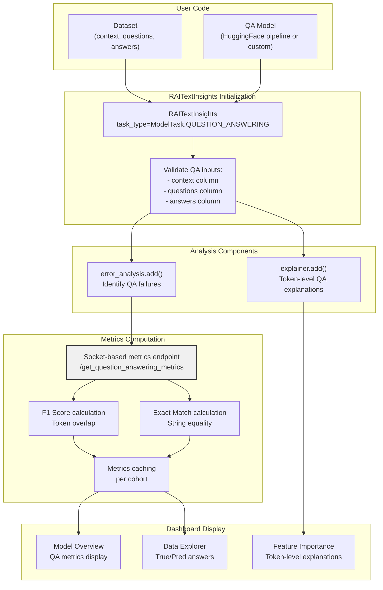
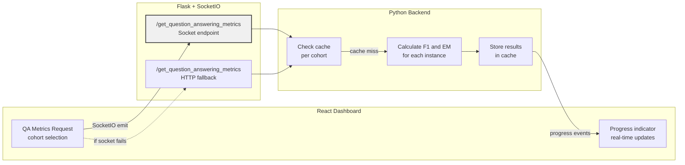
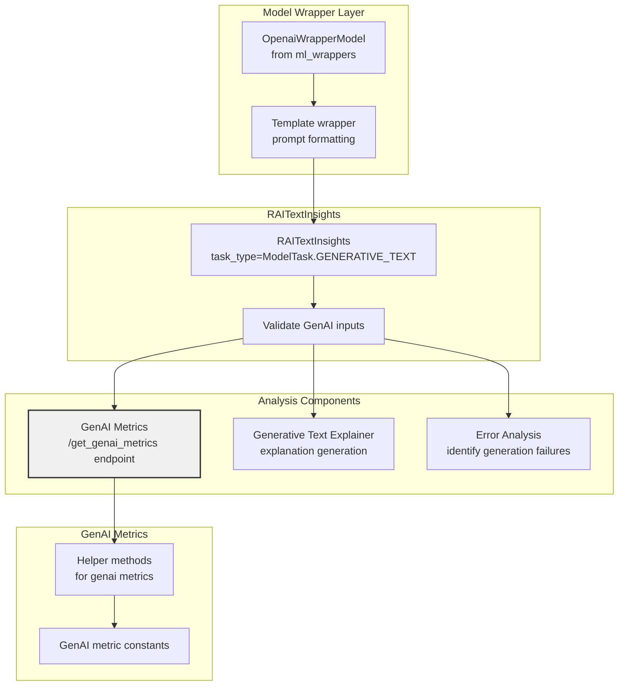

<!-- source: DeepWiki mcp.deepwiki.com · repo microsoft/responsible-ai-toolbox · extra page Question Answering and GenAI · fetched 2026-10-26 -->

# Question Answering and GenAI

<details>
<summary>Relevant source files</summary>

The following files were used as context for generating this wiki page:

- [CHANGES.md](CHANGES.md)
- [README.md](README.md)
- [erroranalysis/requirements-dev.txt](erroranalysis/requirements-dev.txt)
- [erroranalysis/requirements.txt](erroranalysis/requirements.txt)
- [nlp_feature_extractors/requirements.txt](nlp_feature_extractors/requirements.txt)
- [notebooks/responsibleaidashboard/text/responsibleaidashboard-openai-model-debugging.ipynb](notebooks/responsibleaidashboard/text/responsibleaidashboard-openai-model-debugging.ipynb)
- [notebooks/test_notebooks.py](notebooks/test_notebooks.py)
- [rai_core_flask/requirements.txt](rai_core_flask/requirements.txt)
- [raiwidgets/requirements.txt](raiwidgets/requirements.txt)
- [responsibleai/requirements-dev.txt](responsibleai/requirements-dev.txt)
- [responsibleai/requirements.txt](responsibleai/requirements.txt)
- [responsibleai_text/responsibleai_text/version.py](responsibleai_text/responsibleai_text/version.py)
- [responsibleai_vision/responsibleai_vision/version.py](responsibleai_vision/responsibleai_vision/version.py)
- [scripts/e2e-widget.js](scripts/e2e-widget.js)
- [version.cfg](version.cfg)

</details>


## Purpose and Scope

This page documents the Responsible AI Toolbox's support for **Question Answering (QA)** and **Generative AI (GenAI)** text models. These capabilities are provided by the `responsibleai_text` package and enable model assessment, error analysis, and explanations for QA pipelines (e.g., extractive QA on SQuAD) and generative text models (e.g., OpenAI endpoints).

For general text classification tasks, see [RAITextInsights API](#5.2.1). For vision-specific tasks, see [Vision Package](#5.1).

---

## Task Types and Model Support

The `responsibleai_text` package supports two specialized task types for QA and generative models:

| Task Type | Use Case | Supported Models | Metrics |
|-----------|----------|------------------|---------|
| `ModelTask.QUESTION_ANSWERING` | Extractive question answering (e.g., SQuAD) | HuggingFace pipelines, custom QA models | F1 Score, Exact Match (EM) |
| `ModelTask.GENERATIVE_TEXT` | Generative AI responses | OpenAI endpoints, custom generative models | GenAI-specific metrics |

**Sources:** [notebooks/responsibleaidashboard/text/responsibleaidashboard-openai-model-debugging.ipynb:73-74](), [CHANGES.md:92-112]()

---

## Question Answering Architecture

### QA Task Flow



**Question Answering Request Flow**

**Sources:** [notebooks/responsibleaidashboard/text/responsibleaidashboard-openai-model-debugging.ipynb:292-300](), [CHANGES.md:323-326]()

### QA Metrics Computation

Question answering metrics (F1 and Exact Match) are computationally expensive, especially for large datasets. The toolbox uses a socket-based architecture introduced in v0.32.0 to handle these long-running operations asynchronously.



**Socket-based QA Metrics Architecture**

The socket implementation allows the UI to receive progress updates during expensive metric calculations and provides graceful fallback to HTTP requests for backward compatibility.

**Sources:** [CHANGES.md:208-215](), [rai_core_flask/requirements.txt:3]()

### QA Explanations

Question answering models generate token-level feature importance scores to explain which parts of the context influenced the predicted answer.

**Key challenges for QA explanations:**
- Variable token lengths after masking operations
- Alignment between context tokens and answer spans
- Handling start and end token predictions separately

The explainer generates importances for both the **start token** and **end token** predictions, plus base values for the ending tokens.

**Sources:** [CHANGES.md:332](), [CHANGES.md:281]()

---

## Generative AI Support

### GenAI Task Integration

Starting in v0.34.0, the toolbox added support for Generative AI models, including OpenAI endpoints. This enables assessment of large language models (LLMs) for text generation tasks.



**Generative AI Integration Flow**

**Sources:** [CHANGES.md:92-112](), [notebooks/responsibleaidashboard/text/responsibleaidashboard-openai-model-debugging.ipynb:167-192]()

### OpenAI Model Integration

The toolbox integrates with OpenAI endpoints via the `ml_wrappers` library's `OpenaiWrapperModel` class. This wrapper handles:

- API authentication (api_type, api_base, api_version, api_key)
- Request formatting
- Response parsing

**Example configuration:**
```python
from ml_wrappers.model import OpenaiWrapperModel

openai_model = OpenaiWrapperModel(
    api_type="azure",
    api_base="https://your.openai.azure.com/",
    api_version="2023-03-15-preview",
    api_key="your_secret_key",
    engine="gpt-4"
)
```

Users can wrap the model with custom templates to format prompts:

```python
class PromptTemplate:
    def __init__(self, model):
        self.model = model
    
    def predict(self, dataset):
        # Format questions with template
        template = 'Answer the question given the context.'
        # Add context and question to prompt
        templated_questions = [
            f"{template}\n\ncontext: {ctx}\nquestion: {q}"
            for ctx, q in zip(dataset['context'], dataset['questions'])
        ]
        return self.model.predict(dataset)
```

**Sources:** [notebooks/responsibleaidashboard/text/responsibleaidashboard-openai-model-debugging.ipynb:167-237]()

### GenAI Metrics and Evaluation

GenAI models are evaluated using specialized metrics introduced in v0.34.0. The metrics endpoint is accessible via:

**Dashboard UI:** Model Overview tab displays GenAI metrics for the selected cohort

**Backend API:** `/get_genai_metrics` endpoint computes and caches GenAI-specific evaluation metrics

The metrics include constants and helper methods defined in the `responsibleai_text` package.

**Sources:** [CHANGES.md:108-112]()

---

## Example Workflows

### Question Answering on SQuAD

The toolbox provides example notebooks demonstrating QA model assessment:

**HuggingFace QA Model:**
```python
from transformers import pipeline
from responsibleai_text import RAITextInsights, ModelTask

# Load QA pipeline
qa_pipeline = pipeline("question-answering", model="...")

# Initialize RAITextInsights
rai_insights = RAITextInsights(
    qa_pipeline, 
    test_data,
    "answers",
    task_type=ModelTask.QUESTION_ANSWERING
)

# Add analysis components
rai_insights.error_analysis.add()
rai_insights.explainer.add()

# Compute insights
rai_insights.compute()

# Launch dashboard
from raiwidgets import ResponsibleAIDashboard
ResponsibleAIDashboard(rai_insights)
```

**Sources:** [README.md:114-116](), [notebooks/test_notebooks.py:344-351]()

### OpenAI Model Assessment

The OpenAI notebook demonstrates GenAI model assessment:

**OpenAI Endpoint:**
```python
from ml_wrappers.model import OpenaiWrapperModel
from responsibleai_text import RAITextInsights, ModelTask

# Configure OpenAI wrapper
openai_model = OpenaiWrapperModel(
    api_type="azure",
    api_base="...",
    api_version="...",
    api_key="...",
    engine="gpt-4"
)

# Wrap with prompt template
pipeline = PromptTemplate(openai_model)

# Initialize RAITextInsights
rai_insights = RAITextInsights(
    pipeline,
    test_data,
    "answers",
    task_type=ModelTask.QUESTION_ANSWERING
)

# Error analysis available; explanations not yet supported for OpenAI
rai_insights.error_analysis.add()
# rai_insights.explainer.add()  # Not available for OpenAI

rai_insights.compute()
```

**Current limitations:**
- Explanations are not yet available for OpenAI models
- Socket-based communication required for large datasets

**Sources:** [notebooks/responsibleaidashboard/text/responsibleaidashboard-openai-model-debugging.ipynb:292-320](), [README.md:114]()

---

## Dataset Format Requirements

### Question Answering Dataset

QA datasets must contain three columns:

| Column | Type | Description |
|--------|------|-------------|
| `context` | string | The passage containing the answer |
| `questions` | string | The question to be answered |
| `answers` | string | The ground truth answer text |

Example from SQuAD dataset:
```python
data = pd.DataFrame({
    'context': context_list,
    'questions': questions_list,
    'answers': answers_list
})
```

**Sources:** [notebooks/responsibleaidashboard/text/responsibleaidashboard-openai-model-debugging.ipynb:131-148]()

### Generative AI Dataset

GenAI datasets follow the same structure as QA datasets but may include additional task-specific columns. The model wrapper handles prompt formatting before sending requests to the generative model.

**Sources:** [notebooks/responsibleaidashboard/text/responsibleaidashboard-openai-model-debugging.ipynb:210-236]()

---

## Caching and Performance

### Metrics Caching Strategy

To optimize performance, QA and GenAI metrics are cached per cohort:

**Cache key:** Cohort definition (filters, feature selections)

**Cache invalidation:** When cohort definition changes

**Benefits:**
- Avoid recomputing expensive metrics (F1, EM, GenAI metrics)
- Enable fast cohort switching in the dashboard
- Support interrupted computation resumption

**Sources:** [CHANGES.md:323]()

### Socket-based Communication

For long-running metric computations, the toolbox uses SocketIO to provide:

1. **Real-time progress updates** - Dashboard shows computation progress
2. **Graceful fallback** - HTTP requests if socket connection fails
3. **Interruption support** - User can cancel expensive operations

**Endpoints:**
- `/get_question_answering_metrics` - QA metrics computation
- `/get_genai_metrics` - GenAI metrics computation (v0.34.0+)

**Sources:** [CHANGES.md:208](), [CHANGES.md:358-359](), [rai_core_flask/requirements.txt:3]()

---

## Testing and Notebooks

### Notebook Tests

The toolbox includes notebook tests for QA and GenAI scenarios:

**Test files:**
- `test_responsibleaidashboard_question_answering_model_debugging()` - HuggingFace QA model
- `test_responsibleaidashboard_openai_model_debugging()` - OpenAI endpoint

**Test notebooks:**
- `responsibleaidashboard-question-answering-model-debugging.ipynb` - HuggingFace example
- `responsibleaidashboard-openai-model-debugging.ipynb` - OpenAI example

**Note:** These notebooks are in the `ignoredFiles` list for E2E testing, indicating they require manual testing or special setup (e.g., API keys).

**Sources:** [notebooks/test_notebooks.py:344-360](), [scripts/e2e-widget.js:35-38]()

---

## Version History

| Version | Feature | Description |
|---------|---------|-------------|
| v0.30.0 | QA cache support | Model overview metrics caching for QA tasks |
| v0.30.0 | QA feature importance | Individual token-level explanations for QA |
| v0.31.0 | QA UI improvements | Info button and SHAP values in description |
| v0.32.0 | Socket implementation | Async metrics computation via SocketIO |
| v0.34.0 | GenAI integration | Support for generative text models |
| v0.34.0 | GenAI metrics | Specialized metrics for generative AI evaluation |
| v0.34.0 | GenAI explainer | Generative text explanation methods |
| v0.34.0 | GenAI UI | Dashboard support for generative AI task type |

**Sources:** [CHANGES.md:92-112](), [CHANGES.md:208-215](), [CHANGES.md:323-326]()

---

