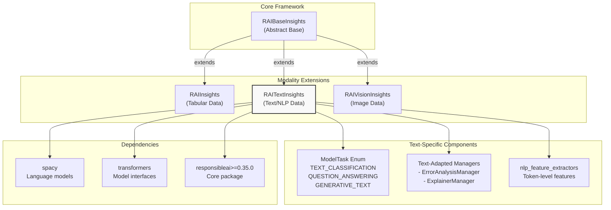
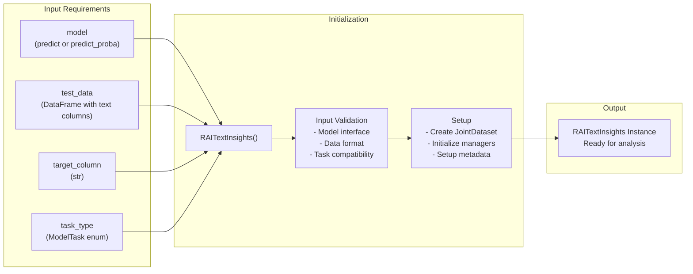
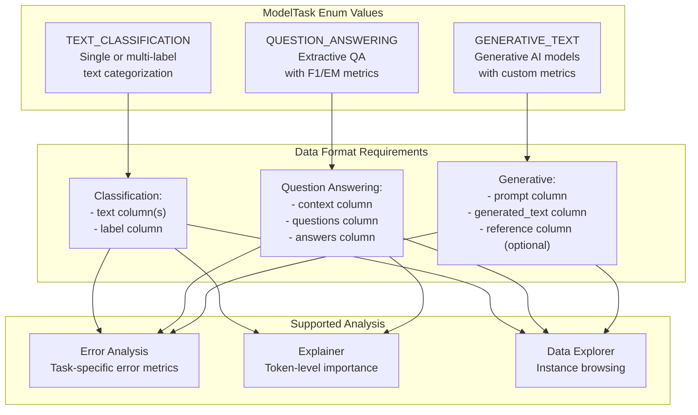
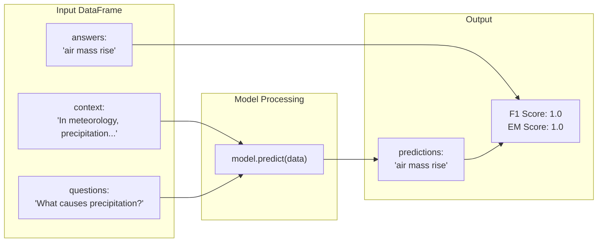
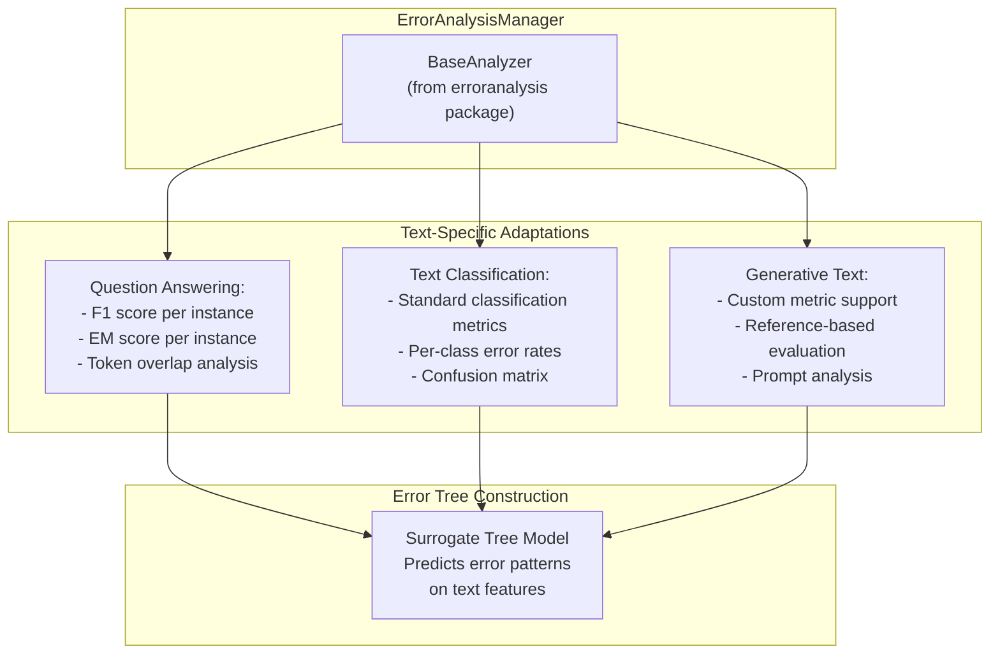
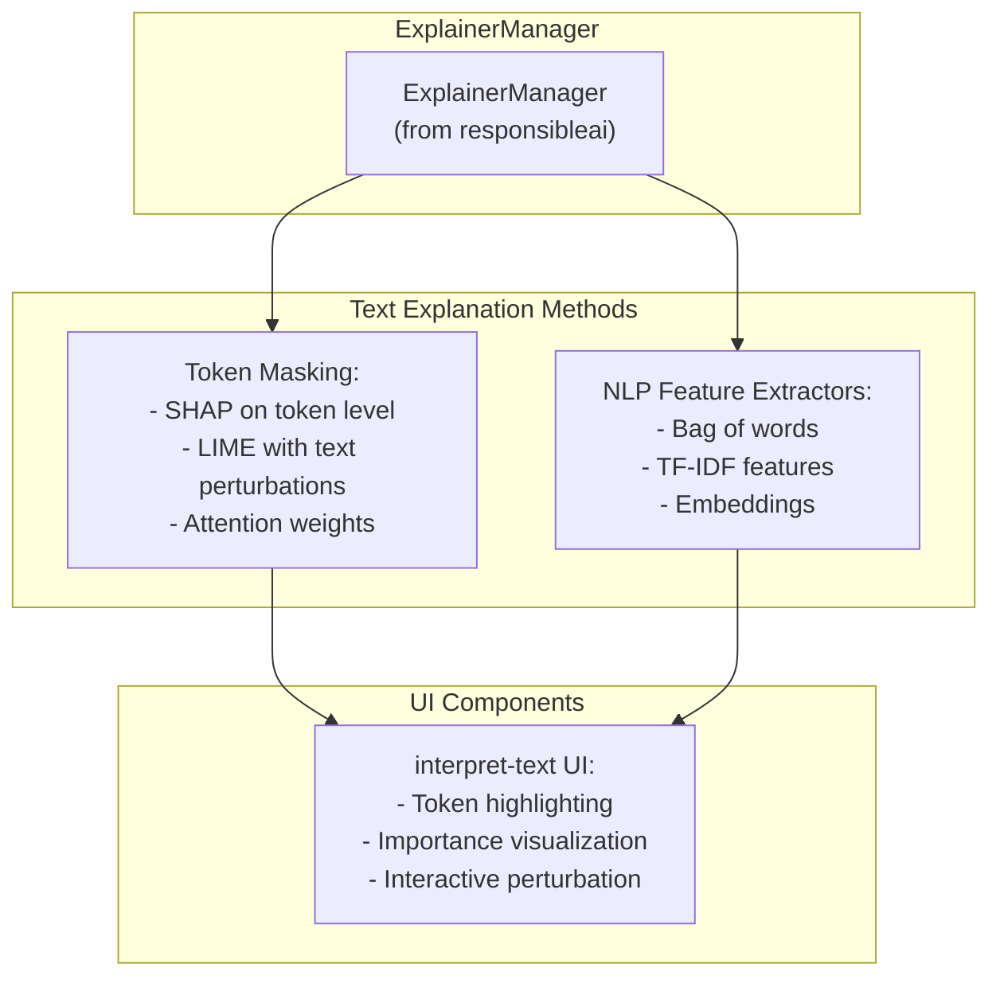
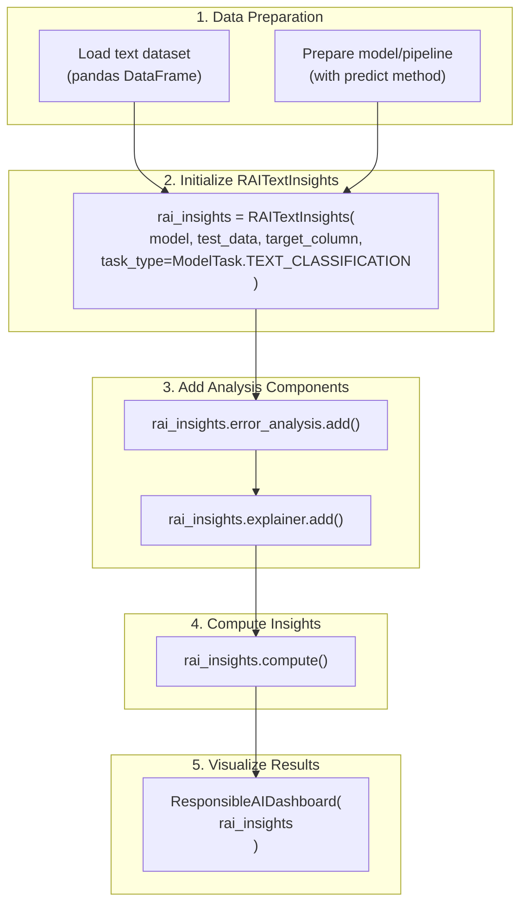
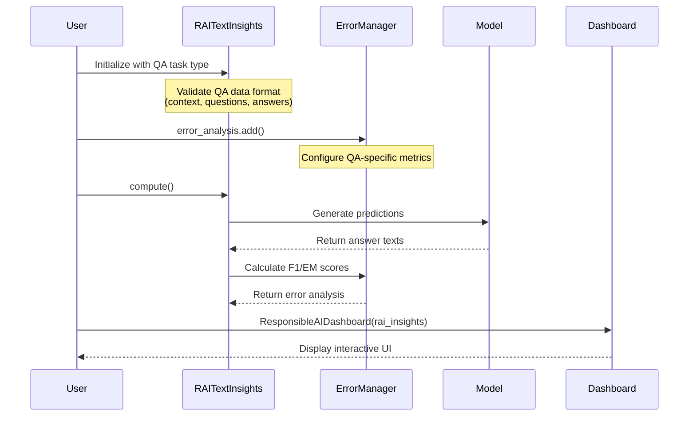
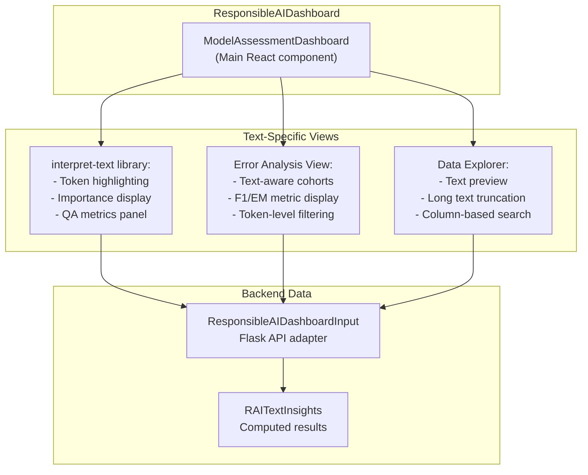

<!-- source: DeepWiki mcp.deepwiki.com · repo microsoft/responsible-ai-toolbox · extra page RAITextInsights API · fetched 2026-10-26 -->

# RAITextInsights API

<details>
<summary>Relevant source files</summary>

The following files were used as context for generating this wiki page:

- [.github/workflows/CI-e2e-notebooks-text-vision.yml](.github/workflows/CI-e2e-notebooks-text-vision.yml)
- [.github/workflows/CI-notebook-text.yml](.github/workflows/CI-notebook-text.yml)
- [.github/workflows/CI-notebook-vision.yml](.github/workflows/CI-notebook-vision.yml)
- [.github/workflows/CI-responsibleai-text-vision-pytest.yml](.github/workflows/CI-responsibleai-text-vision-pytest.yml)
- [README.md](README.md)
- [notebooks/responsibleaidashboard/text/responsibleaidashboard-openai-model-debugging.ipynb](notebooks/responsibleaidashboard/text/responsibleaidashboard-openai-model-debugging.ipynb)
- [notebooks/test_notebooks.py](notebooks/test_notebooks.py)
- [responsibleai_text/requirements.txt](responsibleai_text/requirements.txt)
- [responsibleai_vision/requirements.txt](responsibleai_vision/requirements.txt)
- [scripts/e2e-widget.js](scripts/e2e-widget.js)

</details>


## Purpose and Scope

This document describes the `RAITextInsights` class, the main entry point for analyzing text and NLP models in the Responsible AI Toolbox. `RAITextInsights` provides specialized support for text classification, question answering, and generative AI tasks.

For general information about the core RAI framework, see [RAIInsights Core API](#3.2). For vision-specific analysis, see [RAIVisionInsights API](#5.1.1). For information about text-specific UI components, see [Text Package](#5.2).

---

## Overview

`RAITextInsights` extends the core RAI framework to handle text data and NLP models. It inherits from `RAIBaseInsights` and adapts the standard analysis managers (error analysis, explainer, causal, counterfactual) to work with text-specific data structures and model outputs.

### Architecture Position



**RAITextInsights Class Position in Package Hierarchy**

Sources: [responsibleai_text/requirements.txt:1-7](), [README.md:27-32]()

---

## Package Dependencies

The `responsibleai_text` package requires the following core dependencies:

| Dependency | Version | Purpose |
|------------|---------|---------|
| `numpy` | >=1.17.2, <2.0.0 | Array operations |
| `pandas` | >=0.25.1 | DataFrame handling |
| `scikit-learn` | >=0.22.1 | Base ML utilities |
| `scipy` | >=1.4.1 | Scientific computing |
| `semver` | ~=2.13.0 | Version management |
| `nlp-feature-extractors` | ==0.1.0 | Text feature extraction |
| `responsibleai` | >=0.35.0 | Core RAI framework |

Additional optional dependencies include `spacy` for language models and `transformers` for HuggingFace model integration.

Sources: [responsibleai_text/requirements.txt:1-7]()

---

## Initialization

### Basic Initialization Pattern

The `RAITextInsights` class follows the same initialization pattern as the core `RAIInsights` class, but with text-specific considerations:



**RAITextInsights Initialization Flow**

### Constructor Signature

The typical initialization looks like:

```python
from responsibleai_text import RAITextInsights, ModelTask

rai_insights = RAITextInsights(
    model,                    # Model or pipeline with predict method
    test_data,               # pandas DataFrame with text data
    target_column,           # Name of the target/label column
    task_type=ModelTask.TEXT_CLASSIFICATION,  # Task type
    classes=None,            # Optional: class labels for classification
    text_column=None,        # Optional: name of main text column
    serializer=None          # Optional: custom serializer
)
```

Sources: [notebooks/responsibleaidashboard/text/responsibleaidashboard-openai-model-debugging.ipynb:297-299]()

---

## Supported Task Types

### ModelTask Enum

`RAITextInsights` supports three primary task types through the `ModelTask` enum:



**Task Types and Their Requirements**

### Task-Specific Characteristics

#### TEXT_CLASSIFICATION
- Supports binary, multiclass, and multilabel classification
- Model must implement `predict_proba()` for probability outputs
- Compatible with standard classification metrics (accuracy, precision, recall, F1)
- Example notebooks: DBPedia classification, binary text classification

#### QUESTION_ANSWERING
- Dataset requires three columns: `context`, `questions`, `answers`
- Model returns text spans as predictions
- Evaluated using F1 score and Exact Match (EM) metrics
- Supports both extractive QA models and API endpoints (e.g., OpenAI)

#### GENERATIVE_TEXT
- For generative AI models (GPT, T5, etc.)
- Supports custom evaluation metrics
- Can integrate with prompt templates
- Model outputs are free-form text

Sources: [notebooks/responsibleaidashboard/text/responsibleaidashboard-openai-model-debugging.ipynb:73-74](), [README.md:113-118]()

---

## Data Format Expectations

### Text Classification Data

For text classification tasks, data is expected in a pandas DataFrame:

| Column Type | Required | Description |
|-------------|----------|-------------|
| Text column(s) | Yes | One or more columns containing text data |
| Label column | Yes | Target column specified in `target_column` parameter |
| Metadata columns | Optional | Additional columns for cohort analysis |

### Question Answering Data

Question answering requires specific column structure:

| Column Name | Required | Description |
|-------------|----------|-------------|
| `context` | Yes | Background text/passage |
| `questions` | Yes | Questions to be answered |
| `answers` | Yes | Ground truth answers (for evaluation) |

Example from SQuAD dataset:



**Question Answering Data Flow**

Sources: [notebooks/responsibleaidashboard/text/responsibleaidashboard-openai-model-debugging.ipynb:131-147]()

---

## Manager Integration

### Text-Adapted Error Analysis

The Error Analysis manager adapts to text-specific model types:



**Text-Specific Error Analysis Adaptations**

### Text-Adapted Explainer

The Explainer manager provides token-level explanations:



**Text Explainer Integration**

Sources: [responsibleai_text/requirements.txt:6]()

---

## Workflow Examples

### Complete Analysis Workflow



**End-to-End Text Analysis Workflow**

### Question Answering Example

Based on the OpenAI notebook example:



**Question Answering Analysis Sequence**

Sources: [notebooks/responsibleaidashboard/text/responsibleaidashboard-openai-model-debugging.ipynb:297-337]()

---

## Text-Specific Features

### NLP Feature Extractors

The `nlp_feature_extractors` package provides text-specific feature extraction:

| Extractor Type | Purpose | Output |
|----------------|---------|--------|
| Bag of Words | Token frequency features | Sparse matrix |
| TF-IDF | Term importance weighting | Sparse matrix |
| Word Embeddings | Dense semantic representations | Dense matrix |
| Custom Extractors | Domain-specific features | Custom format |

These extractors enable error analysis and explanation on text data by converting text into numeric features that the surrogate tree and explainer can process.

### Token-Level Explanations

Unlike tabular features, text explanations operate at the token level:

- Individual tokens receive importance scores
- Importance is visualized through text highlighting in the UI
- Supports both local (instance-level) and global explanations
- Compatible with SHAP, LIME, and attention-based methods

---

## Model Interface Requirements

### Standard Prediction Interface

Models must implement one of:

1. **`predict(data)` method**: Returns predictions
   - For classification: class labels
   - For QA: answer text strings
   - For generative: generated text

2. **`predict_proba(data)` method**: Returns probability distributions
   - Required for classification with probability-based explanations
   - Optional for other task types

### API Endpoint Wrapping

For API-based models (e.g., OpenAI, Azure endpoints), use wrapper classes:

```python
from ml_wrappers.model import OpenaiWrapperModel

openai_model = OpenaiWrapperModel(
    api_type="azure",
    api_base="https://your.openai.azure.com/",
    api_version="2023-03-15-preview",
    api_key="your_key",
    engine='gpt-4'
)
```

The wrapper ensures the model conforms to the expected interface while handling API communication.

Sources: [notebooks/responsibleaidashboard/text/responsibleaidashboard-openai-model-debugging.ipynb:167-192]()

---

## Integration with Dashboard

### Dashboard Components for Text

The text dashboard includes specialized UI components:



**Text Dashboard Component Integration**

The dashboard automatically detects the task type from `RAITextInsights` and renders appropriate UI components.

---

## Testing and CI/CD

### Notebook Tests

Text notebooks are tested using the pytest framework with specialized markers:

| Test Marker | Purpose | Notebooks Covered |
|-------------|---------|-------------------|
| `text_notebooks` | Marks text-specific tests | All text notebooks |
| Parametrized | Multiple OS/Python versions | Ubuntu, Windows; Python 3.8-3.10 |

Test execution:
```bash
python -m pytest -s -v notebooks -m text_notebooks
```

### CI Workflows

The text package has dedicated CI workflows:

1. **CI-notebook-text.yml**: Tests text notebooks
   - Runs on: ubuntu-latest, windows-latest
   - Python versions: 3.8, 3.9, 3.10
   - Includes spacy model download

2. **CI-responsibleai-text-vision-pytest.yml**: Unit/integration tests
   - Tests both text and vision packages
   - Matrix excludes macOS due to timeout issues
   - Installs keras compatibility layer for transformers

3. **CI-e2e-notebooks-text-vision.yml**: End-to-end dashboard tests
   - Tests complete widget integration
   - Uses Cypress for UI testing
   - Covers specific notebooks: DBPedia, blbooksgenre, covid-event

Sources: [.github/workflows/CI-notebook-text.yml:1-125](), [.github/workflows/CI-responsibleai-text-vision-pytest.yml:1-166](), [.github/workflows/CI-e2e-notebooks-text-vision.yml:1-174]()

---

## Limitations and Constraints

### Current Limitations

1. **Explainer Support**: Not all explanation methods support API-based models (e.g., OpenAI endpoints)
2. **macOS CI**: Currently excluded from some CI workflows due to timeout issues
3. **Generative Metrics**: Limited built-in metrics for generative text tasks
4. **Large Text**: Very long documents may require truncation or chunking

### Known Issues

- QA notebooks for OpenAI are excluded from automated e2e tests
- Some transformers models require keras compatibility layer (keras==2.15)
- Specific torch/torchvision version constraints for compatibility

Sources: [.github/workflows/CI-responsibleai-text-vision-pytest.yml:20-39](), [notebooks/responsibleaidashboard/text/responsibleaidashboard-openai-model-debugging.ipynb:318-319]()

---

## Example Notebooks

The repository includes several text analysis notebooks:

| Notebook | Task Type | Model | Dataset |
|----------|-----------|-------|---------|
| responsibleaidashboard-DBPedia-text-classification-model-debugging | Classification | Custom | DBPedia |
| responsibleaidashboard-blbooksgenre-binary-text-classification-model-debugging | Binary Classification | Custom | BLBooksGenre |
| responsibleaidashboard-covid-event-multilabel-text-classification-model-debugging | Multilabel Classification | Custom | COVID-19 Events |
| responsibleaidashboard-question-answering-model-debugging | QA | HuggingFace | SQuAD |
| responsibleaidashboard-openai-model-debugging | QA | OpenAI API | SQuAD |

All notebooks follow a similar structure:
1. Load and prepare data
2. Initialize RAITextInsights
3. Add analysis components (error_analysis, explainer)
4. Compute insights
5. Visualize with ResponsibleAIDashboard

Sources: [README.md:113-118](), [notebooks/test_notebooks.py:315-360](), [scripts/e2e-widget.js:30-38]()

---

