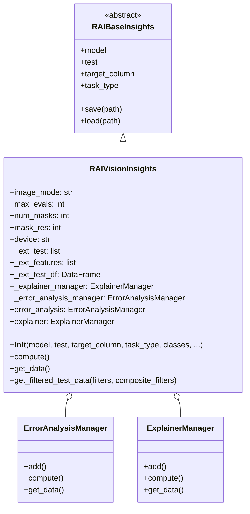
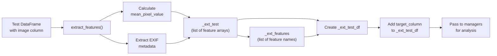
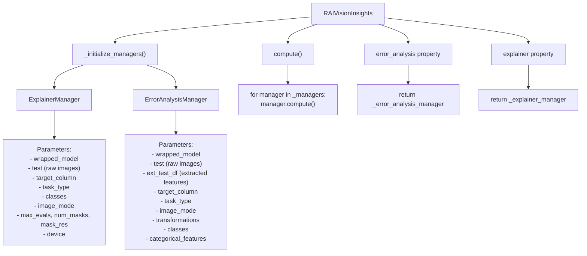
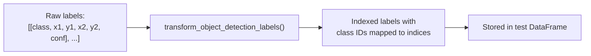
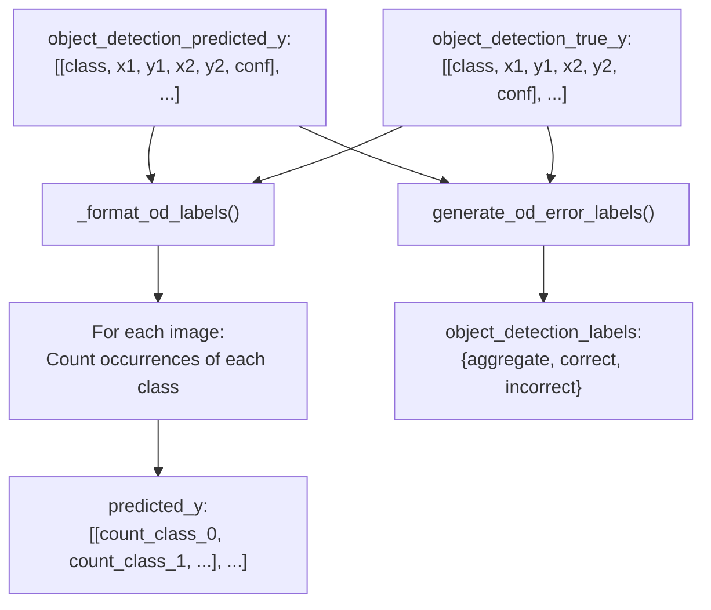
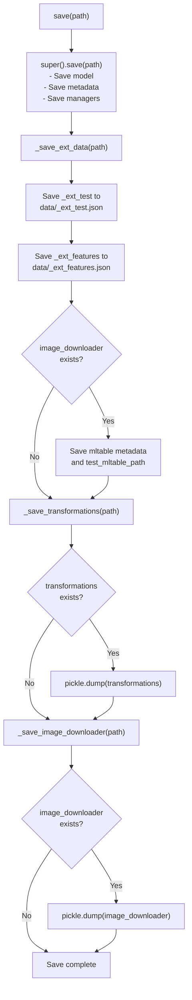
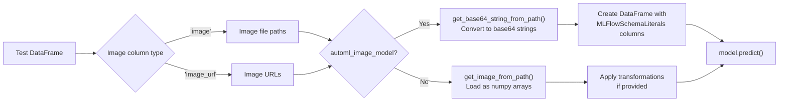

<!-- source: DeepWiki mcp.deepwiki.com · repo microsoft/responsible-ai-toolbox · extra page RAIVisionInsights API · fetched 2026-10-26 -->

# RAIVisionInsights API

<details>
<summary>Relevant source files</summary>

The following files were used as context for generating this wiki page:

- [apps/dashboard/src/app/visionApplications.ts](apps/dashboard/src/app/visionApplications.ts)
- [apps/dashboard/src/model-assessment-vision/__mock_data__/fridgeObjectDetection.ts](apps/dashboard/src/model-assessment-vision/__mock_data__/fridgeObjectDetection.ts)
- [apps/dashboard/src/model-assessment-vision/__mock_data__/fridgeObjectDetectionImages.ts](apps/dashboard/src/model-assessment-vision/__mock_data__/fridgeObjectDetectionImages.ts)
- [libs/core-ui/src/lib/Interfaces/IVisionModelExplanationData.ts](libs/core-ui/src/lib/Interfaces/IVisionModelExplanationData.ts)
- [libs/interpret-vision/src/lib/VisionExplanationDashboard/Controls/DetectionDetails.tsx](libs/interpret-vision/src/lib/VisionExplanationDashboard/Controls/DetectionDetails.tsx)
- [libs/interpret-vision/src/lib/VisionExplanationDashboard/Controls/FlyoutObjectDetection.tsx](libs/interpret-vision/src/lib/VisionExplanationDashboard/Controls/FlyoutObjectDetection.tsx)
- [libs/interpret-vision/src/lib/VisionExplanationDashboard/Controls/FlyoutObjectDetectionUtils.tsx](libs/interpret-vision/src/lib/VisionExplanationDashboard/Controls/FlyoutObjectDetectionUtils.tsx)
- [libs/interpret-vision/src/lib/VisionExplanationDashboard/utils/FlyoutUtils.tsx](libs/interpret-vision/src/lib/VisionExplanationDashboard/utils/FlyoutUtils.tsx)
- [notebooks/individual-dashboards/erroranalysis-dashboard/erroranalysis-dashboard-regression-superconductor.ipynb](notebooks/individual-dashboards/erroranalysis-dashboard/erroranalysis-dashboard-regression-superconductor.ipynb)
- [responsibleai_text/tests/test_rai_text_insights_save_and_load_scenarios.py](responsibleai_text/tests/test_rai_text_insights_save_and_load_scenarios.py)
- [responsibleai_vision/responsibleai_vision/common/constants.py](responsibleai_vision/responsibleai_vision/common/constants.py)
- [responsibleai_vision/responsibleai_vision/managers/error_analysis_manager.py](responsibleai_vision/responsibleai_vision/managers/error_analysis_manager.py)
- [responsibleai_vision/responsibleai_vision/rai_vision_insights/rai_vision_insights.py](responsibleai_vision/responsibleai_vision/rai_vision_insights/rai_vision_insights.py)
- [responsibleai_vision/tests/rai_vision_insights_validator.py](responsibleai_vision/tests/rai_vision_insights_validator.py)
- [responsibleai_vision/tests/test_rai_vision_insights.py](responsibleai_vision/tests/test_rai_vision_insights.py)
- [responsibleai_vision/tests/test_rai_vision_insights_save_and_load_scenarios.py](responsibleai_vision/tests/test_rai_vision_insights_save_and_load_scenarios.py)

</details>


## Purpose and Scope

The `RAIVisionInsights` class is the main entry point for analyzing vision machine learning models within the Responsible AI Toolbox. It extends the core RAI framework to support image-based tasks including image classification, multilabel image classification, and object detection.

This page documents the `RAIVisionInsights` API, its initialization parameters, data processing pipeline, and integration with vision-specific analysis managers. For the base RAI framework that this extends, see [RAIInsights Core API](#3.2). For object detection-specific features, see [Object Detection Support](#5.1.2). For vision UI components, see [Vision UI Components](#5.1.3).

**Sources:** [responsibleai_vision/responsibleai_vision/rai_vision_insights/rai_vision_insights.py:119-273]()

---

## Class Structure and Inheritance



The `RAIVisionInsights` class is defined in [responsibleai_vision/responsibleai_vision/rai_vision_insights/rai_vision_insights.py:119]() and inherits from `RAIBaseInsights` to provide vision-specific functionality while maintaining compatibility with the core RAI framework.

**Sources:** [responsibleai_vision/responsibleai_vision/rai_vision_insights/rai_vision_insights.py:119-125](), [responsibleai_vision/responsibleai_vision/rai_vision_insights/rai_vision_insights.py:274-298]()

---

## Constructor Parameters

The `RAIVisionInsights` constructor accepts the following parameters:

| Parameter | Type | Required | Description |
|-----------|------|----------|-------------|
| `model` | object | Yes | Model implementing `predict()` or `predict_proba()` methods |
| `test` | pd.DataFrame | Yes | Test dataframe with image column and labels |
| `target_column` | str or list[str] | Yes | Label column name (list for multilabel tasks) |
| `task_type` | str | Yes | One of: `image_classification`, `multilabel_image_classification`, `object_detection` |
| `classes` | np.ndarray | Optional | Class labels in order matching model output |
| `serializer` | object | Optional | Custom serializer with `save()` and `load()` methods |
| `maximum_rows_for_test` | int | Optional | Row limit for test data (default: 5000) |
| `image_mode` | str | Optional | Pillow image mode (default: `RGB`) |
| `test_data_path` | str | Optional | Path to test data for persistence |
| `transformations` | callable | Optional | Image transformations to apply |
| `image_downloader` | object | Optional | Downloader for URL-based images |
| `feature_metadata` | FeatureMetadata | Optional | Metadata for categorical/dropped features |
| `image_width` | float | Optional | Width in inches to resize images for dashboard |
| `max_evals` | int | Optional | Max evaluations for SHAP explainer (default: 100) |
| `num_masks` | int | Optional | Number of masks for DRISE explainer (default: 50) |
| `mask_res` | int | Optional | Mask resolution for DRISE explainer (default: 4) |
| `device` | str | Optional | Device for model execution: `cpu`, `cuda`, `auto` (default: `auto`) |

**Sources:** [responsibleai_vision/responsibleai_vision/rai_vision_insights/rai_vision_insights.py:126-202]()

---

## Initialization and Validation Flow

```mermaid
flowchart TD
    Start["RAIVisionInsights.__init__()"] --> ResetIndex["Reset DataFrame index"]
    ResetIndex --> InitFeatureMeta["Initialize FeatureMetadata"]
    InitFeatureMeta --> SetParams["Set image_mode, max_evals, num_masks, mask_res, device"]
    
    SetParams --> GetSample["Get 2-row sample from test data"]
    GetSample --> TransformSample["get_images(sample, image_mode, transformations)"]
    TransformSample --> WrapModel["wrap_model(model, sample, task_type, classes, device)"]
    
    WrapModel --> CheckAutoML["Check if is_automl_image_model()"]
    CheckAutoML --> Validate["_validate_rai_insights_input_parameters()"]
    
    Validate --> ValidateTask["Validate task_type in<br/>[image_classification,<br/>multilabel_image_classification,<br/>object_detection]"]
    ValidateTask --> ValidateModel["Validate model.predict() works"]
    ValidateModel --> ValidateDataFrame["Validate test is pd.DataFrame"]
    ValidateDataFrame --> ValidateSize["Validate test.shape[0] <= maximum_rows_for_test"]
    ValidateSize --> ValidateTargetCol["Validate target_column in test.columns"]
    
    ValidateTargetCol --> GetClasses["_get_classes(task_type, test, target_column, classes)"]
    GetClasses --> TransformOD{"task_type ==<br/>OBJECT_DETECTION?"}
    
    TransformOD -->|Yes| TransformLabels["transform_object_detection_labels(test, target_column, classes)"]
    TransformOD -->|No| CallSuper["Call super().__init__()"]
    TransformLabels --> CallSuper
    
    CallSuper --> ExtractFeatures["extract_features(test, target_column, image_mode, feature_metadata)"]
    ExtractFeatures --> CreateExtDF["Create _ext_test_df from extracted features + target_column"]
    CreateExtDF --> InitManagers["_initialize_managers()"]
    
    InitManagers --> CreateExplainerMgr["Create ExplainerManager"]
    InitManagers --> CreateErrorMgr["Create ErrorAnalysisManager"]
    
    CreateExplainerMgr --> End["Initialization complete"]
    CreateErrorMgr --> End
```



**Sources:** [responsibleai_vision/responsibleai_vision/rai_vision_insights/rai_vision_insights.py:203-272](), [responsibleai_vision/responsibleai_vision/rai_vision_insights/rai_vision_insights.py:325-418]()

---

## Supported Task Types

The `ModelTask` enum defines three supported vision tasks:

### Image Classification

Single-label classification where each image belongs to exactly one class.

- **Target column:** Single string column name
- **Classes:** Array of class names or automatically extracted from `test[target_column].unique()`
- **Predictions:** Single class label per image

**Sources:** [responsibleai_vision/responsibleai_vision/common/constants.py:13-22](), [responsibleai_vision/responsibleai_vision/rai_vision_insights/rai_vision_insights.py:307-314]()

### Multilabel Image Classification

Multi-label classification where each image can belong to multiple classes simultaneously.

- **Target column:** List of column names (one per label)
- **Classes:** List of target column names if not explicitly provided
- **Predictions:** Binary array indicating presence/absence of each label
- **Validation:** Requires `target_column` to be a list and all columns present in test data

**Sources:** [responsibleai_vision/responsibleai_vision/rai_vision_insights/rai_vision_insights.py:315-319](), [responsibleai_vision/responsibleai_vision/rai_vision_insights/rai_vision_insights.py:403-412]()

### Object Detection

Detection of multiple objects with bounding boxes in each image.

- **Target column:** Single column with nested arrays
- **Label format:** `[[class_id, x1, y1, x2, y2, confidence], ...]` per image
- **Classes:** Required array of object class names
- **Special handling:** Labels are transformed via `transform_object_detection_labels()`

**Sources:** [responsibleai_vision/responsibleai_vision/rai_vision_insights/rai_vision_insights.py:256-258](), [responsibleai_vision/responsibleai_vision/rai_vision_insights/rai_vision_insights.py:320-323]()

---

## Feature Extraction Pipeline



The feature extraction process converts raw images into tabular features for error analysis:

| Feature Type | Description | Extraction Method |
|--------------|-------------|-------------------|
| `mean_pixel_value` | Average pixel intensity across all channels | Computed from image array |
| EXIF metadata | Camera settings, timestamps, GPS, etc. | Extracted from image file metadata |
| User-provided | Additional metadata columns | Passed through from test DataFrame |

The extracted features are stored in three attributes:
- `_ext_test`: List of feature value arrays
- `_ext_features`: List of feature names
- `_ext_test_df`: pandas DataFrame combining features and target column

**Sources:** [responsibleai_vision/responsibleai_vision/rai_vision_insights/rai_vision_insights.py:263-271](), [responsibleai_vision/responsibleai_vision/utils/feature_extractors.py]()

---

## Manager Integration



The `_initialize_managers()` method creates two vision-specific managers:

### ExplainerManager

Handles model explanations for vision tasks using techniques like SHAP and DRISE.

- Works with **raw images** for generating explanations
- Supports hierarchical image SHAP for classification
- Supports DRISE (object detection explanations)
- Configured via `max_evals`, `num_masks`, `mask_res` parameters

**Sources:** [responsibleai_vision/responsibleai_vision/rai_vision_insights/rai_vision_insights.py:279-288](), [responsibleai_vision/responsibleai_vision/managers/explainer_manager.py]()

### ErrorAnalysisManager

Performs error analysis using **extracted features** for tabular analysis.

- Creates `WrappedIndexPredictorModel` to cache predictions
- Uses extracted features (`_ext_test_df`) for error tree/matrix computation
- Supports categorical features from `feature_metadata`
- Special handling for multilabel tasks (concatenates labels)

**Sources:** [responsibleai_vision/responsibleai_vision/rai_vision_insights/rai_vision_insights.py:289-296](), [responsibleai_vision/responsibleai_vision/managers/error_analysis_manager.py:164-219]()

---

## Data Processing for Dashboard

```mermaid
flowchart TD
    GetData["get_data()"] --> CreateRAIData["Create RAIInsightsData()"]
    CreateRAIData --> GetDataset["_get_dataset()"]
    
    GetDataset --> SetTaskType["Set task_type and categorical_features"]
    SetTaskType --> SetClassNames["Set class_names from _classes"]
    
    SetClassNames --> CheckAutoML{"automl_image_model?"}
    
    CheckAutoML -->|Yes| ConvertBase64["Convert images to base64<br/>using get_base64_string_from_path()"]
    CheckAutoML -->|No| GetImages["get_images(test, image_mode, transformations)"]
    
    ConvertBase64 --> CheckOD{"task_type ==<br/>OBJECT_DETECTION?"}
    GetImages --> CheckOD
    
    CheckOD -->|Yes| ODBranch["Create DataFrame with<br/>INPUT_COLUMN_IMAGE and<br/>INPUT_IMAGE_SIZE columns"]
    CheckOD -->|No| RegularBranch["Create DataFrame with<br/>INPUT_COLUMN_IMAGE column"]
    
    ODBranch --> Predict["wrapped_model.predict(dataset)"]
    RegularBranch --> Predict
    
    Predict --> ConvertPred["convert_to_list(predicted_y)"]
    ConvertPred --> ConvertLabels["_convert_labels(predicted_y, class_names)"]
    
    ConvertLabels --> ExtractImages["Extract images from test DataFrame"]
    ExtractImages --> EncodeLoop["For each image:<br/>- Load from path if string<br/>- Normalize to [0,1]<br/>- Resize if image_width specified<br/>- Save as JPG to BytesIO<br/>- Base64 encode"]
    
    EncodeLoop --> StoreDims["Store image_dimensions<br/>(original width, height)"]
    StoreDims --> CheckODOutput{"task_type ==<br/>OBJECT_DETECTION?"}
    
    CheckODOutput -->|Yes| FormatOD["_format_od_labels()<br/>Convert to multilabel format<br/>generate_od_error_labels()"]
    CheckODOutput -->|No| SetFeatures["Set features to _ext_test<br/>Set feature_names to _ext_features"]
    
    FormatOD --> SetFeatures
    SetFeatures --> ReturnDataset["Return dashboard_dataset"]
    ReturnDataset --> AddErrorData["Add error_analysis.get_data()"]
    AddErrorData --> ReturnRAIData["Return RAIInsightsData"]
```



**Sources:** [responsibleai_vision/responsibleai_vision/rai_vision_insights/rai_vision_insights.py:545-704]()

---

## Object Detection Specific Processing

### Label Transformation

Object detection labels are transformed during initialization:



### Prediction Format

Object detection predictions are reformatted for the dashboard:



The `_format_od_labels()` method converts object detection format to multilabel format by counting object occurrences per class.

**Sources:** [responsibleai_vision/responsibleai_vision/rai_vision_insights/rai_vision_insights.py:683-728]()

---

## Persistence: Save and Load

### Save Process



**Sources:** [responsibleai_vision/responsibleai_vision/rai_vision_insights/rai_vision_insights.py:762-827]()

### Load Process

The `RAIVisionInsights.load(path)` class method reconstructs the object from saved artifacts:

1. Loads base RAIInsights data (model, metadata, test data)
2. Loads extracted features from `data/_ext_test.json` and `data/_ext_features.json`
3. Loads transformations and image_downloader if present
4. Reconstructs managers by calling their `_load()` methods
5. Validates and returns the restored `RAIVisionInsights` instance

**Sources:** [responsibleai_vision/responsibleai_vision/rai_vision_insights/rai_vision_insights.py:762-827](), [responsibleai_vision/responsibleai_vision/managers/error_analysis_manager.py:263-356]()

---

## Image Processing and Conversion

### Image Loading Pipeline



### Image Encoding for Dashboard

For dashboard visualization, images are encoded as base64 JPEG:

1. Load image from path using `get_image_from_path()`
2. Convert array to [0, 1] range by dividing by 255
3. Optionally resize using `image_width` parameter
4. Render with matplotlib (removing axes)
5. Save to BytesIO as JPEG
6. Base64 encode and store as string

**Sources:** [responsibleai_vision/responsibleai_vision/rai_vision_insights/rai_vision_insights.py:634-681]()

---

## Validation and Error Handling

### Input Validation Checks

| Validation | Error Raised | Condition Checked |
|------------|--------------|-------------------|
| Task type | `UserConfigValidationException` | `task_type` not in `[image_classification, multilabel_image_classification, object_detection]` |
| Model interface | Warning only | `model is None` (predictions will not work) |
| Serializer | `UserConfigValidationException` | Missing `save()` or `load()` methods, or not picklable |
| Test data type | `UserConfigValidationException` | `test` is not a pandas DataFrame |
| Test data size | `UserConfigValidationException` | `test.shape[0] > maximum_rows_for_test` |
| Target column (multilabel) | `UserConfigValidationException` | `target_column` not a list or not all in test columns |
| Target column (other) | `UserConfigValidationException` | `target_column` not in test columns |
| Model prediction | `UserConfigValidationException` | `model.predict()` fails on sample data |
| max_evals | `ValueError` | `max_evals < 1` |
| num_masks | `ValueError` | `num_masks < 1` |
| mask_res | `ValueError` | `mask_res < 1` |

**Sources:** [responsibleai_vision/responsibleai_vision/rai_vision_insights/rai_vision_insights.py:325-430](), [responsibleai_vision/responsibleai_vision/rai_vision_insights/rai_vision_insights.py:212-229]()

---

## Common Usage Patterns

### Basic Image Classification

```python
from responsibleai_vision import RAIVisionInsights, ModelTask

# Initialize
rai_insights = RAIVisionInsights(
    model=trained_model,
    test=test_df,  # DataFrame with 'image' and 'label' columns
    target_column='label',
    task_type=ModelTask.IMAGE_CLASSIFICATION,
    classes=class_names
)

# Add analyses
rai_insights.explainer.add()
rai_insights.error_analysis.add()

# Compute
rai_insights.compute()

# Get data for dashboard
data = rai_insights.get_data()
```

### Object Detection with Custom Parameters

```python
rai_insights = RAIVisionInsights(
    model=od_model,
    test=test_df,
    target_column='label',
    task_type=ModelTask.OBJECT_DETECTION,
    classes=np.array(['can', 'carton', 'milk_bottle', 'water_bottle']),
    num_masks=25,  # For DRISE explainer
    mask_res=8,    # Mask resolution
    device='cuda'  # Use GPU
)
```

### Multilabel Classification

```python
rai_insights = RAIVisionInsights(
    model=multilabel_model,
    test=test_df,
    target_column=['label1', 'label2', 'label3'],  # List of columns
    task_type=ModelTask.MULTILABEL_IMAGE_CLASSIFICATION,
    classes=None  # Will use target_column as classes
)
```

**Sources:** [responsibleai_vision/tests/test_rai_vision_insights.py:301-352]()

---

## Key Implementation Details

### AutoML Image Model Support

The framework detects AutoML image models and handles them specially:

- Detection: `is_automl_image_model(wrapped_model)` checks for AutoML-specific model types
- Image encoding: Uses `get_base64_string_from_path()` to convert images to base64
- DataFrame format: Creates DataFrames with `MLFlowSchemaLiterals.INPUT_COLUMN_IMAGE` columns
- Object detection: Includes `INPUT_IMAGE_SIZE` column with image dimensions

**Sources:** [responsibleai_vision/responsibleai_vision/rai_vision_insights/rai_vision_insights.py:241-242](), [responsibleai_vision/responsibleai_vision/rai_vision_insights/rai_vision_insights.py:450-465]()

### RGBA Image Handling

When images have 4 channels (RGBA), they are converted to RGB:

```python
if img[0][0].size == 4:
    rgb = np.zeros((row, col, 3), dtype='float32')
    r, g, b = img[:, :, 0], img[:, :, 1], img[:, :, 2]
    a = np.asarray(img[:, :, 3], dtype='float32') / 255.0
    # Alpha blending with white background
    rgb[:, :, 0] = r * a + (1.0 - a) * 255.0
    rgb[:, :, 1] = g * a + (1.0 - a) * 255.0
    rgb[:, :, 2] = b * a + (1.0 - a) * 255.0
```

**Sources:** [responsibleai_vision/responsibleai_vision/rai_vision_insights/rai_vision_insights.py:468-479]()

### Model Wrapping

All models are wrapped using `ml_wrappers.wrap_model()` to provide consistent interfaces:

- Standardizes `predict()` and `predict_proba()` methods
- Handles device placement (CPU/GPU)
- Supports different model types (sklearn, PyTorch, TensorFlow, AutoML)

**Sources:** [responsibleai_vision/responsibleai_vision/rai_vision_insights/rai_vision_insights.py:233-236]()

---

