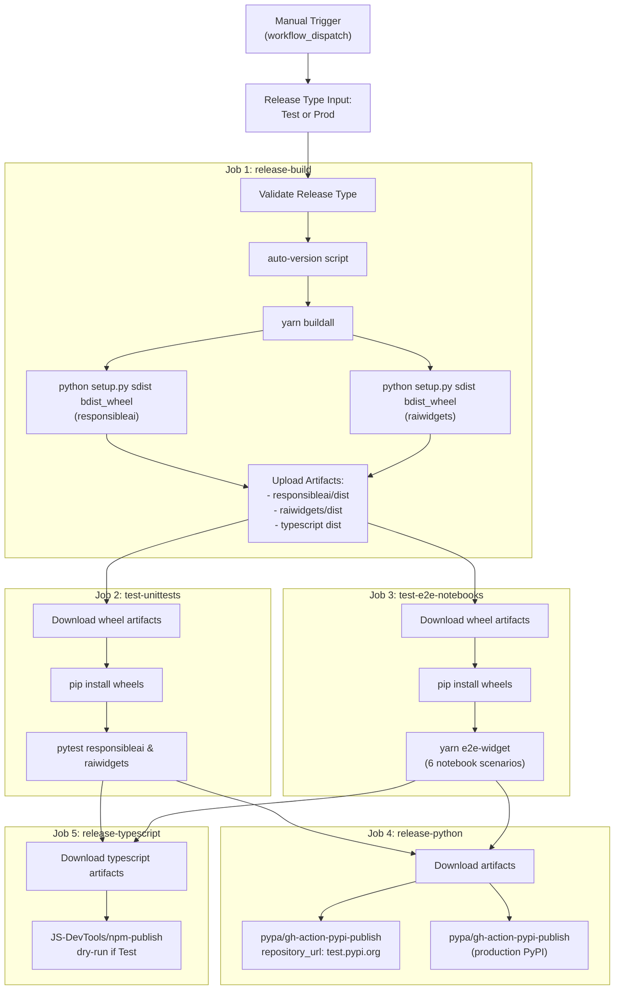
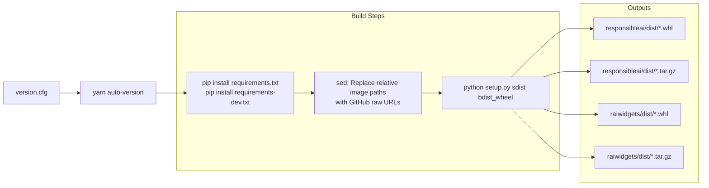
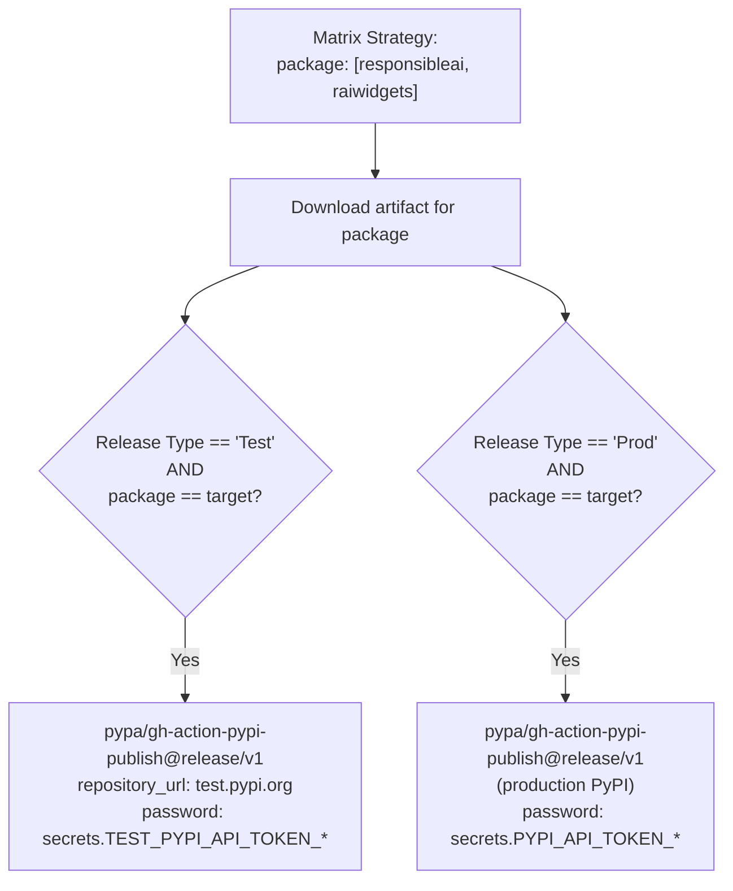
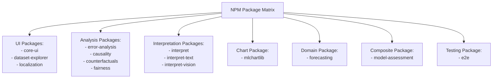
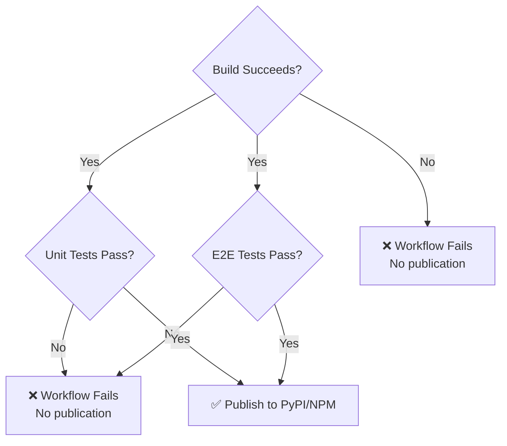

<!-- source: DeepWiki mcp.deepwiki.com · repo microsoft/responsible-ai-toolbox · extra page Release Process · fetched 2026-10-26 -->

# Release Process

<details>
<summary>Relevant source files</summary>

The following files were used as context for generating this wiki page:

- [.azure-devops/component-governance.yml](.azure-devops/component-governance.yml)
- [.github/workflows/CD.yml](.github/workflows/CD.yml)
- [.github/workflows/CI-codescan.yml](.github/workflows/CI-codescan.yml)
- [.github/workflows/CI-e2e-notebooks.yml](.github/workflows/CI-e2e-notebooks.yml)
- [.github/workflows/CI-notebook.yml](.github/workflows/CI-notebook.yml)
- [.github/workflows/CI-python.yml](.github/workflows/CI-python.yml)
- [.github/workflows/CI-rai_core_flask-pytest.yml](.github/workflows/CI-rai_core_flask-pytest.yml)
- [.github/workflows/CI-raiwidgets-pytest.yml](.github/workflows/CI-raiwidgets-pytest.yml)
- [.github/workflows/CI-typescript.yml](.github/workflows/CI-typescript.yml)
- [.github/workflows/GitHubPages.yml](.github/workflows/GitHubPages.yml)
- [.github/workflows/python-linting.yml](.github/workflows/python-linting.yml)
- [.github/workflows/release-rai-tabular.yml](.github/workflows/release-rai-tabular.yml)
- [CHANGES.md](CHANGES.md)
- [erroranalysis/requirements-dev.txt](erroranalysis/requirements-dev.txt)
- [erroranalysis/requirements.txt](erroranalysis/requirements.txt)
- [nlp_feature_extractors/requirements.txt](nlp_feature_extractors/requirements.txt)
- [rai_core_flask/requirements.txt](rai_core_flask/requirements.txt)
- [raiwidgets/requirements.txt](raiwidgets/requirements.txt)
- [responsibleai/requirements-dev.txt](responsibleai/requirements-dev.txt)
- [responsibleai/requirements.txt](responsibleai/requirements.txt)
- [responsibleai_text/responsibleai_text/version.py](responsibleai_text/responsibleai_text/version.py)
- [responsibleai_vision/responsibleai_vision/version.py](responsibleai_vision/responsibleai_vision/version.py)
- [version.cfg](version.cfg)

</details>


## Purpose and Scope

This document describes the manual release workflow for publishing packages to PyPI and NPM registries. The release process is distinct from the automated CI/CD pipelines that run on every push or pull request ([7.2.3](#7.2.3)). This workflow is manually triggered and includes comprehensive testing gates before publication to ensure release quality.

The release process covers:
- Publishing Python packages (`responsibleai`, `raiwidgets`) to PyPI or Test PyPI
- Publishing TypeScript packages to NPM registry
- Version management and auto-versioning
- Pre-release validation via unit tests and end-to-end tests

For information about automated builds and deployments on every commit, see [Build and Deployment](#7.2.3). For general package versioning strategy, see [Package Versioning and Releases](#6.3).

---

## Release Workflow Overview

The Responsible AI Toolbox uses a multi-stage release workflow defined in `.github/workflows/release-rai-tabular.yml`. The workflow is manually triggered via GitHub Actions `workflow_dispatch` and requires selecting a release target: **Test PyPI** or **Prod PyPI**.

### Key Characteristics

| Aspect | Details |
|--------|---------|
| Trigger | Manual (`workflow_dispatch`) - requires "collaborator" or higher permissions |
| Release Targets | Test PyPI or Production PyPI (user-specified input) |
| Python Packages | `responsibleai`, `raiwidgets` |
| TypeScript Packages | 14 NPM packages (core-ui, mlchartlib, error-analysis, model-assessment, etc.) |
| Pre-release Validation | Unit tests + E2E notebook tests |
| Version Source | [version.cfg:1]() |

**Sources:** [.github/workflows/release-rai-tabular.yml:1-364]()

---

## Release Workflow Structure



**Release Workflow Job Dependencies**

The workflow enforces strict dependency ordering to ensure quality gates are passed before publication. The `release-python` and `release-typescript` jobs both depend on successful completion of `test-unittests` and `test-e2e-notebooks`.

**Sources:** [.github/workflows/release-rai-tabular.yml:19-364]()

---

## Python Package Release Process

### Build Phase

The `release-build` job prepares Python wheel distributions for both `responsibleai` and `raiwidgets` packages.



**Key Steps:**

1. **Version Update** ([.github/workflows/release-rai-tabular.yml:52-59]()): 
   - For Test releases: `yarn auto-version -r`
   - For Prod releases: `yarn auto-version -r -t`
   
2. **README Processing** ([.github/workflows/release-rai-tabular.yml:89-97]()):
   - Replaces relative image paths `(./img/` with `(https://raw.githubusercontent.com/microsoft/responsible-ai-widgets/main/img/`
   - Ensures images display correctly on PyPI package pages

3. **Wheel Building** ([.github/workflows/release-rai-tabular.yml:99-107]()):
   - Runs `python setup.py sdist bdist_wheel` in both package directories
   - Creates both source distribution (`.tar.gz`) and wheel (`.whl`) formats

**Sources:** [.github/workflows/release-rai-tabular.yml:20-126]()

---

### Testing Phase

Two parallel testing jobs validate the built packages before publication:

#### Unit Test Validation

The `test-unittests` job validates package functionality:

| Step | Command | Working Directory |
|------|---------|-------------------|
| Download artifacts | `actions/download-artifact@v4` | N/A |
| Install wheels | `find ./ -name '*.whl' -exec pip install {} \;` | `responsibleai`, `raiwidgets` |
| Run tests | `pytest -s -v ./tests/` | `responsibleai`, `raiwidgets` |

**Sources:** [.github/workflows/release-rai-tabular.yml:127-180]()

#### E2E Notebook Validation

The `test-e2e-notebooks` job runs integration tests on six notebook scenarios:

```python
# Notebooks tested (executed via yarn e2e-widget)
scenarios = [
    "responsibleaidashboard-census-classification-model-debugging",
    "responsibleaidashboard-diabetes-regression-model-debugging",
    "responsibleaidashboard-housing-decision-making",
    "responsibleaidashboard-housing-classification-model-debugging",
    "responsibleaidashboard-diabetes-decision-making",
    "responsibleaidashboard-multiclass-dnn-model-debugging"
]
```

This ensures the dashboard UI works correctly with the built packages in realistic usage scenarios.

**Sources:** [.github/workflows/release-rai-tabular.yml:182-260]()

---

### Publication Phase

The `release-python` job publishes packages using a matrix strategy to handle both packages independently.



**Authentication Tokens:**

| Package | Test PyPI Secret | Prod PyPI Secret |
|---------|------------------|------------------|
| `responsibleai` | `TEST_PYPI_API_TOKEN_RESPONSIBLEAI` | `PYPI_API_TOKEN_RESPONSIBLEAI` |
| `raiwidgets` | `TEST_PYPI_API_TOKEN_RAIWIDGETS` | `PYPI_API_TOKEN_RAIWIDGETS` |

**Sources:** [.github/workflows/release-rai-tabular.yml:261-313]()

---

## TypeScript Package Release Process

The `release-typescript` job publishes 14 TypeScript libraries to NPM using a matrix strategy.

### Package Matrix



**Publication Logic:**

```yaml
# For each package in matrix
- name: NPM Publish
  uses: JS-DevTools/npm-publish@v1
  with:
    token: ${{ secrets.NPM_TOKEN }}
    package: dist/libs/${{ matrix.package }}/package.json
    dry-run: ${{ github.event.inputs.releaseType == 'Test' }}
    access: public
```

**Key Differences from Python Release:**

| Aspect | Python | TypeScript |
|--------|--------|------------|
| Test Release | Publishes to test.pypi.org | `dry-run: true` (no actual publish) |
| Prod Release | Publishes to pypi.org | `dry-run: false` (publishes to npmjs.com) |
| Authentication | Per-package API tokens | Single `NPM_TOKEN` secret |

**Sources:** [.github/workflows/release-rai-tabular.yml:315-364]()

---

## Version Management

### Version Source Files

The repository maintains version information in multiple locations:

| File | Package | Format | Example |
|------|---------|--------|---------|
| [version.cfg:1]() | All packages | Single line version string | `0.36.0` |
| [responsibleai_vision/responsibleai_vision/version.py:4-8]() | `responsibleai_vision` | Python variables `_major`, `_minor`, `_patch` | `0.3.8` |
| [responsibleai_text/responsibleai_text/version.py:4-8]() | `responsibleai_text` | Python variables `_major`, `_minor`, `_patch` | `0.2.7` |

### Auto-Versioning Script

The `yarn auto-version` command updates version numbers across all packages:

```bash
# Test release - increment version with release candidate suffix
yarn auto-version -r

# Production release - increment version and create git tag
yarn auto-version -r -t
```

This script:
1. Reads current version from `version.cfg`
2. Updates all `package.json` files for TypeScript packages
3. Updates Python package version files
4. For production releases with `-t` flag: creates a git tag

**Sources:** [.github/workflows/release-rai-tabular.yml:52-59](), [version.cfg:1]()

---

## Manual Release Execution

### Prerequisites

1. **Permissions**: "Collaborator" or higher access to the repository
2. **Secrets**: Properly configured PyPI and NPM API tokens in repository secrets
3. **Clean State**: All CI checks passing on the main branch

### Execution Steps

1. **Navigate to GitHub Actions**:
   - Go to repository → Actions → "Release responsibleai and raiwidgets to PyPI"

2. **Trigger Workflow**:
   - Click "Run workflow"
   - Select branch: `main`
   - Choose release type: `Test` or `Prod`
   - Click "Run workflow" button

3. **Monitor Progress**:
   ```
   release-build (runs immediately)
         ↓
   test-unittests + test-e2e-notebooks (parallel)
         ↓
   release-python + release-typescript (parallel)
   ```

4. **Verify Publication**:
   - **Test PyPI**: Check https://test.pypi.org/project/responsibleai/ and https://test.pypi.org/project/raiwidgets/
   - **Prod PyPI**: Check https://pypi.org/project/responsibleai/ and https://pypi.org/project/raiwidgets/
   - **NPM**: Check https://www.npmjs.com/package/@responsible-ai/core-ui (and other packages)

**Sources:** [.github/workflows/release-rai-tabular.yml:10-17]()

---

## Release Validation Gates

The workflow enforces strict quality gates before allowing publication:



### Quality Gate Details

| Gate | Validation | Failure Impact |
|------|------------|----------------|
| **Build Phase** | TypeScript compilation<br/>Python wheel building<br/>Dependency installation | Entire workflow fails immediately |
| **Unit Tests** | `pytest` on both packages<br/>Tests installed wheel artifacts | Publication jobs blocked |
| **E2E Tests** | 6 dashboard notebooks<br/>Full UI integration tests | Publication jobs blocked |
| **Publication** | PyPI upload validation<br/>NPM package validation | Individual package publication may fail |

### Job Dependencies

The `needs` keyword enforces strict ordering:

```yaml
release-python:
  needs: [test-unittests, test-e2e-notebooks]
  
release-typescript:
  needs: [test-unittests, test-e2e-notebooks]
```

This ensures no package can be published unless all tests pass successfully.

**Sources:** [.github/workflows/release-rai-tabular.yml:127-128](), [.github/workflows/release-rai-tabular.yml:182-183](), [.github/workflows/release-rai-tabular.yml:262](), [.github/workflows/release-rai-tabular.yml:316]()

---

## Comparison: Continuous Deployment vs Release

While the CD workflow ([7.2.3](#7.2.3)) runs automatically on every push, the Release workflow is strictly manual:

| Aspect | CD Workflow | Release Workflow |
|--------|-------------|------------------|
| **Trigger** | Automatic (push to main, PR) | Manual (workflow_dispatch) |
| **Workflow File** | `.github/workflows/CD.yml` | `.github/workflows/release-rai-tabular.yml` |
| **Python Publication** | None | PyPI / Test PyPI |
| **TypeScript Publication** | NPM (automatic) | NPM (manual, with dry-run option) |
| **Azure Blob** | Dashboard previews | Not used |
| **Testing** | Basic pytest | pytest + E2E notebooks |
| **Version Control** | Automatic versioning | Manual version selection |

**Sources:** [.github/workflows/CD.yml:1-243](), [.github/workflows/release-rai-tabular.yml:1-364]()

---

