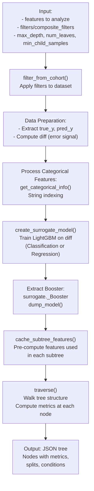
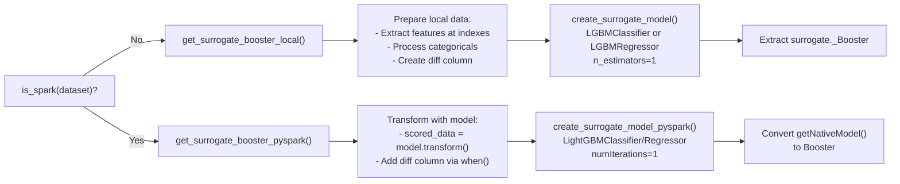
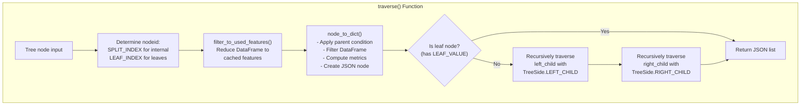
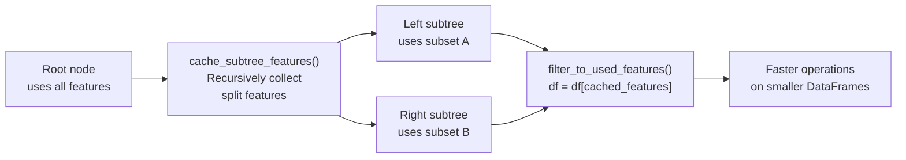
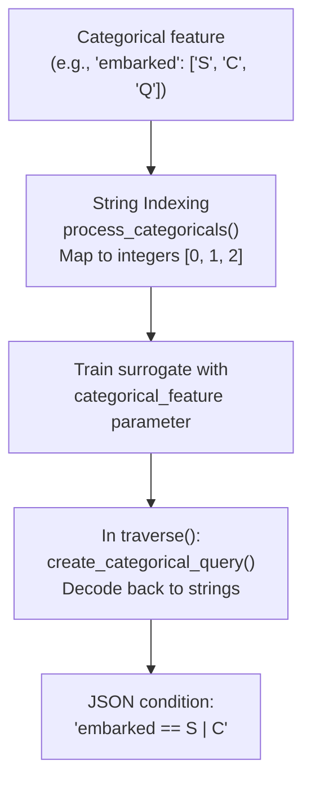
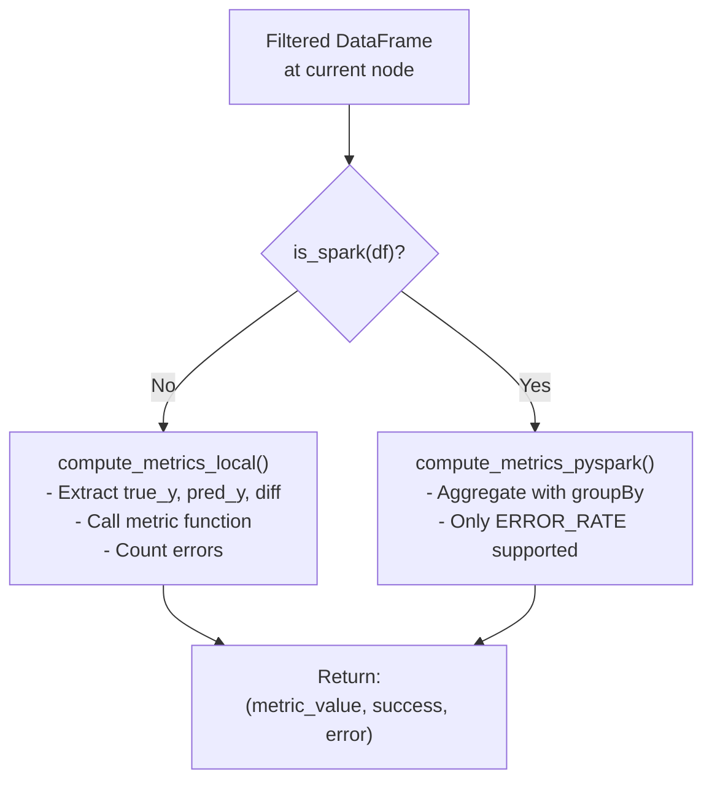

<!-- source: DeepWiki mcp.deepwiki.com · repo microsoft/responsible-ai-toolbox · extra page Surrogate Error Tree · fetched 2026-10-26 -->

# Surrogate Error Tree

<details>
<summary>Relevant source files</summary>

The following files were used as context for generating this wiki page:

- [erroranalysis/erroranalysis/_internal/cohort_filter.py](erroranalysis/erroranalysis/_internal/cohort_filter.py)
- [erroranalysis/erroranalysis/_internal/constants.py](erroranalysis/erroranalysis/_internal/constants.py)
- [erroranalysis/erroranalysis/_internal/matrix_filter.py](erroranalysis/erroranalysis/_internal/matrix_filter.py)
- [erroranalysis/erroranalysis/_internal/metrics.py](erroranalysis/erroranalysis/_internal/metrics.py)
- [erroranalysis/erroranalysis/_internal/surrogate_error_tree.py](erroranalysis/erroranalysis/_internal/surrogate_error_tree.py)
- [erroranalysis/erroranalysis/analyzer/error_analyzer.py](erroranalysis/erroranalysis/analyzer/error_analyzer.py)
- [erroranalysis/erroranalysis/version.py](erroranalysis/erroranalysis/version.py)
- [erroranalysis/requirements-object-detection.txt](erroranalysis/requirements-object-detection.txt)
- [erroranalysis/tests/common_utils.py](erroranalysis/tests/common_utils.py)
- [erroranalysis/tests/test_cohort_filter.py](erroranalysis/tests/test_cohort_filter.py)
- [erroranalysis/tests/test_error_report.py](erroranalysis/tests/test_error_report.py)
- [erroranalysis/tests/test_importances.py](erroranalysis/tests/test_importances.py)
- [erroranalysis/tests/test_matrix_filter.py](erroranalysis/tests/test_matrix_filter.py)
- [erroranalysis/tests/test_metrics.py](erroranalysis/tests/test_metrics.py)
- [erroranalysis/tests/test_surrogate_error_tree.py](erroranalysis/tests/test_surrogate_error_tree.py)

</details>


The Surrogate Error Tree is a hierarchical error analysis method that trains a lightweight decision tree to predict where a machine learning model makes errors. By learning patterns in model failures, it creates an interpretable tree structure that helps identify cohorts of data where the model underperforms.

This page covers the implementation of the surrogate error tree algorithm. For the matrix filter (heatmap) visualization, see [3.4.2](#3.4.2). For general error analysis concepts, see [3.4](#3.4).

## Overview

The core idea is to train a **surrogate model** (LightGBM tree) on a binary classification task: predicting whether the original model is correct or incorrect on each data point. The resulting decision tree naturally segments the data into regions with different error rates, making it easy to identify where and why the model fails.

The implementation supports:
- Classification and regression tasks
- Object detection scenarios
- Categorical and numeric features
- Both pandas DataFrames and PySpark DataFrames
- Multiple metrics (error rate, precision, recall, F1, MAE, MSE, etc.)

Sources: [erroranalysis/erroranalysis/_internal/surrogate_error_tree.py:1-115]()

## Algorithm Workflow



**Diagram: Surrogate Error Tree Algorithm Flow**

The algorithm proceeds in distinct phases:
1. **Filtering**: Apply cohort filters to subset the data
2. **Preparation**: Compute the error signal (diff between predictions and labels)
3. **Training**: Fit a LightGBM tree to predict errors
4. **Extraction**: Get the trained tree structure
5. **Traversal**: Walk the tree and compute metrics at each node
6. **Serialization**: Convert to JSON for frontend visualization

Sources: [erroranalysis/erroranalysis/_internal/surrogate_error_tree.py:195-274](), [erroranalysis/erroranalysis/_internal/surrogate_error_tree.py:117-193]()

## Core Functions

### Entry Points

| Function | Purpose | Parameters |
|----------|---------|------------|
| `compute_error_tree()` | Main entry point with filters | `analyzer, features, filters, composite_filters, max_depth, num_leaves, min_child_samples` |
| `compute_error_tree_on_dataset()` | Direct dataset input | `analyzer, features, dataset, max_depth, num_leaves, min_child_samples` |
| `compute_json_error_tree()` | Legacy backcompat wrapper | Same as `compute_error_tree()` |

Sources: [erroranalysis/erroranalysis/_internal/surrogate_error_tree.py:76-115](), [erroranalysis/erroranalysis/_internal/surrogate_error_tree.py:195-274]()

### Surrogate Model Creation



**Diagram: Surrogate Model Training Paths**

The system supports two execution paths:
- **Local**: For pandas DataFrames, uses sklearn-compatible LightGBM
- **PySpark**: For distributed data, uses SynapseML LightGBM

Both produce a LightGBM `Booster` object that can be traversed to extract the tree structure.

Sources: [erroranalysis/erroranalysis/_internal/surrogate_error_tree.py:277-393](), [erroranalysis/erroranalysis/_internal/surrogate_error_tree.py:396-435]()

### Error Signal Computation

The **diff** column represents the error signal that the surrogate model learns to predict:

| Model Task | Diff Computation | Code Reference |
|------------|------------------|----------------|
| Classification | `diff = pred_y != true_y` | [surrogate_error_tree.py:324]() |
| Regression | `diff = pred_y - true_y` | [surrogate_error_tree.py:342]() |
| Object Detection | `diff = [len(ErrorLabeling(...).compute_error_list()) > 0 for ...]` | [surrogate_error_tree.py:331-340]() |

For **classification**, the diff is a boolean array indicating incorrect predictions. For **regression**, it's the residual. For **object detection**, it uses the `ErrorLabeling` class from `vision_explanation_methods` to determine if any detection errors occurred.

Sources: [erroranalysis/erroranalysis/_internal/surrogate_error_tree.py:321-344]()

## Tree Traversal and Node Generation



**Diagram: Tree Traversal Algorithm**

The `traverse()` function performs a depth-first traversal of the LightGBM tree structure, converting each node to a JSON representation. At each node, it:

1. **Determines the node ID**: Internal nodes use `SPLIT_INDEX`, leaves use `max_split_index + LEAF_INDEX`
2. **Filters the data**: Reduces the DataFrame to only the features used in this subtree (performance optimization)
3. **Applies parent conditions**: Filters data based on the split condition from the parent node
4. **Computes metrics**: Calculates error rate, precision, recall, or other metrics on the filtered data
5. **Recursively processes children**: For non-leaf nodes, processes left and right children

Sources: [erroranalysis/erroranalysis/_internal/surrogate_error_tree.py:587-650](), [erroranalysis/erroranalysis/_internal/surrogate_error_tree.py:754-859]()

## JSON Node Structure

Each node in the output JSON tree contains:

```python
{
    'id': int,                    # Unique node identifier
    'parentId': int or None,      # Parent node ID (None for root)
    'nodeName': str or None,      # Feature name for splits (None for leaves)
    'condition': str,             # Human-readable condition (e.g., "age <= 30.5")
    'method': str,                # Filter method ('less and equal', 'greater', etc.)
    'arg': float or list,         # Threshold value(s)
    'size': int,                  # Number of samples in this node
    'error': int or float,        # Error count or metric value
    'metricName': str,            # Display name of the metric
    'metricValue': float,         # Computed metric value
    'isErrorMetric': bool,        # Whether higher is worse
    'isRegressionMetric': bool    # Whether it's a regression metric
}
```

The `node_to_dict()` function constructs these dictionaries by examining the tree structure and computing statistics on the filtered data at each node.

Sources: [erroranalysis/erroranalysis/_internal/surrogate_error_tree.py:754-859]()

## Configuration Parameters

### Tree Hyperparameters

| Parameter | Default | Purpose | Code Reference |
|-----------|---------|---------|----------------|
| `max_depth` | 3 | Maximum depth of surrogate tree | [surrogate_error_tree.py:51]() |
| `num_leaves` | 31 | Maximum number of leaf nodes | [surrogate_error_tree.py:52]() |
| `min_child_samples` | 20 | Minimum samples required to create a leaf | [surrogate_error_tree.py:53]() |

These parameters are passed to the LightGBM model constructor:

```python
if analyzer.model_task == ModelTask.CLASSIFICATION:
    surrogate = LGBMClassifier(
        n_estimators=1,
        max_depth=max_depth,
        num_leaves=num_leaves,
        min_child_samples=min_child_samples,
        verbosity=-1
    )
```

**Note**: `n_estimators=1` because we only need a single tree for interpretability.

Sources: [erroranalysis/erroranalysis/_internal/surrogate_error_tree.py:51-53](), [erroranalysis/erroranalysis/_internal/surrogate_error_tree.py:511-522]()

## Performance Optimizations

### Feature Caching

The `cache_subtree_features()` function pre-computes which features are used in each subtree and stores them in a `CACHED_SUBTREE_FEATURES` field on each node. This enables the `filter_to_used_features()` function to dramatically reduce the DataFrame size during traversal.



**Diagram: Feature Caching Optimization**

This optimization is critical for large datasets with many features, as it avoids unnecessarily processing columns that don't affect the current subtree.

Sources: [erroranalysis/erroranalysis/_internal/surrogate_error_tree.py:668-693](), [erroranalysis/erroranalysis/_internal/surrogate_error_tree.py:653-665]()

### Large Dataset Handling

For datasets with more than 1 million rows, the algorithm is optimized to train quickly:

- LightGBM is inherently fast for large datasets due to histogram-based splitting
- The single-tree constraint (`n_estimators=1`) ensures minimal training time
- Test results show training completes in under 20 seconds for 1M+ rows

Sources: [erroranalysis/tests/test_surrogate_error_tree.py:181-236]()

## Categorical Feature Handling

Categorical features require special processing:



**Diagram: Categorical Feature Processing**

The `get_categorical_info()` function extracts categorical feature indices and their possible values, which are then used during:
1. **Training**: LightGBM is told which features are categorical via the `categorical_feature` parameter
2. **Traversal**: The `create_categorical_query()` function decodes numeric thresholds back to human-readable category names

Sources: [erroranalysis/erroranalysis/_internal/surrogate_error_tree.py:546-569](), [erroranalysis/erroranalysis/_internal/surrogate_error_tree.py:696-751]()

## Metrics Computation

At each tree node, the system computes metrics on the filtered data subset:



**Diagram: Metrics Computation**

For **classification**, metrics include error_rate, precision, recall, f1_score, and accuracy. For **regression**, metrics include MAE, MSE, R2, and median absolute error.

The `compute_metrics_local()` function uses the `metric_to_func` mapping to invoke the appropriate sklearn metric function.

Sources: [erroranalysis/erroranalysis/_internal/surrogate_error_tree.py:894-1003]()

## Special Cases

### Object Detection

Object detection models output bounding boxes rather than simple class labels, requiring special handling:

```python
from vision_explanation_methods.error_labeling.error_labeling import ErrorLabeling

diff = [
    len(
        ErrorLabeling(
            ModelTask.OBJECT_DETECTION,
            pred_y[image_idx],
            true_y[image_idx]
        ).compute_error_list()
    ) > 0
    for image_idx in range(len(true_y))
]
```

The `ErrorLabeling` class from the `vision_explanation_methods` package computes detection errors (false positives, false negatives, localization errors) and returns a list. If this list is non-empty, the prediction is considered an error.

Sources: [erroranalysis/erroranalysis/_internal/surrogate_error_tree.py:325-340]()

### PySpark Integration

For distributed datasets, the code uses SynapseML's LightGBM implementation:

1. The `model.transform()` method adds predictions directly to the PySpark DataFrame
2. A `diff` column is computed using PySpark's `when()` function
3. The surrogate model is trained on the distributed data
4. The native model string is extracted and converted to a Booster

The trained tree structure is then converted to Koalas (pandas API on Spark) for traversal.

Sources: [erroranalysis/erroranalysis/_internal/surrogate_error_tree.py:396-435](), [erroranalysis/erroranalysis/_internal/surrogate_error_tree.py:438-477]()

## Integration with Error Analyzer

The surrogate error tree is exposed through the `BaseAnalyzer` interface:

```python
class BaseAnalyzer(ABC):
    def compute_error_tree(self, features, filters, composite_filters, 
                          max_depth=None, num_leaves=None, 
                          min_child_samples=None):
        return _compute_error_tree(self, features, filters, 
                                  composite_filters, max_depth, 
                                  num_leaves, min_child_samples)
    
    def compute_error_tree_on_dataset(self, features, dataset,
                                     max_depth=None, num_leaves=None,
                                     min_child_samples=None):
        return _compute_error_tree_on_dataset(self, features, dataset,
                                             max_depth, num_leaves,
                                             min_child_samples)
```

Both `ModelAnalyzer` and `PredictionsAnalyzer` inherit this functionality, making the surrogate error tree available for both live model analysis and pre-computed predictions.

Sources: [erroranalysis/erroranalysis/analyzer/error_analyzer.py:315-390]()

## Error Handling

The implementation includes validation and error handling:

1. **Invalid feature names**: Raises `UserConfigValidationException` if requested features don't exist
2. **Invalid prediction shape**: Detects and reports when model outputs have incorrect dimensions
3. **Empty cohorts**: Returns a special empty node structure when filters produce zero rows
4. **Type mismatches**: Catches and provides helpful errors for categorical features incorrectly treated as numeric

Sources: [erroranalysis/erroranalysis/_internal/surrogate_error_tree.py:162-166](), [erroranalysis/erroranalysis/_internal/surrogate_error_tree.py:529-542](), [erroranalysis/erroranalysis/_internal/surrogate_error_tree.py:876-891]()

---

