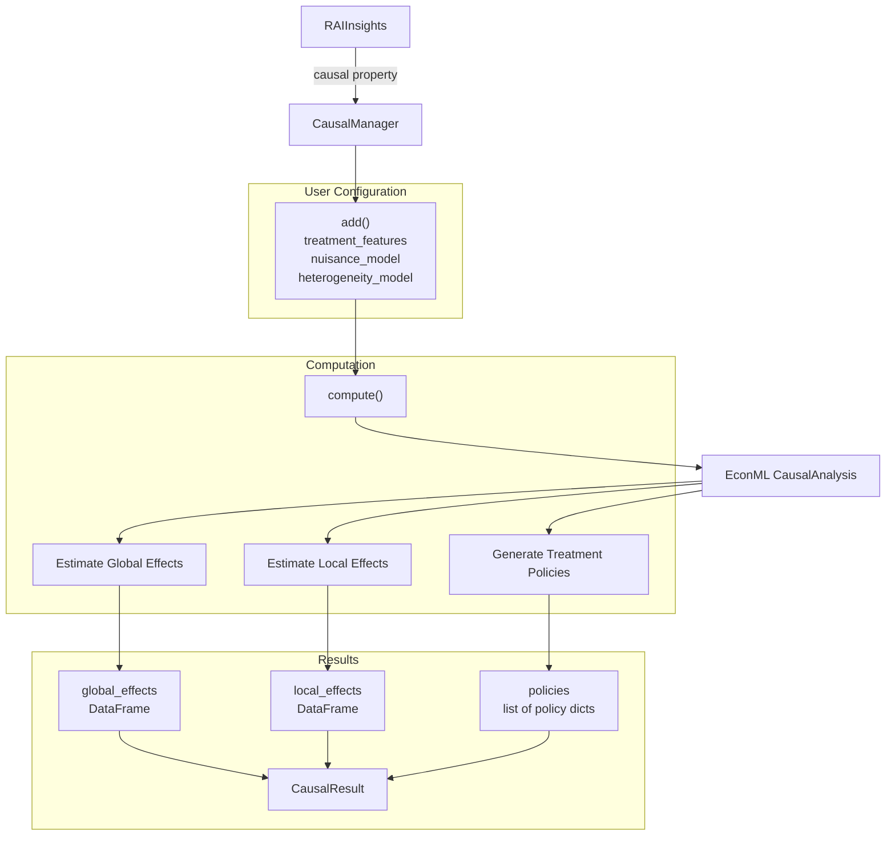
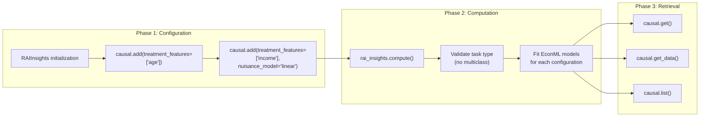
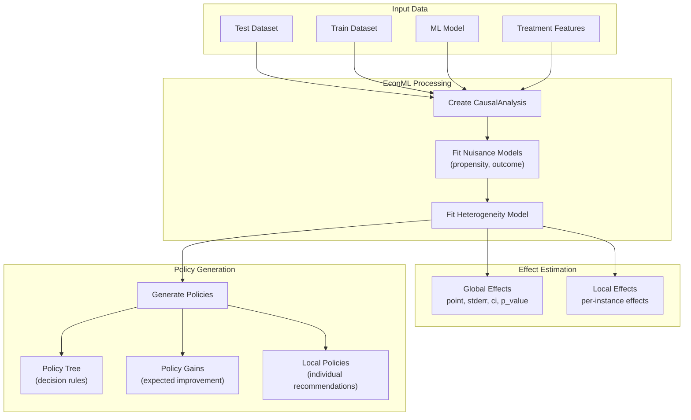
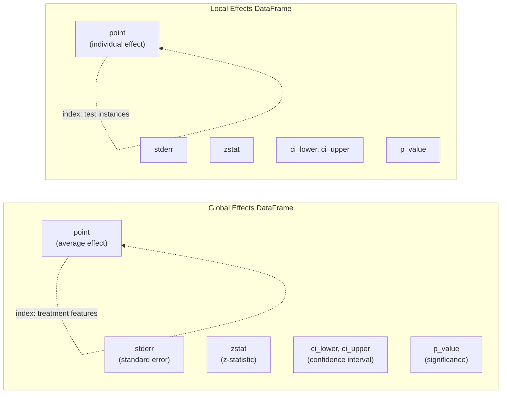
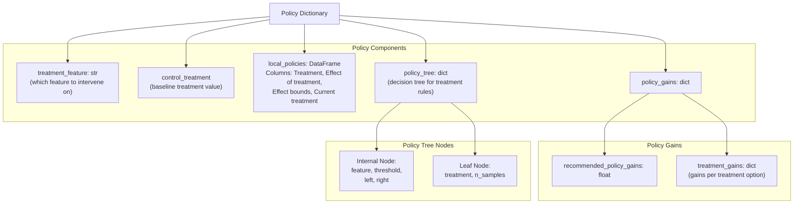
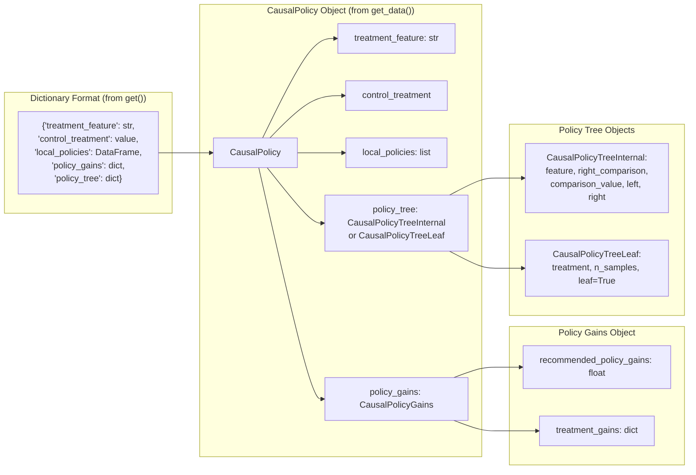
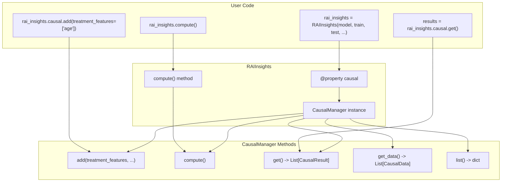

<!-- source: DeepWiki mcp.deepwiki.com · repo microsoft/responsible-ai-toolbox · extra page Causal Manager · fetched 2026-10-26 -->

# Causal Manager

<details>
<summary>Relevant source files</summary>

The following files were used as context for generating this wiki page:

- [raiwidgets/raiwidgets/interfaces.py](raiwidgets/raiwidgets/interfaces.py)
- [responsibleai/responsibleai/_tools/shared/state_directory_management.py](responsibleai/responsibleai/_tools/shared/state_directory_management.py)
- [responsibleai/responsibleai/exceptions.py](responsibleai/responsibleai/exceptions.py)
- [responsibleai/responsibleai/modelanalysis/model_analysis.py](responsibleai/responsibleai/modelanalysis/model_analysis.py)
- [responsibleai/tests/causal_manager_validator.py](responsibleai/tests/causal_manager_validator.py)
- [responsibleai/tests/counterfactual_manager_validator.py](responsibleai/tests/counterfactual_manager_validator.py)
- [responsibleai/tests/error_analysis_validator.py](responsibleai/tests/error_analysis_validator.py)
- [responsibleai/tests/explainer_manager_validator.py](responsibleai/tests/explainer_manager_validator.py)
- [responsibleai/tests/test_exceptions.py](responsibleai/tests/test_exceptions.py)

</details>


## Purpose and Scope

The Causal Manager (`CausalManager`) is an analysis manager within the Responsible AI Toolbox that enables causal inference on machine learning models. It provides an interface to estimate causal effects of feature interventions, generate optimal treatment policies, and perform what-if analysis using the [EconML](https://github.com/py-why/EconML) library.

This document covers the configuration, computation, and results retrieval for causal analysis. For other analysis types, see [Error Analysis Manager](#3.3.1), [Explainer Manager](#3.3.2), [Counterfactual Manager](#3.3.4), and [Data Balance Manager](#3.3.5). For the overall orchestration pattern, see [Manager Orchestration](#3.2.2).

**Sources:** [responsibleai/responsibleai/modelanalysis/model_analysis.py:13-14](), [responsibleai/tests/causal_manager_validator.py:1-261]()

## Overview

The Causal Manager wraps EconML's `CausalAnalysis` class to estimate heterogeneous treatment effects and generate policy recommendations. It supports both classification and regression tasks, with the limitation that multiclass classification (>2 classes) is not supported.



**Sources:** [responsibleai/tests/causal_manager_validator.py:37-95](), [responsibleai/responsibleai/modelanalysis/model_analysis.py:90-96]()

## Manager Access and Lifecycle

The Causal Manager is accessed via the `causal` property on `RAIInsights` objects. It follows the standard three-phase pattern: configuration via `add()`, computation via `compute()`, and retrieval via `get()` or `get_data()`.



**Sources:** [responsibleai/tests/causal_manager_validator.py:37-95](), [responsibleai/responsibleai/modelanalysis/model_analysis.py:122-124]()

## Configuration API

The `add()` method configures a causal analysis. Multiple configurations can be added, each producing independent results.

### Method Signature

```python
causal.add(
    treatment_features: List[str],
    nuisance_model: str = 'automl',
    heterogeneity_model: str = None,
    upper_bound_on_cat_expansion: int = None,
    # Additional EconML parameters...
)
```

### Configuration Parameters

| Parameter | Type | Description | Valid Values |
|-----------|------|-------------|--------------|
| `treatment_features` | `List[str]` | Feature names to analyze as treatments | Any valid feature names from dataset |
| `nuisance_model` | `str` | Model for nuisance functions (propensity/outcome) | `'automl'`, `'linear'` (default: `'automl'`) |
| `heterogeneity_model` | `str` | Model for heterogeneous treatment effects | `'linear'`, `'forest'`, or other EconML models |
| `upper_bound_on_cat_expansion` | `int` | Maximum one-hot expansion for categorical features | Positive integer |

### Validation Rules

The Causal Manager performs the following validations:

1. **Task Type Validation**: Raises `UserConfigValidationException` if the task is multiclass classification (>2 classes)
2. **Nuisance Model Validation**: Raises `UserConfigValidationException` if `nuisance_model` is not a recognized value
3. **Heterogeneity Model Validation**: Raises `UserConfigValidationException` if `heterogeneity_model` is not a recognized value

**Sources:** [responsibleai/tests/causal_manager_validator.py:37-95](), [raiutils/raiutils/exceptions.py]()

## Computation and Results

### Computation Process

When `compute()` is called (via `RAIInsights.compute()`), the Causal Manager:

1. Creates an EconML `CausalAnalysis` object for each configuration
2. Fits causal models to estimate treatment effects
3. Computes global effects (average treatment effects)
4. Computes local effects (individual-level treatment effects)
5. Generates optimal treatment policies



**Sources:** [responsibleai/tests/causal_manager_validator.py:52-63]()

### Result Structure: CausalResult

The `get()` method returns a list of `CausalResult` objects (one per configuration). Each `CausalResult` contains:

| Attribute | Type | Description |
|-----------|------|-------------|
| `id` | `str` | Unique identifier for the configuration |
| `config` | `object` | Configuration parameters (15 attributes including treatment_features) |
| `causal_analysis` | `CausalAnalysis` | EconML CausalAnalysis instance |
| `global_effects` | `pd.DataFrame` | Global treatment effects with columns: `point`, `stderr`, `zstat`, `ci_lower`, `ci_upper`, `p_value` |
| `local_effects` | `pd.DataFrame` | Individual-level treatment effects with same columns as global |
| `policies` | `list` | List of policy dictionaries (one per treatment feature) |

**Sources:** [responsibleai/tests/causal_manager_validator.py:113-133]()

### Global and Local Effects

Effects DataFrames contain statistical measures of treatment impact:



**Sources:** [responsibleai/tests/causal_manager_validator.py:19-26, 148-164]()

### Policy Structure

Each policy is a dictionary with the following structure:



**Sources:** [responsibleai/tests/causal_manager_validator.py:28-34, 166-261]()

## Serialization: CausalData

The `get_data()` method returns serialized `CausalData` objects suitable for persistence and visualization. The serialization converts DataFrames to lists and extracts only essential configuration parameters.

### CausalData Structure

| Attribute | Type | Serialized From |
|-----------|------|-----------------|
| `id` | `str` | `CausalResult.id` |
| `config` | `CausalConfig` | Subset of `CausalResult.config` (1 attribute: treatment_features) |
| `global_effects` | `list` | `CausalResult.global_effects` (DataFrame → list) |
| `local_effects` | `list` | `CausalResult.local_effects` (DataFrame → list) |
| `policies` | `list[CausalPolicy]` | `CausalResult.policies` (dict → CausalPolicy objects) |

### CausalPolicy Serialization



**Sources:** [responsibleai/tests/causal_manager_validator.py:113-133, 172-193, 214-261]()

## Manager Information

The `list()` method returns metadata about configured causal analyses:

```python
{
    'manager_type': 'causal',
    'causal_effects': [
        {
            'global_effects_computed': bool,
            'local_effects_computed': bool,
            'policies_computed': bool
        },
        # ... one entry per configuration
    ]
}
```

**Sources:** [responsibleai/tests/causal_manager_validator.py:97-111](), [responsibleai/_internal/constants.py]()

## Integration with RAIInsights



**Sources:** [responsibleai/responsibleai/modelanalysis/model_analysis.py:90-96, 122-124]()

## Validation and Error Handling

The Causal Manager enforces several validation rules to ensure proper configuration:

### Task Type Validation

```python
# Multiclass classification not supported
if task_type == ModelTask.CLASSIFICATION and len(unique_labels) > 2:
    raise UserConfigValidationException(
        "Multiclass classification isn't supported"
    )
```

### Model Validation

```python
# Invalid nuisance_model
if nuisance_model not in ['automl', 'linear', ...]:
    raise UserConfigValidationException(
        "Invalid nuisance_model: ..."
    )

# Invalid heterogeneity_model
if heterogeneity_model not in [None, 'linear', 'forest', ...]:
    raise UserConfigValidationException(
        "Invalid heterogeneity_model: ..."
    )
```

**Sources:** [responsibleai/tests/causal_manager_validator.py:39-94](), [raiutils/raiutils/exceptions.py](), [responsibleai/responsibleai/exceptions.py:35-42]()

## Persistence

The Causal Manager follows the standard persistence pattern using the `DirectoryManager`:

1. **Configuration Persistence**: Configuration parameters are saved to the `configuration` directory
2. **Data Persistence**: Serialized `CausalData` objects are saved to the `data` directory  
3. **Generator Persistence**: EconML `CausalAnalysis` objects are saved to the `generators` directory

Upon loading, the manager reconstructs the full `CausalResult` objects from saved configurations and generators.

**Sources:** [responsibleai/responsibleai/_tools/shared/state_directory_management.py:11-132]()

## Usage Example Pattern

```python
# Initialize RAIInsights
rai_insights = RAIInsights(
    model=model,
    train=train_data,
    test=test_data,
    target_column='outcome',
    task_type='classification'
)

# Configure causal analysis
rai_insights.causal.add(
    treatment_features=['age', 'income'],
    nuisance_model='automl',
    upper_bound_on_cat_expansion=50
)

# Add another configuration
rai_insights.causal.add(
    treatment_features=['education'],
    nuisance_model='linear',
    heterogeneity_model='forest'
)

# Compute all analyses
rai_insights.compute()

# Retrieve results
causal_results = rai_insights.causal.get()
for result in causal_results:
    print(f"Treatment features: {result.config.treatment_features}")
    print(f"Global effects:\n{result.global_effects}")
    print(f"Policies: {len(result.policies)}")

# Get serialized data for persistence/visualization
causal_data = rai_insights.causal.get_data()

# Get metadata
info = rai_insights.causal.list()
print(f"Number of causal analyses: {len(info['causal_effects'])}")
```

**Sources:** [responsibleai/tests/causal_manager_validator.py:37-95]()

---

