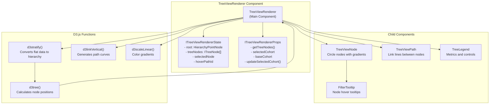
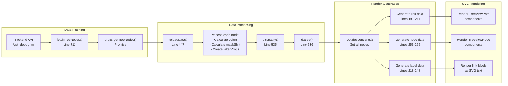
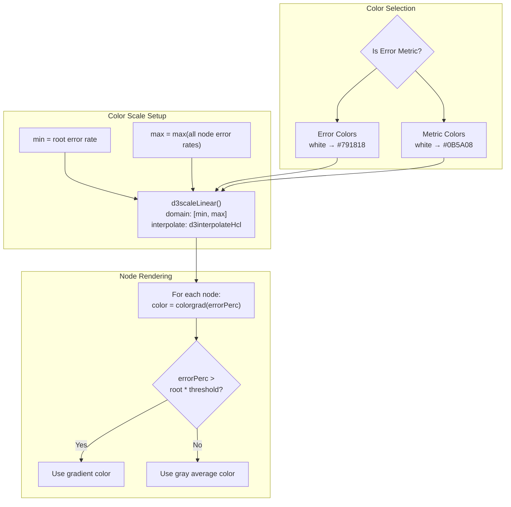
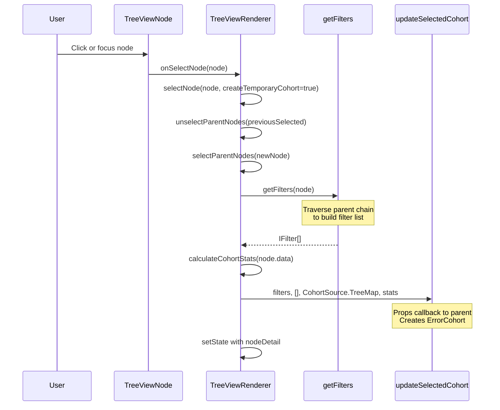
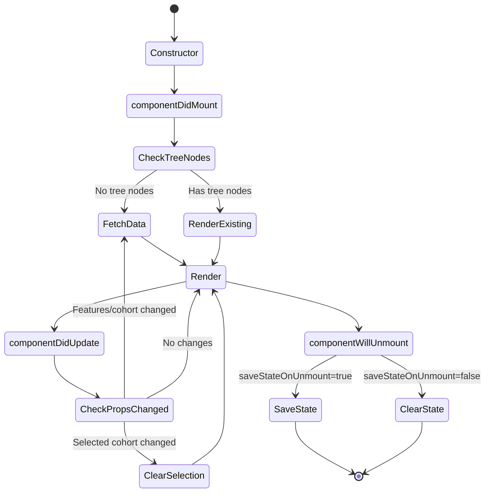

<!-- source: DeepWiki mcp.deepwiki.com · repo microsoft/responsible-ai-toolbox · extra page Tree View Renderer · fetched 2026-10-26 -->

# Tree View Renderer

<details>
<summary>Relevant source files</summary>

The following files were used as context for generating this wiki page:

- [apps/dashboard/src/error-analysis/App.tsx](apps/dashboard/src/error-analysis/App.tsx)
- [libs/core-ui/src/lib/components/SVGToolTip.tsx](libs/core-ui/src/lib/components/SVGToolTip.tsx)
- [libs/error-analysis/src/lib/ErrorAnalysisDashboard/ColorPalette.ts](libs/error-analysis/src/lib/ErrorAnalysisDashboard/ColorPalette.ts)
- [libs/error-analysis/src/lib/ErrorAnalysisDashboard/Controls/ErrorAnalysisView/ErrorAnalysisView.tsx](libs/error-analysis/src/lib/ErrorAnalysisDashboard/Controls/ErrorAnalysisView/ErrorAnalysisView.tsx)
- [libs/error-analysis/src/lib/ErrorAnalysisDashboard/Controls/ErrorAnalysisView/ErrorAnalysisViewTab.tsx](libs/error-analysis/src/lib/ErrorAnalysisDashboard/Controls/ErrorAnalysisView/ErrorAnalysisViewTab.tsx)
- [libs/error-analysis/src/lib/ErrorAnalysisDashboard/Controls/FilterTooltip/FilterTooltip.styles.ts](libs/error-analysis/src/lib/ErrorAnalysisDashboard/Controls/FilterTooltip/FilterTooltip.styles.ts)
- [libs/error-analysis/src/lib/ErrorAnalysisDashboard/Controls/FilterTooltip/FilterTooltip.tsx](libs/error-analysis/src/lib/ErrorAnalysisDashboard/Controls/FilterTooltip/FilterTooltip.tsx)
- [libs/error-analysis/src/lib/ErrorAnalysisDashboard/Controls/TreeLegend/TreeLegend.styles.ts](libs/error-analysis/src/lib/ErrorAnalysisDashboard/Controls/TreeLegend/TreeLegend.styles.ts)
- [libs/error-analysis/src/lib/ErrorAnalysisDashboard/Controls/TreeLegend/TreeLegend.tsx](libs/error-analysis/src/lib/ErrorAnalysisDashboard/Controls/TreeLegend/TreeLegend.tsx)
- [libs/error-analysis/src/lib/ErrorAnalysisDashboard/Controls/TreeViewRenderer/TreeViewNode.tsx](libs/error-analysis/src/lib/ErrorAnalysisDashboard/Controls/TreeViewRenderer/TreeViewNode.tsx)
- [libs/error-analysis/src/lib/ErrorAnalysisDashboard/Controls/TreeViewRenderer/TreeViewRenderer.styles.ts](libs/error-analysis/src/lib/ErrorAnalysisDashboard/Controls/TreeViewRenderer/TreeViewRenderer.styles.ts)
- [libs/error-analysis/src/lib/ErrorAnalysisDashboard/Controls/TreeViewRenderer/TreeViewRenderer.tsx](libs/error-analysis/src/lib/ErrorAnalysisDashboard/Controls/TreeViewRenderer/TreeViewRenderer.tsx)
- [libs/error-analysis/src/lib/ErrorAnalysisDashboard/Controls/TreeViewRenderer/TreeViewUtils.ts](libs/error-analysis/src/lib/ErrorAnalysisDashboard/Controls/TreeViewRenderer/TreeViewUtils.ts)
- [libs/error-analysis/src/lib/ErrorAnalysisDashboard/ErrorAnalysisDashboard.tsx](libs/error-analysis/src/lib/ErrorAnalysisDashboard/ErrorAnalysisDashboard.tsx)

</details>


## Purpose and Scope

The Tree View Renderer is a React component responsible for visualizing error analysis results as an interactive hierarchical tree diagram using D3.js. It displays a surrogate decision tree that identifies patterns in model errors, allowing users to drill down into error-prone data segments by selecting nodes. This document covers the TreeViewRenderer component architecture, rendering pipeline, user interactions, and integration with the Error Analysis Dashboard.

For information about the matrix-based error visualization, see [Matrix Filter UI](#4.3.2). For the overall Error Analysis Dashboard architecture, see [Error Analysis Dashboard](#4.3).

---

## Component Architecture

The TreeViewRenderer is implemented as a stateful React component that combines D3.js for layout calculation and SVG rendering with React for component lifecycle management.



**Sources:** [libs/error-analysis/src/lib/ErrorAnalysisDashboard/Controls/TreeViewRenderer/TreeViewRenderer.tsx:1-756]()

---

## Data Flow and Rendering Pipeline

The tree rendering follows a multi-stage pipeline from raw tree data to interactive SVG visualization.



**Sources:** [libs/error-analysis/src/lib/ErrorAnalysisDashboard/Controls/TreeViewRenderer/TreeViewRenderer.tsx:711-754](), [libs/error-analysis/src/lib/ErrorAnalysisDashboard/Controls/TreeViewRenderer/TreeViewRenderer.tsx:447-587]()

---

## Tree Node Data Structure

Each node in the tree contains both raw data from the backend and computed display properties.

### ITreeNode Interface

The `ITreeNode` interface extends `IErrorAnalysisTreeNode` with additional rendering properties:

| Property | Type | Description |
|----------|------|-------------|
| `error` | number | Number of errors in this node |
| `size` | number | Total samples in this node |
| `metricValue` | number | Computed metric (error rate, MSE, etc.) |
| `metricName` | string | Metric type being displayed |
| `errorColor` | Property.Color | Fill color based on error rate |
| `maskShift` | number | Gradient mask offset for visualization |
| `filterProps` | FilterProps | Cohort filter properties |
| `nodeState` | object | Selection and path state |
| `condition` | string | Split condition text |
| `r` | number | Circle radius (28px) |

### Node State Management

Node state tracks selection and highlighting:

```typescript
nodeState: {
  isSelectedLeaf: boolean,      // Is this the currently selected leaf node?
  onSelectedPath: boolean,       // Is this on the path to selected node?
  style: { transform: string }   // SVG transform for positioning
}
```

**Sources:** [libs/error-analysis/src/lib/ErrorAnalysisDashboard/Controls/TreeViewRenderer/TreeViewRenderer.tsx:498-533]()

---

## Color Encoding and Visual Design

The TreeViewRenderer uses a color gradient system to encode error metrics visually.

### Color Gradient Calculation



**Sources:** [libs/error-analysis/src/lib/ErrorAnalysisDashboard/Controls/TreeViewRenderer/TreeViewRenderer.tsx:486-517](), [libs/error-analysis/src/lib/ErrorAnalysisDashboard/ColorPalette.ts:9-28]()

### Node Fill Pattern

Each node uses a linear gradient to show both the error proportion and the total data proportion:

- **Bottom portion (gradient)**: Colored by error rate/metric value
- **Top portion (fill)**: Light gray (`#F3F2F1`)
- **Gradient offset**: Proportional to `error / rootErrorSize` (line 506)

**Sources:** [libs/error-analysis/src/lib/ErrorAnalysisDashboard/Controls/TreeViewRenderer/TreeViewNode.tsx:55-76]()

---

## Node Selection and Cohort Creation

The TreeViewRenderer supports interactive node selection to create temporary cohorts for further analysis.

### Selection Flow



**Sources:** [libs/error-analysis/src/lib/ErrorAnalysisDashboard/Controls/TreeViewRenderer/TreeViewRenderer.tsx:642-693](), [libs/error-analysis/src/lib/ErrorAnalysisDashboard/Controls/TreeViewRenderer/TreeViewRenderer.tsx:622-640]()

### Filter Construction

The `getFilters` method recursively builds the filter chain from a selected node to the root:

```typescript
// Pseudo-code from lines 622-640
getFilters(node):
  if (!node || !node.parent):
    return []
  
  filter = {
    column: node.parent.data.nodeName,
    method: node.data.method,
    arg: node.data.arg
  }
  
  return [filter, ...getFilters(node.parent)]
```

This creates a filter list representing the path from root to the selected node, defining the cohort.

**Sources:** [libs/error-analysis/src/lib/ErrorAnalysisDashboard/Controls/TreeViewRenderer/TreeViewRenderer.tsx:622-640]()

---

## State Persistence

The TreeViewRenderer implements static state persistence to maintain the tree view across component unmounts.

### State Save/Restore Mechanism

| Static Property | Type | Purpose |
|----------------|------|---------|
| `savedState` | `ITreeViewRendererState \| undefined` | Stores state on unmount |
| `saveStateOnUnmount` | boolean | Flag to control persistence |

**Persistence Logic:**

1. **On mount** (constructor, lines 88-97): If `selectedCohort !== baseCohort` and `savedState` exists, restore from `savedState`, otherwise create initial state
2. **On unmount** (lines 136-142): If `saveStateOnUnmount` is true, save current state to `savedState`
3. **On reset** (lines 99-101): `resetState()` sets `saveStateOnUnmount = false` to clear state on next unmount

This pattern allows the tree to maintain its expanded/selected state when users switch between the tree view and other views, but resets when explicitly clearing cohorts.

**Sources:** [libs/error-analysis/src/lib/ErrorAnalysisDashboard/Controls/TreeViewRenderer/TreeViewRenderer.tsx:79-101](), [libs/error-analysis/src/lib/ErrorAnalysisDashboard/Controls/TreeViewRenderer/TreeViewRenderer.tsx:136-143]()

---

## Component Integration Points

### Props Interface

```typescript
interface ITreeViewRendererProps {
  // Data fetching
  getTreeNodes?: (request: any[], signal: AbortSignal) => Promise<IErrorAnalysisTreeNode[]>
  tree?: IErrorAnalysisTreeNode[]  // Static tree data
  
  // Feature configuration
  features: string[]
  selectedFeatures: string[]
  
  // Cohort management
  baseCohort: ErrorCohort
  selectedCohort: ErrorCohort
  updateSelectedCohort: (filters, compositeFilters, source, cells, stats) => void
  onClearCohortSelectionClick: () => void
  
  // Display options
  showCohortName: boolean
  disabledView: boolean
  
  // Callbacks
  telemetryHook?: (event: ITelemetryEvent) => void
}
```

**Sources:** [libs/error-analysis/src/lib/ErrorAnalysisDashboard/Controls/TreeViewRenderer/TreeViewRenderer.tsx:74-86]()

### Fetch Request Format

When `getTreeNodes` is provided, the component calls it with an array containing:

```typescript
[
  selectedFeatures,              // string[] - features to use for splitting
  filtersRelabeled,             // IFilter[] - base cohort filters
  compositeFiltersRelabeled,    // ICompositeFilter[] - composite filters
  maxDepth,                     // number - tree depth limit
  numLeaves,                    // number - max leaf nodes
  minChildSamples,              // number - min samples per node
  metric                        // string - metric to optimize
]
```

**Sources:** [libs/error-analysis/src/lib/ErrorAnalysisDashboard/Controls/TreeViewRenderer/TreeViewRenderer.tsx:738-747]()

---

## Sub-Components

### TreeViewNode

Renders individual circular nodes with gradient fills and hover tooltips.

**Key Features:**
- Gradient fill showing error proportion (lines 55-76)
- Stroke styling based on selection state (lines 85-95)
- Text label showing error/size ratio (lines 107-113)
- `SVGToolTip` with `FilterTooltip` on hover (lines 115-122)

**Sources:** [libs/error-analysis/src/lib/ErrorAnalysisDashboard/Controls/TreeViewRenderer/TreeViewNode.tsx:1-131]()

### TreeViewPath

Renders curved links between parent and child nodes.

**Interface:**
```typescript
interface ITreeViewLink {
  d: string              // SVG path data from d3linkVertical
  id: string            // Node ID
  key: string           // Unique React key
  style: {
    stroke: string      // Line color based on selection
    strokeWidth: number // Width based on data proportion
  }
}
```

**Sources:** [libs/error-analysis/src/lib/ErrorAnalysisDashboard/Controls/TreeViewRenderer/TreeViewRenderer.tsx:191-211]()

### TreeLegend

Displays metrics legend, cohort information, and controls.

**Elements:**
- Cohort name display
- Metric selector dropdown
- "Clear Selection" button
- Error coverage visualization (circle with mask)
- Metric value visualization (color bar)

**Sources:** [libs/error-analysis/src/lib/ErrorAnalysisDashboard/Controls/TreeLegend/TreeLegend.tsx:1-188]()

---

## Lifecycle and Update Logic

### Component Lifecycle



**Sources:** [libs/error-analysis/src/lib/ErrorAnalysisDashboard/Controls/TreeViewRenderer/TreeViewRenderer.tsx:103-143]()

### Update Triggers

The component re-fetches tree data when:

1. **Selected features change** (line 115)
2. **Base cohort changes** (line 116)
3. **Error analysis parameters change** (lines 117-122):
   - `maxDepth`
   - `numLeaves`
   - `minChildSamples`
   - `metric`

**Sources:** [libs/error-analysis/src/lib/ErrorAnalysisDashboard/Controls/TreeViewRenderer/TreeViewRenderer.tsx:113-134]()

---

## Accessibility Features

### Keyboard Navigation

- All nodes have `tabIndex={0}` for keyboard focus (line 51 in TreeViewNode)
- Nodes respond to both `onClick` and `onFocus` events (line 46)
- SVG has `aria-label` with descriptive text (lines 282-284)

### ARIA Labels

Node aria labels include comprehensive information:
- Split condition
- Correct/incorrect counts or metric values
- Error coverage percentage
- Metric name and value

Generated by `treeNodeAriaLabel()` function.

**Sources:** [libs/error-analysis/src/lib/ErrorAnalysisDashboard/Controls/TreeViewRenderer/TreeViewNode.tsx:34-53](), [libs/error-analysis/src/lib/ErrorAnalysisDashboard/Controls/TreeViewRenderer/TreeViewUtils.ts:13-44]()

---

## Static vs Dynamic Mode

The TreeViewRenderer supports two operational modes:

| Mode | Condition | Behavior |
|------|-----------|----------|
| **Dynamic** | `props.getTreeNodes` is defined | Fetches tree data from backend on demand |
| **Static** | `props.tree` is provided | Renders pre-computed tree data |

In static mode (lines 716-721), the component:
1. Calls `reloadData(props.tree)` directly
2. Skips fetch requests
3. Uses provided tree structure as-is

This supports both live analysis (computing trees on-demand) and pre-computed scenarios (displaying saved results).

**Sources:** [libs/error-analysis/src/lib/ErrorAnalysisDashboard/Controls/TreeViewRenderer/TreeViewRenderer.tsx:715-721]()

---

## Usage Example

From the Error Analysis Dashboard integration:

```typescript
// In ErrorAnalysisView.tsx, lines 63-78
{this.props.errorAnalysisOption === ErrorAnalysisOptions.TreeMap && (
  <TreeViewRenderer
    theme={this.context.theme}
    messages={this.props.messages}
    getTreeNodes={this.props.getTreeNodes}
    tree={this.props.tree}
    features={this.props.features}
    selectedFeatures={this.props.selectedFeatures}
    onClearCohortSelectionClick={this.props.onClearCohortSelectionClick}
    updateSelectedCohort={this.props.updateSelectedCohort}
    selectedCohort={this.props.selectedCohort}
    baseCohort={this.props.baseCohort}
    showCohortName={this.props.showCohortName}
    disabledView={this.props.disabledView}
    telemetryHook={this.props.telemetryHook}
  />
)}
```

**Sources:** [libs/error-analysis/src/lib/ErrorAnalysisDashboard/Controls/ErrorAnalysisView/ErrorAnalysisView.tsx:63-78]()

---

