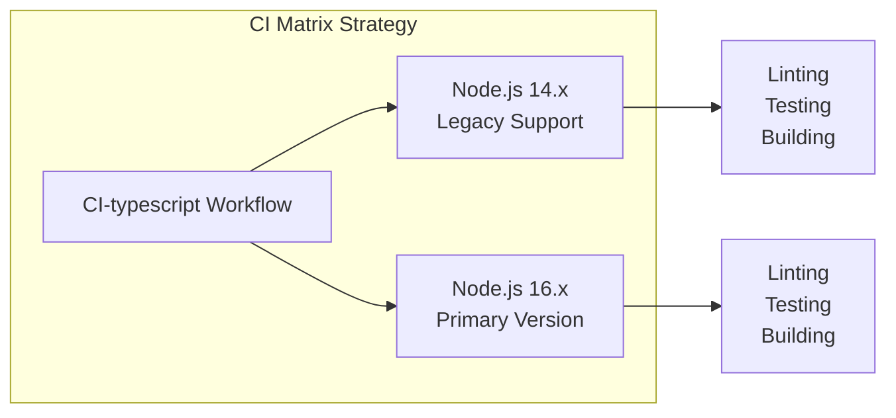
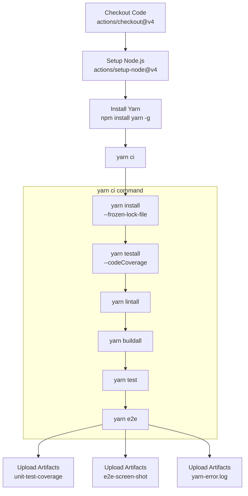
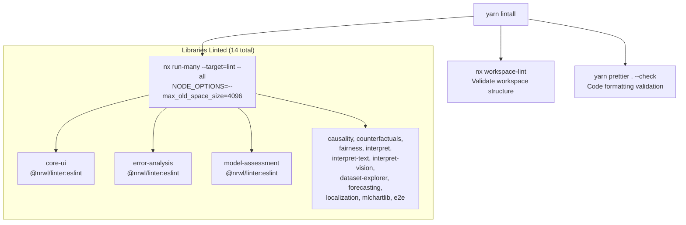
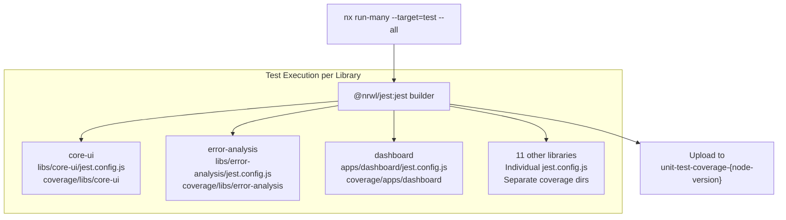
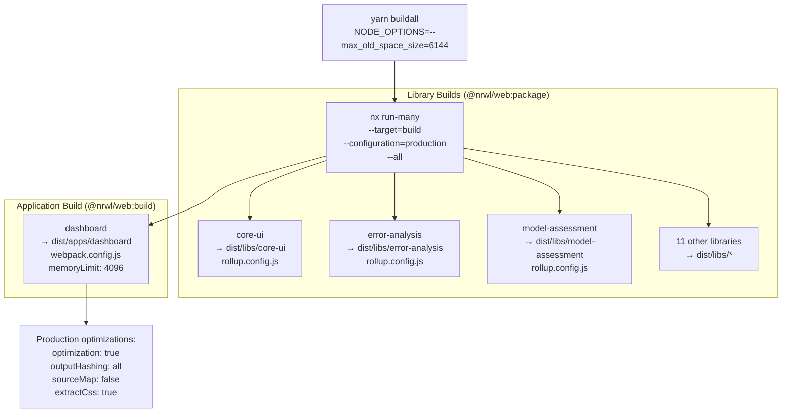
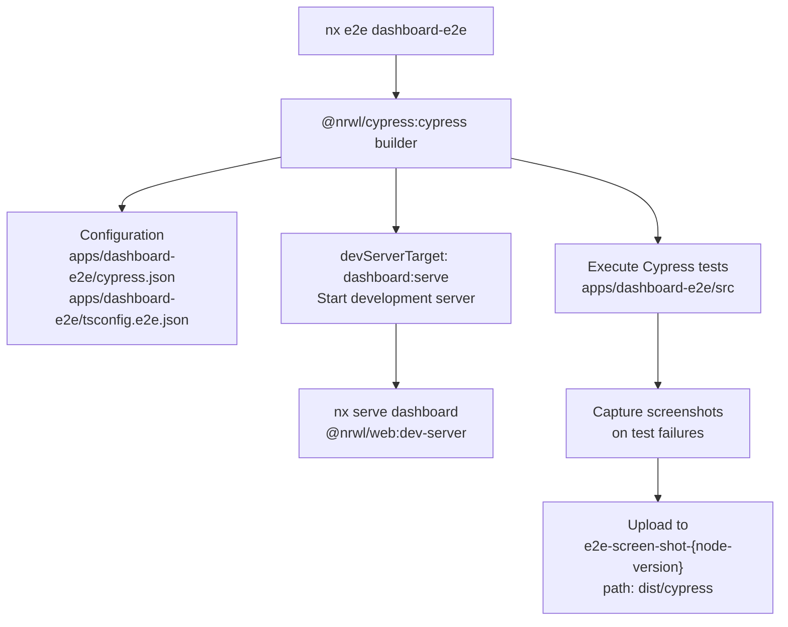
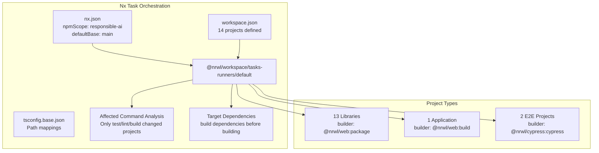
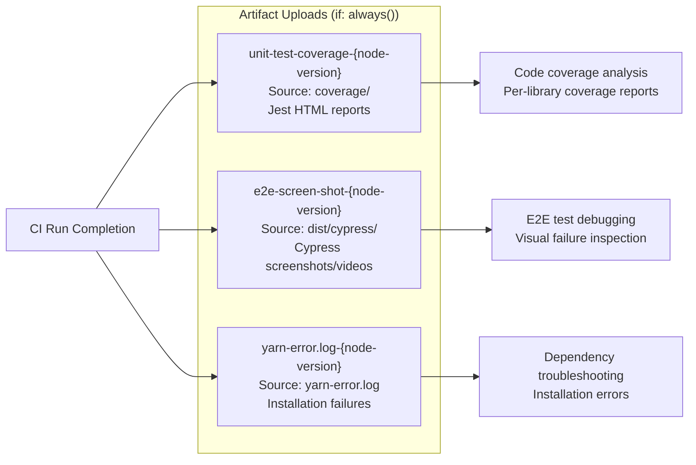

<!-- source: DeepWiki mcp.deepwiki.com · repo microsoft/responsible-ai-toolbox · extra page TypeScript CI Workflows · fetched 2026-10-26 -->

# TypeScript CI Workflows

<details>
<summary>Relevant source files</summary>

The following files were used as context for generating this wiki page:

- [.azure-devops/component-governance.yml](.azure-devops/component-governance.yml)
- [.github/workflows/CD.yml](.github/workflows/CD.yml)
- [.github/workflows/CI-codescan.yml](.github/workflows/CI-codescan.yml)
- [.github/workflows/CI-e2e-notebooks.yml](.github/workflows/CI-e2e-notebooks.yml)
- [.github/workflows/CI-notebook.yml](.github/workflows/CI-notebook.yml)
- [.github/workflows/CI-python.yml](.github/workflows/CI-python.yml)
- [.github/workflows/CI-rai_core_flask-pytest.yml](.github/workflows/CI-rai_core_flask-pytest.yml)
- [.github/workflows/CI-raiwidgets-pytest.yml](.github/workflows/CI-raiwidgets-pytest.yml)
- [.github/workflows/CI-typescript.yml](.github/workflows/CI-typescript.yml)
- [.github/workflows/GitHubPages.yml](.github/workflows/GitHubPages.yml)
- [.github/workflows/python-linting.yml](.github/workflows/python-linting.yml)
- [.github/workflows/release-rai-tabular.yml](.github/workflows/release-rai-tabular.yml)
- [apps/dashboard-e2e/src/describer/interpret/individualFeatureImportance/describeSubBarChart.ts](apps/dashboard-e2e/src/describer/interpret/individualFeatureImportance/describeSubBarChart.ts)
- [libs/e2e/src/lib/describer/interpretText/validateBarChart.ts](libs/e2e/src/lib/describer/interpretText/validateBarChart.ts)
- [libs/mlchartlib/src/lib/components/AccessibleChart.tsx](libs/mlchartlib/src/lib/components/AccessibleChart.tsx)
- [nx.json](nx.json)
- [package.json](package.json)
- [tsconfig.base.json](tsconfig.base.json)
- [workspace.json](workspace.json)
- [yarn.lock](yarn.lock)

</details>


This document describes the TypeScript continuous integration workflows that validate code quality, run tests, and build artifacts for the dashboard and TypeScript libraries in the Responsible AI Toolbox repository. These workflows ensure that all TypeScript and React code meets quality standards before merging.

For information about Python testing and CI, see [Python CI Workflows](#7.2.1). For deployment and release processes, see [Build and Deployment](#7.2.3) and [Release Process](#7.2.4).

## Purpose and Scope

The TypeScript CI system validates all frontend code through linting, unit testing, and end-to-end testing. The primary workflow is defined in [.github/workflows/CI-typescript.yml:1-51]() and executes on every pull request to the `main` branch. The workflow runs across multiple Node.js versions to ensure compatibility and uses the Nx build system to efficiently test and build all 14 TypeScript libraries in the monorepo.

## Workflow Trigger Configuration

The CI-typescript workflow triggers on pull requests only, distinguishing it from the CD workflow which also triggers on pushes to main:

```yaml
on:
  pull_request:
    branches: [main]
```

**Trigger Conditions:**
- Pull requests targeting the `main` branch
- All file types (no path filtering applied)
- Manual workflow dispatch not enabled

Sources: [.github/workflows/CI-typescript.yml:11-13]()

## Node.js Version Matrix

The workflow runs against multiple Node.js versions to ensure compatibility:



Sources: [.github/workflows/CI-typescript.yml:19-21](), [package.json:42]()

## CI Pipeline Stages

The TypeScript CI pipeline executes a comprehensive validation sequence through the `yarn ci` command:



Sources: [.github/workflows/CI-typescript.yml:23-50](), [package.json:19]()

### Installation Phase

The installation phase locks dependencies to ensure reproducible builds:

**Command:** `yarn install --frozen-lock-file`

This command:
- Installs all dependencies from [yarn.lock:1-794617]()
- Fails if `package.json` and `yarn.lock` are out of sync
- Ensures exact version matching across CI runs

Sources: [package.json:19]()

### Linting Phase

The linting phase validates code quality across all libraries:

**Command:** `yarn lintall`



**ESLint Configuration:**
- Linter: `@nrwl/linter:eslint` builder
- Patterns: `**/*.js`, `**/*.jsx`, `**/*.ts`, `**/*.tsx`, `**/*.d.ts`
- Includes test files: `**/*.test.*`, `**/*.spec.*`

Sources: [package.json:31](), [workspace.json:10-28]()

### Unit Testing Phase

The unit testing phase executes Jest tests across all libraries with code coverage:

**Command:** `yarn testall --codeCoverage`

This expands to: `nx run-many --target=test --all --codeCoverage`



**Test Configuration per Library:**
- Builder: `@nrwl/jest:jest`
- Config location: `{library}/jest.config.js`
- Coverage output: `coverage/{library-path}`
- Option: `passWithNoTests: true`

Sources: [package.json:39](), [workspace.json:63-69](), [workspace.json:132-139]()

### Build Phase

The build phase compiles all TypeScript libraries for production:

**Command:** `yarn buildall`

This expands to: `cross-env NODE_OPTIONS=--max_old_space_size=6144 nx run-many --target=build --configuration=production --all`



**Build Configuration:**
- Libraries use `@nrwl/web:package` with Rollup
- Dashboard app uses `@nrwl/web:build` with Webpack
- External dependencies excluded: `react`, `react-dom`, `@fluentui/react`, `plotly.js`, etc.
- Memory allocation: 6GB for libraries, 4GB for dashboard
- Budget limits: 20MB warning, 50MB error for initial bundle

Sources: [package.json:17](), [workspace.json:99-130](), [workspace.json:217-266]()

### End-to-End Testing Phase

The E2E testing phase validates the dashboard application using Cypress:

**Command:** `yarn e2e`

This expands to: `nx e2e dashboard-e2e`



Sources: [package.json:22](), [workspace.json:314-326]()

## Nx Monorepo Integration

The TypeScript CI workflow leverages Nx for efficient task execution across the monorepo:



**Nx Configuration:**
- Default task runner: `@nrwl/workspace/tasks-runners/default`
- Affected base: `main` branch
- Target dependencies: Build dependencies before building dependents

**Path Aliases:**
```typescript
"@responsible-ai/core-ui": ["libs/core-ui/src/index.ts"]
"@responsible-ai/error-analysis": ["libs/error-analysis/src/index.ts"]
"@responsible-ai/model-assessment": ["libs/model-assessment/src/index.ts"]
// ... 11 more library mappings
```

Sources: [nx.json:1-89](), [workspace.json:1-10](), [tsconfig.base.json:37-56]()

## Memory Allocation Strategy

TypeScript compilation and testing require significant memory allocation:

| Phase | Memory Limit | Configuration |
|-------|-------------|---------------|
| Linting | 4GB | `NODE_OPTIONS=--max_old_space_size=4096` |
| Testing | Default | No explicit limit |
| Building (libraries) | 6GB | `NODE_OPTIONS=--max_old_space_size=6144` |
| Building (dashboard) | 4GB | `memoryLimit: 4096` in workspace.json |

**Rationale:**
- Building all 14 libraries simultaneously requires 6GB heap space
- Dashboard webpack build configured with 4GB internal limit
- Linting requires 4GB due to parallel ESLint execution across all projects

Sources: [package.json:13-17](), [workspace.json:227]()

## Artifact Upload Strategy

The workflow uploads three types of artifacts for debugging and analysis:



**Upload Conditions:**
- All uploads use `if: always()` to ensure artifacts are captured even on failure
- Artifacts are namespaced by Node.js version to prevent collisions
- Actions: `actions/upload-artifact@v4`

Sources: [.github/workflows/CI-typescript.yml:33-50]()

## Comparison with CD Workflow

While CI-typescript runs on pull requests, the CD workflow ([.github/workflows/CD.yml:1-243]()) handles builds on merge:

| Aspect | CI-typescript | CD |
|--------|--------------|-----|
| Trigger | Pull requests only | Push to main, PRs, manual |
| Node versions | 14.x, 16.x | 16.x only |
| Build configuration | Production | Production |
| Artifact destination | GitHub Actions | Azure Blob Storage |
| NPM publishing | No | Yes (on main/manual) |
| Python wheel building | No | Yes |

The CD workflow includes additional steps:
- Building Python wheels for `raiwidgets` and `responsibleai`
- Uploading to Azure Blob Storage at URLs like `https://responsibleai.blob.core.windows.net/latest/index.html`
- Publishing TypeScript packages to NPM registry
- 90-day retention policy for blob storage artifacts

Sources: [.github/workflows/CI-typescript.yml:1-51](), [.github/workflows/CD.yml:1-243]()

---

