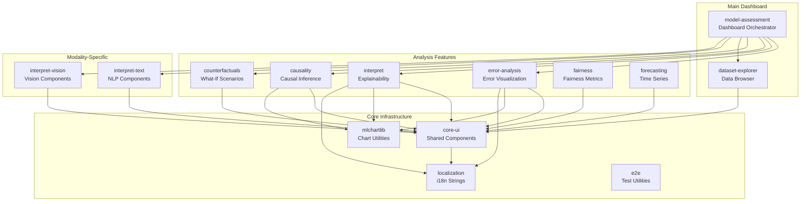
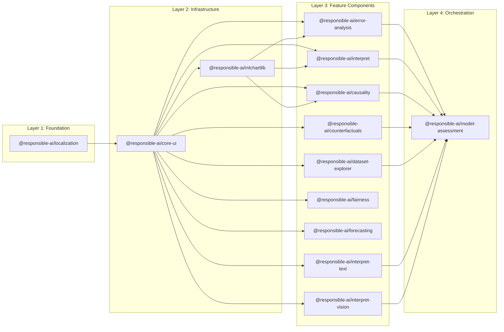
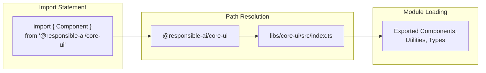
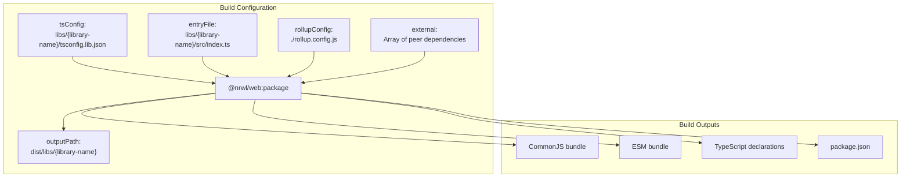

<!-- source: DeepWiki mcp.deepwiki.com · repo microsoft/responsible-ai-toolbox · extra page TypeScript Libraries · fetched 2026-10-26 -->

# TypeScript Libraries

<details>
<summary>Relevant source files</summary>

The following files were used as context for generating this wiki page:

- [apps/dashboard-e2e/src/describer/interpret/individualFeatureImportance/describeSubBarChart.ts](apps/dashboard-e2e/src/describer/interpret/individualFeatureImportance/describeSubBarChart.ts)
- [libs/e2e/src/lib/describer/interpretText/validateBarChart.ts](libs/e2e/src/lib/describer/interpretText/validateBarChart.ts)
- [libs/mlchartlib/src/lib/components/AccessibleChart.tsx](libs/mlchartlib/src/lib/components/AccessibleChart.tsx)
- [nx.json](nx.json)
- [package.json](package.json)
- [tsconfig.base.json](tsconfig.base.json)
- [workspace.json](workspace.json)
- [yarn.lock](yarn.lock)

</details>


## Purpose and Scope

This page documents the individual TypeScript libraries that comprise the Responsible AI Toolbox dashboard. These libraries are organized within an Nx monorepo and provide reusable UI components, visualizations, and utilities for model assessment, error analysis, interpretability, and other responsible AI features. Each library is independently buildable and testable, with well-defined dependencies.

For information about the overall Nx monorepo structure and organization, see [Nx Monorepo Structure](#4.5). For details on the build process and bundling, see [Build and Bundle Pipeline](#4.5.2). For chart-specific components, see [Chart Components](#4.5.3).

---

## Library Inventory

The monorepo contains 14 TypeScript libraries, organized under the `libs/` directory. Each library is published as a scoped NPM package under `@responsible-ai/*`.

| Library Name | Package Name | Entry Point | Purpose |
|-------------|--------------|-------------|---------|
| **causality** | `@responsible-ai/causality` | `libs/causality/src/index.ts` | Causal analysis UI components |
| **core-ui** | `@responsible-ai/core-ui` | `libs/core-ui/src/index.ts` | Shared UI components and utilities |
| **counterfactuals** | `@responsible-ai/counterfactuals` | `libs/counterfactuals/src/index.ts` | Counterfactual explanation UI |
| **dataset-explorer** | `@responsible-ai/dataset-explorer` | `libs/dataset-explorer/src/index.ts` | Data exploration and browsing |
| **e2e** | `@responsible-ai/e2e` | `libs/e2e/src/index.ts` | End-to-end testing utilities |
| **error-analysis** | `@responsible-ai/error-analysis` | `libs/error-analysis/src/index.ts` | Error analysis visualizations |
| **fairness** | `@responsible-ai/fairness` | `libs/fairness/src/index.ts` | Fairness metrics and UI |
| **forecasting** | `@responsible-ai/forecasting` | `libs/forecasting/src/index.ts` | Forecasting-specific components |
| **interpret** | `@responsible-ai/interpret` | `libs/interpret/src/index.ts` | Model interpretability components |
| **interpret-text** | `@responsible-ai/interpret-text` | `libs/interpret-text/src/index.ts` | Text/NLP interpretation UI |
| **interpret-vision** | `@responsible-ai/interpret-vision` | `libs/interpret-vision/src/index.ts` | Vision/image interpretation UI |
| **localization** | `@responsible-ai/localization` | `libs/localization/src/index.ts` | Internationalization strings |
| **mlchartlib** | `@responsible-ai/mlchartlib` | `libs/mlchartlib/src/index.ts` | Chart components and utilities |
| **model-assessment** | `@responsible-ai/model-assessment` | `libs/model-assessment/src/index.ts` | Main dashboard orchestrator |

**Sources:** [workspace.json:1-1098](), [tsconfig.base.json:37-56](), [nx.json:23-79]()

---

## Library Categories

The libraries are organized into functional categories based on their responsibilities within the system.

### Library Organization by Function



**Sources:** [workspace.json:1-1098](), [nx.json:23-79]()

---

## Dependency Structure

### Inter-Library Dependencies

The libraries follow a layered architecture where higher-level components depend on lower-level utilities. The `core-ui` library serves as the foundation, with `model-assessment` at the top orchestrating all features.



**Sources:** [workspace.json:1-1098](), [nx.json:81-88]()

### Build Target Dependencies

Nx ensures that dependent libraries are built before their consumers through the `targetDependencies` configuration. When building a library, Nx automatically builds all its dependencies first.

**Sources:** [nx.json:81-88]()

---

## External Dependencies

All libraries share a common set of external dependencies that are not bundled into the library packages. These are specified in each library's build configuration under the `external` array.

### Common External Dependencies (Legacy Build Configuration)

Most libraries use the following external dependency list:

| Dependency | Purpose |
|-----------|---------|
| `@fluentui/react` | Microsoft Fluent UI component library |
| `highcharts` | Highcharts charting library |
| `jmespath` | JSON query language for data filtering |
| `localized-strings` | Localization utility |
| `lodash` | Utility functions |
| `memoize-one` | Memoization for performance |
| `moment` | Date/time manipulation |
| `plotly.js` | Plotly charting library |
| `react-plotly.js` | React wrapper for Plotly |
| `react` | React framework |
| `react-dom` | React DOM bindings |
| `uuid` | UUID generation |

**Sources:** [workspace.json:37-50](), [workspace.json:106-119]()

### Modern External Dependencies

Newer libraries (forecasting, interpret-text, interpret-vision, e2e) use a simplified external dependency configuration:

```typescript
"external": ["react/jsx-runtime"]
```

These libraries use the default Nx React rollup configuration instead of the custom `rollup.config.js`.

**Sources:** [workspace.json:432](), [workspace.json:610](), [workspace.json:719](), [workspace.json:759]()

---

## Import Path Mapping

TypeScript path mappings enable clean imports across the monorepo. The `tsconfig.base.json` file defines path aliases for all libraries, allowing imports without relative paths.

### Path Mapping Configuration



### Import Examples

```typescript
// Importing from core-ui
import { ErrorCohort, CohortSource } from "@responsible-ai/core-ui";

// Importing from error-analysis
import { ErrorAnalysisView } from "@responsible-ai/error-analysis";

// Importing from model-assessment
import { ModelAssessmentDashboard } from "@responsible-ai/model-assessment";
```

**Sources:** [tsconfig.base.json:37-56]()

---

## Library Build Configuration

Each library in the monorepo follows a consistent build configuration pattern defined in `workspace.json`. Libraries are built using the `@nrwl/web:package` builder.

### Standard Build Configuration Structure



**Sources:** [workspace.json:30-62](), [workspace.json:99-131]()

### Build Targets

Each library defines three standard build targets:

1. **build**: Compiles the library and creates distributable packages
2. **lint**: Runs ESLint on all TypeScript/JavaScript files
3. **test**: Runs Jest unit tests

**Sources:** [workspace.json:10-71]()

---

## Core Infrastructure Libraries

### core-ui

The `core-ui` library provides foundational UI components, utilities, and types used across all other libraries. It includes cohort management, error handling, data processing utilities, and shared React components.

**Key exports include:**
- Cohort management components and utilities
- Common error handling and validation
- Data transformation utilities
- Shared UI components (buttons, panels, dropdowns)
- TypeScript interfaces for data models

**Sources:** [workspace.json:73-141](), [tsconfig.base.json:39]()

### mlchartlib

The `mlchartlib` library provides charting components and utilities built on top of Plotly and Highcharts. It includes the `AccessibleChart` component that wraps Plotly for accessibility and theming support.

**Key components:**
- `AccessibleChart`: Main chart component with accessibility table generation
- `PlotlyThemes`: Theme management for consistent styling
- Chart formatters and data transformation utilities

**Sources:** [workspace.json:1001-1069](), [libs/mlchartlib/src/lib/components/AccessibleChart.tsx:1-135]()

### localization

The `localization` library provides internationalization (i18n) strings and utilities for all UI components. It uses the `localized-strings` package to manage translations.

**Sources:** [workspace.json:786-854](), [tsconfig.base.json:53]()

### e2e

The `e2e` library provides shared utilities for end-to-end testing with Cypress, including page object models, test helpers, and reusable test scenarios.

**Sources:** [workspace.json:407-457](), [apps/dashboard-e2e/src/describer/interpret/individualFeatureImportance/describeSubBarChart.ts:1-42](), [libs/e2e/src/lib/describer/interpretText/validateBarChart.ts:1-35]()

---

## Analysis Feature Libraries

### error-analysis

The `error-analysis` library provides UI components for visualizing model errors through tree maps and heat maps. It communicates with the Python error analysis engine via Flask endpoints.

**Key components:**
- `ErrorAnalysisView`: Main container component
- `TreeViewRenderer`: Hierarchical error tree visualization using D3
- `MatrixFilter`: 2D heat map for error distribution
- Error cohort selection and filtering UI

**Sources:** [workspace.json:459-527](), [tsconfig.base.json:45]()

### interpret

The `interpret` library provides model interpretability components including feature importance charts, individual explanations, and global explanations. It integrates with InterpretML and SHAP on the backend.

**Key components:**
- Feature importance bar charts
- Individual feature importance scatter plots
- Dependence plots
- ICE (Individual Conditional Expectation) plots

**Sources:** [workspace.json:637-704](), [tsconfig.base.json:48]()

### causality

The `causality` library provides UI components for causal analysis, integrating with EconML on the backend. It enables users to explore causal effects of features on outcomes.

**Key features:**
- Treatment effect visualization
- Causal policy analysis
- What-if scenario exploration for causal interventions

**Sources:** [workspace.json:4-72](), [tsconfig.base.json:38]()

### counterfactuals

The `counterfactuals` library provides UI for generating and exploring counterfactual explanations using DiCE. Users can see what minimal changes to input features would change the model's prediction.

**Key components:**
- `CounterfactualPanel`: Main panel for CF configuration
- `CounterfactualChart`: Visualization of generated counterfactuals
- Feature perturbation controls

**Sources:** [workspace.json:142-210](), [tsconfig.base.json:40]()

### fairness

The `fairness` library provides UI components for fairness analysis, integrating with the Fairlearn package. It visualizes fairness metrics across sensitive features and demographic groups.

**Sources:** [workspace.json:528-596](), [tsconfig.base.json:46]()

### forecasting

The `forecasting` library provides specialized UI components for time series forecasting models, including forecast-specific error analysis and interpretability.

**Sources:** [workspace.json:597-636](), [tsconfig.base.json:47]()

---

## Modality-Specific Libraries

### interpret-text

The `interpret-text` library provides UI components specific to NLP and text models, including:
- Token-level importance visualization
- Question-answering metrics (F1, Exact Match)
- Text classification explanations
- Generative AI evaluation metrics

**Sources:** [workspace.json:706-744](), [tsconfig.base.json:49]()

### interpret-vision

The `interpret-vision` library provides UI components specific to computer vision models, including:
- Image visualization with bounding boxes
- Object detection metrics
- Image classification explanations
- EXIF metadata display
- Saliency map overlays

**Sources:** [workspace.json:746-784](), [tsconfig.base.json:50-52]()

---

## Dataset and Dashboard Libraries

### dataset-explorer

The `dataset-explorer` library provides data browsing and exploration capabilities, allowing users to view individual data points, filter by cohorts, and explore feature distributions.

**Key features:**
- Table view with sorting and filtering
- Cohort-based data subsetting
- Feature statistics and distributions
- Individual data point inspection

**Sources:** [workspace.json:338-406](), [tsconfig.base.json:41-43]()

### model-assessment

The `model-assessment` library is the top-level orchestrator that integrates all other feature libraries into a unified dashboard. It provides the `ModelAssessmentDashboard` component that serves as the main entry point.

**Key responsibilities:**
- Tab-based navigation across features
- Global cohort management
- State coordination across components
- Integration with Flask backend for data fetching

**Sources:** [workspace.json:1070-1098](), [tsconfig.base.json:55]()

---

## Build Configuration Patterns

### Legacy Build Pattern

Most libraries use a custom Rollup configuration with explicit external dependencies:

```json
{
  "builder": "@nrwl/web:package",
  "options": {
    "rollupConfig": "./rollup.config.js",
    "external": [
      "@fluentui/react",
      "react",
      "react-dom",
      ...
    ]
  }
}
```

**Sources:** [workspace.json:99-131]()

### Modern Build Pattern

Newer libraries use the default Nx React rollup plugin:

```json
{
  "builder": "@nrwl/web:package",
  "options": {
    "rollupConfig": "@nrwl/react/plugins/bundle-rollup",
    "external": ["react/jsx-runtime"]
  }
}
```

**Sources:** [workspace.json:711-729]()

---

## Testing Configuration

Each library includes a Jest test configuration with the following pattern:

```json
{
  "test": {
    "builder": "@nrwl/jest:jest",
    "options": {
      "jestConfig": "libs/{library-name}/jest.config.js",
      "passWithNoTests": true
    },
    "outputs": ["coverage/libs/{library-name}"]
  }
}
```

The `passWithNoTests` option allows libraries without tests to pass CI without failing.

**Sources:** [workspace.json:63-70](), [workspace.json:132-139]()

---

## Linting Configuration

All libraries use ESLint with a comprehensive pattern covering all TypeScript and JavaScript files, including test files:

```json
{
  "lint": {
    "builder": "@nrwl/linter:eslint",
    "options": {
      "lintFilePatterns": [
        "libs/{library-name}/**/*.js",
        "libs/{library-name}/**/*.jsx",
        "libs/{library-name}/**/*.ts",
        "libs/{library-name}/**/*.tsx",
        "libs/{library-name}/**/*.test.ts",
        "libs/{library-name}/**/*.test.tsx",
        "libs/{library-name}/**/*.spec.ts",
        "libs/{library-name}/**/*.spec.tsx",
        "libs/{library-name}/**/*.d.ts"
      ]
    }
  }
}
```

**Sources:** [workspace.json:10-29](), [workspace.json:79-98]()

---

