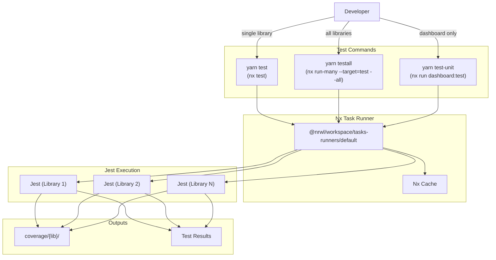
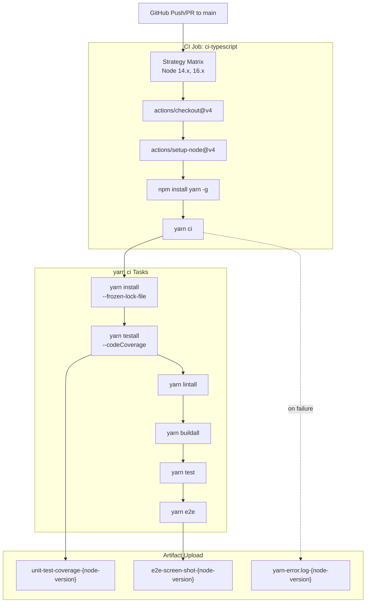
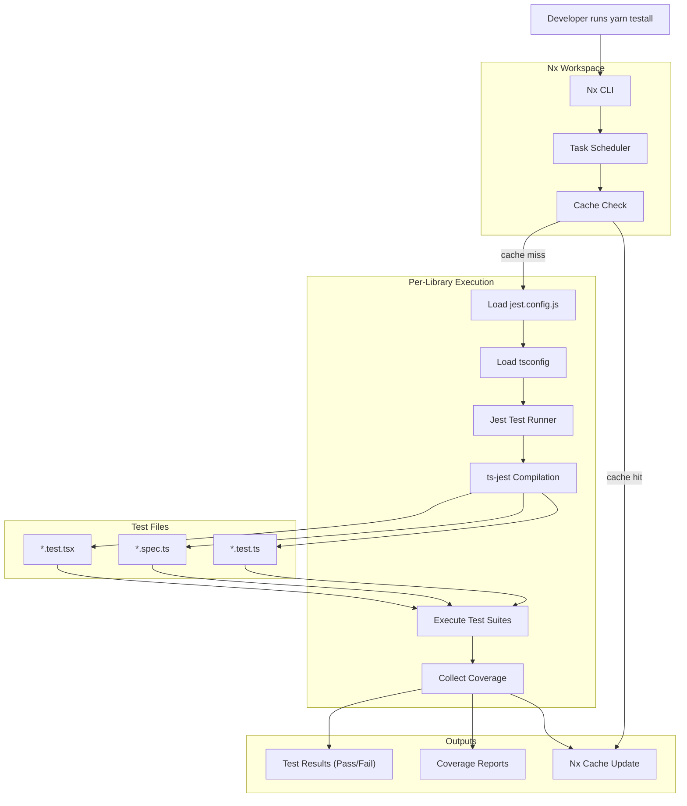
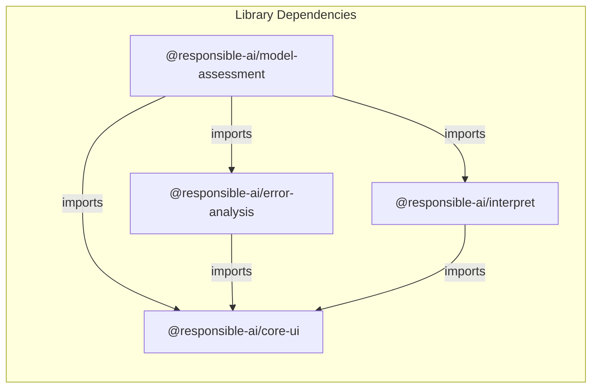

<!-- source: DeepWiki mcp.deepwiki.com · repo microsoft/responsible-ai-toolbox · extra page TypeScript Unit Tests · fetched 2026-10-26 -->

# TypeScript Unit Tests

<details>
<summary>Relevant source files</summary>

The following files were used as context for generating this wiki page:

- [.azure-devops/component-governance.yml](.azure-devops/component-governance.yml)
- [.github/workflows/CD.yml](.github/workflows/CD.yml)
- [.github/workflows/CI-codescan.yml](.github/workflows/CI-codescan.yml)
- [.github/workflows/CI-e2e-notebooks.yml](.github/workflows/CI-e2e-notebooks.yml)
- [.github/workflows/CI-notebook.yml](.github/workflows/CI-notebook.yml)
- [.github/workflows/CI-python.yml](.github/workflows/CI-python.yml)
- [.github/workflows/CI-rai_core_flask-pytest.yml](.github/workflows/CI-rai_core_flask-pytest.yml)
- [.github/workflows/CI-raiwidgets-pytest.yml](.github/workflows/CI-raiwidgets-pytest.yml)
- [.github/workflows/CI-typescript.yml](.github/workflows/CI-typescript.yml)
- [.github/workflows/GitHubPages.yml](.github/workflows/GitHubPages.yml)
- [.github/workflows/python-linting.yml](.github/workflows/python-linting.yml)
- [.github/workflows/release-rai-tabular.yml](.github/workflows/release-rai-tabular.yml)
- [apps/dashboard-e2e/src/describer/interpret/individualFeatureImportance/describeSubBarChart.ts](apps/dashboard-e2e/src/describer/interpret/individualFeatureImportance/describeSubBarChart.ts)
- [libs/e2e/src/lib/describer/interpretText/validateBarChart.ts](libs/e2e/src/lib/describer/interpretText/validateBarChart.ts)
- [libs/mlchartlib/src/lib/components/AccessibleChart.tsx](libs/mlchartlib/src/lib/components/AccessibleChart.tsx)
- [nx.json](nx.json)
- [package.json](package.json)
- [tsconfig.base.json](tsconfig.base.json)
- [workspace.json](workspace.json)
- [yarn.lock](yarn.lock)

</details>


## Purpose and Scope

This document describes the TypeScript unit testing infrastructure for the Responsible AI Toolbox dashboard and component libraries. Unit tests verify individual components, functions, and utilities in isolation using Jest as the test runner.

For end-to-end widget integration testing, see [End-to-End Tests](#7.1.4). For Python testing, see [Python Unit and Integration Tests](#7.1.1).

---

## Test Framework and Infrastructure

### Jest Test Runner

The codebase uses **Jest 27.2.3** as the primary test framework for all TypeScript code, configured through the **Nx monorepo** build system.

**Key Dependencies:**
- `jest@27.2.3` - Core test framework
- `ts-jest@27.0.5` - TypeScript support for Jest
- `@nrwl/jest@12.10.0` - Nx Jest builder integration
- `@testing-library/react@11.2.6` - Modern React testing utilities
- `enzyme@3.11.0` - Legacy React component testing
- `enzyme-to-json@3.5.0` - Enzyme snapshot serialization
- `jest-canvas-mock@2.2.0` - Canvas API mocking for chart tests

Sources: [package.json:78-151]()

### Nx Jest Builder Configuration

Each library in the monorepo has a dedicated test target configured via the `@nrwl/jest:jest` builder. The configuration pattern is consistent across all libraries:

```json
"test": {
  "builder": "@nrwl/jest:jest",
  "options": {
    "jestConfig": "libs/{library-name}/jest.config.js",
    "passWithNoTests": true
  },
  "outputs": ["coverage/libs/{library-name}"]
}
```

**Library Test Configurations:**

| Library | Jest Config Path | Coverage Output |
|---------|------------------|-----------------|
| core-ui | `libs/core-ui/jest.config.js` | `coverage/libs/core-ui` |
| error-analysis | `libs/error-analysis/jest.config.js` | `coverage/libs/error-analysis` |
| model-assessment | `libs/model-assessment/jest.config.js` | `coverage/libs/model-assessment` |
| interpret | `libs/interpret/jest.config.js` | `coverage/libs/interpret` |
| causality | `libs/causality/jest.config.js` | `coverage/libs/causality` |
| counterfactuals | `libs/counterfactuals/jest.config.js` | `coverage/libs/counterfactuals` |
| fairness | `libs/fairness/jest.config.js` | `coverage/libs/fairness` |
| dataset-explorer | `libs/dataset-explorer/jest.config.js` | `coverage/libs/dataset-explorer` |
| mlchartlib | `libs/mlchartlib/jest.config.js` | `coverage/libs/mlchartlib` |
| interpret-text | `libs/interpret-text/jest.config.js` | `coverage/libs/interpret-text` |
| interpret-vision | `libs/interpret-vision/jest.config.js` | `coverage/libs/interpret-vision` |
| localization | `libs/localization/jest.config.js` | `coverage/libs/localization` |
| forecasting | `libs/forecasting/jest.config.js` | `coverage/libs/forecasting` |
| e2e | `libs/e2e/jest.config.js` | `coverage/libs/e2e` |
| dashboard | `apps/dashboard/jest.config.js` | `coverage/apps/dashboard` |

The `passWithNoTests: true` option prevents build failures when a library has no tests yet.

Sources: [workspace.json:63-70](), [workspace.json:132-139](), [workspace.json:201-208](), [workspace.json:299-306](), [workspace.json:397-404](), [workspace.json:449-456](), [workspace.json:518-525](), [workspace.json:587-594]()

---

## Test Organization and Structure

### Directory Conventions

Test files follow a co-located pattern, residing alongside the source code they test:

```
libs/{library-name}/
├── src/
│   ├── lib/
│   │   ├── Component.tsx
│   │   ├── Component.test.tsx
│   │   ├── utils.ts
│   │   └── utils.test.ts
│   └── index.ts
└── jest.config.js
```

### Test File Naming

Test files use one of the following extensions, as configured in workspace linting rules:
- `*.test.ts` - TypeScript unit tests
- `*.test.tsx` - React component unit tests
- `*.spec.ts` - Specification-style tests
- `*.spec.tsx` - React component specification tests
- `*.test.js` / `*.spec.js` - JavaScript tests (legacy)

Sources: [workspace.json:82-96](), [workspace.json:469-483]()

### Test File Discovery

Jest discovers test files matching these patterns across all libraries:
- `**/*.test.ts`
- `**/*.test.tsx`
- `**/*.spec.ts`
- `**/*.spec.tsx`
- `**/*.test.js`
- `**/*.test.jsx`

The Nx workspace linter enforces these naming conventions during the linting phase.

Sources: [workspace.json:14-27]()

---

## Running Tests

### Local Development Commands

**Test Execution Diagram:**



**Available Test Scripts:**

| Command | Description | Implementation |
|---------|-------------|----------------|
| `yarn test` | Run tests for a specific library | `nx test` |
| `yarn testall` | Run tests for all libraries in parallel | `nx run-many --target=test --all` |
| `yarn test-unit` | Run dashboard application tests only | `nx run dashboard:test` |
| `yarn ci` | Full CI test suite with coverage | `yarn testall --codeCoverage && yarn lintall && yarn buildall && yarn test && yarn e2e` |

Sources: [package.json:37-39](), [package.json:19]()

### Test Execution with Coverage

To run tests with code coverage:

```bash
yarn testall --codeCoverage
```

This generates coverage reports in `coverage/{library-name}/` directories for each tested library.

Sources: [package.json:19]()

### Nx Caching and Parallelization

Nx provides intelligent caching and parallel execution for test tasks:
- Tests are cached based on source file hashes
- Unchanged libraries skip test execution using cached results
- Multiple libraries run tests in parallel when possible
- Task dependencies defined in `nx.json` ensure correct execution order

The default task runner configuration:

```json
"tasksRunnerOptions": {
  "default": {
    "runner": "@nrwl/workspace/tasks-runners/default",
    "options": {}
  }
}
```

Sources: [nx.json:17-22]()

---

## Continuous Integration

### CI Workflow Architecture

The TypeScript CI pipeline validates tests across multiple Node.js versions on every pull request and push to main.

**CI Pipeline Diagram:**



### Workflow Configuration

**File:** `.github/workflows/CI-typescript.yml`

**Trigger Conditions:**
- Pull requests to `main` branch
- Direct pushes to `main` branch (not common)

**Matrix Strategy:**
- Node.js versions: 14.x, 16.x
- Operating system: `ubuntu-latest` only

**Execution Steps:**
1. Checkout repository with `actions/checkout@v4`
2. Setup Node.js with `actions/setup-node@v4`
3. Install Yarn globally: `npm install yarn -g`
4. Execute full CI suite: `yarn ci`

Sources: [.github/workflows/CI-typescript.yml:1-51]()

### CI Command Breakdown

The `yarn ci` command executes a comprehensive test and build pipeline:

```bash
yarn install --frozen-lock-file && \
yarn testall --codeCoverage && \
yarn lintall && \
yarn buildall && \
yarn test && \
yarn e2e
```

**Execution Order:**
1. `yarn install --frozen-lock-file` - Install exact dependency versions from `yarn.lock`
2. `yarn testall --codeCoverage` - **Run all unit tests with coverage**
3. `yarn lintall` - Lint all TypeScript/JavaScript code
4. `yarn buildall` - Build all libraries in production mode
5. `yarn test` - Run additional test verification
6. `yarn e2e` - Execute Cypress end-to-end tests

Sources: [package.json:19](), [.github/workflows/CI-typescript.yml:32]()

### Artifact Collection

The CI workflow uploads three categories of artifacts on every run:

| Artifact Name | Upload Condition | Content | Path |
|---------------|------------------|---------|------|
| `unit-test-coverage-{node-version}` | Always | Jest coverage reports | `coverage/` |
| `e2e-screen-shot-{node-version}` | Always | Cypress screenshots | `dist/cypress/` |
| `yarn-error.log-{node-version}` | Always (even on failure) | Yarn error logs | `yarn-error.log` |

Sources: [.github/workflows/CI-typescript.yml:33-50]()

---

## Code Coverage

### Coverage Collection

Jest collects code coverage when the `--codeCoverage` flag is passed to `yarn testall`. Each library generates its own coverage report in the `coverage/{library-name}/` directory.

**Coverage Output Structure:**
```
coverage/
├── libs/
│   ├── core-ui/
│   │   ├── index.html
│   │   ├── lcov.info
│   │   └── ...
│   ├── error-analysis/
│   │   ├── index.html
│   │   ├── lcov.info
│   │   └── ...
│   └── ...
└── apps/
    └── dashboard/
        ├── index.html
        ├── lcov.info
        └── ...
```

Sources: [workspace.json:69](), [workspace.json:138](), [workspace.json:207]()

### Coverage Reporting in CI

During CI execution, coverage reports are uploaded as GitHub Actions artifacts for inspection:

**Artifact Upload Configuration:**
```yaml
- name: Upload unit test code coverage
  if: always()
  uses: actions/upload-artifact@v4
  with:
    name: unit-test-coverage-${{ matrix.node-version }}
    path: coverage
```

The `if: always()` condition ensures coverage uploads even when tests fail, enabling debugging.

Sources: [.github/workflows/CI-typescript.yml:33-38]()

---

## Test Utilities and Testing Patterns

### React Testing Libraries

The codebase uses two React testing approaches:

**Modern Approach - React Testing Library:**
- `@testing-library/react@11.2.6` - Provides user-centric testing utilities
- Encourages testing component behavior rather than implementation
- Preferred for new tests

**Legacy Approach - Enzyme:**
- `enzyme@3.11.0` - Legacy shallow/mount rendering
- `@wojtekmaj/enzyme-adapter-react-17@0.6.6` - React 17 compatibility adapter
- `enzyme-to-json@3.5.0` - Snapshot serialization
- Used in existing tests but not recommended for new code

Sources: [package.json:93](), [package.json:119](), [package.json:125-126]()

### Chart and Visualization Testing

Testing chart components requires mocking browser APIs:

**jest-canvas-mock:**
- Mocks the HTML5 Canvas API
- Essential for testing Plotly, D3, and Highcharts visualizations
- Automatically configured in Jest setup

Example usage in `AccessibleChart` component testing would leverage this mock to verify chart rendering without actual canvas operations.

Sources: [package.json:139](), [libs/mlchartlib/src/lib/components/AccessibleChart.tsx:1-135]()

### TypeScript Configuration for Tests

Tests use the same TypeScript configuration as source code, defined in `tsconfig.base.json`:

**Key Compiler Options:**
- `jsx: "react"` - Enable JSX transformation
- `lib: ["es2017", "dom"]` - Include DOM and ES2017 APIs
- `allowJs: true` - Support JavaScript test files
- `esModuleInterop: true` - CommonJS/ESM interop
- `strict: true` - Full strict mode checking
- `isolatedModules: true` - Ensure each file can be transpiled independently

Sources: [tsconfig.base.json:1-59]()

### Path Mapping for Test Imports

Tests can import from library aliases defined in `tsconfig.base.json`:

```typescript
import { IErrorAnalysisData } from "@responsible-ai/error-analysis";
import { ModelAssessmentContext } from "@responsible-ai/model-assessment";
import { ITheme } from "@fluentui/react";
```

**Available Import Aliases:**

| Alias | Source Path |
|-------|-------------|
| `@responsible-ai/core-ui` | `libs/core-ui/src/index.ts` |
| `@responsible-ai/error-analysis` | `libs/error-analysis/src/index.ts` |
| `@responsible-ai/model-assessment` | `libs/model-assessment/src/index.ts` |
| `@responsible-ai/interpret` | `libs/interpret/src/index.ts` |
| `@responsible-ai/causality` | `libs/causality/src/index.ts` |
| `@responsible-ai/counterfactuals` | `libs/counterfactuals/src/index.ts` |
| `@responsible-ai/fairness` | `libs/fairness/src/index.ts` |
| `@responsible-ai/dataset-explorer` | `libs/dataset-explorer/src/index.ts` |
| `@responsible-ai/mlchartlib` | `libs/mlchartlib/src/index.ts` |
| `@responsible-ai/interpret-text` | `libs/interpret-text/src/index.ts` |
| `@responsible-ai/interpret-vision` | `libs/interpret-vision/src/index.ts` |
| `@responsible-ai/localization` | `libs/localization/src/index.ts` |
| `@responsible-ai/forecasting` | `libs/forecasting/src/index.ts` |
| `@responsible-ai/e2e` | `libs/e2e/src/index.ts` |

Sources: [tsconfig.base.json:37-56]()

---

## Test Execution Flow

### Complete Test Pipeline



### Dependency Resolution

Nx automatically handles test dependencies between libraries:



When running tests for `model-assessment`, Nx ensures:
1. `core-ui` tests pass first
2. `error-analysis` and `interpret` tests run after `core-ui`
3. `model-assessment` tests run after all dependencies

This dependency chain is defined implicitly through the `buildableProjectDepsInPackageJsonType: "dependencies"` configuration and enforced via the `targetDependencies` section in `nx.json`.

Sources: [nx.json:81-88](), [workspace.json:59](), [workspace.json:128](), [workspace.json:197]()

---

