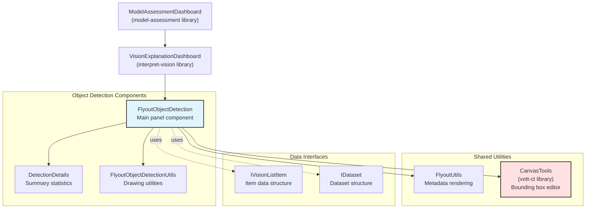
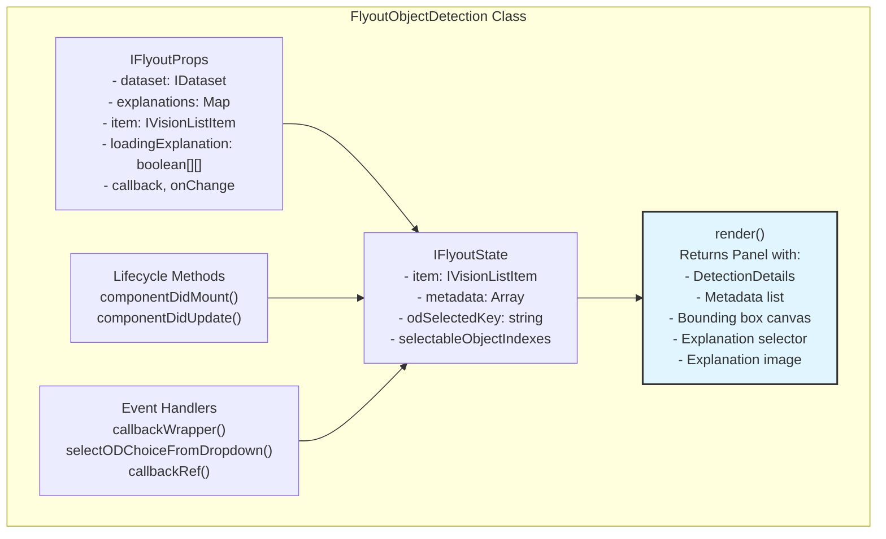
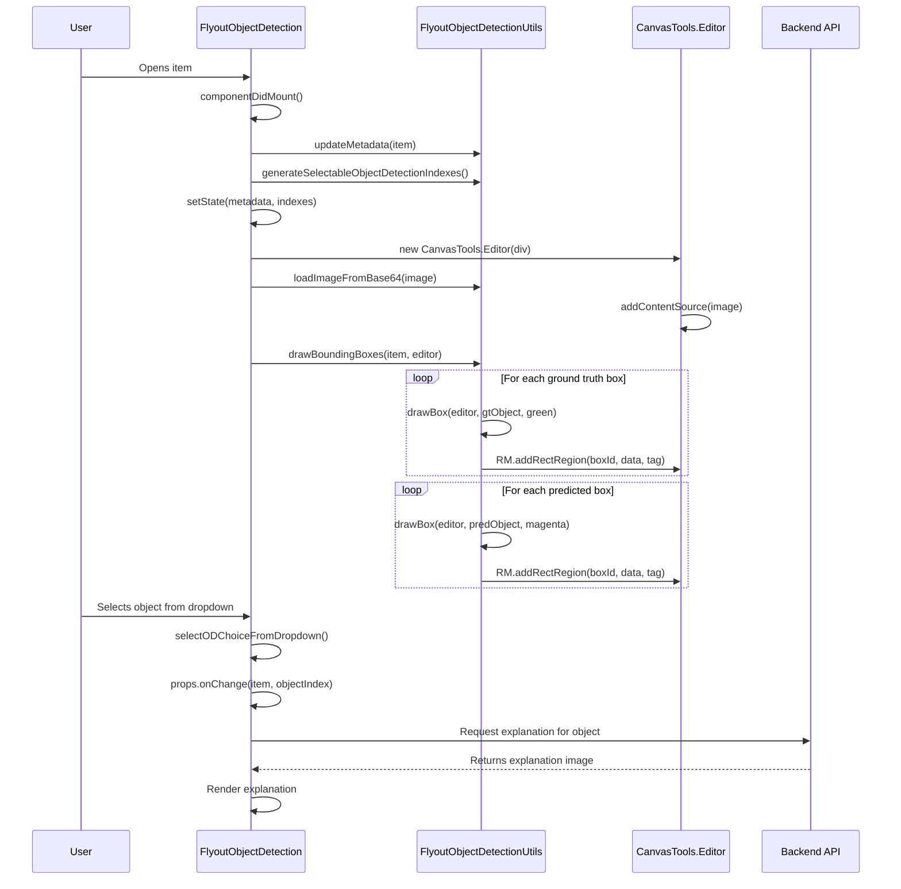
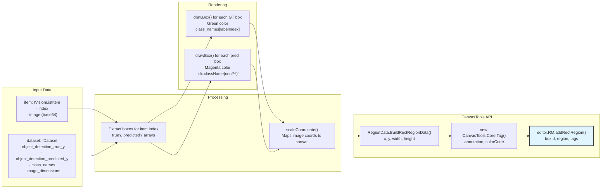
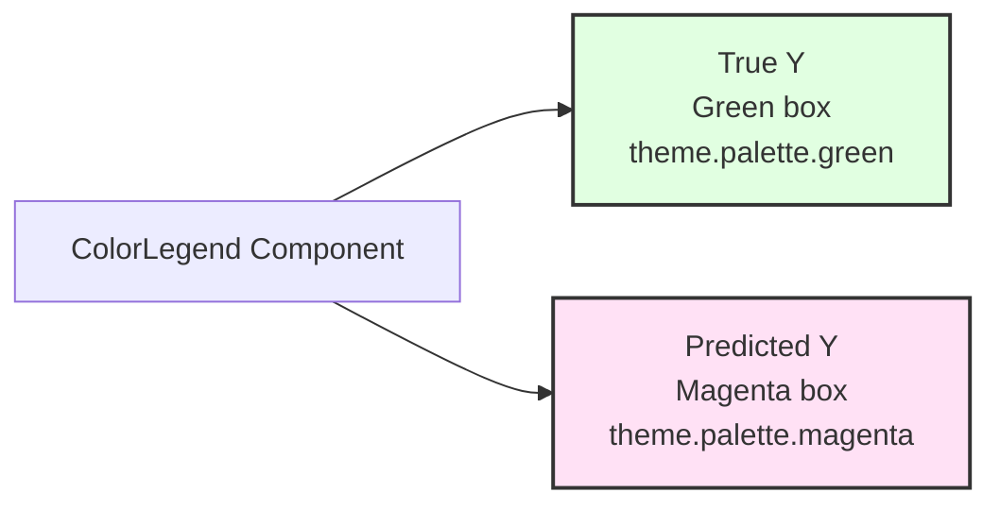
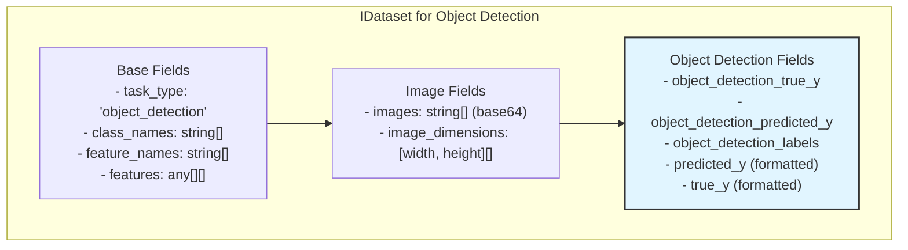
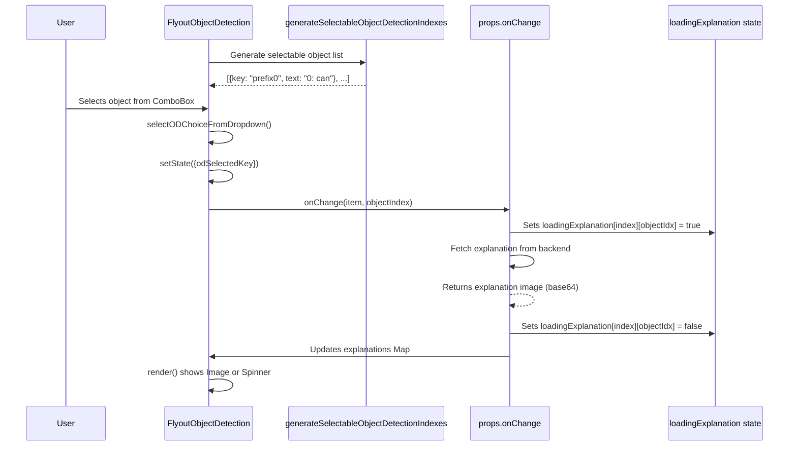
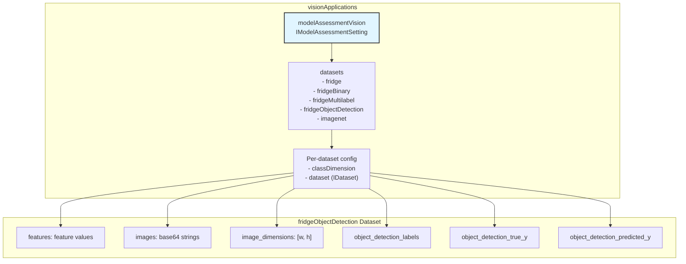
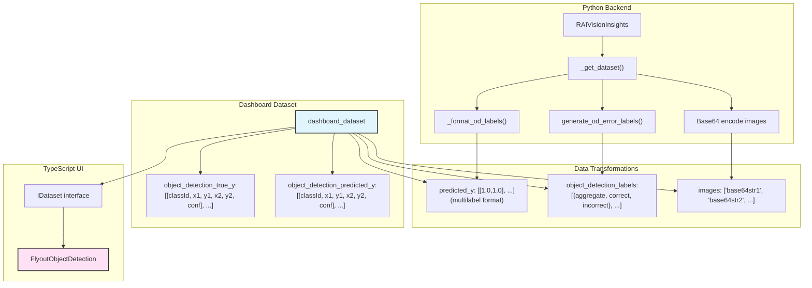

<!-- source: DeepWiki mcp.deepwiki.com · repo microsoft/responsible-ai-toolbox · extra page Vision UI Components · fetched 2026-10-26 -->

# Vision UI Components

<details>
<summary>Relevant source files</summary>

The following files were used as context for generating this wiki page:

- [apps/dashboard/src/app/visionApplications.ts](apps/dashboard/src/app/visionApplications.ts)
- [apps/dashboard/src/model-assessment-vision/__mock_data__/fridgeObjectDetection.ts](apps/dashboard/src/model-assessment-vision/__mock_data__/fridgeObjectDetection.ts)
- [apps/dashboard/src/model-assessment-vision/__mock_data__/fridgeObjectDetectionImages.ts](apps/dashboard/src/model-assessment-vision/__mock_data__/fridgeObjectDetectionImages.ts)
- [libs/core-ui/src/lib/Interfaces/IVisionModelExplanationData.ts](libs/core-ui/src/lib/Interfaces/IVisionModelExplanationData.ts)
- [libs/interpret-vision/src/lib/VisionExplanationDashboard/Controls/DetectionDetails.tsx](libs/interpret-vision/src/lib/VisionExplanationDashboard/Controls/DetectionDetails.tsx)
- [libs/interpret-vision/src/lib/VisionExplanationDashboard/Controls/FlyoutObjectDetection.tsx](libs/interpret-vision/src/lib/VisionExplanationDashboard/Controls/FlyoutObjectDetection.tsx)
- [libs/interpret-vision/src/lib/VisionExplanationDashboard/Controls/FlyoutObjectDetectionUtils.tsx](libs/interpret-vision/src/lib/VisionExplanationDashboard/Controls/FlyoutObjectDetectionUtils.tsx)
- [libs/interpret-vision/src/lib/VisionExplanationDashboard/utils/FlyoutUtils.tsx](libs/interpret-vision/src/lib/VisionExplanationDashboard/utils/FlyoutUtils.tsx)
- [notebooks/individual-dashboards/erroranalysis-dashboard/erroranalysis-dashboard-regression-superconductor.ipynb](notebooks/individual-dashboards/erroranalysis-dashboard/erroranalysis-dashboard-regression-superconductor.ipynb)
- [responsibleai_text/tests/test_rai_text_insights_save_and_load_scenarios.py](responsibleai_text/tests/test_rai_text_insights_save_and_load_scenarios.py)
- [responsibleai_vision/responsibleai_vision/common/constants.py](responsibleai_vision/responsibleai_vision/common/constants.py)
- [responsibleai_vision/responsibleai_vision/managers/error_analysis_manager.py](responsibleai_vision/responsibleai_vision/managers/error_analysis_manager.py)
- [responsibleai_vision/responsibleai_vision/rai_vision_insights/rai_vision_insights.py](responsibleai_vision/responsibleai_vision/rai_vision_insights/rai_vision_insights.py)
- [responsibleai_vision/tests/rai_vision_insights_validator.py](responsibleai_vision/tests/rai_vision_insights_validator.py)
- [responsibleai_vision/tests/test_rai_vision_insights.py](responsibleai_vision/tests/test_rai_vision_insights.py)
- [responsibleai_vision/tests/test_rai_vision_insights_save_and_load_scenarios.py](responsibleai_vision/tests/test_rai_vision_insights_save_and_load_scenarios.py)

</details>


## Purpose and Scope

This page documents the TypeScript/React UI components in the `interpret-vision` library that provide visualization capabilities for vision models in the Responsible AI Toolbox. These components handle image display, object detection bounding boxes, and vision-specific explanations.

For the Python-side vision API, see [RAIVisionInsights API](#5.1.1). For backend object detection support, see [Object Detection Support](#5.1.2). For general dashboard architecture, see [TypeScript Dashboard Architecture](#4).

---

## Component Architecture

The vision UI components are organized within the `interpret-vision` library and integrate with the broader model assessment dashboard to provide vision-specific visualizations.

### Vision Component Hierarchy



**Sources:** [libs/interpret-vision/src/lib/VisionExplanationDashboard/Controls/FlyoutObjectDetection.tsx:1-287](), [apps/dashboard/src/app/visionApplications.ts:1-106]()

---

## FlyoutObjectDetection Component

The `FlyoutObjectDetection` component is the primary UI element for displaying object detection results. It renders a side panel that shows an image with bounding boxes, detection summaries, and explanations.

### Component Structure



**Sources:** [libs/interpret-vision/src/lib/VisionExplanationDashboard/Controls/FlyoutObjectDetection.tsx:36-286]()

### Key Methods

| Method | Purpose | Lines |
|--------|---------|-------|
| `componentDidMount()` | Initializes metadata and selectable object indexes | [50-64]() |
| `componentDidUpdate()` | Updates state when props change | [66-88]() |
| `render()` | Renders the panel with all sub-components | [90-241]() |
| `callbackWrapper()` | Cleans up state on panel close | [242-246]() |
| `selectODChoiceFromDropdown()` | Handles object selection for explanations | [247-260]() |
| `callbackRef()` | Initializes CanvasTools editor for bounding boxes | [261-285]() |

**Sources:** [libs/interpret-vision/src/lib/VisionExplanationDashboard/Controls/FlyoutObjectDetection.tsx:36-286]()

### Rendering Pipeline



**Sources:** [libs/interpret-vision/src/lib/VisionExplanationDashboard/Controls/FlyoutObjectDetection.tsx:261-285](), [libs/interpret-vision/src/lib/VisionExplanationDashboard/Controls/FlyoutObjectDetectionUtils.tsx:138-208]()

---

## Bounding Box Visualization with CanvasTools

The vision UI uses the `vott-ct` (VoTT Canvas Tools) library to render interactive bounding boxes on images. This enables users to visualize both ground truth and predicted object detections.

### Drawing Bounding Boxes

The `drawBoundingBoxes` function orchestrates the rendering of all bounding boxes on an image:



**Sources:** [libs/interpret-vision/src/lib/VisionExplanationDashboard/Controls/FlyoutObjectDetectionUtils.tsx:94-208]()

### Coordinate Scaling

Bounding box coordinates must be scaled from the original image dimensions to the canvas frame dimensions:

| Function | Purpose | Formula |
|----------|---------|---------|
| `scaleCoordinate(coordinate, imageDim, frameDim)` | Scales a single coordinate | `(coordinate / imageDim) * frameDim` |
| `drawBox()` | Applies scaling to all box coordinates | Uses `scaleFactor` callback for each coordinate |

The scaling is applied to:
- `x`: Left edge coordinate (objectLabel[1])
- `y`: Top edge coordinate (objectLabel[2])
- `width`: Box width (objectLabel[3] - objectLabel[1])
- `height`: Box height (objectLabel[4] - objectLabel[2])

**Sources:** [libs/interpret-vision/src/lib/VisionExplanationDashboard/Controls/FlyoutObjectDetectionUtils.tsx:94-129](), [libs/interpret-vision/src/lib/VisionExplanationDashboard/Controls/FlyoutObjectDetectionUtils.tsx:132-136]()

### Color Legend

The `ColorLegend` component provides a visual key for distinguishing ground truth from predicted boxes:



**Sources:** [libs/interpret-vision/src/lib/VisionExplanationDashboard/Controls/FlyoutObjectDetectionUtils.tsx:38-69]()

---

## Detection Details Component

The `DetectionDetails` component displays a summary of detection results for the selected image.

### Component Interface

| Prop | Type | Description |
|------|------|-------------|
| `item` | `IVisionListItem` | The selected image item with detection data |
| `correctDetections` | `string` | Formatted string of correct detections (e.g., "1 can, 1 milk_bottle") |
| `incorrectDetections` | `string` | Formatted string of incorrect detections |

The component renders three text fields:
1. **Index Label**: The image's index in the dataset
2. **Correct Detections**: List of correctly detected objects
3. **Incorrect Detections**: List of incorrectly detected objects

**Sources:** [libs/interpret-vision/src/lib/VisionExplanationDashboard/Controls/DetectionDetails.tsx:1-52]()

---

## Data Structures and Interfaces

### IVisionListItem Interface

The primary data structure for vision items passed to UI components:

```typescript
interface IVisionListItem {
  [key: string]: string | number | boolean | string[] | number[][];
  image: string;                    // Base64-encoded image
  predictedY: string | string[];    // Predicted label(s)
  trueY: string | string[];         // True label(s)
  index: number;                    // Item index in dataset
  odIncorrect: string;              // Incorrect OD summary
  odCorrect: string;                // Correct OD summary
  odAggregate: string;              // Aggregate OD summary
}
```

**Sources:** [libs/core-ui/src/lib/Interfaces/IVisionModelExplanationData.ts:4-13]()

### Object Detection Dataset Structure

The dataset passed from Python to the UI contains object detection-specific fields:



### Object Detection Label Format

Each object detection label is a 6-element array:

| Index | Field | Description |
|-------|-------|-------------|
| 0 | `class_id` | Class index (1-based) |
| 1 | `x_min` | Left edge of bounding box |
| 2 | `y_min` | Top edge of bounding box |
| 3 | `x_max` | Right edge of bounding box |
| 4 | `y_max` | Bottom edge of bounding box |
| 5 | `confidence` | Confidence score (0-1, or 0 for ground truth) |

**Example from mock data:**
```typescript
[3, 37.834, 312.559, 323.292, 420.728, 0.987]
// class_id=3 (milk_bottle), bbox=(37.834, 312.559, 323.292, 420.728), conf=98.7%
```

**Sources:** [apps/dashboard/src/model-assessment-vision/__mock_data__/fridgeObjectDetection.ts:129-202]()

### Object Detection Labels Structure

The `object_detection_labels` field provides human-readable summaries:

```typescript
{
  aggregate: "2 correct, 0 incorrect",
  correct: "1 can, 1 milk_bottle",
  incorrect: "(none)"
}
```

These labels are generated by the Python backend and used for display in the UI.

**Sources:** [apps/dashboard/src/model-assessment-vision/__mock_data__/fridgeObjectDetection.ts:102-128](), [responsibleai_vision/responsibleai_vision/rai_vision_insights/rai_vision_insights.py:697-702]()

---

## Explanation Visualization

The flyout component supports displaying explanations for individual detected objects. Users can select an object from a dropdown, and the component requests and displays the corresponding explanation image.

### Explanation Flow



**Sources:** [libs/interpret-vision/src/lib/VisionExplanationDashboard/Controls/FlyoutObjectDetection.tsx:179-234](), [libs/interpret-vision/src/lib/VisionExplanationDashboard/Controls/FlyoutObjectDetection.tsx:247-260]()

### Explanation Storage

Explanations are stored in a nested Map structure:
- Outer Map: Keyed by image index
- Inner Map: Keyed by object index within that image
- Value: Base64-encoded explanation image

The component retrieves the explanation using:
```typescript
this.props.explanations
  .get(item.index)
  ?.get(objectIndex)
```

**Sources:** [libs/interpret-vision/src/lib/VisionExplanationDashboard/Controls/FlyoutObjectDetection.tsx:210-216](), [libs/interpret-vision/src/lib/VisionExplanationDashboard/Controls/FlyoutObjectDetectionUtils.tsx:12-21]()

---

## Metadata Display

The flyout displays extracted image metadata (EXIF data) using utility functions from `FlyoutUtils`.

### Metadata Rendering

| Function | Purpose | Location |
|----------|---------|----------|
| `updateMetadata(item, fieldNames)` | Extracts metadata fields from item into display format | [libs/interpret-vision/src/lib/VisionExplanationDashboard/utils/FlyoutUtils.tsx:54-69]() |
| `onRenderCell(item)` | Renders each metadata row with label and value | [libs/interpret-vision/src/lib/VisionExplanationDashboard/utils/FlyoutUtils.tsx:10-33]() |

The `updateMetadata` function processes the item to create an array of `[fieldName, value]` pairs, joining array values with commas. The `onRenderCell` function renders each pair in a horizontal Stack with appropriate styling.

**Sources:** [libs/interpret-vision/src/lib/VisionExplanationDashboard/Controls/FlyoutObjectDetection.tsx:149-157](), [libs/interpret-vision/src/lib/VisionExplanationDashboard/utils/FlyoutUtils.tsx:54-69]()

---

## Vision Application Configuration

Vision datasets are configured in the dashboard application's mock data structure:



**Sources:** [apps/dashboard/src/app/visionApplications.ts:1-106](), [apps/dashboard/src/model-assessment-vision/__mock_data__/fridgeObjectDetection.ts:8-219]()

---

## Integration with Python Backend

The vision UI components consume data structures created by the Python `RAIVisionInsights` class.

### Data Flow from Python to UI



**Sources:** [responsibleai_vision/responsibleai_vision/rai_vision_insights/rai_vision_insights.py:557-704](), [responsibleai_vision/responsibleai_vision/rai_vision_insights/rai_vision_insights.py:706-728]()

### Object Detection Label Generation

The Python backend generates the human-readable detection labels using `generate_od_error_labels()`:

1. Compares `object_detection_true_y` with `object_detection_predicted_y`
2. Determines which objects are correctly detected vs. missed/incorrect
3. Formats labels as `"1 can, 2 carton"` style strings
4. Creates aggregate summaries like `"3 correct, 1 incorrect"`

**Sources:** [responsibleai_vision/responsibleai_vision/rai_vision_insights/rai_vision_insights.py:697-702]()

---

## Summary

The vision UI components provide a specialized interface for visualizing image classification and object detection models:

| Component | Purpose | Key Features |
|-----------|---------|--------------|
| `FlyoutObjectDetection` | Main panel for object detection visualization | Bounding boxes, metadata, explanations |
| `DetectionDetails` | Summary statistics | Correct/incorrect detection counts |
| `FlyoutObjectDetectionUtils` | Drawing utilities | CanvasTools integration, coordinate scaling |
| `ColorLegend` | Visual key | Green (ground truth) vs. magenta (predicted) |

The components integrate with the VoTT CanvasTools library for interactive bounding box rendering and consume structured data from the Python `RAIVisionInsights` backend.

**Sources:** [libs/interpret-vision/src/lib/VisionExplanationDashboard/Controls/FlyoutObjectDetection.tsx:1-287](), [libs/interpret-vision/src/lib/VisionExplanationDashboard/Controls/FlyoutObjectDetectionUtils.tsx:1-209](), [libs/interpret-vision/src/lib/VisionExplanationDashboard/Controls/DetectionDetails.tsx:1-52]()

---

