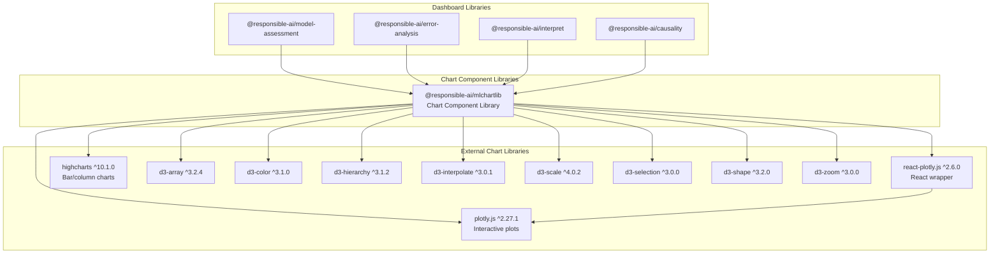
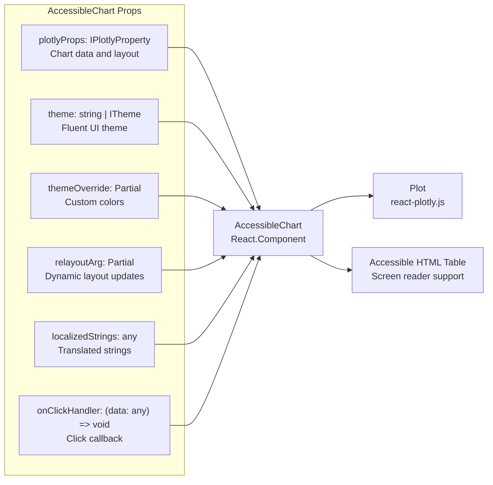
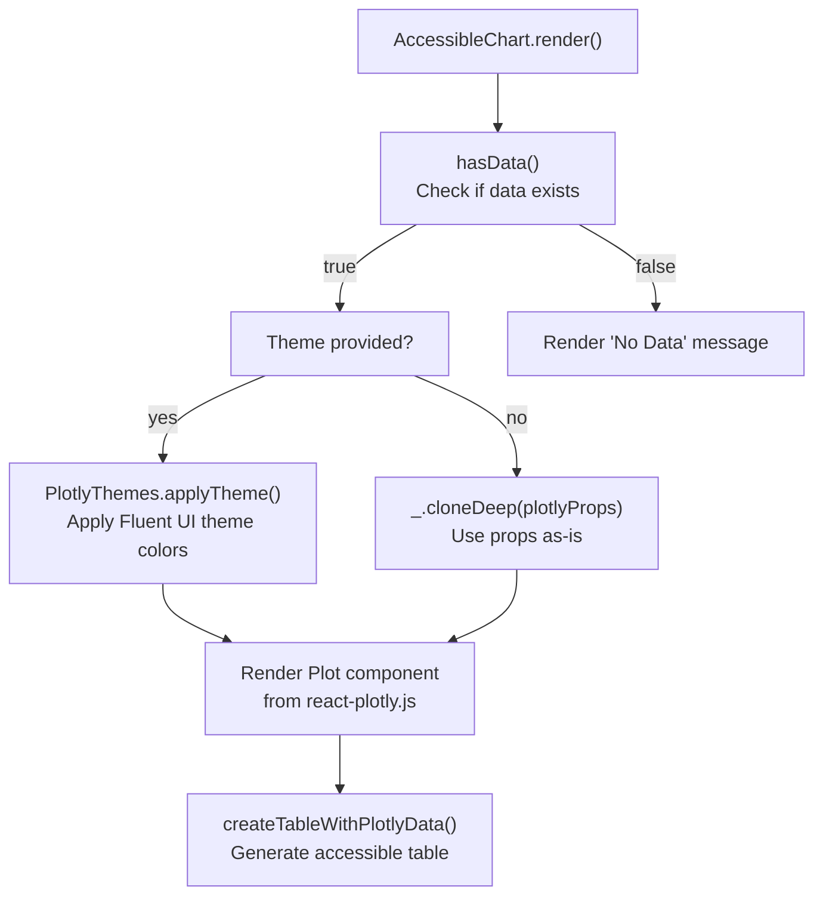
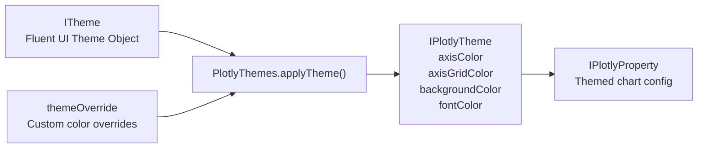
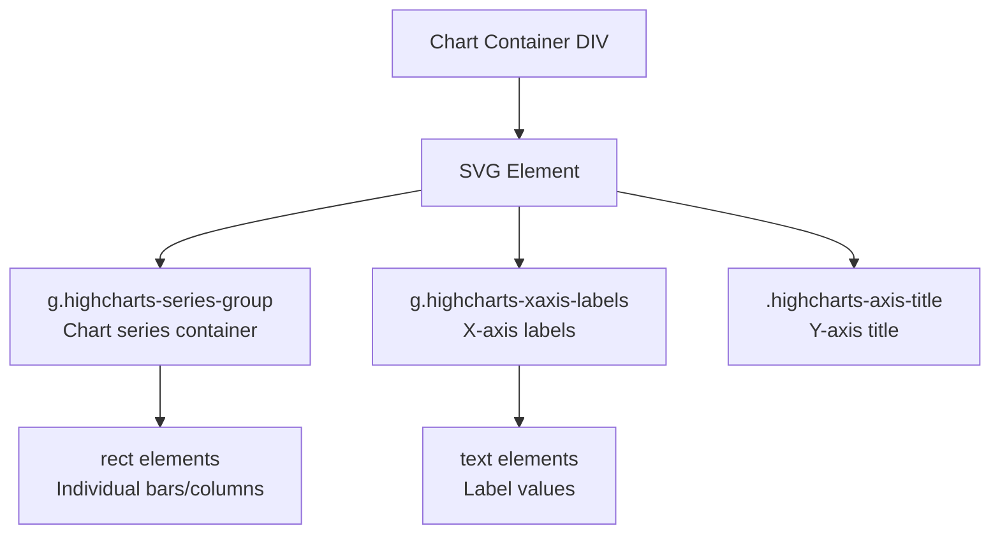
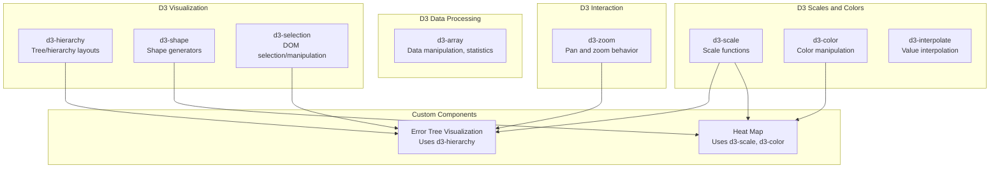
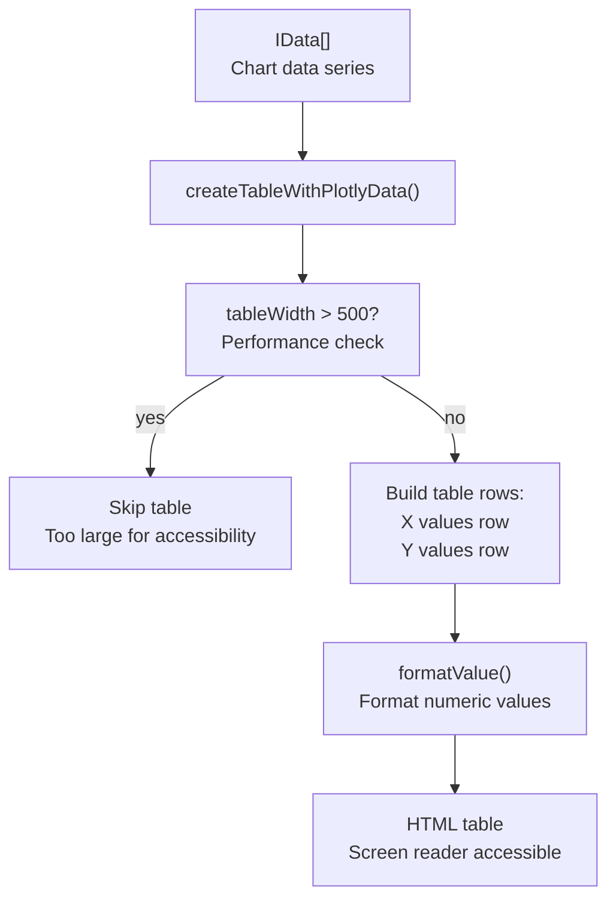
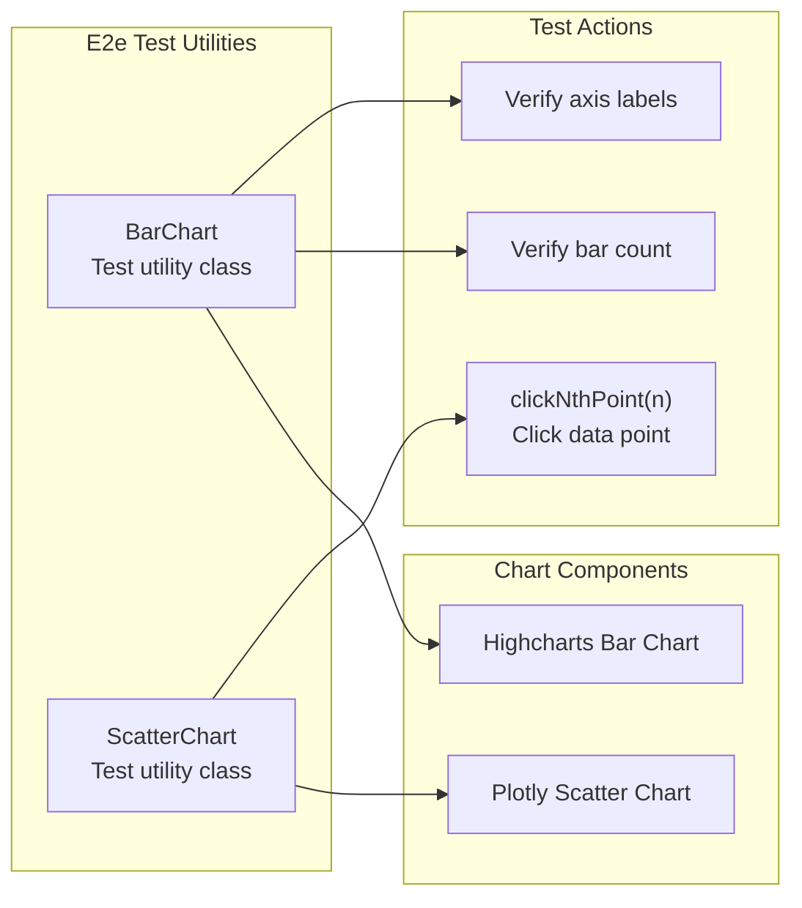

<!-- source: DeepWiki mcp.deepwiki.com · repo microsoft/responsible-ai-toolbox · extra page Chart Components · fetched 2026-10-26 -->

# Chart Components

Relevant source files

The following files were used as context for generating this wiki page:

- [apps/dashboard-e2e/src/describer/interpret/individualFeatureImportance/describeSubBarChart.ts](apps/dashboard-e2e/src/describer/interpret/individualFeatureImportance/describeSubBarChart.ts)
- [libs/e2e/src/lib/describer/interpretText/validateBarChart.ts](libs/e2e/src/lib/describer/interpretText/validateBarChart.ts)
- [libs/mlchartlib/src/lib/components/AccessibleChart.tsx](libs/mlchartlib/src/lib/components/AccessibleChart.tsx)
- [nx.json](nx.json)
- [package.json](package.json)
- [tsconfig.base.json](tsconfig.base.json)
- [workspace.json](workspace.json)
- [yarn.lock](yarn.lock)

## Purpose and Scope

This document describes the chart visualization components used throughout the Responsible AI Toolbox dashboard. It covers the `mlchartlib` library, which provides reusable chart components and utilities for data visualization. This page focuses on the chart rendering layer and visualization utilities, not the higher-level dashboard components that consume them. For information about specific dashboard views that use these charts, see [Model Assessment Dashboard](#4.2), [Error Analysis Dashboard](#4.3), and [Other Dashboard Components](#4.4).

## Overview of mlchartlib

The `mlchartlib` library is a standalone TypeScript package within the Nx monorepo that provides chart components and visualization utilities. It is designed as a shared library consumed by other dashboard libraries.

**Library Configuration:**

| Property | Value |
|----------|-------|
| Package Name | `@responsible-ai/mlchartlib` |
| Location | `libs/mlchartlib` |
| Entry Point | `libs/mlchartlib/src/index.ts` |
| Dependencies | React, Plotly.js, D3, Highcharts, Fluent UI |

The library is referenced in `tsconfig.base.json` with the path mapping `@responsible-ai/mlchartlib` and is configured in `workspace.json` as a buildable library project.

**Sources:** [tsconfig.base.json:54](), [workspace.json:1-90](), [package.json:1-158]()

## Chart Libraries Architecture

The Responsible AI Toolbox uses three primary charting libraries, each serving different visualization needs:

**Chart Library Purposes:**

- **Plotly.js**: General-purpose interactive charts including scatter plots, line charts, and complex multi-axis visualizations
- **Highcharts**: Primarily used for bar charts and column charts with rich interactivity
- **D3**: Custom visualizations requiring fine-grained control, particularly for hierarchical data (error trees) and network diagrams

**Sources:** [package.json:46-76](), [workspace.json:67-69]()

## AccessibleChart Component

The `AccessibleChart` component is the primary Plotly wrapper that provides accessible, themeable chart rendering throughout the dashboard.

### Component Interface

The component accepts configuration through `IPlotlyProperty`, which defines the complete chart specification including data series, layout, and Plotly configuration options.

**Sources:** [libs/mlchartlib/src/lib/components/AccessibleChart.tsx:22-29]()

### Rendering Flow

**Key Methods:**

- **`render()`** [libs/mlchartlib/src/lib/components/AccessibleChart.tsx:41-88](): Main rendering method that conditionally renders chart or "No Data" message
- **`hasData()`** [libs/mlchartlib/src/lib/components/AccessibleChart.tsx:90-99](): Validates that at least one data series has non-empty x or y arrays
- **`createTableWithPlotlyData()`** [libs/mlchartlib/src/lib/components/AccessibleChart.tsx:101-133](): Generates an HTML table representation of chart data for screen readers

**Sources:** [libs/mlchartlib/src/lib/components/AccessibleChart.tsx:31-134]()

### Theme Integration

The component integrates with Fluent UI theming through the `PlotlyThemes` utility:

When a Fluent UI theme is provided, the component automatically maps theme colors to chart elements:

- `palette.neutralPrimary` → axis color
- `palette.neutralLight` → axis grid color
- `palette.white` → background color
- `semanticColors.bodyText` → font color

**Sources:** [libs/mlchartlib/src/lib/components/AccessibleChart.tsx:42-62]()

## Highcharts Integration

While not directly visible in the provided files, Highcharts is extensively used throughout the dashboard, as evidenced by e2e test utilities that interact with Highcharts-rendered elements.

### Highcharts DOM Structure

E2e tests reveal the typical Highcharts DOM structure used in the application:

**Common Selectors:**

- `svg g.highcharts-series-group rect` - Individual data bars/points
- `g.highcharts-xaxis-labels text` - X-axis label text elements
- `.highcharts-axis-title` - Axis title elements

**Sources:** [apps/dashboard-e2e/src/describer/interpret/individualFeatureImportance/describeSubBarChart.ts:23-38](), [libs/e2e/src/lib/describer/interpretText/validateBarChart.ts:4-34]()

### Bar Chart Usage Pattern

The e2e tests demonstrate the expected usage pattern for Highcharts bar charts:

| Element | Purpose | Validation |
|---------|---------|------------|
| `rect` elements | Data bars | Count should match number of features/data points |
| Y-axis title | Axis label | Should contain "Feature importance" or relevant metric |
| X-axis labels | Category labels | Count should match or be less than number of categories |

**Sources:** [apps/dashboard-e2e/src/describer/interpret/individualFeatureImportance/describeSubBarChart.ts:22-40](), [libs/e2e/src/lib/describer/interpretText/validateBarChart.ts:27-34]()

## D3 Integration

The Responsible AI Toolbox includes comprehensive D3 library support for custom visualizations:

### D3 Modules Used

**D3 Module Purposes:**

- **d3-array**: Statistical operations, data sorting, grouping
- **d3-color**: Color space conversions, color interpolation
- **d3-hierarchy**: Tree and hierarchical data layout algorithms (used for error analysis trees)
- **d3-interpolate**: Smooth transitions between values
- **d3-scale**: Mapping data values to visual dimensions (position, color, size)
- **d3-selection**: Efficient DOM manipulation for data-driven updates
- **d3-shape**: SVG path generators (lines, areas, arcs, symbols)
- **d3-zoom**: Pan and zoom interaction for large visualizations

**Sources:** [package.json:48-55](), [package.json:94-101]()

## Accessibility Features

The `AccessibleChart` component implements accessibility through dual rendering:

### Accessible Table Generation

**Accessibility Implementation Details:**

1. **Hidden Tables**: The generated table has CSS class `plotlyTable` which is visually hidden but accessible to screen readers
2. **Performance Optimization**: Tables are skipped for datasets with more than 500 data points to avoid rendering performance issues [libs/mlchartlib/src/lib/components/AccessibleChart.tsx:110]()
3. **Value Formatting**: Uses `formatValue()` utility to ensure consistent presentation of numeric data [libs/mlchartlib/src/lib/components/AccessibleChart.tsx:119-122]()
4. **Structure**: Creates separate rows for x and y values, making the data relationship clear to screen readers

**Sources:** [libs/mlchartlib/src/lib/components/AccessibleChart.tsx:101-133]()

## Testing Utilities

The codebase includes reusable test utilities for interacting with charts in e2e tests:

### Chart Test Classes

**Test Utility Functions:**

| Function | Purpose | Usage |
|----------|---------|-------|
| `checkNumBars()` | Validates number of bars in chart | Counts `rect` elements in Highcharts series group |
| `checkYAxisLabel()` | Validates Y-axis label text | Checks `.highcharts-axis-title` content |
| `checkNumLabels()` | Validates number of X-axis labels | Counts text elements in X-axis labels group |
| `validateBarChart()` | Comprehensive bar chart validation | Combines all checks for complete validation |

**Example Test Pattern:**

The test utilities follow a consistent pattern for chart interaction:

1. Create chart instance with selector: `new ScatterChart("#IndividualFeatureImportanceChart")`
2. Perform interaction: `chart.clickNthPoint(1)`
3. Validate resulting state: Check element counts, text content, visibility

**Sources:** [apps/dashboard-e2e/src/describer/interpret/individualFeatureImportance/describeSubBarChart.ts:8-41](), [libs/e2e/src/lib/describer/interpretText/validateBarChart.ts:1-35]()

## Build Configuration

The `mlchartlib` package is configured in `workspace.json` with external dependencies marked to avoid bundling large chart libraries:

**External Dependencies (Not Bundled):**
- `@fluentui/react`
- `highcharts`
- `plotly.js`
- `react-plotly.js`
- `react`, `react-dom`
- Various utility libraries (`lodash`, `moment`, `uuid`, etc.)

This configuration ensures that chart libraries are shared across all dashboard components, reducing bundle size and improving load performance.

**Sources:** [workspace.json:1-90](), [package.json:43-76]()

---

