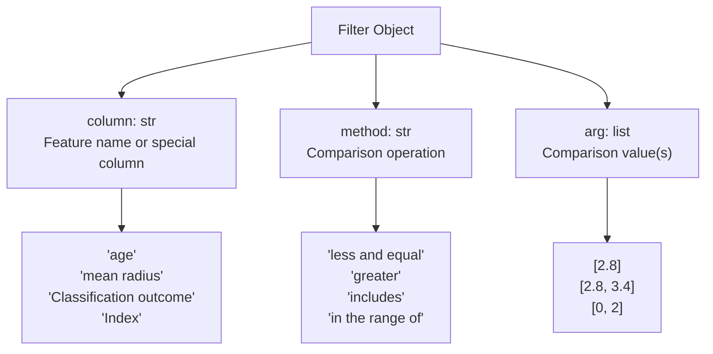
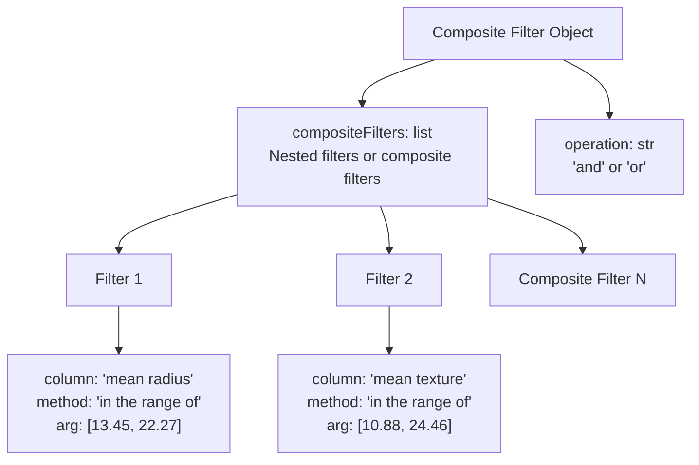
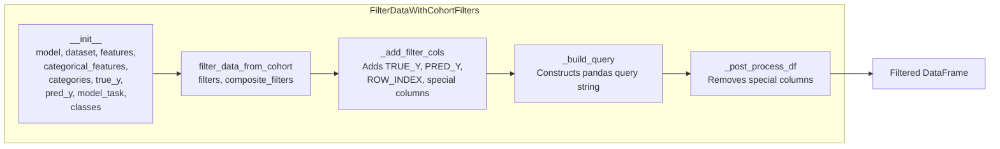
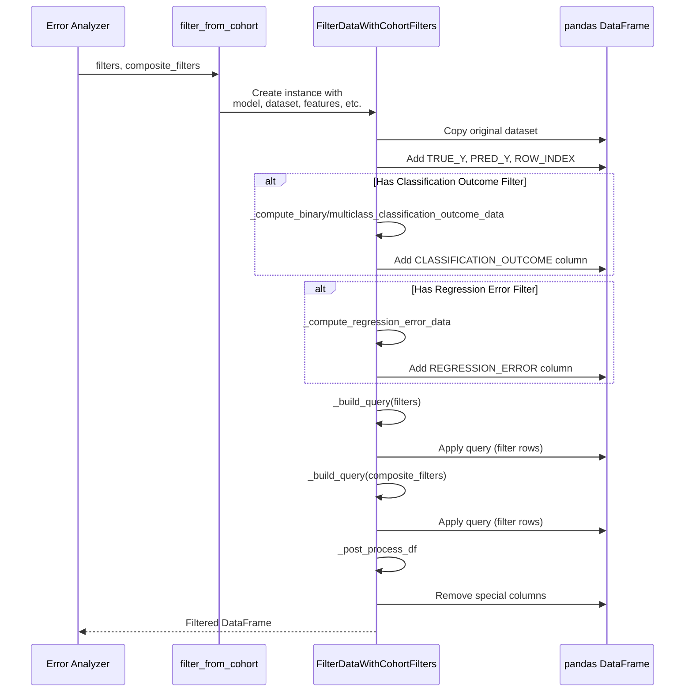
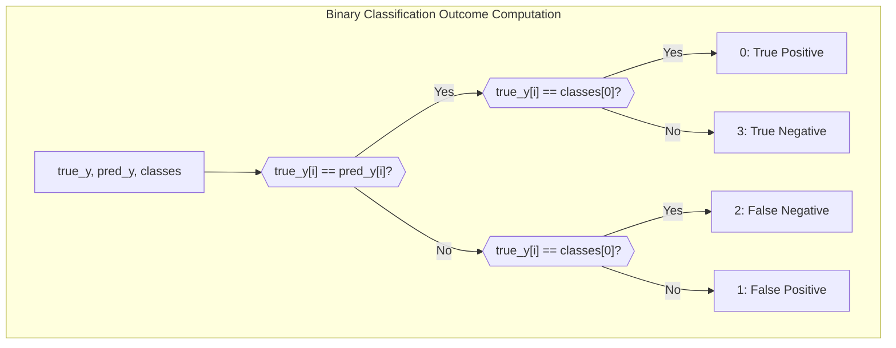
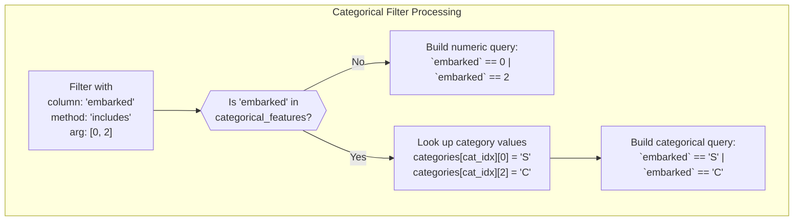
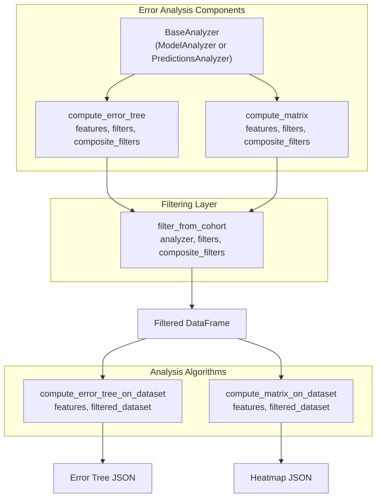

<!-- source: DeepWiki mcp.deepwiki.com · repo microsoft/responsible-ai-toolbox · extra page Cohort Filtering · fetched 2026-10-26 -->

# Cohort Filtering

<details>
<summary>Relevant source files</summary>

The following files were used as context for generating this wiki page:

- [erroranalysis/erroranalysis/_internal/cohort_filter.py](erroranalysis/erroranalysis/_internal/cohort_filter.py)
- [erroranalysis/erroranalysis/_internal/constants.py](erroranalysis/erroranalysis/_internal/constants.py)
- [erroranalysis/erroranalysis/_internal/matrix_filter.py](erroranalysis/erroranalysis/_internal/matrix_filter.py)
- [erroranalysis/erroranalysis/_internal/metrics.py](erroranalysis/erroranalysis/_internal/metrics.py)
- [erroranalysis/erroranalysis/_internal/surrogate_error_tree.py](erroranalysis/erroranalysis/_internal/surrogate_error_tree.py)
- [erroranalysis/erroranalysis/analyzer/error_analyzer.py](erroranalysis/erroranalysis/analyzer/error_analyzer.py)
- [erroranalysis/erroranalysis/version.py](erroranalysis/erroranalysis/version.py)
- [erroranalysis/requirements-object-detection.txt](erroranalysis/requirements-object-detection.txt)
- [erroranalysis/tests/common_utils.py](erroranalysis/tests/common_utils.py)
- [erroranalysis/tests/test_cohort_filter.py](erroranalysis/tests/test_cohort_filter.py)
- [erroranalysis/tests/test_error_report.py](erroranalysis/tests/test_error_report.py)
- [erroranalysis/tests/test_importances.py](erroranalysis/tests/test_importances.py)
- [erroranalysis/tests/test_matrix_filter.py](erroranalysis/tests/test_matrix_filter.py)
- [erroranalysis/tests/test_metrics.py](erroranalysis/tests/test_metrics.py)
- [erroranalysis/tests/test_surrogate_error_tree.py](erroranalysis/tests/test_surrogate_error_tree.py)

</details>


Cohort filtering is the data subsetting mechanism used throughout the error analysis engine to select specific groups of data points for analysis. It enables users to drill down into different slices of their dataset by applying logical conditions on features, predictions, or model outcomes. The filtering system supports both simple single-condition filters and complex composite filters combining multiple conditions with AND/OR operations.

This page documents the cohort filtering mechanism itself. For how filtering is used within the surrogate error tree, see [3.4.1](#3.4.1). For matrix filter (heatmap) usage, see [3.4.2](#3.4.2).

## Filter Structure

Filters in the error analysis system follow a standardized JSON-like structure with specific keys and values. There are two types of filters: simple filters and composite filters.

### Simple Filter Structure



**Simple Filter Example Structure**

| Key | Type | Description | Example |
|-----|------|-------------|---------|
| `column` | string | Feature name, 'Index', 'Classification outcome', 'Regression error', 'True Y', or 'Predicted Y' | `'age'` |
| `method` | string | Comparison method from `CohortFilterMethods` | `'less and equal'` |
| `arg` | list | One or more values for comparison | `[2.8]` |

Sources: [erroranalysis/_internal/cohort_filter.py:1-493](), [erroranalysis/_internal/constants.py:1-228]()

### Composite Filter Structure



Sources: [erroranalysis/_internal/cohort_filter.py:347-439](), [erroranalysis/_internal/constants.py:34-40]()

## Filter Methods

The `CohortFilterMethods` class defines the supported comparison operations:

| Method Constant | String Value | Description | Argument Count |
|----------------|--------------|-------------|----------------|
| `METHOD_EQUAL` | `'equal'` | Exact match | 1 |
| `METHOD_GREATER` | `'greater'` | Strictly greater than | 1 |
| `METHOD_LESS` | `'less'` | Strictly less than | 1 |
| `METHOD_GREATER_AND_EQUAL` | `'greater and equal'` | Greater than or equal to | 1 |
| `METHOD_LESS_AND_EQUAL` | `'less and equal'` | Less than or equal to | 1 |
| `METHOD_RANGE` | `'in the range of'` | Inclusive range [min, max] | 2 |
| `METHOD_INCLUDES` | `'includes'` | Value is in specified set | 1+ |
| `METHOD_EXCLUDES` | `'excludes'` | Value is not in specified set | 1+ |

**Composite Filter Operations**

| Operation Constant | String Value | Description |
|-------------------|--------------|-------------|
| `CohortFilterOps.AND` | `'and'` | All nested filters must match |
| `CohortFilterOps.OR` | `'or'` | At least one nested filter must match |

Sources: [erroranalysis/_internal/constants.py:20-40]()

## FilterDataWithCohortFilters Class

The core filtering logic is implemented in the `FilterDataWithCohortFilters` class, which encapsulates the filtering process and handles special columns.



Sources: [erroranalysis/_internal/cohort_filter.py:64-345]()

### Key Methods

**`filter_data_from_cohort(filters, composite_filters, include_original_columns_only=False)`**

Main entry point that applies all filters and returns the filtered DataFrame.

1. Adds special columns (TRUE_Y, PRED_Y, ROW_INDEX, and computed columns)
2. Builds and applies recursive filters
3. Post-processes to remove special columns

Sources: [erroranalysis/_internal/cohort_filter.py:105-134]()

**`_build_query(filters, categorical_features, categories)`**

Recursively constructs a pandas query string from filter specifications:
- Handles numeric comparisons with proper operators
- Handles categorical features with proper encoding
- Handles composite filters with AND/OR logic
- Returns a valid pandas DataFrame query string

Sources: [erroranalysis/_internal/cohort_filter.py:370-439]()

## Filter Application Flow



Sources: [erroranalysis/_internal/cohort_filter.py:22-62](), [erroranalysis/_internal/cohort_filter.py:105-345]()

## Special Filter Columns

The cohort filtering system provides several special computed columns that don't exist in the original dataset but can be used for filtering.

### Index Column

The `ROW_INDEX` constant (value: `'Index'`) provides zero-based row indices for the dataset. This allows users to filter on specific row positions.

```python
# Example: Filter first 40 rows
filters = [{
    'column': 'Index',
    'method': 'less and equal',
    'arg': [40]
}]
```

Sources: [erroranalysis/_internal/cohort_filter.py:289-290](), [erroranalysis/_internal/constants.py:14]()

### Classification Outcome

For classification tasks, the `CLASSIFICATION_OUTCOME` column categorizes each prediction into confusion matrix categories.

**Binary Classification** (4 categories):
- `0`: True Positive (predicted positive class, was positive)
- `1`: False Positive (predicted positive class, was negative)
- `2`: False Negative (predicted negative class, was positive)
- `3`: True Negative (predicted negative class, was negative)

**Multiclass Classification** (2 categories):
- `0`: Correct prediction
- `1`: Incorrect prediction



Sources: [erroranalysis/_internal/cohort_filter.py:179-244](), [erroranalysis/_internal/cohort_filter.py:291-310]()

### Regression Error

For regression tasks, the `REGRESSION_ERROR` column contains the absolute difference between true and predicted values: `abs(true_y[i] - pred_y[i])`.

```python
# Example: Filter low-error predictions
filters = [{
    'column': 'Regression error',
    'method': 'less and equal',
    'arg': [40]
}]
```

Sources: [erroranalysis/_internal/cohort_filter.py:246-266](), [erroranalysis/_internal/cohort_filter.py:311-320]()

### True Y and Predicted Y

The true labels and predicted labels can be filtered directly using `'True Y'` and `'Predicted Y'` as column names. For categorical labels, the `arg` values are indices into the classes array.

Sources: [erroranalysis/_internal/cohort_filter.py:390-392](), [erroranalysis/_internal/cohort_filter.py:470-492]()

## Categorical Feature Handling

The filtering system has special logic for categorical features to handle the encoding/decoding between categorical values and their numeric indices.



The `_build_bounds_query` method handles categorical features by:
1. Checking if the column is in `categorical_features`
2. Looking up the categorical index
3. Mapping argument indices to actual category values from the `categories` list
4. Building a query with the decoded categorical values

Sources: [erroranalysis/_internal/cohort_filter.py:441-492](), [erroranalysis/_internal/cohort_filter.py:404-409]()

## Integration with Error Analysis Components

Cohort filtering is used extensively throughout the error analysis engine to subset data before performing computations.



Sources: [erroranalysis/_internal/surrogate_error_tree.py:195-274](), [erroranalysis/_internal/matrix_filter.py:322-388]()

### Usage in Surrogate Error Tree

The `compute_error_tree` function applies filters before training the surrogate tree:

1. Calls `filter_from_cohort(analyzer, filters, composite_filters)` to get filtered dataset
2. Passes filtered dataset to `compute_error_tree_on_dataset`
3. Trains LightGBM surrogate model only on the filtered data
4. Returns tree structure representing error patterns in the cohort

Sources: [erroranalysis/_internal/surrogate_error_tree.py:195-274]()

### Usage in Matrix Filter (Heatmap)

The `compute_matrix` function applies filters before computing the heatmap:

1. Calls `filter_from_cohort(analyzer, filters, composite_filters)` to get filtered dataset
2. Passes filtered dataset to `compute_matrix_on_dataset`
3. Bins features and computes error metrics for each cell
4. Returns matrix JSON with error rates/metrics for the cohort

Sources: [erroranalysis/_internal/matrix_filter.py:322-388]()

## Query String Construction

The filtering system uses pandas DataFrame query strings for efficient filtering. The `_build_query` method constructs these strings recursively.

### Numeric Filters

```python
# Input filter
{
    'column': 'age',
    'method': 'greater',
    'arg': [30]
}

# Generated query string
"`age` > 30"
```

### Range Filters

```python
# Input filter
{
    'column': 'temperature',
    'method': 'in the range of',
    'arg': [20.0, 25.5]
}

# Generated query string
"`temperature` >= 20.0 & `temperature` <= 25.5"
```

### Categorical Include/Exclude Filters

```python
# Input filter (categorical feature)
{
    'column': 'embarked',
    'method': 'includes',
    'arg': [0, 2]  # Indices into categories
}

# Lookup: categories[cat_idx] = ['S', 'C', 'Q']
# Generated query string
"`embarked` == 'S' | `embarked` == 'C'"
```

### Composite Filters with AND

```python
# Input composite filter
{
    'compositeFilters': [
        {'column': 'age', 'method': 'greater', 'arg': [30]},
        {'column': 'fare', 'method': 'less', 'arg': [100]}
    ],
    'operation': 'and'
}

# Generated query string
"(`age` > 30) & (`fare` < 100)"
```

### Composite Filters with OR

```python
# Input composite filter
{
    'compositeFilters': [
        {'column': 'age', 'method': 'less and equal', 'arg': [18]},
        {'column': 'age', 'method': 'greater and equal', 'arg': [65]}
    ],
    'operation': 'or'
}

# Generated query string
"(`age` <= 18) | (`age` >= 65)"
```

Sources: [erroranalysis/_internal/cohort_filter.py:370-439]()

## Error Handling and Edge Cases

### Empty Cohorts

When filters result in an empty dataset (no rows match), the error analysis algorithms handle this gracefully:

- **Surrogate Error Tree**: Returns a single root node with zero samples
- **Matrix Filter**: Returns empty or zero-valued cells

Sources: [erroranalysis/_internal/surrogate_error_tree.py:157-158]()

### Column Name Escaping

Column names are wrapped in backticks to handle special characters and spaces:

```python
# Column name with spaces
column = "mean radius"

# Generated query uses backticks
query = "`mean radius` > 15.0"
```

For numeric column names, uses indexed access:

```python
# Numeric column name
column = 42

# Generated query uses @df[] syntax
query = "@df[42] > 15.0"
```

Sources: [erroranalysis/_internal/surrogate_error_tree.py:793-800]()

### True Y Column Renaming

The special column name `'True Y'` is mapped to the internal constant `TRUE_Y` (`'true_y'`) for consistency:

```python
if colname == 'True Y':
    colname = TRUE_Y
```

Sources: [erroranalysis/_internal/cohort_filter.py:390-391]()

## Complete Example: Multi-level Composite Filter

```python
# Complex filter: (age in [30,50] AND fare < 100) OR (embarked == 'C')
composite_filter = {
    'compositeFilters': [
        {
            'compositeFilters': [
                {
                    'column': 'age',
                    'method': 'in the range of',
                    'arg': [30, 50]
                },
                {
                    'column': 'fare',
                    'method': 'less',
                    'arg': [100]
                }
            ],
            'operation': 'and'
        },
        {
            'column': 'embarked',
            'method': 'includes',
            'arg': [2]  # Index for 'C'
        }
    ],
    'operation': 'or'
}

# Generated query (assuming embarked is categorical with values ['S', 'Q', 'C'])
# "((`age` >= 30 & `age` <= 50) & (`fare` < 100)) | (`embarked` == 'C')"
```

Sources: [erroranalysis/tests/test_surrogate_error_tree.py:248-261](), [erroranalysis/tests/test_cohort_filter.py:228-273]()

---

