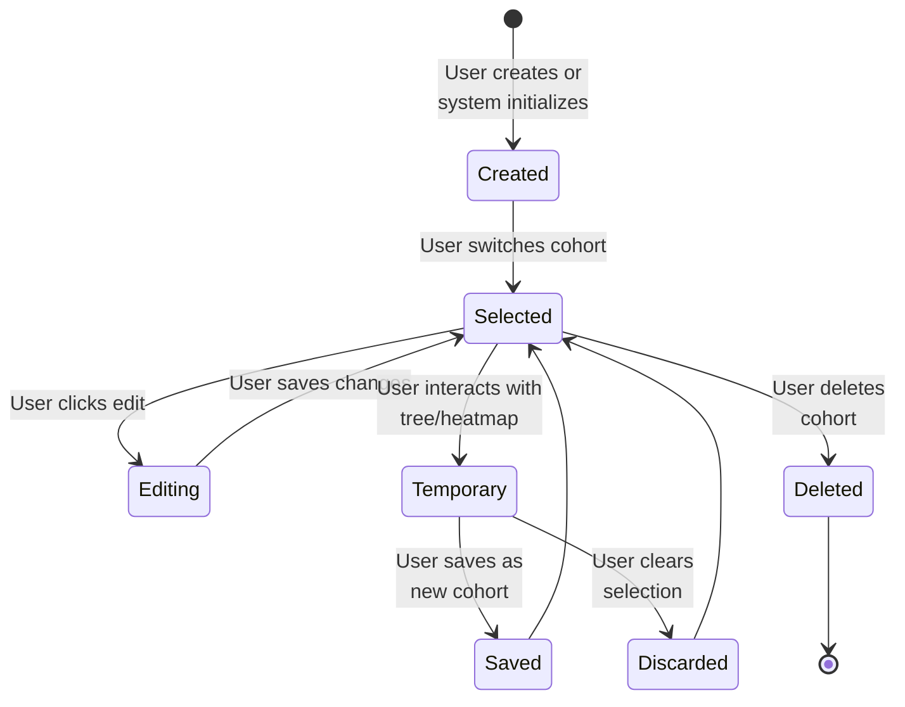
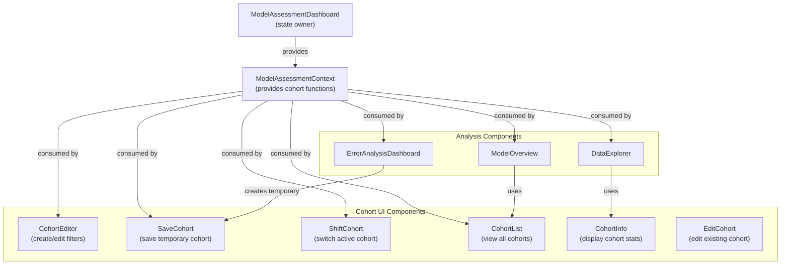
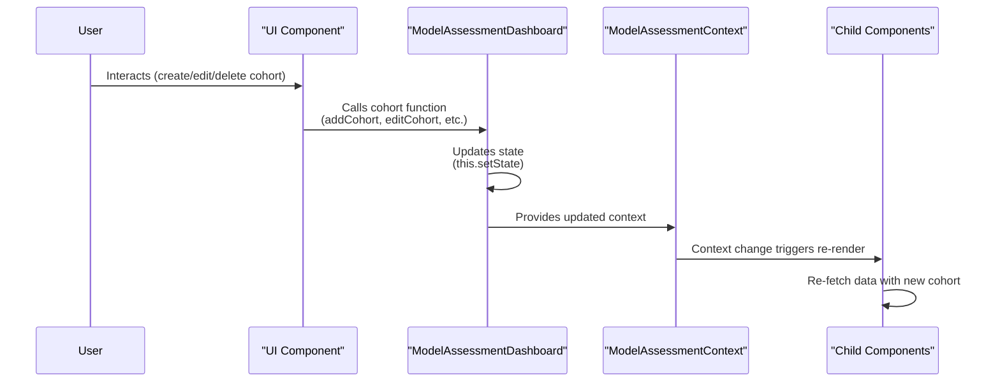

<!-- source: DeepWiki mcp.deepwiki.com · repo microsoft/responsible-ai-toolbox · extra page Cohort Management · fetched 2026-10-26 -->

# Cohort Management

<details>
<summary>Relevant source files</summary>

The following files were used as context for generating this wiki page:

- [apps/widget/src/app/ModelAssessment.tsx](apps/widget/src/app/ModelAssessment.tsx)
- [libs/core-ui/src/index.ts](libs/core-ui/src/index.ts)
- [libs/core-ui/src/lib/Context/ModelAssessmentContext.tsx](libs/core-ui/src/lib/Context/ModelAssessmentContext.tsx)
- [libs/core-ui/src/lib/Interfaces/IExplanationContext.ts](libs/core-ui/src/lib/Interfaces/IExplanationContext.ts)
- [libs/core-ui/src/lib/util/StatisticsUtils.ts](libs/core-ui/src/lib/util/StatisticsUtils.ts)
- [libs/error-analysis/src/index.ts](libs/error-analysis/src/index.ts)
- [libs/error-analysis/src/lib/ErrorAnalysisDashboard/Controls/MetricSelector/MetricSelector.tsx](libs/error-analysis/src/lib/ErrorAnalysisDashboard/Controls/MetricSelector/MetricSelector.tsx)
- [libs/error-analysis/src/lib/ErrorAnalysisDashboard/Interfaces/IErrorAnalysisDashboardState.ts](libs/error-analysis/src/lib/ErrorAnalysisDashboard/Interfaces/IErrorAnalysisDashboardState.ts)
- [libs/interpret-vision/src/lib/VisionExplanationDashboard/Interfaces/IVisionExplanationDashboardProps.ts](libs/interpret-vision/src/lib/VisionExplanationDashboard/Interfaces/IVisionExplanationDashboardProps.ts)
- [libs/localization/src/lib/en.json](libs/localization/src/lib/en.json)
- [libs/model-assessment/src/lib/ModelAssessmentDashboard/Context/buildModelAssessmentContext.ts](libs/model-assessment/src/lib/ModelAssessmentDashboard/Context/buildModelAssessmentContext.ts)
- [libs/model-assessment/src/lib/ModelAssessmentDashboard/Controls/ModelOverview/ModelOverview.tsx](libs/model-assessment/src/lib/ModelAssessmentDashboard/Controls/ModelOverview/ModelOverview.tsx)
- [libs/model-assessment/src/lib/ModelAssessmentDashboard/Controls/ModelOverview/StatsTableUtils.ts](libs/model-assessment/src/lib/ModelAssessmentDashboard/Controls/ModelOverview/StatsTableUtils.ts)
- [libs/model-assessment/src/lib/ModelAssessmentDashboard/Controls/TabsView/TabsViewProps.ts](libs/model-assessment/src/lib/ModelAssessmentDashboard/Controls/TabsView/TabsViewProps.ts)
- [libs/model-assessment/src/lib/ModelAssessmentDashboard/ModelAssessmentDashboard.tsx](libs/model-assessment/src/lib/ModelAssessmentDashboard/ModelAssessmentDashboard.tsx)
- [libs/model-assessment/src/lib/ModelAssessmentDashboard/ModelAssessmentDashboardProps.ts](libs/model-assessment/src/lib/ModelAssessmentDashboard/ModelAssessmentDashboardProps.ts)
- [libs/model-assessment/src/lib/ModelAssessmentDashboard/ModelAssessmentDashboardState.ts](libs/model-assessment/src/lib/ModelAssessmentDashboard/ModelAssessmentDashboardState.ts)
- [raiwidgets/raiwidgets/responsibleai_dashboard.py](raiwidgets/raiwidgets/responsibleai_dashboard.py)
- [raiwidgets/raiwidgets/responsibleai_dashboard_input.py](raiwidgets/raiwidgets/responsibleai_dashboard_input.py)

</details>


## Purpose and Scope

Cohort Management enables users to segment the dataset into meaningful subsets for analysis throughout the Responsible AI Dashboard. This page documents how cohorts are created, selected, edited, and deleted in both the TypeScript frontend and Python backend, as well as how cohort state is managed across the application.

For information about how cohorts are used in specific analysis tabs (e.g., Error Analysis, Model Overview), see those respective sections. For information about cohort filtering logic and filter composition, see [3.4.3](#3.4.3).

---

## Cohort Types

The system maintains three cohort types with distinct purposes:

### ErrorCohort

`ErrorCohort` extends the base `Cohort` class with error analysis statistics. It is the primary cohort type used throughout the error analysis views.

**Key Properties:**
- `cohort: Cohort` - The underlying cohort definition
- `cohortStats: MetricCohortStats` - Statistical metrics (total size, error coverage, metric value)
- `source: CohortSource` - Origin of cohort (None, Imported, TreeMap, HeatMap, ManuallyCreated)
- `isTemporary: boolean` - Whether the cohort is persisted or ephemeral

Sources: [libs/core-ui/src/lib/Cohort/ErrorCohort.ts]()

### DatasetCohort

`DatasetCohort` represents cohorts specifically for dataset-level analysis, without error-specific statistics. Used in the Model Overview and Data Analysis tabs.

**Key Properties:**
- `name: string`
- `filters: IFilter[]`
- `compositeFilters: ICompositeFilter[]`
- `columnRanges: { [key: string]: IColumnRange }`

Sources: [libs/core-ui/src/lib/DatasetCohort.ts]()

### Cohort (Base)

The base `Cohort` class provides core filtering and data selection functionality.

**Key Properties:**
- `name: string`
- `filters: IFilter[]` - Simple filters (e.g., `Age > 30`)
- `compositeFilters: ICompositeFilter[]` - Complex filters combining multiple conditions
- `cohortID: number` - Unique identifier

**Key Methods:**
- `unwrap(key: string): any[]` - Extract data matching cohort filters
- `getCohortID(): number` - Get unique identifier
- `copy(): Cohort` - Create a deep copy

Sources: [libs/core-ui/src/lib/Cohort/Cohort.ts]()

---

## Cohort Lifecycle



**Cohort Lifecycle State Machine**

Sources: [libs/model-assessment/src/lib/ModelAssessmentDashboard/ModelAssessmentDashboard.tsx:219-377]()

### Creation

Cohorts can be created in multiple ways:

#### 1. Default Cohort Initialization

The system creates a default "All data" cohort on initialization:

```typescript
// buildInitialModelAssessmentContext
const defaultErrorCohort = new ErrorCohort(
  new Cohort(
    localization.ErrorAnalysis.Cohort.defaultLabel,
    jointDataset,
    []
  ),
  jointDataset,
  0,
  CohortSource.None,
  false,
  metricStats,
  true
);
```

Sources: [libs/model-assessment/src/lib/ModelAssessmentDashboard/Context/buildModelAssessmentContext.ts:85-97]()

#### 2. Pre-built Cohorts

Users can pass pre-built cohorts via the `cohortData` prop, which are processed during initialization:

```python
# Python side validation
def _validate_cohort_list(self, cohort_list=None):
    if not isinstance(cohort_list, list):
        raise UserConfigValidationException(
            "cohort_list parameter should be a list.")
    
    if not all(isinstance(entry, Cohort) for entry in cohort_list):
        raise UserConfigValidationException(
            "All entries in cohort_list should be of type Cohort.")
```

Sources: [raiwidgets/raiwidgets/responsibleai_dashboard_input.py:72-127]()

#### 3. Manual Creation via CohortEditor

Users create cohorts interactively through the `CohortEditor` component, which allows adding filters and composite filters.

Sources: [libs/core-ui/src/lib/Cohort/ManualCohortManagement/CohortEditor.tsx]()

#### 4. Time Series Cohorts (Forecasting)

For forecasting tasks, cohorts are auto-generated from time series ID columns:

```typescript
// generateTimeSeriesCohorts
const generateTimeSeriesCohorts = (
  defaultErrorCohort: ErrorCohort,
  preBuiltErrorCohortList: ErrorCohort[],
  dataset: IDataset,
  jointDataset: JointDataset
): ErrorCohort[]
```

Sources: [libs/model-assessment/src/lib/ModelAssessmentDashboard/Cohort/GenerateTimeSeriesCohorts.ts]()

### Selection and Switching

The dashboard maintains two cohort references:
- `baseCohort` - The actively applied cohort for all analyses
- `selectedCohort` - Temporarily selected cohort (e.g., from error tree interaction)

#### Switching Base Cohort

```typescript
private shiftErrorCohort = (cohort: ErrorCohort): void => {
  this.setState({
    baseCohort: cohort,
    selectedCohort: cohort
  });
};
```

Sources: [libs/model-assessment/src/lib/ModelAssessmentDashboard/ModelAssessmentDashboard.tsx:219-224]()

#### Temporary Selection

```typescript
private setSelectedCohort = (cohort: ErrorCohort): void => {
  this.setState({
    selectedCohort: cohort
  });
};
```

Sources: [libs/model-assessment/src/lib/ModelAssessmentDashboard/ModelAssessmentDashboard.tsx:226-230]()

#### ShiftCohort UI Component

The `ShiftCohort` component provides a modal dialog for switching cohorts:

| Property | Description |
|----------|-------------|
| `title` | "Switch Cohort" |
| `subText` | "Select a cohort from the cohort list. Apply the cohort to the dashboard." |
| `selectCohort` | Dropdown to choose cohort |
| `apply` | Button to confirm selection |

Sources: [libs/core-ui/src/lib/Cohort/ShiftCohort/ShiftCohort.tsx](), [libs/localization/src/lib/en.json:124-131]()

### Editing

The `editCohort` function updates an existing cohort:

```typescript
private editCohort = (
  editCohort: Cohort,
  datasetCohort?: DatasetCohort,
  switchNew?: boolean
): void => {
  const editIndex = this.state.cohorts.findIndex(
    (c) => c.cohort.name === editCohort.name
  );
  if (editIndex === -1) {
    return;
  }
  const newErrorCohort = new ErrorCohort(
    editCohort,
    this.state.jointDataset,
    0,
    CohortSource.ManuallyCreated
  );
  let newCohorts = [...this.state.cohorts];
  newCohorts[editIndex] = newErrorCohort;
  newCohorts = newCohorts.filter((cohort) => !cohort.isTemporary);
  
  if (switchNew) {
    this.setState({
      baseCohort: newCohorts[editIndex],
      cohorts: newCohorts,
      selectedCohort: newCohorts[editIndex]
    });
  } else {
    this.setState({ cohorts: newCohorts });
  }
  // Also updates datasetCohorts if provided
};
```

Sources: [libs/model-assessment/src/lib/ModelAssessmentDashboard/ModelAssessmentDashboard.tsx:316-362]()

### Saving

The `SaveCohort` component handles saving temporary cohorts as permanent ones:

```typescript
private onSaveCohort = (
  savedCohort: ErrorCohort,
  switchNew?: boolean
): void => {
  if (
    this.state.cohorts.some((c) => c.cohort.name === savedCohort.cohort.name)
  ) {
    return; // Duplicate name check
  }
  let newCohorts = [...this.state.cohorts, savedCohort];
  newCohorts = newCohorts.filter((cohort) => !cohort.isTemporary);
  this.setState((preState) => ({
    baseCohort: switchNew ? savedCohort : preState.baseCohort,
    cohorts: newCohorts,
    selectedCohort: switchNew ? savedCohort : preState.selectedCohort
  }));
};
```

**Save Dialog Properties:**
- Validates cohort is non-empty (see `EmptyCohortDialog`)
- Prevents duplicate names
- Option to switch to newly saved cohort

Sources: [libs/model-assessment/src/lib/ModelAssessmentDashboard/ModelAssessmentDashboard.tsx:246-266](), [libs/core-ui/src/lib/Cohort/SaveCohort/SaveCohort.tsx](), [libs/localization/src/lib/en.json:137-140]()

### Deletion

```typescript
private deleteCohort = (cohort: ErrorCohort): void => {
  if (
    this.state.baseCohort.cohort.name === cohort.cohort.name ||
    this.state.selectedCohort.cohort.name === cohort.cohort.name
  ) {
    return; // Cannot delete active cohort
  }
  const newCohorts = [...this.state.cohorts].filter(
    (t) => t?.cohort?.name !== cohort?.cohort?.name
  );
  this.setState({
    cohorts: newCohorts
  });
};
```

Sources: [libs/model-assessment/src/lib/ModelAssessmentDashboard/ModelAssessmentDashboard.tsx:364-377]()

---

## UI Components Architecture



**Cohort Management UI Component Architecture**

Sources: [libs/model-assessment/src/lib/ModelAssessmentDashboard/ModelAssessmentDashboard.tsx:59-121](), [libs/core-ui/src/lib/Context/ModelAssessmentContext.tsx]()

### CohortEditor

The `CohortEditor` component provides a comprehensive interface for creating and editing cohorts with filters.

**Key Features:**
- Add simple filters (single condition: feature, operator, value)
- Add composite filters (multiple conditions with AND/OR logic)
- Preview affected data count
- Validate filter combinations

**Component Structure:**
- `CohortEditorFilterList` - Lists all current filters
- `CohortBar` - Shows cohort summary statistics
- Filter addition controls with dropdowns for features and operators

Sources: [libs/core-ui/src/lib/Cohort/ManualCohortManagement/CohortEditor.tsx](), [libs/core-ui/src/lib/Cohort/ManualCohortManagement/CohortEditorFilterList.tsx]()

### SaveCohort Dialog

Modal dialog for saving temporary cohorts created from error analysis interactions.

**Props:**
| Property | Type | Description |
|----------|------|-------------|
| `isOpen` | boolean | Controls dialog visibility |
| `onDismiss` | function | Handler for closing dialog |
| `onSave` | function | Handler for saving cohort |
| `temporaryCohort` | ErrorCohort | The cohort to save |
| `baseCohort` | ErrorCohort | Current base cohort for reference |

**Validation:**
- Checks for empty cohorts (no datapoints)
- Validates unique cohort names

Sources: [libs/core-ui/src/lib/Cohort/SaveCohort/SaveCohort.tsx](), [libs/localization/src/lib/en.json:439-447]()

### ShiftCohort Dialog

Modal dialog for switching the active cohort across the dashboard.

**User Flow:**
1. User clicks "Switch cohort" button
2. Dialog displays list of available cohorts
3. User selects desired cohort
4. User clicks "Apply"
5. Dashboard re-renders with new cohort as base

Sources: [libs/core-ui/src/lib/Cohort/ShiftCohort/ShiftCohort.tsx]()

### CohortList Panel

Side panel displaying all available cohorts with metadata.

**Displayed Information:**
- Cohort name
- Sample count
- Coverage percentage (for error cohorts)
- Creation source (manual, tree map, heat map, etc.)

**Actions:**
- Select cohort to view details
- Edit cohort filters
- Delete cohort (if not active)

Sources: [libs/core-ui/src/lib/Cohort/CohortList/CohortList.tsx](), [libs/core-ui/src/lib/Cohort/CohortList/CohortListPanel.tsx]()

### CohortInfo Panel

Displays detailed information about a selected cohort.

**Sections:**
- **Basic Information:** Name, total instances
- **Prediction Path (Filters):** Visual representation of applied filters
- **Cohort Statistics:** Correct/incorrect predictions, error rates
- **Actions:** Save as new cohort, edit cohort

Sources: [libs/core-ui/src/lib/Cohort/CohortInfo/CohortInfo.tsx](), [libs/core-ui/src/lib/Cohort/CohortInfo/CohortInfoPanel.tsx]()

---

## ModelAssessmentContext Integration

The `ModelAssessmentContext` provides cohort management functions to all descendant components:

```typescript
export interface IModelAssessmentContext {
  // Cohort State
  errorCohorts: ErrorCohort[];
  readonly baseErrorCohort: ErrorCohort;
  readonly selectedErrorCohort: ErrorCohort;
  datasetCohorts?: DatasetCohort[];
  readonly baseDatasetCohort?: DatasetCohort;
  readonly selectedDatasetCohort?: DatasetCohort;
  
  // Cohort Management Functions
  shiftErrorCohort(cohort: ErrorCohort): void;
  addCohort(
    cohort: Cohort,
    datasetCohort?: DatasetCohort,
    switchNew?: boolean
  ): void;
  editCohort(
    cohort: Cohort,
    datasetCohort?: DatasetCohort,
    switchNew?: boolean
  ): void;
  deleteCohort(cohort: ErrorCohort): void;
}
```

**Context Provider Location:**

The `ModelAssessmentDashboard` wraps its children in the context provider:

```typescript
<ModelAssessmentContext.Provider
  value={{
    addCohort: this.addCohort,
    baseDatasetCohort: this.state.baseDatasetCohort,
    baseErrorCohort: this.state.baseCohort,
    datasetCohorts: this.state.datasetCohorts,
    deleteCohort: this.deleteCohort,
    editCohort: this.editCohort,
    errorCohorts: this.state.cohorts,
    selectedDatasetCohort: this.state.selectedDatasetCohort,
    selectedErrorCohort: this.state.selectedCohort,
    // ... other context properties
  }}
>
  {/* Dashboard children */}
</ModelAssessmentContext.Provider>
```

Sources: [libs/core-ui/src/lib/Context/ModelAssessmentContext.tsx:28-191](), [libs/model-assessment/src/lib/ModelAssessmentDashboard/ModelAssessmentDashboard.tsx:59-121]()

---

## Backend Processing

### Python Cohort Validation

The `ResponsibleAIDashboardInput` class validates cohorts before passing them to the dashboard:

```python
def _validate_cohort_list(self, cohort_list=None):
    """Validate cohort list structure and contents."""
    # Check list type
    if not isinstance(cohort_list, list):
        raise UserConfigValidationException(
            "cohort_list parameter should be a list.")
    
    # Check all entries are Cohort objects
    if not all(isinstance(entry, Cohort) for entry in cohort_list):
        raise UserConfigValidationException(
            "All entries in cohort_list should be of type Cohort.")
    
    # Check for duplicate names
    all_cohort_names = [cohort.name for cohort in cohort_list]
    unique_cohort_names = np.unique(all_cohort_names).tolist()
    if len(unique_cohort_names) != len(all_cohort_names):
        raise UserConfigValidationException(
            "Found cohorts with duplicate names. "
            "All pre-defined cohorts need to have distinct names.")
    
    # Validate each cohort against test data
    test_data = pd.DataFrame(
        data=self.dashboard_input.dataset.features,
        columns=self.dashboard_input.dataset.feature_names)
    
    for cohort in cohort_list:
        cohort._validate_with_test_data(
            test_data=test_data,
            target_column=self.dashboard_input.dataset.target_column,
            categorical_features=categorical_features,
            is_classification=self._is_classifier)
```

**Validation Steps:**
1. Type checking (list of Cohort objects)
2. Duplicate name detection
3. Filter validation against actual dataset columns
4. Categorical feature verification
5. Target column compatibility

Sources: [raiwidgets/raiwidgets/responsibleai_dashboard_input.py:72-127]()

### Time Series Cohort Generation

For forecasting tasks, cohorts are automatically generated from time series ID columns:

```python
def _generate_time_series_cohorts(self):
    """Generate time series cohorts based on time series ID columns."""
    cohort_list = []
    ts_id_cols = self._analysis._feature_metadata.time_series_id_features
    all_time_series = self._analysis.test[ts_id_cols].value_counts().index
    
    for time_series_id_values in all_time_series:
        column_value_combinations = zip(ts_id_cols, time_series_id_values)
        filters = []
        id_columns_name_value_mapping = []
        
        for (col, val) in column_value_combinations:
            id_columns_name_value_mapping.append(f"{col} = {val}")
            filters.append(CohortFilter(
                method=CohortFilterMethods.METHOD_INCLUDES,
                arg=[val],
                column=col))
        
        time_series = Cohort(", ".join(id_columns_name_value_mapping))
        for filter in filters:
            time_series.add_cohort_filter(filter)
        cohort_list.append(time_series)
    
    return cohort_list
```

Sources: [raiwidgets/raiwidgets/responsibleai_dashboard_input.py:49-70]()

---

## Pre-built Cohorts

Pre-built cohorts allow users to define cohorts programmatically before launching the dashboard.

### Processing Pre-built Error Cohorts

```typescript
// processPreBuiltCohort
export function processPreBuiltCohort(
  props: IModelAssessmentDashboardProps,
  jointDataset: JointDataset
): [ErrorCohort[], ErrorCohort[]] {
  const preBuiltErrorCohortList: ErrorCohort[] = [];
  const preBuiltCohortList = props.cohortData || [];
  
  preBuiltCohortList.forEach((preBuiltCohort: IPreBuiltCohort) => {
    const cohort = new Cohort(
      preBuiltCohort.name,
      jointDataset,
      preBuiltCohort.cohort_filter_list,
      preBuiltCohort.composite_filters
    );
    const errorCohort = new ErrorCohort(
      cohort,
      jointDataset,
      0,
      CohortSource.Imported
    );
    preBuiltErrorCohortList.push(errorCohort);
  });
  
  return [preBuiltErrorCohortList, preBuiltErrorCohortList];
}
```

Sources: [libs/model-assessment/src/lib/ModelAssessmentDashboard/Cohort/ProcessPreBuiltCohort.ts]()

### Processing Pre-built Dataset Cohorts

Similar processing for `DatasetCohort` objects:

```typescript
// processPreBuiltDatasetCohort
export function processPreBuiltDatasetCohort(
  props: IModelAssessmentDashboardProps,
  modelType: ModelTypes,
  columnRanges?: { [key: string]: IColumnRange }
): DatasetCohort[] {
  const preBuiltDatasetCohortList: DatasetCohort[] = [];
  const preBuiltCohortList = props.cohortData || [];
  
  preBuiltCohortList.forEach((preBuiltCohort: IPreBuiltCohort) => {
    const datasetCohort = new DatasetCohort(
      preBuiltCohort.name,
      props.dataset,
      preBuiltCohort.cohort_filter_list,
      preBuiltCohort.composite_filters,
      modelType,
      columnRanges,
      CohortSource.Imported
    );
    preBuiltDatasetCohortList.push(datasetCohort);
  });
  
  return preBuiltDatasetCohortList;
}
```

Sources: [libs/model-assessment/src/lib/ModelAssessmentDashboard/Cohort/ProcessPreBuiltDatasetCohort.ts]()

### Pre-built Cohort Interface

```typescript
export interface IPreBuiltCohort {
  name: string;
  cohort_filter_list: IFilter[];
  composite_filters?: ICompositeFilter[];
}
```

Sources: [libs/core-ui/src/lib/Interfaces/IPreBuiltCohort.ts]()

---

## State Management

### Dashboard State Structure

The `ModelAssessmentDashboard` maintains cohort state:

```typescript
interface IModelAssessmentDashboardState {
  // Error Cohorts
  cohorts: ErrorCohort[];           // All error cohorts
  baseCohort: ErrorCohort;          // Active cohort for analysis
  selectedCohort: ErrorCohort;      // Temporarily selected cohort
  
  // Dataset Cohorts  
  datasetCohorts?: DatasetCohort[]; // All dataset cohorts
  baseDatasetCohort?: DatasetCohort;     // Active dataset cohort
  selectedDatasetCohort?: DatasetCohort; // Temporarily selected dataset cohort
  
  // UI State
  saveCohortVisible: boolean;       // SaveCohort dialog visibility
}
```

Sources: [libs/model-assessment/src/lib/ModelAssessmentDashboard/ModelAssessmentDashboardState.ts]()

### State Update Flow



**Cohort State Update Sequence**

Sources: [libs/model-assessment/src/lib/ModelAssessmentDashboard/ModelAssessmentDashboard.tsx:268-314]()

### Cohort Synchronization

The dashboard synchronizes cohorts when they change externally (e.g., from pre-built cohort updates):

```typescript
public componentDidUpdate(): void {
  const newDatasetCohortIDs = this.context.errorCohorts.map(
    (errorCohort) => errorCohort.cohort.getCohortID()
  );
  const oldDatasetCohortIDs = this.state.datasetBasedCohorts.map(
    (errorCohort) => errorCohort.cohort.getCohortID()
  );
  
  if (!this.ifCohortIndexesEquals(newDatasetCohortIDs, oldDatasetCohortIDs)) {
    const addCohortIDs = newDatasetCohortIDs.filter(
      (x) => !oldDatasetCohortIDs.includes(x)
    );
    const deleteCohortIDs = oldDatasetCohortIDs.filter(
      (x) => !newDatasetCohortIDs.includes(x)
    );
    
    if (addCohortIDs.length > 0) {
      this.setState({
        selectedDatasetCohorts: 
          this.state.selectedDatasetCohorts?.concat(addCohortIDs)
      }, () => this.updateDatasetCohortStats());
    } else if (deleteCohortIDs.length > 0) {
      this.setState({
        selectedDatasetCohorts: this.state.selectedDatasetCohorts?.filter(
          (x) => !deleteCohortIDs.includes(x)
        )
      }, () => this.updateDatasetCohortStats());
    }
  }
}
```

Sources: [libs/model-assessment/src/lib/ModelAssessmentDashboard/Controls/ModelOverview/ModelOverview.tsx:207-242]()

---

## Error Handling

### Empty Cohort Detection

The system prevents saving cohorts with no datapoints:

**EmptyCohortDialog:**
```typescript
{
  "title": "Dataset cohort contains no datapoints",
  "subText": "It seems your dataset cohort contains no datapoints, 
             adjust your filters to include at least one datapoint 
             in your dataset cohort before saving."
}
```

Sources: [libs/localization/src/lib/en.json:137-140]()

### Pre-built Cohort Validation Errors

Common validation errors from Python backend:

| Error | Condition | Message |
|-------|-----------|---------|
| Invalid type | `cohort_list` not a list | "cohort_list parameter should be a list." |
| Invalid entry | Entry not a `Cohort` object | "All entries in cohort_list should be of type Cohort." |
| Duplicate names | Multiple cohorts with same name | "Found cohorts with duplicate names. All pre-defined cohorts need to have distinct names." |
| Feature not found | Filter references non-existent feature | "Feature name not found in the dataset" |
| Invalid categorical | Non-categorical feature treated as categorical | "Feature is not categorical" |

Sources: [raiwidgets/raiwidgets/responsibleai_dashboard_input.py:88-103](), [libs/localization/src/lib/en.json:133-136]()

### Active Cohort Protection

The system prevents deletion of the currently active cohort:

```typescript
private deleteCohort = (cohort: ErrorCohort): void => {
  if (
    this.state.baseCohort.cohort.name === cohort.cohort.name ||
    this.state.selectedCohort.cohort.name === cohort.cohort.name
  ) {
    return; // Cannot delete active cohort
  }
  // ... proceed with deletion
};
```

Sources: [libs/model-assessment/src/lib/ModelAssessmentDashboard/ModelAssessmentDashboard.tsx:364-377]()

---

