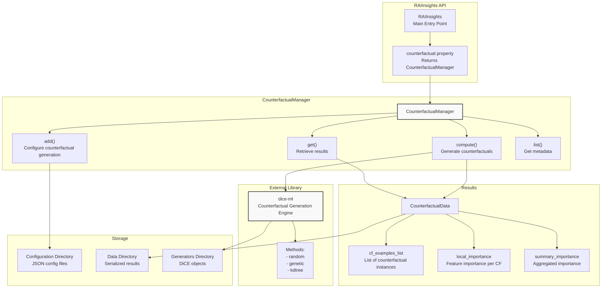
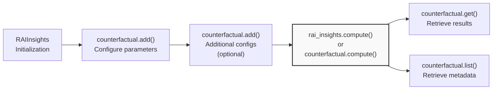
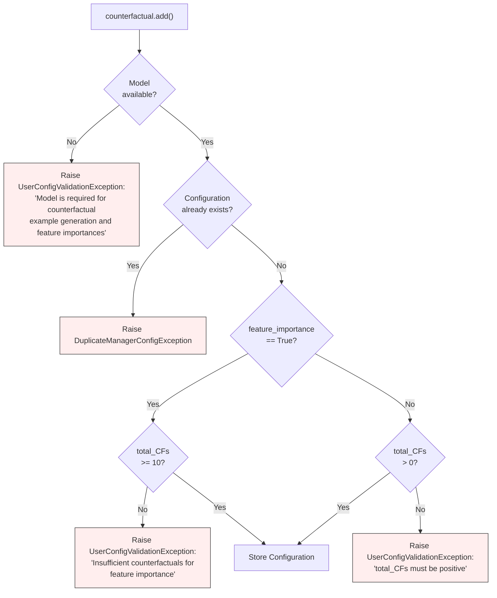
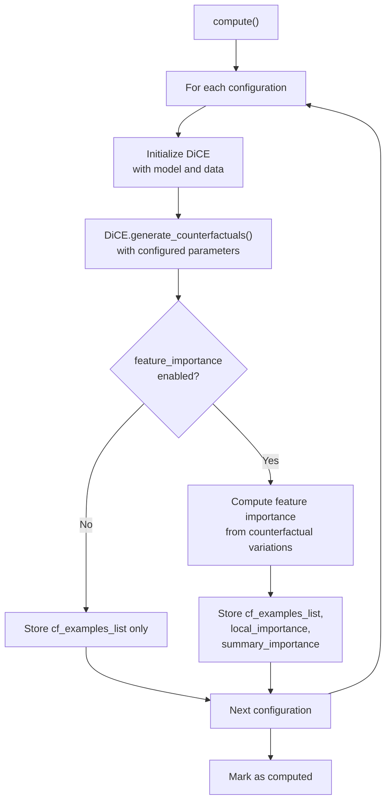
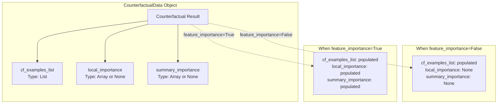
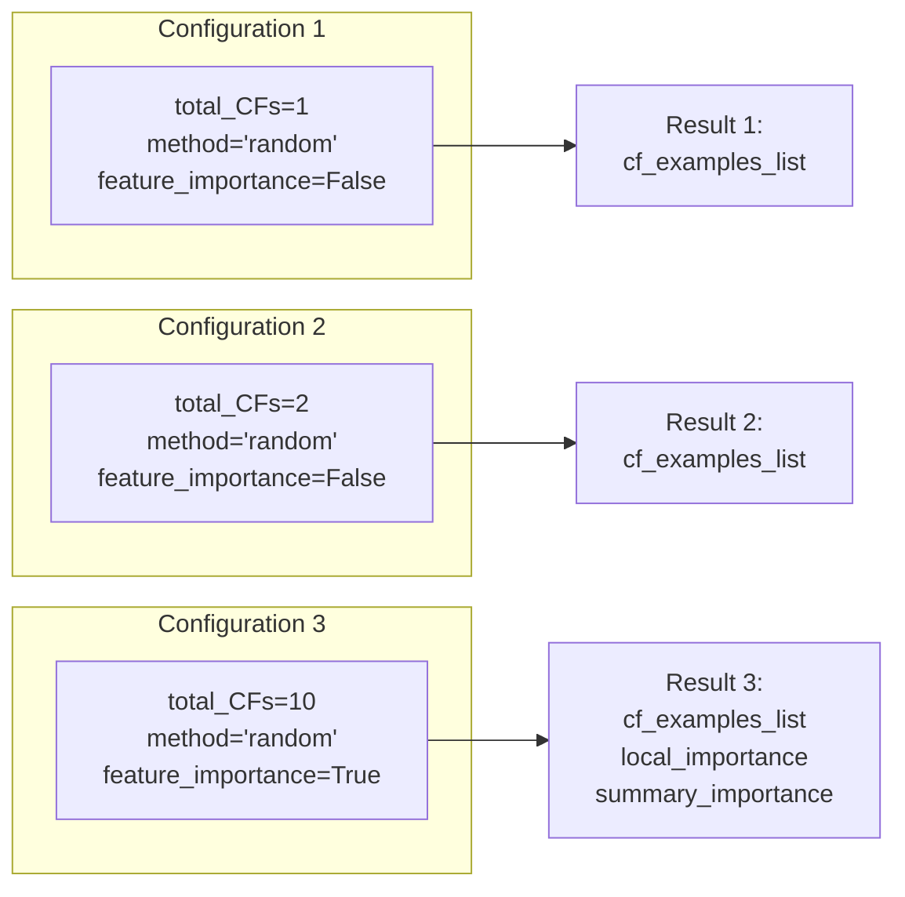
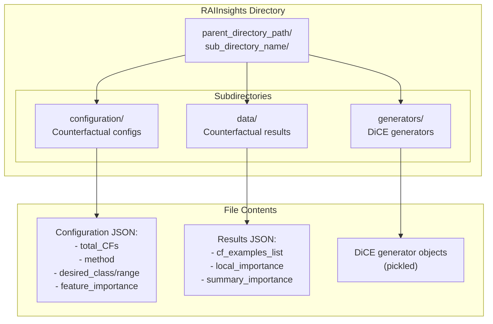
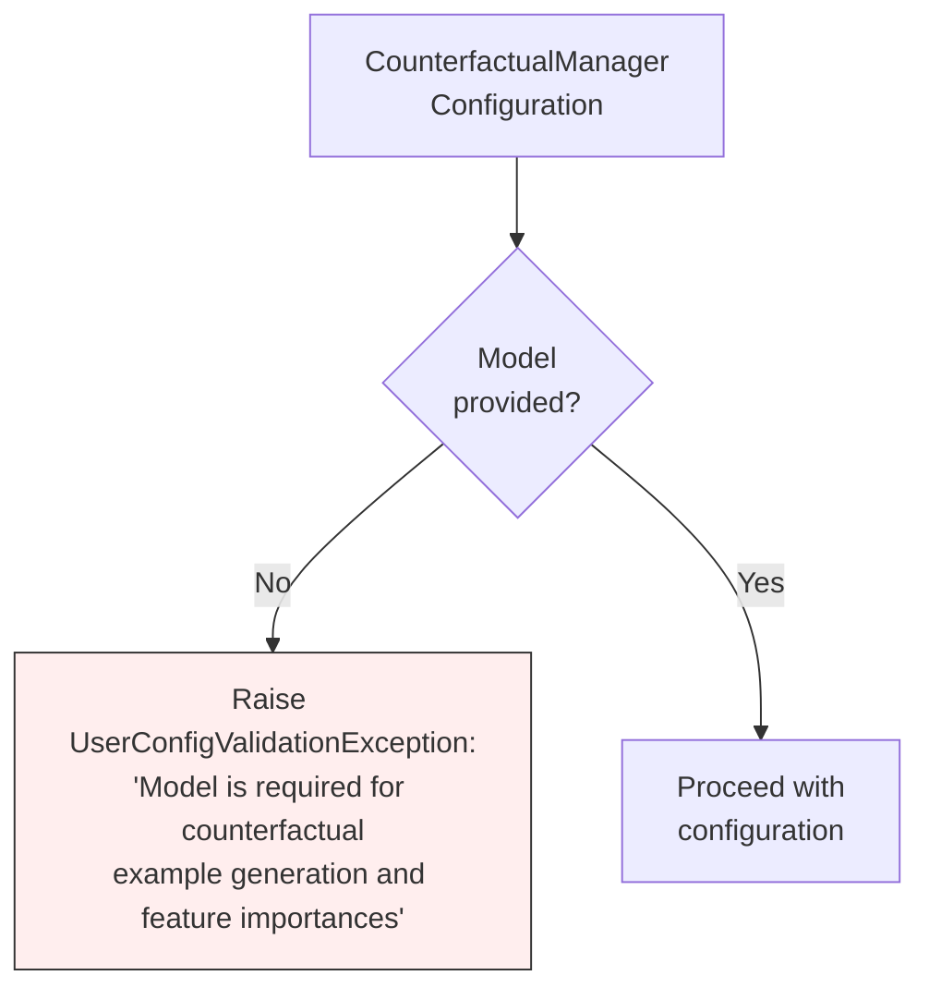
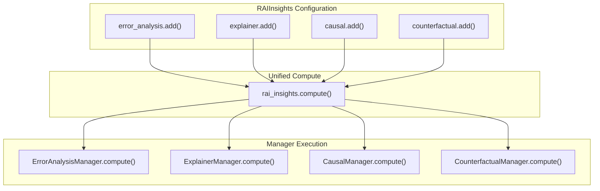

<!-- source: DeepWiki mcp.deepwiki.com · repo microsoft/responsible-ai-toolbox · extra page Counterfactual Manager · fetched 2026-10-26 -->

# Counterfactual Manager

<details>
<summary>Relevant source files</summary>

The following files were used as context for generating this wiki page:

- [raiwidgets/raiwidgets/interfaces.py](raiwidgets/raiwidgets/interfaces.py)
- [responsibleai/responsibleai/_tools/shared/state_directory_management.py](responsibleai/responsibleai/_tools/shared/state_directory_management.py)
- [responsibleai/responsibleai/exceptions.py](responsibleai/responsibleai/exceptions.py)
- [responsibleai/responsibleai/modelanalysis/model_analysis.py](responsibleai/responsibleai/modelanalysis/model_analysis.py)
- [responsibleai/tests/causal_manager_validator.py](responsibleai/tests/causal_manager_validator.py)
- [responsibleai/tests/counterfactual_manager_validator.py](responsibleai/tests/counterfactual_manager_validator.py)
- [responsibleai/tests/error_analysis_validator.py](responsibleai/tests/error_analysis_validator.py)
- [responsibleai/tests/explainer_manager_validator.py](responsibleai/tests/explainer_manager_validator.py)
- [responsibleai/tests/test_exceptions.py](responsibleai/tests/test_exceptions.py)

</details>


## Purpose and Scope

The **CounterfactualManager** is one of the core analysis managers in the Responsible AI Toolbox, responsible for generating counterfactual explanations for machine learning models. Counterfactual explanations answer the question: "What minimal changes to input features would result in a different prediction?" This manager integrates the [DiCE (Diverse Counterfactual Explanations)](https://github.com/interpretml/DiCE) library to generate diverse, actionable counterfactual examples.

The CounterfactualManager is accessed as a property of the `RAIInsights` object and follows the standard manager pattern used throughout the toolkit. For information about the broader manager orchestration system, see [Manager Orchestration](#3.2.2). For other analysis types, see [Causal Manager](#3.3.3), [Explainer Manager](#3.3.2), and [Error Analysis Manager](#3.3.1).

**Sources:** [responsibleai/responsibleai/modelanalysis/model_analysis.py:98-104](), [responsibleai/tests/counterfactual_manager_validator.py:1-128]()

## Architecture Overview

The CounterfactualManager integrates into the RAI ecosystem as a specialized analysis component that wraps the DiCE library. The following diagram shows how it fits within the overall system:



**Sources:** [responsibleai/responsibleai/modelanalysis/model_analysis.py:14,99-104](), [responsibleai/tests/counterfactual_manager_validator.py:33-128]()

## Manager Lifecycle and API

### Standard Manager Pattern

The CounterfactualManager follows the standard three-phase lifecycle used by all RAI managers:

| Phase | Method | Purpose |
|-------|--------|---------|
| **Configuration** | `add()` | Specify parameters for counterfactual generation |
| **Computation** | `compute()` | Execute DiCE to generate counterfactuals |
| **Retrieval** | `get()`, `list()` | Access computed results and metadata |



**Sources:** [responsibleai/tests/counterfactual_manager_validator.py:33-96]()

### Configuration Phase: `add()` Method

The `add()` method configures a counterfactual generation task. Users can call this method multiple times to create different configurations with varying parameters.

**Key Parameters:**

| Parameter | Type | Description | Constraints |
|-----------|------|-------------|-------------|
| `total_CFs` | int | Number of counterfactual examples to generate per instance | Must be positive; if `feature_importance=True`, must be ≥ 10 |
| `method` | str | DiCE method to use | Options: `'random'`, `'genetic'`, `'kdtree'` |
| `desired_class` | int/str | Target class for classification (optional) | Used for classification tasks |
| `desired_range` | tuple | Target range for regression (optional) | Used for regression tasks |
| `feature_importance` | bool | Whether to compute feature importance | Default: `False`; requires `total_CFs ≥ 10` |

**Example Usage Pattern:**

```python
# Classification: Generate counterfactuals for desired class
rai_insights.counterfactual.add(
    total_CFs=10,
    method='random',
    desired_class=1,
    feature_importance=True
)

# Regression: Generate counterfactuals within desired range
rai_insights.counterfactual.add(
    total_CFs=5,
    method='genetic',
    desired_range=[50, 100]
)
```

**Sources:** [responsibleai/tests/counterfactual_manager_validator.py:33-85]()

### Validation Logic

The CounterfactualManager performs several validation checks during configuration:



**Sources:** [responsibleai/tests/counterfactual_manager_validator.py:43-128](), [raiutils/raiutils/exceptions.py](), [responsibleai/responsibleai/exceptions.py:25-33]()

### Computation Phase: `compute()` Method

The `compute()` method triggers the actual counterfactual generation using DiCE. This can be called either directly on the manager or on the parent `RAIInsights` object (which will call compute on all configured managers).

**Computation Flow:**



**Sources:** [responsibleai/tests/counterfactual_manager_validator.py:61-95]()

### Retrieval Phase: `get()` and `list()` Methods

#### `get()` Method

Returns a list of counterfactual result objects, one for each configured counterfactual generation task.

**Return Structure:**

Each result object contains:
- `cf_examples_list`: List of generated counterfactual examples
- `local_importance`: Feature importance for each counterfactual (if `feature_importance=True`)
- `summary_importance`: Aggregated feature importance across all counterfactuals (if `feature_importance=True`)

**Filtering Failed Computations:**

```python
# Get successful results only (default)
results = rai_insights.counterfactual.get()

# Get failed computations
failed = rai_insights.counterfactual.get(failed_to_compute=True)
```

**Sources:** [responsibleai/tests/counterfactual_manager_validator.py:62-95,121-127]()

#### `list()` Method

Returns metadata about all counterfactual configurations without the full result data.

**Return Structure:**

```python
{
    'manager_type': 'counterfactual',  # ManagerNames.COUNTERFACTUAL
    'counterfactuals': [
        # List of configuration summaries
        # Length equals number of add() calls
    ]
}
```

**Sources:** [responsibleai/tests/counterfactual_manager_validator.py:22-30,67-69]()

## Result Data Structures

### Counterfactual Object Structure



**Validation Assertions:**

The test suite validates the following invariants:

| Condition | Assertion |
|-----------|-----------|
| Always | `cf_examples_list is not None` |
| `feature_importance=True` | `local_importance is not None` |
| `feature_importance=True` | `summary_importance is not None` |
| `feature_importance=False` | `local_importance is None` |
| `feature_importance=False` | `summary_importance is None` |

**Sources:** [responsibleai/tests/counterfactual_manager_validator.py:12-20]()

## Multiple Configurations

The CounterfactualManager supports multiple configurations, allowing users to experiment with different generation strategies.

### Configuration Multiplicity Example



### Duplicate Detection

The manager prevents duplicate configurations:

- Configurations are compared based on all parameters: `total_CFs`, `method`, `desired_class`, `desired_range`, `feature_importance`
- If a duplicate is detected, `DuplicateManagerConfigException` is raised
- This ensures efficient resource usage and prevents redundant computations

**Sources:** [responsibleai/tests/counterfactual_manager_validator.py:71-77](), [responsibleai/responsibleai/exceptions.py:25-33]()

## Persistence and Serialization

The CounterfactualManager integrates with the broader RAI persistence system using the `DirectoryManager` pattern.

### Storage Structure



The manager uses the `DirectoryManager` class to create and access these directories:
- `create_config_directory()`: Store configuration parameters
- `create_data_directory()`: Store computed results  
- `create_generators_directory()`: Store DiCE generator objects for potential reuse

**Sources:** [responsibleai/responsibleai/_tools/shared/state_directory_management.py:11-132]()

## Error Handling and Edge Cases

### Required Model Validation

The CounterfactualManager requires a model to function, unlike some other managers that can operate with cached predictions:



This is because DiCE needs to evaluate the model repeatedly to search for counterfactual examples.

**Sources:** [responsibleai/tests/counterfactual_manager_validator.py:43-53]()

### Failed Computation Tracking

The manager tracks configurations that fail during computation:

| Scenario | Behavior |
|----------|----------|
| Successful computation | Result added to main results list |
| Failed computation | Configuration stored separately, accessible via `get(failed_to_compute=True)` |
| Invalid pre-compute configuration | Exception raised during `add()`, configuration not stored |
| Invalid runtime configuration | Exception raised during `compute()`, marked as failed |

**Example: Tracking Failures**

```python
# Add invalid configuration (negative total_CFs)
try:
    rai_insights.counterfactual.add(total_CFs=-2, method='random')
    rai_insights.counterfactual.compute()
except UserConfigValidationException:
    pass

# Check failed computations
successful = rai_insights.counterfactual.get()  # Excludes failed
failed = rai_insights.counterfactual.get(failed_to_compute=True)  # Only failed
```

**Sources:** [responsibleai/tests/counterfactual_manager_validator.py:113-127]()

## Integration with RAIInsights

### Manager Property Access

The CounterfactualManager is accessed as a property of `RAIInsights`:

```python
# Via RAIInsights
rai_insights = RAIInsights(model, train, test, target_column, task_type)
cf_manager = rai_insights.counterfactual  # Returns CounterfactualManager instance
```

The deprecated `ModelAnalysis` class provides the same interface:

```python
# Via ModelAnalysis (deprecated)
model_analysis = ModelAnalysis(model, train, test, target_column, task_type)
cf_manager = model_analysis.counterfactual  # Returns CounterfactualManager instance
```

**Sources:** [responsibleai/responsibleai/modelanalysis/model_analysis.py:98-104]()

### Orchestration with Other Managers

The CounterfactualManager operates independently but can be computed alongside other managers:



All managers are computed when `rai_insights.compute()` is called, or individual managers can be computed separately.

**Sources:** [responsibleai/responsibleai/modelanalysis/model_analysis.py:122-124]()

## Constants and Configuration Keys

The CounterfactualManager uses standardized keys defined in the `_internal.constants` module:

| Constant | Usage |
|----------|-------|
| `CounterfactualManagerKeys.COUNTERFACTUALS` | Key for counterfactual results in `list()` output |
| `ManagerNames.COUNTERFACTUAL` | Identifier for manager type |
| `ListProperties.MANAGER_TYPE` | Key for manager type in `list()` output |

**Sources:** [responsibleai/tests/counterfactual_manager_validator.py:7-8,24-30]()

## Summary

The CounterfactualManager provides a streamlined interface for generating counterfactual explanations using the DiCE library. Key features include:

- **Flexible Configuration**: Support for multiple generation strategies and parameters
- **Feature Importance**: Optional computation of feature importance from counterfactual variations
- **Validation**: Comprehensive input validation and duplicate detection
- **Persistence**: Integration with RAI's standard serialization system
- **Error Tracking**: Graceful handling of failed computations

The manager follows the standard RAI manager pattern (add → compute → get/list) and integrates seamlessly with other analysis components in the Responsible AI Toolbox.

**Sources:** [responsibleai/tests/counterfactual_manager_validator.py:1-128](), [responsibleai/responsibleai/modelanalysis/model_analysis.py:1-176]()

---

