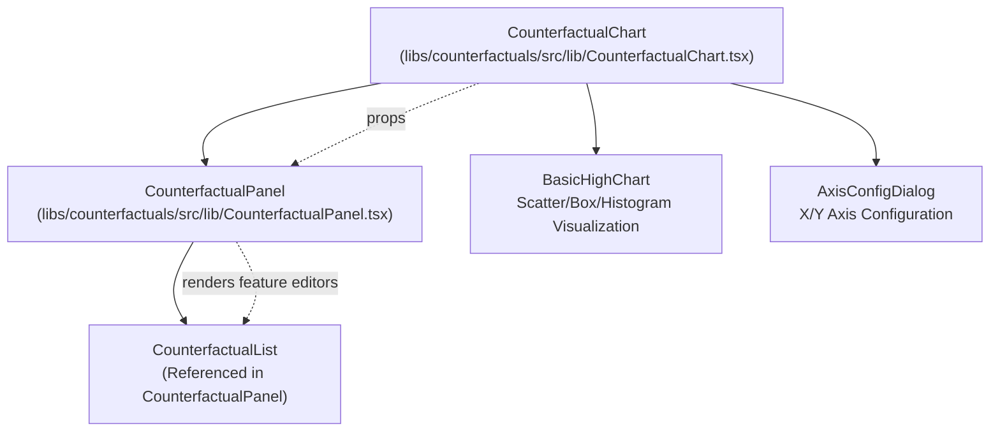
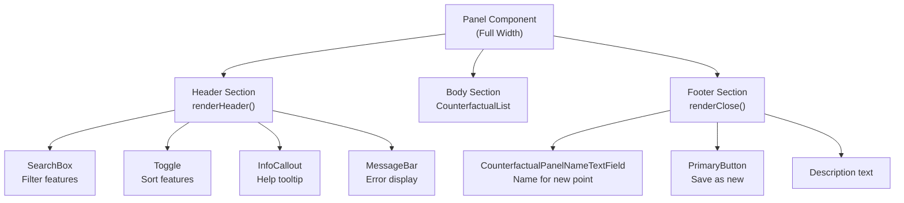
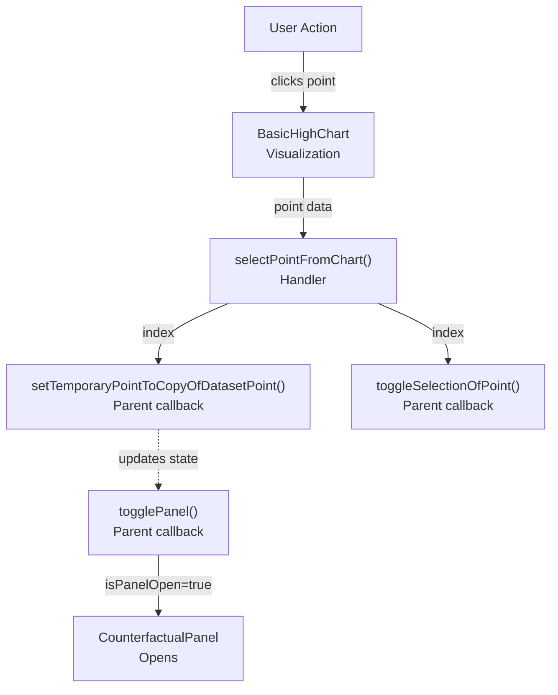
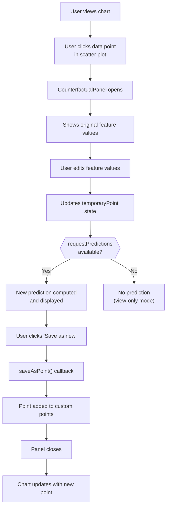

<!-- source: DeepWiki mcp.deepwiki.com · repo microsoft/responsible-ai-toolbox · extra page Counterfactual Panel · fetched 2026-10-26 -->

# Counterfactual Panel

<details>
<summary>Relevant source files</summary>

The following files were used as context for generating this wiki page:

- [.eslintrc/.eslintrc.custom.eslintrc](.eslintrc/.eslintrc.custom.eslintrc)
- [apps/dashboard/src/model-assessment/__mock_data__/adultCensus.ts](apps/dashboard/src/model-assessment/__mock_data__/adultCensus.ts)
- [apps/dashboard/src/model-assessment/__mock_data__/bostonData.ts](apps/dashboard/src/model-assessment/__mock_data__/bostonData.ts)
- [libs/core-ui/src/lib/Interfaces/ICausalAnalysisData.ts](libs/core-ui/src/lib/Interfaces/ICausalAnalysisData.ts)
- [libs/core-ui/src/lib/Interfaces/ICounterfactualData.ts](libs/core-ui/src/lib/Interfaces/ICounterfactualData.ts)
- [libs/core-ui/src/lib/Interfaces/IDataset.ts](libs/core-ui/src/lib/Interfaces/IDataset.ts)
- [libs/counterfactuals/src/lib/CounterfactualChart.tsx](libs/counterfactuals/src/lib/CounterfactualChart.tsx)
- [libs/counterfactuals/src/lib/CounterfactualPanel.tsx](libs/counterfactuals/src/lib/CounterfactualPanel.tsx)
- [responsibleai/responsibleai/_interfaces.py](responsibleai/responsibleai/_interfaces.py)

</details>


## Purpose and Scope

The Counterfactual Panel is a TypeScript/React component that provides an interactive interface for exploring "what-if" scenarios in machine learning model analysis. It allows users to modify feature values of selected data points and observe how these changes affect model predictions. The panel is part of the counterfactual analysis capabilities in the Model Assessment Dashboard.

For information about the backend counterfactual generation using DiCE, see the Counterfactual Manager documentation [3.3.4](#3.3.4). For details on the broader Model Assessment Dashboard architecture, see [4.2](#4.2).

**Sources:** [libs/counterfactuals/src/lib/CounterfactualPanel.tsx:1-280](), [libs/counterfactuals/src/lib/CounterfactualChart.tsx:1-253]()

## Component Architecture

The counterfactual UI is organized in a hierarchical component structure where `CounterfactualChart` serves as the container, embedding both the visualization and the interactive panel.



**Component Relationships:**
- **CounterfactualChart** [libs/counterfactuals/src/lib/CounterfactualChart.tsx:61-252]() manages the visualization and embeds the panel
- **CounterfactualPanel** [libs/counterfactuals/src/lib/CounterfactualPanel.tsx:62-280]() provides the interactive editing interface
- **CounterfactualList** [libs/counterfactuals/src/lib/CounterfactualPanel.tsx:93-106]() renders individual feature controls

**Sources:** [libs/counterfactuals/src/lib/CounterfactualPanel.tsx:62-110](), [libs/counterfactuals/src/lib/CounterfactualChart.tsx:61-199]()

## Data Interface

The counterfactual functionality operates on the `ICounterfactualData` interface, which carries data from the Python backend to the TypeScript frontend.

### TypeScript Interface

| Property | Type | Description |
|----------|------|-------------|
| `id` | `string` | Unique identifier for the counterfactual analysis |
| `cfs_list` | `Array<Array<Array<string \| number>>>` | List of counterfactual examples for each test point |
| `feature_names` | `string[]` | Names of features in the dataset |
| `feature_names_including_target` | `string[]` | Feature names plus the target variable |
| `test_data` | `Array<Array<string \| number>>` | Original test dataset |
| `summary_importance` | `number[]` (optional) | Global feature importance for counterfactual generation |
| `local_importance` | `number[][]` (optional) | Per-instance feature importance |
| `model_type` | `string` (optional) | Type of model being analyzed |
| `desired_class` | `string` (optional) | Target class for classification counterfactuals |
| `desired_range` | `[number, number]` (optional) | Target range for regression counterfactuals |
| `errorMessage` | `string` (optional) | Error message if counterfactual generation failed |

**Sources:** [libs/core-ui/src/lib/Interfaces/ICounterfactualData.ts:4-16](), [responsibleai/responsibleai/_interfaces.py:174-184]()

### Python to TypeScript Data Flow

```mermaid
graph LR
    CounterfactualManager["CounterfactualManager<br/>Python Backend"]
    ResponsibleAIDashboard["ResponsibleAIDashboard<br/>Python Class"]
    DashboardInput["ResponsibleAIDashboardInput<br/>Flask Adapter"]
    Flask["Flask Server<br/>rai-core-flask"]
    MAD["ModelAssessmentDashboard<br/>React Component"]
    ModelAssessmentContext["ModelAssessmentContext<br/>React Context"]
    CounterfactualPanel["CounterfactualPanel<br/>Component"]
    
    CounterfactualManager -->|"CounterfactualData object"| ResponsibleAIDashboard
    ResponsibleAIDashboard -->|serializes| DashboardInput
    DashboardInput -->|"JSON via HTTP"| Flask
    Flask -->|serves| MAD
    MAD -->|"provides via context"| ModelAssessmentContext
    ModelAssessmentContext -->|"counterfactualData prop"| CounterfactualPanel
```



**Sources:** [responsibleai/responsibleai/_interfaces.py:174-184](), [libs/counterfactuals/src/lib/CounterfactualPanel.tsx:21-27](), [libs/counterfactuals/src/lib/CounterfactualChart.tsx:103]()

## CounterfactualPanel Component Details

### Component Props

The `CounterfactualPanel` component accepts the following props via `ICounterfactualPanelProps`:

| Prop | Type | Description |
|------|------|-------------|
| `selectedIndex` | `number` | Index of the currently selected data point |
| `data` | `ICounterfactualData` (optional) | Counterfactual data from backend |
| `isPanelOpen` | `boolean` | Controls panel visibility |
| `temporaryPoint` | `{ [key: string]: string \| number }` (optional) | Current edited values (temporary state) |
| `originalData` | `{ [key: string]: string \| number }` | Original feature values of selected point |
| `closePanel` | `() => void` | Callback to close the panel |
| `saveAsPoint` | `() => void` | Callback to save edited point as new datapoint |
| `setCustomRowProperty` | `(key, isString, newValue?) => void` | Callback to update a feature value |
| `setCustomRowPropertyComboBox` | `(key, index?, value?) => void` | Callback for categorical feature updates |
| `telemetryHook` | `(message: ITelemetryEvent) => void` (optional) | Telemetry logging callback |

**Sources:** [libs/counterfactuals/src/lib/CounterfactualPanel.tsx:37-56]()

### Component State

```typescript
interface ICounterfactualState {
  filterText?: string;      // Search filter for features
  sortFeatures: boolean;    // Whether to alphabetically sort features
}
```

**Sources:** [libs/counterfactuals/src/lib/CounterfactualPanel.tsx:57-60]()

## Panel Layout Structure

The `CounterfactualPanel` is organized into three main sections rendered within a Fluent UI `Panel` component.



**Sources:** [libs/counterfactuals/src/lib/CounterfactualPanel.tsx:76-109]()

### Header Section

The header section [libs/counterfactuals/src/lib/CounterfactualPanel.tsx:112-204]() provides:

1. **Title Display**: Shows either "What-If" or "Counterfactual" based on whether `requestPredictions` is available in context
2. **Description**: Conditional text explaining functionality
3. **Search Box**: Filters features by name [libs/counterfactuals/src/lib/CounterfactualPanel.tsx:163-168]()
4. **Sort Toggle**: Controls alphabetical sorting of features [libs/counterfactuals/src/lib/CounterfactualPanel.tsx:171-177]()
5. **Info Tooltip**: Provides help documentation [libs/counterfactuals/src/lib/CounterfactualPanel.tsx:179-191]()
6. **Error Message Bar**: Displays `errorMessage` from counterfactual data if present [libs/counterfactuals/src/lib/CounterfactualPanel.tsx:195-201]()

**Sources:** [libs/counterfactuals/src/lib/CounterfactualPanel.tsx:112-204]()

### Body Section - CounterfactualList

The body contains the `CounterfactualList` component [libs/counterfactuals/src/lib/CounterfactualPanel.tsx:92-106](), which receives:
- Current feature values (`temporaryPoint`)
- Original feature values (`originalData`)
- Counterfactual data from backend
- Filter text and sort preferences
- Callbacks for updating feature values

The `CounterfactualList` renders interactive controls for each feature, allowing users to:
- Edit numeric features with text inputs
- Select categorical features with dropdowns
- See the original vs. modified values side-by-side

**Sources:** [libs/counterfactuals/src/lib/CounterfactualPanel.tsx:92-106]()

### Footer Section - Save Functionality

The footer section [libs/counterfactuals/src/lib/CounterfactualPanel.tsx:206-240]() is only rendered when `requestPredictions` is available in the context (indicating the model can make predictions on the modified point). It provides:

1. **Name Text Field**: `CounterfactualPanelNameTextField` for naming the new data point [libs/counterfactuals/src/lib/CounterfactualPanel.tsx:218-223]()
2. **Save Button**: `PrimaryButton` that triggers `saveAsPoint` callback [libs/counterfactuals/src/lib/CounterfactualPanel.tsx:226-231]()
3. **Description**: Explanatory text about saving functionality [libs/counterfactuals/src/lib/CounterfactualPanel.tsx:234-237]()

When the save button is clicked, the `handleSavePoint` method [libs/counterfactuals/src/lib/CounterfactualPanel.tsx:256-263]():
- Calls the `saveAsPoint` callback
- Closes the panel
- Logs a telemetry event (`CounterfactualSaveAsNewDatapointClick`)

**Sources:** [libs/counterfactuals/src/lib/CounterfactualPanel.tsx:206-263]()

## Integration with CounterfactualChart

The `CounterfactualPanel` is embedded within the `CounterfactualChart` component, which provides the visualization context.

### Chart Component Responsibilities

The `CounterfactualChart` [libs/counterfactuals/src/lib/CounterfactualChart.tsx:61-252]():
1. **Renders Visualization**: Uses `BasicHighChart` with Highcharts for scatter, box, or histogram plots [libs/counterfactuals/src/lib/CounterfactualChart.tsx:168-176]()
2. **Manages Axis Configuration**: Provides `AxisConfigDialog` for X and Y axis selection [libs/counterfactuals/src/lib/CounterfactualChart.tsx:107-145]()
3. **Handles Point Selection**: Clicking a point in the chart opens the panel [libs/counterfactuals/src/lib/CounterfactualChart.tsx:238-245]()
4. **Passes Data to Panel**: Forwards counterfactual data and callbacks to `CounterfactualPanel` [libs/counterfactuals/src/lib/CounterfactualChart.tsx:92-105]()

### Chart-Panel Data Flow



**Sources:** [libs/counterfactuals/src/lib/CounterfactualChart.tsx:238-245]()

## User Interaction Flow

The following diagram illustrates the complete user interaction flow for the counterfactual "what-if" analysis.



**Sources:** [libs/counterfactuals/src/lib/CounterfactualChart.tsx:238-245](), [libs/counterfactuals/src/lib/CounterfactualPanel.tsx:256-263]()

## Context Integration

The `CounterfactualPanel` heavily relies on the `ModelAssessmentContext` for shared state and functionality.

### Context Dependencies

```typescript
// From CounterfactualPanel component
public static contextType = ModelAssessmentContext;
public context: React.ContextType<typeof ModelAssessmentContext> = 
  defaultModelAssessmentContext;
```

**Key Context Properties Used:**

| Property | Usage | Location |
|----------|-------|----------|
| `requestPredictions` | Determines if prediction functionality is available | Header and footer rendering logic |
| `counterfactualData` | Provides the `ICounterfactualData` object | Passed to `CounterfactualList` |
| `jointDataset` | Provides feature metadata and data structure | Used in `CounterfactualChart` for plotting |
| `selectedErrorCohort` | Current cohort being analyzed | Used for filtering chart data |

**Sources:** [libs/counterfactuals/src/lib/CounterfactualPanel.tsx:66-68](), [libs/counterfactuals/src/lib/CounterfactualChart.tsx:65-67]()

## Key Event Handlers

### Feature Value Updates

**Text Input Handler** [libs/counterfactuals/src/lib/CounterfactualPanel.tsx:264-271]():
```
setCustomRowProperty(key, isString, event, newValue)
  -> Forwards to props.setCustomRowProperty
  -> Updates temporaryPoint state in parent
```

**ComboBox Handler** [libs/counterfactuals/src/lib/CounterfactualPanel.tsx:100-102]():
```
setCustomRowPropertyComboBox(key, index, value)
  -> Forwards to props.setCustomRowPropertyComboBox
  -> Updates categorical feature in temporaryPoint
```

### Panel Control

**Filter Text Update** [libs/counterfactuals/src/lib/CounterfactualPanel.tsx:272-279]():
```
setFilterText(event, newValue)
  -> Updates state.filterText
  -> CounterfactualList filters displayed features
```

**Sort Features Toggle** [libs/counterfactuals/src/lib/CounterfactualPanel.tsx:242-249]():
```
toggleSortFeatures(event, checked)
  -> Updates state.sortFeatures
  -> CounterfactualList re-orders features alphabetically
```

**Close Panel** [libs/counterfactuals/src/lib/CounterfactualPanel.tsx:250-255]():
```
onClosePanel()
  -> Resets state.filterText
  -> Calls props.closePanel()
  -> Panel visibility controlled by parent
```

**Sources:** [libs/counterfactuals/src/lib/CounterfactualPanel.tsx:242-279]()

## Telemetry Events

The component logs telemetry events for user actions:

| Event | Trigger | Event Name |
|-------|---------|------------|
| Save as new datapoint | User clicks save button | `CounterfactualSaveAsNewDatapointClick` |
| Select point from chart | User clicks chart point | `CounterfactualNewDatapointSelectedFromChart` |

Telemetry events are logged with level `TelemetryLevels.ButtonClick` and passed to the optional `telemetryHook` callback.

**Sources:** [libs/counterfactuals/src/lib/CounterfactualPanel.tsx:259-262](), [libs/counterfactuals/src/lib/CounterfactualChart.tsx:242-250]()

## Error Handling

The panel displays error messages when counterfactual generation fails on the backend:

1. Backend returns `errorMessage` in `ICounterfactualData` [libs/core-ui/src/lib/Interfaces/ICounterfactualData.ts:7]()
2. Panel header checks for `props.data?.errorMessage` [libs/counterfactuals/src/lib/CounterfactualPanel.tsx:196]()
3. If present, displays `MessageBar` with type `MessageBarType.error` [libs/counterfactuals/src/lib/CounterfactualPanel.tsx:197-199]()

**Sources:** [libs/counterfactuals/src/lib/CounterfactualPanel.tsx:195-201](), [libs/core-ui/src/lib/Interfaces/ICounterfactualData.ts:7]()

## Styling

The component uses the `counterfactualPanelStyles` helper [libs/counterfactuals/src/lib/CounterfactualPanel.tsx:34]() to generate consistent CSS classes for:
- Panel layout (`panelStyle`)
- Header formatting (`stackHeader`, `headerText`, `boldText`)
- Button row layout (`buttonRow`, `buttons`, `searchBox`)
- Footer layout (`bottom`, `buttonWrapper`, `button`)
- Tooltips (`tooltipWrapper`, `tooltipTitle`, `tooltipHost`)
- Message display (`messageBar`, `description`, `saveDescription`)

**Sources:** [libs/counterfactuals/src/lib/CounterfactualPanel.tsx:34, 77, 113]()

---

