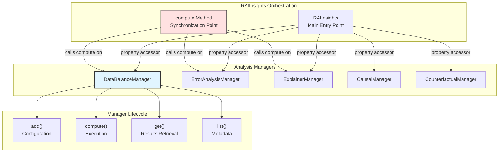
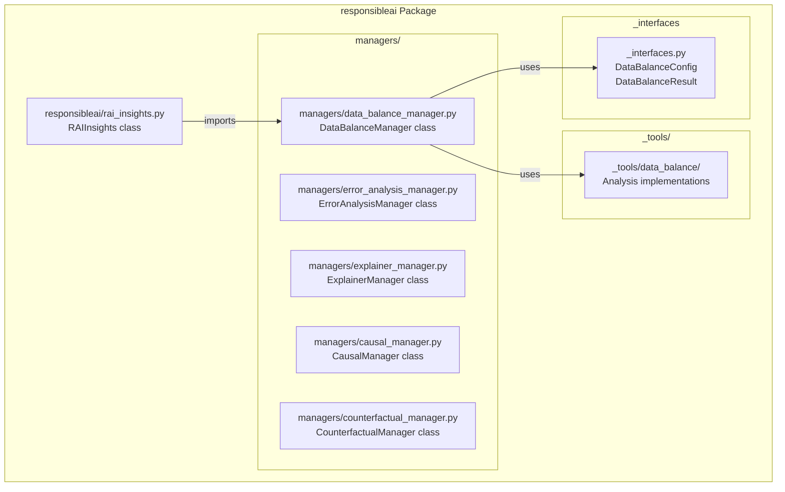
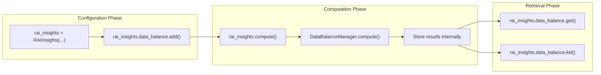
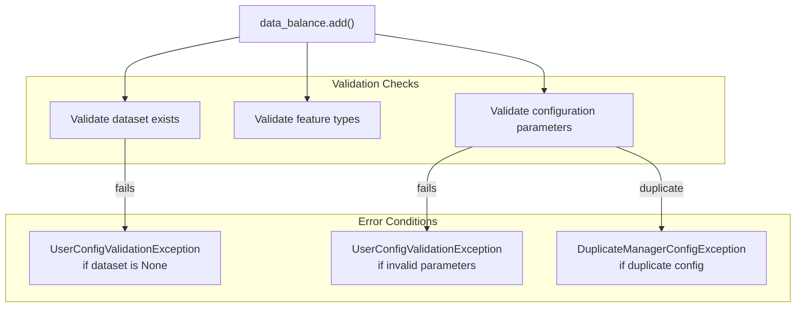
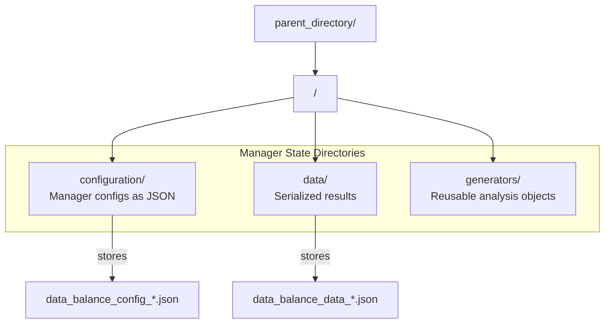
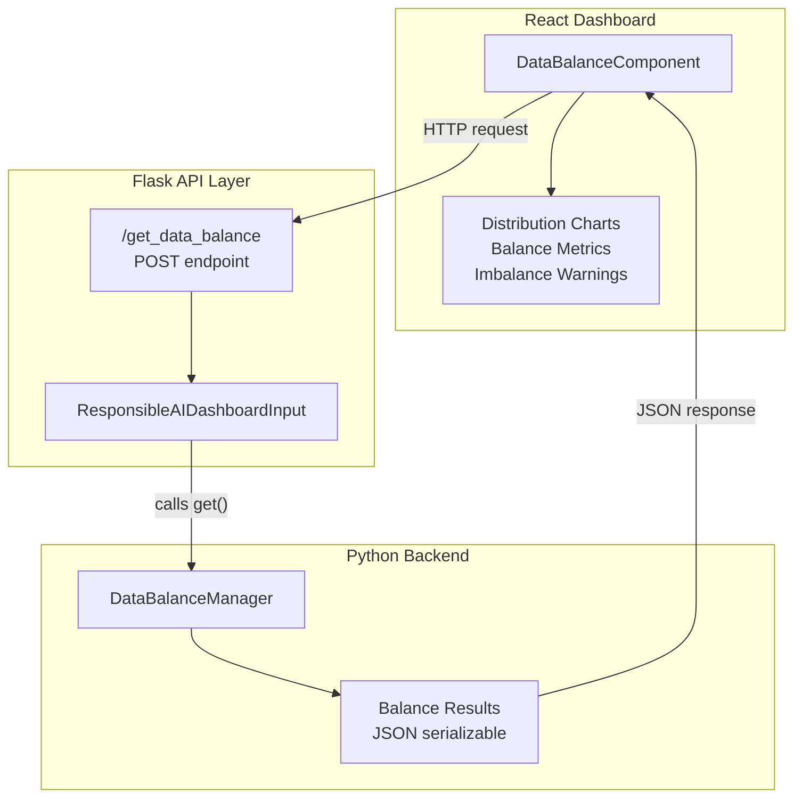

<!-- source: DeepWiki mcp.deepwiki.com · repo microsoft/responsible-ai-toolbox · extra page Data Balance Manager · fetched 2026-10-26 -->

# Data Balance Manager

<details>
<summary>Relevant source files</summary>

The following files were used as context for generating this wiki page:

- [raiwidgets/raiwidgets/interfaces.py](raiwidgets/raiwidgets/interfaces.py)
- [responsibleai/responsibleai/_tools/shared/state_directory_management.py](responsibleai/responsibleai/_tools/shared/state_directory_management.py)
- [responsibleai/responsibleai/exceptions.py](responsibleai/responsibleai/exceptions.py)
- [responsibleai/responsibleai/modelanalysis/model_analysis.py](responsibleai/responsibleai/modelanalysis/model_analysis.py)
- [responsibleai/tests/causal_manager_validator.py](responsibleai/tests/causal_manager_validator.py)
- [responsibleai/tests/counterfactual_manager_validator.py](responsibleai/tests/counterfactual_manager_validator.py)
- [responsibleai/tests/error_analysis_validator.py](responsibleai/tests/error_analysis_validator.py)
- [responsibleai/tests/explainer_manager_validator.py](responsibleai/tests/explainer_manager_validator.py)
- [responsibleai/tests/test_exceptions.py](responsibleai/tests/test_exceptions.py)

</details>


## Purpose and Scope

The Data Balance Manager is an analysis manager within the Responsible AI Toolbox that enables analysis of data distribution and balance characteristics in datasets. It helps identify potential issues such as feature imbalance, label distribution problems, and representation gaps that could impact model fairness and performance.

This document covers the architecture and integration of the Data Balance Manager within the RAIInsights framework. For information about other analysis capabilities, see:
- Error analysis: [Error Analysis Manager](#3.3.1)
- Model interpretability: [Explainer Manager](#3.3.2)
- Causal inference: [Causal Manager](#3.3.3)
- Counterfactual generation: [Counterfactual Manager](#3.3.4)

**Note**: The specific implementation files for DataBalanceManager were not included in the provided codebase snapshot. This documentation describes the manager's architectural role and expected integration patterns based on the overall system design and similar manager implementations.

## Architecture Overview

### Manager Pattern Integration

The Data Balance Manager follows the same architectural pattern as other analysis managers in the RAIInsights ecosystem. It is orchestrated by the RAIInsights class and participates in the standard manager lifecycle.



**Sources**: High-level architecture diagrams (Diagram 2, Diagram 3)

### Location in Package Structure

Based on the established package organization patterns, the Data Balance Manager would reside within the core `responsibleai` package:



**Sources**: [responsibleai/responsibleai/modelanalysis/model_analysis.py:1-176](), High-level architecture diagrams

## Manager Lifecycle

### Standard Manager Methods

Following the pattern established by other managers, the Data Balance Manager implements the standard manager interface:

| Method | Purpose | Returns |
|--------|---------|---------|
| `add()` | Configure data balance analysis parameters | None |
| `compute()` | Execute configured analyses on the dataset | None |
| `get()` | Retrieve computed data balance results | List of results |
| `list()` | Return metadata about configured analyses | Dictionary with configuration info |
| `get_data()` | Retrieve serialized results for persistence | Serialized result objects |

**Sources**: [responsibleai/tests/causal_manager_validator.py:1-261](), [responsibleai/tests/counterfactual_manager_validator.py:1-128](), [responsibleai/tests/explainer_manager_validator.py:1-69]()

### Configuration and Execution Flow

The typical usage pattern follows a two-phase approach:



**Sources**: High-level architecture diagrams (Diagram 3), [responsibleai/tests/causal_manager_validator.py:53-84]()

## Integration with RAIInsights

### Property Accessor Pattern

Following the established pattern in RAIInsights, the Data Balance Manager is accessed through a property decorator:

```python
@property
def data_balance(self) -> DataBalanceManager:
    """Get the data balance manager.
    :return: The data balance manager.
    :rtype: DataBalanceManager
    """
    return self._data_balance
```

This pattern is consistent with other managers as seen in [responsibleai/responsibleai/modelanalysis/model_analysis.py:90-120]().

**Sources**: [responsibleai/responsibleai/modelanalysis/model_analysis.py:90-120]()

### Relationship with Other Managers

The Data Balance Manager operates independently but can provide complementary insights to other analyses:

```mermaid
graph TB
    subgraph "Data Balance Analysis"
        DBM["DataBalanceManager"]
        FeatureBalance["Feature Distribution<br/>Analysis"]
        LabelBalance["Label Distribution<br/>Analysis"]
        RepGaps["Representation Gap<br/>Detection"]
    end
    
    subgraph "Complementary Managers"
        ErrorMgr["ErrorAnalysisManager<br/>Error patterns by cohort"]
        ExplainMgr["ExplainerManager<br/>Feature importance"]
        CausalMgr["CausalManager<br/>Treatment effects"]
    end
    
    DBM --> FeatureBalance
    DBM --> LabelBalance
    DBM --> RepGaps
    
    FeatureBalance -.."informs".-> ErrorMgr
    LabelBalance -.."informs".-> ErrorMgr
    RepGaps -.."informs".-> CausalMgr
    FeatureBalance -.."correlates with".-> ExplainMgr
```

**Sources**: High-level architecture diagrams (Diagram 2, Diagram 3)

## Validation and Error Handling

### Expected Validation Patterns

Based on the patterns from other managers, the Data Balance Manager likely implements validation checks:



**Sources**: [responsibleai/responsibleai/exceptions.py:1-62](), [responsibleai/tests/error_analysis_validator.py:20-30](), [responsibleai/tests/explainer_manager_validator.py:13-30]()

### Exception Hierarchy

The Data Balance Manager uses the standard exception hierarchy:

| Exception Type | Base Class | Use Case |
|---------------|------------|----------|
| `UserConfigValidationException` | `UserErrorException` | Invalid configuration parameters |
| `DuplicateManagerConfigException` | `UserErrorException` | Attempting to add duplicate analysis |
| `ConfigAndResultMismatchException` | `SystemErrorException` | Internal state inconsistency |

**Sources**: [responsibleai/responsibleai/exceptions.py:25-62](), [responsibleai/tests/test_exceptions.py:1-53]()

## Persistence and Serialization

### Directory Structure

Following the standard persistence pattern, the Data Balance Manager stores its state in subdirectories managed by DirectoryManager:



**Sources**: [responsibleai/responsibleai/_tools/shared/state_directory_management.py:1-132]()

### Save and Load Operations

The manager participates in the RAIInsights save/load mechanism:

| Operation | Directory | Content |
|-----------|-----------|---------|
| **Save Configuration** | `configuration/` | Analysis parameters, feature names |
| **Save Results** | `data/` | Computed balance metrics, distributions |
| **Save Generators** | `generators/` | Analysis objects for recomputation (if applicable) |
| **Load** | All directories | Reconstruct manager state from saved files |

**Sources**: [responsibleai/responsibleai/_tools/shared/state_directory_management.py:46-113]()

## Integration with Dashboard

### Dashboard Communication Pattern

The Data Balance Manager follows the standard Flask API integration pattern:



**Sources**: High-level architecture diagrams (Diagram 2)

### Expected Dashboard Output

Based on the manager's purpose, the dashboard would display:

- **Feature Distribution**: Histograms showing value distributions for each feature
- **Class Balance**: Bar charts showing label distribution in classification tasks
- **Representation Metrics**: Quantitative measures of data imbalance
- **Imbalance Warnings**: Alerts for features or classes with severe imbalance

## Constants and Configuration Keys

Following the pattern from other managers, expected constants would be defined in `responsibleai/_internal/constants.py`:

```python
class DataBalanceManagerKeys:
    """Keys for data balance manager configuration and results."""
    BALANCE_METRICS = 'balance_metrics'
    FEATURE_DISTRIBUTIONS = 'feature_distributions'
    LABEL_DISTRIBUTIONS = 'label_distributions'
    IMBALANCE_THRESHOLD = 'imbalance_threshold'
```

**Sources**: [responsibleai/tests/error_analysis_validator.py:8-17](), [responsibleai/tests/causal_manager_validator.py:15-16]()

## Usage Example Pattern

Based on the standard manager usage pattern, expected usage would be:

```python
# Initialize RAIInsights
rai_insights = RAIInsights(
    model=model,
    train=train_data,
    test=test_data,
    target_column='target',
    task_type='classification'
)

# Configure data balance analysis
rai_insights.data_balance.add()

# Compute all configured analyses
rai_insights.compute()

# Retrieve results
balance_results = rai_insights.data_balance.get()

# Get metadata
balance_metadata = rai_insights.data_balance.list()

# Save for later use
rai_insights.save('path/to/save')
```

**Sources**: [responsibleai/tests/causal_manager_validator.py:53-84](), [responsibleai/tests/counterfactual_manager_validator.py:56-69]()

## Testing Pattern

Following the established testing patterns, validation would include:

| Test Type | Validation |
|-----------|------------|
| **Configuration** | Verify `add()` accepts valid parameters |
| **Duplicate Detection** | Confirm duplicate configs raise `DuplicateManagerConfigException` |
| **Computation** | Ensure `compute()` produces expected results |
| **Serialization** | Verify save/load preserves manager state |
| **List Metadata** | Confirm `list()` returns correct manager type and config count |

**Sources**: [responsibleai/tests/causal_manager_validator.py:97-111](), [responsibleai/tests/counterfactual_manager_validator.py:22-31](), [responsibleai/tests/error_analysis_validator.py:20-30]()

---

