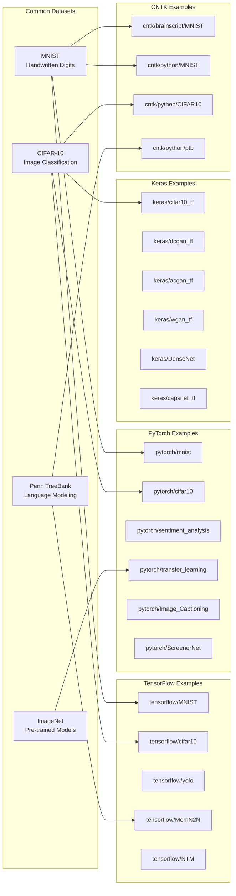
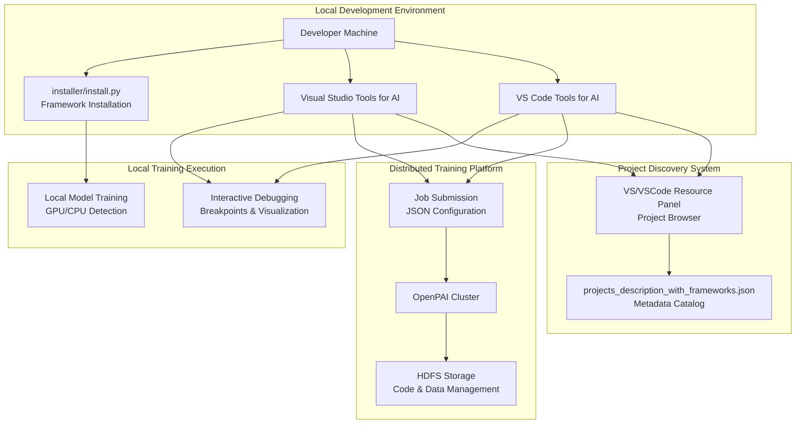

<!-- source: DeepWiki mcp.deepwiki.com · repo microsoft/samples-for-ai · page 1 Overview · fetched 2026-10-26 -->

# Overview

Relevant source files

The following files were used as context for generating this wiki page:

- [README.md](README.md)
- [docs/download_data.md](docs/download_data.md)
- [docs/local_run.md](docs/local_run.md)
- [docs/prerequisites.md](docs/prerequisites.md)
- [docs/submit_job_to_pai.md](docs/submit_job_to_pai.md)
- [examples/README.md](examples/README.md)
- [examples/projects_description.json](examples/projects_description.json)
- [examples/projects_description_with_frameworks.json](examples/projects_description_with_frameworks.json)
- [projects/StyleTransfer/StyleTransferTraining/src/README.md](projects/StyleTransfer/StyleTransferTraining/src/README.md)
- [projects/description.json](projects/description.json)
- [zh-hans/README.md](zh-hans/README.md)
- [zh-hant/README.md](zh-hant/README.md)

This document provides a comprehensive overview of the Microsoft Samples for AI repository, which serves as a deep learning samples and projects collection designed to help developers get started with AI/ML development across multiple frameworks. The repository contains classic deep learning algorithms, applications, development tools, and infrastructure for both local development and distributed training.

For detailed setup instructions, see [Installation and Environment Setup](#2.1). For framework-specific examples, see [Framework Examples](#3). For production applications, see [Specialized Projects](#4).

## Repository Architecture

The samples-for-ai repository is organized around several core systems that work together to provide a complete AI development experience:

```mermaid
graph TB
    subgraph "Core Infrastructure"
        INSTALLER["installer/install.py<br/>One-Click Framework Setup"]
        README["README.md<br/>Main Documentation"]
    end
    
    subgraph "Framework Examples"
        TF_EXAMPLES["examples/tensorflow/<br/>TensorFlow Projects"]
        PYTORCH_EXAMPLES["examples/pytorch/<br/>PyTorch Projects"] 
        KERAS_EXAMPLES["examples/keras/<br/>Keras Projects"]
        CNTK_EXAMPLES["examples/cntk/<br/>CNTK Projects"]
        OTHER_FRAMEWORKS["examples/{mxnet,caffe2,theano,chainer}/<br/>Additional Frameworks"]
    end
    
    subgraph "Project Discovery"
        PROJECT_CATALOG["examples/projects_description*.json<br/>Project Metadata"]
        LANDING_CONTENT["examples/LandingPageContent*.json<br/>UI Content"]
    end
    
    subgraph "Production Applications"
        STYLE_TRANSFER["projects/StyleTransfer/<br/>Neural Style Transfer"]
        BEAR_CLASSIFICATION["projects/BearClassificationUWPDemo/<br/>UWP Application"]
        MNIST_DEMO["projects/MnistDemo/<br/>WinForm Application"]
    end
    
    subgraph "Development Tools"
        VS_INTEGRATION["Visual Studio Tools for AI"]
        OPENPAI_INTEGRATION["OpenPAI Distributed Training"]
    end
    
    INSTALLER --> TF_EXAMPLES
    INSTALLER --> PYTORCH_EXAMPLES
    INSTALLER --> KERAS_EXAMPLES
    INSTALLER --> CNTK_EXAMPLES
    INSTALLER --> OTHER_FRAMEWORKS
    
    PROJECT_CATALOG --> TF_EXAMPLES
    PROJECT_CATALOG --> PYTORCH_EXAMPLES
    PROJECT_CATALOG --> STYLE_TRANSFER
    
    VS_INTEGRATION --> TF_EXAMPLES
    VS_INTEGRATION --> PYTORCH_EXAMPLES
    VS_INTEGRATION --> OPENPAI_INTEGRATION
    
    README --> INSTALLER
    README --> OPENPAI_INTEGRATION
```

**Sources:** [README.md:1-83](), [examples/projects_description_with_frameworks.json:1-50](), [projects/description.json:1-65]()

## Framework Examples Ecosystem

The repository provides implementations of common AI tasks across multiple deep learning frameworks, enabling comparative learning and framework evaluation:

**Sources:** [examples/projects_description_with_frameworks.json:8-130](), [examples/projects_description.json:4-243]()

## Development Workflow Integration

The repository integrates with Microsoft's AI development ecosystem to provide seamless workflows from local development to distributed training:

**Sources:** [docs/submit_job_to_pai.md:1-52](), [examples/README.md:45-66](), [docs/prerequisites.md:18-47]()

## Core Components

### One-Click Installer System
The `installer/install.py` script provides automated setup of deep learning frameworks with GPU detection and dependency management. It supports Windows, macOS, and Linux platforms and automatically configures CUDA environments.

**Key Features:**
- NVIDIA GPU detection and CUDA setup
- Multi-platform Python environment configuration  
- Framework installation: TensorFlow, PyTorch, Keras, CNTK, MXNet, Caffe2, Theano, Chainer
- User directory installation support with `--user` flag
- CUDA version selection with `--cuda80` flag

**Sources:** [README.md:28-29](), [docs/prerequisites.md:18-47](), [examples/README.md:45-66]()

### Framework Examples Collection
Organized under `examples/` directory by framework, each containing Visual Studio solution files (`.sln`) and project configurations for integrated development experience.

| Framework | Example Count | Key Projects |
|-----------|---------------|--------------|
| TensorFlow | 6+ | MNIST, CIFAR-10, YOLO, MemN2N, NTM |
| PyTorch | 6+ | MNIST, CIFAR-10, Sentiment Analysis, Transfer Learning, Image Captioning, ScreenerNet |
| Keras | 8+ | CIFAR-10, DCGAN, ACGAN, WGAN, InfoGAN, DenseNet, CapsNet |
| CNTK | 6+ | BrainScript and Python versions of MNIST, CIFAR-10, Speech Recognition |
| Other | 4+ | MXNet, Caffe2, Theano, Chainer implementations |

**Sources:** [examples/projects_description_with_frameworks.json:6-640](), [examples/README.md:5-13]()

### Project Catalog System
JSON-based metadata system for project discovery and categorization:

- `examples/projects_description_with_frameworks.json` - Comprehensive project metadata with framework organization
- `examples/projects_description.json` - Simplified project catalog
- `projects/description.json` - Production application metadata

Each entry contains hyperlinks, summaries, framework information, download links, and ownership details.

**Sources:** [examples/projects_description_with_frameworks.json:1-10](), [examples/projects_description.json:1-10](), [projects/description.json:1-10]()

### OpenPAI Integration
Distributed training support through Microsoft's OpenPAI platform with JSON job configuration files provided for each sample project.

**Configuration Format:** `framework_name.sample_name.json` files containing:
- Resource allocation specifications
- HDFS storage paths for code and data
- Container and runtime configurations
- Multi-GPU and distributed training parameters

**Sources:** [docs/submit_job_to_pai.md:1-52](), [examples/README.md:80-92]()

### Production Applications
The `projects/` directory contains deployment-ready applications demonstrating real-world AI implementations:

- **StyleTransfer** - Real-time neural style transfer with TensorFlow backend and VGG-19 feature extraction
- **BearClassificationUWPDemo** - Universal Windows Platform app using Custom Vision and Windows ML
- **MnistDemo** - WinForms application for handwritten digit recognition

**Sources:** [projects/description.json:4-63](), [projects/StyleTransfer/StyleTransferTraining/src/README.md:1-15]()

## Getting Started

To begin using the samples-for-ai repository:

1. **Environment Setup**: Use the one-click installer at [Installation and Environment Setup](#2.1)
2. **Choose Framework**: Browse framework-specific examples at [Framework Examples](#3) 
3. **Run Locally**: Follow local execution guides at [Getting Started](#2)
4. **Scale to Cloud**: Deploy to OpenPAI using [OpenPAI Integration](#5.2)
5. **Explore Applications**: Study production examples in [Specialized Projects](#4)

The repository serves as both a learning resource for AI/ML concepts and a practical toolkit for developing and deploying deep learning applications across Microsoft's AI ecosystem.

**Sources:** [README.md:26-38](), [examples/README.md:31-92]()

---

